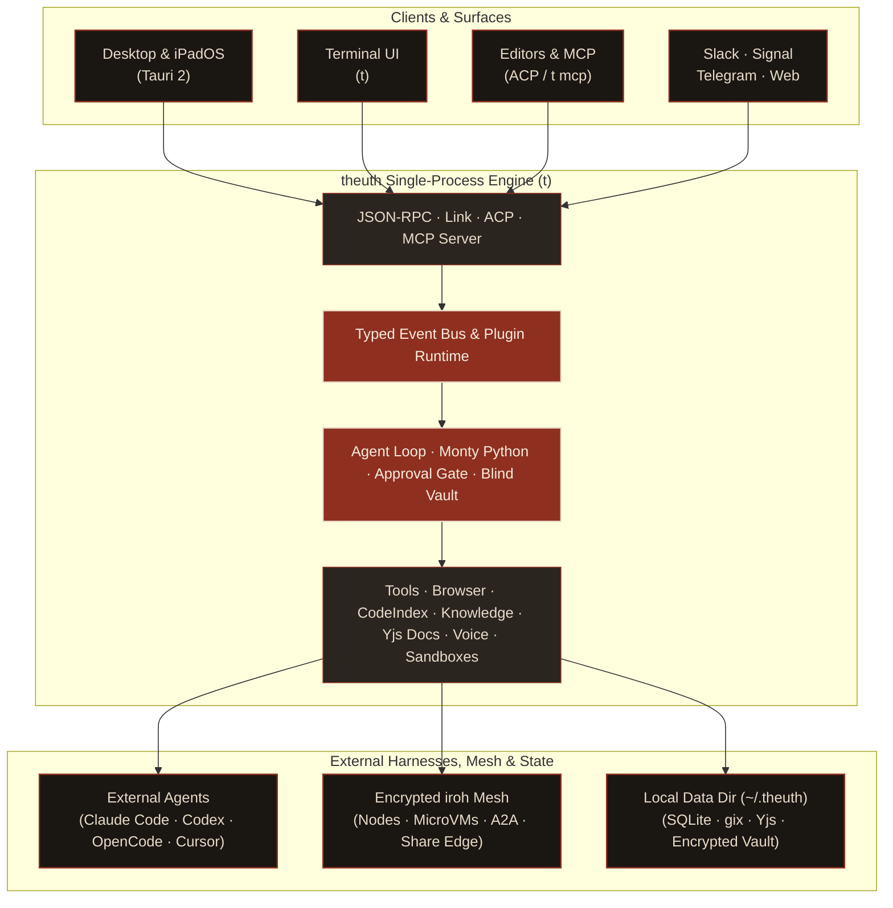

<div align="center">

<picture>
  <source media="(prefers-color-scheme: dark)" srcset="assets/brand/lockup-dark.svg">
  <source media="(prefers-color-scheme: light)" srcset="assets/brand/lockup-light.svg">
  
</picture>

<p><strong>Your agents, your machines, your keys.</strong></p>

<p>
  A single-process, local-first Rust AI harness that orchestrates models, external coding agents, tools, and machines over a typed internal bus and an encrypted peer-to-peer mesh.<br>
  Drive it from your terminal, native desktop and iPadOS apps, editors over ACP, MCP clients, Slack, Signal, or Telegram — with your sessions, knowledge, and blind secrets vault staying on hardware you control.
</p>

<p>
  <a href="https://github.com/BaseDatum/Theuth/actions/workflows/release.yml"></a>
  <a href="https://github.com/BaseDatum/Theuth/releases/latest"></a>
  <a href="rust-toolchain.toml"></a>
  <a href="LICENSE"></a>
  <a href="https://theuth.io/docs"></a>
</p>

<p>
  <a href="#install">Install</a> ·
  <a href="#why-theuth">Why theuth</a> ·
  <a href="#capabilities">Capabilities</a> ·
  <a href="#connect-from-anywhere">Surfaces</a> ·
  <a href="#architecture">Architecture</a> ·
  <a href="#build-from-source">Build</a> ·
  <a href="#documentation">Docs</a>
</p>

<br>


</div>

---

## Install

### Homebrew (macOS Apple Silicon & Linux)

```sh
brew install --cask basedatum/tap/theuth   # macOS desktop app + CLI (Apple Silicon)
brew install basedatum/tap/theuth          # CLI engine `t` (macOS Apple Silicon & Linux)
```

### Downloads & Platform Support

Every release is built and published automatically to [**GitHub Releases**](https://github.com/BaseDatum/Theuth/releases/latest) with signed binaries and silent self-updates (`t --update`).

| Platform | Architecture & Requirements | Artifacts |
| :--- | :--- | :--- |
| **macOS** | Apple Silicon (`arm64`), macOS 15+ *(Intel not supported — Apple Silicon required for MLX & microsandbox)* | [Signed & notarized `.dmg`, `.app.tar.gz`, CLI `.tar.gz`](https://github.com/BaseDatum/Theuth/releases/latest), Homebrew |
| **Linux** | `x86_64`, glibc 2.39+ | [`.AppImage`, `.deb`, `.rpm`, CLI `.tar.gz`](https://github.com/BaseDatum/Theuth/releases/latest), Homebrew |
| **Linux** | `ARM64`, glibc 2.39+ | [`.AppImage`, `.deb`, `.rpm`, CLI `.tar.gz`](https://github.com/BaseDatum/Theuth/releases/latest), Homebrew |
| **Windows** | `x86_64`, Windows 10/11 + WebView2 | [NSIS installer (`-setup.exe`), CLI `.zip`](https://github.com/BaseDatum/Theuth/releases/latest) |
| **Windows** | `ARM64`, Windows 10/11 + WebView2 | [NSIS installer (`-setup.exe`), CLI `.zip`](https://github.com/BaseDatum/Theuth/releases/latest) |

> **iOS & iPadOS:** Built with Tauri 2 and native Apple Pencil ink whiteboards — available via TestFlight or built from source (`just package-ios`).

### First Run

```sh
t --secret-set anthropic        # store a provider key in the encrypted vault (any provider works)
t                               # launch the terminal UI (initializes ~/.theuth)
t -p "summarize this repo"      # print mode: stream one reply and exit (also reads stdin)
t --headless                    # JSON-RPC daemon on ws://127.0.0.1:7777 for desktop, relay & chat
t --update                      # verify signature and self-update to the latest release
```

---

## Why theuth

- **Model-agnostic orchestrator & external coding agents** — Switch across Anthropic, OpenAI, Gemini, AWS Bedrock, Ollama, and custom OpenAI-compatible gateways, or delegate codebases directly to external coding harnesses (**Claude Code**, **Codex**, **OpenCode**, **omp** over ACP, plus **Cursor**) alongside recursive `theuth` subagents running an embedded persistent Python sandbox.
- **Leaderless encrypted mesh across your machines** — Pair laptops, workstations, remote servers, and isolated Linux microVMs over `iroh` QUIC and Noise-encrypted relays with zero open ports. Sessions, tasks, and replicated state follow you across engines, and any paired device can drive any node.
- **Blind secrets vault & unified approval gate** — Store credentials in an XChaCha20-Poly1305 vault (keyed by your OS keychain) or connect AWS Secrets Manager and Bitwarden / Vaultwarden. Agents reference secrets solely via `{{secret:NAME}}` placeholders — substituted at tool execution time and scrubbed from output, never entering model context — while every mutating or destructive call flows through one policy-enforced approval gate.
- **Local-first by default** — Everything lives under `~/.theuth`: SQLite session transcripts with compaction epochs, `gix`-versioned Markdown knowledge, Yjs-backed collaborative documents, on-device Parakeet TDT / Nemotron STT and Kyutai Pocket TTS, and a local `candle` decision model for fast bulk classification and your personal approval double.

---

## Capabilities

| Domain | Included in the Single Engine |
| :--- | :--- |
| **Workspace & Surfaces** | Ratatui TUI, native Tauri 2 Desktop & iPadOS apps, live interactive **OpenUI Lang** apps, side-by-side **Web / PTY / File / Diff / Note** tiles, **Whiteboards** with Apple Pencil ink, **Notebooks** with source indexing, **Code-Anchored Boards**, one-press **User Cells**, and compiled **Typst PDFs** |
| **Delegation & Automation** | **Standing Agents** with charters & budgets, **Kanban Tasks** with dependency graphs, cron/interval **Schedules** & `until` **Loops**, zero-token Python **Watcher** sensors, measured git-worktree **Autoresearch** studies, nightly **Dreaming** memory consolidation, and the **Owner's Double** |
| **Local AI & Capture** | On-device **Parakeet TDT** (ONNX / MLX) & **Nemotron** streaming dictation, **Pocket TTS** read-aloud & **Live Talk**, bot-free macOS **Meetings** with live briefs, embedded headless **Browser** (`obscura`) with cookie import & JSON **Route Learning**, site **Crawler** (`firecrawl-native`), and OS Accessibility **Desktop Control** |
| **Connectivity & Isolation** | Encrypted **`iroh` Mesh**, **Sandboxes** (microsandbox Linux desktop VMs, Docker, SSH nodes), owner-approved **Contacts** & **A2A 1.0** remote peer exports, and SNI-spliced **Public HTTPS Sharing** (`theuth-share-edge`) |
| **Extensibility** | Hot-reloaded **MCP** servers (`~/.theuth/mcp/`), **`t mcp`** server mode for external MCP clients, **External Plugins** with SDKs in 6 languages (`python`, `ts`, `go`, `rust`, `ruby`, `sh`), and reusable Markdown **Skills** |

---

## Connect From Anywhere

Every client attaches to the same engine over typed JSON-RPC, keeping sessions, approvals, and artifacts synchronized in real time.

| Surface | Entry Point | What You Get |
| :--- | :--- | :--- |
| **Desktop & iPadOS** | `theuth.app` | Multi-pane workspace, whiteboards, live browser / PTY / file / diff tiles, voice, and mesh switcher |
| **Terminal** | `t` / `t -p "…"` | Full-screen TUI with streaming Markdown, inline diffs, approvals, PTY takeover, and pipeable print mode |
| **Editors (ACP)** | `t --acp` | Agent Client Protocol over stdio for Zed and compatible editors |
| **MCP Clients** | `t mcp` | Expose theuth's tools, skills, and data catalogue over stdio / HTTP to any MCP client |
| **Web & Phone Relay** | `t --link` · [app.theuth.io](https://app.theuth.io) | Noise-encrypted QR / URL-fragment pairing; stateless relay never sees keys or messages |
| **Slack** | `t --slack-setup` | Socket Mode bot with Block Kit approvals, threaded subagent activity, and out-of-band file handoff |
| **Signal** | `t --link-signal` | Linked-device bridge for private chats, approvals, voice notes, and file delivery |
| **Telegram** | `t --telegram-setup` | Long-polling bot with deep-link pairing, command menus, and threaded approvals |

---

## Architecture

`theuth` runs as a single Rust process composed of in-process plugin crates wired over a typed message bus (`runtime` + `wire`), with every frontend speaking typed JSON-RPC (`rpc` / `rpc-core`).



### Workspace Map (70 Crates)

| Domain | Crates (`crates/*`) |
| :--- | :--- |
| **Engine & RPC (11)** | `theuth`, `runtime`, `wire`, `rpc`, `rpc-core`, `rpc-core-macros`, `rpc-compose`, `platform`, `models`, `oauth`, `update` |
| **Agent, Delegation & Automation (9)** | `agent`, `acp`, `cursor`, `roster`, `tasks`, `schedule`, `autoresearch`, `dreaming`, `evalcore` |
| **Tools, Code & Local AI (13)** | `tools`, `codeindex`, `cells`, `computer`, `decision`, `double`, `voice`, `voice-mlx`, `talk`, `meeting`, `js-runtime`, `app-parser-stub`, `plugins` |
| **Documents, Knowledge & Search (7)** | `document`, `knowledge`, `artifact`, `app`, `surface`, `markdown`, `search` |
| **Browser, Web & Scraping (7)** | `browser`, `web`, `webprofile`, `routes`, `scrape`, `firecrawl-native`, `search-providers` |
| **Secrets & Security (4)** | `secrets`, `secrets-aws`, `secrets-bitwarden`, `aws-profiles` |
| **Mesh, Sandboxes, Relay & Sharing (11)** | `mesh`, `nodes`, `replica`, `sessionsync`, `sandbox`, `link`, `relay`, `a2a`, `share`, `share-edge`, `share-proto` |
| **Clients, Channels & MCP (8)** | `tui`, `desktop`, `tauri-plugin-ink`, `mcp-server`, `slack`, `signal`, `telegram`, `chat-common` |

Deep dives: [`docs/design/00-architecture.md`](docs/design/00-architecture.md) · [`docs/plugins.md`](docs/plugins.md) · [`sdk/README.md`](sdk/README.md)

---

## Build from Source

### Prerequisites

- **Rust** stable toolchain ([`rust-toolchain.toml`](rust-toolchain.toml), Edition 2024) and [`just`](https://github.com/casey/just)
- **Native build tools** for the embedded browser's BoringSSL: `cmake`, `clang` / `libclang`, `llvm-objcopy`, `llvm-nm` (`brew install cmake llvm` on macOS; `apt install cmake clang libclang-dev` on Debian/Ubuntu)
- **Network** on the first build to fetch the prebuilt V8 archive (or set `RUSTY_V8_ARCHIVE` to build offline)
- **`bun`** (`brew install oven-sh/bun/bun`) — required only for the desktop UI and rebuilding committed JS bundles (`just apps-bundle`, `just documents-bundle`); installed `t` binaries need neither Node nor Bun at runtime

### Common `just` Recipes

```sh
just setup                 # install the pinned rustup toolchain
just run                   # build and launch the terminal UI
just check                 # workspace check + committed JS bundle freshness checks
just test                  # run workspace tests
just install               # install release `t` + compatibility stub into ~/.cargo/bin
just desktop               # launch the Tauri + Vite desktop app in dev mode
just package-macos         # build macOS .app + .dmg (Apple Silicon)
just package-linux         # build Linux .AppImage, .deb, and .rpm
just package-windows       # build Windows NSIS installer
just package-ios           # build signed iOS / iPadOS IPA for TestFlight
just relay                 # run a local theuth-relay on 127.0.0.1:8787
```

<details>
<summary><strong>macOS Privacy Permissions</strong> — desktop control &amp; meetings</summary>

`computer_*` desktop control needs **Screen Recording** and **Accessibility** granted in **System Settings › Privacy & Security** to the app running theuth (your terminal — Ghostty, iTerm, Terminal — or `theuth.app`). Screen Recording takes effect only after restarting that app; Accessibility applies immediately. Run `/computer` inside theuth to check granted permissions.

</details>

<details>
<summary><strong>Self-Hosting the Relay &amp; Share Edge</strong> — zero-knowledge relay &amp; public HTTPS sharing</summary>

**Link Relay** (`theuth-relay`, stateless Noise tunnel for phones, browsers, and shared docs):

```sh
just web-build                                                              # build browser UI → crates/desktop/ui/dist
cargo run -p relay -- --listen 0.0.0.0:8787 --web crates/desktop/ui/dist    # plain; put TLS in front or pass --tls CERT KEY
RELAY_HOST=relay.example.com docker compose -f deploy/relay/compose.yaml up -d
# then set in ~/.theuth/config.yaml:
#   link:
#     relay: wss://relay.example.com
```

**Public Share Edge** (`theuth-share-edge`, SNI-spliced TLS passthrough over `iroh` — never decrypts traffic or holds certificates):

```sh
cp deploy/share-edge/config.example.yaml deploy/share-edge/config.yaml      # configure domain, iroh.public_addrs, DNS
docker compose -f deploy/share-edge/compose.yaml up -d
```

See [`deploy/relay/README.md`](deploy/relay/README.md) and [`deploy/share-edge/README.md`](deploy/share-edge/README.md) for Kubernetes manifests, systemd units, and TLS notes.

</details>

<details>
<summary><strong>A2A Peer Configuration (<code>~/.theuth/a2a/peers.yaml</code>)</strong> — connecting remote A2A 1.0 agents</summary>

Agent-to-agent communication is **off by default**. Enable local communication with `/communication on always` (or `agent.communication: true` in `config.yaml`), then enable `a2a.enabled: true` and define peers and exports in `~/.theuth/a2a/peers.yaml`:

```yaml
peers:
  lab:
    card_url: https://lab.example/agents/research/.well-known/agent-card.json
    outbound_secret: a2a_lab_outbound   # vault secret names (`t --secret-set …`), never raw values
    inbound_secret: a2a_lab_inbound
    sessions: ["<local-root-uuid>"]     # local roots whose enabled trees may send to `lab`
    exports: [research]                 # exports `lab` may call
exports:
  research:
    session: "<local-session-uuid>"     # that exact session, not its tree
    name: Research
    description: Answer explicitly submitted research requests.
```

Run `/a2a reload` to atomically validate and install changes (`/a2a` shows live status). The listener binds loopback only (`a2a.listen`); put an HTTPS reverse proxy in front of it and set `a2a.public_url` before exposing it beyond same-machine development. Details: [`docs/design/50-agent-communication.md`](docs/design/50-agent-communication.md).

</details>

---

## Documentation

Full guides and reference documentation live at [**theuth.io/docs**](https://theuth.io/docs). Key in-repo references:

| Guide | Path |
| :--- | :--- |
| **Architecture & Event Bus** | [`docs/design/00-architecture.md`](docs/design/00-architecture.md) |
| **In-Process & External Plugins** | [`docs/plugins.md`](docs/plugins.md) · [`docs/design/216-external-plugins.md`](docs/design/216-external-plugins.md) · [`sdk/README.md`](sdk/README.md) |
| **Skills & Owner's Double** | [`docs/skills.md`](docs/skills.md) · [`docs/double.md`](docs/double.md) |
| **Secrets Vault & External Managers** | [`docs/design/37-secrets.md`](docs/design/37-secrets.md) · [`docs/design/221-external-secrets.md`](docs/design/221-external-secrets.md) |
| **Encrypted Link, Nodes & Sandboxes** | [`docs/design/31-link.md`](docs/design/31-link.md) · [`docs/design/32-nodes.md`](docs/design/32-nodes.md) · [`docs/design/79-sandbox-vm.md`](docs/design/79-sandbox-vm.md) |
| **Agent Communication, Autoresearch & Sharing** | [`docs/design/50-agent-communication.md`](docs/design/50-agent-communication.md) · [`docs/design/140-autoresearch.md`](docs/design/140-autoresearch.md) · [`docs/design/210-public-share.md`](docs/design/210-public-share.md) |

---

## License

- **Source code:** Licensed under the GNU General Public License, version 3 or later (**`GPL-3.0-or-later`**) — see [`LICENSE`](LICENSE).
- **Distributed binaries & Bitwarden SDK:** Released binaries enable the default `bitwarden` Cargo feature, linking [`bitwarden/sdk-internal`](https://github.com/bitwarden/sdk-internal) under its **`GPL-3.0`** option only, which makes distributed binaries works covered by **`GPL-3.0`** as a whole — see [`NOTICE`](NOTICE). Building from source with `--no-default-features` omits the Bitwarden SDK.
- **Third-party notices:** Complete dependency licenses are listed in [`THIRD-PARTY-NOTICES`](THIRD-PARTY-NOTICES).
