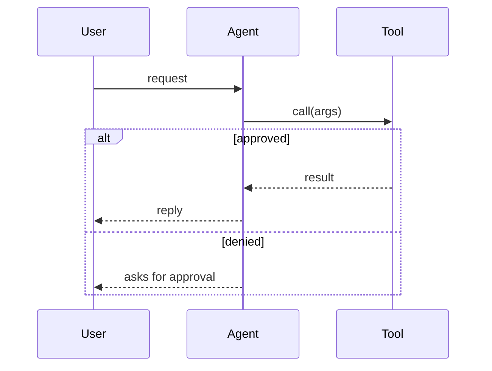
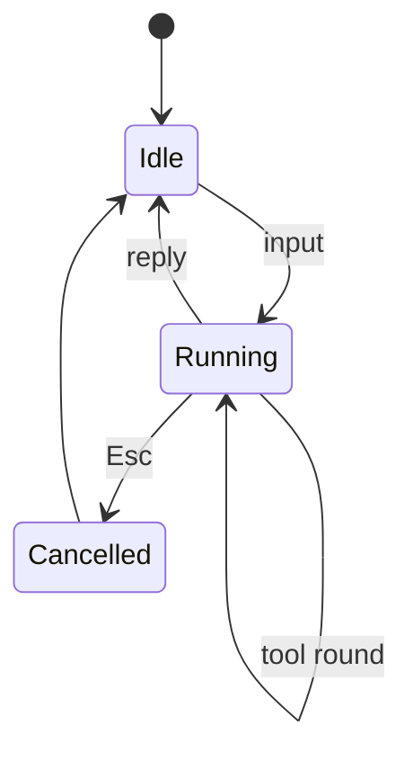

# Visualize: show first, then tell

A picture is read in one glance; the same content as prose is read in ten.
When the thing you are explaining has a shape, give it the shape. Default to
showing; words are for what a picture cannot carry.

## Choose the block

| The answer is… | Draw | Not |
|---|---|---|
| components, dependencies, data flow, a pipeline, a call graph | `json-render` `Graph` (`direction: "TB"` for a hierarchy; a state per node for health/progress) | a bullet list of arrows, or a mermaid flowchart |
| who calls whom in what order | `sequenceDiagram` | numbered prose steps |
| a lifecycle, modes, retries, transitions | `stateDiagram-v2` | "when X it becomes Y, unless…" |
| schema, types, relationships | `erDiagram` or `classDiagram` | field lists |
| a how-to or an explanation in steps | `openui` `Steps` | "first… then… finally" |
| options with trade-offs, alternatives | `openui` `Tabs` (one per option), or `json-render` `Table` on shared criteria | three paragraphs |
| a comparison, before/after, a matrix | `json-render` `Table` (`Badge` for verdict cells) | "A vs B" prose |
| status of work, checks, tests, a rollout | `MetricGrid` + `Checklist` (or `Progress`) | "we have done A and B; C is pending" |
| what happened when: incident, history, plan | `Timeline` (state per item) | headers + bullets |
| numbers, counts, durations, sizes | `MetricGrid` or `Bars`; `openui` `BarChart` / `LineChart` for a series | numbers buried in sentences |
| a warning, a blocker, the one thing to act on | `openui` `Callout` or `json-render` `Alert` | a bold sentence in the middle of a paragraph |
| facts about one thing (a config, a host, a PR) | `json-render` `KeyValueList` | a colon-separated list |
| a schedule, a chronology, a topic map | mermaid `gantt`, `timeline`, `mindmap` | dated bullets |

Boxes and arrows — architecture, dependencies, data flow, a pipeline — are a `Graph` in a
json-render block; it draws on every surface and an app can highlight it. Mermaid stays for
sequence, state, class and ER diagrams, gantt, timeline and mindmap, and for anything that
needs mermaid's own syntax.

## Shapes for common replies

- **Finished work / a subagent's result:** one sentence on the outcome → `MetricGrid` (files, tests, cost/time) + `Checklist` of what was done and verified → a short prose line per caveat or open item.
- **Investigation / root cause:** one-sentence verdict → `Graph` or `sequenceDiagram` marking where it breaks (`state: "error"`) → `Timeline` if timing matters → prose for evidence you must quote exactly.
- **Plan or proposal:** `Steps` or `Timeline` → `Table` of risks/choices → the question for the user in words.
- **"How does X work":** `Graph` or `sequenceDiagram` first, then prose only for what the arrows don't say.
- **Status check / "how's it going":** `MetricGrid` + `Checklist`/`Progress`; prose only for what changed or is stuck.

Do not draw: one fact; code or commands; anything the user will copy; a
diagram of the diagram you are about to show. In a voice-note reply, draw
nothing. Never describe the picture in prose — one sentence of takeaway above
it, then the block.

## Mermaid rules that avoid errors
- Quote labels that contain `(`, `)`, `[`, `]`, `{`, `}`, `:` or `|`: `A["fetch(url)"]`.
- Node ids are bare words; `end` is reserved — write `End` or `finish`.
- Edge labels: `A -->|label| B` or `A -- label --> B`, no spaces inside `|…|` delimiters.
- One diagram, one direction; ≤ 12 nodes; split otherwise.
- `subgraph name … end` for grouping; `%%` for comments; no HTML in labels.

## json-render rules that avoid errors
- Exactly `{ "root": "<id>", "elements": { … } }`; nothing else at the top.
- Every id in any `children` list is a key of `elements`; each element appears in at most one `children`.
- `type` is one of the catalog names below, spelled exactly; `props` match its schema; unknown props are errors.
- Only `Card`, `Stack`, `Grid`, `Tabs` and `Accordion` take `children`; `Tabs.labels` and `Accordion.titles` have one entry per child.
- Strict JSON: double quotes, no trailing commas, no comments, no `True`/`None`.
- Prefer flat: a `Card` with a `Table` beats nested `Stack`s. ≤ 256 elements.
- `Graph`: every `edges[].from`/`to` and `nodes[].group` names an existing `nodes[].id` / `groups[].id`; ids unique; ≤ 120 nodes, ≤ 240 edges, ≤ 12 groups; labels ≤ 80 characters. `from == to` is a self-loop.

## Catalog
<!-- generated from crates/surface: names, props, one example each -->
Each entry is one element of `elements`; `?` marks an optional prop.

{{catalog}}

## Worked examples
### Architecture answer
Takeaway sentence, then:
```json-render
{ "root": "g", "elements": {
  "g": {"type":"Graph","props":{
    "direction":"LR",
    "groups":[{"id":"clients","label":"Clients"},{"id":"core","label":"Core"}],
    "nodes":[
      {"id":"tui","label":"TUI","kind":"actor","group":"clients"},
      {"id":"desktop","label":"Desktop","kind":"actor","group":"clients"},
      {"id":"rpc","label":"RPC","kind":"rounded","group":"core"},
      {"id":"agent","label":"Agent","group":"core","state":"active"},
      {"id":"tools","label":"Tools","group":"core"},
      {"id":"store","label":"sessions.sqlite","kind":"cylinder"}],
    "edges":[
      {"from":"tui","to":"agent","label":"UserInput"},
      {"from":"desktop","to":"rpc","label":"ws RPC"},
      {"from":"rpc","to":"agent"},
      {"from":"agent","to":"tools"},
      {"from":"agent","to":"store","style":"dashed"}]}} } }
```
### Status board
```json-render
{ "root": "c", "elements": {
  "c": {"type":"Card","props":{"title":"Rollout · eu-west"},"children":["p","l"]},
  "p": {"type":"Progress","props":{"value":7,"max":12,"label":"hosts migrated"}},
  "l": {"type":"Checklist","props":{"items":[
    {"text":"schema migration","done":true},
    {"text":"canary 5%","done":true},
    {"text":"full traffic","done":false}]}} } }
```
### Comparison
```json-render
{ "root": "t", "elements": {
  "t": {"type":"Table","props":{
    "columns":["", "SQLite", "Postgres", "DynamoDB"],
    "rows":[
      ["Setup", "none", "a server", "an account"],
      ["Concurrency", "one writer", "many", "many"],
      ["Query power", "SQL", "SQL + extensions", "key/value"],
      ["Fits here", "yes", "later", "no"]]}} } }
```
### Sequence

### Lifecycle

### Metrics
```json-render
{ "root": "m", "elements": {
  "m": {"type":"MetricGrid","props":{"items":[
    {"label":"Requests / s","value":"1 240","trend":"up","delta":"+12%"},
    {"label":"Error rate","value":"0.4%","trend":"down","delta":"-0.2 pt"},
    {"label":"p99","value":"180 ms","trend":"flat"},
    {"label":"Hosts","value":"12"}]}} } }
```
