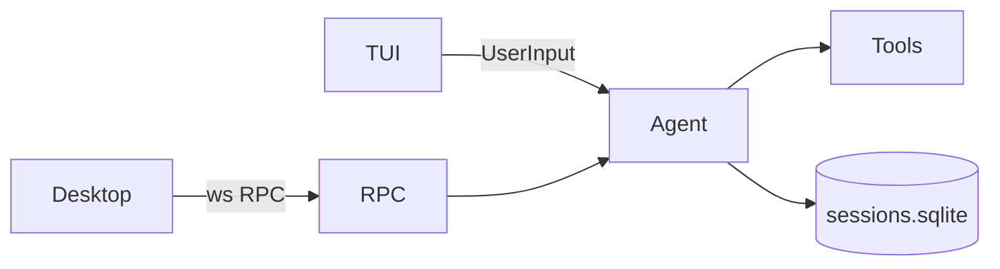
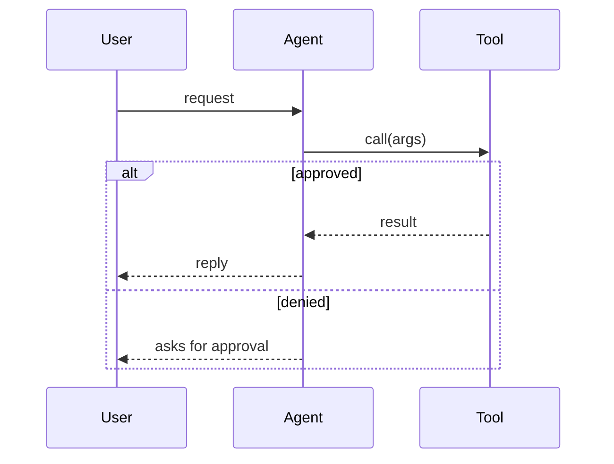
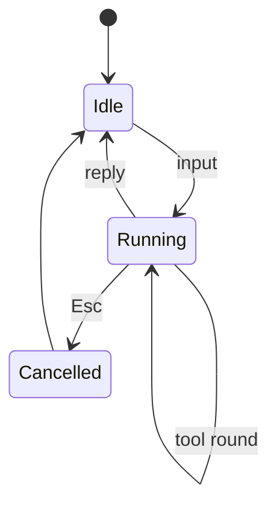

# Visualize: show, don't tell

A picture is read in one glance; the same content as prose is read in ten.
When the thing you are explaining has a shape, give it the shape.

## Choose the block

| The answer is… | Draw | Not |
|---|---|---|
| components and what talks to what | `flowchart LR` (TD if it is a hierarchy) | a bullet list of arrows |
| a request/response order across parties | `sequenceDiagram` | numbered prose steps |
| a lifecycle, modes, transitions | `stateDiagram-v2` | "when X it becomes Y, unless…" |
| data model / relationships | `erDiagram` or `classDiagram` | field lists |
| options compared on criteria | `json-render` `Table` | three paragraphs |
| where a job/rollout/checklist stands | `Checklist`, `Timeline`, `Progress` | "we have done A and B; C is pending" |
| numbers that matter | `MetricGrid` or `Bars` | numbers buried in sentences |
| a plan with phases | `Timeline` (state per item) | headers + bullets |

Do not draw: one fact; two items; code or commands; anything the user will
copy; a diagram of the diagram you are about to show. Never describe the
picture in prose — one sentence of takeaway above it, then the block.

## Mermaid rules that avoid errors
- Quote labels that contain `(`, `)`, `[`, `]`, `{`, `}`, `:` or `|`: `A["fetch(url)"]`.
- Node ids are bare words; `end` is reserved — write `End` or `finish`.
- Edge labels: `A -->|label| B` or `A -- label --> B`, no spaces inside `|…|` delimiters.
- One diagram, one direction; ≤ 12 nodes; split otherwise.
- `subgraph name … end` for grouping; `%%` for comments; no HTML in labels.

## json-render rules that avoid errors
- Exactly `{ "root": "<id>", "elements": { … } }`; nothing else at the top.
- Every id in any `children` list is a key of `elements`; each element appears in at most one `children`.
- `type` is one of the catalog names below, spelled exactly; `props` match its schema; unknown props are errors.
- Only `Card`, `Stack`, `Grid`, `Tabs` and `Accordion` take `children`; `Tabs.labels` and `Accordion.titles` have one entry per child.
- Strict JSON: double quotes, no trailing commas, no comments, no `True`/`None`.
- Prefer flat: a `Card` with a `Table` beats nested `Stack`s. ≤ 256 elements.

## Catalog
<!-- generated from crates/surface: names, props, one example each -->
Each entry is one element of `elements`; `?` marks an optional prop.

{{catalog}}

## Worked examples
### Architecture answer
Takeaway sentence, then:

### Status board
```json-render
{ "root": "c", "elements": {
  "c": {"type":"Card","props":{"title":"Rollout · eu-west"},"children":["p","l"]},
  "p": {"type":"Progress","props":{"value":7,"max":12,"label":"hosts migrated"}},
  "l": {"type":"Checklist","props":{"items":[
    {"text":"schema migration","done":true},
    {"text":"canary 5%","done":true},
    {"text":"full traffic","done":false}]}} } }
```
### Comparison
```json-render
{ "root": "t", "elements": {
  "t": {"type":"Table","props":{
    "columns":["", "SQLite", "Postgres", "DynamoDB"],
    "rows":[
      ["Setup", "none", "a server", "an account"],
      ["Concurrency", "one writer", "many", "many"],
      ["Query power", "SQL", "SQL + extensions", "key/value"],
      ["Fits here", "yes", "later", "no"]]}} } }
```
### Sequence

### Lifecycle

### Metrics
```json-render
{ "root": "m", "elements": {
  "m": {"type":"MetricGrid","props":{"items":[
    {"label":"Requests / s","value":"1 240","trend":"up","delta":"+12%"},
    {"label":"Error rate","value":"0.4%","trend":"down","delta":"-0.2 pt"},
    {"label":"p99","value":"180 ms","trend":"flat"},
    {"label":"Hosts","value":"12"}]}} } }
```
