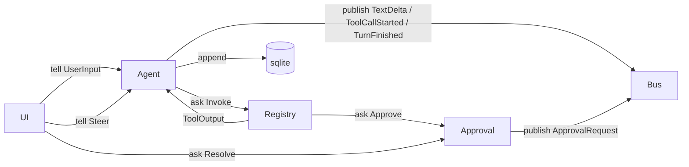

# Architecture: event bus + plugins

Status: draft v0 · 2026-09-11 (v0 text 2026-09-09; additions past v0 scope are
marked "added in NN")

A single-process Rust harness that does things for the user. Plugins are
in-process crates that talk to each other only through a typed message bus.
Any frontend (terminal, desktop app, editors over ACP) attaches over JSON-RPC.

Decisions below are final unless a spike in §9 falsifies them. Every decision
names the alternative it beat and why.

## 1. Non-negotiables

1. **No branding.** Crates, modules, types, config keys are named by function.
   The only product name is the binary `wth`.
2. **No reinvented wheels.** Off-the-shelf library first; we write glue. A
   custom implementation needs a written reason in this doc.
3. **Patch dependencies when needed, don't wait on upstream.** Patches live
   in-repo via `[patch.crates-io]` with the diff and reason recorded; drop
   them when upstream catches up.
4. **No god-wiring.** The binary holds a `Vec<Box<dyn Plugin>>` and nothing
   else. Plugins register themselves on the bus. (jarvis: `jarvisd` imported
   every subsystem and threaded handles between them.)
5. **No central event enum, no protocol dumping ground.** Each plugin owns its
   message types. The shared crate holds only the plugin trait and the handful
   of cross-plugin contract types listed in §4, with a hard size ceiling.
   (jarvis: `types.rs` 129 KB, `rpc.rs` 197 KB, one `Event` enum.)
6. **A subsystem earns a crate only when the current phase needs it.**
7. **Permissions are one contract type from day one**, not a subsystem that
   accretes. (jarvis: tiers, approvals, kill switch, safe mode grew ad hoc.)
8. **Not a coding agent.** The tool set is what an assistant needs to act on
   the user's machine: shell, files (read, write, list, `grep`, `edit`),
   MCP, python, and whatever plugins register. We do not ship coding-specific
   natives (LSP, notebooks, git, diff review): those are a use of the
   harness, not a product line (12 §10). oh-my-pi
   is inspiration for loop shape, tool ergonomics, sessions, steering,
   subagents, skills — not for its tool set. Providers may be whoever mints
   the token; a provider-required identity line (05 §2.3) is not product
   branding and is not shown for key auth.

## 2. Process model

One process. `wth` runs the bus, the agent, the tools, and the terminal UI
in-process. The RPC server is a plugin; enabling it turns the same binary into
a headless daemon that a Tauri app or a second terminal attaches to.

Rejected: daemon + thin clients from day one (jarvis). Forces every UI
interaction through serialization before there is a second UI.

**How a GUI starts the daemon.** A Tauri `.app` launched from Finder has
launchd's environment, not the shell's. It opens a pty and runs
`$SHELL -l -i -c 'exec wth --headless'` on it - a terminal for one command,
no window - so the daemon is exactly the process a terminal would have
produced. Design doc 18; the bundle around it (sidecar, signing, tray) is
25 §5. **How a server starts it.** `wth --install-service` writes a launchd
LaunchAgent or a systemd user unit whose command is the same
`$SHELL -l -i -c 'exec wth --headless'` without the pty (the journal /
`logs/service.log` is the transcript), starts it, and pairs the box to the
user's main harness as a node; 32 §5.1. How any of them stays current: 39
(added in 39, 2026-09-17).

## 3. Message bus: kameo

Library: `kameo` 0.22 + `kameo_actors` 0.8 (`MessageBus`, `PubSub`, `Broker`).

Why kameo over the field:
- **Typed request/response and pub/sub in one primitive.** `ActorRef::ask`
  gives correlated typed replies; `kameo_actors::MessageBus` routes by Rust
  type (`Register(actor.recipient::<T>())`, `Publish(T)`). This is exactly
  "one Rust type per event, subscribe by type" without writing a bus.
- **Bounded mailboxes + explicit `DeliveryStrategy`** (`Guaranteed`,
  `BestEffort`, `TimedDelivery`, `Spawned`, `SpawnedWithTimeout`). jarvis's
  `tokio::broadcast` silently dropped on lag; here the policy is chosen per
  publish site and lag is observable.
- **Supervision and panic isolation** for free: a plugin actor panicking does
  not take down the loop.
- Optional `remote` (libp2p) feature exists; we do not enable it. Frontends
  use JSON-RPC (§7), not remote actors.

Rejected:
- `ractor` 0.16: mature (Meta), but messages are one enum per actor, so
  type-routed pub/sub (`pg`) needs a shared enum or downcasting — the thing
  we are avoiding.
- `actix` 0.13: system-runtime coupling, dated async story.
- `tokio::sync::broadcast` per type in a `HashMap<TypeId, _>`: is a custom bus.
- `messagebus`, `busrt`, `postage`: low maintenance or wrong shape.

Vocabulary (kameo terms, no wrappers):
- **Event**: a `Clone + Send + 'static` struct published via `MessageBus`.
  Zero or more subscribers. Fire-and-forget.
- **Command**: `actor_ref.ask(Msg)` to a specific actor. Exactly one handler,
  typed reply. Actors are found through the kameo registry by name:
  `actor_ref.register("tools")?` / `ActorRef::<Tools>::lookup("tools")?`.
  Sync, process-global, typed (wrong type → `BadActorType`), duplicate name →
  error, name freed on actor stop. Never enable kameo's `remote` feature: it
  replaces this API with an async libp2p one (features unify across the graph).
- **Wire-visible** types additionally derive `serde::{Serialize, Deserialize}`
  and `schemars::JsonSchema`. Only these cross the RPC boundary.

Delivery: `Guaranteed` on the one shared `MessageBus`, and every subscriber
actor uses an **unbounded mailbox** (`spawn_with_mailbox(.., mailbox::unbounded())`).
Spike 2 showed why the obvious alternatives fail: `Guaranteed` with bounded
subscribers head-of-line-blocks the whole bus on the slowest subscriber;
`BestEffort` drops silently with no signal to anyone; `Spawned` never blocks
but gives no ordering across messages to the same subscriber (garbles
`TextDelta` streams). Unbounded + Guaranteed = ordered, lossless, non-blocking;
the ceiling is memory on a subscriber that stops draining, which is a bug we
want loud, not hidden. Payloads are cloned once per subscriber, so deltas
carry `Arc<str>`; non-`Clone` payloads are published as `Arc<T>`.

## 4. Plugin system

A plugin is a workspace crate exporting one type that implements the trait
below. How to design, build and wire one: `../plugins.md`.

```rust
// crate: runtime
pub trait Plugin: Send {
    fn name(&self) -> &'static str;
    /// Spawn actors, register recipients on the bus, register named actors.
    async fn start(self: Box<Self>, rt: &Runtime) -> anyhow::Result<()>;
}

pub struct Runtime {
    pub bus: ActorRef<MessageBus>,   // kameo_actors, Guaranteed
    pub config: figment::Figment,    // §9; plugins call rt.section("name")
    pub data_dir: PathBuf,
    pub shutdown: CancellationToken, // any plugin may end the process
}
// helpers: rt.publish(event), rt.subscribe::<A, T>(&actor), subscriber_mailbox()
```

`wth/main.rs` is, in full: build `Runtime`, `for p in plugins { p.start(&rt).await? }`,
wait for shutdown. Plugin order is the vector order; a plugin needing another
looks it up by name at first use. A plugin may wait for a named actor at
start (`Runtime::lookup_when`, 12 §2); it must not assume vector order.

Shared crate `runtime` contains exactly `Plugin`, `Runtime` (+ the three
helpers above), `SessionId`, `TurnId`. Nothing else. The tool and approval
contracts live in `tools`; the agent's commands and its `AgentEvent` live in
`agent`. Plugins depend on each other's crates for those types along the
`runtime ← tools ← secrets ← knowledge ← agent ← link ← {signal, slack, nodes, schedule, artifact, update} ← rpc ← tui ← wth`
(`knowledge` joins the chain in 12 §9; `secrets` in 37 §0.10 — `web`,
`search-providers`, `agent`, `slack`, `rpc`, `signal` depend on it; `update`
in 39: depends on `agent` only, `rpc` forwards its `UpdateReady`). This keeps the shared crate under
its 400-line ceiling and puts each contract next to the code that enforces
it. (Earlier draft put the tool contract in `runtime`; dropped once the
agent needed `tools` anyway for the registry actor type.)

Events: a plugin may publish one struct per event or one `#[serde(tag =
"type")]` enum per event *stream* — `agent::AgentEvent` is the latter because
every UI consumes the whole stream with one subscription and one `match`.
Both are the owning plugin's types; the rule being enforced is "no shared
enum edited by every plugin", not "no enums".

### Tool contract (oh-my-pi ergonomics)

```rust
pub trait Tool: Send + Sync + 'static {
    const NAME: &'static str;
    const RISK: Risk;                      // ReadOnly | Mutating | Destructive
    type Args: DeserializeOwned + JsonSchema + Send;
    fn description(&self) -> String;
    async fn call(&self, args: Self::Args, cx: ToolCx) -> anyhow::Result<ToolOutput>;
}
```

No `summary()`: `ToolCallStarted`, `HistoryEntry::Tool` and
`ApprovalRequested` carry the raw `args: serde_json::Value` and every UI
formats them itself (`tui::model::describe`: `shell` → the command with a
`$ ` prompt, anything else → `key: value` per argument, long strings
collapsed to their size). One presentation function, no per-tool string in
the agent, structured args for any frontend.

`schemars` produces the JSON Schema that `genai::chat::Tool` needs; no
hand-written schemas. A `ToolRegistry` actor (in `tools`) holds
`HashMap<String, Box<dyn ErasedTool>>` and answers `ask(ListTools)` /
`ask(Invoke)`. MCP servers add tools to the same registry (§6).

`tools::secrets` is the one hook between the gate and `tool.call`:
placeholder expansion in, value scrubbing out (37 §3.4). No other
middleware exists; a second one amends this sentence first.

`ToolOutput.files` is the model's view, not the user's (17 §10; 35 §13,
added 2026-09-16): a tool may return the page-1 PNG of a document it
rendered so a vision model sees what it made; the artifact itself is
announced to frontends by the owning plugin's own event (`ArtifactShown`),
never by `files`.

A plugin that wants the model to know *when* to use what it registered
sends `ask(RegisterPrompt { plugin, text })` to the same registry (added
2026-09-11): one static paragraph, a pure function of config. The agent
fetches `ask(ListPrompts)` at turn start next to `ListTools` and renders the
blocks, sorted by plugin name, as one baseline part (07 §4 part 7). The
agent's own `GUIDANCE` const keeps only what the agent owns (todo,
subagents); no plugin's usage text lives in `agent`. Alternatives rejected:
(a) `Plugin::prompt()` on the trait — `start(self: Box<Self>)` consumes the
plugin before the agent runs, so `main.rs` would carry the texts between
plugins (§1.4), and the text could not depend on the plugin's config; (b)
plugins appending to `<data_dir>/prompt.md` — the user's file, and the text
outlives a disabled plugin; (c) tool descriptions alone — cross-tool
guidance ("check hints *before* assuming") has no tool to hang on.

Loop-local exception: `todo` and `python` are dispatched by the turn, not
the registry (07 §5, 08). `todo` is turn state, not a capability. Every host
call `python` makes is `Invoke` and takes the gate. A third loop-local name
amends this sentence first. Test: if it can affect the world without
`Invoke`, it is a bug.

### Permission gate

One contract: `Risk → PolicyAction` from `tools.policy` (`{ read_only =
"allow", mutating = "ask", destructive = "ask" }`). A call whose arguments
carry a `{{secret:…}}` placeholder resolves to at least `Ask` before the
two switches apply (37 §0.4); 28 folds this into `consequential`. On `Ask`
the registry publishes `ApprovalRequested` (Guaranteed) and awaits
`ask(Resolve { id, decision })` from whichever UI answers first; timeout →
deny. Two UI
switches rewrite `Ask` to `Allow` and nothing else: the persisted
`tools.approvals: false` (written back to `config.yaml` by `SetApprovals {
session: None }`) and the in-memory per-session set (`SetApprovals {
session: Some(id) }`, inherited by subagents through `SetParent`). `Deny` is
never rewritten. MCP config assigns a tool's `Risk` or hides it; it is not
a second policy (12 §5; MCP risk comes from the server's tool annotations).

TUI: `/approvals [on|off] [always]`; RPC: `set_approvals`; header shows
`approvals off` while either switch is off.

## 5. Agent plugin

Library: `genai` (0.7.0-beta.23 now; 0.7.0 stable due this month, migration
from 0.6 is "minimal API changes" — starting on the beta avoids migrating
twice). Provides native-protocol streaming, tool calls, reasoning content,
prompt caching, 26 providers. Default provider/model comes from config.
Provider keys come from the secrets vault through `secrets::Handle`, read
per request (37 §3.6); `credentials.yaml` is gone.

Rejected: `async-openai` (one provider), `llm-chain`/`rig` (framework
opinions we would fight).

**Cursor backend** (added in 05 §2.5, as library `cursor`): v0 did not
include Cursor; it was added because Cursor's AgentService is
Connect-RPC/protobuf over HTTP/2 — genai has no adapter and the protocol is
not OpenAI-shaped. Crate `cursor` is that adapter, reached only through
`agent::backend` (12 §6). Rejected: upstreaming to genai (protocol
unstable); tonic (protoc, heavy).

Actor `Agent` per session. Loop (oh-my-pi shape):



- `UserInput { session, text }` starts a turn. `Steer { session, text }`
  queues a user message that is injected after the current tool batch — the
  oh-my-pi steering semantic, not a cancel.
- `genai::exec_chat_stream` events map 1:1 to published events
  (`TextDelta`, `ReasoningDelta`, `ToolCallPending`, `ToolCallStarted`, `ToolCallFinished`,
  `TurnFinished { stop_reason, usage }`). No buffering in the agent except
  tool-call arguments, which genai only delivers parsed in `StreamEnd`
  (`with_capture_tool_calls(true)` is mandatory; chunks carry cumulative
  partial JSON strings). Those partial strings are republished as
  `ToolCallProgress { call_id, args }` (35 §3.6, added 2026-09-16):
  coalesced to at most one event per 250 ms per call, not persisted — a
  `writing report.pdf… 3.2 KB` row for a long `show{content}`, never a
  dispatch.
- Tool calls in one assistant message run concurrently (`join_all` on
  `ask(Invoke)`); results appended as one tool-response message. `shell`
  returns within `tools.job_grace_secs`; the process continues as a job and
  its result arrives as a `<job_result>` input (14). PTY jobs (22, added
  2026-09-14): `start`/`send`/`screen`/`wait` run a command on a
  pseudo-terminal with a rendered 120×40 screen the model reads instead of
  the bytes; same `Jobs` actor, stdin, no deadline. Browser (23): fifteen
  `browser_*` tools drive an embedded obscura isolate per session;
  screenshots return as image parts of the tool result; alongside it
  `scrape_url` / `crawl` / `map_site` (38, added 2026-09-17) read a page or
  walk a site to markdown as runtime functions — plain fetch first, that
  isolate only for thin pages. `message_user`
  (24, added 2026-09-14): text plus files to the user on Slack or Signal,
  out of band; the session's bound thread, else every channel's owner,
  via a `UserSink` registry the two plugins fill at start
  (`RegisterUserSink`). `RegisterNode` (32 §6.5) is the second message of
  that shape — a higher plugin hands `agent` a trait object: `nodes` sends
  a `Dialer` per paired machine so `spawn_subagent{agent: <node>}` runs
  there as an ACP child over a link conn. Computer (27):
  eight `computer_*` tools see and drive the user's desktop — one composite
  screenshot of every display as an image part, enigo input on one
  thread, `Risk` as the only gate. `ask_user` (added 2026-09-15): the
  model's multiple-choice questions to the user, an `AskUser` actor with
  the same shape as approvals (`AskRequested`/`AskResolved` on the bus,
  `answer_ask` over RPC; dismiss cancels the turn); TUI and desktop show
  the questions, Slack as Block Kit cards, Signal one question per text.
  `show` (35, added 2026-09-16): the model's file-to-user display — one
  tool, kind by extension (`.md`, `.csv`, `.png`, `.svg`, `.pdf`, …),
  `path` for a file that exists or `content` + `name` to write one under
  `<data_dir>/artifacts/`; `.pdf` compiles markdown or Typst in-process
  and the page-1 image comes back to the model; the `show` tool card *is*
  the artifact card in every frontend, joined by `call_id`.
  `todo` and `python` are loop-local (dispatched by the turn, not the
  registry; `07 §5`).
- Every `ChatMessage` is appended to the session store before the next
  request; history is append-only within an epoch and compaction opens a
  new one. Resume = latest `epochs` row's head + messages from its
  `tail_from` (`07-context.md` §8.4), rebuild the frame. `/clear` is an
  epoch with an empty tail (11 §2.4, added 2026-09-13): the conversation
  leaves the frame, the session and its rows stay. `/undo`, edit and
  regenerate move `cut_at` to a turn start; the next write commits it
  (07 §8.8, 29). Fork copies the visible rows and epochs of a session into
  a new one (29 §3): no message tree — rejected because a tree store plus
  a branch switcher buys nothing the fork does not.

**Session store**: `sqlx` 0.9 sqlite, inside the agent crate (only the agent
writes it; UIs read via `ask(ListSessions)`/`ask(LoadSession)`). Tables:
`sessions(id, created_at, updated_at, title, model, …)` (`updated_at` = last
append; `list_sessions` orders by it),
`messages(session_id, seq, role, body_json)`,
`epochs(session_id, n, at_seq, tail_from, head, created_at)` (`07 §8.4`).
`sqlx::migrate!`.

**Skills** (phase 2): markdown files with front matter (`gray_matter`) under
`<data_dir>/skills`; the agent lists names+descriptions in the system prompt
and loads a body on `ask(LoadSkill)` from the model via a builtin tool. The
human hands one over with `/skills` ⏎ or `/<skill> [words]` (`UseSkill`: the
body as a `<skill name>`-wrapped user input); the set in the frame this
epoch is `SkillsChanged` / `Loaded.skills`, shown as a status badge (04
§2.4, added 2026-09-13).

**Subagents**: detached — `spawn_subagent` returns at once, the child's result
arrives in the parent as a new turn, peers talk via `send_message`. Design,
limits and events: `01-config-and-subagents.md` §2.

## 6. Tools plugin

Crate `tools`: registry, approval gate, builtin tools, MCP source.

**Shell**: `brush-core` 0.5 + `brush-builtins` 0.2 (`brush_core::Shell`).
brush-core ships **zero builtins**; without brush-builtins `cd`/`export` are
"command not found" while `echo` silently works via `/bin/echo`. Build with
`default_builtins(BuiltinSet::BashMode)` minus the interactive-only set
(`bind history fc complete compgen compopt`), `ProfileLoadBehavior::Skip`,
`RcLoadBehavior::Skip`. One persistent `Shell` per session (cwd, env,
functions persist across calls — the oh-my-pi "persistent shell" behavior).
Output capture: per call, `std::io::pipe()` for stdout and stderr set on
`ExecutionParameters::set_fd(1|2, ..)` (not the shell's persistent open-file
table; in-memory `OpenFile::Stream` becomes `Stdio::null()` for external
processes), reader drained on `spawn_blocking` *before* awaiting
`run_string`, `params` dropped after to close the writer. `tokio::time::timeout`
around the call: dropping the future leaves the `Shell` intact and reusable,
but the external child is **orphaned** (brush spawns without `kill_on_drop`
and does not expose the foreground pid). v0 runs each call under
`ProcessGroupPolicy::NewProcessGroup` and `killpg`s on timeout; if brush
lacks the hook, that is the first `[patch.crates-io]`.
Children get `/dev/null` on fd 0. With the TUI's tty inherited as stdin,
brush makes a new-group child `tcsetpgrp` itself into the foreground; under
the TUI that stops it with SIGTTOU and the turn hangs (and the blocked pipe
drain then pinned process exit — `main` now `process::exit`s after the flush
sleep instead of waiting for the runtime). Tools never read the terminal.
The approval prompt shows the command verbatim (`describe` in the TUI), so
the parse-only shell that used to summarise it into command names is gone.
Job output is scrubbed of vault values per chunk and once whole before it
reaches the log, the bus or the model (37 §3.4).

Rejected: `std::process::Command("bash", "-c")`: no in-process state, spawns
a subprocess per call.

**Filesystem**: `read_file`, `write_file`, `list_dir`, `grep` (`ignore` +
`grep-searcher`: gitignore-aware walk, regex, `path:line: text`), `edit`
(exact-string replace, exactly-once unless `all`) — thin,
`Risk::ReadOnly`/`Mutating` (12 §10).

**MCP client**: `rmcp` 3.2 (official SDK; stable spec 2026-07-28). One
`McpServer` actor per configured server (`TokioChildProcess` stdio or
streamable HTTP). On start it lists tools and registers each into
`ToolRegistry` under its remote name (01 §1.4). A name offered by more than
one running server, or by a native, registers as `<server>__<name>` for each
server offering it (`mcp.rs` `register`), so every server keeps its own
slot; the prefix drops when the clash does. `Risk` comes from the server's
tool annotations, overridable in `mcp/config.yaml` (12 §5). Invoke forwards
`call_tool`.

## 7. RPC plugin

Library: `jsonrpsee` 0.26, `server` + `macros` features, WebSocket on
`127.0.0.1:<port>`, bearer token from `<data_dir>/token`.

The RPC layer is generic glue, not a second protocol:
- **Methods** = `ask` on a named actor (80 methods on `trait Api`):
  `agent.send_input`, `agent.steer`, `agent.list_sessions`,
  `tools.resolve_approval`, `tools.list`.
- **Subscriptions** = bus events: `subscribe_events(session?, descendants?)`
  yields every wire-visible event as `{ "type": "<TypeName>", ... }` via
  `#[serde(tag = "type")]`; `descendants: true` widens the filter to the
  session's subtree, including `SubagentSpawned` whose parent is inside it
  (19 §2.2).
- Method params/results and event payloads are the plugins' own types; the
  RPC crate defines none. TypeScript bindings for Tauri are generated with
  `ts-rs` 12 from the same types (`#[derive(TS)]` behind a feature).

Rejected: raw bus envelope over the wire (couples internal type layout to the
wire, no request semantics without reinventing JSON-RPC); `tonic` (no
webview story without grpc-web).

**Second in-process consumer.** The `link` plugin (31) dispatches each
decrypted device request into the same `jsonrpsee::Methods` the socket
serves, through `Methods::raw_json_request` (`rpc::methods(rt)` builds it;
`crates/link/src/conn.rs`) — no loopback socket, no token, no second
serialization. So `rpc::bridge::start` is idempotent: the one `Bridge` per
process is registered as `"rpc.events"` and looked up before it is spawned.
`put_attachment(bytes, ext)` / `get_attachment(path)` are `Api` methods
(base64; `<data_dir>/{attachments,browser,computer,artifacts}` only) because
a phone is not on the harness host (31 §6.4). `list_artifacts(session?,
descendants?)` (`null` session = every session, for the desktop explorer)
and `export_artifact(id, dest)` (35 §3.5, added 2026-09-16)
are the two asks on the artifact actor; the desktop's `resolveFile` fetches
artifact blobs and previews through `get_attachment` unchanged.

**ACP.** `wth --acp` speaks the Agent Client Protocol on stdio
(`rpc::AcpPlugin`, `crates/rpc/src/acp.rs`): the same actor lookups as the
methods above, a bus-subscribed `Relay` translating
`AgentEvent`/`ApprovalRequested` into `session/update`/`session/request_permission`.
Editors (Zed et al.) are frontends without a Tauri build; the jsonrpsee
surface stays for the TUI and config menus. Design: doc 06 §4.

## 8. Terminal UI plugin

Library: `iocraft` 0.9 (declarative, flexbox via taffy, hooks;
runtime-agnostic — `use_future` takes any future). Ink-like model matches
the oh-my-pi rendering approach.

The TUI is a control plane over the same actor commands RPC exposes. It
subscribes to bus events for the transcript, approvals, MCP progress and
logins (its own subscription, so `TextDelta` never serializes), and for
everything else calls the harness commands. **There is one list of
commands: `rpc::Api`.** `rpc::api::Server` implements it as lookup + one
`ask` per method; the TUI holds a `Server::new(rt)` in-process and calls
the trait methods directly (plain async fn calls, no socket, no JSON);
Tauri calls the same trait over the WebSocket. A command exists when it is
an `Api` method: add it once, every frontend has it. `mcp_status` was
added to `Api` to cover the one ask only the TUI made; the TUI's own actor
lookups and message imports are gone. Alternatives rejected: (a) a
`TypeId` registry both facades consume — reflection machinery for what a
trait already does; (b) TUI as a real jsonrpsee client of localhost — §2's
serialization cost on the chat path, and RPC would have to always listen.
See 12 §7.

Input: `TextInput` is multiline with `newline_modifiers: SHIFT` (our iocraft
patch, `[patch.crates-io]`): plain Enter submits, Shift+Enter inserts a
newline. Shift+Enter is only distinguishable under the kitty keyboard
protocol, so the app pushes `DISAMBIGUATE_ESCAPE_CODES` after iocraft enters
the alternate screen and pops it on quit; Ctrl+C is routed through the app
(`ignore_ctrl_c`) so that teardown always runs. Mouse capture is off
(`disable_mouse_capture`): the terminal's own selection works, and Ghostty's
copy-on-select copies on release without any code here. The wheel still
scrolls: without mouse capture the terminal sends ↑/↓ for it (alternate
scroll mode), which the transcript takes while the editor is one line;
PgUp/PgDn page. The box auto-grows
with `flex_shrink: 0`, otherwise a full transcript squeezes it back to three
rows. Bracketed paste is on (second iocraft patch: `TerminalEvent::Paste`):
a paste lands at the cursor in one piece with `\r` normalised to `\n`; one
over five lines or 400 chars is held in `Model::pastes` and the box shows
`[⎘ paste 1: 69 lines]` instead. `submit` swaps the tokens back before
sending; the `◆ you` card keeps the token.

Only a window of the transcript is built each frame (`Model::window`, one
60 Hz loop applying every pending event under a single write). iocraft lays
out and paints every child it is given, so the whole history made a frame
O(session) — 27 ms at 150 turns, against a 16 ms tick — and typing during a
stream lagged (1.2 s key echo at 300 messages; 30 ms after). Scrolling is
ours, not iocraft's `ScrollView` (which can only reach what was built):
`Model.anchor = (entry, rows into it)` is the first visible row, `None`
follows the tail. Two views' worth from the anchor is built and drawn from
`top: -rows`; pinned, the tail is drawn bottom-aligned. Anchoring to an
entry rather than to a row count from the bottom keeps what you are reading
still while a reply streams in below. Reaching the bottom or sending
re-pins. Heights are pre-wrap estimates (`Entry::height`); a row off moves
the first scroll step, never the pinned bottom.

Transcript shapes, so a glance tells the kinds apart: every input and event
is a rounded card with a glyph header in its own colour (text glyphs, never
emoji): human turns `◆ you` in `AnsiValue(117)`, tool calls `⚙ name` in cyan
(described args, `✓`/`✗` result line), peer messages `⟵ name` in magenta.
Only the assistant's own words are unboxed markdown on the default
background; reasoning is dim italic. Headings render bold yellow (h1/h2
underlined) with no `#` marker. A finished tool card collapses its output
to the first line; Ctrl+O expands the most recent card to the full output
in a code fence, pretty-printed when it parses as JSON (also with a
trailing `exit code` line).

A `show` tool card is an artifact card (35 §6, added 2026-09-16): header
`▣ name · vN · <pages | lines | W×H | bytes>`, the title when it differs,
the path dim as an OSC 8 `file://` link; before `ArtifactShown` lands the
spinner row reads `writing report.pdf… 3.2 KB` from `ToolCallProgress`.
`o` opens the newest card's file with the OS (`open`/`xdg-open`); Ctrl+O
renders text kinds inline — markdown through the fence-aware path below,
code in a fence, CSV as a table; `/artifacts` is a picker over the
session's subtree (open, show inline, export).

Nothing ever looks frozen: while a turn is in flight the status line and
the transcript show a braille spinner with what is happening — `thinking…`
(waiting for the first token, as a trailing row), `preparing <tool>…` (one
row per `ToolCallPending`, the event the loop publishes on the first
argument chunk of each call), `running <tool>…` inside the card until
`ToolCallFinished`, `streaming…`/`reasoning…` while text arrives. The
16 ms frame loop runs only while `Model::animating()`.

Peer injections (`<subagent_result>`, `<message>`) never echo raw:
`tui::model::injected` splits a `TurnStarted`/history text into one
`(peer, body)` per wrapper (inputs queued during a turn arrive as several
wrappers joined by newlines) and each becomes a `⟵ name` card, collapsed to
one line by default; Ctrl+O toggles the most recent and the body renders
through the same markdown path as assistant text. A `MessageDelivered` that
lands while the model is mid-response is inserted *above* the streaming text
(`Model::interject`), never after it: the deltas keep flowing into one
`markdown::Text`, so a table or list is not split into two half-rendered
pieces.

Assistant entries render through `markdown::Text::with(Options { width,
fence: surface::fence })` (30 §7): a closed ```` ```mermaid ```` or
```` ```json-render ```` block becomes box-drawn lines at the terminal
width; one that fails shows `╭ lang`, a dim `✗ <first error>` line and the
source; other fences and every `Card`/tool expansion keep `Text::new()`.

Subagents are sessions. `/agents` is a picker over the current session's
subtree with live state on every row (`list_agents`); Enter opens one — the
`/sessions` switch — and `/parent` climbs back. A board under the transcript
shows the live rows only: board = live, transcript = history. A child's
`Error` or cancelled `TurnFinished` interjects one line in the parent; its
results keep arriving as `⟵ name` cards (19).

Rejected: `ratatui` (immediate-mode; streaming markdown + approval modals
are more code); line-oriented REPL (would be replaced immediately); an
in-app selection/clipboard (would need mouse capture and re-implement what
the terminal already does).

## 9. Config

`figment` 0.10: `<data_dir>/config.yaml` merged with `WTH_*` env; data dir
defaults to `~/.wth`, with `secrets.vault` (encrypted vault: provider keys,
web keys, Slack tokens, the user's secrets — 37) and `secrets.key` (only
without a keychain), `mcp/`, `skills/`,
`knowledge/` (the OKF knowledge bundle, a git repository kept in-process by
`gix`) and `knowledge.sqlite` (its derived FTS index; delete to rebuild),
`schedules/` (one `<name>.md` per scheduled run, 34) and `schedule.sqlite`
(its run history; deleting it forgets, does not rebuild — 34 §7),
`artifacts/` (content-addressed blobs shown with `show`, 35) and
`artifacts.sqlite` (its index; deleting it orphans the blobs, swept at the
next start — 35 §3.4)
beside it — `10-knowledge.md`. No shared `Config` struct: each plugin
extracts its own section
(`rt.config.extract_inner::<AgentConfig>("agent")`), so `runtime` never knows
the union of all config. Layout, first run, secrets and MCP drop-in files:
`01-config-and-subagents.md` §1.

Hot reload (v0 read everything once; added in 01 §1.4 because MCP drop-ins
are edited while `wth` runs): `mcp/` is watched (`notify`, 300 ms debounce).
Skills (04 §1.1) and knowledge (10) resync at turn start by mtime. The
direct tool list is read once per turn (12 §4).

## 10. Workspace

```
Cargo.toml            workspace, edition 2024, resolver 3
crates/
  runtime/            library: Plugin trait, Runtime, SessionId/TurnId (≤400 lines; §4)
  models/             library: model catalog trimmed from models.dev (added in 02)
  markdown/           library: streaming markdown renderer for the TUI (added in 03)
  oauth/              library: loopback callback, PKCE, provider token store (added in 05)
  cursor/             library: Cursor AgentService adapter behind agent::backend (added in 05 §2.5; seam 12 §6)
  acp/                library: agents.yaml, ACP registry, Harness (external harness process), renderers (06)
  tools/              plugin: registry, approval, shell (brush), fs, mcp (rmcp) (§6, 01)
  secrets/            plugin: encrypted versioned vault (provider keys included), keychain key, {{secret:NAME[:-N]}} expansion + output scrub hook, secret_* tools, masked request, --secret-* CLI (37)
  knowledge/          plugin: OKF bundle, FTS index, gix history, knowledge_* tools (added in 10; extracted from agent in 12 §9)
  agent/              plugin: genai loop, session store, frame/compaction, skills, subagents, repl, session search (§5, 07, 08, 26)
  web/                plugin: search_web / read_url, SSRF-guarded fetcher, RRF aggregator, keyless engines google/bing/brave/qwant/wikipedia/arxiv/github; one-call search reads top hits and returns relevant passages (16 §4.7)
  search-providers/   plugin: optional Firecrawl, SearXNG, OpenSERP, Brave API (`brave_api`) registered with web over the bus; only firecrawl present by default, key-gated (16)
  firecrawl-native/   library: vendored Firecrawl crawler/html heuristics (AGPL; 38)
  scrape/             plugin: scrape_url / crawl / map_site, two-tier engine, BFS crawler, `scrape` render provider (38)
  signal/             plugin: Signal channel and device pairing (added in 09)
  slack/              plugin: Slack channel over Socket Mode (added in 21)
  computer/           plugin: screenshot + pointer/keyboard tools (27)
  surface/            library: json-render spec, jsonrepair parse, located validation, terminal rendering of json-render and Mermaid (merman), flatten for text channels, prompt block + visualize skill (30)
  rpc/                plugin: jsonrpsee server, event subscription bridge (§7)
  link/               plugin: relay uplink, Noise pairing and sessions, device registry (31)
  nodes/              plugin: paired remote harnesses — control conns, dial transport for ACP children (32)
  schedule/           plugin: scheduled runs from `schedules/*.md` — tick, one session per schedule, delivery (34)
  artifact/           plugin: show tool, content-addressed artifact store + index, Typst PDF compile and page render, SVG rasterise, prompt block + pdf skill (35)
  update/             plugin: silent self-update of the `wth` binary — manifest GET, minisign verify, atomic rename; `--update` (added in 39)
  relay/              bin: wth-relay, stateless encrypted-frame relay (31)
  tui/                plugin: iocraft frontend (§8)
  desktop/            app: Tauri menubar frontend, RPC client of `Api` - not a plugin (designed in 25)
  wth/                bin: config load, plugin list from CLI flags, run (§2); service.rs: --install-service / --uninstall-service (32 §5.1)
docs/design/          this file and per-plugin decisions
```

v0 named six crates (`runtime`, `agent`, `oauth`, `tools`, `rpc`, `tui`) plus
the `wth` bin; the rest were added by the docs named beside them, each as the kind
(plugin or library) that doc argued for. `rpc` starts with `--serve` or
`--headless`. Budget: `runtime` ≤ 400 lines. `agent` is the loop and what
the loop must own (store, frame, compact, repl); frontends do not grow it.
New subsystems earn a plugin. `agent/src/lib.rs` re-exports; command structs
live next to the handler that answers them (12 §8). Dependency order:
`runtime ← tools ← secrets ← knowledge ← agent ← link ← {signal, slack, nodes, schedule, artifact, update} ← rpc ← tui ← wth`
(`update` depends on `agent` and `runtime` only, `rpc` forwards
`UpdateReady` and answers `update_status`, 39 §4.3;
`web`, `search-providers`, `agent`, `slack`, `rpc`, `signal` depend on
`secrets`; `agent` calls `tools::secrets::redact` from `tools`, 37 §0.10;
`rpc` names `link`'s and `nodes`' types like every plugin's; `signal`
imports `link::qr`; `nodes` imports `link`'s identity, initiator and record
codec; `tui` renders `link`'s status and QR; `rpc` sends `link` its
dispatch as a `SetDispatch` message at start, 32 §3.1 — never a handle
threaded through `wth`; `artifact` depends on `agent` for
`AgentEvent::SessionDeleted` — subscribed, never asked — and on
`tools`/`runtime`; nothing below `rpc` depends on it, 35 §13;
`scrape → {firecrawl-native, web, browser}` and `browser → web`, so there is
no cycle; `rpc` and `tui` depend on `scrape` only for the `ScrapeProgress`
event type they forward and render, 38 §0.2).

Workspace dependencies (versions verified 2026-09-09 via `cargo info`):

| Crate | Version | Role |
|---|---|---|
| tokio | 1.53 | runtime |
| kameo / kameo_actors | 0.22 / 0.8 | bus, actors, supervision |
| genai | 0.7.0-beta.23 → 0.7 (patched, 23 §5: `ToolResponse.images`) | LLM |
| brush-core / brush-builtins | 0.5 / 0.2 | shell (core has no builtins) |
| rmcp | 3.2 | MCP client |
| sqlx (sqlite, runtime-tokio, migrate) | 0.9 | session store |
| jsonrpsee (server, macros) | 0.26 | RPC |
| iocraft | 0.9 | TUI |
| schemars | 1.2 | tool schemas |
| serde / serde_json | 1 | wire |
| figment (yaml, env) | 0.10 | config |
| ts-rs | 12 | TS bindings (feature-gated) |
| gray_matter | 0.3 | skill front matter (phase 2) |
| tracing / tracing-subscriber | 0.1 / 0.3 | logs |
| anyhow / thiserror | 1 / 2 | errors |
| clap | 4 | CLI |
| agent-client-protocol | 2.1 (pinned) | ACP client + agent (acp, agent, rpc) |
| html-to-markdown-rs | 3.12 | HTML → markdown/text (web) |
| kuchikiki | 0.8 | HTML DOM for the vendored Firecrawl heuristics (firecrawl-native; 38) |
| psl | 2.1 | public-suffix list: registrable-domain checks in link filtering (firecrawl-native; 38) |
| roxmltree | 0.20 | sitemap `urlset` / `sitemapindex` parsing (firecrawl-native; 38) |
| texting_robots | 0.2 | robots.txt: disallows, `Crawl-delay`, `Sitemap:` (firecrawl-native; 38) |
| flate2 | 1 | gzip sitemaps inflated in the web fetcher (38); CLI update tarballs (39) |
| slack-morphism | 2.28 (patched, 21 §2.1) | Slack Socket Mode + Web API |
| portable-pty | 0.9 | pty open/spawn/read/write for PTY jobs (22) |
| vt100 | 0.16 | rendered screen of a PTY job (22) |
| obscura-mcp | git v0.2.2 (fork, 23 §3.3) | embedded headless browser: per-session isolates, agent tool layer (stealth + render) |
| taffy / cosmic-text | obscura's vendored copies via `[patch]` (23 §2) | render layer |
| btls-sys | 0.5.6 (fork, 23 §9) | wreq's BoringSSL: `links = "btls"` + symbol prefixing on macOS so it coexists with libsignal's boring-sys |
| xcap | 0.9 (no default features) | display enumeration; capture off-macOS (27) |
| enigo | 0.6 | mouse/keyboard simulation (27) |
| image | 0.25 (png) | resize + PNG for screenshots (27; ends 13 §0.4's avoidance) |
| snow | 0.10 | Noise `IKpsk2`/`IK` on the harness side (31) |
| tokio-tungstenite | 0.30 | relay uplink WebSocket client (31) |
| axum / axum-server | 0.8 / 0.8 | `wth-relay` HTTP + WebSocket, `--tls` (31) |
| tower-http | 0.6 | relay: static UI bundle, CSP header (31) |
| dashmap | 6 | relay: harness id → uplink table (31) |
| rand | 0.9 | pairing secrets, relay cookie secret (31) |
| croner | 4 (chrono) | cron parsing, next occurrence in a chrono TimeZone, describe() (34) |
| humantime | 2 | `every:` durations (34) |
| typst-as-lib | 0.16 (Typst 0.15; API unstable, pinned) | PDF compile: engine builder, static resolvers for the vendored `cmarker` package, located diagnostics (35) |
| typst / typst-pdf / typst-render / typst-kit | 0.15 (kit: embedded-fonts, scan-fonts) | PDF compile + page render, embedded and system fonts (35) |
| resvg | 0.47 (already transitive via typst) | SVG raster (35) |
| csv | 1.4 | CSV parse (35) |
| keyring | 3 | vault key in the OS keychain (37) |
| chacha20poly1305 | 0.10 | vault encryption (37; already transitive via snow) |
| zeroize | 1 | secret values in memory (37) |
| aho-corasick | 1 | one-pass output scrub (37; already transitive via regex) |
| rpassword | 7 | --secret-set without echo (37) |
| semver | 1 | update version rule `remote > current ∧ same major` (39; already transitive) |
| minisign-verify | 0.2 | update payload signatures, the updater plugin's own verifier (39) |
| tar | 0.4 | extract the one-file CLI update tarball (39) |
| tauri-plugin-updater | 2 | desktop: check + download at tick, install at quit (39; desktop only) |
| wiremock | 0.6 dev | provider contract tests |

Build prerequisites (23 §9): `cmake`, `clang`/`libclang` and `llvm-objcopy`/`llvm-nm` (brew `llvm`) for BoringSSL
(obscura's stealth TLS); network on the first build for the prebuilt V8
archive (`RUSTY_V8_ARCHIVE` for offline). `panic = "unwind"` stays: obscura's
`catch_unwind` around DOM ops needs it.

Lints: `missing_docs = warn`, `clippy::all = warn` while the crates are being
built out in parallel; flips to `deny` once phase 3 lands and the workspace is
clippy-clean.

## 11. Spike results (2026-09-09)

All six ran green as throwaway `spikes/examples/*.rs`, then were deleted.
Facts that changed a decision are already folded into the sections above;
this is the residue that phase 1 needs.

1. **kameo registry** — yes, default features. `ActorRef::register(&self,
   name) -> Result<(), RegistryError>` and `ActorRef::<A>::lookup(name) ->
   Result<Option<ActorRef<A>>, RegistryError>`, both sync. Stores concrete
   `ActorRef<A>` only (no `Recipient<M>` registration), so plugins share
   actor types for commands. Fallback `HashMap` not needed.
2. **MessageBus bounds** — `Publish<M>: M: Clone + Send + 'static`;
   `Register<M>: M: Send + 'static`. Routing key is `TypeId` only.
   Measured 10 publishes × 2 subscribers = 20 clones. `BestEffort` with a
   bounded(2) slow subscriber delivered 3/10, silently. `Guaranteed` stalled
   the bus actor 1.4 s. Dead subscribers auto-unregister only on
   `ActorNotRunning`. `Unregister<M>::new(actor_id)` takes the id.
3. **brush** — see §6. Extra: `Shell::builder().build()` is async;
   `ExecutionExitCode` has no `Display`/`Debug`, use `u8::from`; macOS `cd
   /tmp` reports `/tmp` (logical cwd). AST types re-exported at
   `brush_core::parser::ast`.
4. **genai 0.7.0-beta.23 vs Anthropic** (`claude-sonnet-4-5` resolves with no
   namespace) — streaming works end to end. Must set
   `ChatOptions::with_capture_tool_calls(true).with_capture_usage(true).with_capture_content(true)`
   or `StreamEnd` carries `None`. `ToolCallChunk.fn_arguments` is
   `Value::String(cumulative partial JSON)`, not a delta and not parsed; parsed
   args come only from `StreamEnd::captured_tool_calls()`. `ChatStreamEvent`
   has undocumented `Heartbeat` and `ThoughtSignatureChunk` variants — match
   exhaustively. Round trip: `end.into_assistant_message_for_tool_use()`
   returns `Option<ChatMessage>` (keeps Anthropic signed-thinking blocks) +
   `ChatMessage::from(ToolResponse::new(call_id, text))`. `StopReason` seen:
   `ToolCall("tool_use")`, `Completed("end_turn")`; compare with `matches!`.
   Observed sequence: `Start, ToolCallChunk×5 (Heartbeat interleaved), End`.
5. **iocraft under tokio** — yes; `use_future` is polled inside `render_loop`
   on whatever executor awaits it, no smol. Pattern: own the
   `mpsc::Receiver` in `ContextProvider(value: Context::owned(..))`, `take()`
   it via `use_context_mut` into `use_future`, drive `State<T>`. Hooks are
   render-only, so the future cannot call `SystemContext::exit()`; flip a
   `State<bool>` and call `exit()` in the next render. Non-TTY stdout does not
   panic but concatenates frames — guard with `stdout().is_terminal()` and
   use a plain printer otherwise.
6. **jsonrpsee 0.26 fan-out** — `#[rpc(server, client)]` with
   `#[subscription(name, unsubscribe, item = Value)]`; server fn receives
   `PendingSubscriptionSink`, `accept().await?`, then one `tokio::spawn` per
   subscription owning a `broadcast::Receiver` taken *before* accept. Loop
   must `select!` on `sink.closed()` or an idle bus parks the task forever;
   `Lagged(n)` is the only lag signal (publisher never blocks). 3 clients × 20
   events, publisher ≈ pure sleep time; request on the subscribed connection
   mid-stream works. `pipe_from_stream` no longer exists.

Resolved follow-up from spike 3: `ExecutionParameters::process_group_policy`
is public and `NewProcessGroup` puts each external command in its own group
(`commands.rs:611`, pgid = child pid at `:640`), but nothing returns that pgid
to the embedder and `ShellExtensions` has no spawn hook. **First patch:**
fork brush-core, add `ExecutionParameters::on_spawn: Option<Arc<dyn Fn(pid,
pgid) + Send + Sync>>` (or record `last_spawned_pgid` on `Shell`), consume via
`[patch.crates-io] brush-core = { git = "<fork>", rev = ".." }`, PR upstream.
The shell tool `killpg`s that group on timeout.

## 12. Phases

Each phase ends with a runnable check, not a test suite.

| Phase | Deliverable | Check | Status (2026-09-11) |
|---|---|---|---|
| 0 | workspace, `runtime`, `wth` starts an empty plugin list | `wth --version` | done |
| 1 | agent + tui: streamed chat, sessions persisted and resumable | chat, quit, `wth --resume <id>` shows history | done; verified in a real pty |
| 1 | tools: shell via brush + fs, approval gate in tui | ask model to `ls`; approval modal; output returned | done; orphan kill verified (`sleep 30` group dead after timeout) |
| 1 | mcp: one configured stdio server's tools callable | `@modelcontextprotocol/server-everything` `echo` | done (`everything__echo` → `Echo: hi`; registered as plain `echo` since 01 §1.4) |
| 2 | rpc plugin, `--serve`; ts-rs bindings emitted | subscribe + send_input round trip over WS | done; headless e2e: shell + write/read + list/load sessions + shutdown, all over the wire |
| 2 | skills | skill body appears in prompt on load | done (`docs/skills.md`) |
| 3 | subagents, steering polish | parent receives child result as tool output | superseded by 01 §2 (detached) |
| 4 | desktop app over rpc (25) | 25 §9 steps 1–9 | done 2026-09-15 (chat/settings/knowledge smoked in the webview; 50 streaming sessions at 59.9 fps, 0 long tasks; `.app` launched under launchd's env, daemon inherited `~/.zshrc`; bundle/signing not exercised; 25 §12) |
| 5 | course correction (12) | docs and tree agree | done 2026-09-11 (12 §8 lib.rs re-exports stays opportunistic) |
| 6 | steering ids + undo/redo | 01 §2.3, 07 §8.8 | done 2026-09-11 |
| 7 | snap compaction (13) | `/compact snap` on a vision model; a fact only in the archive is recalled | done 2026-09-11 (4 frames, 10/10 offsets recalled without tools; ~4.5k tokens/frame measured) |
| 8 | background jobs (14) | `shell` returns within grace; `<job_result>` starts a turn; no orphans at shutdown | done 2026-09-11 (stub → wake turn, mid-turn inject, inline once, `sleep 300` dead after shutdown) |
| 9 | ACP (06): external harnesses as subagents, `wth --acp` | opencode child streams, approval relayed, result delivered, resume via session/load; stdio client runs prompt/deny/cancel/load | done 2026-09-12 |
| 10 | server configuration (15): owners, per-user sandboxed workers (Landlock/Seatbelt), postgres later | — | shelved 2026-09-12; preconditions in 15 §9 |
| 11 | web (16): `search_web`/`read_url` plugin + `search-providers` plugin (Firecrawl, SearXNG, OpenSERP, Brave) | keyless search merges engines with SERP features; SSRF matrix rejects; rendered fetch via a provider | done 2026-09-12 (search_web merges duckduckgo+wikipedia with a knowledge panel; SSRF refusals; rendered errors without a provider; firecrawl default-on, key-gated) |
| 12 | Slack (21) | Socket Mode channel, streamed threads, approvals, subagent threads | done 2026-09-14 (21 §19) |
| 13 | PTY jobs (22) | `start` a REPL with `ready`, `send` an expression, read the answer off the screen; the harness drives its own TUI | done 2026-09-14 (3 tool calls for the REPL, `pty="true"` result; the harness read `no session · idle` off its own TUI; 22 §11) |
| 14 | browser (23) | `browser_open` reads HN; a screenshot of a local dev server is described from the image; `read_url rendered` keyless | done 2026-09-14 (one `browser_open` names the top story; colours of a fixture page read off the screenshot, not the text; `read_url rendered: true` without Firecrawl; 23 §13) |
| 15 | message_user (24) | a bound Slack session receives a screenshot in its thread; an unbound RPC session lands in the owner DM and on the phone with the `session …` line | done 2026-09-14 (owner DM with the screenshot, three tool calls; bound thread and Signal unit-tested only; 24 §9) |
| 16 | session search (26) | `search_sessions` over a real store ranks the expected session first with a highlighted snippet; ⌘K and `/search` show it | done 2026-09-15 (26 §8) |
| 17 | computer (27) | composite screenshot of two displays described; TextEdit typed into and verified from the PNG; a click on display 2 lands | done 2026-09-15 (screenshot + open/key/type/refusal smoked on two displays; live click aborted by the user mid-turn, mapping unit-tested only; 27 §13) |
| 18 | rewind (29): edit, regenerate, fork | 29 §9 checks 1–6 headless, 7–8 in both UIs | in progress 2026-09-15 |
| 19 | link (31): phone/browser drives the harness through a stateless relay, Noise E2E, same JSON-RPC | 31 §12 | done 2026-09-15 (relay + headless + `wth --link` QR; browser paired IKpsk2, reconnected IK, no secrets in storage; device script paired/reconnected/revoked; relay restart re-registers <4 s; TUI `/link` card and badge in a pty; iOS build, camera scan and 31 §11 bench not run; 31 §13) |
| 20 | nodes (32): a harness on another machine paired to this one; `spawn_subagent` runs there over a link mode-1 conn | 32 §11 | in progress 2026-09-15 |
| 21 | schedule (34) | an `every: 20s` file fires a titled session twice; a `cron` reply lands in the owner DM; a laptop-sleep fire arrives once on wake | done 2026-09-16 (20 s cadence, restart reuse + `lost`, one-shot consumed, `busy` skip, model-made `demo-cron` via the tool; owner-DM delivery, timeout and laptop sleep not exercised; 34 §13) |
| 22 | artifacts (35) | 35 §11 checks: a `.pdf` show compiles and its page-1 image comes back to the model; the card, panel and Slack thread each show it; a phone fetches it through the relay | done 2026-09-16 (headless: md/csv/svg/pdf shown, page-1 PNG to the model, compile error located `5:16`, v2 on re-show, list/get/export over RPC; TUI card, Ctrl+O and `/artifacts` on a pty; desktop webview, Slack/Signal live and the relay not exercised; 35 §14) |
| 23 | loops (33) | a `0s` file with `until` runs until the check passes and removes itself; `schedule_done` from a run ends it; `pause`/`resume` flips the line; a run with a live child stays open; `schedule_status` reports from chat | done 2026-09-16 (all five headless; also `max_runs` cap, broken check, `removed`, restart → `lost` + resume, status from history after the file is gone; three defects found and fixed in smoke — tick wake, pending children, settle; owner-DM delivery, subtree timeout, the §2 port loop with an external harness not exercised; 33 §11) |
| 24 | secrets (37) | a `shell` echoing `{{secret:T}}` shows the placeholder in every frontend and in `messages.body`; `secret_capture` stores a token the transcript never contains; a rotated key is reachable as `:-1` and restorable; a data dir with `credentials.yaml` starts with the file imported and gone; a placeholder in `read_url` asks | done 2026-09-16 (all headless with a real model, plus the TUI on a pty; three leaks found and fixed in smoke — expanded job `command` in `JobEvent`, capture output through `JobEvent`, pty tail; keychain key store and the desktop panes not exercised; 37 §15) |
| 25 | scrape (38) + in-tree SERP (16 §3.2) | crawl a docs site scoped to its directory; `map_site` via sitemap; `search_web` keyless on google/bing/brave/qwant/duckduckgo | done 2026-09-17 (fetch tier live: docs.rs and tokio.rs crawls fill their budgets in scope, `map_site` 11 URLs with titles; SERP live: brave + duckduckgo answer, google/qwant walled, bing served decoys → `reject_decoys`; two crawl defects found and fixed in smoke — duplicate links eating the budget, nav chrome surviving `only_main_content`; headless `list_tools`/`get_prompt` checked; render tier, a real model turn and the UI on a live run not exercised; 38 §11; search_web one-call read+passages 2026-09-17, 16 §4.7) |
| 26 | update (39): `wth` and `wth.app` update themselves, silently; Homebrew tap; Linux CLI tarballs | 39 §12 steps 1–10 | in progress 2026-09-17 |
| 27 | triggers (40): `on: hook` through the relay, `on: fs`, `when:` shell check on `every:` files | 40 §11 steps 1–6 | shelved 2026-09-17; preconditions in 40 §12 |
| 28 | knowledge checks (41): `check:` on a concept, daily sweep, `(stale: …)` hints, `knowledge_verify`, picker/explorer run · edit · accept · fix with an agent | 41 §14 steps 1–6 | planned 2026-09-17 |

Known gaps carried forward: cancel/error paths in the loop are code-reviewed,
not smoke-tested; the `Jobs` actor kills every process group on shutdown
(14 §2); a `setsid` child still escapes; no upstream PR yet for the
brush `on_spawn` patch; RPC token compare is plain `==` (loopback only);
session actors are never evicted from the supervisor; `cargo test -p
knowledge` hung once (2026-09-11, 0% CPU, parallel threads; 1/7 runs), not
reproduced - run with `--test-threads=1` if it recurs and bisect gix vs sqlite.
ACP: binary registry installs and terminal-type login messages are not
smoke-tested; ACP children cannot message their parent (no MCP back-channel,
06 §3.8). web: hosted providers (Firecrawl, Brave API, SearXNG, OpenSERP)
verified only against documented response shapes, not live; keyless SERP
engines: bing/brave parsers driven by captured 2026-09-17 fixtures,
google/qwant blocked from the capture network (inline happy-path fixtures,
captured `Blocked` fixtures; 16 §10).

## 13. Lessons carried from jarvis (design only, no code)

- One WebSocket API with token auth, localhost bind: keep.
- SQLite WAL, data dir owns state/logs/token: keep.
- Per-subsystem crates depending only on a core crate: keep the shape, cap
  the core (§1.5).
- `Event` enum on `tokio::broadcast`: replaced by type-routed `MessageBus`.
- Subsystems that were never used daily (meetings, signal, slack, voice,
  goals, loops, notes, okf, character, continuity): not in v0. They return
  as plugins when a doc argues the need, and only as plugins. Returned so far:

  | Was | Now | As | Doc |
  |---|---|---|---|
  | signal | `signal` crate: channel + pairing | plugin | 09 (in-agent module rejected: only plugins may return) |
  | slack | `slack` crate: Socket Mode channel, streamed threads, approvals, subagent threads | plugin | 21 |
  | okf | `knowledge` crate: store, FTS index, gix history, `knowledge_*` tools | plugin | 10, 12 §9 (the harvest *model call* stays in `agent`: it is a continuation of the live frame, 07; keep-it-all-in-agent rejected by the user) |
  | control | `computer` crate | plugin | 27 (safety engine not ported: `Risk` covers it) |
  | scheduler | `schedule` crate: files, tick, one session per schedule, `Deliver` | plugin | 34 (heartbeat, goals briefings, task DAG, notify flags, phase plumbing not ported: each is a file the user writes or a primitive the harness already has) |
  | updater (Tauri shell only, 966 lines) | `update` crate: manifest, minisign, atomic rename over `current_exe()`; the `.app` via `tauri-plugin-updater` at quit | plugin | 39 (toast, modal, snooze, phases, relaunch, daemon hunting not ported: silent by construction) |
