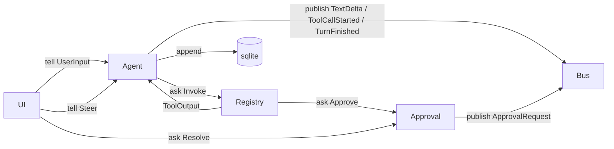

# Architecture: event bus + plugins

Status: draft v0 · 2026-09-09

A single-process Rust harness that does things for the user. Plugins are
in-process crates that talk to each other only through a typed message bus.
Any frontend (terminal now, Tauri later) attaches over JSON-RPC.

Decisions below are final unless a spike in §9 falsifies them. Every decision
names the alternative it beat and why.

## 1. Non-negotiables

1. **No branding.** Crates, modules, types, config keys are named by function.
   The only product name is the binary `wth`.
2. **No reinvented wheels.** Off-the-shelf library first; we write glue. A
   custom implementation needs a written reason in this doc.
3. **Patch dependencies when needed, don't wait on upstream.** Patches live
   in-repo via `[patch.crates-io]` with the diff and reason recorded; drop
   them when upstream catches up.
4. **No god-wiring.** The binary holds a `Vec<Box<dyn Plugin>>` and nothing
   else. Plugins register themselves on the bus. (jarvis: `jarvisd` imported
   every subsystem and threaded handles between them.)
5. **No central event enum, no protocol dumping ground.** Each plugin owns its
   message types. The shared crate holds only the plugin trait and the handful
   of cross-plugin contract types listed in §4, with a hard size ceiling.
   (jarvis: `types.rs` 129 KB, `rpc.rs` 197 KB, one `Event` enum.)
6. **A subsystem earns a crate only when the current phase needs it.**
7. **Permissions are one contract type from day one**, not a subsystem that
   accretes. (jarvis: tiers, approvals, kill switch, safe mode grew ad hoc.)
8. **Not a coding agent.** oh-my-pi is inspiration for loop shape, tool
   ergonomics, sessions, steering, subagents, skills — not for its tool set.

## 2. Process model

One process. `wth` runs the bus, the agent, the tools, and the terminal UI
in-process. The RPC server is a plugin; enabling it turns the same binary into
a headless daemon that a Tauri app or a second terminal attaches to.

Rejected: daemon + thin clients from day one (jarvis). Forces every UI
interaction through serialization before there is a second UI.

## 3. Message bus: kameo

Library: `kameo` 0.22 + `kameo_actors` 0.8 (`MessageBus`, `PubSub`, `Broker`).

Why kameo over the field:
- **Typed request/response and pub/sub in one primitive.** `ActorRef::ask`
  gives correlated typed replies; `kameo_actors::MessageBus` routes by Rust
  type (`Register(actor.recipient::<T>())`, `Publish(T)`). This is exactly
  "one Rust type per event, subscribe by type" without writing a bus.
- **Bounded mailboxes + explicit `DeliveryStrategy`** (`Guaranteed`,
  `BestEffort`, `TimedDelivery`, `Spawned`, `SpawnedWithTimeout`). jarvis's
  `tokio::broadcast` silently dropped on lag; here the policy is chosen per
  publish site and lag is observable.
- **Supervision and panic isolation** for free: a plugin actor panicking does
  not take down the loop.
- Optional `remote` (libp2p) feature exists; we do not enable it. Frontends
  use JSON-RPC (§7), not remote actors.

Rejected:
- `ractor` 0.16: mature (Meta), but messages are one enum per actor, so
  type-routed pub/sub (`pg`) needs a shared enum or downcasting — the thing
  we are avoiding.
- `actix` 0.13: system-runtime coupling, dated async story.
- `tokio::sync::broadcast` per type in a `HashMap<TypeId, _>`: is a custom bus.
- `messagebus`, `busrt`, `postage`: low maintenance or wrong shape.

Vocabulary (kameo terms, no wrappers):
- **Event**: a `Clone + Send + 'static` struct published via `MessageBus`.
  Zero or more subscribers. Fire-and-forget.
- **Command**: `actor_ref.ask(Msg)` to a specific actor. Exactly one handler,
  typed reply. Actors are found through the kameo registry by name:
  `actor_ref.register("tools")?` / `ActorRef::<Tools>::lookup("tools")?`.
  Sync, process-global, typed (wrong type → `BadActorType`), duplicate name →
  error, name freed on actor stop. Never enable kameo's `remote` feature: it
  replaces this API with an async libp2p one (features unify across the graph).
- **Wire-visible** types additionally derive `serde::{Serialize, Deserialize}`
  and `schemars::JsonSchema`. Only these cross the RPC boundary.

Delivery: `Guaranteed` on the one shared `MessageBus`, and every subscriber
actor uses an **unbounded mailbox** (`spawn_with_mailbox(.., mailbox::unbounded())`).
Spike 2 showed why the obvious alternatives fail: `Guaranteed` with bounded
subscribers head-of-line-blocks the whole bus on the slowest subscriber;
`BestEffort` drops silently with no signal to anyone; `Spawned` never blocks
but gives no ordering across messages to the same subscriber (garbles
`TextDelta` streams). Unbounded + Guaranteed = ordered, lossless, non-blocking;
the ceiling is memory on a subscriber that stops draining, which is a bug we
want loud, not hidden. Payloads are cloned once per subscriber, so deltas
carry `Arc<str>`; non-`Clone` payloads are published as `Arc<T>`.

## 4. Plugin system

A plugin is a workspace crate exporting one type that implements:

```rust
// crate: runtime
pub trait Plugin: Send {
    fn name(&self) -> &'static str;
    /// Spawn actors, register recipients on the bus, register named actors.
    async fn start(self: Box<Self>, rt: &Runtime) -> anyhow::Result<()>;
}

pub struct Runtime {
    pub bus: ActorRef<MessageBus>,   // kameo_actors, Guaranteed
    pub config: figment::Figment,    // §9; plugins call rt.section("name")
    pub data_dir: PathBuf,
    pub shutdown: CancellationToken, // any plugin may end the process
}
// helpers: rt.publish(event), rt.subscribe::<A, T>(&actor), subscriber_mailbox()
```

`wth/main.rs` is, in full: build `Runtime`, `for p in plugins { p.start(&rt).await? }`,
wait for shutdown. Plugin order is the vector order; a plugin needing another
looks it up by name at first use, never at start (no start-order coupling).

Shared crate `runtime` contains exactly `Plugin`, `Runtime` (+ the three
helpers above), `SessionId`, `TurnId`. Nothing else. The tool and approval
contracts live in `tools`; the agent's commands and its `AgentEvent` live in
`agent`. Plugins depend on each other's crates for those types along the
acyclic order `runtime ← tools ← agent ← {tui, rpc} ← wth`. This keeps the
shared crate at ~130 lines and puts each contract next to the code that
enforces it. (Earlier draft put the tool contract in `runtime`; dropped once
the agent needed `tools` anyway for the registry actor type.)

Events: a plugin may publish one struct per event or one `#[serde(tag =
"type")]` enum per event *stream* — `agent::AgentEvent` is the latter because
every UI consumes the whole stream with one subscription and one `match`.
Both are the owning plugin's types; the rule being enforced is "no shared
enum edited by every plugin", not "no enums".

### Tool contract (oh-my-pi ergonomics)

```rust
pub trait Tool: Send + Sync + 'static {
    const NAME: &'static str;
    const RISK: Risk;                      // ReadOnly | Mutating | Destructive
    type Args: DeserializeOwned + JsonSchema + Send;
    fn description(&self) -> String;
    async fn call(&self, args: Self::Args, cx: ToolCx) -> anyhow::Result<ToolOutput>;
}
```

No `summary()`: `ToolCallStarted`, `HistoryEntry::Tool` and
`ApprovalRequested` carry the raw `args: serde_json::Value` and every UI
formats them itself (`tui::model::describe`: `shell` → the command with a
`$ ` prompt, anything else → `key: value` per argument, long strings
collapsed to their size). One presentation function, no per-tool string in
the agent, structured args for any frontend.

`schemars` produces the JSON Schema that `genai::chat::Tool` needs; no
hand-written schemas. A `ToolRegistry` actor (in `tools`) holds
`HashMap<String, Box<dyn ErasedTool>>` and answers `ask(ListTools)` /
`ask(Invoke)`. MCP servers add tools to the same registry (§6).

### Permission gate

Single actor `Approval` (lives in `tools`). `Invoke` → registry checks the
tool's `Risk` against config policy `{ read_only = "allow", mutating = "ask",
destructive = "ask" }` → on `ask`, publishes `ApprovalRequest` (Guaranteed)
and awaits `ask(Resolve { id, decision })` from whichever UI answers first.
Timeout → deny. That is the whole permission system for v0.

Two switches turn `ask` into `allow` without touching the policy: the
persisted `tools.approvals: false` (written back to `config.yaml` by
`SetApprovals { session: None }`) and a per-session set held by the registry
(`SetApprovals { session: Some(id) }`, in memory). `deny` is never lifted.
TUI: `/approvals [on|off] [always]`; RPC: `set_approvals`; header shows
`approvals off` while either switch is off. The agent `tell`s the registry
`SetParent { session, parent }` when a subagent session comes up, and the
bypass check walks that chain, so children inherit the parent's switch
(toggling the parent later applies to them too).

## 5. Agent plugin

Library: `genai` (0.7.0-beta.23 now; 0.7.0 stable due this month, migration
from 0.6 is "minimal API changes" — starting on the beta avoids migrating
twice). Provides native-protocol streaming, tool calls, reasoning content,
prompt caching, 26 providers. Default provider/model comes from config.

Rejected: `async-openai` (one provider), `llm-chain`/`rig` (framework
opinions we would fight).

Actor `Agent` per session. Loop (oh-my-pi shape):



- `UserInput { session, text }` starts a turn. `Steer { session, text }`
  queues a user message that is injected after the current tool batch — the
  oh-my-pi steering semantic, not a cancel.
- `genai::exec_chat_stream` events map 1:1 to published events
  (`TextDelta`, `ReasoningDelta`, `ToolCallPending`, `ToolCallStarted`, `ToolCallFinished`,
  `TurnFinished { stop_reason, usage }`). No buffering in the agent except
  tool-call arguments, which genai only delivers parsed in `StreamEnd`
  (`with_capture_tool_calls(true)` is mandatory; chunks carry cumulative
  partial JSON strings, usable for a "calling X…" indicator only).
- Tool calls in one assistant message run concurrently (`join_all` on
  `ask(Invoke)`); results appended as one tool-response message.
- Every `ChatMessage` is appended to the session store before the next
  request. Resume = load messages, rebuild `ChatRequest`.

**Session store**: `sqlx` 0.9 sqlite, inside the agent crate (only the agent
writes it; UIs read via `ask(ListSessions)`/`ask(LoadSession)`). Tables:
`sessions(id, created_at, title, model)`,
`messages(session_id, seq, role, body_json)`. `sqlx::migrate!`.

**Skills** (phase 2): markdown files with front matter (`gray_matter`) under
`<data_dir>/skills`; the agent lists names+descriptions in the system prompt
and loads a body on `ask(LoadSkill)` from the model via a builtin tool.

**Subagents**: detached — `spawn_subagent` returns at once, the child's result
arrives in the parent as a new turn, peers talk via `send_message`. Design,
limits and events: `01-config-and-subagents.md` §2.

## 6. Tools plugin

Crate `tools`: registry, approval gate, builtin tools, MCP source.

**Shell**: `brush-core` 0.5 + `brush-builtins` 0.2 (`brush_core::Shell`).
brush-core ships **zero builtins**; without brush-builtins `cd`/`export` are
"command not found" while `echo` silently works via `/bin/echo`. Build with
`default_builtins(BuiltinSet::BashMode)` minus the interactive-only set
(`bind history fc complete compgen compopt`), `ProfileLoadBehavior::Skip`,
`RcLoadBehavior::Skip`. One persistent `Shell` per session (cwd, env,
functions persist across calls — the oh-my-pi "persistent shell" behavior).
Output capture: per call, `std::io::pipe()` for stdout and stderr set on
`ExecutionParameters::set_fd(1|2, ..)` (not the shell's persistent open-file
table; in-memory `OpenFile::Stream` becomes `Stdio::null()` for external
processes), reader drained on `spawn_blocking` *before* awaiting
`run_string`, `params` dropped after to close the writer. `tokio::time::timeout`
around the call: dropping the future leaves the `Shell` intact and reusable,
but the external child is **orphaned** (brush spawns without `kill_on_drop`
and does not expose the foreground pid). v0 runs each call under
`ProcessGroupPolicy::NewProcessGroup` and `killpg`s on timeout; if brush
lacks the hook, that is the first `[patch.crates-io]`.
Children get `/dev/null` on fd 0. With the TUI's tty inherited as stdin,
brush makes a new-group child `tcsetpgrp` itself into the foreground; under
the TUI that stops it with SIGTTOU and the turn hangs (and the blocked pipe
drain then pinned process exit — `main` now `process::exit`s after the flush
sleep instead of waiting for the runtime). Tools never read the terminal.
The approval prompt shows the command verbatim (`describe` in the TUI), so
the parse-only shell that used to summarise it into command names is gone.

Rejected: `std::process::Command("bash", "-c")`: no in-process state, spawns
a subprocess per call.

**Filesystem**: `read_file`, `write_file`, `list_dir` — thin over
`tokio::fs`, `Risk::ReadOnly`/`Mutating`.

**MCP client**: `rmcp` 3.2 (official SDK; stable spec 2026-07-28). One
`McpServer` actor per configured server (`TokioChildProcess` stdio or
streamable HTTP). On start it lists tools and registers each into
`ToolRegistry` under `<server>__<tool>` with `Risk` from config (default
`Mutating`). Invoke forwards `call_tool`.

## 7. RPC plugin

Library: `jsonrpsee` 0.26, `server` + `macros` features, WebSocket on
`127.0.0.1:<port>`, bearer token from `<data_dir>/token`.

The RPC layer is generic glue, not a second protocol:
- **Methods** = `ask` on a named actor: `agent.send_input`, `agent.steer`,
  `agent.list_sessions`, `tools.resolve_approval`, `tools.list`.
- **Subscriptions** = bus events: `subscribe_events(session?)` yields every
  wire-visible event as `{ "type": "<TypeName>", ... }` via
  `#[serde(tag = "type")]`.
- Method params/results and event payloads are the plugins' own types; the
  RPC crate defines none. TypeScript bindings for Tauri are generated with
  `ts-rs` 12 from the same types (`#[derive(TS)]` behind a feature).

Rejected: raw bus envelope over the wire (couples internal type layout to the
wire, no request semantics without reinventing JSON-RPC); `tonic` (no
webview story without grpc-web).

## 8. Terminal UI plugin

Library: `iocraft` 0.9 (declarative, flexbox via taffy, hooks;
runtime-agnostic — `use_future` takes any future). Ink-like model matches
the oh-my-pi rendering approach.

The TUI is an ordinary bus subscriber: it registers recipients for the
agent's events and approval requests, and sends `UserInput`/`Steer`/`Resolve`
by `ask`/`tell`. It does not know the agent exists beyond those types. The
same code path a Tauri app will use over RPC.

Input: `TextInput` is multiline with `newline_modifiers: SHIFT` (our iocraft
patch, `[patch.crates-io]`): plain Enter submits, Shift+Enter inserts a
newline. Shift+Enter is only distinguishable under the kitty keyboard
protocol, so the app pushes `DISAMBIGUATE_ESCAPE_CODES` after iocraft enters
the alternate screen and pops it on quit; Ctrl+C is routed through the app
(`ignore_ctrl_c`) so that teardown always runs. Mouse capture is off
(`disable_mouse_capture`): the terminal's own selection works, and Ghostty's
copy-on-select copies on release without any code here. The cost is no
wheel scrolling of the transcript (never implemented). The box auto-grows
with `flex_shrink: 0`, otherwise a full transcript squeezes it back to three
rows. Bracketed paste is on (second iocraft patch: `TerminalEvent::Paste`):
a paste lands at the cursor in one piece with `\r` normalised to `\n`; one
over five lines or 400 chars is held in `Model::pastes` and the box shows
`[⎘ paste 1: 69 lines]` instead. `submit` swaps the tokens back before
sending; the `◆ you` card keeps the token.

Only the tail of the transcript is built each frame (`Model::tail`: entries
from the end until their pre-wrap height reaches eight screens). iocraft lays
out and paints every child it is given, so the whole history made a frame
O(session) — 27 ms at 150 turns, against a 16 ms tick — and typing during a
stream lagged. Scroll-back (PageUp) stops at that window.

Transcript shapes, so a glance tells the kinds apart: every input and event
is a rounded card with a glyph header in its own colour (text glyphs, never
emoji): human turns `◆ you` in `AnsiValue(117)`, tool calls `⚙ name` in cyan
(described args, `✓`/`✗` result line), peer messages `⟵ name` in magenta.
Only the assistant's own words are unboxed markdown on the default
background; reasoning is dim italic. Headings render bold yellow (h1/h2
underlined) with no `#` marker. A finished tool card collapses its output
to the first line; Ctrl+O expands the most recent card to the full output
in a code fence, pretty-printed when it parses as JSON (also with a
trailing `exit code` line).

Nothing ever looks frozen: while a turn is in flight the status line and
the transcript show a braille spinner with what is happening — `thinking…`
(waiting for the first token, as a trailing row), `preparing <tool>…` (one
row per `ToolCallPending`, the event the loop publishes on the first
argument chunk of each call), `running <tool>…` inside the card until
`ToolCallFinished`, `streaming…`/`reasoning…` while text arrives. The
16 ms frame loop runs only while `Model::animating()`.

Peer injections (`<subagent_result>`, `<message>`) never echo raw:
`tui::model::injected` splits a `TurnStarted`/history text into one
`(peer, body)` per wrapper (inputs queued during a turn arrive as several
wrappers joined by newlines) and each becomes a `⟵ name` card, collapsed to
one line by default; Ctrl+O toggles the most recent and the body renders
through the same markdown path as assistant text. A `MessageDelivered` that
lands while the model is mid-response is inserted *above* the streaming text
(`Model::interject`), never after it: the deltas keep flowing into one
`markdown::Text`, so a table or list is not split into two half-rendered
pieces.

Rejected: `ratatui` (immediate-mode; streaming markdown + approval modals
are more code); line-oriented REPL (would be replaced immediately); an
in-app selection/clipboard (would need mouse capture and re-implement what
the terminal already does).

## 9. Config

`figment` 0.10: `<data_dir>/config.yaml` merged with `WTH_*` env; data dir
defaults to `~/.wth`, with `credentials.yaml` and `mcp/` beside it. No shared
`Config` struct: each plugin extracts its own section
(`rt.config.extract_inner::<AgentConfig>("agent")`), so `runtime` never knows
the union of all config. Layout, first run, credentials and MCP drop-in files:
`01-config-and-subagents.md` §1.

## 10. Workspace

```
Cargo.toml            workspace, edition 2024, resolver 3
crates/
  runtime/            Plugin trait + §4 contract types (≤400 lines)
  agent/              genai loop, session store, skills (phase 2), subagents (phase 3)
  oauth/              loopback callback, PKCE, provider token store (doc 05)
  tools/              registry, approval, shell (brush), fs, mcp (rmcp)
  rpc/                jsonrpsee server, event subscription bridge
  tui/                iocraft frontend
  wth/                bin: config load, plugin list, run
docs/design/          this file and per-plugin decisions
```

Six crates for v0. `rpc` may be omitted from the default plugin list and
enabled by `--serve` until a second frontend exists.

Workspace dependencies (versions verified 2026-09-09 via `cargo info`):

| Crate | Version | Role |
|---|---|---|
| tokio | 1.53 | runtime |
| kameo / kameo_actors | 0.22 / 0.8 | bus, actors, supervision |
| genai | 0.7.0-beta.23 → 0.7 | LLM |
| brush-core / brush-builtins | 0.5 / 0.2 | shell (core has no builtins) |
| rmcp | 3.2 | MCP client |
| sqlx (sqlite, runtime-tokio, migrate) | 0.9 | session store |
| jsonrpsee (server, macros) | 0.26 | RPC |
| iocraft | 0.9 | TUI |
| schemars | 1.2 | tool schemas |
| serde / serde_json | 1 | wire |
| figment (yaml, env) | 0.10 | config |
| ts-rs | 12 | TS bindings (feature-gated) |
| gray_matter | 0.3 | skill front matter (phase 2) |
| tracing / tracing-subscriber | 0.1 / 0.3 | logs |
| anyhow / thiserror | 1 / 2 | errors |
| clap | 4 | CLI |

Lints: `missing_docs = warn`, `clippy::all = warn` while the crates are being
built out in parallel; flips to `deny` once phase 3 lands and the workspace is
clippy-clean.

## 11. Spike results (2026-09-09)

All six ran green as throwaway `spikes/examples/*.rs`, then were deleted.
Facts that changed a decision are already folded into the sections above;
this is the residue that phase 1 needs.

1. **kameo registry** — yes, default features. `ActorRef::register(&self,
   name) -> Result<(), RegistryError>` and `ActorRef::<A>::lookup(name) ->
   Result<Option<ActorRef<A>>, RegistryError>`, both sync. Stores concrete
   `ActorRef<A>` only (no `Recipient<M>` registration), so plugins share
   actor types for commands. Fallback `HashMap` not needed.
2. **MessageBus bounds** — `Publish<M>: M: Clone + Send + 'static`;
   `Register<M>: M: Send + 'static`. Routing key is `TypeId` only.
   Measured 10 publishes × 2 subscribers = 20 clones. `BestEffort` with a
   bounded(2) slow subscriber delivered 3/10, silently. `Guaranteed` stalled
   the bus actor 1.4 s. Dead subscribers auto-unregister only on
   `ActorNotRunning`. `Unregister<M>::new(actor_id)` takes the id.
3. **brush** — see §6. Extra: `Shell::builder().build()` is async;
   `ExecutionExitCode` has no `Display`/`Debug`, use `u8::from`; macOS `cd
   /tmp` reports `/tmp` (logical cwd). AST types re-exported at
   `brush_core::parser::ast`.
4. **genai 0.7.0-beta.23 vs Anthropic** (`claude-sonnet-4-5` resolves with no
   namespace) — streaming works end to end. Must set
   `ChatOptions::with_capture_tool_calls(true).with_capture_usage(true).with_capture_content(true)`
   or `StreamEnd` carries `None`. `ToolCallChunk.fn_arguments` is
   `Value::String(cumulative partial JSON)`, not a delta and not parsed; parsed
   args come only from `StreamEnd::captured_tool_calls()`. `ChatStreamEvent`
   has undocumented `Heartbeat` and `ThoughtSignatureChunk` variants — match
   exhaustively. Round trip: `end.into_assistant_message_for_tool_use()`
   returns `Option<ChatMessage>` (keeps Anthropic signed-thinking blocks) +
   `ChatMessage::from(ToolResponse::new(call_id, text))`. `StopReason` seen:
   `ToolCall("tool_use")`, `Completed("end_turn")`; compare with `matches!`.
   Observed sequence: `Start, ToolCallChunk×5 (Heartbeat interleaved), End`.
5. **iocraft under tokio** — yes; `use_future` is polled inside `render_loop`
   on whatever executor awaits it, no smol. Pattern: own the
   `mpsc::Receiver` in `ContextProvider(value: Context::owned(..))`, `take()`
   it via `use_context_mut` into `use_future`, drive `State<T>`. Hooks are
   render-only, so the future cannot call `SystemContext::exit()`; flip a
   `State<bool>` and call `exit()` in the next render. Non-TTY stdout does not
   panic but concatenates frames — guard with `stdout().is_terminal()` and
   use a plain printer otherwise.
6. **jsonrpsee 0.26 fan-out** — `#[rpc(server, client)]` with
   `#[subscription(name, unsubscribe, item = Value)]`; server fn receives
   `PendingSubscriptionSink`, `accept().await?`, then one `tokio::spawn` per
   subscription owning a `broadcast::Receiver` taken *before* accept. Loop
   must `select!` on `sink.closed()` or an idle bus parks the task forever;
   `Lagged(n)` is the only lag signal (publisher never blocks). 3 clients × 20
   events, publisher ≈ pure sleep time; request on the subscribed connection
   mid-stream works. `pipe_from_stream` no longer exists.

Resolved follow-up from spike 3: `ExecutionParameters::process_group_policy`
is public and `NewProcessGroup` puts each external command in its own group
(`commands.rs:611`, pgid = child pid at `:640`), but nothing returns that pgid
to the embedder and `ShellExtensions` has no spawn hook. **First patch:**
fork brush-core, add `ExecutionParameters::on_spawn: Option<Arc<dyn Fn(pid,
pgid) + Send + Sync>>` (or record `last_spawned_pgid` on `Shell`), consume via
`[patch.crates-io] brush-core = { git = "<fork>", rev = ".." }`, PR upstream.
The shell tool `killpg`s that group on timeout.

## 12. Phases

Each phase ends with a runnable check, not a test suite.

| Phase | Deliverable | Check | Status (2026-09-09) |
|---|---|---|---|
| 0 | workspace, `runtime`, `wth` starts an empty plugin list | `wth --version` | done |
| 1 | agent + tui: streamed chat, sessions persisted and resumable | chat, quit, `wth --resume <id>` shows history | done; verified in a real pty |
| 1 | tools: shell via brush + fs, approval gate in tui | ask model to `ls`; approval modal; output returned | done; orphan kill verified (`sleep 30` group dead after timeout) |
| 1 | mcp: one configured stdio server's tools callable | `@modelcontextprotocol/server-everything` `echo` | done (`everything__echo` → `Echo: hi`) |
| 2 | rpc plugin, `--serve`; ts-rs bindings emitted | subscribe + send_input round trip over WS | done; headless e2e: shell + write/read + list/load sessions + shutdown, all over the wire |
| 2 | skills | skill body appears in prompt on load | done (`docs/skills.md`) |
| 3 | subagents, steering polish | parent receives child result as tool output | superseded by 01 §2 (detached) |
| 4 | Tauri frontend over rpc | out of scope for this doc | not started; `just ts` emits `bindings/*.ts` |

Known gaps carried forward: cancel/error paths in the loop are code-reviewed,
not smoke-tested; a `setsid` child escapes `killpg`; no upstream PR yet for the
brush `on_spawn` patch; RPC token compare is plain `==` (loopback only);
session actors are never evicted from the supervisor.

## 13. Lessons carried from jarvis (design only, no code)

- One WebSocket API with token auth, localhost bind: keep.
- SQLite WAL, data dir owns state/logs/token: keep.
- Per-subsystem crates depending only on a core crate: keep the shape, cap
  the core (§1.5).
- `Event` enum on `tokio::broadcast`: replaced by type-routed `MessageBus`.
- Subsystems that were never used daily (meetings, signal, slack, voice,
  goals, loops, notes, okf, character, continuity): not planned. They return
  as plugins only when needed, and only as plugins.
