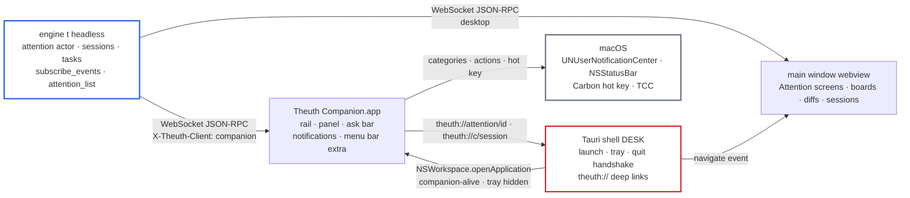
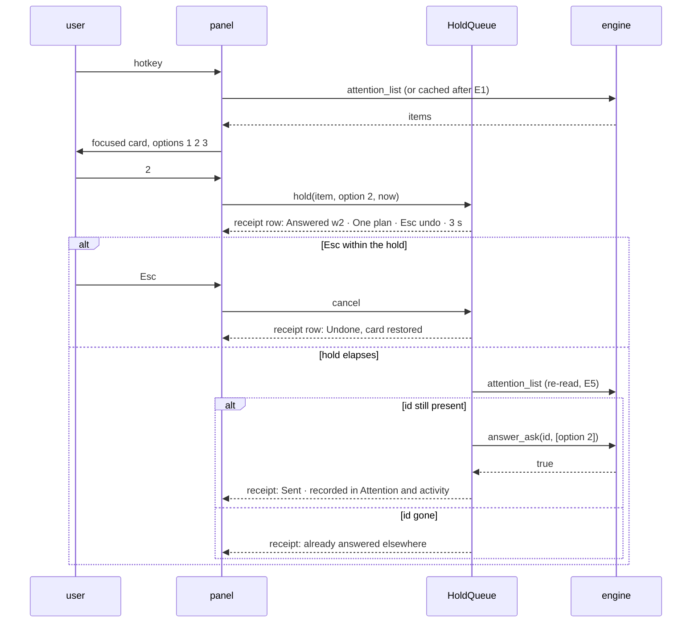

# 130 — Companion: supervising many agents from the edge of the screen (macOS)

Status: design v0 · 2026-10-07 · extends `25-desktop.md` (shell, tray, windows, shortcuts), `53-meetings.md` +
`meetings/03-island.md` (the NSPanel island), `96-point-and-say.md` (the voice key, overlays, a state machine
in Rust), `70-*` / `104-attention-inbox.md` (the attention inbox), `101-decision-review-surface.md` +
`103-decision-packets-v3.md` (packets and mini-boards), `92-decide-tool.md` / `93-as-built-SUBAGENT-STRIP.md`
(the subagent strip and its beat), `67-agents.md` (desks), `76-talk.md` (talk), `31-link.md` (the iOS link).
Neighbours in flight that this design does not touch: 128 (the HUD scene on `/`, UI-only, same palette
semantics) and 129 (event-focus on the event stream). Cites were read on main `e04f1d1a` by recon D and
re-checked on this worktree's base `5fca50dd`; where this doc and `00-architecture.md` disagree, 00 wins;
where it and 25 disagree on the shell, this doc wins for the companion only. Recon reports:
`docs/design/130/recon-A-products.md` (products, 121 URLs), `recon-B-macos.md` (macOS surfaces and APIs),
`recon-C-cognition.md` (the research, 69 URLs), `recon-D-theuth.md` (the codebase, 185 resolved cites). Mock
files: `docs/design/130/mock-round1.html` (round 1, desktop composite in theuth's palette) and
`docs/design/130/mock-round2.html` (round 2, native look, rulings applied; §10 describes its eight frames).
Abbreviations used throughout, as in recon D: `UI/` = `crates/desktop/ui/src/`, `DESK/` =
`crates/desktop/src/`, `api.rs` = `crates/rpc/src/api.rs`, `attention.rs` = `crates/roster/src/attention.rs`.

Scope: a native macOS **companion** to the theuth desktop app — a rail of agent marks at the screen edge, an
Attention panel that answers an agent's question, approval, review or finished work with one keystroke and a 3
s undo, an Ask bar that hands a typed or spoken request to theuth's desk, breakpoint-deferred notifications
with actions, and one menu bar extra — built in Swift (SwiftUI + AppKit) as a helper app inside the theuth
bundle, talking JSON-RPC to the engine like any other client, plus the small engine additions (an
`AttentionChanged` event, `waiting_since_ms`, a `Finished` item kind, an `actor` stamp) and the small
Tauri-shell changes (launch, tray hand-over, `theuth://` deep links, quit handshake) it needs. The main window
keeps every deep screen; the companion stays shallow.

Not in this doc: a Windows or Linux companion (§5.9 names what one would need); aggregating several engines'
attention lists into one rail (v1 connects to the local engine and routes Ask-bar requests through the hub,
§5.2); phone push through the relay (W5, a separate design); any change to point-and-say (96) beyond
documenting how its voice key and the companion's hotkey coexist; the HUD scene (128); the event-focus fix
(129).

Names. **Companion** = the Swift helper app (`Theuth Companion.app`). **Rail** = the edge strip; a **mark** is
one glyph in it. **Panel** = the Attention panel; a **card** is the focused item in full; a **line** is a
collapsed item. **Ask bar** = the typed or spoken request field that routes via theuth's desk. **Receipt** =
the undo/confirmation row after an action, and its record in Attention and the activity feed. **Breakpoint** =
an app switch, a ≥ 20 s typing pause, or the deferral cap. **Needs-you** = the class of items that require a
human action (gold). **Finished** = an unseen receipt of completed work (malachite). **Hotkey** = the
companion's chord (`⌃⇧Space` by default); **voice key** = 96's `Ctrl+S`, unchanged.

## 0. Decisions in one screen

1. **D1 Substrate: a Swift companion app (Sky, 2026-10-07, R1).** `Theuth Companion.app` — bundle id `<main
   id>.companion`, `LSUIElement = true`, SwiftUI + AppKit, macOS 15+ to match the bundle's
   `minimumSystemVersion` (`crates/desktop/tauri.macos.conf.json:38-41`), Liquid Glass when available on 26+
   with an `NSVisualEffectView` fallback — lives at `theuth.app/Contents/Library/LoginItems/Theuth
   Companion.app` and talks JSON-RPC to the engine. Cards are rebuilt natively; nothing of the React Attention
   surface is hosted in the companion. Sky chose this over the orchestrator's recommendation (Tauri/Rust
   in-process panels now, Swift extensions later) for the UX ceiling: per-control glass, system focus and
   VoiceOver behaviour, actionable notifications, App Intents — none reachable from a webview (recon B §3).
   The recommendation was declined; it is recorded in §8.
2. **D2 Engine connection.** The companion is an RPC client exactly like the webview (25 §0.1): it discovers
   the engine the way `DESK/launch.rs` probes (`~/.theuth/engine.json`, else the configured port; token at
   `<data_dir>/token`), opens one WebSocket, one `subscribe_events(null)` whose first item is `PendingPrompts`
   (`api.rs:1865-1881`), and re-derives on the same 13 event kinds the UI uses
   (`UI/components/hud/queries.ts:24-43`) until E1 lands. It identifies itself on the upgrade with
   `X-Theuth-Client: companion` (for E4). v1 connects to the local engine; Ask-bar routing goes to the hub
   named by `mesh_status` because `desk_open` is refused off the hub (`api.rs:1680-1682`). Aggregating N
   engines is a later wave.
3. **D3 Engine additions (W0, additive).** E1 `AttentionChanged { count, ids_added, ids_removed }` on the
   stream, emitted by the `Attention` actor whenever `derive` output changes — clients stop polling, the UI's
   60 s poll goes too. E2 `waiting_since_ms` on `AttentionItem` and on `SessionActivity` for root/desk
   sessions in `awaiting`/`approval`. E3 a `Finished` item kind (`finished:<session>:<turn>`) with `summary` ≤
   160 chars and `next_steps` ≤ 2 × 80 chars, produced from a root or desk session's `TurnFinished` with
   `stop_reason = end_turn` and no pending ask; the agent supplies both through a `## Next` list the prompts
   ask for, the title model is the fallback; cleared with `attention_dismiss`; subagents never produce one. E4
   the engine stamps the connecting client (`companion` · `desktop` · `tui` · `ios`) as `actor` on the
   activity entries that answers write — receipts. E5 the stale-answer guard is client-side (re-read, then
   send; the engine already returns `false` when not pending, `api.rs:572-578`). No engine-side undo: the undo
   is the companion's 3 s hold before the RPC is sent.
4. **D4 The rail (Sky, 2026-10-07, R2: two zones, as mocked).** An `NSPanel` (`nonactivatingPanel`, level
   `.statusBar`, `canJoinAllSpaces | fullScreenAuxiliary | stationary`, `sharingType = .none`,
   `ignoresMouseEvents` except over marks), 26 pt wide on the right edge of the main display, vertically
   centred. Top → bottom: wordmark glyph + gold count; needs-you marks (oldest first); a hairline; agents —
   working (filled faience, 380 ms beat), idle (hollow faience), finished-unseen (malachite), error
   (carnelian) and lapsed (dashed sand) sorting into the agents zone. ≤ 12 marks then `+N`. Quiet (nothing
   needs you and nothing working): a 4 pt dim sliver after 8 s. The rail has no keyboard grammar.
5. **D5 The Attention panel.** An `NSPanel`, non-activating but key when summoned (the Spotlight pattern), 372
   pt wide, ≤ 560 pt tall, glass. Anchored under the status item, beside the rail, or top-centre of the
   mouse's screen by the hotkey. Fixed order: header sentence ("3 need you · 5 working · 2 done" + "1 of 3") →
   the focused card in full → the other items as lines → key hints → the receipt row. A card reads in the
   order a person decides: who and how long they have waited → the question → why it matters to you → ≤ 3
   options with key badges and the recommended one pre-picked → deeper steps as hints. Depth (mini-boards,
   diffs, sessions) opens in the main window through `theuth://` links; the panel stays shallow.
6. **D6 Keyboard grammar.** Hotkey `⌃⇧Space` (rebindable; Carbon `RegisterEventHotKey` through
   sindresorhus/KeyboardShortcuts, MIT, no permission dialog) opens the panel on the oldest needs-you item, or
   as the Ask bar when nothing needs you. Double-tap `⌥` is an opt-in that requests Accessibility. In the
   panel: 1/2/3 or ⏎ answer and start the 3 s hold; ⎋ undoes during the hold, otherwise closes and returns key
   to the app you were in; J/K and ↓/↑ move; R replies in words (hold the hotkey to dictate); S snoozes 30 m;
   E clears a finished receipt; D diff · O mini-board · ⌘O session (all in the main app); ⌘L jumps to the Ask
   bar. Every option is an accessible button with its key as the accessibility hint.
7. **D7 The Ask bar (Sky, 2026-10-07, R4: always via theuth's desk).** One field ("Ask theuth…") with a mic
   glyph; ⏎ sends `send_input(desk, text)` to theuth's desk on the hub after the same 3 s hold; the desk's
   reply streams into the receipt row ("theuth: handed to w3 — it owns crates/rpc; told w2 to wait") with Open
   for the rest. No agent picker, no ⌘1–9, no "New agent" row. Voice: hold the hotkey → `AVAudioEngine` →
   release → `transcribe` → text → the hold → send. 96's `Ctrl+S` voice key stays the "point at it" verb in
   the Tauri process; two keys, two verbs, both in Settings › Shortcuts.
8. **D8 Notifications (Sky, 2026-10-07, R3: by kind).** The companion owns them through
   `UNUserNotificationCenter` with categories `question` · `approval` · `review` · `finished` · `batch`,
   `threadIdentifier` = agent name. Blocking kinds (approval, ask/decision, secret, handoff) → an immediate
   banner, `.active`, no sound. Deferrable kinds (review, hire, finished, budget 80 %) → held until a
   breakpoint (app switch, ≥ 20 s typing pause, or a 2-minute cap) and delivered as one banner; steady-state
   cap 1 banner per 2 minutes; above 10 waiting items a single summary banner. Errors (budget paused, failed
   job, unreachable engine) → immediate with sound. The policy engine is a pure Swift type with unit tests.
   Actions answer immediately (no hold on a deliberate tap) and show a receipt banner. The rail is always
   live. While the companion is alive the webview suppresses `notifyIfHidden` and the tray `●N` badge.
9. **D9 Menu bar extra.** One theuth presence: the companion's `NSStatusItem` (template SF Symbol; a gold dot
   + count when needs-you > 0). Left click → the panel; right/⌥-click → Open theuth · Ask theuth… · Pause
   notifications ▸ · Launch at login · Settings… · Quit theuth. The Tauri shell hides its own tray while the
   companion is alive and re-shows it if the companion exits.
10. **D10 Tauri shell changes (all in `crates/desktop/src`).** Launch the nested companion at start; detect it
    by bundle id and emit `companion-alive` to the webview; hide/show the tray; register `theuth://` on
    desktop with `tauri-plugin-deep-link` (routes `attention/<id>`, `c/<session>`, `new`); extend the
    `quit-requested` handshake (`DESK/lib.rs:505-521`). Windows and Linux keep today's behaviour.
11. **D11 Build, bundle, sign.** An Xcode project under `crates/desktop/companion/` (Swift packages
    `TheuthKit` — the RPC client and models — and `CompanionCore` — pure state — plus the app target). `just
    desktop-bundle` runs `xcodebuild -configuration Release` first and copies the product into the bundle
    before Tauri signs the outer app; nested bundles are signed inside-out with the same Developer ID;
    notarization covers the whole bundle. The ~12 RPC shapes used are hand-written `Codable` structs pinned by
    a contract test that decodes fixtures exported from the ts-rs bindings (`just ts-desktop`).
12. **D12 Settings (native, in the companion).** Rail side/display/show-finished/quiet-collapse; hotkey chord
    and the double-tap ⌥ opt-in; per-kind notification class and the error sound; pause; undo delay 0–5 s
    (default 3); launch at login; the connected engine and hub.
13. **D13 Cognitive-load read-back.** Four glance questions answered in one look (is anything waiting on me ·
    who · what do they need · what landed); ≤ 3 options + a recommended default; 2 keystrokes to answer from
    anywhere, 1 with the panel open; hotkey → sent answer < 5 s including the hold; ≤ 4 glyph states per zone;
    ≤ 1 deferrable banner per 2 min, flood mode above 10; a quiet day shows a 4 pt sliver and no gold; every
    card carries the agent's evidence; undo on every keystroke action; instrument rather than ask. §6 is the
    checklist.
14. **D14 Waves and spikes.** Five one-day spikes first (S1 nested-bundle signing under Tauri's bundler · S2
    notification authorization from a LoginItems helper · S3 the permission class of a listen-only
    `flagsChanged` monitor · S4 `secondsSinceLastEventType` without TCC · S5 the time-sensitive entitlement
    for Developer ID). Then W0 contract (engine E1–E4 + TS bindings + prompt text) → W1 companion core → W2
    notifications + policy + settings → W3 Ask bar + voice + receipts → W4 App Intents, Shortcuts, a "Needs
    you" widget, Focus filter → W5 phone push (separate design). One `130-as-built-<W>.md` per wave (§7).
15. **D15 Rejected alternatives.** Tauri/Rust in-process panels; Tauri-now + Swift-later; React cards in a
    WKWebView inside the companion; engine-side undo; screen-scraped agent detection; menu-bar Live
    Activities; WidgetKit for live state; double-tap ⌥ as the default; two menu bar icons; immediate banners
    for everything; deferral for blocking approvals; a window that activates and steals focus; Electron and
    other shells — one line each in §8.

## 1. Why

**Sky's words (2026-10-07 10:35):** "https://getone.one/ — I want you to write a design document to plan a
build of this kind of interface for macos for theuth. if it needs to be built in swift for optimal UX, that's
fine. Do extensive research on how to achieve the best UX, then write the design document, include mock ups,
design examples, etc. and show me all of it as you go. The main goal is reduce cognitive load and context
switching, how do we make it easy for a user to manage many agents while staying focused."

**The problem in the research's terms.** A person supervising several agents is doing fragmented knowledge
work under interruption. Mark, González and Harris measured 11 min 4 s per working sphere before a switch, 57
% of spheres interrupted, and 21 min 28 s to self-resume interrupted work with 2.3 intervening activities in
between (recon C §1.1, §1.8). Altmann and Trafton put the resumption lag at 3.8 s against a 1.9 s normal
inter-action interval and found that an interruption of only 2.8 s doubles place-keeping errors and 4.4 s
triples them (recon C §1.3). Deferring an interruption to a breakpoint cost 1.5 min of delay on average and
lowered frustration and reaction time (Iqbal and Bailey 2008, §1.4); McFarlane found negotiated delivery best
overall and immediate delivery right only when timeliness is critical (§1.6). Alarm management in process
control (EEMUA 191, ISA-18.2) settled on about one alarm per ten minutes steady state and no more than ten per
ten minutes in a burst, with a flood mode above that (§2.7). Cowan's focus of attention holds about four
chunks (§3.1); Hick–Hyman says a choice among three with a strong prior is nearly free, and Fitts says a key
beats pointer travel (§3.2). Bainbridge's irony is that the supervisor has less context than the actor and
must not be asked to re-derive what the actor knows (§2.3); Cognitive Load Theory's split-attention effect
says the evidence belongs beside the question (§4). Today every one of those costs is paid in full: an agent's
question sits in a chat tab or an inbox screen inside the main window, finding it means leaving the editor,
the answer is a mouse action with no undo, and nothing tells the user which of five agents is the one actually
waiting.

**What One is and why it is the reference.** getone.one ("One") is a Mac app for developers who run coding
agents such as Claude Code and Codex: "A toolbar on the side of your screen shows your agents. Their questions
and finished work collect in an Inbox, and One sends each task you type or say to the agent already on that
work, or starts a new agent" (recon A §1.1). Its surfaces are a side toolbar of agent dots ("Blue is working,
amber needs you, green is done"), an Inbox ("Press 1, 2 or 3 and the agent has its answer"), a Router
("Double-tap Option and say what you need, or type it"), an iPhone app and a Linux connector. Its habits are
the ones this design borrows: "Every answer waits 2 seconds. Press Escape to undo"; "J and K move between
cards. E clears one"; "Finished work comes with up to two replies, ready to send"; and the AI layer "does what
you asked, shows a receipt of what it did, and stops" (recon A §1.3–1.4). One is the reference because no
other product read combines a surface outside every window, one-keystroke answers with an undo window,
next-step replies and receipts (recon A §5.2); Claude Code's `agents` view is the closest shipped equivalent
and documents the hole One fills — a permission prompt "replying doesn't answer it … To answer the dialog,
attach with →" (recon A §4.10). One's weaknesses are also instructive: it detects agents by screen-scraping
terminal panes through herdr, which is lossy ("unusual new prompts may initially show as `idle` instead of
`blocked`"), and it asks for Microphone, Accessibility, Screen Recording and Automation on setup (recon A
§1.5–1.6, §4.9, §4.12). theuth has structured events for every state One has to guess, and needs fewer
permissions, later.

**What theuth already has, and what is missing.** Recon D's table (§4) maps One's features onto the tree:

| One feature | theuth today | Where | Gap |
|---|---|---|---|
| Per-agent state dots outside the window | Subagent strip above the composer (one blinking dot per live subagent, inside the chat); HUD `/` lists; the island is an out-of-window NSPanel but carries meetings and point-and-say only | `UI/components/chat/SubagentStrip.tsx:9-15`, `:35-57`; `DESK/island/macos.rs:25-62` | No rail; nothing shows agents while another app is frontmost |
| Single inbox of questions and finished work | Attention (104): 12 kinds derived on every `attention_list` — approval, decision, hire, blocked, review, budget, node, handoff, secret, ask, show, resume | `attention.rs:1-12`, `:35-66`, `:68-101`; `UI/components/hud/Hud.tsx:170-183` | "Finished work" is not an item; a root `TurnFinished` is only a system notification when hidden (`UI/App.tsx:370-378`) |
| Answer by keystroke (1/2/3) | None — `KindActions` renders buttons; asks carry `options` + `recommended` and packets carry `options`/`recommended`/`recommendation` the UI could key | `Hud.tsx:246-361`; `crates/tools/src/ask.rs:47-59`; `crates/tasks/src/packet.rs:216-225` | Whole feature; no `onKeyDown` anywhere under `UI/components/attention/` |
| Esc-undo | None — every action is an immediate RPC that wakes the agent; the engine has no un-answer | `UI/components/hud/queries.ts:97-138`; `api.rs:572-578`, `:1749-1751` | A client-side hold before sending |
| Router (hotkey + voice/text → the right agent) | The voice key: `Ctrl+S` → `screen_context` → `desk_open('theuth')` → `steer`/`send_input`; destination hard-coded to theuth's desk | `DESK/point/mod.rs:111-147`; `UI/lib/voice-key.ts:333-363` | No typed entry outside the main window; `desk_open` refused off the hub |
| Next steps attached to finished work | Partial: `Question.recommended`, `Packet.recommended`/`recommendation`, `TodoChanged` | `crates/tools/src/ask.rs:58`; `crates/tasks/src/packet.rs:218-225` | No source for a finished turn's next steps |
| Notifications with actions and policy | `notifyIfHidden(title, body)` for `ApprovalRequested` and root `TurnFinished`; tray `●N` counts approvals only | `UI/lib/notify.ts:6-12`; `UI/App.tsx:366-391` | No actions, grouping, interruption levels, per-kind settings; nothing for asks, decisions, reviews |
| Receipts of what the layer did | Activity feed, task events, transcripts, cost ledgers | `api.rs:1725-1730`, `:1719-1721`; `crates/tasks/src/activity.rs:90-107` | No actor tag saying an answer came from a companion |
| Phone follow-up | iOS link client over the relay, local notifications while running | `DESK/lib.rs:5-9`; `UI/lib/notify.ts:14-21` | No push (no APNs anywhere in `crates/`) |
| Multi-machine | Mesh with a hub lease; the desktop scopes every store per engine | `api.rs:1560-1574`; `UI/link/engines.ts:8-40` | `attention_list` is per engine; a rail across engines must merge client-side |

The pieces exist as separate mechanisms — a non-activating, capture-excluded, never-ordered-out NSPanel
(`DESK/island/*`), a Rust-owned global chord with a pure state machine (`DESK/point/*`), a per-kind inbox with
resolve RPCs (`attention.rs` + `KindActions`), a hotkey → voice → desk router (`UI/lib/voice-key.ts`). What is
missing is keyboard answering with a hold, a "waiting since" signal and a finished-work kind on the engine
side, typed routing outside the main window, notifications with actions and a policy, and an edge rail (recon
D §7). Two platform facts shaped 53 and 96 and apply unchanged: a hidden `WKWebView` is throttled "to the
point that its RPC client took 30–45 s to connect and, in one run, never did"
(`docs/design/meetings/03-island.md:368-379`), and only one webview may register global shortcuts
(`UI/App.tsx:283`; `96-point-and-say.md:59-61`). A surface that must answer within a keystroke while every
webview may be hidden has to be native or shell-owned — which is why 96 put its state machine in Rust, and why
this design puts the whole glance layer in a native process.

## 2. Facts relied on

### 2.1 One (getone.one)
Read in full by recon A on 2026-10-07: the home page (hero, FAQ, pricing), `/docs/remote-machines`,
`/privacy`, `/support`, and herdr.dev with its agents documentation (recon A §1). Bundle id `com.kyzo.one`;
older builds were called "agentpill". Facts this design rests on:

- **Surfaces.** A side toolbar ("the pill") of agent rows such as `claude-7 · ~/shop/web · ✻ Working…`; an
  Inbox ("Every agent's questions and finished work, in one list. Press 1, 2 or 3 and the agent has its
  answer") whose cards show agent name, question and numbered options with one marked "Recommended", plus
  system cards such as "Update One on <machine>"; a Router ("Double-tap Option and say what you need, or type
  it. One sends it to the right agent, or starts a new one"); an iPhone app (iOS 17+, notification when an
  agent asks or finishes, answer from the same Inbox); a Linux connector (up to 8 servers, end-to-end
  encrypted, no open port) (recon A §1.2).
- **Habits.** "Every answer waits 2 seconds. Press Escape to undo." "J and K move between cards. E clears
  one." "Finished work comes with up to two replies, ready to send" — off by default for remote machines.
  "Point at it: Drag over your screen, then say what should happen" — one screenshot per turn. The connector
  "answers a numbered question with its digit key after checking the question is still the one you answered"
  (recon A §1.3).
- **The AI layer.** "Does One act on my agents by itself? No. One acts when you send it a request or answer in
  the Inbox. It does what you asked, shows a receipt of what it did, and stops." Titles, recaps, next steps
  and routing are One's own model calls; the agents stay on the user's plans. Free tier 25 requests a day; Pro
  $12.99 a month (recon A §1.4, §1.7).
- **How it sees agents.** Through herdr (Apache 2.0, "a server running in the background, and the terminals
  live inside it"): status is read from "the live bottom of the pane" against per-agent detection manifests;
  "Blocked detection is deliberately strict"; unmatched screens fall back to `idle` (Codex to `unknown`);
  "When you message an agent that's still open in another terminal, 'Move to herdr and send' closes it there
  and reopens the same conversation in herdr" (recon A §1.6).
- **Permissions.** Microphone, Accessibility ("so the shortcut works in every app"), Screen Recording
  (re-confirmed "roughly once a month" on macOS 15), and Automation of the terminal app; analytics with "no
  switch to turn them off"; the Option double-tap conflicts with "window managers and text expanders" (recon A
  §1.5, §4.12). Platform: macOS 13+, universal; no Windows version; "in beta" (recon A §1.7).

### 2.2 The landscape and the complaint record
Recon A read nineteen products (§2) and distilled a pattern catalogue (§3). The patterns that recur across
every serious product — a per-agent list grouped Needs-input / Working / Done, a one-line model-written
summary per row, notification on needs-input and finish, diff review reachable from the list, phone follow-up
— are table stakes; the surface outside every window, the keystroke answer with an undo window, next-step
replies and receipts are what One alone combines (recon A §5.1–5.2). Reference points used below:

| Product | What it shows | Borrowed / avoided here |
|---|---|---|
| Claude Code `agents` view (research preview) | Sessions grouped Pinned · Ready for review · Needs input · Working · Completed; glyph colour + shape (`✻` running or needs input, `∙` exited, `✢` sleeping); Haiku-written row summaries refreshed ≤ 15 s; `Space` peeks, number keys pick a listed choice, `Tab` fills a suggested reply; footer `← 2 agents` counter; permission prompts cannot be answered from the peek panel | Colour + shape as two channels; one-line summaries; the hole (prompts answerable only in the full window) is exactly what the panel closes |
| Codex / ChatGPT desktop app | Threads per project, review queue for Automations, worktrees; issues #9902 ("no persistent view of other agents … context switching back to the picker"), #10471 (no subagent indication), #2961 (notify only on completion, not approval) | The complaints are the design's negative requirements |
| Cursor Agents Window, Conductor, Devin Desktop, Factory, Zed, Warp Oz, HumanLayer | Multi-agent windows with diff review inside the supervisor; Devin groups Running / Waiting for review / Done; HumanLayer `⌘K` palette and RUNNING / DONE / IDLE / DRAFT states | Review stays in the main window (depth), not in the companion |
| AgentManager (agentmgr.app) | Menu-bar count; window appears "the moment any session needs input" and hides when clear; `⌥ Space` toggle; "the status dot itself shows which" kind of wait; 80 % context warning; red lamp + window comes forward on API death; observes and jumps, never answers | The needs-you-only surfacing and the "why it waits" glyph; the window-comes-forward behaviour is avoided |
| herdr | `working` / `blocked` / `idle` rolled up per workspace from screen-scraped panes; strict blocked detection with `idle`/`unknown` fallbacks | Avoided: theuth has structured events |
| LangChain Agent Inbox, Vibe Kanban, Crystal, Superset, Emdash, CCManager and smaller managers | Inbox of interrupts from any graph; kanban of agent tasks; "review is the bottleneck" | Confirms the queue model; nothing else borrowed |

The complaint record (recon A §4, GitHub issue numbers and reaction counts as of 2026-10-07): missing the
prompt that blocks the agent (openai/codex#2961, anthropics/claude-code#15795); notifications firing for ~25 %
of permission prompts (claude-code#9575); no push on mobile when approval is needed (claude-code#29438, 69
reactions; #35637, 30); no persistent overview inside a thread (codex#9902, #10471); a "needs input" that can
only be cleared by spending a model turn or deleting the job (claude-code#82328 — the reason E3 items clear
with `attention_dismiss`); silent death that looks like running (AgentManager); lost context on compaction;
orphaned processes (claude-code#33979, #19045); blocked-state misdetection (herdr's own docs); permission
prompts not answerable from the overview (Claude agent view docs); review as the bottleneck (Vibe Kanban,
Cursor 2.0); the permission and privacy cost of a system-wide layer (One); quota drain from many parallel
sessions (claude-code#13354, 215 reactions).

### 2.3 macOS surfaces and APIs
Recon B verified each API against Apple's documentation on 2026-10-07. Apple's site advertises macOS 27
"Golden Gate"; 26 Tahoe is the previous release; theuth's bundle `minimumSystemVersion` is 15.0
(`crates/desktop/tauri.macos.conf.json:38-41`). "Reachable" says whether the companion (Swift) or the existing
Rust shell (objc2) can use it.

| Surface / API | First macOS | What it gives | Reachable | Used here |
|---|---|---|---|---|
| `NSStatusItem` + `NSStatusBarButton`; SwiftUI `MenuBarExtra` (`.window` style takes key focus) | 10.x / 13 | One 24 pt strip; template image; menu; the system may hide extras | Rust (tray-icon) and Swift | D9 — the companion's status item; the Tauri tray hides |
| `NSStatusItem.expandedInterfaceDelegate` / `expandedInterfaceSession` | 27 | The first sanctioned hook for a window under a status item; not called when the item has an `NSMenu` | Swift (Objective-C protocol) | D5 anchoring on 27; manual positioning under `button.window.frame` on 15–26 |
| Menu-bar Live Activities | — | Only mirrored from a paired iPhone; "Mac apps aren't allowed to show them" | No | Rejected (§8) |
| `NSPanel` `nonactivatingPanel`, `becomesKeyOnlyIfNeeded`, `NSWindow.Level` (`.statusBar` = 25), `CollectionBehavior` (`canJoinAllSpaces`, `fullScreenAuxiliary`, `stationary`), `sharingType` | 10.5+ | A panel over any app and any Space, excluded from capture; key focus is per window | Both (the island uses it from Rust, `DESK/island/macos.rs:25-62`) | D4 rail, D5 panel |
| `NSScreen.safeAreaInsets`, `visibleFrame` | 12 | Notch geometry and the usable frame | Both (`DESK/island/macos.rs:113-150`) | Rail placement |
| `UNUserNotificationCenter`: `UNNotificationCategory`, `UNTextInputNotificationAction`, `threadIdentifier`, `UNNotificationInterruptionLevel` (`passive` · `active` · `timeSensitive` · `critical`), `.provisional` | 10.14 / 12 | Actionable, grouped, levelled notifications; needs a signed `.app` with a bundle id | Swift (the official Tauri plugin gives title/body only on macOS; actions are "Only used on mobile") | D8 |
| Time-sensitive entitlement for Developer ID; critical alerts | 12 | Break through Focus; critical is request-gated | Unverified (recon B §1.4) | Spike S5; default `.active` |
| `INFocusStatusCenter`; `SetFocusFilterIntent` | 12 / 13 | Is the user in a Focus; per-Focus app configuration | Swift (filters need App Intents) | W2 batching; W4 filter |
| WidgetKit | 11 (desktop placement 14) | Desktop / Notification Center widgets; 40–70 refreshes a day; free reloads while the app is foreground; interactive buttons run App Intents | Swift `.appex` only | W4 "Needs you" widget, reload on `AttentionChanged`; never live state |
| App Intents, Spotlight actions, Shortcuts, Services menu | 13 / 26 (Spotlight actions) | "Ask theuth" and "Answer theuth" from Spotlight; automations | Swift-only (compile-time metadata); Services from objc2 | W4 |
| Carbon `RegisterEventHotKey` (sindresorhus/KeyboardShortcuts, MIT) | 10.15 | A global chord with no permission dialog; key + modifiers only, swallowed in every app while registered | Both (theuth's voice key uses it from Rust) | D6 hotkey |
| `NSEvent.addGlobalMonitorForEvents(matching: .flagsChanged)`; `CGEvent.tapCreate`; `CGPreflightListenEventAccess` | 10.6 / 10.4 / 10.15 | Observe modifier taps system-wide; "Key-related events may only be monitored if … trusted for accessibility" | Both; permission class of a listen-only `flagsChanged` monitor unverified | D6 double-tap ⌥ opt-in; spike S3 |
| `CGEventSource.secondsSinceLastEventType` | 10.4 | Seconds since the last keyboard event system-wide | Both; TCC class to confirm | D8 typing-pause breakpoint; spike S4 |
| `NSWorkspace.didActivateApplicationNotification` | 10.6 | The app-switch breakpoint | Both | D8 |
| `AVAudioEngine`, `SFSpeechRecognizer` (10.15), `SpeechAnalyzer`/`SpeechTranscriber` (26, Swift-only) | — | Capture and on-device transcription | Swift | D7 captures audio; transcription stays the engine's `transcribe` RPC |
| `NSGlassEffectView` (26), `NSVisualEffectView` (10.10); HIG "Materials" | 26 / 10.10 | Liquid Glass for the floating functional layer, sparingly; vibrancy fallback; honour Reduce Transparency | Swift per control; backdrop only from Rust | D4/D5 chrome |
| ScreenCaptureKit, `AXUIElementCopyElementAtPosition`, TCC | 12.3 / 10.2 | Screen and pointer context | Both; the companion never asks | 96 keeps it |
| `SMAppService.loginItem(identifier:)` | 13 | Register a nested LoginItems helper | Swift | D1 |

HIG points carried into the grammar (recon B §2): "Avoid using the Control key as a modifier" and prefer
Command with Shift as secondary — so the companion's chord is `⌃⇧Space` only because every ⌘-based chord with
Space is system-reserved for input sources, and it is rebindable; single unmodified letters are legitimate
only inside a focused panel of one's own; the j/k · e · 1/2/3 · Esc grammar is Gmail's and Superhuman's, not a
macOS convention, and One uses exactly it; Gmail's "Undo Send" is a delayed commit (5–30 s) shown as a toast,
which is what the 3 s hold is; VoiceOver's cursor enters a non-activating panel only when it is key, and a
glass surface must honour Reduce Transparency and Increase Contrast. Reference implementations worth reading,
with licences (recon B §4): Maccy (MIT) for a keyboard-first floating panel; KeyboardShortcuts,
LaunchAtLogin-Modern and Settings by sindresorhus (MIT); Hidden Bar (MIT); Notchmeister (BSD-3); Ice and
boring.notch are GPL-3.0 — techniques only, never open the clone into theuth.

### 2.4 The research numbers
From recon C §1.8, §2.8, §3 and §5; grade A = a primary source read during the recon.

| Finding | Value | Source | Where it lands |
|---|---|---|---|
| Time per working sphere before a switch | 11 min 4 s | Mark, González & Harris 2005 (A) | Working-sphere metric, §6 |
| Share of working spheres interrupted | 57 % | Mark 2005 (A) | Why a rail instead of a window |
| Time to self-resume interrupted work | 21 min 28 s, 2.3 intervening activities | Mark 2005 (A) | One place to look (P1) |
| Resumption lag vs normal inter-action interval | 3.8 s vs 1.9 s | Altmann & Trafton 2004 (A) | The 3 s hold; the resumption-lag metric |
| Error multiplier after a 2.8 s / 4.4 s interruption | ×2 / ×3 | Altmann, Trafton & Hambrick 2014 (A, abstract) | No toasts while typing (P11) |
| Interruption lag that enables preparation | 8 s warning | Trafton et al. 2003 (A) | The mark change is the warning; the panel opens on a keystroke (P3) |
| Alerts per hour already disruptive | 3.74 / h | Iqbal & Horvitz 2007 (A) | Rate cap |
| Deferral to a breakpoint | 1.5 min average delay; lower frustration and reaction time | Iqbal & Bailey 2008 (A) | The 2-minute cap and breakpoint policy (D8) |
| Best coordination method | Negotiated, except when timeliness is critical | McFarlane 2002 (A, abstract) | Deferrable vs blocking kinds (R3) |
| Interrupted work: speed vs stress | Faster, same quality, higher TLX and stress | Mark, Gudith & Klocke 2008 (A) | "This can wait" in the card (P8); TLX in §6 |
| Alarm rate benchmarks | ≈ 1 per 10 min steady; ≤ 10 per 10 min burst; flood mode | EEMUA 191 / ISA-18.2 (C) | Rate cap and flood mode |
| Working-memory focus | ~4 chunks (3–5) | Cowan 2001 (A via summary) | ≤ 4 glyph states per zone; one chunk per card |
| Choice time | log₂(n+1); a strong prior shrinks the effective choice | Hick 1952 / Hyman 1953 (A via summary) | ≤ 3 options + a recommended default |
| Perceived vs measured speed-up | A 19 % slowdown perceived as a 20 % speed-up | METR 2025 (A) | Instrument rather than ask (P15) |

### 2.5 theuth today
Recon D read the tree at main `e04f1d1a` (185 cites, all resolved). `UI/` = `crates/desktop/ui/src/`, `DESK/`
= `crates/desktop/src/`.

- **Shell.** "The Rust side does launch, probe, quit and OS integration only (25 §0.4); the webview owns the
  WebSocket" (`DESK/lib.rs:1-9`). `ActivationPolicy::Accessory` on macOS (`DESK/lib.rs:322-329`); tray id
  `main`, `showMenuOnLeftClick: false`, template icon (`crates/desktop/tauri.conf.json:42-46`;
  `tauri.macos.conf.json:34-36`); menu items `open` · `new` · `knowledge` · `meeting` · `settings` · `quit`
  handled by `on_menu` (`DESK/lib.rs:354-378`, `:450-461`); left click toggles the main window (`:379-389`);
  the tray title `●N` is set from JS and counts approvals only (`UI/App.tsx:386-391`). Windows `main` and
  `island` are declared in config (`tauri.conf.json:15-40`); `popout-*` and `overlay-<n>` are runtime
  (`DESK/commands.rs:15-48`; `DESK/point/mod.rs:573-630`). Hide-on-close for every window but pop-outs
  (`DESK/lib.rs:306-314`). Quit handshake: `request_quit` emits `quit-requested`, the webview runs `shutdown`
  if it owns the daemon then `quit_ack`, `QUIT_ACK_TIMEOUT` 3 s (`DESK/lib.rs:211-213`, `:505-521`). Launch
  probes `engine.json`, else the configured port, else spawns `t --headless` on a PTY (`DESK/launch.rs:1-12`,
  `:304-331`); `data_dir()` is `$THEUTH_DATA_DIR` else `~/.theuth` (`:174-176`). Autostart is
  `tauri_plugin_autostart` with `MacosLauncher::LaunchAgent` (`DESK/lib.rs:256-259`).
- **Island and point-and-say.** The island is a `tauri-nspanel` `NonactivatingPanel | Resizable` at
  `NSStatusWindowLevel`, all Spaces + full-screen auxiliary + stationary, `hides_on_deactivate(false)`,
  `becomes_key_only_if_needed(true)`, never ordered out (alpha 0 + mouse-transparent, because WebKit throttles
  an off-screen webview), `sharingType = .none`, notch-placed (`DESK/island/macos.rs:25-62`, `:113-150`). The
  voice key is a Rust-registered Carbon chord (`voice_key_bind`, `DESK/point/mod.rs:111-147`) driving a pure
  reducer `machine::step` with `HOLD_MS 200`, `DOUBLE_TAP_MS 300`, `MIN_NOTE_MS 800` and 20+ unit tests
  (`DESK/point/machine.rs:6-18`, `:20-65`, `:147-474`); the UI's `voice-key.ts` calls `screen_context`, then
  `desk_open('theuth')`, then `steer` or `send_input` (`UI/lib/voice-key.ts:333-363`).
- **UI.** Attention item kinds and labels (`UI/components/hud/Hud.tsx:170-183`); `useAttention()` polls
  `attention_list` every 60 s and invalidates on `ATTENTION_EVENTS` (`UI/components/hud/queries.ts:17-43`);
  `useAttentionActions()` maps every kind to its RPC (`:97-138`); `KindActions` renders buttons, the decision
  kind a free-text input (`Hud.tsx:246-361`); no keyboard handling and no undo under
  `UI/components/attention/`. Global shortcuts register only in the main desktop webview
  (`UI/App.tsx:278-298`); `DEFS` lists every chord — `toggle-window` Alt+Space, `cancel-all` Alt+Escape,
  `voice-key` Control+S (`UI/lib/shortcuts.ts:10-62`). `notifyIfHidden` posts `{title, body}` only
  (`UI/lib/notify.ts:6-12`) for `ApprovalRequested` and parentless `TurnFinished` (`UI/App.tsx:366-378`). The
  subagent strip blinks a dot per live subagent on a 250 ms-throttled reducer beat
  (`UI/components/chat/SubagentStrip.tsx:9-15`, `:35-57`; `UI/store/reduce.ts:1148-1164`). Palette tokens:
  light `--fg-accent #b4531e`, `--status-danger-fg #9b2d1f`, `--status-info-fg #3d6b66`, `--status-success-fg
  #2f5d4a`; dark `--fg-accent #c47a2c`, carnelian `#c45a48`, faience `#5b8f8a`, malachite `#4a8a6e`; "the
  palette has no separate warning hue" (`UI/styles.css:9-10`, `:13-38`, `:59-84`).
- **Engine and RPC.** Attention is derived, not stored: `derive(inputs, states, now_ms)` over tasks, packets,
  agents, approvals, peers, handoffs, secrets, asks, shows (`attention.rs:1-12`, `:171-220`); the `Attention`
  actor subscribes `ApprovalRequested` / `ApprovalResolved` / `ArtifactShown` / `AgentEvent` (`:940-1020`);
  `AttentionKind` has 12 variants (`:35-66`); `AttentionItem { id, kind, title, detail, at_ms, task, agent,
  session, approval, decision, packet, ask, turn }` where `at_ms` is "when the item arose" and `turn` is never
  set (`:68-101`). RPCs: `attention_list`, `attention_snooze`, `attention_dismiss`, `resume_turn`,
  `packet_get`, `task_decide` (`api.rs:1731-1751`); `answer_ask(id, answers | None) -> bool` (`:575-578`);
  `resolve_approval(id, decision) -> bool` (`:572-574`); `task_move(id, state, note)` (`:1707-1715`);
  `activity_list` and `ActivityEntry { id, ts_ms, kind, actor, subject, summary, cost }` (`:1725-1730`;
  `crates/tasks/src/activity.rs:90-107`); `agents_list` and `AgentStatus = Idle | Working | Blocked | Paused |
  Proposed | Unreachable | Invalid` (`:1674-1676`; `crates/roster/src/types.rs:249-284`); `desk_open(name)`
  refused off the hub (`:1680-1682`); `list_activity` → `SessionActivity { state, last_active,
  turn_started_at, jobs, ptys, children, asks, live }` (`:226-229`; `crates/agent/src/lib.rs:927-944`);
  `subscribe_events` with `PendingPrompts` first and `Lagged` on a slow client (`:1850-1862`, `:1865-1881`);
  `AgentEvent::TurnFinished { session, turn, stop_reason, usage, context }` among 40 variants
  (`crates/agent/src/lib.rs:1723-2165`); `mesh_status` (`:1560-1562`). `Packet { key, task, kind, by, at_ms,
  question, summary, board, options, recommended, pointers, checks, recommendation, items, to }`
  (`crates/tasks/src/packet.rs:196-234`); `Question { id, question, options, recommended }`
  (`crates/tools/src/ask.rs:47-59`). No `AttentionChanged` event, no "waiting since", no finished-work item,
  no engine undo, no push path (recon D §3.7, §3.10, §6).
- **Build and platform.** Tauri 2.11.5, `macOSPrivateApi: true`, hardened runtime with JIT + audio-input
  entitlements only, usage strings for microphone and audio capture only
  (`crates/desktop/entitlements.plist:5-10`; `crates/desktop/Info.plist:5-10`); no Swift source anywhere —
  macOS code is `objc2` + `tauri-nspanel` (`crates/desktop/Cargo.toml:63-69`); `just desktop-check` = `bun run
  check && bun run test && bun run build` (`justfile:223-224`); `just ts` / `just ts-desktop` export and copy
  the ts-rs bindings (`justfile:90-97`). The engine `t` already links Swift-bridge crates and carries
  `LC_RPATH /usr/lib/swift` (recon B §3 preamble).

## 3. The reader's mechanics

### 3.1 The four glance questions
Every surface exists to answer one of four questions in one look, without leaving the app the user is in. The
table says which surface answers which, and what the user does next.

| Question | Where it is answered | How | Next action |
|---|---|---|---|
| Is anything waiting on me? | The rail's top zone and the menu bar count | Gold present or absent; the count beside the wordmark is the only number on screen | Hotkey or click → panel on the oldest needs-you item |
| Who? | The rail's marks and the panel header | One mark per agent, agent name in the card's first line; hover gives name · model · one-line status · waiting since / running for · cost today | Click a mark → that item (needs-you) or a peek card (agent) |
| What do they need? | The focused card | Question ≤ 2 lines, one "why it matters to you" line, ≤ 3 options with the recommended one pre-picked | 1/2/3 or ⏎, then 3 s to change your mind |
| What landed? | Finished marks (malachite) and Finished cards | E3 summary ≤ 160 chars, check chips, ≤ 2 next steps | 1/2 sends a next step; E clears; D opens the diff in the main window |

A quiet day — nothing needs you, nothing working — answers all four at once with a 4 pt sliver and no gold
anywhere.

### 3.2 Principles
Each principle is tied to the finding it rests on (recon C §6; grades as there) and to the mechanism in §4/§5
that carries it.

- **P1 One needs-you queue, nothing in it without a required human action.** Management by exception and alarm
  rationalisation (recon C §2.5, §2.7); each extra place to look multiplies the 2.3 intervening activities
  (Mark 2005). Mechanism: the rail's top zone and the panel list only `attention_list` items; Finished items
  are receipts in the second zone, never gold (§4.1).
- **P2 Interrupt at a breakpoint — the user's, not the agent's.** Iqbal & Bailey 2008 (1.5 min delay, lower
  frustration); Horvitz's bounded deferral (§1.4–1.5). Mechanism: deferrable kinds are held until an app
  switch, a ≥ 20 s typing pause or a 2-minute cap, then one banner (§4.4, §5.5).
- **P3 Negotiate, don't seize; immediate only when timeliness is critical.** McFarlane 2002; Trafton's 8 s
  interruption lag (§1.3, §1.6). Mechanism: the mark change is the warning; the panel opens on the user's
  keystroke; blocking kinds get a quiet banner because an agent is waiting (R3), never a window that comes
  forward.
- **P4 Rate-cap and batch; flood mode above ten.** EEMUA 191 / ISA-18.2; Iqbal & Horvitz's 3.74 alerts/h
  baseline (§1.5, §2.7). Mechanism: ≤ 1 deferrable banner per 2 min; above 10 waiting items one summary banner
  and the rail count (§4.4).
- **P5 ≤ 4 states per glyph, one preattentive channel per meaning, motion only for "working now".** Cowan;
  Healey & Enns; Weiser & Brown (§3.1, §3.3, §3.4). Mechanism: the rail grammar in §4.1 — colour and shape
  both carry state; the 380 ms beat is the only motion, opacity-only under Reduce Motion.
- **P6 ≤ 3 options with a recommended default; keys 1/2/3.** Hick–Hyman; Fitts (§3.2). Mechanism: the card's
  option rows and key badges; ⏎ takes the recommended option; an ask with more than three options shows the
  first three and "R reply" for the rest.
- **P7 Evidence beside the question; never make the user re-derive.** CLT split-attention; Bainbridge; Endsley
  L2/L3 (§2.2, §2.3, §4). Mechanism: the "why it matters to you" line comes from the packet `summary`,
  `describe(tool, args)` + risk, or the ask text; inline code/diff pointers render in the card; depth is one
  key away (§4.2).
- **P8 Show the cost of answering and whether the agent is blocked.** Fan-out economics; Horvitz's
  expected-cost framing; Mark 2008's rushing (§1.2, §2.6). Mechanism: "waiting 4 m" and "blocks the Stripe
  checkout task; the other two agents are not waiting" in the card header; `waiting_since_ms` (E2) is the
  source.
- **P9 Receipts and undo so fast answers are cheap to correct.** Sheridan's veto window as a safer level than
  full delegation; reflex-approval research (§2.1, §5.3). Mechanism: the 3 s hold with ⎋ undo on every
  keystroke action; the receipt row; `actor` stamps (E4) in the activity feed (§5.4).
- **P10 Periodic low-cost summaries, not streams.** Endsley's out-of-the-loop problem; Pousman & Stasko's
  "make aware" level; Mark 2005's self-resumption (§1.1, §2.2, §3.4). Mechanism: Finished items with a
  one-line summary and chips; the agent peek card's "what happened since you looked"; no live token stream
  anywhere in the companion.
- **P11 Protect ongoing work from micro-interruptions.** Altmann, Trafton & Hambrick 2014 (2.8 s doubles
  errors) (§1.3). Mechanism: no banner while the user is typing for deferrable kinds; a non-activating panel
  that never steals key until summoned; ⎋ returns key to the app you were in.
- **P12 Management by exception per agent.** Sheridan levels 7–9; Lee & See's calibrated trust; Feng et al.'s
  observer/approver roles (§2.1, §2.4, §5.2). Mechanism: per-kind notification classes in Settings now;
  per-agent auto-resolve classes are named as later work (§9), not built in v1.
- **P13 A forcing function for high-stakes items.** Buçinca et al. 2021; automation bias (§2.4, §5.3).
  Mechanism: `destructive` approvals and reviews with failing checks have no pre-picked option — the user must
  press a digit, never just ⏎; Send back requires a note.
- **P14 Noticeable, not animated: a "changed since you looked" marker, ~250 ms transitions, then stillness.**
  Change blindness; calm technology (§3.4, §3.5). Mechanism: a finished mark stays malachite until cleared;
  transitions 250 ms; the quiet collapse after 8 s.
- **P15 Instrument rather than ask.** METR 2025 (§5.1). Mechanism: the engine records arise → waiting_since →
  answered with `actor`; the companion logs interruptions per hour, undo rate and dwell time locally (§6).

## 4. The surfaces

Mock round 1 (`docs/design/130/mock-round1.html`) is the desktop composite in theuth's palette; it predates
rulings R3 and R4 and the hotkey default, so three of its details are superseded (named in §10). Mock round 2
(`docs/design/130/mock-round2.html`) is the native look with the rulings applied; its eight frames are
referenced below as "Mock round 2, frame N".

### 4.1 The rail (D4)
An `NSPanel` that is never ordered out: `nonactivatingPanel`, level `.statusBar` (25, the island's level),
`canJoinAllSpaces | fullScreenAuxiliary | stationary`, `sharingType = .none` so it is hidden from screen
capture like the island, `ignoresMouseEvents = true` except over marks (hit-tested per mark with a tracking
area). 26 pt wide at the right edge of the main display, vertically centred, 10 pt radius on the two inner
corners; Settings move it to the left edge or another display. Zones, top → bottom (Sky's R2):

1. **Wordmark glyph and the gold count.** The only gold chrome anywhere — the count is "needs you" items;
   absent when zero.
2. **Needs-you marks**, oldest first, one per attention item, gold. Kinds that are needs-you: approval,
   decision, ask, review, hire, secret, handoff, blocked, resume, budget-paused, node (unreachable) — every
   `AttentionKind` except `show` (a shown artifact is a receipt, not a wait) plus the new `Finished` kind
   (second zone).
3. **A hairline.**
4. **Agents** — one mark per desk (`agents_list`) and per root session with a live actor (`list_activity`),
   working above idle above finished-unseen; error and lapsed marks sort into this zone where they would
   otherwise fall.

| State | Colour | Shape | Motion | Source |
|---|---|---|---|---|
| needs you | gold `--fg-accent` | filled ring with a notch at the kind's clock position (question 12 · approval 3 · review 6 · other 9) | none | `attention_list` (E1 pushes changes) |
| working | faience `--status-info-fg` | filled disc | 380 ms beat on activity (opacity 1 → 0.55 → 1), opacity-only under Reduce Motion, nothing when idle | `SessionActivity.state = running`; desks `Working`; `turn_started_at` for "running for" |
| idle, connected | faience | hollow disc | none | `state = idle`, desks `Idle` |
| finished, unseen | malachite `--status-success-fg` | filled disc with a check cut-out | none | E3 `Finished` items not yet dismissed |
| error | carnelian `--status-danger-fg` | filled disc with a bar | none | `state = error`; desks `Unreachable`/`Invalid`; `budget:<agent>` paused |
| lapsed | sand (bone at 60 %) | dashed ring | none | a desk `Paused`, or a routine whose `next` is past with no run (`list_schedules`) |

≤ 4 states per zone (needs-you has one; agents has working · idle · finished · error, with lapsed as a
shape-only variant of idle) — Cowan's bound (P5). ≤ 12 marks, then a `+N` tail. Colour is never the only
channel: shape distinguishes every row of the table with colour removed, and VoiceOver reads each mark as
"<agent>, <state>, <since>". Quiet state — nothing needs you and nothing working — collapses the rail to a 4
pt dim sliver after 8 s; hover reveals; a new needs-you item or a working agent expands it. Hover on a mark
shows a tooltip card: name · model · one-line status · waiting since / running for · cost today
(`AgentSummary.spent_month` scaled to the day from `activity_list` costs). Click a needs-you mark: the panel
opens beside the rail focused on that item. Click an agent mark: a peek card — what it is doing (last
`ToolCallStarted` name or `TurnStarted.text` head), elapsed, cost, "Open session" → `theuth://c/<session>`.
The rail has no keyboard grammar; it is for glancing and pointing. Mock round 2, frame 2 shows the rail at the
right edge with 3 gold marks, the hairline, working and finished marks over an editor with the panel opened
from the menu bar item; frame 3 is the quiet afternoon — a 4 pt sliver and a menu bar glyph with no dot; the
grammar legend is mock round 1, frame 2.

### 4.2 The Attention panel (D5)
An `NSPanel`, non-activating, made key only when summoned (the Spotlight pattern: `becomesKeyOnlyIfNeeded`
with the panel's content view answering `needsPanelToBecomeKey`), 372 pt wide, ≤ 560 pt tall, glass material
(`NSGlassEffectView .regular` on 26+, `NSVisualEffectView .hudWindow` before; opaque under Reduce
Transparency). Anchors: under the status item when opened from it (macOS 27 `expandedInterfaceDelegate`;
manual positioning under `button.window.frame` on 15–26); beside the rail when opened from a mark; top-centre
of the screen with the mouse, ≈ 20 % down, when opened by the hotkey. ⎋ or a click outside closes it and
returns key to the app that had it (`NSRunningApplication.activate` on the previously frontmost app,
remembered at open).

Order of content, fixed: (1) header — one state sentence "3 need you · 5 working · 2 done" and the position "1
of 3"; (2) the focused card in full; (3) the other items as one-line lines — needs-you oldest first, then
finished; (4) footer — key hints; (5) the receipt row, present only while an answer is held or just sent. Card
anatomy in the order a person decides:

| Row | Content | Source |
|---|---|---|
| who · how long | agent mark · name · model · task title; "waiting 4 m" | `AttentionItem.agent/session/task`; `waiting_since_ms` (E2), `at_ms` until E2 lands |
| the question | ≤ 2 lines, expandable with ⇥ | `title`/`detail`; `ask.questions[0].question`; `Packet.question` |
| why it matters to you | one line | `Packet.summary` (decisions, reviews); `describe(tool, args)` + risk (approvals); the ask text (asks); "blocks <task>" when the item's task has dependants |
| options | ≤ 3 rows with key badges 1/2/3, the recommended one pre-picked and marked ⏎ | `Question.options`/`recommended`; `Packet.options`/`recommended`/`recommendation`; fixed sets per kind below |
| deeper steps | hints: O board · D diff · ⌘O session | `Packet.board`, `pointers` of kind diff, `session` |

Per kind:

| Kind | Options (1 · 2 · 3) | RPC on commit | Notes |
|---|---|---|---|
| Ask | the question's options; ⏎ = `recommended` | `answer_ask(id, [Answer])` | More than three options → first three + "R reply" for the rest; a multi-question ask is answered one question per card, in order |
| Decision | packet options; ⏎ = `recommended`, or the forwarded `recommendation` | `task_decide(decision, <option label>)` | Free text via R; a bundle (`items`) shows "Approve all as recommended" as option 1 and Open for per-item picks |
| Approval | Allow once · Allow for this session · Deny | `resolve_approval(id, allow\|deny)`; "for this session" also calls `set_approvals` scoped to the session | `destructive` risk has no pre-pick (P13); R attaches a note to a deny |
| Review | Approve · Send back… · Open | `task_move(task, done)`; `task_move(task, todo, note)` | Chips from `Packet.checks`; failing checks remove the pre-pick; Send back requires the note |
| Finished (E3) | next step 1 · next step 2 · Clear | `send_input(session, text)`; `attention_dismiss(id)` | Chips from the summary; D opens the diff when a pointer carries one; E clears without sending |
| Hire | Hire · Decline · Open | `agent_approve(name)`; `agent_remove(name, null)` | — |
| Budget · Node · Blocked · Handoff · Secret · Resume · Show | one line + Open in theuth (and Un-pause / Unblock / Resume / Done where the UI has them) | `agent_pause(name,false)`; `task_move(task,todo)`; `resume_turn(session)`; `handoff_resolve(id,done)`; `attention_dismiss` | Secrets are never typed in the companion in v1 |

Deep content — mini-boards, diffs, artifacts, sessions — opens in the main theuth window through
`theuth://attention/<id>` and `theuth://c/<session>`; the panel stays shallow and native. Packet `pointers` of
kind code or diff with inline `text` render natively (monospace, collapsed, first two). Lines show mark ·
agent · one-line title · age. Mock round 2, frame 4 shows the panel states in the dark appearance — a decision
question focused with three lines beneath, an approval with an answer in its 3 s hold and the receipt row
counting down, the Ask bar after sending, and a peek card for a working agent; frame 5 repeats the question
and the finished-work card with two next steps in the light appearance.

Keyboard grammar (D6; the panel is key):

| Key | Action | Notes |
|---|---|---|
| `⌃⇧Space` (rebindable) | Open the panel on the oldest needs-you item; open as the Ask bar when nothing needs you; toggle closed when open | Carbon hot key via KeyboardShortcuts (MIT); no permission dialog; HIG prefers ⌘, but every ⌘-Space chord is an input-source reservation |
| double-tap `⌥` (opt-in) | Same as the hotkey | Requests Accessibility; `NSEvent` global monitor on `flagsChanged`, 300 ms window, cancelled by any other key |
| 1 · 2 · 3 | Answer with that option; start the hold | Badges on the rows |
| ⏎ | Answer with the recommended option | Disabled when no pre-pick (P13) |
| ⎋ | During the hold: undo. Otherwise: close and return key to the previous app | One key, two meanings, both shown in the receipt row |
| J / K · ↓ / ↑ | Next / previous item | Needs-you first, oldest first; finished after |
| R | Reply in words: a text field under the options; ⏎ sends after the hold | Hold the hotkey to dictate into it |
| S | Snooze 30 m | `attention_snooze(id, now+30m)`; the agent keeps working on anything not blocked |
| E | Clear a finished receipt | `attention_dismiss`; clearing never cancels anything |
| D · O · ⌘O | Diff · mini-board · session in the main app | `theuth://` links; the panel closes |
| ⌘L | Jump to the Ask bar | — |
| ⇥ | Expand the question / pointers | — |

Every option is an accessible button whose accessibility hint is its key; the list is a VoiceOver list with
the card first; arrivals announce politely.

### 4.3 The Ask bar (D7; Sky's R4)
One field, placeholder "Ask theuth…", a mic glyph at the right, the receipt row beneath. Typing or dictating;
⏎ starts the same 3 s hold, then `send_input(<theuth desk>, text)` where the desk id comes from
`desk_open("theuth")` on the hub engine (`mesh_status` names it; `desk_open` is refused elsewhere,
`api.rs:1680-1682`). theuth's desk routes — to the agent already on that work, to several, or by starting one
— and the desk's reply streams into the receipt row as two lines ("theuth: handed to w3 — it owns crates/rpc;
told w2 to wait") with Open → `theuth://c/<desk session>` for the rest. There is no agent picker, no ⌘1–9 and
no "New agent" row: One's model, as ruled. Voice: hold the hotkey while the Ask bar is open → `AVAudioEngine`
records → release → the engine's `transcribe` RPC → the text appears in the field → the hold starts → ⎋ keeps
editing instead of sending. "Point at it" stays 96's `Ctrl+S` voice key in the Tauri process, with its
screenshots and pointer trail; the companion's Ask bar is its typed sibling. Two keys, two verbs — `Ctrl+S` =
ask about the screen, `⌃⇧Space` = ask or answer without the screen — both documented in Settings › Shortcuts
(the main app's table gains a read-only row for the companion's chord, pointing at the companion's own
Settings). Mock round 2, frame 4 (lower row) shows the Ask bar after sending — the typed request, "send to
theuth · it routes", "hold ⌃⇧Space to talk", and the desk's reply line "theuth · handed to w3 — it owns
crates/rpc; told w2 to wait for the fix" with Open.

### 4.4 Notifications (D8; Sky's R3)
The companion owns them through `UNUserNotificationCenter`; the Tauri webview's `notifyIfHidden` and tray `●N`
are suppressed while the companion is alive (D10). Categories and actions: `question` (≤ 3 option buttons +
"Reply…" as a `UNTextInputNotificationAction`), `approval` (Allow once · Allow for session · Deny), `review`
(Approve · Send back… text · Open), `finished` (next step 1 · next step 2 · Clear), `batch` (Open panel ·
Later). `threadIdentifier` = agent name, so an agent's banners stack.

| Kind | Class | Interruption level | When | Batching |
|---|---|---|---|---|
| approval, ask, decision, secret, handoff | blocking | `.active`, no sound | immediately | never held; stacked per agent |
| review, hire, finished, budget 80 % | deferrable | `.passive` | at the next breakpoint — app switch, ≥ 20 s typing pause, or 2 min after the first held item | everything held → one banner; steady state ≤ 1 per 2 min |
| budget paused, failed job, unreachable engine, companion lost the engine | error | `.active` with sound; `.timeSensitive` only if S5 confirms the entitlement | immediately | per event |
| > 10 items waiting | flood | `.active`, no sound | immediately once, then at breakpoints | one summary banner ("11 agents need you — open the panel") + the rail count |

Deliberate taps on a notification action answer immediately (no hold) and show a receipt banner; tapping the
body opens the panel on that item. "Pause notifications 1 h / until tomorrow" in the menu; a system Focus is
respected by the OS because deferrable kinds are never time-sensitive. The rail is always live regardless of
policy. Mock round 2, frame 6 shows three banners — w2's quiet question with 1 · 2 · Reply…, "theuth at your
break · 2 for later · 1 finished" with Open panel · Later, and an error banner with sound ("ops-desk paused ·
budget reached $40.00 of $40.00" with Raise to $60 · Keep paused · Open) — under the round-2 policy text.

### 4.5 Menu bar extra (D9)
One theuth presence: the companion's `NSStatusItem` with a template SF Symbol glyph; a gold dot and the count
when needs-you > 0; nothing else changes with state (the HIG asks for a menu, not a popover, on click — the
panel is justified by the inbox being "too complex for a menu", and a right-click menu keeps the menu path).
Left click → the panel anchored under the item; right-click or ⌥-click → Open theuth · Ask theuth… · Pause
notifications ▸ (1 h · until tomorrow · off) · Launch at login · Settings… · Quit theuth. The Tauri shell
hides its own tray while the companion is alive (`tray.set_visible(false)`) and re-shows it when the companion
exits; "Open theuth" goes through `theuth://new`. Two icons were considered and rejected (§8).

### 4.6 Settings (D12)
A native Settings window (sindresorhus/Settings, MIT, or a plain `TabView`): Rail — side, display, show
finished marks, quiet collapse on/off. Keys — the hotkey chord (KeyboardShortcuts recorder), double-tap ⌥
opt-in (explains the Accessibility prompt before requesting). Notifications — per kind immediate / deferred /
off, sound on errors, pause. Undo delay 0–5 s (default 3). Launch at login (`SMAppService`). Engine — the
connected engine, the hub, client id. Mock round 2, frame 7 shows the right-click menu and the Settings
window.

### 4.7 Phone and widgets (later)
The iOS link client already receives `AskRequested` and `ApprovalRequested` through the relay and posts local
notifications while running (`UI/lib/notify.ts:14-21`); push through the relay (APNs) is W5 and a separate
design. A WidgetKit "Needs you" widget (W4) shows the count and the three oldest lines, reloads on
`AttentionChanged` while the companion is foreground and otherwise within WidgetKit's 40–70 daily refreshes;
it is a slow glance, never live state (recon B §1.5). App Intents "Ask theuth" and "Answer theuth" give
Spotlight actions on 26+ and Shortcuts; a Focus filter can set the companion's notification class per Focus.

## 5. Architecture

### 5.1 Process topology
Three processes on the Mac, one protocol. The engine (`t --headless`) is the only state holder; the Tauri
shell and the companion are both RPC clients; the companion never proxies through the shell and the shell
never proxies RPC (25 §0.4 kept). The two clients meet only through the OS: the shell launches the companion,
hides its tray while the companion is alive, and handles `theuth://` links the companion opens.



The shell is the gate in the diagram because it owns the two hand-overs that can fail: launching the nested
bundle and routing a deep link to a window that may be hidden.

### 5.2 Engine connection and events (D2)
- **Discovery.** The companion reads `~/.theuth/engine.json` (63's record of the running engine) the way
  `DESK/launch.rs` probes it, else the configured `rpc.listen` port from `~/.theuth/config.yaml`, honouring
  `$THEUTH_DATA_DIR` (`DESK/launch.rs:174-176`); the token is at `<data_dir>/token`. It opens one WebSocket
  with the header `X-Theuth-Client: companion` and keeps it open with exponential back-off (1 s → 30 s) when
  the engine is away; "engine unreachable" after 60 s is an error-class notification and a carnelian wordmark.
- **Subscription.** One `subscribe_events(null)`; the first item is `PendingPrompts { approvals, asks, secrets
  }` (`api.rs:1865-1881`), so a late-starting companion has every pending card at once. `Lagged` → reload
  every list (as `UI/App.tsx:362-365` does). Design 129's event-focus work (in flight) shrinks what a client
  receives; the companion's subscription is a second long-lived subscriber on the stream and will adopt 129's
  focus call when it lands — until then it filters client-side and ignores every delta kind (`TextDelta`,
  `ReasoningDelta`, `ToolCallProgress`).
- **Lists.** `attention_list` (needs-you and finished), `agents_list` (desks), `list_activity` (root sessions
  with `SessionActivity`), `activity_list({since_ms, kinds: null, limit: 100})` (receipts and costs),
  `mesh_status` (the hub), `list_schedules` (lapsed routines). Until E1 lands the companion re-fetches
  `attention_list` on the same 13 kinds the UI uses — `ActivityAppended, ApprovalRequested, ApprovalResolved,
  ArtifactShown, AskRequested, AskResolved, NodeAdded, NodeOnline, NodeRemoved, NodeRevoked, SecretRequested,
  SecretResolved, Takeover` (`UI/components/hud/queries.ts:24-43`) — debounced 250 ms, and never polls on a
  timer. After E1 it re-fetches only on `AttentionChanged` and shows `count` immediately from the event.
- **Rail state** is a pure function `railState(attention, agents, activity, schedules, now) -> [Mark]` in
  `CompanionCore`, unit-tested; working/idle/error come from `SessionActivity.state` and `AgentStatus`,
  finished from E3 items, lapsed from desks `Paused` and overdue schedules.
- **Multi-engine.** v1 shows one engine. Ask-bar sends go to the hub named by `mesh_status` when the local
  engine is not it, over a second connection opened on demand. Aggregating N engines' attention lists (fan-out
  subscriptions, client-side merge, or a hub-side aggregate that does not exist today — recon D §6.7) is a
  later wave.

### 5.3 Engine additions E1–E5 (W0 contract)
All additive; no existing RPC signature changes. Rust shapes are the contract; the TS mirrors come from `just
ts` and the Swift `Codable` structs from the fixtures (§5.6).

**E1 `AttentionChanged`.** A new wire event emitted by the `Attention` actor (`attention.rs:617-629`) after
every derive whose result differs from the previous one by id set or count — on its subscribed events
(`:940-1020`), on `SnoozeAttention`/`DismissAttention`, and after the task/agent changes that reach it through
`ActivityAppended`. The UI's `useAttention()` drops `refetchInterval: 60_000`
(`UI/components/hud/queries.ts:17-43`) and invalidates on this one kind.

```rust
// crates/roster/src/attention.rs (new)
#[derive(Clone, Debug, Serialize, Deserialize, TS)]
#[serde(tag = "type")]
pub struct AttentionChanged {
    pub count: u32,
    pub ids_added: Vec<String>,
    pub ids_removed: Vec<String>,
    pub at_ms: u64,
}
```

**E2 `waiting_since_ms`.** `AttentionItem` gains `pub waiting_since_ms: Option<u64>` (serde default): for
approvals the `ApprovalRequested` timestamp already in `Inputs.approvals: Vec<(ApprovalRequested, u64)>`; for
asks the `AskRequested` arrival; for decisions and reviews the blocker's or the review transition's
`task_events` time; for hire/budget/node the `at_ms`. `SessionActivity` (`crates/agent/src/lib.rs:927-944`)
gains `pub waiting_since_ms: Option<u64>`, set when `state` enters `awaiting` or `approval` and cleared when
it leaves; `UI/rpc/extra.ts:79-110` mirrors it by hand.

**E3 `Finished` items.**

```rust
// crates/roster/src/attention.rs
pub enum AttentionKind { /* existing 12 */ Finished }

pub struct AttentionItem {
    /* existing fields */
    #[serde(default)] pub waiting_since_ms: Option<u64>,   // E2
    #[serde(default)] pub summary: Option<String>,         // E3, ≤ 160 chars
    #[serde(default)] pub next_steps: Vec<String>,         // E3, ≤ 2 × 80 chars
}
```

Id `finished:<session>:<turn>`. Produced when a root or desk session's `TurnFinished` has `stop_reason =
end_turn` and the session has no pending ask or approval; subagent sessions never produce one (the parent
reports). The summary and next steps come from the agent: the desk manual (`crates/roster/src/desk.rs`) and
the final-answer prompt ask every user-facing turn to end with a `## Next` list of ≤ 2 items; the engine
parses that list from the final assistant text, strips it from the item's `summary`, and truncates to the
caps; when absent, the title model's path (`TitleChanged`) produces a one-line summary and `next_steps` is
empty. Stored rows live in a new `attention_finished` table beside `attention_shows` (`attention.rs:103-124`)
so a restart keeps them; dismissed with `attention_dismiss` through the existing `attention_state`; a Finished
item for a session is replaced by the next turn's. `groupItems()` in the UI
(`UI/components/attention/model.ts:10-31`) gains the kind as a "Done" group so the main window shows the same
receipts.

**E4 `actor` on activity entries.** The RPC server reads the `X-Theuth-Client` header on the WebSocket upgrade
(default `desktop` for the Tauri webview, `tui` for the terminal, `ios` for the link client, `companion`) and
stores it in the connection's context; `answer_ask`, `resolve_approval`, `task_decide`, `task_move`,
`send_input`, `agent_approve`, `attention_dismiss` and `attention_snooze` write their `ActivityEntry.actor`
(`crates/tasks/src/activity.rs:90-107`) as `user@<client>`. No signature changes; the companion reads receipts
back from `activity_list` filtered to `actor = user@companion`.

**E5 stale-answer guard** is client-side (§5.4). The engine already returns `false` from
`answer_ask`/`resolve_approval` when the prompt is no longer pending (`api.rs:572-578`) and `task_decide`
errors on an unknown decision.

### 5.4 The undo queue and the stale-answer guard
Every keystroke action goes through one `HoldQueue` in `CompanionCore`: a pure reducer over `(state, event,
now) -> (state, [effect])`, in the shape of 96's `point::machine` (`DESK/point/machine.rs:69-131`), with the
delay a parameter (default 3 000 ms, settings 0–5 000). States: `Idle`, `Held { item, answer, since }`,
`Sending`, `Sent`, `Stale`. The 3 s comes from Altmann & Trafton: a slip is noticed within the 2–4 s
resumption window, so 3 s catches it where One's 2 s is at the edge; a deliberate notification-action tap
skips the hold.



Rules: one held item at a time per panel (a second keystroke on another item commits the first immediately —
the receipt row says so); the panel may close during a hold, the queue keeps running and the receipt lands as
a notification banner; the engine's `false` is shown as "already answered elsewhere" and the card is
refreshed, never retried; a `Lagged` or disconnect during `Held` keeps the item held until reconnection, then
re-reads. Receipts persist: the `ActivityEntry` with `actor = user@companion` (E4) is what the main window's
activity feed and the Finished zone show; the companion keeps the last 50 receipts for the receipt row's
history (↑ in the Ask bar).

### 5.5 Breakpoint detection and the policy engine
`NotificationPolicy` is a pure Swift type: `decide(item: AttentionItem, class: Class, held: [Held], now,
lastBannerAt, busy: Busy) -> Verdict` where `Class` is `blocking | deferrable | error`, `Busy` is `(typing:
Bool, frontmostChangedAt: Date)`, and `Verdict` is `deliverNow(level, sound) | hold(until: cap) | fold(into:
batch) | floodSummary | suppressed(paused)`. Unit tests cover every row of the table in §4.4 and the
transitions below.

| State | Event | Next | Effect |
|---|---|---|---|
| `Quiet` | blocking item arrives | `Quiet` | banner `.active`, no sound, thread = agent |
| `Quiet` | deferrable item arrives | `Holding { since: now }` | none; start the 2-minute cap timer |
| `Holding` | another deferrable item | `Holding` | fold into the batch |
| `Holding` | breakpoint: `didActivateApplication`, or `secondsSinceLastEventType(.keyDown) ≥ 20`, or cap elapsed | `Quiet` | one `batch` banner (or the single item's own category when the batch has one), `.passive`; `lastBannerAt = now` |
| any | error-class event | same | banner `.active` with sound (`.timeSensitive` only if S5 confirms) |
| any | waiting items > 10 | `Flood` | one summary banner; the rail count; no per-item banners |
| `Flood` | waiting items ≤ 10 | `Quiet` | — |
| any | deferrable arrives and `now - lastBannerAt < 2 min` | `Holding` | hold even at a breakpoint until the rate window passes |
| any | user chose Pause | `Paused { until }` | nothing delivered; the rail is still live |

Breakpoint sources: `NSWorkspace.didActivateApplicationNotification` (an app switch; the companion's own panel
does not count), `CGEventSource.secondsSinceLastEventType(.combinedSessionState, eventType: .keyDown)` sampled
every 5 s while holding (spike S4 confirms it needs no TCC grant — Apple documents it as a system-wide idle
measure and it carries no content), and the cap timer. Nothing in the policy reads keystrokes or screen
content.

### 5.6 Swift module layout, the Codable contract test, build, bundle, sign (D11)
Layout under `crates/desktop/companion/`:

```
crates/desktop/companion/
  Package.swift                 — SwiftPM: TheuthKit, CompanionCore, TheuthCompanion (executable)
  Sources/TheuthKit/            — WebSocket JSON-RPC client, discovery, subscription, Codable models
  Sources/CompanionCore/        — pure state: railState, HoldQueue, NotificationPolicy, card view-models
  Sources/TheuthCompanion/      — AppKit/SwiftUI app: rail, panel, ask bar, status item, settings, notifications
  Tests/TheuthKitTests/         — contract test over fixtures/*.json
  Tests/CompanionCoreTests/     — reducer and policy tests
  fixtures/                     — JSON exported from the ts-rs bindings (just companion-fixtures)
  bundle/                       — Info.plist, PkgInfo, icon PNGs, make-app.sh (iconutil + codesign)
  Companion.xcodeproj/          — W4 only: widget and intents .appex targets (needs Xcode)
```

**Toolchain fact (A1, verified on Sky's machine 2026-10-07 11:42):** macOS 26.6.2 (Tahoe); `xcode-select -p` =
`/Library/Developer/CommandLineTools`; `xcodebuild` is not available ("requires Xcode"); `swift --version` =
Apple Swift 6.3.2 (swift-driver 1.148.6). Consequences: (1) W1–W3 — rail, panel, hotkey, menu bar extra,
notifications, Ask bar — are built with SwiftPM alone: an executable target plus `bundle/make-app.sh`, which
assembles `Theuth Companion.app` (Info.plist with `LSUIElement`, `CFBundleIdentifier`, usage strings; PkgInfo;
an `.icns` from PNGs via `iconutil`; `codesign --options runtime`). So there is no asset catalog: palette
colours are defined in Swift code as dark/light pairs with the exact `UI/styles.css` values (gold `#c47a2c` /
`#b4531e`, malachite `#4a8a6e` / `#2f5d4a`, faience `#5b8f8a` / `#3d6b66`, carnelian `#c45a48` / `#9b2d1f`),
and icons are PNG/ICNS files. (2) W4 — the WidgetKit widget, App Intents / Spotlight actions, the Focus filter
— requires full Xcode because app-extension (`.appex`) targets cannot be built by SwiftPM. (3) Spike S1 gains
a step: install Xcode on the build machine and in the release CI, and confirm `xcodebuild` plus notarization
of the nested bundle. (4) Until Xcode is installed the companion ships as a Developer-ID-signed SwiftPM
product; D11's "`xcodebuild -configuration Release`" reads "`swift build -c release` + `make-app.sh`" for
W1–W3.

**Contract test.** `just companion-fixtures` runs `just ts` and then a small script that writes one JSON
fixture per RPC shape the companion uses (`AttentionItem` × every kind, `AttentionChanged`, `AgentSummary`,
`AgentInfo`/`SessionActivity`, `ActivityEntry`, `Packet`, `AskRequested`/`Question`, `ApprovalRequested`,
`PendingPrompts`, `MeshStatus`, `SessionSummary`, `TurnFinished`) from the engine's own serialisers (a
`#[test]` behind `--features ts` that serialises constructed values, next to `export_bindings`,
`justfile:90-97`). `TheuthKitTests` decodes every fixture with the hand-written `Codable` structs and fails on
an unknown required field, so a W0 shape change breaks the companion's test before it breaks the app. ~12
shapes; adding one is a fixture plus a struct.

**Bundle and sign.** `just desktop-bundle` runs `swift build -c release` (W4 later: `xcodebuild -configuration
Release`) first and copies `Theuth Companion.app` into the outer bundle at `Contents/Library/LoginItems/`
through `tauri.conf.json` `bundle.macOS.files` (or a post-build script if the bundler flattens the directory —
spike S1); the nested bundle is signed inside-out with the same Developer ID before Tauri signs the outer app
(`scripts/package-macos.sh` already signs inside-out), and `notarize-macos.sh` covers the whole bundle. The
companion's bundle id is `<main id>.companion`; its `Info.plist` carries `NSMicrophoneUsageDescription` and,
for the opt-in gesture, the Accessibility rationale text shown by Settings; no Screen Recording string. The
Tauri updater replaces the whole `.app`, so the companion updates with it; the companion is quit by the shell
before `install_pending` runs (`DESK/update.rs:102-138`).

### 5.7 Permissions plan
Each TCC class is asked once, late, with one screen of explanation, and everything else works without it. The
companion is a separate TCC identity (its own bundle id); S2 confirms what name the Notifications dialog shows
for a LoginItems helper launched by the main app.

| Permission | When asked | Why | What works without it |
|---|---|---|---|
| Notifications | First run, one explanation screen; `.provisional` first so banners deliver quietly to Notification Center until the user promotes them | Banners with actions (D8) | Rail, panel, Ask bar, menu bar count — everything but banners |
| Microphone | First press-and-hold on the hotkey in the Ask bar | Dictation into the Ask bar and R replies | Typing |
| Accessibility | Only when the user turns on double-tap ⌥ in Settings (explained before the system prompt) | The `flagsChanged` global monitor | The `⌃⇧Space` hot key (Carbon, no permission) |
| Screen Recording | Never | — | "Point at it" is 96's path in the Tauri process |
| Automation | Never | — | — |
| Login item | A toggle in Settings and the menu (`SMAppService.loginItem`) | Rail at login without the main app | The shell launches the companion at start |

### 5.8 Tauri shell changes (D10)
All in `crates/desktop/src`, macOS-gated, small:

- **Launch.** In `setup` after `island::init`/`point::init` (`DESK/lib.rs:322-329` region): resolve
  `Contents/Library/LoginItems/Theuth Companion.app` relative to the running bundle and
  `NSWorkspace.shared.openApplication(at:configuration:)` with `activates = false`; skip when a process with
  the companion's bundle id is already running
  (`NSRunningApplication.runningApplications(withBundleIdentifier:)`).
- **Detect and announce.** Observe `NSWorkspace.didLaunchApplicationNotification` /
  `didTerminateApplicationNotification` for the companion's bundle id; emit `companion-alive { alive: bool }`
  to every webview. `UI/App.tsx` suppresses `notifyIfHidden` (`:366-378`) and the tray title (`:386-391`)
  while alive; `UI/lib/tauri.ts` gains the listener beside `onCaptureHidden` (`:82-107`).
- **Tray.** `tray.set_visible(false)` on alive, `true` on exit; the menu and `on_menu` (`DESK/lib.rs:354-378`,
  `:450-461`) are unchanged.
- **Deep links.** `tauri-plugin-deep-link` with the `theuth` scheme registered for desktop (the iOS link
  client already owns a universal link, 31 §8 — the two do not collide: `theuth://` is a custom scheme, the
  universal link is https). Routes: `theuth://attention/<id>` → `navigate("/attention/<id>")`,
  `theuth://c/<session>` → `navigate("/c/<session>")`, `theuth://new` → `navigate("/")`; `navigate()` already
  shows and focuses the window (`DESK/lib.rs:500-503`). `capabilities/default.json` gains the plugin's
  permission.
- **Quit handshake.** `request_quit` (`DESK/lib.rs:505-521`) gains a step before `quit-requested`: terminate
  the companion (`NSRunningApplication.terminate()`; `forceTerminate` after 2 s), so the engine's `shutdown`
  is not raced by a companion reconnect; the companion, when it sees the engine go away and the main app is
  not running, stays alive showing a dim wordmark and reconnects when the engine returns (it may be a login
  item without the main app).
- **Commands.** One new `#[tauri::command(rename_all = "snake_case")] companion_status() -> { alive: bool,
  version: Option<String> }` for Settings; the inventory in `DESK/lib.rs:277-300` grows by one.

### 5.9 Cross-platform note
Windows and Linux keep today's behaviour unchanged: the Tauri tray, `notifyIfHidden`, the island backends. A
Windows companion would need Win32 toast notifications with actions (`ToastNotificationManager`, XML templates
with `<action>` elements), a notification-area icon, an edge window kept topmost without activation
(`WS_EX_NOACTIVATE | WS_EX_TOOLWINDOW`), `RegisterHotKey`, and the same `TheuthKit`/`CompanionCore` contract
re-implemented (C# or Rust); a Linux one would need freedesktop notifications with actions over D-Bus and a
layer-shell surface on Wayland. Neither is in this design; the engine additions E1–E5 serve them unchanged.

## 6. Checks

### 6.1 The cognitive-load read-back (D13)
Each line is a requirement and how it is verified before a wave is called done. "Scripted day" = a
fixture-driven run of the companion against a scratch engine with synthetic events (asks, approvals, reviews,
finished turns, a flood) replayed from a JSON script over 20 simulated minutes; "screens" = screenshots in
dark and light at 1× and 2×; "VO" = a VoiceOver pass with the panel key.

| # | Requirement | Verified by |
|---|---|---|
| C1 | Each of the four glance questions is answered in one look: gold present? · who · what do they need · what landed | Screens of the rail and panel at each scripted-day step; a reviewer answers the four questions from the screenshot alone |
| C2 | ≤ 3 options per card, the recommended one pre-picked; more than three → first three + R | `CompanionCore` card view-model tests over every kind fixture |
| C3 | Keystrokes to answer: 2 from anywhere (hotkey + digit), 1 with the panel open | Scripted-day event log counts key events per answered item |
| C4 | Hotkey → sent answer < 5 s including the hold (3 s) | Scripted-day timing: hotkey at t₀, `answer_ask` observed at the engine < 5 s |
| C5 | ≤ 4 glyph states per rail zone; colour never the only channel | `railState` tests; a greyscale screenshot where every state is still distinguishable |
| C6 | Deferrable banners ≤ 1 per 2 min steady; flood mode above 10 waiting items; blocking kinds immediate; errors immediate with sound | `NotificationPolicy` tests, one per row of §4.4 and §5.5; the scripted day's flood segment yields exactly one summary banner |
| C7 | A quiet day shows a 4 pt sliver and nothing else; no gold for chrome | Screens of the quiet state; a token lint over the Swift palette (gold used only by the wordmark, the count and needs-you marks) |
| C8 | Every card carries the agent's evidence and the "why" line; the user never re-derives | Fixture cards: a `why` line is non-empty for every kind; pointers render for decision/review fixtures |
| C9 | Undo on every keystroke action; a deliberate notification tap has no hold | `HoldQueue` tests: Esc within the delay cancels; the elapsed path re-reads then sends; the stale path shows "already answered elsewhere" |
| C10 | The panel never steals key until summoned and returns it on ⎋ | Scripted day with a text editor frontmost: typed characters land in the editor before and after the panel is used |
| C11 | Hidden from capture | A screen recording of the scripted day shows neither rail nor panel |
| C12 | VoiceOver reads marks as "<agent>, <state>, <since>" and options with their key as the hint | VO pass checklist |
| C13 | Reduce Motion removes the beat's motion; Reduce Transparency makes the panel opaque | Screens under both accessibility settings |
| C14 | Instrumented, not asked: arise → waiting_since → answered with actor; undo count; per-day wait-for-human totals | Engine: `attention_finished`/`attention_state` rows and `ActivityEntry.actor`; companion: a local metrics log |

### 6.2 Metrics (recon C §7)
Collected from day one, reported weekly; A/B weeks (companion on / off) when the user agrees.

| Metric | Definition here | Instrument | Reference |
|---|---|---|---|
| Interruptions per hour | Banners + panel opens + sounds per active hour | Companion log | ≤ 6/h steady; 3.74/h was already disruptive (Iqbal & Horvitz) |
| Burst count | Max items surfaced in any rolling 10 min; % time in flood | Companion log | ≤ 10; flood < 1 % |
| Time-to-answer | `waiting_since_ms` → answer, by kind and blocked-or-not | Engine (E2, E4) | Median and p90; watch p90 for blocking kinds |
| Agent wait-for-human | Sum of blocked-on-human time per agent-hour | Engine | Trend down as fan-out rises |
| Inbox dwell | Panel open → close per answered item | Companion | Seconds for 1/2/3 items; long dwell = evidence missing |
| Resumption-lag proxy | Panel close → first key in the previous app (frontmost + input timestamps, no content; opt-in) | Companion | Trend against Altmann & Trafton's 3.8 s vs 1.9 s |
| Working-sphere length | Time in the frontmost non-theuth app between theuth foregroundings | Companion | Mark 2005's 11 min 4 s should not fall |
| Undo rate | Esc within the hold ÷ answers; later reversals | Engine + companion | Low but non-zero; spikes = reflex approvals |
| Reflex-approval rate | Answers < 1 s after arrival on items with unopened evidence | Companion | Monitor; P13 forcing function |
| Deferral latency | Item ready → surfaced for deferrable kinds | Companion | Iqbal & Bailey's 1.5 min acceptable |
| Subjective load | NASA-TLX (RTLX) at end of A/B days; ≤ 10 s in-app prompt | Companion | Lower TLX at equal or higher throughput |
| Perceived vs logged time saved | One weekly question vs the log | Companion | Expect a gap (METR 2025); report both |
| Stale items | Items older than 24 h still open | Engine | < 5 at any time |

### 6.3 Gates per wave
W0: `cargo test -p roster -p rpc -p tasks -p agent`, `just ts` exports the new shapes, `just
companion-fixtures` writes them; the UI's `useAttention` drops the poll and vitest passes. W1–W3: `swift test`
(CompanionCore + TheuthKit) green; the scripted day runs end to end against a scratch engine; C1–C13 recorded
in the as-built with screenshots. W4: Xcode present; `xcodebuild` builds the `.appex` targets; the widget
reloads on `AttentionChanged`; Spotlight shows "Ask theuth" on 26+.

## 7. Waves and spikes

Spikes are one day together, read-only on the main tree, each a short note under `docs/design/130/spikes/`.
Waves are contract-first: W0 lands on main before W1 is cut; W1–W3 can run as parallel worktrees once W0's TS
bindings and fixtures exist, with the file ownership below; W4 waits for Xcode (A1).

| Id | Question / scope | Owner seam | Done when |
|---|---|---|---|
| S1 | Nested `.app` in `Contents/Library/LoginItems` under Tauri's bundler: does `bundle.macOS.files` keep the directory, sign order, notarization of the whole bundle. **A1:** install Xcode on the build machine and in release CI; confirm `xcodebuild` and notarization of the nested bundle | `scripts/package-macos.sh`, `tauri.conf.json` | A notarized dev build with a nested signed helper launches it; `spctl --assess` passes; the Xcode install path is written down |
| S2 | `UNUserNotificationCenter` authorization and actions from a LoginItems helper: what name the permission dialog shows; does `.provisional` deliver | A throwaway SwiftPM app | The dialog text and the delivered banner with an action are in the note |
| S3 | Permission class of a listen-only `NSEvent` global monitor on `flagsChanged` on macOS 26/27 (Accessibility? Input Monitoring? none?) | Same | The TCC prompt (or its absence) recorded on 26.6.2 |
| S4 | `CGEventSource.secondsSinceLastEventType` without any TCC grant | Same | A value that changes with typing, from an unprivileged helper |
| S5 | Time-sensitive entitlement for a Developer ID (non-App-Store) app | Apple developer portal | Yes/no with the capability matrix cited; default stays `.active` |
| W0 | Contract: E1 `AttentionChanged`, E2 `waiting_since_ms`, E3 `Finished` + `## Next` prompt text in the desk manual and final-answer prompt, E4 `actor` stamps; `just ts`; `just companion-fixtures`; UI drops the 60 s poll and shows the Done group | `crates/roster/src/attention.rs`, `crates/agent/src/lib.rs` (SessionActivity, TurnFinished hook), `crates/rpc/src/api.rs` + server upgrade handler, `crates/tasks/src/activity.rs`, `crates/roster/src/desk.rs` manual, `UI/components/hud/queries.ts`, `UI/components/attention/model.ts`, `justfile` | Crate tests green; fixtures written; a scratch engine emits `AttentionChanged` and a `finished:` item for a root turn with a `## Next` list; `130-as-built-W0.md` |
| W1 | Companion core: `TheuthKit` client + models + contract test; `CompanionCore` railState + HoldQueue; rail; panel for Ask/Decision/Approval/Review/Finished/empty; hotkey; menu bar extra; deep links; `bundle/make-app.sh`; Tauri shell D10 | `crates/desktop/companion/**` (new), `DESK/lib.rs` (launch, tray, quit, deep link), `DESK/commands.rs` (`companion_status`), `UI/App.tsx` (`companion-alive`), `UI/lib/tauri.ts`, `capabilities/default.json` | `swift test` green; C1–C5, C9–C11 pass on the scripted day; `just desktop-bundle` produces a bundle with the nested helper; `130-as-built-W1.md` |
| W2 | Notifications: categories, actions, `NotificationPolicy` + breakpoints + flood + pause; Settings window (all D12 pages) | `Sources/TheuthCompanion/Notifications/**`, `Sources/CompanionCore/Policy/**`, `Sources/TheuthCompanion/Settings/**` | Policy tests one per table row; C6, C7, C13 pass; `130-as-built-W2.md` |
| W3 | Ask bar typed + voice (AVAudioEngine → `transcribe`) + receipts (E4 read-back, receipt history, desk reply streaming into the row); hub connection on demand | `Sources/TheuthCompanion/Ask/**`, `Sources/TheuthKit/Hub.swift` | A typed request reaches theuth's desk on the hub and the two-line receipt renders; C3, C4, C8 pass; `130-as-built-W3.md` |
| W4 | App Intents "Ask theuth" / "Answer theuth" (Spotlight actions on 26+), Shortcuts, the "Needs you" WidgetKit widget (reload on `AttentionChanged`, budget-aware), Focus filter. **Requires Xcode (A1).** | `Companion.xcodeproj`, `Sources/Widget/**`, `Sources/Intents/**` | `xcodebuild` builds and signs the `.appex` targets inside the bundle; the widget updates within one reload of a change; `130-as-built-W4.md` |
| W5 | Phone push via the relay (APNs) | Separate design | — |

Ownership rules for the parallel waves: W2 and W3 touch only their own directories under
`Sources/TheuthCompanion/` plus new files in `CompanionCore`; W1 owns `Package.swift`, the app delegate, the
panel and rail; any shared type a later wave needs is added to `CompanionCore` by W1 as a stub with a frozen
signature (`NotificationPolicy.decide(...)`, `AskBar.send(...)`) so the merges are adjacent-line at worst.
Each wave ends with one `130-as-built-<W>.md` in the shape of `104-as-built-UI.md`.

## 8. Rejected alternatives

- **Tauri/Rust in-process panels** (the island pattern generalised: transparent `NSPanel` webviews + `objc2`)
  — the orchestrator's recommendation; declined by Sky (R1) for the UX ceiling: no actionable notifications,
  no App Intents, no per-control glass, a non-activating webview panel that must become key for every
  keystroke, and WebKit throttling of anything hidden (`03-island.md:368-379`).
- **Tauri now + Swift extensions later** — the same recommendation staged; declined with it (R1): it would
  have built the panel twice.
- **Hosting the React Attention cards in a `WKWebView` inside the companion** — two renderers of one card,
  WebKit throttling of an off-screen panel, theme drift between CSS tokens and native chrome; the panel stays
  shallow and native and depth opens in the main app.
- **Engine-side undo** — the engine has no un-answer (`task_decide` re-wakes the owner, `answer_ask(None)`
  cancels the turn, `api.rs:575-578`, `:1749-1751`); a delayed commit on the client is Gmail's proven shape
  and needs no engine state.
- **Screen-scraped agent detection (herdr)** — lossy by its own documentation (`idle`/`unknown` fallbacks);
  theuth has structured events for every state.
- **Menu-bar Live Activities** — a Mac app cannot post one; only a paired iPhone's activities appear (recon B
  §1.1).
- **WidgetKit as the live state surface** — 40–70 refreshes a day; a widget is a slow glance (W4), never the
  rail.
- **Double-tap ⌥ as the default trigger** — needs Accessibility on first run (One's path and the first
  complaint about it); it is an opt-in, the Carbon chord is the default.
- **Two menu bar icons** (the Tauri tray and the companion's) — one presence; the shell hides its tray while
  the companion is alive.
- **Immediate banners for everything** (One's default) — the research: 3.74 alerts/h was already disruptive;
  deferral to breakpoints lowered frustration (recon C §1.4–1.5).
- **Deferring blocking approvals too** — agents would wait on a breakpoint that may be minutes away;
  McFarlane's exception for critical timeliness (R3).
- **A window that activates and steals focus** (AgentManager's "the window comes forward"; Codex #9902's
  "context switching back to the picker") — every companion surface is non-activating; the panel is key only
  when summoned and returns key on ⎋.
- **⌘1–9 direct routing and a "New agent" row in the Ask bar** — declined by Sky (R4); theuth's desk routes
  and the receipt shows what it did.
- **A rail with one mixed zone sorted by state** — declined for the two-zone spine (R2): the hairline makes
  "is anything waiting on me" a presence test.
- **Electron or another shell** — a third runtime for one surface; the existing Tauri shell and a native
  helper cover it.

## 9. Open questions

1. **Nested bundle under Tauri's bundler (S1)** — whether `bundle.macOS.files` preserves
   `Contents/Library/LoginItems/*.app` as a directory and whether the inside-out signing step needs a
   post-build hook; **and (A1) Xcode is not installed on Sky's machine or in CI — W4 cannot start until it is,
   and S1 must record the install path and confirm `xcodebuild` + notarization of the nested bundle.**
2. **Notification identity of a LoginItems helper (S2)** — the name the authorization dialog shows and whether
   `.provisional` delivery works from a helper launched by the main app.
3. **Permission class of a listen-only `flagsChanged` global monitor on 26/27 (S3)** — Accessibility, Input
   Monitoring, or none; decides the wording of the double-tap ⌥ opt-in.
4. **`secondsSinceLastEventType` without TCC (S4)** — if a grant turns out to be needed, the typing-pause
   breakpoint is dropped and the policy keeps app switch + cap.
5. **Time-sensitive entitlement for Developer ID (S5)** — if unavailable, errors stay `.active` with sound.
6. **Per-agent management by exception (P12)** — which ask classes may auto-resolve per agent, with
   reliability history visible; named for a later design, not v1.
7. **Aggregating N engines' attention lists in one rail** — fan-out subscriptions and client-side merge vs a
   hub-side aggregate; v1 shows one engine.
8. **Design 129's event-focus call** — how the companion declares its interest once the call lands; until then
   it filters deltas client-side.
9. **Cost today in the hover card** — `spent_month` is monthly; a per-day figure needs `activity_list` costs
   summed client-side or a small engine addition.
10. **The `## Next` list in prompts** — whether every harness (ACP children included) can be asked for it, or
    only theuth's own sessions and desks; E3 falls back to the title model either way.

## 10. Mockups

Both files are self-contained HTML pages under `docs/design/130/`; open them in a browser. They use theuth's
palette tokens (`UI/styles.css`), dark and light.

### Mock round 1 — `docs/design/130/mock-round1.html`
The first composite, drawn before the rulings of 11:29; three details it shows are superseded and are named
per frame.

- **Frame 1 — At a glance.** Zed frontmost over `crates/rpc/src/api.rs`, the rail on the right edge with three
  gold marks over the hairline and working/finished marks under it, the Attention panel open beside it on a
  question card (w2 · claude-fable · "Which layout for the pricing page?" · three options with 1 recommended ·
  R/S/O/⌘O hints · three lines beneath · "answers wait 3 s · ⎋ undoes"), and the menu bar count. Caption text
  says the panel was opened with ⌥⌥ — superseded: the default is `⌃⇧Space`, ⌥⌥ is opt-in (D6).
- **Frame 2 — The rail's grammar.** The six-row legend — needs you (gold) · working (faience filled) · idle
  (faience hollow) · finished unseen (malachite) · error (carnelian) · lapsed (dashed sand) — repeated in both
  themes to show that shape alone distinguishes every row.
- **Frame 3 — The Attention panel, four states.** A question card; an approval card ("Run `git push origin
  v2.10.1`?" · Allow once ⏎ · Allow for this session · Deny) with the receipt row "Answered w2 · Three tiers ·
  ⎋ undo · 2"; a finished-work card (w1 · auth refactor · "Auth refactor landed on feat/auth-tokens" · chips
  tests 48/48 · clippy · +212 −80 · 1 open item · two next steps · D/R/E/⌘O); the quiet state ("Nothing needs
  you. w1 · w2 · w4 · ops-desk are working · next routine 14:00"). Dark and light.
- **Frame 4 — The Ask bar.** "Fix the flaky rpc test and tell w2 to wait for it" with theuth's routing line
  and ⌘1/⌘2/⌘3 agent rows plus a ⌘N "New agent" row — superseded: the routing rows and the New-agent row are
  out (R4); only the field, the hold and the receipt remain.
- **Frame 5 — Notifications at breakpoints.** Three banners: w2's question with two option buttons; "Open
  theuth at your break · 3 agents need you"; w1 finished with "Open a PR · Reply… · Clear". Its policy caption
  says a needs-you item that has waited less than 2 minutes while you are typing is held — superseded:
  blocking kinds are immediate, only deferrable kinds are held (R3).
- **Frame 6 — Keyboard grammar.** The table of ⌥⌥/⌃⇧Space · 1/2/3/⏎ · ⎋ · J/K · R · S · E · D/O/⌘O · ⌘1–9.
  Superseded entries: ⌘1–9 (R4) and "hold ⌃S to say it instead" (the companion dictates on its own hotkey;
  `Ctrl+S` stays point-and-say).

### Mock round 2 — `docs/design/130/mock-round2.html`
The native (Swift) look with every ruling applied: Liquid-Glass panels, SF type, system notifications,
two-zone rail, the 3 s take-back, the Ask bar that always goes to theuth's desk, notifications by kind. Eight
frames:

- **Frame 1 — The loop from glance to answer.** Five steps in a row: glance (gold on the rail or a count in
  the menu bar) → `⌃⇧Space` (the panel opens over your app, key but non-activating, oldest needs-you card
  focused) → 1/2/3 · ⏎ (one keystroke picks; the receipt row counts down 3 s) → ⎋ or wait (take it back, or
  the answer is sent and the item becomes a receipt; focus is already back in your app) → later (finished work
  arrives at the next breakpoint with two ready replies; E clears).
- **Frame 2 — At a glance.** Zed frontmost over `crates/roster/src/attention.rs` with the panel opened from
  the menu bar item (macOS 27 expanded interface; manual placement on 15–26): the header "3 need you · 5
  working · 2 done · 1 of 3 · ⌘L ask", the w2 decision card with three options, three lines beneath (w3
  approval 40 s · ops-desk review 11 m · w1 finished 6 m), the rail on the right edge with the gold count.
- **Frame 3 — A quiet afternoon.** Nothing needs you and nothing is running: the rail is a 4 pt sliver, the
  menu bar glyph has no dot, the editor shows notes; the panel, if opened, says "Nothing needs you. Two desks
  idle, next routine 14:30."
- **Frame 4 — Panel states, dark appearance.** A decision question; an approval ("Run `git push origin
  v2.10.1`?" · Mutating · Allow once ⏎ · Allow for this session · Deny — R adds a note the agent reads) with
  "w2 · Three tiers — sending · ⎋ undo · 2" in the receipt row; the Ask bar after sending ("Fix the flaky rpc
  test and tell w2 to wait for it" · "send to theuth · it routes" · "hold ⌃⇧Space to talk" · the desk's reply
  "handed to w3 — it owns crates/rpc; told w2 to wait for the fix" · Open); a peek card for a working agent
  (w3 · omp · release 2.10.1 · running 12 m · "Running cargo test -p rpc under build-lock · last tool 20 s
  ago" · $0.31 today · 3 tasks · 2 subagents · ⌘O session).
- **Frame 5 — Light appearance.** The same tokens in their light variants: the question card and the
  finished-work card (w1 · auth refactor · finished 6 m ago · 38 m · $0.42 · "Auth refactor landed on
  feat/auth-tokens" · chips tests 48/48 · clippy · +212 −80 · 1 open item · next steps "Open a PR against
  main" ⏎ and "Fix the CLI cookie name first, then PR" · D diff · R reply · E clear · ⌘O session; a routine
  receipt line "rss routine · Ran 08:00 · 3 new items filed to knowledge"; "receipts stay 24 h").
- **Frame 6 — Notifications by kind.** Three native banners grouped per agent: w2's question (quiet, no sound)
  with 1 Three tiers · 2 One plan · Reply…; "theuth at your break · 2 for later · 1 finished" (ops-desk review
  · hire request for a docs desk · w1 finished the auth refactor) with Open panel · Later; an error with sound
  ("ops-desk paused · budget reached $40.00 of $40.00 this month. Its two open tasks are waiting." · Raise to
  $60 · Keep paused · Open). The policy caption matches R3: blocking questions and approvals now and quiet;
  reviews, hires and finished work held until an app switch, a 20 s typing pause or 2 minutes, then one
  banner; errors now with sound; a button answers at once, the body opens the panel.
- **Frame 7 — Menu bar menu and Settings.** The right-click menu (Open theuth ⌘⇧O · Ask theuth… ⌃⇧Space ·
  Pause notifications ▸ · Launch at login ✓ · Settings… ⌘, · Quit theuth ⌘Q) and one small native Settings
  window: Rail (side left/right, display, collapse when quiet), Keys (open panel / Ask theuth ⌃⇧Space,
  double-tap ⌥ as well — asks for Accessibility, answers wait 0 / 2 / 3 / 5 s), Notifications (questions ·
  approvals: now quiet / at a break / off; reviews · hires · finished work: now / at a break / off; errors:
  now with sound / now / off).
- **Frame 8 — Keyboard grammar.** `⌃⇧Space` (rebindable) · ⌥⌥ opt-in; 1 2 3 · ⏎; ⎋ (take back, else close —
  "your app never lost focus"); J K · ↓ ↑; R (reply, deny-with-a-note, send-back-with-a-note); S · E; D · O ·
  ⌘O in the main window; ⌘L to the Ask bar — "whatever you type goes to theuth's desk, which routes it".

Where the two rounds differ, round 2 is the design: the hotkey default, no routing rows, blocking kinds
immediate, dictation on the companion's own hotkey.

## 11. Sources

Grouped by the recon that read them on 2026-10-07; the full lists are in `docs/design/130/recon-A-products.md`
(121 URLs), `recon-B-macos.md` and `recon-C-cognition.md` (69 URLs). Only the sources this document cites
directly are repeated here.

### Recon A — products
- One: https://getone.one/ · https://getone.one/docs/remote-machines · https://getone.one/support ·
  https://getone.one/privacy
- herdr: https://herdr.dev/ · https://herdr.dev/docs/agents/
- Claude Code agent view and Desktop: https://code.claude.com/docs/en/agent-view ·
  https://code.claude.com/docs/en/desktop
- Codex / ChatGPT desktop app: https://openai.com/index/introducing-the-codex-app/ ·
  https://developers.openai.com/codex/app
- Cursor: https://cursor.com/docs/agent/agents-window · https://cursor.com/blog/2-0
- Conductor, Devin Desktop, HumanLayer, LangChain Agent Inbox, Vibe Kanban, Superset:
  https://docs.conductor.build/ · https://devin.ai/desktop · https://www.humanlayer.dev/codelayer ·
  https://github.com/langchain-ai/agent-inbox · https://www.vibekanban.com/ · https://superset.sh/
- AgentManager: https://agentmgr.app/
- Complaint record: https://github.com/openai/codex/issues/2961 · https://github.com/openai/codex/issues/9902
  · https://github.com/openai/codex/issues/10471 · https://github.com/anthropics/claude-code/issues/15795 ·
  https://github.com/anthropics/claude-code/issues/9575 ·
  https://github.com/anthropics/claude-code/issues/29438 ·
  https://github.com/anthropics/claude-code/issues/35637 ·
  https://github.com/anthropics/claude-code/issues/82328 ·
  https://github.com/anthropics/claude-code/issues/33979 ·
  https://github.com/anthropics/claude-code/issues/19045 ·
  https://github.com/anthropics/claude-code/issues/13354

### Recon B — macOS
- Platform: https://www.apple.com/os/macos/ ·
  https://developer.apple.com/design/human-interface-guidelines/the-menu-bar ·
  https://developer.apple.com/design/human-interface-guidelines/keyboards ·
  https://developer.apple.com/design/human-interface-guidelines/undo-and-redo ·
  https://developer.apple.com/design/human-interface-guidelines/materials ·
  https://developer.apple.com/design/human-interface-guidelines/accessibility ·
  https://developer.apple.com/design/human-interface-guidelines/widgets
- Menu bar: https://developer.apple.com/documentation/appkit/nsstatusitem ·
  https://developer.apple.com/documentation/appkit/nsstatusitem/expandedinterfacedelegate ·
  https://developer.apple.com/documentation/SwiftUI/MenuBarExtra ·
  https://developer.apple.com/documentation/activitykit · https://support.apple.com/en-us/122868
- Panels: https://developer.apple.com/documentation/appkit/nspanel ·
  https://developer.apple.com/documentation/appkit/nswindow/stylemask-swift.struct/nonactivatingpanel ·
  https://developer.apple.com/documentation/appkit/nspanel/becomeskeyonlyifneeded ·
  https://developer.apple.com/documentation/appkit/nswindow/level-swift.struct ·
  https://developer.apple.com/documentation/appkit/nswindow/collectionbehavior-swift.struct ·
  https://developer.apple.com/documentation/appkit/nsscreen/safeareainsets
- Notifications and Focus: https://developer.apple.com/documentation/usernotifications/unnotificationcategory
  · https://developer.apple.com/documentation/usernotifications/untextinputnotificationaction ·
  https://developer.apple.com/documentation/usernotifications/unmutablenotificationcontent/threadidentifier ·
  https://developer.apple.com/documentation/usernotifications/unnotificationinterruptionlevel ·
  https://developer.apple.com/documentation/usernotifications/unauthorizationoptions/provisional ·
  https://developer.apple.com/documentation/intents/infocusstatuscenter ·
  https://developer.apple.com/documentation/appintents/setfocusfilterintent ·
  https://raw.githubusercontent.com/tauri-apps/plugins-workspace/v2/plugins/notification/src/desktop.rs ·
  https://raw.githubusercontent.com/tauri-apps/plugins-workspace/v2/plugins/notification/guest-js/index.ts ·
  https://github.com/orgs/tauri-apps/discussions/14781 ·
  https://github.com/Choochmeque/tauri-plugin-notifications
- Widgets, intents, services: https://developer.apple.com/documentation/widgetkit ·
  https://developer.apple.com/documentation/widgetkit/keeping-a-widget-up-to-date ·
  https://developer.apple.com/documentation/appintents · https://developer.apple.com/videos/play/wwdc2025/260/
  ·
  https://developer.apple.com/documentation/appkit/nsapplication/registerservicesmenusendtypes(_:returntypes:)
- Hotkeys and events: https://github.com/sindresorhus/KeyboardShortcuts ·
  https://developer.apple.com/documentation/appkit/nsevent/addglobalmonitorforevents(matching:handler:) ·
  https://developer.apple.com/documentation/coregraphics/cgevent/tapcreate(tap:place:options:eventsofinterest:callback:userinfo:)
  · https://developer.apple.com/documentation/applicationservices/1460720-axisprocesstrusted ·
  https://developer.apple.com/documentation/coregraphics/cgpreflightlisteneventaccess() ·
  https://github.com/tauri-apps/global-hotkey
- Speech and glass: https://developer.apple.com/documentation/speech/sfspeechrecognizer ·
  https://developer.apple.com/documentation/speech/speechanalyzer ·
  https://developer.apple.com/documentation/appkit/nsglasseffectview ·
  https://developer.apple.com/documentation/appkit/nsvisualeffectview ·
  https://github.com/tauri-apps/window-vibrancy
- Screen context: https://developer.apple.com/documentation/screencapturekit ·
  https://developer.apple.com/documentation/screencapturekit/sccontentsharingpicker ·
  https://developer.apple.com/documentation/applicationservices/1462077-axuielementcopyelementatposition
- Build and distribution: https://developer.apple.com/documentation/servicemanagement/smappservice ·
  https://developer.apple.com/documentation/security/notarizing-macos-software-before-distribution ·
  https://v2.tauri.app/distribute/macos-application-bundle/ · https://v2.tauri.app/distribute/sign/macos/
- Keyboard conventions: https://support.google.com/mail/answer/6594 ·
  https://blog.google/products-and-platforms/products/gmail/how-to-unsend-email-gmail/
- Reference implementations: https://github.com/p0deje/Maccy (MIT) ·
  https://github.com/sindresorhus/LaunchAtLogin-Modern (MIT) · https://github.com/sindresorhus/Settings (MIT)
  · https://github.com/dwarvesf/hidden (MIT) · https://github.com/chockenberry/Notchmeister (BSD-3) ·
  https://github.com/ahkohd/tauri-nspanel (MIT) · https://github.com/jordanbaird/Ice (GPL-3.0, techniques
  only) · https://github.com/TheBoredTeam/boring.notch (GPL-3.0, techniques only)

### Recon C — the research
- Mark, González & Harris 2005: https://ics.uci.edu/~gmark/CHI2005.pdf ·
  https://dl.acm.org/doi/10.1145/1054972.1055017
- Mark, Gudith & Klocke 2008: https://ics.uci.edu/~gmark/chi08-mark.pdf ·
  https://dl.acm.org/doi/10.1145/1357054.1357072
- Altmann & Trafton 2004; Altmann, Trafton & Hambrick 2014:
  https://interruptions.net/literature/Altmann-CogSci04.pdf ·
  https://interruptions.net/literature/Altmann-JExpPsycholGen14.pdf · https://doi.org/10.1037/a0030986
- Trafton et al. 2003: https://www.interruptions.net/literature/Trafton-IJHCS03.pdf
- Iqbal & Horvitz 2007; Iqbal & Bailey 2008; Horvitz bounded deferral:
  https://interruptions.net/literature/Iqbal-CHI07.pdf · https://interruptions.net/literature/Iqbal-CHI08.pdf
  · https://erichorvitz.com/bounded_deferral.pdf
- McFarlane 2002: https://www.interruptions.net/literature/McFarlane-HCI02_2.pdf ·
  https://doi.org/10.1207/S15327051HCI1701_2
- Sheridan & Verplank; Parasuraman, Sheridan & Wickens 2000: https://doi.org/10.1109/3468.844354
- Endsley 1995: https://doi.org/10.1518/001872095779049543 · https://en.wikipedia.org/wiki/Situation_awareness
- Bainbridge 1983: https://en.wikipedia.org/wiki/Ironies_of_Automation
- Lee & See 2004; automation bias: https://doi.org/10.1518/hfes.46.1.50_30392 ·
  https://doi.org/10.1177/0018720810376055
- Alarm management: https://www.eemua.org/Products/Publications/Print/EEMUA-Publication-191.aspx ·
  https://en.wikipedia.org/wiki/Alarm_management
- Cowan 2001; Miller 1956: https://doi.org/10.1017/S0140525X01003922 ·
  https://en.wikipedia.org/wiki/Working_memory · https://doi.org/10.1037/h0043158
- Hick 1952; Hyman 1953: https://doi.org/10.1080/17470215208416600 ·
  https://en.wikipedia.org/wiki/Hick%27s_law
- Healey & Enns; Pousman & Stasko; Weiser & Brown: https://doi.org/10.1109/TVCG.2011.127 ·
  https://doi.org/10.1145/1133265.1133277 · https://calmtech.com/
- Cognitive Load Theory: https://en.wikipedia.org/wiki/Cognitive_load ·
  https://doi.org/10.1007/s10648-019-09465-5
- METR 2025: https://metr.org/blog/2025-07-10-early-2025-ai-experienced-os-dev-study/
- Buçinca, Malaya & Gajos 2021: https://doi.org/10.1145/3449287
- Feng, McDonald & Zhang 2025 (levels of autonomy): https://arxiv.org/abs/2506.12469
- NASA-TLX: https://doi.org/10.1016/S0166-4115(08)62386-9

---

Revision history: v0 2026-10-07 — written from the four recon reports and Sky's rulings of 11:29.
