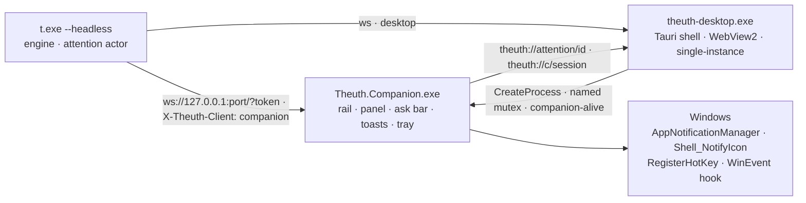

# 134 — Companion for Windows: the macOS companion (130) in WinUI 3 and C#

Status: design for review (Sky reviews §0 first). Date 2026-10-07. Base: main `d5f76242`. Parent design:
`docs/design/130-companion.md` (D1–D15, Revisions 1–2) and its as-builts W0, W1, W1S, W2, W3, W6. Everything 130
decided about *what the companion is* — the four glance questions, the two-zone rail, the card order, the 3 s hold,
by-kind notifications with breakpoint deferral, the Ask bar through theuth's desk — is inherited unchanged; this
document decides only *how it is built on Windows*. The engine additions E1–E4 already exist (130 W0) and are reused as
they are; no engine change is proposed (§5.3). Target: full parity with the macOS companion as built, on Windows 11
(build-B is Windows 11 Pro 25H2, build 26200), floor Windows 10 1809 per the Windows App SDK's own support table.

Notation: `DESK/` = `crates/desktop/src/`, `SWIFT/` = `crates/desktop/companion/Sources/`, `WIN/` =
`crates/desktop/companion-windows/`. "Sky" marks a decision he made on 2026-10-07 (quoted where he gave words);
"rec." marks the orchestrator's recommendation he has not yet ruled on. **UNVERIFIED** marks a platform claim that no
primary source or spike has confirmed yet; §7's spikes S1–S4 close them.

## 0. Decisions in one screen

1. **D1 Substrate (Sky).** C# on .NET 10 with WinUI 3 (Windows App SDK 2.x, Current channel 2.5.1 as of
   2026-09-16; 1.8 is in Maintenance). Not C++/WinRT, not Rust. An **unpackaged, self-contained** desktop app
   (`WindowsPackageType=None`, `WindowsAppSDKSelfContained=true`) so the NSIS installer carries it with no runtime
   prerequisite and no package identity. Mirrors 130 D1 (a native helper beside the shell) with the Windows
   analogue of `LSUIElement`: no taskbar button, no Alt-Tab entry, a tray icon.
2. **D2 Engine connection (unchanged from 130 D2).** One `ClientWebSocket` to the engine found through
   `%USERPROFILE%\.theuth\engine.json` (`THEUTH_DATA_DIR` overrides) with the bearer token at `<data_dir>\token`
   and `X-Theuth-Client: companion` on the upgrade; one `subscribe_events`; the same ~12 calls the Swift client
   makes (§5.3). Identical semantics, because the engine on Windows is the same `t.exe`.
3. **D3 Engine additions: none (rec.).** E1 `AttentionChanged`, E2 `waiting_since_ms`, E3 `Finished`, E4 `actor`
   stamps, the dictation stream (`dictation_*`) and `set_event_focus` are all on main and platform-neutral; the
   Windows companion consumes them. The one thing Windows *could* ask of the engine — nothing — is argued in §5.3.
4. **D4 The rail (inherits 130 D4 + R2-3).** A borderless WinUI 3 window sized exactly to its marks, 26 effective
   px wide at the right (or left) edge of the primary display, `WS_EX_TOOLWINDOW | WS_EX_NOACTIVATE |
   WS_EX_TOPMOST`, `AppWindow.IsShownInSwitchers = false`, shown with `AppWindow.Show(false)`, excluded from
   capture with `SetWindowDisplayAffinity(WDA_EXCLUDEFROMCAPTURE)` — exactly the style set theuth's island already
   uses on Windows (`DESK/island/windows.rs:1-19`). Sized to content, so no click-through window styles are needed
   (rec.; S1 proves it). "Rail presence" setting (Expanded · Sliver when quiet · Always a sliver) as R2-3.
5. **D5 The Attention panel (inherits 130 D5 + R1-5).** A second borderless window, 372 × ≤ 560 effective px,
   Mica/Acrylic backdrop (opaque when `IsSupported()` is false or transparency is off), `IsShownInSwitchers =
   false`, topmost. Hidden until summoned; when summoned it **is activated** (foreground) — the WM_HOTKEY grant
   makes that legitimate — and on Esc it hands foreground back to the window it took it from
   (`SetForegroundWindow(prev)`, allowed because we are the foreground process at that moment). Anchors: above
   the tray icon, beside the rail mark, or top-centre of the display under the mouse. Same card anatomy, per-kind
   options and `Decision = Allow | Deny` as 130 §4.2 / R1-5.
6. **D6 Keyboard grammar (inherits 130 D6 + R2-4).** `RegisterHotKey` with `MOD_CONTROL | MOD_SHIFT | MOD_NOREPEAT`
   + `VK_SPACE` (Ctrl+Shift+Space; Win-key chords are reserved for the OS and are refused by Settings); failure
   to register is detected (the call returns 0 when another app holds the chord) and falls back exactly as the
   Mac's `resolveGlobal` does. The panel grammar (1/2/3 ⏎ Esc J/K ↓/↑ R S E D O Ctrl+O Ctrl+L Tab) and the
   one `KeyTable` with scopes, legend (`Ctrl+/` or `?`), per-row rebinding and collision policy port verbatim;
   ⌘ becomes Ctrl. Double-tap-Alt stays an opt-in and uses a low-level keyboard hook (`WH_KEYBOARD_LL`) —
   no permission dialog exists on Windows, so the opt-in is a privacy choice, not a TCC one.
7. **D7 Ask bar + voice (inherits 130 D7 + R2-2, Sky's R4).** Same field, same 3 s hold, same desk routing
   (`mesh_status` → `desk_open("theuth")` → `send_input`), same live dictation over the engine's
   `dictation_prewarm/start/audio/stop` stream with the companion's own 16 kHz mono i16 PCM. Capture: WASAPI
   through `NAudio.Wasapi` (MIT, net9.0+) (rec.; the alternative `Windows.Media.Audio.AudioGraph` is §8).
8. **D8 Notifications (inherits 130 D8, Sky's R3).** Windows App SDK `AppNotificationManager` (unpackaged mode:
   `Register()` sets up COM activation itself); buttons carry the card's ≤ 3 option labels, `AddTextBox` for
   Reply / Deny-with-note / Send-back, `SetGroup(agent)` + `SetTag(item)` for per-agent stacking, blocking kinds
   immediate and silent (`MuteAudio`), deferrable kinds held by the same `NotificationPolicy` until a breakpoint,
   errors immediate with sound; the "time-sensitive" analogue is `AppNotificationScenario.Reminder`, which Windows'
   Do-not-disturb lets through only when the user allows reminders (documented, **UNVERIFIED** for third-party
   apps; S2). Elevated processes cannot post notifications — the companion must never run elevated.
9. **D9 Tray presence (translates 130 D9).** One notification-area icon (the companion's; the Tauri shell hides its
   own while the companion is alive) via `Shell_NotifyIcon` P/Invoke (rec.; H.NotifyIcon.WinUI, MIT, is §8's
   alternative). Left click → the panel above the icon; right click → Open theuth · Ask theuth… · Pause
   notifications ▸ · Launch at login · Keyboard shortcuts… · Settings… · Quit theuth. Gold `●N` overlay on the
   icon when needs-you > 0 (the tray has no title text, unlike the Mac menu bar).
10. **D10 Tauri shell changes on Windows (translates 130 D10; all in `DESK/`).** A `companion/windows.rs` backend
    replacing `other.rs` on Windows: launch `<exe dir>\companion\Theuth.Companion.exe` at start, alive detection
    by a named mutex, `companion-alive` event, tray hide/show, terminate in `RunEvent::Exit` (already called
    `DESK/lib.rs:52-56`) and before the updater installs. `theuth://` registered on Windows through the deep-link
    plugin (the NSIS installer writes `HKCU\Software\Classes\theuth`) **plus** `tauri-plugin-single-instance` with
    the `deep-link` feature — without it every link starts a second `theuth-desktop.exe` (the W1S finding). The
    route parser `deep_link_route` (`DESK/lib.rs:535-548`) is reused; `deep_links()` loses its macOS gate.
11. **D11 Build, bundle, sign.** `WIN/Theuth.Companion.slnx`: `Theuth.Companion.Rpc` and `Theuth.Companion.Core`
    are plain `net10.0` class libraries with xUnit tests that build and run on the Mac with `~/.dotnet/dotnet`;
    only `Theuth.Companion` (WinUI, `net10.0-windows10.0.26100.0`) needs Windows and is built on build-B with
    `dotnet publish -r win-x64 --self-contained` (unsigned, like every other Windows artifact today). The output
    folder becomes a Tauri resource directory `companion/` in the rendered bundle config of
    `scripts/package-windows.ps1` (step [4/6], `:183-187`) so NSIS installs it under `%LOCALAPPDATA%\theuth\companion\`.
    The same 15 JSON fixtures the Swift contract test uses (`crates/desktop/companion/Tests/TheuthKitTests/Fixtures/`)
    are consumed by `Theuth.Companion.Rpc.Tests` — one fixture set, two companions.
12. **D12 Settings (inherits 130 D12 + R2).** A WinUI Settings window with the same pages (Rail · Keys · Notifications
    · Undo delay · Launch at login · Engine); values in `%LOCALAPPDATA%\theuth\companion\settings.json` (no
    `UserDefaults`); launch at login = `HKCU\Software\Microsoft\Windows\CurrentVersion\Run\TheuthCompanion`,
    written by the companion itself (no Windows equivalent of the "main app must register" rule), mirrored into
    `<data_dir>\companion.json` so `companion_login_item_status` keeps working.
13. **D13 Cognitive-load read-back (inherits 130 D13).** The C1–C14 checklist (§6) is unchanged except C12
    (Narrator instead of VoiceOver; UIA names also drive the `windows-build-b` test harness) and C13 (Windows'
    "Animation effects" and "Transparency effects" switches instead of Reduce Motion / Reduce Transparency).
14. **D14 Spikes and waves (Sky: "this design first, then waves").** Four spikes S1–S4 are running on build-B now
    (§7, results TBD). Then W1 skeleton + RPC + Core port + tests on the Mac → W2 tray + panel + hotkey + rail →
    W3 notifications + policy + breakpoints + Settings + launch at login → W4 Ask bar + voice + receipts →
    W5 Tauri shell on Windows + bundling + NSIS. One `134-as-built-<W>.md` per wave.
15. **D15 Rejected (one line each in §8).** C++/WinRT and Rust (Sky); a Tauri in-process WebView2 panel; packaged
    MSIX / sparse package; framework-dependent runtime; Win-key hotkeys; `WS_EX_TRANSPARENT` click-through as the
    primary rail mechanism; a second tray icon; WPF or WinForms; Avalonia/Uno; Windows widgets as live state;
    immediate banners for everything; a window that stays activated.

## 1. Why (short; 130 §1 is the argument)

Sky runs theuth on Windows as well as the Mac (the Windows desktop app and CLI ship since 1.13.4; build-B is the
Windows box), and the supervision problem 130 solves — many agents, a human who must answer in two keystrokes
without losing their place — does not change with the OS. 130 §5.9 left Windows at "today's behaviour": the Tauri
tray, title/body toasts with no actions, no rail, no inbox. Sky's instruction for 134 is full parity. The engine
contract was built platform-neutral in 130 W0 precisely so a second companion is a client port, not an engine
project.

## 2. Facts relied on

Every platform fact below was read on 2026-10-07 from the primary source named; theuth facts carry `path:line` at
main `d5f76242`. Where a fact is a documented *claim* that no spike has exercised, it is marked UNVERIFIED and
assigned to a spike.

### 2.1 Windows App SDK, WinUI 3, .NET

| # | Fact | Source |
|---|---|---|
| A1 | Windows App SDK **2.0** was released 2026-04-29; latest patch **2.5.1** (2026-09-16), support level *Current* until 2027-04-29. **1.8** (2025-09-09, patch 1.8.260921001) is *Maintenance*; 1.7 and earlier are out of support. 2.0 Preview 2 preceded it on 2026-03-31. | [Release channels — servicing table](https://learn.microsoft.com/en-us/windows/apps/windows-app-sdk/release-channels) |
| A2 | Windows App SDK APIs "run on Windows 11 and earlier versions starting from Windows 10, version 1809"; the per-version support matrix lists 2.0 on Win11 26H2 → Win10 1809 and Server 2019/2022. | [Overview](https://learn.microsoft.com/en-us/windows/apps/windows-app-sdk/), [Supported releases](https://learn.microsoft.com/en-us/windows/apps/windows-app-sdk/support) |
| A3 | An **unpackaged** app sets `<WindowsPackageType>None</WindowsPackageType>`; the generated auto-initializer calls the Bootstrapper so the runtime is found. **Self-contained** adds `<WindowsAppSDKSelfContained>true</WindowsAppSDKSelfContained>` and bundles the runtime into the output folder — "significantly larger", no prerequisite on the machine. Unpackaged apps have **no package identity**: no manifest-based features (StartupTask, background tasks, file associations), but "installer-written registry entries and shortcuts still work". `PublishSingleFile` works only for unpackaged self-contained apps (1.5+) and extracts to a temp dir at first launch; `dotnet publish` cannot single-file the native runtime otherwise. | [Distribute an unpackaged WinUI 3 app](https://learn.microsoft.com/en-us/windows/apps/package-and-deploy/unpackage-winui-app), [Use the runtime](https://learn.microsoft.com/en-us/windows/apps/windows-app-sdk/use-windows-app-sdk-run-time), [Self-contained deploy](https://learn.microsoft.com/en-us/windows/apps/package-and-deploy/self-contained-deploy/deploy-self-contained-apps) |
| A4 | Self-contained output **size**: not stated on Learn. **UNVERIFIED** — S1 measures the publish folder (expect tens of MB for the WinAppSDK runtime + .NET runtime). Relevant because the installer carries it (§5.7). | — |
| A5 | .NET 10 with Windows App SDK 2.x: build-B has .NET SDK 10.0.201 and VS 2026 18.4 with the WinUI workload and the `Microsoft.WindowsAppSDK.Cs.Dev17 2.0` templates; the Mac has a user-local .NET SDK 10.0.201 at `~/.dotnet` (not on PATH). The exact TFM (`net10.0-windows10.0.26100.0`) and the WinAppSDK NuGet's .NET 10 support are **UNVERIFIED** until S1 builds the template app on build-B. | knowledge `hosts/build-b-windows-11-winui-dev-box-2026-10-07`, `facts/sky-mac-dotnet-10-sdk-user-local-2026-10-07` |
| A6 | `OverlappedPresenter.IsAlwaysOnTop` (topmost), `IsResizable`, `SetBorderAndTitleBar(hasBorder, hasTitleBar)`; `AppWindow.IsShownInSwitchers` ("`true` if this window will appear in … ALT+TAB and taskbar"); `AppWindow.Show(bool activateWindow)` shows without activating when `false`. | [OverlappedPresenter](https://learn.microsoft.com/en-us/windows/windows-app-sdk/api/winrt/microsoft.ui.windowing.overlappedpresenter), [IsShownInSwitchers](https://learn.microsoft.com/en-us/windows/windows-app-sdk/api/winrt/microsoft.ui.windowing.appwindow.isshowninswitchers), [Show(Boolean)](https://learn.microsoft.com/en-us/windows/windows-app-sdk/api/winrt/microsoft.ui.windowing.appwindow.show) |
| A7 | Backdrops: `MicaController` / `DesktopAcrylicController` (`IsSupported()` gates; `Kind` Base/BaseAlt, Base/Thin), attached with `AddSystemBackdropTarget` + `SetSystemBackdropConfiguration`. The controller's fallback is driven by `SystemBackdropConfiguration.IsInputActive` — "whether the system backdrop should consider the current window as having input focus" — which **the app sets** (the sample wires it to `Window.Activated`). So a never-activated rail keeps its material by setting `IsInputActive = true` itself; `FallbackColor` covers unsupported systems and "Transparency effects" off. | [Apply Mica or Acrylic](https://learn.microsoft.com/en-us/windows/apps/windows-app-sdk/system-backdrop-controller), [IsInputActive](https://learn.microsoft.com/en-us/windows/windows-app-sdk/api/winrt/microsoft.ui.composition.systembackdrops.systembackdropconfiguration.isinputactive) |
| A8 | DPI: WinUI 3 lays out in effective pixels; `XamlRoot.RasterizationScale` is "the number of raw (physical) pixels for each view pixel". `DisplayArea` gives `WorkArea`, `OuterBounds`, `IsPrimary`, `Primary`, `GetFromPoint(point, fallback)` in screen coordinates — the rail and panel are placed with these (physical px, divided by the scale for layout). | [RasterizationScale](https://learn.microsoft.com/en-us/windows/windows-app-sdk/api/winrt/microsoft.ui.xaml.xamlroot.rasterizationscale), [DisplayArea](https://learn.microsoft.com/en-us/windows/windows-app-sdk/api/winrt/microsoft.ui.windowing.displayarea) |
| A9 | Single instance: `AppInstance.FindOrRegisterForKey(key)` returns the instance that already holds the key; `IsCurrent` false → `RedirectActivationToAsync(args)` and exit. Unpackaged apps are "multi-instanced by default". | [App instancing](https://learn.microsoft.com/en-us/windows/apps/windows-app-sdk/applifecycle/applifecycle-instancing) |
| A10 | Accessibility: `AutomationProperties.Name` is the accessible name UIA exposes (Narrator reads it; "button button" repetition is the anti-pattern to validate against). `AutomationProperties.AutomationId` is the stable test id. The UIA tree has raw/control/content views; `windows-build-b`'s `ui_find`/`ui_snapshot` read it. | [Basic accessibility information](https://learn.microsoft.com/en-us/windows/apps/design/accessibility/basic-accessibility-information); knowledge `facts/windows-mcp-remote-via-supergateway-build-b-2026-10-07` |

### 2.2 Win32 window behaviour

| # | Fact | Source |
|---|---|---|
| B1 | `WS_EX_NOACTIVATE` (0x08000000): "does not become the foreground window when the user clicks it … should not be activated through programmatic access or via keyboard navigation by accessible technology"; activate explicitly with `SetActiveWindow`/`SetForegroundWindow`. `WS_EX_TOOLWINDOW` (0x80): "does not appear in the taskbar or in the dialog that appears when the user presses ALT+TAB". `WS_EX_TOPMOST` (0x8): stays above non-topmost windows "even when the window is deactivated"; add/remove with `SetWindowPos`. `WS_EX_TRANSPARENT` (0x20) alone is a *painting* order flag; `WS_EX_LAYERED` (0x80000) marks a layered window. | [Extended Window Styles](https://learn.microsoft.com/en-us/windows/win32/winmsg/extended-window-styles) |
| B2 | Click-through: "Hit testing of a layered window is based on the shape and transparency of the window … if the layered window has the **WS_EX_TRANSPARENT** extended window style, the shape of the layered window will be ignored and the mouse events will be passed to other windows underneath". `WM_NCHITTEST` → `HTTRANSPARENT` passes only to "underlying windows **in the same thread**" — useless across processes. Hence D4: size the rail to its content instead. | [Window Features — layered windows](https://learn.microsoft.com/en-us/windows/win32/winmsg/window-features), [WM_NCHITTEST](https://learn.microsoft.com/en-us/windows/win32/inputdev/wm-nchittest) |
| B3 | theuth already applies `WS_EX_TOOLWINDOW | WS_EX_NOACTIVATE | WS_EX_TOPMOST` to the island HWND and shows with `SW_SHOWNOACTIVATE`, re-asserting `HWND_TOPMOST` because "a `SetWindowLongPtr` style change alone does not" — the same recipe for the rail. | `DESK/island/windows.rs:1-19`, `:34-36` |
| B4 | Capture exclusion: `SetWindowDisplayAffinity(hwnd, WDA_EXCLUDEFROMCAPTURE)` (0x11) — "displayed only on a monitor. Everywhere else, the window does not appear at all"; Windows 10 2004+; top-level windows only; works only while DWM composes; explicitly "no guarantee" (not DRM). theuth calls it through Tauri's `set_content_protected` for the point overlays (`DESK/point/mod.rs:612`). The analogue of 130's `sharingType = .none`; keep a `--shareable` flag for screenshot-based checks (130 R1-6). | [SetWindowDisplayAffinity](https://learn.microsoft.com/en-us/windows/win32/api/winuser/nf-winuser-setwindowdisplayaffinity) |
| B5 | Foreground rules: a process may `SetForegroundWindow` only if it is a desktop app, no menu is active and `LockSetForegroundWindow` was not called, **and** one of: foreground lock timeout expired · it is the foreground process · it was started by the foreground process · no foreground window · **it received the last input event** · a debugger is attached. Otherwise the taskbar button flashes. | [SetForegroundWindow](https://learn.microsoft.com/en-us/windows/win32/api/winuser/nf-winuser-setforegroundwindow) |
| B6 | Hotkey grant: "windows with registered hotkeys *do* get the foreground love … If you call `SetForegroundWindow` from inside your hotkey handler, the foreground window will change according to your instructions." Combined with B5's "calling process is the foreground process", the panel can also give focus **back** to the previous window on Esc. | [Raymond Chen, 2009-02-26](https://devblogs.microsoft.com/oldnewthing/20090226-00/?p=19013) |
| B7 | `RegisterHotKey(hWnd, id, fsModifiers, vk)`: `MOD_NOREPEAT` (0x4000) suppresses auto-repeat; `MOD_WIN` chords "are reserved for use by the operating system"; a hot key with the same `hWnd`/`id` is replaced; returns 0 on failure (a chord already held by another app — the collision detection macOS lacks). `WM_HOTKEY` is posted "at the top of the message queue" of the registering thread. | [RegisterHotKey](https://learn.microsoft.com/en-us/windows/win32/api/winuser/nf-winuser-registerhotkey), [WM_HOTKEY](https://learn.microsoft.com/en-us/windows/win32/inputdev/wm-hotkey) |
| B8 | Breakpoint signals: `SetWinEventHook(EVENT_SYSTEM_FOREGROUND … WINEVENT_OUTOFCONTEXT)` with `idProcess = 0` receives foreground changes from all processes without a DLL; `GetLastInputInfo` returns the tick of the last input in *this session* (not guaranteed monotonic; `SendInput` supplies its own tick — the same "theuth drives the mouse" caveat as the Mac's HIDIdleTime). Neither needs a permission. **UNVERIFIED** that the hook fires for the companion's own non-activating windows (S4 measures). | [SetWinEventHook](https://learn.microsoft.com/en-us/windows/win32/api/winuser/nf-winuser-setwineventhook), [GetLastInputInfo](https://learn.microsoft.com/en-us/windows/win32/api/winuser/nf-winuser-getlastinputinfo) |
| B9 | Transparent WinUI 3 windows (per-pixel alpha over the desktop) are **UNVERIFIED**; the design does not need them — the rail and panel are opaque-with-backdrop surfaces with rounded corners (`DwmSetWindowAttribute(DWMWA_WINDOW_CORNER_PREFERENCE, DWMWCP_ROUND)`, Windows 11). S1 records what a borderless WinUI window looks like at 26 px. | — |

### 2.3 Notifications, tray, startup, audio

| # | Fact | Source |
|---|---|---|
| C1 | `AppNotificationManager.Default.Register()` — "For unpackaged apps, `Register()` automatically sets up the COM server registration that allows Windows to launch your app when a notification is clicked. You don't need to configure COM activation or an AUMID manually." The `NotificationInvoked` handler must be attached **before** `Register()`, and `Register()` before `AppInstance.GetCurrent().GetActivatedEventArgs()`; `Unregister()` on exit. A click on a notification while the app is not running launches it with `ExtendedActivationKind.AppNotification`. The spec adds: the current `.exe` is the COM server; WinAppSDK derives DisplayName and icon for unpackaged apps. | [App notifications with a .NET app](https://learn.microsoft.com/en-us/windows/apps/develop/notifications/app-notifications/app-notifications-dotnet), [Quickstart](https://learn.microsoft.com/en-us/windows/apps/develop/notifications/app-notifications/app-notifications-quickstart), [spec](https://github.com/microsoft/WindowsAppSDK/blob/main/specs/AppNotifications/AppNotifications-spec.md) |
| C2 | "App notifications are not supported when your app is running with administrator privileges (elevated). `Show` will fail silently." | Quickstart, Overview (Limitations) |
| C3 | Content: `AppNotificationBuilder.AddText/AddButton(AppNotificationButton.AddArgument)/AddTextBox/SetAudioUri/MuteAudio/SetGroup/SetTag/SetScenario`; **up to 5 buttons** including context-menu items; buttons appear in the expanded part; arguments come back as `action=…&id=…` strings. | [App notification content](https://learn.microsoft.com/en-us/windows/apps/develop/notifications/app-notifications/app-notifications-content) |
| C4 | `AppNotificationScenario` = Default · Reminder · Alarm · IncomingCall · Urgent; Urgent "only supported on Windows 10 Build 19041 and later" (`IsUrgentScenarioSupported`). | [AppNotificationScenario](https://learn.microsoft.com/en-us/windows/windows-app-sdk/api/winrt/microsoft.windows.appnotifications.builder.appnotificationscenario?view=windows-app-sdk-2.0) |
| C5 | Do not disturb: "you will only receive banners for alarms, reminders, and apps of your choice. Other notifications are sent directly to the notification center"; priority settings let the user allow calls/reminders and named apps; per-app priority Top/High/Normal orders the centre. So a `Reminder`-scenario error banner is the closest analogue to macOS time-sensitive, **UNVERIFIED** for third-party apps (S2). | [Notifications and do not disturb](https://support.microsoft.com/en-gb/windows/experience/notifications-and-do-not-disturb-in-windows) |
| C6 | Tray: `Shell_NotifyIcon` is Win32 (P/Invoke, no dependency). `H.NotifyIcon.WinUI` (HavenDV, **MIT**, 768★, NuGet) wraps it for WinUI with context menus, Efficiency Mode and trimming/NativeAOT support. | [H.NotifyIcon](https://github.com/HavenDV/H.NotifyIcon) |
| C7 | Launch at login: `desktop:StartupTask` lives in the appx manifest → needs package identity (A3 rules it out). The classic path is `HKCU\Software\Microsoft\Windows\CurrentVersion\Run` (per-user, runs at every logon of that user; the user can disable it in Settings › Apps › Startup). | [StartupTask element](https://learn.microsoft.com/en-us/uwp/schemas/appxpackage/uapmanifestschema/element-desktop-startuptask), [Run and RunOnce keys](https://learn.microsoft.com/en-us/windows/win32/setupapi/run-and-runonce-registry-keys) |
| C8 | Audio: NAudio (**MIT**, 6.2k★) v3 split into packages; `NAudio.Wasapi` = "WASAPI playback, capture and loopback; Media Foundation codecs" (Windows), minimum TFM **net9.0**, Native-AOT compatible core. No permission dialog for an unpackaged desktop app; Windows' Settings › Privacy › Microphone "Let desktop apps access your microphone" governs it (**UNVERIFIED** on build-B: WASAPI was silent over SSH there, so the test must run in the RDP session). | [NAudio](https://github.com/naudio/NAudio); knowledge `facts/theuth-windows-host-issues-inventory-2026-09-23` |
| C9 | Deep links: on Windows the NSIS template writes `SHCTX\Software\Classes\<protocol>` (`URL Protocol`, `DefaultIcon`, `shell\open\command "<app>.exe" "%1"`) for every `deep_link_protocols` entry and deletes them on uninstall; `SHCTX` is HKCU for a `currentUser` install. Tauri: "On Linux and Windows deep links are delivered as a command line argument to a new app process. The deep link plugin has integration with the single instance plugin" (feature `deep-link`, registered first). | [installer.nsi:671-677, 806-812](https://github.com/tauri-apps/tauri/blob/dev/crates/tauri-bundler/src/bundle/windows/nsis/installer.nsi), [Tauri deep linking](https://v2.tauri.app/plugin/deep-linking/) |
| C10 | The UI-automation harness: sbroenne/mcp-windows 1.3.27 (**MIT**) — "Uses the Windows UI Automation API to find UI elements reliably, regardless of DPI, theme, resolution"; served to the Mac as `windows-build-b` (18 tools: `ui_find/ui_click/ui_type/ui_read/ui_snapshot/ui_wait/ui_batch`, `app`, `window_management`, `keyboard_control`, `mouse_control`, `screenshot_control`, …). Must run in the interactive RDP session; Windows Terminal's buffer is not readable through UIA (read build output from the ssh PTY). | [mcp-windows](https://github.com/sbroenne/mcp-windows); knowledge `facts/windows-mcp-remote-via-supergateway-build-b-2026-10-07` |

### 2.4 theuth today (engine discovery and the shell on Windows)

| # | Fact | Source |
|---|---|---|
| T1 | Data dir: `$THEUTH_DATA_DIR`, else `dirs::home_dir()/.theuth` — on Windows `dirs` resolves the home to the profile folder (`%USERPROFILE%`), so build-B's account `sky` with profile `C:\Users\user` yields `C:\Users\user\.theuth`; never assume `C:\Users\<login>`. | `DESK/launch.rs:174-180`; `crates/theuth/src/main.rs:1428` |
| T2 | Engine record `<data_dir>/engine.json` = `{ pid, listen: Option<String>, started, host, version, id }`; a client uses `listen` only when `pid` is alive, else the configured `rpc.listen` from `config.yaml`, else `127.0.0.1:7777`; the desktop probes with a TCP connect before trusting it. | `crates/rpc/src/engine.rs:52-70`, `:225-245`; `DESK/launch.rs:26`, `:185-220` |
| T3 | Token: `<data_dir>/token` (64 hex chars, owner-only); the server admits `Authorization: Bearer <token>` **or** `?token=<token>` on the WebSocket upgrade; the desktop builds `ws://<listen>/?token=<token>`. | `crates/rpc/src/lib.rs:88-89`, `:254-268`, `:271-294`; `DESK/launch.rs:228-230` |
| T4 | `X-Theuth-Client: companion` on the upgrade stamps every call on that socket `user@companion` (E4); unknown or absent → `desktop`. | `crates/rpc/src/lib.rs:58-72`, test `:441-470` |
| T5 | The ~12 RPCs the Swift companion uses, all on `rpc::api::Api`: `subscribe_events` (`api.rs:1981`), `attention_list` (`:1847`), `attention_snooze` (`:1850`), `attention_dismiss` (`:1853`), `packet_get` (`:1861`), `task_decide` (`:1864`), `task_move` (`:1822`), `answer_ask` (`:605`), `resolve_approval` (`:601`), `agents_list` (`:1786`), `list_activity` (`:246`), `activity_list` (`:1840`), `send_input` (`:194`), `steer` (`:218`), `mesh_status` (`:1672`), `desk_open` (`:1792`), `set_event_focus` (`:1969`), `dictation_prewarm/start/audio/stop` (`:1298-1319`). Shapes: `AttentionItem` (`crates/roster/src/attention.rs:78-120`, with E2 `waiting_since_ms:113` and E3 `summary`/`next_steps`), `AttentionChanged` (`:138`), `Finished` kind (`:72`). | as cited |
| T6 | The shell's companion module is already a platform switch: `DESK/companion/mod.rs:7-16` picks `macos.rs` or `other.rs` (Windows/Linux no-ops: `init`, `alive() = false`, `terminate()`); `RunEvent::Exit` calls `companion::terminate()` before the engine shutdown on every OS (`DESK/lib.rs:52-56`); `companion_alive` / `companion_login_item_status` commands exist (`mod.rs:31-50`); `companion.json` is the login-item wish file (`login_item.rs:1-7`, `FILE:30`). | as cited |
| T7 | Deep links are macOS-gated today: the plugin is added only on macOS (`DESK/lib.rs:278-284`, comment: "Windows/Linux would need single-instance to not spawn a second process per link"); `deep_links()` is `#[cfg(target_os = "macos")]` (`:519-533`); `deep_link_route` is platform-neutral and unit-tested (`:535-548`, test `:577`). Scheme config lives in `tauri.macos.conf.json:45`, not the base file (W1S). | as cited |
| T8 | Windows packaging: `scripts/package-windows.ps1` builds `t.exe` + two bun helpers, stages them as `externalBin`, bundles `onnxruntime.dll` as a resource, renders `target/tauri.windows.bundle.conf.json` (`:183-187`) and runs `cargo tauri build --config` (`:189-193`); NSIS only, `installMode currentUser` → `%LOCALAPPDATA%\theuth` (`:218`), WebView2 `downloadBootstrapper`, unsigned (`:23`). `crates/desktop/tauri.windows.conf.json` sets the tray icon `icons/tray-windows.png` and the NSIS block. | as cited |
| T9 | The Windows tray today is Tauri's, id `main` (`DESK/lib.rs:367`), badge = JS `TrayIcon.setTitle('●N')` (no effect on Windows — no tray titles) and webview `notifyIfHidden` title/body toasts without actions. | `tauri.conf.json:42-44`; knowledge `facts/theuth-desktop-shell-companion-seams-2026-10-07` |

## 3. The reader's mechanics

Unchanged — 130 §3 (the four glance questions; principles P1–P13) applies verbatim. One Windows note: the Win key
is the OS's and `Alt` alone opens menus in most apps, so the opt-in gesture is **double-tap Alt** (the analogue
of ⌥⌥) and the chord default stays Ctrl+Shift+Space; both are rows in the same `KeyTable`.

## 4. The surfaces (Windows form)

Sizes are **effective pixels** (epx; 1 epx = 1 px at 100 % scale, the WinUI layout unit). The macOS numbers in
points carry over 1:1. Colours are the exact `UI/styles.css` pairs the Swift `Palette.swift` holds (gold
`#c47a2c`/`#b4531e`, faience `#5b8f8a`/`#3d6b66`, malachite `#4a8a6e`/`#2f5d4a`, carnelian `#c45a48`/`#9b2d1f`),
declared once as `ResourceDictionary` theme brushes; gold stays reserved for the wordmark, the count and needs-you
marks (C7).

### 4.1 The rail (D4)
A `Window` whose `AppWindow` has an `OverlappedPresenter` with `SetBorderAndTitleBar(false, false)`,
`IsResizable = false`, `IsAlwaysOnTop = true`; `IsShownInSwitchers = false`; HWND ex-style `WS_EX_TOOLWINDOW |
WS_EX_NOACTIVATE | WS_EX_TOPMOST` (B1, B3); shown with `Show(false)`; `WDA_EXCLUDEFROMCAPTURE` unless
`--shareable` (B4). 26 epx wide, height = content (wordmark + count + marks + hairline + marks + `+N`), placed with
`DisplayArea.Primary.WorkArea` (or the configured display) at the right edge, vertically centred; it never
overlaps the taskbar because `WorkArea` excludes it. Rounded 10 epx inner corners via DWM corner preference
(B9). Backdrop: `DesktopAcrylicController` Thin with `IsInputActive = true` held constant (A7), `FallbackColor`
= the panel surface when unsupported or transparency effects are off. Zones, states, glyphs, ≤ 12 marks + `+N`,
the 380 ms working beat (static when `UISettings.AnimationsEnabled` is false), hover tooltips and peek cards —
all as 130 §4.1 / W1. Clicks: the rail is `NOACTIVATE`, so a click on a mark never takes foreground from the
user's app; it opens the panel (which then activates — 4.2). Because the window is sized to its marks, nothing
outside the marks exists to click through (B2); the quiet state is a 4 epx × 120 epx sliver window, hover
expands. "Rail presence" (R2-3): Expanded · Sliver when quiet · Always a sliver — the tray `●N` is the indicator.

Windows difference from macOS: the rail may collide with the taskbar when the taskbar is on the right (rare;
`WorkArea` handles it) and with Windows 11 widgets/snap flyouts at the screen edge; S1 records what happens when
Snap Assist's edge zone and the rail overlap, and Settings can move the rail to the left edge.

### 4.2 The Attention panel (D5)
A second borderless, topmost, `IsShownInSwitchers = false` window, 372 epx × ≤ 560 epx, Mica (Base) backdrop with
Acrylic fallback, opaque under "Transparency effects off". **Summoned = activated**: on `WM_HOTKEY` the companion
records `GetForegroundWindow()`, then `AppWindow.Show(true)` + `SetForegroundWindow(panel)` — legitimate under
B6; from the tray or a rail click the companion *received the last input event* (B5). On Esc (or focus loss) it
hides and calls `SetForegroundWindow(prev)`; if the previous window is gone, nothing. Keyboard input needs
activation on Windows — a `WS_EX_NOACTIVATE` window cannot hold a focused `TextBox` — so unlike the Mac, the panel
does *not* carry `NOACTIVATE`; it carries `TOOLWINDOW | TOPMOST` only. Anchors: above the tray icon (the
`Shell_NotifyIcon` rect from `Shell_NotifyIconGetRect`, clamped to the work area), beside the rail mark, or
top-centre of `DisplayArea.GetFromPoint(cursor)` ≈ 20 % down. Content order, card anatomy, per-kind options, RPC
on commit, deep content through `theuth://` — 130 §4.2 tables unchanged (R1-5: Approval = `1 Allow · 2 Deny · R
deny with a note`). Every option is a `Button` with `AutomationProperties.Name = "<label>, key <n>"` and
`AutomationId = "option-<n>"` (A10) — the same names the `windows-build-b` harness clicks in the wave gates.

Keyboard grammar: 130 §4.2's table with ⌘ → Ctrl (`Ctrl+O` session, `Ctrl+L` Ask bar, `Ctrl+/` legend, `Ctrl+,`
Settings). Keys are read on the panel window's `KeyDown` (it is active) through the ported `KeyGrammar`/`KeyTable`.
The hotkey itself toggles; hold-to-talk is the hotkey held (WM_HOTKEY gives key-down; release is observed with
`GetAsyncKeyState(VK_SPACE)` polling at 50 ms or the `WH_KEYBOARD_LL` hook when the Alt-double-tap opt-in has
installed it — S3 picks).

### 4.3 The Ask bar (D7, R2-2)
Same window class as the panel, 480 epx. Field "Ask theuth…", mic glyph, receipt row, hints "hold Ctrl+Shift+Space
· to talk · release to send in 3 s". Live dictation: `NAudio.Wasapi` `WasapiRecorder` on the default capture
endpoint → resample to 16 kHz mono i16 (NAudio `MediaFoundationResampler` or `WdlResamplingSampleProvider`) →
100 ms chunks → `dictation_audio(id, base64)`; `dictation_start(sample_rate: 16000)` **never `null`** (that would
open the engine's own microphone — W6 rule); finals in ink, the open partial muted, `DictationLevel` drives the
pulse; `dictation_stop` on release, 5 s cap on "finishing…". "Point at it" remains design 96's `Ctrl+S` in the
Tauri process. Windows difference: no system microphone prompt; the first failure to open the endpoint shows
"microphone blocked in Settings › Privacy" with a `ms-settings:privacy-microphone` link.

### 4.4 Notifications (D8)
`AppNotificationManager` (C1). Categories become argument sets: `kind=question|approval|review|finished|batch|error`,
`item=<id>`, `action=opt-1|opt-2|opt-3|reply|deny-note|send-back|clear|open|later`. Per-agent stacking:
`SetGroup(agent)`; replacement of an item's banner: `SetTag(itemId)`; withdrawal: `RemoveByTagAndGroupAsync`.
Blocking kinds → `Show` now, `MuteAudio()`; deferrable → held by `NotificationPolicy` (ported verbatim, 26 tests)
until a breakpoint — `EVENT_SYSTEM_FOREGROUND` to another process, `GetLastInputInfo` idle ≥ 20 s, or the 2-minute
cap (B8) — then one `batch` toast "theuth at your break · N for later · M finished"; errors → `Show` with the
default sound and `SetScenario(Reminder)` **only if** S2 shows a third-party Reminder breaks DND (C5), else
Default. Flood (> 10) → one summary toast. Button taps answer **immediately** (no hold) and a `.passive`
receipt toast follows; the body tap opens the panel on the item (activation args). Elevated = no toasts (C2):
the shell never launches the companion elevated, and the companion logs a warning if `IsElevated`.
Windows difference: toasts live in the notification centre until dismissed, so `RemoveByTag` on answered-elsewhere
matters more than on macOS; ≤ 5 buttons (we use ≤ 4: three options + Reply/Open).

### 4.5 Tray (D9)
`Shell_NotifyIcon` with `NOTIFYICON_VERSION_4`, icon = `crates/desktop/icons/tray-windows.png` rendered to an
`.ico` with a gold dot + count overlay drawn at runtime (Win2D or `System.Drawing` is not available in WinUI;
use `Microsoft.Graphics.Canvas` or a pre-rendered sprite set 0–9/9+ — W2 decides), tooltip "theuth · 3 need you".
Left click → panel above the icon; right click → the `MenuFlyout` (Open theuth · Ask theuth… · Pause
notifications ▸ 1 h / until tomorrow / off · Launch at login ✓ · Keyboard shortcuts… Ctrl+/ · Settings… ·
Quit theuth). The Tauri shell hides its tray (`tray_by_id("main").set_visible(false)`) while the companion is
alive and re-shows it when it exits (D10). Windows difference: icons may be hidden in the overflow chevron by
default; the tray badge replaces the Mac's `●N` title; first-run tip "pin theuth to the taskbar corner".

### 4.6 Settings (D12)
A WinUI window with a `NavigationView`: Rail (side · display · presence · show finished) · Keys (the `KeyTable`
rows with a `ShortcutRecorder` control that renders the chord itself, reset per row/all, collision policy "Already
used by <label> · Use here instead", Win-key chords refused) · Notifications (per class immediate / at break / off,
sound on errors, pause) · Undo delay 0–5 s · Launch at login (HKCU Run key, C7) · Engine (data dir, listen, hub,
client id, version). Storage: `%LOCALAPPDATA%\theuth\companion\settings.json` (D12). Windows difference: no
Accessibility prompt page — the Alt-double-tap toggle explains that it installs a keyboard hook that sees key
*codes* (not text) only while the companion runs.

### 4.7 Widgets and phone (later)
Windows Widgets Board widgets require package identity (A3) — out of scope with an unpackaged app; the phone path
is 130 W5 and unchanged.

## 5. Architecture

### 5.1 Process topology
Three processes, one protocol, as 130 §5.1: `t.exe --headless` (engine), `theuth-desktop.exe` (Tauri shell +
WebView2), `Theuth.Companion.exe` (this design). The shell launches and terminates the companion and hands
`theuth://` links to its window; the companion talks only to the engine. On Windows the shell additionally owns
single-instance for deep links (D10) and must stop the companion before the NSIS updater runs (locked files).



### 5.2 Projects, namespaces, layout (D11)
```
crates/desktop/companion-windows/
  Theuth.Companion.slnx
  Directory.Build.props                — LangVersion, Nullable, TreatWarningsAsErrors, version from workspace Cargo.toml
  src/Theuth.Companion.Rpc/            — net10.0: Discovery, RpcClient (ClientWebSocket, JSON-RPC 2.0), Models, Json
  src/Theuth.Companion.Core/           — net10.0: RailModel, PanelModel, UndoQueue, KeyGrammar, KeyBindings, CardModel,
                                          Policy, Breakpoint, PolicySettings, AskRouter, ReceiptModel, AskVoice/AskDictation
  src/Theuth.Companion/                — net10.0-windows10.0.26100.0, WinUI 3, WindowsPackageType=None, SelfContained:
                                          App, Store, Windows/{Rail,AttentionPanel,AskBar,Legend,Settings}, Tray, Hotkeys,
                                          Notifications/Notifier, Breakpoints/BreakpointSource, Voice/VoiceRecorder,
                                          Interop/ (CsWin32-generated P/Invoke), Assets/
  tests/Theuth.Companion.Rpc.Tests/    — xUnit: FixtureTests over ../../../companion/Tests/TheuthKitTests/Fixtures/*.json
  tests/Theuth.Companion.Core.Tests/   — xUnit: the CompanionCore suites ported one-for-one
  build.ps1                            — dotnet publish → target/release/companion-windows/ (used by package-windows.ps1)
  test.sh                              — ~/.dotnet/dotnet test on the two net10.0 test projects (Mac)
```
Namespaces follow the folders (`Theuth.Companion.Core.Policy` …). Win32 calls come from the `Microsoft.Windows.CsWin32`
source generator (MIT) — no hand-written `DllImport` signatures; the `NativeMethods.txt` lists exactly the ~20
functions used (`SetWindowLongPtrW`, `SetWindowPos`, `SetWindowDisplayAffinity`, `RegisterHotKey`,
`SetForegroundWindow`, `GetForegroundWindow`, `SetWinEventHook`, `GetLastInputInfo`, `Shell_NotifyIconW`,
`Shell_NotifyIconGetRect`, `DwmSetWindowAttribute`, `SetWindowsHookExW`, `GetAsyncKeyState`, `CreateMutexW`, …).
Port map, Swift → C#: `SWIFT/TheuthKit/*` → `Rpc`; `SWIFT/CompanionCore/*` → `Core` (file for file, test for
test); `SWIFT/Companion/*` → `Theuth.Companion` (AppKit panels → WinUI windows; `Store` stays the one `@MainActor`
→ `DispatcherQueue`-affine object).

### 5.3 The RPC contract
`Theuth.Companion.Rpc` hand-writes the same ~12 shapes as `SWIFT/TheuthKit/Models.swift` (`AttentionKind` with
`Finished` and an `Other(string)` case, `AttentionItem` incl. E2/E3 fields, `AttentionChanged`, `AgentSummary`,
`AgentInfo`/`SessionActivity`, `ActivityEntry`, `Packet` subset, `AskRequested`/`Question`/`Answer`,
`ApprovalRequested`/`Decision`, `PendingPrompts`, `TurnFinished`, `Lagged`, `MeshStatus` subset, `Dictation*`
events) with `System.Text.Json` (`JsonNamingPolicy.SnakeCaseLower`, `JsonStringEnumConverter`, unknown fields
ignored, unknown enum tags → `Other`). **Contract test**: `FixtureTests` decodes every file in the shared
`Fixtures/` directory and asserts the same invariants the Swift test does (unknown kind → `Other`; `Answer`
encodes `{"index":1,"kind":"choice"}`; `Decision` encodes `"allow"`/`"deny"`; discovery reads `engine.json`). The
fixture directory stays where it is and is referenced by relative path, so a W0-style shape change breaks both
companions' tests at once. Calls (T5): positional params, numeric ids, one `subscribe_events(null, null)`
re-issued on every open, back-off 1 s → 30 s, pending calls failed on loss, `set_event_focus([desk])` after every
`PendingPrompts` (pre-129 engines answer -32601 → ignored). No engine addition: everything the Windows companion
reads or writes is already served to the Swift one; Windows-specific needs (tray badge, toast activation, Run key)
are all client-side. If anything, a later shared addition is a per-day cost figure (130 §9 Q9) — not Windows'.

### 5.4 State flow and threading
One UI thread (`DispatcherQueue` of `App`) owns every window (WinUI 3 supports several windows on one thread) and
the `Store`; `RpcClient` runs on the thread pool and marshals with `DispatcherQueue.TryEnqueue`. Events → 250 ms
debounced refetch (`attention_list`, `agents_list`, `list_activity`, `packet_get` per decision/review, `activity_list`
for receipts), `AttentionChanged`/`PendingPrompts`/`Lagged` → immediate. `UndoQueue` ticks on a `DispatcherQueueTimer`
(100 ms) with injected `now`; the hold → re-read (E5) → send path and the "already answered elsewhere" outcome are
the Swift ones. `NotificationPolicy.update/breakpoint/tick/pause/engine` are driven by the Store, the
`BreakpointSource` (WinEvent hook + 1 s idle sampling) and a 1 s timer.

### 5.5 Single instance, lifecycle, launch at login, crash reporting
- **Single instance**: `AppInstance.FindOrRegisterForKey("io.theuth.companion")`; a second instance redirects its
  activation (a toast click) and exits 0 (A9). The named mutex `Local\io.theuth.companion` is held for the shell's
  cheap alive check (D10).
- **Lifecycle**: launched by the shell at start (`companion/windows.rs`) or by the Run key at logon; when the engine
  goes away the companion stays alive with a dim wordmark and reconnects (as R1-2); the shell's `terminate()` posts
  `WM_CLOSE` to the rail window and waits 2 s before `TerminateProcess`. Exit code 0 always.
- **Launch at login**: `HKCU\…\Run\TheuthCompanion = "<exe>" --background` written/removed by Settings (C7),
  mirrored to `<data_dir>\companion.json` so the main UI's `companion_login_item_status` reads `enabled` /
  `not_registered`; the NSIS uninstall hook deletes the value (W5, Tauri `installerHooks` — **UNVERIFIED** that the
  hook macros exist in the pinned tauri-cli; fallback: the shell removes it on `RunEvent::Exit` when uninstalling is
  detected is *not* possible, so the hook is the plan).
- **Logging**: `Microsoft.Extensions.Logging` to `%LOCALAPPDATA%\theuth\companion\logs\companion-<date>.log` (rolling,
  7 files) plus stderr under `--probe`; the same `--probe N`, `--shareable`, `--probe-notify`, `--probe-legend`,
  `--ask-probe N --synthetic-dictation` flags as the Swift app so the wave gates are the same scripts.
- **Crash reporting**: `AppDomain.UnhandledException` + `Application.UnhandledException` write a `.crash.json` (exception,
  stack, version, engine version) beside the log; Windows Error Reporting's `LocalDumps` is **not** configured (it is
  per-machine registry). No telemetry.

### 5.6 Tauri shell changes on Windows (D10)
All in `DESK/`, Windows-gated, additive, mirroring `macos.rs`:
- `companion/windows.rs` (new, replaces `other.rs` for `target_os = "windows"`): `init` — if the mutex is free,
  `CreateProcess` `<exe dir>\companion\Theuth.Companion.exe` with `CREATE_NO_WINDOW`-irrelevant (it is a WinExe)
  and `--launched-by-shell`; `watch` — poll the mutex every 2 s (the Mac polls too, W1S); `set_alive` emits
  `companion-alive` and toggles `tray_by_id("main").set_visible(!alive)`; `terminate` — `WM_CLOSE` to the window
  class `TheuthCompanionRail`, 2 s, then `TerminateProcess`.
- `DESK/lib.rs:278-284`: add `tauri_plugin_single_instance::init(|app, argv, _| deep-link handoff)` **first** and
  `tauri_plugin_deep_link::init()` on Windows too; `deep_links()` gate becomes `any(target_os = "macos", target_os =
  "windows")`; `crates/desktop/tauri.windows.conf.json` gains `plugins.deep-link.desktop.schemes = ["theuth"]`
  (NSIS writes the registry, C9). `capabilities/default.json` already lists `deep-link:default`.
- `DESK/update.rs`: terminate the companion before `install_pending` runs the setup.exe (locked exe otherwise).
- `companion_login_item_status` (`mod.rs:43-50`) gains a Windows arm reading `companion.json`.
- `UI/App.tsx` suppresses `notifyIfHidden` and the tray badge while `companion-alive` — already platform-neutral
  once W1S's integration line is in; nothing new.

### 5.7 Build, bundle, test loop (D11, Sky's dev loop)
- **Mac** (`~/.dotnet/dotnet`, not on PATH): `test.sh` restores and runs `Theuth.Companion.Rpc.Tests` and
  `Theuth.Companion.Core.Tests`; the WinUI project is excluded from the Mac solution filter (`*.slnf`) so
  `dotnet build` of the filter never touches Windows-only TFMs.
- **build-B** (ssh PTY, orchestrator-driven, PSReadLine removed): `git pull` of the pushed branch, `build.ps1` =
  `dotnet publish src/Theuth.Companion -c Release -r win-x64 --self-contained -p:Platform=x64 -o
  target/release/companion-windows/`; artefact size logged (A4). UI checks run from the Mac through
  `windows-build-b` (`app` to launch the published exe with `--probe`, `ui_find` by `AutomationId`, `ui_click`,
  `screenshot_control` with `--shareable`).
- **Packaging** (W5): `scripts/package-windows.ps1` gains step "[3b/6] companion" (runs `build.ps1` when
  `crates/desktop/companion-windows/Theuth.Companion.slnx` exists, else a skip line, like the Mac's step 1) and
  adds `resources["../../target/release/companion-windows/"] = "companion/"` to the rendered bundle config
  (`:184-187`) so NSIS installs `%LOCALAPPDATA%\theuth\companion\Theuth.Companion.exe` beside `t.exe`'s folder;
  the CLI zip (`:201-213`) is unchanged — the companion is desktop-only. Unsigned like everything else on Windows
  (T8); Trusted Signing is the existing open question for the whole Windows line, not this design's.

## 6. Checks — the cognitive-load read-back (D13)

130 §6.1's C1–C14 apply with these Windows substitutions; "scripted day" and "screens" mean the same (a fixture-driven
run against a scratch engine; screenshots in dark and light at 100 % and 200 % scale — build-B's RDP desktop is
2016 × 1300, so 200 % is a `DisplayArea` emulation or a second RDP geometry).

| # | Windows form | Verified by |
|---|---|---|
| C1–C4, C8, C9 | unchanged | `Core` tests (card view-model, `UndoQueue`, `KeyGrammar`) on the Mac; the scripted day on build-B, timed from `WM_HOTKEY` to the engine's `answer_ask` |
| C5 | ≤ 4 glyph states per zone; colour never the only channel | `RailModel` tests; a greyscale `screenshot_control` capture under `--shareable` |
| C6 | ≤ 1 deferrable toast per 2 min; flood above 10; blocking immediate; errors immediate with sound | `Policy` tests (26, ported); the scripted day's flood segment yields exactly one summary toast (counted via `AppNotificationManager.GetAllAsync`) |
| C7 | quiet day = 4 epx sliver, no gold chrome | screens; a brush lint over the `ResourceDictionary` (gold brush referenced only by wordmark, count, needs-you mark) |
| C10 | the panel never takes foreground until summoned and returns it on Esc | scripted day with Notepad foreground: `ui_type` text before and after the panel is used lands in Notepad; `GetForegroundWindow` logged at open and close |
| C11 | hidden from capture | `screenshot_control` without `--shareable` shows neither rail nor panel; with it, both |
| C12 | Narrator reads marks as "<agent>, <state>, <since>" and options with their key; UIA names present | `ui_snapshot` of the panel lists every option with `Name` and `AutomationId`; a Narrator pass once per wave |
| C13 | "Animation effects" off removes the beat; "Transparency effects" off makes the panel opaque | screens under both switches (`UISettings.AnimationsEnabled`, `UISettings.AdvancedEffectsEnabled`) |
| C14 | instrumented, not asked | engine `attention_finished`/`attention_state` rows + `ActivityEntry.actor = user@companion`; the local log |

Metrics (130 §6.2) are collected by the same local log fields; nothing Windows-specific.

## 7. Spikes and waves (D14)

Spikes run on build-B now (another worker), read-only on the repo, as throwaway WinUI projects under
`C:\Users\user\spikes\134\`; each writes a short note to `docs/design/134/spike-S<n>.md` in a later commit. **Result
lines are TBD until the worker reports.**

| Id | Question | Done when | Result |
|---|---|---|---|
| S1 | Rail window styles: a borderless WinUI 3 window with `TOOLWINDOW\|NOACTIVATE\|TOPMOST`, `IsShownInSwitchers=false`, `Show(false)`, sized 26 × 300 epx, Acrylic Thin with `IsInputActive=true`, DWM round corners, `WDA_EXCLUDEFROMCAPTURE`; does a click on it keep Notepad foreground; is it absent from Alt-Tab/taskbar; is it absent from `screenshot_control`; does Snap Assist's edge zone fight it; **publish folder size** (A4); the exact TFM/NuGet versions that build with .NET 10 (A5) | Numbers and a screenshot in the note; the csproj that built | **TBD** |
| S2 | Unpackaged self-contained `AppNotificationManager`: `Register()` without a manifest; a toast with 3 buttons + a text box; activation while running and while not running (COM relaunch); `SetGroup/SetTag/RemoveByTag`; `Scenario.Reminder` under Do-not-disturb with "reminders" allowed (C5); what the attribution line shows for an unpackaged exe | Each behaviour recorded yes/no with the toast XML | **TBD** |
| S3 | `RegisterHotKey(Ctrl+Shift+Space)` from a WinUI app: `WM_HOTKEY` received (via `WindowMessageMonitor`/subclass), `SetForegroundWindow(panel)` succeeds from the handler (B6), `SetForegroundWindow(prev)` succeeds on Esc, failure when another app holds the chord; `Shell_NotifyIcon` left/right click and `Shell_NotifyIconGetRect`; hold detection (release) by `GetAsyncKeyState` vs `WH_KEYBOARD_LL` | Foreground before/after logged for 10 cycles; the chosen release mechanism | **TBD** |
| S4 | Breakpoint signals: `SetWinEventHook(EVENT_SYSTEM_FOREGROUND)` fires for other processes and not for the companion's own non-activating rail; `GetLastInputInfo` idle climbs 1.00 s/s and resets on real input but not on `windows-build-b`'s `ui_click` (`SendInput`?) | A 60 s trace with app switches and typing | **TBD** |

Waves. Each has owner seams (files only that wave touches), gates (Mac / build-B / MCP) and a done-when; each ends
with `docs/design/134-as-built-W<n>.md`. W1 lands before W2–W4 are cut; W2, W3 and W4 can run as parallel worktrees
on the same ownership rule 130 used (shared types stubbed by W1 with frozen signatures); W5 waits for W2.

| Wave | Scope | Owner seams | Gates | Done when |
|---|---|---|---|---|
| W1 | Skeleton: `slnx`, `Directory.Build.props`, `Rpc` (discovery, `ClientWebSocket` JSON-RPC, models, codec), `Core` (every Swift `CompanionCore` file ported with its tests), the two test projects over the shared fixtures, `test.sh`, `build.ps1`, an empty WinUI `App` that connects and logs `attention_list` counts (`--probe`) | `WIN/**` (new); `justfile` (`just companion-windows-test`) | **Mac**: `~/.dotnet/dotnet test` green (≥ 24 Rpc + ≥ 60 Core tests, the Swift counts); **build-B**: `build.ps1` publishes; **MCP**: `app` launches the exe with `--probe 15`, the log shows the engine URL and counts, exit 0 | Tests green on the Mac; the probe log on build-B matches the Swift W1 probe shape; `134-as-built-W1.md` |
| W2 | Tray + rail + Attention panel + hotkey + legend + deep links: `Tray`, `RailWindow`, `AttentionPanelWindow`, `LegendWindow`, `Hotkeys`, `Store`, `Palette` brushes, `Interop` | `WIN/src/Theuth.Companion/{Windows,Tray.cs,Hotkeys.cs,Store.cs,Interop}/**` | **build-B** publish; **MCP**: `ui_find` the rail by `AutomationId`, `screenshot_control` with/without `--shareable` (C11), hotkey via `keyboard_control` → panel appears, `ui_click` option 1 → receipt row, `ui_type` into Notepad before/after (C10), `ui_snapshot` lists options with names (C12) | C1–C5, C9–C12 recorded with screenshots; `134-as-built-W2.md` |
| W3 | Notifications + policy + breakpoints + Settings + launch at login: `Notifier`, `BreakpointSource`, `SettingsWindow`, `ShortcutRecorder`, Run key, `settings.json`, `companion.json` | `WIN/src/Theuth.Companion/{Notifications,Breakpoints,Settings}/**`, `Core/PolicySettings.cs` | **Mac**: `Policy`/`Breakpoint` tests; **build-B/MCP**: `--probe-notify` replay → toasts counted via `GetAllAsync`; a button tap answers on a scratch engine; DND behaviour per S2; Settings tabs opened by `ui_click`; Run key present/absent after the toggle (`reg query` over ssh) | C6, C7, C13; `134-as-built-W3.md` |
| W4 | Ask bar + live dictation + receipts + R on cards + hub routing: `AskBarWindow`, `VoiceRecorder` (NAudio), `Store+Ask`, `AskRouter`/`ReceiptModel` wiring | `WIN/src/Theuth.Companion/{AskBar,Voice}/**` | **Mac**: `AskRouter`/`ReceiptModel`/`AskDictation` tests; **build-B/MCP**: `--ask-probe 9 --synthetic-dictation` streams a sine through `dictation_*` and the field fills; a typed ask reaches theuth's desk and the two-line receipt renders; mic capture verified in the RDP session (C8) | C3, C4, C8; `134-as-built-W4.md` |
| W5 | Tauri shell on Windows + bundling: `companion/windows.rs`, single-instance + deep-link plugins on Windows, `update.rs` terminate-before-install, `tauri.windows.conf.json` scheme, `package-windows.ps1` step + resources, NSIS uninstall hook for the Run key | `DESK/companion/{mod,windows}.rs`, `DESK/lib.rs` (plugin block, `deep_links` gate), `DESK/update.rs`, `crates/desktop/Cargo.toml`, `tauri.windows.conf.json`, `scripts/package-windows.ps1` | **build-B**: `cargo check -p desktop` on Windows, `package-windows.ps1` end to end, install the setup.exe silently (`/S`), `reg query HKCU\Software\Classes\theuth`; **MCP**: launch theuth, tray shows exactly one icon, `theuth://attention/<id>` from `app` opens the main window on the route, quit kills both | The installed app launches the companion, hides its tray, routes a deep link, quits cleanly; `134-as-built-W5.md` |

## 8. Rejected alternatives

- **C++/WinRT** — Sky: C# + WinUI 3. Faster iteration, the same WinUI API surface, no ABI work.
- **Rust (windows-rs + a UI crate)** — Sky. Would re-create the panel as a second Rust UI stack beside Tauri.
- **A Tauri in-process WebView2 panel** (the island pattern generalised) — 130 D15's objection holds: no actionable
  toasts from the webview, one more hidden WebView2 to throttle, two renderers of one card.
- **Packaged MSIX / sparse package** for identity (StartupTask, widgets, cleaner toasts) — needs signing to install,
  a second installer beside NSIS, and the shell's updater replaces files in place; identity buys nothing the
  design needs.
- **Framework-dependent Windows App SDK runtime** — a prerequisite installer in NSIS and a version the engine
  does not control; self-contained costs disk only (A3).
- **Win-key hotkeys** — reserved for the OS (B7).
- **`WS_EX_TRANSPARENT|LAYERED` click-through as the rail's primary mechanism** — size-to-content makes it
  unnecessary (B2); kept as S1's fallback if a WinUI window cannot be 26 epx wide.
- **`WM_NCHITTEST` → `HTTRANSPARENT`** — same thread only (B2).
- **A `NOACTIVATE` Attention panel** — Windows cannot focus a `TextBox` in a never-activated window; the panel
  activates on summon and returns focus (B5/B6), which is the Spotlight pattern expressed in Win32 terms.
- **H.NotifyIcon.WinUI as the tray** — fine library (MIT), but `Shell_NotifyIcon` is ~80 lines through CsWin32 and
  one fewer dependency with its own release cadence; revisit if the icon overlay or context-menu placement costs
  more than that.
- **`Windows.Media.Audio.AudioGraph` / `MediaCapture` for the mic** — WinRT, works unpackaged, but NAudio's WASAPI
  path gives a plain PCM pull with explicit resampling and no `MediaCapture` initialisation dance; swap if NAudio's
  net9.0 floor or AOT story bites.
- **WPF or WinForms host** — would lose Mica/Acrylic, WinUI controls and the WinAppSDK notification/lifecycle APIs
  integration; **Avalonia/Uno** — a third cross-platform UI stack for a Windows-only surface.
- **Windows Widgets as live state** — identity required and a slow glance by design (as 130 rejected WidgetKit).
- **Immediate toasts for everything; deferring blocking approvals; a window that stays activated** — 130 §8.
- **Two tray icons** — one presence; the shell hides its tray while the companion is alive.

## 9. Open questions for Sky

1. **Windows App SDK line.** 2.x (2.5.1, Current; what VS 2026's templates target; 1.8 is Maintenance) · 1.8 (one
   more year of runtime familiarity on build-B, out of servicing per the table). **Rec.: 2.x.**
2. **Tray library.** `Shell_NotifyIcon` via CsWin32 · H.NotifyIcon.WinUI (MIT). **Rec.: Shell_NotifyIcon**, with
   H.NotifyIcon as the fallback if the icon overlay or menu placement costs > 1 day in W2.
3. **Who owns the Run key.** The companion writes `HKCU\…\Run` itself (simplest; mirrored to `companion.json`) ·
   the shell writes it from `companion.json` like the Mac's `SMAppService` rule · the NSIS installer offers a
   "start with Windows" checkbox. **Rec.: the companion**, with the NSIS uninstall hook removing it.
4. **Microphone stack.** NAudio.Wasapi (MIT, net9.0+) · Windows.Media.Audio AudioGraph (no dependency) ·
   flexaudio-style raw WASAPI via CsWin32 (most code). **Rec.: NAudio.Wasapi.**
5. **Error-class breakthrough under Do-not-disturb.** `Scenario.Reminder` if S2 proves a third-party Reminder
   breaks through when the user allows reminders · `Scenario.Urgent` (19041+, may still be filtered) · Default +
   sound only (the user adds theuth to DND's priority apps by hand). **Rec.: decide on S2's result; default to
   Default + sound** so nothing depends on an unverified behaviour.

## 10. Sources

Primary sources are linked inline in §2 (Microsoft Learn — Windows App SDK release channels, support, unpackaged
distribution, self-contained deployment, windowing, system backdrops, app notifications (.NET, quickstart, content,
scenario), app instancing, accessibility; Win32 — extended window styles, window features, WM_NCHITTEST,
SetWindowDisplayAffinity, SetForegroundWindow, RegisterHotKey/WM_HOTKEY, SetWinEventHook, GetLastInputInfo,
Run/RunOnce keys; Raymond Chen on hotkeys and foreground; GitHub — tauri-bundler `installer.nsi`, Tauri deep-link
docs, H.NotifyIcon, NAudio, sbroenne/mcp-windows). theuth sources are cited `path:line` at `d5f76242`. Knowledge
concepts read: `decisions/windows-companion-dev-env-build-b-2026-10-07`, `hosts/build-b-windows-11-winui-dev-box-2026-10-07`,
`facts/windows-mcp-remote-via-supergateway-build-b-2026-10-07`, `facts/theuth-release-artifact-contract-windows-linux-2026-09-23`,
`facts/theuth-windows-host-issues-inventory-2026-09-23`, `facts/sky-mac-dotnet-10-sdk-user-local-2026-10-07`, and the
130 spike/as-built facts (`facts/macos-companion-*`, `facts/theuth-companion-*`).
