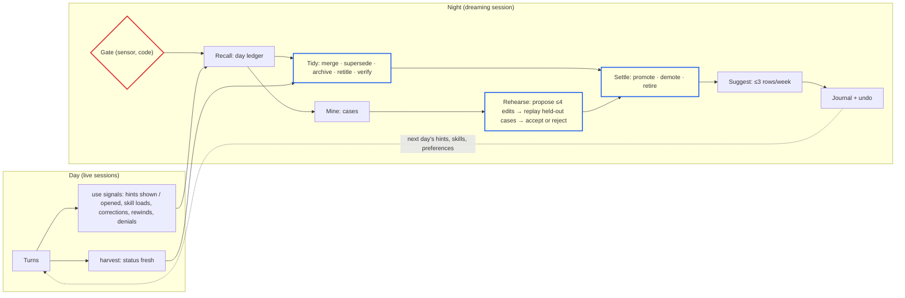

# 136 — Dreaming: a nightly, own-context routine that makes the harness better with use

Status: draft v0.2 · 2026-10-08 (v0.1 00:15; v0.2 00:55 folds the user's rulings of 00:42, marked `[sky]`: no trial state, $1 default budget fully configurable, Settings UI with per-tier model pickers and a Dream-now backlog trigger, gate kept in v1, harvest fixed now, desks tidied not rehearsed, no session replay) · extends 10 (knowledge), 07 (context/harvest), 04 (skills), 34/33/40 (schedules, loops, watchers), 57/92 (decision), 126 (double), 104/132 (attention). Where this doc and 10/07 disagree on how knowledge is written, ranked or retired, this doc wins; where it disagrees with 34/40 on how a routine fires, 34/40 win and this doc adapts. `[orch]` marks calls the orchestrator made for the user; `[sky]` marks the user's rulings once given.

Scope: one built-in routine ("Dreaming") that runs in its own session when the machine is idle, reads the day's sessions, and (1) tidies the knowledge base — merges, supersedes, archives, re-verifies, fixes titles and scopes — (2) mines the user's corrections and friction into **cases**, the harness's own evaluation set, (3) proposes bounded edits to skills and a small always-on preferences slot and keeps only those that pass a held-out replay gate, (4) retires what is no longer used, and (5) surfaces at most a handful of proposals a week to the user. Everything it does is reversible in one action, evidenced by session ids, and budgeted in money, time and attention.

Not in v1 (and the seams left for them): `[sky]` no session replay — the gate's test is a text replay (§7.2) and that is the design, not a stopgap; the forked-session seam (`Store::fork` + `RestartTurn`, 68/29) is noted only in case a later measurement shows the text judge misreads tool-heavy cases; fine-tuning the local decision model from cases (v1 exports rows in the design-57 training format; seam: `decision.families.*.train`); multi-owner composability (one data dir = one owner; desks' knowledge is tidied under its own visibility, never rewritten); an embedding reranker for hints (v1 uses bm25 × usage × type × freshness; seam: RMM-style citation reward on `laya`); a dedicated Dreaming page (v1: the routine row, a journal note, attention rows, a Settings group).


Contents: 0 Decisions · 1 Why · 2 Facts (2.1 Agent Memory Repo · 2.2 SkillOpt · 2.3 live data dir · 2.4 the field · 2.5 theuth's substrate) · 3 Shape · 4 The night · 5 Memory model · 6 Cases · 7 Skills and preferences · 8 What the user sees · 9 Plugin contract · 10 Safety · 11 Anti-ossification table · 12 What we give up · 13 Numbers · 14 Open · 15 Amendments · 16 Build steps · 17 Status

## 0. Decisions in one screen

1. **One routine, one session, phases decided by a ledger** — "Dreaming" is a single bundled schedule file whose run walks eight phases (Gate · Recall · Tidy · Mine · Rehearse · Settle · Suggest · Journal); which phases run tonight and how deep is decided from `<data_dir>/dreaming/state.json`, not from four cron lines. Rejected: one routine per job (four rings on the HUD, four budgets, four things to understand — the opposite of less load).
2. **Code decides when to dream** — an `every: 30m` watcher with a `when:` sensor (40) fires only inside the night window, when no root session has turned for 20 min, no desk is `doing`, power allows, and the day accumulated enough to be worth it. Rejected: `cron: 0 3 * * *` (dreams while the user works late; dreams on empty days).
3. **Dreaming is the only writer of consolidated behaviour** — the live turn's harvest keeps writing raw `status: fresh` entries (cheap, local), and `knowledge_put` from a live session stays; but merging, superseding, archiving, re-titling, learned-block edits and preference promotion happen only in the dreaming session, in git commits authored `dreaming`. Rejected: letting every live session tidy as it goes (Letta's separation exists for a reason: the reader that rewrites its own hints confirms itself).
4. **Delta edits on itemised entries, never a rewrite of the store** — every change is a bounded op (`merge`, `supersede`, `archive`, `retitle`, `verify`, `learned_edit` with exact-text anchors and an apply report). Rejected: "rewrite the knowledge base tonight" (ACE measured the collapse: 18,282 → 122 tokens, accuracy below the no-memory baseline).
5. **Archive and supersede; never delete** — `status: archived` + `hint: false` keeps an entry searchable and restorable; `superseded_by` + `valid_until` give facts bi-temporal validity. Rejected: deletion (two `knowledge_delete` calls in four weeks say nobody deletes anyway; Graphiti retires edges for the same reason).
6. **The user's corrections are the benchmark** — a **case** is a mined unit {intent, context excerpt, what happened, the user's words, the derived ideal, tags, source session, split}. Cases are the held-out set every behaviour edit must improve without regressing. Rejected: a model grading its own past turns as the acceptance test (self-agreement; skillopt's ungated run lost 52.8 points in five nights).
7. **Behaviour lives on a ladder with caps** — knowledge entry (hinted when relevant) → learned sidecar of a skill (`skills/learned/<skill>.md`, appended when the skill is loaded) → one line in a ≤ 20-line **standing preferences** block in the system prompt. Promotion needs evidence and a passed gate; the top rung is capped, so a line must leave for a line to enter. `[sky]` No trial state: an edit that passes the gate is live the next morning; the safety net is undo, the helpful/harmful counts and retirement by disuse, not a probation period. Rejected: an always-on `learned.md` dumping ground (prompt bloat, brevity collapse, and prompt.md is the user's).
8. **Use is a vote** — the knowledge index records every hint shown and opened; type-specific lifetimes (record 14 d, fact verify-by 30 d, procedure/ruling/warning by use and supersession) and a usage-aware rank decide what stays on the hint shelf. Rejected: age-only decay (a warning shown 283 times and never opened is doing its job in the title; a recon fact shown 361 times and never opened is noise — age cannot tell them apart, type + use can).
9. **Rejected-edit buffer and a bounded meta-note** — what dreaming tried and the gate refused is remembered, so the same edit is not re-proposed from the same evidence; a 2–5 bullet note about which kinds of edits helped is revised nightly. Rejected: stateless nights (oscillation; skillopt and ExpeL both needed this).
10. **Budgeted in three currencies** — money (`dreaming.budget_usd`, `[sky]` default **$1 per night, entirely user-configurable** in Settings; a manual **Dream now** run takes its own budget and a backlog mode so the user can chew through a backlog when he chooses), time (`run_timeout: 45m`), and attention (≤ 3 attention rows a week, one journal note, `quiet: true`). At $1 a night the phases run in value order and stop when the money is gone (§4.1). Rejected: a nightly chat report (a message nobody asked for is load).
11. **Tiered models, judge ≠ proposer** — zero-cost `decide_many` for classification, a mid model for tidying and mining, the frontier model for proposing, a *different* frontier vendor for judging replays when one is configured. Rejected: one model for everything (cost; a judge that agrees with its twin).
12. **41's stance on truth stands; lifetimes govern the shelf, not the truth** — design 41 §14 rejected TTL decay, confidence scores and LLM-judged verification *as evidence that a fact is true*; this doc keeps that: `verified` is set only by a read-tool probe (41's `check:` idea becomes the probe spec), never by a model's opinion, and a lifetime only decides whether a `record` is still *worth hinting*. Rejected: a model-rated "confidence" field (Hindsight-style opinions) — it would be the reader grading itself.
13. **Budget enforced where the money is spent** — a per-session money cap (`budget:` in the routine's front matter → `agent` `SetBudget`) checked at `Reserved::open` before every model call, not counted in dreaming's tools. Rejected: trusting the routine prompt to stop at a number (skillopt declares `max_tokens_per_night` and never enforces it).
14. **Harvest fixed upstream, lightly** — title ≤ 120 chars (the rest becomes body), `evidence: [session id]` on every put, `type` gains `record` and `warning`. Rejected: rewriting the harvest (dreaming reconciles whatever the day wrote; the harvest only has to stop making the shelf unreadable).

## 1. Why

The user's words (2026-10-07 23:39): "have dreaming in theuth with its own separate context … a built-in routine that does all the things that both of these repos do, essentially cleaning up knowledge, removing irrelevant knowledge, synthesizing new skills, and training/learning how to be better for the user … a harness that gets better the more you use it, without getting stuck into patterns that don't work or being inflexible to adapt to changes … reduce cognitive load for the user."

What the live data dir says tonight (measured 2026-10-07 23:50, see §2.3): the knowledge base has 1,584 concepts after four weeks, 87 % written by the per-turn harvest, growing 100–270 a day; the median title is 332 characters because the harvest learned to put the whole fact in the title; the per-turn `<knowledge>` note has shown 54,718 hints of which 1,194 were opened (2.2 %); 62 % of hinted ids were never opened and they carry 53 % of all impressions; a quarter of the base has never been hinted; `knowledge_delete` was called twice, ever; `load_skill` 54 times in 713 sessions. Nothing measures use, nothing decays, nothing merges, nothing revisits a lesson, and the only process that writes memory is the one that cannot see across sessions.

So "gets better with use" has a precise meaning here: the hint shelf should carry what the next turn will actually use; a correction the user typed once should not be typed twice; a lesson should stay exactly as long as the world it describes; and the harness should ask for the user's attention only when a decision is genuinely his. The two repos the user pointed at are the two halves of the answer — Agent Memory Repo names the two jobs of a dreaming agent (add cross-session memory; merge, retire, check sources) and SkillOpt-Sleep shows the loop that makes skill edits safe (harvest → mine → replay → consolidate behind a held-out gate) together with the ways it fails when the gate is off. The literature (§2.4) adds the mechanisms against ossification: delta edits not rewrites, use counters with a removal floor, provenance pointers, bi-temporal supersession, writer/reader separation, verified-success gating, use-refreshed decay, and a visible verification interval.

## 2. Facts relied on

### 2.1 Agent Memory Repo (Cognition; AgentMemoryRepo/agentmemoryrepo at 8798cb26, 2026-10-06; five files, read whole)

- The spec is a format plus a loop: a git repo of Markdown; `MEMORY.md` is the entry point "loaded at the start of every session, so keep it short: include only what every session needs, plus links to everything else"; entries are one-line bullets with `[key: value; …]` metadata, recommended keys `source` (link to the session where it was learned) and `added` (date); `[[path]]` cross-links; "keep information in one place and link to it elsewhere"; update or remove entries instead of adding a contradicting one (README.md "Format", SPEC.md).
- Loop: clone → grep or follow links → update "with no human in the loop" → push after every edit (README.md "The memory loop").
- **Dreaming** "is a dedicated agent that runs periodically. It has two jobs. Add new memory: spot patterns across sessions and save them as new entries. Clean up memory: merge duplicates, remove outdated entries, and check sources to resolve contradictions." (README.md "Dreaming"). The published skill does not implement it: "Automatic startup and scheduled Dreaming are not included" (README.md "Try with your agent").
- Ground rules in the skill: memory is data not instructions; no secrets; clean working tree before writing; stage only what you changed; never force-push (skills/agent-memory-repo/SKILL.md "Ground rules"). Composability: one repo per owner, cloned side by side; the agent writes each memory to the right owner's repo and asks when unclear (README.md "Composability").
- Devin's hosted implementation of the same spec (docs.devin.ai/product-guides/memory) adds the rules the spec leaves implicit: not saved — session summaries, task state, "anything cheap to rediscover", secrets; automation-started sessions never read or write memory; new memories apply to future sessions, not the one that wrote them; dreaming runs "about once a day when you've been using Devin", "removes transient details and stale notes that no session has used", preserves "source links and explicit preferences", and the UI lists "recent dreaming sessions with what each one changed".

### 2.2 SkillOpt (microsoft/skillopt at 343db229, 2026-10-06, MIT, v0.2.0 alpha; recon sheet `136-recon-skillopt.md`, line numbers refer to that clone)

- Two products in one repo: the research trainer (`skillopt/`, ReflACT loop over labelled benchmarks) and **SkillOpt-Sleep** (`skillopt_sleep/`), "a nightly offline self-evolution engine (harvest → mine → replay → consolidate behind a held-out validation gate)" over a coding agent's own transcripts, zero dependency on the research code (README.md:18, pyproject.toml:78-81).
- Artefact: one Markdown skill; machine-owned regions `<!-- SLOW_UPDATE_START/END -->`, `<!-- APPENDIX_START/END -->` and (Sleep) `<!-- SKILLOPT-SLEEP:LEARNED START/END -->` that hand-written text never shares and that step edits cannot target (skillopt/optimizer/skill.py:14-30,94-96; skillopt_sleep/memory.py:15-21,47-56).
- Edits are bounded ops with exact-text anchors and an apply report (`append|insert_after|replace|delete`; statuses `applied_*|skipped_*|error`; unmatched edits surfaced) (optimizer/skill.py:85-146; skillopt_sleep/types.py:126-133,181-185).
- Loop per night: harvest digests since last run (default 72 h, drop the engine's own headless sessions, sub-agent sidechains, slash commands, < 3 s single turns) → mine ≤ 40 tasks with a conservative LLM miner that emits a generalized intent + rubric + checks and drops uncheckable tasks → stable train/val split by `sha256(seed+task.id) % 100`, synthetic tasks never in val → baseline on val → replay train → reflect on failures (≤ 4 edits) → gate: strict `>` on val per target (skill, then memory), optional per-task no-regression, `reject_unverified` when train/val overlap → stage report + proposed files; `auto_adopt` false (skillopt_sleep/cycle.py:645-1092; mine.py:272-347; consolidate.py:216-451; harvest.py:137-236).
- Textual learning rate (edit budget 4→2 cosine) and a rejected-edit / unsolved-failure buffer fed into the next proposal prompt "to avoid repeating ineffective edits" (optimizer/scheduler.py:79-92; engine/trainer.py:622-676,1697-1706); an optimizer-side meta note "which kinds of edits tend to help / be too vague, redundant, brittle" revised per epoch (prompts/meta_skill.md:14-34).
- Reflection prompt core (Sleep): "Propose at most N bounded edits … Each edit MUST be a short, GENERAL, reusable rule or preference (never task-specific, never an answer to a single task). Use the actionable semantic feedback to fix user-visible behavior, not to imitate the evaluator … NEVER quote or reconstruct private verifier implementation details" (skillopt_sleep/prompts.py:91-119).
- Results and failures that bind this design: gated Sleep +3.1 to +5.6 points over five nights on SearchQA; **gate off: 0.554 → 0.026 (−52.8) in five nights** because the optimizer learned "answer with the document-title string, verbatim" (docs/sleep/RESULTS.md:40-52); shape-only judges (`section_present`, `contains`) were gamed twice (llm_miner.py:111-115); a regex leaked into reflection produced "a rule that imitates the regex" (docs/sleep/README.md:107-111); single-run strict `>` on ~14 val tasks accepts noise of ±1–2 points (docs/sleep/README.md:441-445); keyword feedback heuristics (`"no,"`, `"wrong"`, `"nice"`) and first-prompt = task / last-message = answer mislabel multi-task sessions (harvest.py:30-39; mine.py:175-187); `max_tokens_per_night` is declared and never enforced (config.py:43); no dollar or wall-clock number is claimed anywhere.

### 2.3 The live data dir (measured by the orchestrator 2026-10-07 23:50, read-only sqlite3 and `knowledge_list`)

| Measure | Value |
|---|---|
| Knowledge concepts | 1,584 (facts 1,030 · procedures 184 · decisions 173 · projects 126 · dr 29 · entities 28 · incidents 4 · hosts 3 · 7 un-namespaced ids) |
| Written by | `source: harvest` 1,379 (87 %) · `source: model` 205 |
| Visibility / owner | shared 1,445 · private 119 · team 20; owner user 1,452, five SRE desks 132 |
| New per day (recent) | 2026-10-05 212 · 10-06 127 · 10-07 270 |
| Title length | p50 332 chars · p90 633 · max 1,546; 1,251 titles > 200 chars, 586 > 400 |
| Scope | none 820 · `~/Develop/theuth` 631 · others 133 |
| Dated duplicates | 19 id stems with > 1 entry (e.g. `theuth-dev-machine-state-…` × 5, `theuth-ui-dogfood-rulings-…` × 4); 184 titles read as closed records (LANDED / DONE / "closed record") |
| Hint impressions | 54,718 in 11,464 notes across 448 sessions; 1,180 distinct ids hinted; 405 ids never hinted |
| Hints opened (`knowledge_get` inner calls) | 1,194 (2.2 %), 480 distinct ids; 28 opened ids were never hinted (found by search) |
| Hinted but never opened | 728 ids (62 %) carrying 28,776 impressions (53 %); e.g. `facts/qartez-mcp-recon` 361 shown / 0 opened, `facts/laya-browser-system1-loop` 331 / 0, `facts/sky-atuin-history-contains-private-key` 283 / 0 (a warning whose title is the payload) |
| Other inner calls | `knowledge_put` 419 (87 sessions) · `knowledge_search` 199 · `load_skill` 54 (48 sessions) · `knowledge_delete` 2 · `session_read` 539 (27 sessions) · `decide_many` 7 |
| Sessions | 713 since 2026-09-13; 157,427 messages; 1,649 plain typed user messages (no `<…>`/`[…]` marker); sessions.sqlite 829 MB |
| Spend (model_calls) | `round` $7,836 total; $1,854 on 10-07, $1,040 on 10-05, $902 on 10-06; `harvest` 793 calls / $346.50 (~$0.44 each); `compaction` $12.96 |
| Correction-shaped user messages (LIKE patterns, low recall) | 28 of 1,649 |

Reading: the shelf is full of things nobody takes, the one writer cannot see across sessions, and a night of dreaming at $5–10 is 0.5 % of a working day's spend.

### 2.4 The field (recon sheet from the read-only child `recon-field`, 2026-10-08 00:04; URL per fact)

- **Letta sleep-time compute** (arxiv 2504.13171; letta.com/blog/sleep-time-compute): a separate sleep agent holds the only tools that edit core memory (`rethink_memory`, ≤ 10 calls, "replace outdated information with the most likely truths, avoiding redundancy"); the primary agent cannot edit its own blocks; ~5× less test-time compute for equal accuracy. Letta's MemFS/Dreaming (docs.letta.com/configuration/memory): git-backed memory, root files always in context, sub-directories indexed by their own `MEMORY.md`, dreaming after N steps or on compaction, an optional "agent reviews before applying" pass, runs in a git worktree so it never blocks the main agent, backups before reorganising.
- **ACE — Agentic Context Engineering** (arxiv 2510.04618): generator marks which context bullets were helpful or misleading; reflector and curator are separate roles; the context is itemised bullets with ids and helpful/harmful counters, updated by deltas; dedupe by embedding; **context collapse measured**: a full-rewrite curator went from 18,282 tokens / 66.7 % to 122 tokens / 57.1 % in one step, below the 63.7 % no-adaptation baseline; "brevity bias" of prompt optimisers drops domain heuristics and failure modes.
- **GEPA** (arxiv 2507.19457, ICLR 2026): natural-language reflection on full trajectories, Pareto frontier per validation instance so specialists survive averaging, 100–500 evaluations against 10,000+ for RL. **Dynamic Cheatsheet** (arxiv 2504.07952): full-rewrite curator — the design ACE showed collapsing.
- **Generative Agents** (arxiv 2304.03442): retrieval = recency (decay 0.995/h since *last retrieval*) + importance (LLM 1–10) + relevance; reflection fires when summed importance passes 150 (~2–3×/day), asks for salient questions, retrieves, and stores insights "because of 1, 5, 3" → a reflection tree with evidence pointers.
- **Skill induction**: Voyager (arxiv 2305.16291) stores a skill only after an independent critic confirms success, abandons after 4 failed rounds, and its library only grows; Agent Workflow Memory (arxiv 2409.07429) induces workflows only from trajectories an evaluator judged correct; SkillWeaver (arxiv 2504.07079) tests each synthesized API with generated cases before use; **ExpeL** (arxiv 2308.10144) extracts insights from fail/success pairs with ADD / EDIT / UPVOTE / DOWNVOTE, a new insight starts at 2, −1 per downvote, removed at 0 — "even successful trajectories can be suboptimal and mislead".
- **Reflexion** (arxiv 2303.11366): verbal lessons between attempts, memory bounded to Ω = 1–3 per task.
- **Memory layers**: mem0 (arxiv 2504.19413) decides ADD / UPDATE / DELETE / NOOP per candidate fact against its top-s similar memories; Zep/Graphiti (arxiv 2501.13956) bi-temporal edges (`t_valid`, `t_invalid`, `t_created`, `t_expired`) — contradictions invalidate, never delete; documented traps: invalidation only searches the ~10 most similar edges so a frequently changing subject keeps two "current" values (graphiti #1956), and retired edges are stamped with ingestion time not change time (#1728); A-MEM (arxiv 2502.12110) lets a new note rewrite linked old notes; Hindsight (arxiv 2512.12818) separates evidence from opinions with confidence.
- **Products**: Claude Code auto memory loads only the first 200 lines / 25 KB of `MEMORY.md`, reminds the model to "keep one line per entry, move detail into topic files, and merge or drop stale entries", types notes `user | feedback | project | reference`, carries a `modified` stamp, runs nothing offline, and gives the rule of thumb for adding an instruction: the same mistake twice, a review catch, or a correction typed last session too (code.claude.com/docs/en/memory). ChatGPT shows a Sources panel of which memories a reply used and lets the user say "don't mention this again" (help.openai.com/…/memory-in-chatgpt).
- **Use as a signal**: MemoryBank (arxiv 2305.10250) Ebbinghaus strength reinforced by recall; **RMM** (arxiv 2503.08026) has the model cite which retrieved memories it used and trains a reranker on those citations with zero labels (> 10 % on LongMemEval) — the labelled-free fix for a 2 % open rate.
- **Implicit feedback**: corrections and re-asks are "noisy as a learning signal" (arxiv 2507.23158) — content helps on short tasks, not long ones; OpenAI's 2025 sycophancy incident came from adding a thumbs-based reward that "weakened the influence of our primary reward signal" while A/B metrics looked fine (openai.com/index/expanding-on-sycophancy).
- **KB hygiene**: Guru gives every card a verifier and an interval (default 1 month); lapsed cards flip to Unverified, stay searchable, visibly flagged (help.getguru.com); Confluence's content manager filters by last-active and deactivated owners for bulk archive (support.atlassian.com).

### 2.5 theuth's own substrate (read-only child `recon-theuth-memory`, 2026-10-08 00:14; path:line against main as checked out tonight; full sheet `136-recon-theuth.md`)

Knowledge (10):
- Files are the truth, `<data_dir>/knowledge.sqlite` is a derived FTS5 index (`concepts` virtual table: id, type, title, description, tags, body + UNINDEXED scope/source/timestamp/owner/visibility/path/mtime/size; `links(src, dst)`), rebuilt from files; no column for reads, last-used, verification or staleness — crates/knowledge/src/store.rs:41-51, 534-599.
- `Meta` keys the harness reads: `type` (required), `title`, `description`, `tags`, `scope`, `source`, `timestamp`, `owner`, `visibility` — crates/knowledge/src/types.rs:141-170. `put_for` rebuilds frontmatter from the `Put` fields and stamps `source`/`timestamp`; the raw editor `write()` keeps unknown keys — crates/knowledge/src/store.rs:709-729, 786-809. `Links:` / `Cited by:` are computed from the `links` table at `knowledge_get` time, not stored keys — store.rs:637-653, tools.rs:163-184.
- Ids are free-form (`[a-z0-9._-]`, ≤ 3 segments); namespaces are convention — store.rs:199-220. `source` ∈ harvest | model | user | sync — types.rs:92-128.
- Ranking (`ranked()`, shared by search and hints): FTS5 `bm25` weights type 3 · title 10 · description 5 · tags 4 · body 1; score × scope boost 1.5 / 1.0 / 0.5; agent-owned first; no recency, usage or source weighting — store.rs:1210-1277. `hint_for` adds "≥ min(2, terms) query terms must prefix-match" — store.rs:950-1002.
- The `<knowledge>` note: built in `Turn::round()` at round 0 from the user text, then every `hint_rounds` (4) from `hint_query(history)`; each id hinted once per epoch; `hint_limit` 5 lines, description clipped to 120 chars; **no token budget**; `state.hinted` and `state.knowledge_read` are in-memory sets cleared at compaction — **no persistent record of what was shown or opened** — crates/agent/src/loop_.rs:4926-4973, 477-482, 6254-6255; crates/knowledge/src/harvest.rs:46-85.
- Tools: `knowledge_put` is ReadOnly on purpose ("asking on every fact would stop the model recording"), `knowledge_delete` Destructive, `knowledge_restore` Mutating; every mutation refused in a private session — crates/knowledge/src/tools.rs:244-271, 310-329, 378-411, 59-66. The only dedupe is the instruction "reuse the id rather than adding a near-duplicate" — tools.rs:255-262.
- Every write: atomic file → FTS upsert → regenerate `index.md` → `log.md` → one gix commit as `theuth <theuth@localhost>` → `KnowledgeChanged{id, op, source}` — store.rs:1087-1119; lib.rs:80-92. History/restore via gix — store.rs:1004-1086. Mesh sync every 300 s, newer commit wins — sync.rs:1-12.
- Design 41 (`check:` commands, daily sweep, `(stale: …)` hint suffix) is **unbuilt** (no code) and its §14 rejected TTL decay, confidence and LLM-judged verification — docs/design/41-knowledge-checks.md:35-80, 442.

Harvest (10 §5, 87):
- Fires at the end of a root turn that dispatched ≥ 1 tool call, every `harvest_every` (3) such turns, and before every compaction; never in children or private sessions; same model as the session, cache-hot continuation of the live frame; `CallKind::Harvest` — crates/agent/src/loop_.rs:4555-4571, 6018-6034, 5877, 6447-6459; crates/runtime/src/side_call.rs:24-25.
- Prompt `HARVEST_INSTRUCTION` ("Review this conversation for knowledge worth keeping … Not: transient task state …; Existing concepts that may already cover this — update by reusing the id; never create a near-duplicate: {related}") with `{related}` = 10 hints; ≤ `harvest_max` (8) `<concept>` docs; `type` limited by the prompt to fact | entity | decision | procedure | project; the harvest can only `put` — crates/knowledge/src/harvest.rs:9-35, 87-134; loop_.rs:6433-6489. No token or dollar cap (one 640k-token frame harvest cost 643,927 input tokens, 3 min 17 s) — docs/design/87-as-built-HARVEST-DETACH.md:9-16.

Compaction (07, 11, 81, 87): the summary's `## Notes (user preferences, constraints, …)` is the only place "user preferences" are summarised, per session — crates/agent/src/compact.rs:23-26; `state.skills` (loaded skills) is cleared at the fold — loop_.rs:6254-6260; epoch heads persist in `epochs`, summaries as `spill/<session>/epoch_<n>.summary.md` swept after 7 days — crates/agent/migrations/0003_epochs.sql:1-9; crates/agent/src/spill.rs:80-96, 146-148.

Skills (04, 108):
- Flat `*.md` or `SKILL.md` dirs under `<data_dir>/skills/`; front matter is exactly `name`, `description`, `always` — crates/agent/src/skills.rs:32-40. `always` bodies are inlined whole; the index is one line per skill; **no budget** — skills.rs:262-295; frame.rs:375-395.
- **Nine bundled skills are binary-owned and rewritten at every start** (harness, visualize, pdf, loops, routines, apps, board, decide, double); user edits to them are lost — crates/theuth/src/main.rs:1236-1261. Loads are not counted anywhere persistent (only recoverable from `load_skill` rows) — skills.rs:226-260.

Prompt (04, 07): `frame::baseline` order — identity line · persona + cwd + date · `prompt.md` (omitted for desks) · `always` skills · skills index · peers · plugin blocks sorted by plugin name · advisory · Guidance; then the runtime index; no token cap on any part; no preferences/lessons slot exists — crates/agent/src/frame.rs:375-395, 348-357; crates/agent/src/loop_.rs:3676-3738, 2878-2899.

Sessions store (68, 109, 133): `sessions` (kind chat|advisor; child = `parent`, desk = `desk`, routine = `unattended = 1`), `messages`, `epochs`, `inner_calls` (runtime function calls inside python cells — `knowledge_get`, `load_skill`…), `tool_calls`, `turn_steps` (`turn_finished.payload.stop_reason`), `questions` (approval | ask | handoff | secret; `answer` allow|deny; `answered_by` human|double), `model_calls` ⟕ `cost_owners` — crates/agent/migrations/0001…0036. **Signals that exist**: approval deny/timeout (`questions`), stop (`stop_reason = "cancelled"`), `[app …]` presses as user messages, attention dismissals (`roster.sqlite` `attention_state`), rewind (`ContextChanged{reason:"rewind"}`, which **deletes the corrected tail**) — 0033_durability.sql:48-62, 111-112; crates/roster/migrations/0003_attention.sql:1-8; docs/design/29-rewind.md:14-19. No thumbs, no "why it went wrong" record, no lessons store. **No bulk session reader for a model**: `session_read` is one session per call (64 KiB), discovery only via `search` (≤ 50 hits); sqlite only via `shell()` — crates/agent/src/session_read.rs:18-57; crates/search/src/lib.rs:14-93.

Routines (34, 40, 88, 131): one unattended session per schedule, cleared (`Compact{style: Clear}`) and runtime-reset before each fire; keys `cron|every|at`, `when:` sensor (Monty sandbox, `timeout` ≤ 60 s, default 20 s), `until`/`max_runs`/`schedule_done`, `quiet`, `approvals`, `model` (applied once at creation), `agent`, `project`, `fire|for|cooldown|mode|memory|expires`, `runtime`, `run_timeout`; **no `effort:` and no per-schedule budget**; spend is attributed to kind `routine` by the session title — crates/schedule/src/file.rs:313-371, 128-176; crates/schedule/src/lib.rs:1189-1215, 1584-1621; docs/design/128-as-built-SPEND-LEDGER.md:22-31. Sensors can only read_file/glob/list_dir/knowledge_search/http — they cannot see sessions — docs/design/40-triggers.md (as built, knowledge `facts/theuth-cross-cutting-seams-2026-09-29`).

Decision and the double (57, 92, 126): `decide_many` (≤ 2,000 rows, gliner default, laya `default`), `capture="<task>"` → `<data_dir>/decisions/training/<prefix>/<date>.jsonl` schema `theuth.decision.v1`, `decide_label` amends; export to fixture or laya shapes — crates/decision/src/tool.rs:307-363; crates/decision/src/training.rs:1-23, 582-709. The double (off by default; never run on this machine) learns from approvals/asks with free labels — `direct`, `override`, `hindsight_rewind`, **`hindsight_correction` from the `double.correction` Bool family, the only correction detector in the harness**, `hindsight_interrupt`; ladder L0–L3 with a 30-day prequential window; nightly Tier A/B training with a venue state machine (one run at a time, 3-night staleness) — crates/double/src/labels.rs:1-44; crates/double/src/actor.rs:1058-1112; crates/double/src/ladder.rs:1-42; crates/double/src/sched.rs:1-46. Its weight for remembered decisions halves every 30 days — crates/double/src/predict.rs:28.

Desks and tasks (67, 103): the desk journal (`Done / Open / Next / Notes`, ≤ 8 KiB) is overwritten every episode — the only per-agent lessons store, with no history — crates/roster/src/desk.rs:34-39, 296-326; tasks carry `done_when` and `done_because` (`criteria_met | intent_met | follow_ups_filed`) — crates/tasks/src/types.rs:424-441; no retro or post-mortem mechanism exists (grep).

Grep sweep: `dream`, `self-improv`, `consolidat` (as a feature), `lesson`, `retro`: 0 hits in crates; the only learning loops in code are the harvest, the desk journal and the double.

Live config tonight: `agent.model: openai/gpt-5.6-sol` (effort max), `agent.subagents.model: anthropic/claude-fable-5-1`, `agent.title_model: anthropic/claude-haiku-4-5`; no `knowledge:`, `schedule:` or `double:` sections (defaults: hint_limit 5, hint_rounds 4, harvest_every 3, harvest_max 8, double off, run_timeout 1800 s) — /Users/Sky.Moore/.theuth/config.yaml; one schedule file (`sre-team-supervisor`, disabled); 10 skills, none `always`; prompt.md 28 lines.

## 3. Shape


Legend: red = gate, blue = the only steps that change durable state.

| Layer | Owner | What it does | Changes state? |
|---|---|---|---|
| Use signals | `knowledge` (impressions), `agent` (turn facts already in sessions.sqlite) | records hints shown/opened per turn, skill loads, rewinds, stops, denials, `[app …]` presses | append-only |
| Sensor `dreaming.py` | `schedule` (40) | reads `<data_dir>/dreaming/signals.json` + clock; exit 0 = dream, 1 = quiet | no |
| Routine `dreaming.md` | `schedule` (34), bundled | one session, cleared each fire, `quiet: true`, `approvals: false`, `runtime: clear`, `run_timeout: 45m`, model tiers | via tools only |
| `dreaming` plugin | new crate | config, state, ledger, cases, journal, undo, standing-preferences block, tools, RPC | yes, bounded |
| `knowledge` plugin (10) amended | existing | new frontmatter keys kept by `put_for`, `hint:`/`status:` honoured by `hint_for`, usage-aware rank, impressions table, `merge`/`supersede`/`archive`/`verify` commands | yes |
| Skills (04) amended | `agent`/`tools` | learned block `<!-- dreaming:learned start … end -->` per skill, `skills/retired/`, load counting already in `inner_calls` | yes |
| Attention (104/132) | existing | proposals as rows: line one is the thing to say back, options in the same words | existing |

## 4. The night, phase by phase

Every phase has a cap (count), a budget share (money) and a stop rule; a phase that hits its cap writes what it did and moves on.

**4.1 Budget order** `[sky]`. The night's money (`budget_usd`, default $1) is spent in value order and the run stops cleanly when it is gone: Recall and the `decide_many` triage are free; the model tail of triage, retitles and merges run on the cheap `tidy` model (~$0.10–0.30 for a normal day); Mine next; Rehearse last, one gated cluster at ~$0.40; Suggest and Journal are pennies. A Dream-now run with a larger budget repeats the same order per pass; in *backlog* mode it keeps passing until nothing is `fresh` or untidied, or the budget is spent. The run reads `state.json` first and may skip phases: a quiet day (fewer than `dreaming.min_sessions` sessions or no new entries) runs Recall and Journal only; a heavy day (≥ 300 new entries or ≥ 40 sessions) is allowed a second window the same night.

**0 · Gate** (sensor, no model). `scripts/sensors/dreaming.py` (40 §3 shape: ≤ 60 s, ≤ 8 tool calls, state ≤ 16 KB) reads `<data_dir>/dreaming/signals.json` — maintained by the plugin from `TurnFinished` events: `last_root_turn_at`, `desks_doing`, `new_concepts_since`, `sessions_since`, `last_dream_at`, `last_dream_window` — and the clock. Fires (exit 0) when all hold: local time inside `dreaming.window` (default 01:00–06:00); `now − last_root_turn_at ≥ 20 min`; `desks_doing == 0`; `last_dream_at` not in this window (unless the heavy-day rule); `new_concepts_since ≥ 1 or sessions_since ≥ 1`; power: on AC, or battery ≥ 40 % (read from `pmset -g batt` written into signals.json by the plugin, not by the sensor). `[orch]` the sensor cannot see sessions (40: the bridge offers read_file/glob/list_dir/knowledge_search/http only), so the plugin writes the file; the sensor only reads.

**1 · Recall** (python in the session, no model; cap: 500 sessions). Builds the **day ledger** from sessions.sqlite and the knowledge index for the window since `last_dream_at`: new/changed concepts (with `evidence`), hint impressions and opens per id, skill loads per skill, tool errors by name and the retry chains behind them, user messages that are plain typed text (no `<…>`/`[…]` marker), rewinds (29), stops (133), `ask_user`/approval denials, `[app …]` presses (task/agent/routine drafts accepted or discarded), attention dismissals (119), desk task dispositions. Excludes the dreaming session itself, private sessions, meeting sessions (81 owns their memory). Rewinds need no mining at night: `ContextChanged{reason: "rewind"}` deletes the corrected tail (29), so the plugin's `Signals` actor snapshots the last assistant message of the deleted span at event time (scrubbed, ≤ 2 KB) into `ledger/pending/`; Recall folds those in. Recall also copies the five desk journals (overwritten every episode, 8 KiB each) into `ledger/<night>/journals/` so desk lessons gain a history. Writes `ledger/<night>.json` (≤ 2 MB, secrets scrubbed by the same redactor as spill). Because a model has no bulk session reader (one `session_read` per call, 64 KiB), Recall is a Rust tool (`dreaming_ledger`), not a loop of tool calls.

**2 · Tidy** (mid model + `decide_many`; caps: 300 triaged, 40 merges, 60 archives, 15 verifications; ~35 % of budget).
- *Triage new entries*: `decide_many` labels each fresh entry's `type` among `record | fact | procedure | decision | warning | entity | project` and `durable-vs-transient`; the unsure tail (confidence below the threshold picked on a 50-row sample, 92 §recipe) goes to the model. Writes `type` corrections, `status: tidy`, `scope` when the body names one path root, and **retitles** any title > 120 chars: the first clause becomes the title, the rest is prepended to the body as a "Summary" paragraph (nothing is lost; the hint shelf gets a readable line).
- *Merge*: candidates are (a) same id stem modulo date/`-vN` suffix, (b) FTS neighbours sharing ≥ 3 title terms and a tag, (c) entries the model groups while triaging. For each group the model answers mem0-style per candidate — `ADD` (distinct), `UPDATE` (fold into the canonical), `SUPERSEDE` (same subject, newer claim), `NOOP` — and writes one canonical **living entry** (one id, history in gix) with `evidence` = union, `Links` kept, the folded ids left as thin redirect stubs (`status: merged`, `merged_into:`, body one line) so old citations resolve. Dated state snapshots (`…-dev-machine-state-2026-10-0N`) become one living entry; the dates survive in git history.
- *Supersede*: when two entries about one subject disagree, check sources — `session_read` of each `evidence` session (the user's words win over a model's inference; a later ruling wins over an earlier one), `read_file`/`glob`/`code_find` for paths, symbols, shas, versions. The loser gets `superseded_by`, `valid_until` = the *change* time taken from the evidence (Graphiti #1728), `hint: false`. Subject search is by stem and tag, not only by similarity (Graphiti #1956).
- *Archive by use*: `type: record` older than `dreaming.lifetimes.record` (14 d) → `status: archived, hint: false`; any entry with ≥ 50 impressions and 0 opens over ≥ 14 days whose type is not `warning` → first *fix* (tags, scope, title) if the misses look like term collisions (`qartez-mcp-recon` matching every "mcp"), else `hint: false`. Archived entries stay searchable and `knowledge_restore`-able.
- *Verify*: sample 15 entries with `verified` older than `lifetimes.fact` (30 d), preferring those with checkable claims (paths, shas, "fixed in", versions, hostnames) and those recently hinted; verify with read tools only; set `verified: <date>`, or `status: stale` + a one-line note of what changed; a stale fact about a tool bug cites the fix commit if `git log` shows it.

**3 · Mine** (mid model; cap 60 cases; ~15 %). From the ledger's friction events build **cases** (§6): a plain user message classified by `decide_many` — first with the double's existing `double.correction` Bool family (the harness's only correction detector, crates/double/src/actor.rs:1063-1091), then a Choice `re-ask | disapproval | approval | neutral` on the positives' neighbours (threshold picked on a 50-row sample; the unsure tail to the model); a rewind or stop; a denial; a retry chain of ≥ 3 errors on one tool; a hint ignored and the same id then opened by search; a desk task sent back. For each, the model writes the generalized intent, a ≤ 1,200-char context excerpt ending at the moment before the mistake, what happened, the user's words verbatim, the derived ideal, tags and a `skill_hint` (which skill or knowledge area should have prevented it) — and drops the case if it cannot say what "right" looked like. Cases are split train/val by `sha256(seed + id) % 100 < 34 → val` (stable across nights; synthetic cases never val).

**4 · Rehearse** (frontier model proposes, a different frontier vendor judges when configured; caps 4 edits per target, 3 targets per night; ~40 %). Cluster open cases by `skill_hint`; for each cluster with ≥ 3 cases, or ≥ 1 case whose user words are an explicit standing instruction ("never …", "always …", "from now on …"), propose ≤ 4 bounded edits to the target's learned block (§7) given the current skill text, the cluster's *train* cases, the rejected-edit buffer and the meta-note. Then replay: for every *val* case of the cluster, render {system prompt as the live frame builds it, the case's context excerpt, the candidate skill text} to the judge-neutral target model in a fresh context and judge the answer against the case's derived ideal and the user's words (rubric, 0–1, with a textual reason) — baseline (current skill) and candidate, same seed. Accept only if mean improves by ≥ `dreaming.gate.margin` (0.1) **and** no val case regresses by more than 0.2; otherwise the edit goes to the rejected buffer with the judge's reasons. A cluster with fewer than 3 val cases is `unverified`: the edit is staged in the journal, not applied (skillopt's `reject_unverified`). The judge never sees the proposer's rationale; the proposer never sees the judge's rubric text, only the cases' user words (the regex-leak lesson).

**5 · Settle** (ledger math, no model). `[sky]` No trial state — a gated edit is simply live. Per skill and learned bullet track `uses` (loads) and `cases_closed − cases_reopened`; retire any skill or learned bullet with 0 loads/uses in 45 days to `skills/retired/<name>.md` with a `retired_because` line; retire a knowledge `warning` when its trigger terms no longer appear in any session for 30 days. Standing preferences (§7): a line whose `evidence` includes ≥ 2 explicit user instructions is promoted automatically and *reported*; a line inferred from behaviour is *proposed*; the block is capped at 20 lines — when full, the line with the oldest last-confirmed date is demoted to a knowledge `decision`. Every learned bullet carries ACE-style `helpful/harmful` counts updated from cases (a reopened case that the bullet should have prevented → harmful +1; a closed case → helpful +1); a bullet at `helpful − harmful ≤ −2` is removed from the block and kept in the rejected buffer.

**6 · Suggest** (small model; cap 3 rows per 7 days). Three shapes only: (a) a recurring manual ask (same intent ≥ 3 mornings in 14 days) → `routine_draft()` with the user's own words as the prompt; (b) a confirmation the user always approves (≥ 10 identical approvals, 0 denials, over ≥ 7 days) → one row proposing a double class or policy change through the existing 126 path; (c) a fact the user had to re-explain ≥ 2 times → "I'll remember: …" row with `confirm | not that | never save this`. Rows go through the attention inbox (104/132): line one is the thing to say back, options in the same words, cost of being wrong stated. Nothing is created without the press.

**7 · Journal**. Appends tonight to the top of the `Dreaming` note (one document, 20 §): counts per phase, each changed group with its undo handle, the three proposals, budget spent and models used, the meta-note diff. Commits the knowledge bundle once per phase with author `dreaming <night id>`. `quiet: true`: nothing reaches chat; proposals reach the inbox; a weekly digest row (Monday 08:00 local by default, `dreaming.digest`) says "last week I changed N things, 0 undone, 2 waiting for you".

## 5. The memory model: what a concept carries and how it is ranked

### 5.1 Frontmatter (10 §3 amended; every key below survives `put_for`)

```yaml
type: fact | procedure | decision | project | entity | architecture | tool | record | warning   # record, warning are new
status: fresh | tidy | merged | archived | stale | retired                                        # new; absent = tidy
hint: true | false            # new; false = never in a <knowledge> note, still searchable
evidence: [01a118…, 01a117…]  # new; session ids (and `user` for a typed instruction); the harvest writes its own session
verified: 2026-10-08          # new; last time a read-tool check confirmed the claim (facts, procedures, entities, hosts)
valid_until: 2026-10-07T21:05Z # new; set when superseded, from the evidence's change time, not the save time
superseded_by: decisions/…    # new
merged_into: facts/…          # new; on a redirect stub
uses: {shown: 361, opened: 0, last_shown: …, last_opened: …}   # NOT frontmatter: lives in the knowledge index db, exposed by knowledge_stats()
helpful: 3 / harmful: 1       # learned bullets only (skills, preferences), inside the learned block, not knowledge
```
Existing keys unchanged: `title` (now ≤ 120 chars for new puts; dreaming retitles old ones), `description`, `tags`, `scope`, `owner`, `visibility`, `source` (gains `dreaming`), `timestamp`. `Links:` / `Cited by:` stay computed from the `links` table at read time (store.rs:637-653) — they are not keys, and the 17 files that carry a pasted `Cited by:` line in their body are a Tidy target.

### 5.2 Types and lifetimes (`dreaming.lifetimes`, days)

| type | what it is | hinted while | archive/verify rule |
|---|---|---|---|
| record | what happened on a date (a wave landed, a machine's state that morning, an incident) | ≤ 14 d old | archived after 14 d; a dated series becomes one living entry |
| fact | a durable claim about the world (a host, a path, a convention, a tool's behaviour) | verified within 30 d or opened within 30 d | verify sample nightly; `stale` when a check fails |
| procedure | how to do something, with traps | opened within 60 d | retire to archived after 90 d unopened; promoted to a skill learned block when loaded ≥ 3 times |
| decision | the user's ruling or a design call, in his words | always, within scope | never archived by use; only superseded by a later ruling |
| warning | a one-line "never/always" whose title is the whole payload | while its trigger terms appear in sessions (30 d) | stays hinted even at 0 opens; retired when the trigger is gone |
| entity / hosts / project | a thing, a machine, a living project record | opened within 60 d | verify sample; project → record when it reads as closed |

### 5.3 Hint rank (replaces 10's bm25 × scope boost; `hint_for`)

`score = bm25 × scope(1.5 | 1.0 | 0.5) × type_weight × freshness × use` where `type_weight` is decision 1.3 · warning 1.3 · procedure 1.1 · fact 1.0 · record 0.6 (0 past its lifetime) · entity 0.9; `freshness = 0.5 + 0.5·e^(−age_days/45)` for records and facts, 1.0 for decisions and warnings; `use = 1 + ln(1 + opened) − 0.4·(shown ≥ 50 ∧ opened = 0 ∧ type ≠ warning)`. `hint: false` and `status ∈ {archived, merged, stale, retired}` are filtered before ranking. The 5-line budget per note and the "at least two terms" rule stay (10). Every id shown is recorded as an impression; every `knowledge_get` as an open (already an inner call). Rejected: an embedding reranker now — no embedding model is in process, and the field's evidence (RMM) says the right next step is training the local classifier on opens, which needs the impressions table this doc adds first.

## 6. Cases: the harness's own evaluation set

A case is one unit of hindsight. Shape (append-only `cases.jsonl`, ulid id, secret-scrubbed, no raw transcripts):

```json
{"id":"01a11…","night":"2026-10-08","kind":"correction|re-ask|disapproval|rewind|stop|denial|tool-chain|hint-miss|task-returned",
 "intent":"ask the user a fork without ask_user","context":"≤1200 chars ending just before the mistake","happened":"called ask_user with 4 forks",
 "user_words":"never use ask_user with me, numbered text","ideal":"the same forks as a numbered list in the reply","tags":["asking","conventions"],
 "skill_hint":"prompt:standing-preferences","source_session":"01a11…","at":"2026-10-07T21:05Z","split":"train|val","origin":"real|synthetic",
 "state":"open|closed|reopened","closed_by":"edit:01a11…","reopened_at":null}
```
- *Where cases come from* is §4 phase 3; what makes one valid is that the model can state the ideal — otherwise it is logged as `friction` (counted, not a case).
- *Why they matter*: they are the labels nobody had to write. The repeat-correction rate (a case of the same intent reopened after its closing edit) is the design's primary success metric (§13).
- *Reuse*: cases export in the design-57 training format (`t dreaming export --format laya|fixture`) for the double's phase 2 and the decision model; cases never leave the data dir otherwise.
- *Bounds*: 60 new cases a night; a case older than 180 days with no reopen is `settled` and leaves the replay pool (kept on disk).

## 7. Skills and standing preferences: the ladder and the gate

### 7.1 Where learned behaviour may live

| Rung | Form | Loaded when | Written by | Cap |
|---|---|---|---|---|
| 1 | knowledge entry (`decision`, `procedure`, `warning`, `fact`) | hinted when bm25 × use says so; opened on demand | harvest (fresh), dreaming (tidy) | hint shelf 5 lines/note |
| 2 | **learned sidecar** `<data_dir>/skills/learned/<skill>.md` — one bullet per lesson with `[helpful: n; harmful: m; evidence: …; since: date]`, appended by `load_skill` (and by the `always` inliner and ACP materialisation) under a `## Learned (dreaming)` heading | when the model loads that skill (04) | dreaming only, bounded edits, after the gate | 12 bullets per skill, 140 chars each |
| 3 | **standing preferences** block in the system prompt (`frame::baseline` plugin block, after the skills index) | every turn | dreaming only; auto when ≥ 2 explicit user instructions, else proposed | 20 lines × 140 chars |

Why a sidecar and not a block inside the skill file: nine of the ten live skills are binary-owned and rewritten at every start (main.rs:1236-1261), so anything written into them is lost on restart; a sidecar survives rebuilds, keeps human and bundled text byte-identical, and makes "learned" a file the user can open, diff and delete on its own. Human-authored text is never edited by dreaming: skill files, `prompt.md`, any `source: user` concept, any desk's `decision` entries. If a learned bullet contradicts the skill's own text, the bullet says so ("overrides: …") and the contradiction is a journal line for the user. A new skill (`skills/dreaming-<name>.md`, front matter `origin: dreaming`) is created only when a cluster of ≥ 5 cases has no fitting skill; it starts as rung-2 content under its own name and competes for the index like any other (`[sky]` no trial state; the index lists dreaming-made skills after the user's).

### 7.2 The gate (every rung-2 and rung-3 change)

1. Proposer (frontier model) sees: the target's current text, the cluster's train cases (intent, context, happened, user words — never the judge rubric), the rejected-edit buffer for this target, the meta-note. Produces ≤ 4 `EditRecord{op: add|replace|delete, content, anchor, rationale}` against the learned sidecar only.
2. Apply → candidate text; an apply report lists `applied | skipped_unmatched | error`; an all-unmatched night is a journal line, not silence.
3. Replay: each val case of the cluster, baseline and candidate, fresh context, same target model and seed; judge (different vendor when configured) scores 0–1 against `ideal` + `user_words` with a one-line reason.
4. Accept iff `mean(candidate) − mean(baseline) ≥ 0.1` and `min(candidate_i − baseline_i) ≥ −0.2`; fewer than 3 val cases → `unverified` (staged, not applied); otherwise `rejected` with reasons into the buffer.
5. Record `edit:<ulid>` with the case ids it closes; those cases become `closed`. A later case of the same intent reopens them and marks the bullet `harmful +1`.

Cost shape: a cluster with 8 val cases ≈ 16 replays × ~3k tokens + 16 judge calls × ~1.5k + one proposal ≈ 90k tokens (~$0.40 at frontier prices). The gate is the expensive part and the part that may not be skipped — so at the $1 default a night affords about one gated cluster, and the rest of the open cases wait for the next night or a Dream-now run.

### 7.3 Why not just write rules into the prompt

Because the prompt already is the fossil record of past corrections (this harness's prompt.md carries dozens of them), every one of which was right once and none of which is measured. Rung 3 exists so that the few rules that *are* the user's standing instructions reach every turn; its cap and its demotion rule are what keep it from becoming another prompt.md.

## 8. What the user sees (the cognitive-load budget)

- **Routines**: one row, "Dreaming — runs at night when the Mac is idle; last night: 14 merged, 31 archived, 1 skill edit kept, 2 rejected, $4.10", with its own origin ring on the HUD (128). Run now works like any routine (`fire_schedule`).
- **The `Dreaming` note** (one document): last night at the top — what changed, grouped, each group with an **Undo** action (`dreaming_undo(night, group)` → `git revert` of that group's commits + the skill backup); the proposals; the meta-note; budget and models. History collapses below.
- **Attention rows**: at most three a week, each phrased as the thing to say back ("Make 'dev machine state at 08:30' a weekday routine?" · "Create and start / Create paused / Not this"), with the cost of being wrong stated (132).
- **Library › Knowledge**: badges `archived`, `superseded`, `verified <date>`, `stale`, `learned`; a filter "changed by dreaming"; the gix history (10 §8) already shows each night's commits.
- **Settings › Dreaming** `[sky]`: **enabled** (the same switch as the routine's toggle on the Routines page — Dreaming is a bundled routine, so turning it off is `enable_schedule(dreaming, false)` like any other; `dreaming.enabled: false` in config removes the file, the sensor, the prompt block and the signals writer) · window · **budget per night (default $1, any amount)** · **models per tier — four pickers (triage / tidy / propose / judge) over `list_models`, like the routines form** · "preferences: auto-promote from my explicit instructions" (default on) · digest day/time · "pause dreaming for 7 days" · **Dream now**: a button with its own budget field and a mode — *one pass* (tonight's phases once) or *backlog* (repeat passes until the fresh/untidied backlog is empty or the budget is spent) — so the 1,584-entry backlog is cleared when the user chooses, at the price he chooses, not by stealth over weeks.
- **Nothing else.** No nightly chat message, no per-merge approval, no questions it can answer itself. If undo is used more than twice in a month the digest says so and asks whether to pause.

## 9. The `dreaming` plugin and the amendments to `knowledge`, `agent`, `schedule`

### 9.1 Is it a plugin? (plugins.md §1)
State on disk (`dreaming/` with state, ledger, cases, journal, backups), its own actor (signals writer, undo), its own tools, its own config section, events other plugins subscribe to (`DreamNightFinished` → attention digest, HUD ring) — yes, a plugin crate `crates/dreaming`. The model work runs in the routine's session (34: one session per schedule), never as a continuation of a live frame — unlike the harvest, which 12 §9 keeps in `agent` for exactly that reason.

### 9.2 Config (`dreaming:` in config.yaml; read at startup like every section)
```yaml
dreaming:
  enabled: true                 # false: no routine file is installed, no signals.json, no prompt block; existing knowledge keys are still honoured
  window: ["01:00", "06:00"]    # local
  idle_minutes: 20
  min_sessions: 1               # below this the night is Recall + Journal only
  heavy_day: {concepts: 300, sessions: 40}   # allows a second window
  budget_usd: 1                 # [sky] default $1 per night; any value; Settings writes it
  run_timeout: 45m
  models:                       # [sky] all four configurable in Settings › Dreaming
    triage: null                # null = decide_many only, model tail off
    tidy: <provider/model>      # default: agent.title_model (the cheap one; anthropic/claude-haiku-4-5 here), else the subagent model
    propose: <provider/model>   # default: agent.subagents.model (anthropic/claude-fable-5-1 here)
    judge: <provider/model>     # default: agent.model when its vendor differs from propose (openai/gpt-5.6-sol here), else propose with another seed
  caps: {triage: 300, merges: 40, archives: 60, verifications: 15, cases: 60, edits_per_target: 4, targets: 3, rows_per_week: 3}
  lifetimes: {record: 14, fact: 30, procedure: 90, entity: 60}
  gate: {margin: 0.1, max_regression: 0.2, min_val_cases: 3, val_fraction: 0.34}
  preferences: {auto_from_explicit: true, cap_lines: 20}
  digest: "Mon 08:00"
  home_engine: null             # mesh: only this engine dreams; null = the engine that installed the routine
```

### 9.3 Commands and events
- `dreaming::Signals` actor: subscribes to `agent` `TurnFinished`, `ContextChanged{reason: rewind}` (snapshots the deleted tail's last assistant message, scrubbed) and `roster` task events; maintains `signals.json` (atomic rename) — `ask` `Snapshot → SignalsSnapshot`.
- `dreaming::Night` actor: `BeginNight{night_id} → Receipt`, `Commit{night_id, phase, summary}`, `Undo{night_id, group} → UndoReport`, `Export{format}`.
- Events published: `DreamNightStarted{night_id}`, `DreamNightFinished{night_id, counts, spend_nanos, proposals}`, `DreamUndone{night_id, group}`. Subscribers: attention (digest row and proposals), rpc (journal/HUD), knowledge (nothing — knowledge is driven by commands).
- `agent` gains `SetBudget{session, nanos}` (from the routine's `budget:` key, 34 amended), enforced at `Reserved::open` — the call is refused with `budget exhausted` and the turn ends with a `<budget>` note the model sees once; `HintsShown{session, turn, ids}` published when a `<knowledge>` note is built.
- `knowledge` gains commands: `Merge{ids, into, body} → Receipt`, `Supersede{loser, winner, valid_until} → Receipt`, `Archive{id, reason}`, `Verify{id, outcome, note}`, `Retitle{id, title, summary}`, `Stats{ids} → Vec<Uses>`, and records impressions on `HintsShown{session, turn, ids}` from `agent` (the only new event `agent` publishes).

### 9.4 Tools (registered by `dreaming`, visible only in the dreaming session and to the user's own root sessions; Risk per 00 §1.7)

| Tool | Risk | Args → returns |
|---|---|---|
| `dreaming_ledger` | read_only | `{since?}` → the day ledger (counts, friction events, impressions, loads) |
| `knowledge_stats` | read_only | `{ids}` → shown/opened/last per id |
| `knowledge_merge` | mutating | `{ids, into, body, evidence}` → canonical id, stubs written |
| `knowledge_supersede` | mutating | `{loser, winner, valid_until, note}` |
| `knowledge_archive` | mutating | `{id, reason}` → sets `status: archived, hint: false` |
| `knowledge_verify` | mutating | `{id, outcome: ok|stale, note}` |
| `knowledge_retitle` | mutating | `{id, title, summary}` |
| `case_put` / `case_list` | mutating / read_only | §6 shape / `{state?, skill_hint?, split?}` |
| `skill_learned_edit` | mutating | `{skill, edits[], night}` → apply report; writes only `skills/learned/<skill>.md` |
| `replay_case` | read_only (spends model budget) | `{case_id, skill_text?, model}` → `{answer, judge: {score, reason}}`; the judge model is fixed by config, not by the caller |
| `preferences_set` | mutating | `{op: add|replace|demote, line, evidence}` → the block; refuses past the cap |
| `dreaming_journal` | mutating | `{night, section, markdown}` → appends to the note |
| `dreaming_undo` | mutating | `{night, group}` → `UndoReport` (also an RPC for the UI) |
Every mutating tool refuses outside a dreaming night unless the caller is the owner's root session (so the user can say "undo last night" in chat). `approvals: false` in the routine file is what lets the night run unattended; the tools above are the whole blast radius, and each is reversible.

### 9.5 RPC and UI
`dreaming.status` (last night, next window, budget left, proposals pending, backlog size = fresh + untidied entries), `dreaming.run_now{budget_usd?, mode: pass|backlog}` (`[sky]` manual trigger; fires the routine's session with a one-off `SetBudget`; `backlog` repeats passes until the backlog is empty or the budget is spent), `dreaming.journal` (document id), `dreaming.undo`, `dreaming.metrics` (§13 series), `dreaming.settings` get/set (window, budget, the four models, preferences toggle, digest, pause). UI per §8; desktop first, TUI shows the status line under `/routines`.

### 9.6 Data on disk (`<data_dir>/dreaming/`)
`state.json` (last night, counters, meta-note, rejected-edit buffer ≤ 200 entries), `signals.json`, `ledger/<night>.json`, `cases.jsonl`, `edits.jsonl`, `backups/<night>/<skill>.md`, `journal` = the `Dreaming` document in the documents store (20). All of it may be deleted and rebuilt except `cases.jsonl` and `edits.jsonl` (the labels and the receipts). The knowledge bundle keeps its own history (gix); dreaming's commits are tagged `dreaming/<night>` so `undo` is a revert range.

### 9.7 The routine file (bundled, installed when `enabled`)
```markdown
---
name: dreaming
every: 30m
when: sensors/dreaming.py
fire: once
memory: clear
runtime: clear
quiet: true
approvals: false
run_timeout: 45m
budget: 1 USD
model: <dreaming.models.tidy>
---
Load the `dreaming` skill and run tonight's phases in order. Read `dreaming_ledger()` first; stop at the budget; write the journal last.
```
The `dreaming` skill (bundled, like `decide` and `routines`) holds the per-phase recipes and the exact proposer/judge prompts, so the behaviour is reviewable text, not Rust.

## 10. Safety and trust

| Risk | Mechanism |
|---|---|
| Dreaming rewrites something the user wrote | human-authored text is out of bounds by construction (§7.1); `skill_learned_edit` refuses anchors outside the block; `source: user` concepts are read-only to it |
| A wrong merge loses a fact | nothing is deleted: stubs redirect, gix keeps every prior version, `undo(night, group)` reverts; `knowledge_restore` already exists |
| A learned rule makes behaviour worse | the gate (§7.2); helpful/harmful counts; reopen detection; rejected buffer; retirement by disuse |
| Memory becomes an instruction channel (28) | cases, ledger and knowledge are data; the routine prompt says so; a learned bullet that reads like an instruction to run something is refused by the proposer prompt and flagged in the journal |
| Secrets leak into cases or the journal | the spill redactor runs on every ledger/case/journal write; the 37 secret-placeholder syntax is never expanded by dreaming tools; cases carry excerpts, never raw tool output |
| Runaway cost | per-night `budget_usd` checked before every model call from the model_calls ledger of the routine's cost owner (128); `run_timeout`; caps per phase |
| Two engines dream the same data dir (mesh) | `home_engine`; the sensor also refuses when `signals.json.engine ≠ self` |
| The user is surprised | nothing new is created without a press; the journal lists everything; the weekly digest counts undos and offers to pause |
| Sycophancy from "fewer corrections" | corrections are one of nine case kinds; the judge scores against the user's words *and* the derived ideal, not against "did the user complain"; the gate requires no-regression on other cases |

## 11. The anti-ossification table — every mechanism, the failure it blocks, where it lives

| # | Mechanism | Blocks | Where |
|---|---|---|---|
| 1 | Evidence provenance + the echo rule: a confirmation from a session in which the entry was *hinted* is not independent evidence | self-confirming memories | `evidence`, impressions table, Tidy |
| 2 | Use is a vote: impressions/opens drive rank and archive; warnings exempt | a shelf full of things nobody takes | `knowledge_stats`, `hint_for` |
| 3 | Types with lifetimes; records archive, facts re-verify, rulings only supersede | event logs posing as facts; facts outliving their world | §5.2, Tidy |
| 4 | Bi-temporal supersession dated from the evidence | contradictions; mis-dated history | `superseded_by`, `valid_until` |
| 5 | Delta ops with anchors and apply reports; no rewrites | context collapse, brevity bias | all mutating tools |
| 6 | Held-out replay gate, margin + no-regression, judge ≠ proposer | rules learned from one incident; optimizer gaming | §7.2 |
| 7 | Rejected-edit buffer and meta-note (bounded) | oscillation, re-proposing the same fix | `state.json` |
| 8 | Retirement by disuse and by harmful count; caps that force curation (no trial period — `[sky]`) | skill sprawl, prompt creep | Settle, §7.1 caps |
| 9 | Negative memory: retired bullets keep their reason; the harvest and Tidy check it before re-creating | relearning from the same old incidents | rejected buffer, `status: retired` |
| 10 | Spaced re-verification of a nightly sample, biased to recently-hinted | silent staleness | Verify |
| 11 | Writer/reader separation: only the night consolidates | the reader confirming itself | §0.3 |
| 12 | Human veto on the always-on rung; one-tap undo everywhere else | surprise automation | §7.1, §8 |
| 13 | Quiet-day skip and heavy-day second window | dreaming on nothing; falling behind | Gate |
| 14 | Subject search by stem and tag for supersession, not similarity only | two "current" values for one subject | Tidy |

## 12. What we knowingly give up

- **End-to-end replay.** v1 replays cases as text in a fresh context; tool-heavy mistakes (a wrong `git` sequence) are judged on the produced plan/code, not on execution. Forked-session replay with recorded tools is v2 (seam 10 in the cross-cutting map: `Store::fork` + `RestartTurn`).
- **Noise in the gate.** Val sets per cluster are small (3–15 cases); a 0.1 margin and a no-regression rule reject noise more often than they accept it, which is the safe side. A paired test over several nights (skillopt's `evalkit` idea) is a later refinement once edits.jsonl has volume.
- **Model-level learning.** No fine-tuning runs on the user's Mac at night in v1 (a 421M checkpoint load makes it unusable); cases export for a later LoRA pass (the 126 W0 spike measured ≈ 45 min per 5,000-row epoch).
- **No probation for edits** (`[sky]`): an edit that passes the gate is live the next morning. What catches a bad one is the reopen detection (a later case of the same intent marks the bullet harmful), retirement, and one-tap undo — not a waiting period.
- **Latency of lessons.** A correction typed at 15:00 changes behaviour the next morning, not the next turn — by design (Devin: "new memories apply to future sessions"); the live `knowledge_put` path still exists for the model to remember something *now*.
- **Cross-owner memory.** One data dir, one owner; desks' entries are tidied under their visibility and never rewritten.

## 13. Numbers to measure (baseline tonight → target after 30 nights; `dreaming.metrics`)

| Series | Baseline | Target | Why it matters |
|---|---|---|---|
| Hint open rate (opens / impressions, 7-day) | 2.2 % | ≥ 10 % | the shelf carries what gets used |
| Impressions on never-opened ids | 53 % | ≤ 15 % | noise removed from every turn |
| Entries hinted with `status: fresh` older than 24 h | — | 0 | the night keeps up with the day |
| Median hint title length | 332 chars | ≤ 110 | a readable shelf; fewer tokens per note |
| **Repeat-correction rate** (cases reopened / cases closed, 30-day) | — (cases don't exist yet) | ≤ 10 % | "told once" |
| Active knowledge (not archived/merged) growth per week vs raw puts | +100 % (nothing leaves) | ≤ 40 % of puts survive as active entries after 30 d | memory has a metabolism |
| Skill loads per 100 sessions | 7.6 | ≥ 20 | learned blocks get read |
| Standing preferences block size | 0 | ≤ 20 lines, ≥ 5 confirmed | the top rung is used and bounded |
| Night spend | — | within the configured budget (default $1); backlog runs at the user's price | the user sets the price |
| Undo actions per month | — | ≤ 2 | trust |
| Attention rows per week from dreaming | — | ≤ 3 | load |

## 14. Rulings and what stays open

### 14.1 The user's rulings (2026-10-08 00:42, verbatim, with the reading applied) `[sky]`

1. "No trial." — read as: drop the trial state for skills and learned edits; an edit that passes the gate is live at once (§0.7, §4 Settle, §7.1, §11 row 8, §12). The autonomy boundary otherwise stands as recommended: tidying autonomous with undo; learned edits autonomous after the gate; preference lines auto only from ≥ 2 explicit instructions, else proposed; human text never touched.
2. "Make sure we have settings UI and a way to manually trigger dreaming to chew through a backlog as needed, budget, completely user configurable with a $1 default." — §8 Settings › Dreaming (budget, window, four model pickers, preferences toggle, digest, pause, **Dream now** with its own budget and a *backlog* mode), §9.2 `budget_usd: 1`, §9.5 `dreaming.run_now`, §16 S5/S6.
3. "Gate in v1? Don't understand, clarify" — clarified in the reply (the gate is the held-out test every behaviour edit must pass before it is applied; the fork was whether to build that test in v1 or ship tidying only first). Kept in v1 as recommended unless the user says otherwise.
4. "Yes" — harvest fixed now (§0.14, §15 07).
5. "Yes" — desks' knowledge tidied under its owner and visibility, never rehearsed (§4 Tidy, §7.1).
6. "Don't understand why we need session replay." — we do not: the gate's test is the *text* replay of §7.2 (old situation + candidate text → fresh answer → judged against the user's words); forked-session replay is removed from the plan and left as a one-line seam (Scope).
7. "Settings UI, these models need to be configurable." — the four tiers (triage, tidy, propose, judge) are Settings pickers over `list_models`, defaults in §9.2.

### 14.2 Still open

1. The reading of "No trial" above — if it meant something else (for example: skip the supervised first night), say so and §12/§16 change.
2. The gate margin (0.1) and no-regression (0.2) numbers are guesses until `edits.jsonl` has a few weeks of data; they are config, not code.
3. `home_engine` on the mesh (one engine dreams per data dir) — default "the engine that installed the routine"; confirm or name one.

## 15. Amendments to earlier docs (exact sentences)

- **10 (knowledge) §3**: add the keys of §5.1 to the frontmatter table; "`put_for` rebuilds the frontmatter from the Put fields" becomes "`put_for` preserves every key in §5.1 of 136 and drops nothing it does not know; unknown keys round-trip verbatim."
- **10 §6 (hints)**: "ranked by bm25 with a scope boost" becomes "ranked by 136 §5.3; `hint: false` and non-live statuses are filtered; every id shown is recorded as an impression (`knowledge` `HintsShown` from `agent`)."
- **07 (context) harvest**: "the harvest writes concepts with a title that states the fact" becomes "titles are ≤ 120 characters; the statement goes in the body; every put carries `evidence: [this session]` and `status: fresh`; `type` may be `record` or `warning`; the harvest does not merge, supersede or archive — 136's night does."
- **04 (skills)**: add "`<data_dir>/skills/learned/<skill>.md` is a machine-owned sidecar appended to that skill's text by `load_skill`, the `always` inliner and ACP materialisation, under `## Learned (dreaming)`; bundled skills are rewritten at start, sidecars are not; `skills/retired/` is not indexed; the index lists `status: trial` skills last."
- **34 (schedule)**: add the front-matter key `budget: <amount> <currency>` (→ `agent` `SetBudget` on every fire; enforced at `Reserved::open`); add the bundled routine `dreaming` to the files the harness installs; `approvals: false` is permitted for it because its tool surface is the bounded set in 136 §9.4.
- **41 (knowledge checks)**: §14's rejection of TTL/confidence/LLM verification *as truth* stands; 136 adopts `check:` as the optional probe a `knowledge_verify` run executes with read tools (no shell in v1) and adds lifetimes for hint eligibility only. 41 is folded into 136's Verify phase rather than built as a daily sweep.
- **40 (watchers)**: add `sensors/dreaming.py` to the bundled sensors; note that a plugin may write the file a sensor reads.
- **00 §10**: add `dreaming` as a plugin crate, doc 136. **00 §13**: no row — nothing here was in jarvis.
- **104/132 (attention)**: add the three dreaming row shapes (§4 phase 6) to the catalogue of attention kinds; the digest row is `kind: dreaming-digest`.
- **126 (double)**: "phase 2: lessons → guards once corrections are labelled" now has its label source: 136's `cases.jsonl` export.

## 16. Build steps (contract-first wave; each step names its check)

| Step | Owner | Builds | Done when |
|---|---|---|---|
| S0 | orchestrator | `136-contract.md`: types (`Case`, `EditRecord`, `Uses`, `SignalsSnapshot`, `NightReceipt`), knowledge commands/events verbatim Rust, tool table, config YAML, routine file, skill skeleton, UI names | committed on main before any worktree |
| S1 | ENG-knowledge | §5.1 keys round-trip in `put_for`; `type` vocabulary; impressions table + `Stats`; `HintsShown` handling; `hint_for` filter + rank §5.3; `Merge/Supersede/Archive/Verify/Retitle` commands and tools; `source: dreaming` | existing 1,584 files load unchanged; a `hint: false` concept never appears in a note; `knowledge_stats` returns counts after one turn; unit tests for rank monotonicity (more opens → higher; shown≥50 & 0 opens → lower; warning exempt) |
| S2 | ENG-agent | `HintsShown` event per note; `SetBudget` + the `Reserved::open` guard + `<budget>` note; harvest prompt title ≤ 120 + body, `evidence`, `status: fresh`, `type: record|warning`; standing-preferences plugin block in `frame::baseline` after the skills index, capped | harvest fixture yields a ≤ 120-char title and evidence; a session with a 1-cent budget ends its turn with the `<budget>` note and no further model_calls row; the block renders ≤ 20 lines and is absent when empty |
| S3 | ENG-dreaming | crate: config, `Signals` + `Night` actors, state/ledger/cases/edits files, tools §9.4, `undo` (tagged commit range revert + skill backup), RPC §9.5, export; bundled `dreaming.md` routine + `sensors/dreaming.py` + `dreaming` skill with the phase recipes and the proposer/judge prompts | `t dreaming dry-run --snapshot <dir>` over a copy of tonight's data dir produces a journal with counts and **zero writes**; `undo` of a synthetic night restores byte-identical files; sensor fires/holds correctly on a table of `signals.json` fixtures |
| S4 | ENG-skills | learned sidecar (`skills/learned/<skill>.md`) applier with anchors + apply report; `load_skill`/`always`/ACP materialisation append the sidecar; `skills/retired/`; index ordering for trial skills; `load_skill` counting surfaced via `inner_calls` query | a sidecar survives a binary rebuild of its skill byte-for-byte; an edit targeting the skill file itself is refused with the reason; a retired skill vanishes from the index and comes back on restore |
| S5 | UI | Routines row text + ring; `Dreaming` note rendering (undo buttons via RPC); Knowledge badges + "changed by dreaming" filter; **Settings › Dreaming with budget, window, four model pickers (Radix Select over `list_models`, as the routines form), preferences toggle, digest, pause, and Dream now (budget + pass/backlog)**; attention row shapes | storybook/fixtures for each state; `dreaming.status`/`run_now`/`settings` wired; a Dream-now press with a $5 budget starts a run whose `SetBudget` is $5 and whose journal names the mode; mobile layout per 113 |
| S6 | orchestrator | first night on the real data dir as a Dream-now backlog run at a budget the user names, journal reviewed with him, then the nightly routine enabled at $1 | journal reviewed; metrics §13 baseline recorded in knowledge |

Order: S0 → S1 ∥ S2 ∥ S4 → S3 → S5 → S6. Workspace check per `project_profile()` of the repo; no step merges without the knowledge crate's existing tests green.

## 17. Status

v0.1 (2026-10-08 00:15): drafted by the orchestrator from three read-only recon sheets (skillopt internals, theuth's own substrate, the field) and the orchestrator's own measurements of the live data dir (§2.3); committed main f59047ae with the recon sheets beside it (`136-recon-theuth.md`, `136-recon-skillopt.md`).

v0.2 (2026-10-08 00:55): the user's seven rulings of 00:42 folded in (§14.1) — no trial state, $1 default budget fully configurable, Settings UI with four model pickers and Dream now (pass | backlog), gate kept in v1, harvest fixed now, desks tidied not rehearsed, no session replay. Nothing built. Next: `136-contract.md` and the wave of §16 on the user's go.
