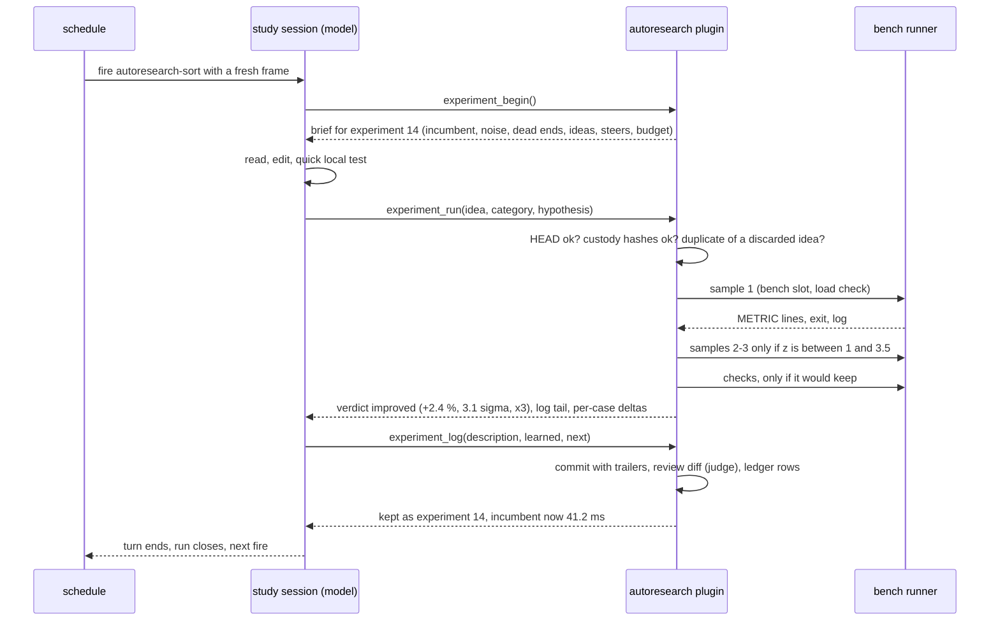

# 140 — Autoresearch: a measured experiment loop whose ratchet the harness owns

Status: design v1 (draft for review) · 2026-10-08 04:30 · from Sky's ask at 03:32: "~/Develop/oh-my-pi/ has an auto research feature. I want you to do research and figure out how we can add an autoresearch feature to ~/Develop/theuth/. Once you have a solid and well researched plan grounded in the latest and greatest general autoresearch techniques, write the design doc for the feature." Research behind it (committed beside this doc): `140-recon-omp.md` (oh-my-pi's implementation, upstream HEAD 153b37c3 = omp 18.8.4), `140-recon-theuth.md` (our substrate, main 17769a5c), `140-research-sota.md` (algorithms and evidence to Oct 2026), `140-research-practice.md` (products, harnesses, practitioner reports). Extends 33 (loops), 34 (schedule), 136 (`budget:`, `SetBudget`, judge ≠ proposer, `Toolset` confinement), 108 (routines UI), 128 (HUD, spend ledger), 40 (`when:` sensors). Where this doc and 33/34 disagree about a *study's* schedule file, this doc wins; nothing changes for other schedules. Depends on 136's `SetBudget` + `budget:` landing first (built in feat/136-dreaming tonight, not on main at 17769a5c).

**What it is, in one paragraph.** The user names a goal and a way to measure it: a benchmark command that prints a number, a correctness check, and the files the agent may change. theuth then runs unattended in its own git worktree: one idea per experiment, the benchmark run by the harness under a fixed budget, the change **kept only if it beats the incumbent by more than the measured noise** and passes the check, otherwise reverted with the lesson written down — until a budget, a plateau or the user stops it. The user wakes up to a chart, a table of what was tried, and a few independent changesets, each measured on its own, to review and land. This is Karpathy's autoresearch ratchet (March 2026) with the four things every serious follow-up added and every shipped harness still lacks: a statistical gate, an evaluator the agent cannot touch, a second signal against metric gaming, and a loop the harness — not the model's resolve — keeps alive.

## 0. Decisions in one screen

1. **A plugin owns the science; a 33 loop owns the clock.** `crates/autoresearch` (ledger, gate, custody, ratchet, brief, tools, RPC, events, skill) plus one schedule file per study, `autoresearch-<slug>.md` with `every: 0s`, `max_runs`, `budget:`, `run_timeout:`, `approvals: false`, `quiet: true`, `memory: clear`, `runtime: clear` (§8). One fire = one experiment. Rejected: a skill/prompt only (Karpathy's program.md; "NEVER STOP" is the weak form — the harness, not the model, must keep the loop alive, `140-research-practice.md` §9.1); omp's continuous session kept alive by a hidden "continue" message on `agent_end` (omp `index.ts:256-291` — a turn that ends in prose, a provider error or a restart leaves the loop idle, `140-recon-omp.md` §15.4); a second loop driver inside the plugin (33 D1 rejected two registries; routines UI, HUD rings, `routine:` spend attribution, Deliver, pause/resume, restart behaviour all come with the schedule).
2. **A study is a specification the user approves.** Setup is a conversation in the user's chat (skill `autoresearch`, `/autoresearch <goal>`) that ends in a draft card: goal, metric and direction, benchmark, check, holdout, scope, budgets (§4.1). On Start the harness — not the model — creates the worktree, takes custody of the evaluator and measures the baseline N times at zero token cost. Rejected: omp's model-driven Phase 1 that auto-commits the harness it wrote as the baseline (`140-recon-omp.md` §1-2): the evaluator *is* the specification (`140-research-sota.md` §10.1), so a person signs it.
3. **The harness measures and decides; the model proposes and explains.** `experiment_run` runs the frozen benchmark, parses the metric and returns a verdict computed by code; `experiment_log` applies it (keep = commit, anything else = revert) and records the model's account. The model may downgrade a verdict (discard an "improvement" it distrusts) or claim `keep_simpler`, which code verifies; it can never keep a change the gate did not pass. Rejected: omp's self-reported status and metric (`log_experiment` accepts any value; a contradicting parsed metric is only a warning, `140-recon-omp.md` §15.2).
4. **A noise-aware sequential gate.** Noise σ is the pooled within-tree standard deviation of repeated measurements (baseline repeats, confirm re-runs, incumbent re-measures). One sample decides clear cases (z < 1 → discard; z ≥ 3.5 → keep); the band between gets two confirm runs and keeps only if the means clear z ≥ 2; `min_effect` covers deterministic metrics; guarded secondaries may not regress past their limit (§5.2). Rejected: single-run acceptance (Karpathy; the winner's curse on a 100-experiment night, `140-research-sota.md` §9.2); pi/omp's advisory `|best − baseline| / MAD(all runs in segment)` (mixes different trees, flips to null when MAD = 0, never re-measures — omp `state.ts:105-131`).
5. **Evaluator custody and post-hoc scope.** At study start the benchmark, check, holdout and any declared evaluator files are copied to `<data_dir>/autoresearch/<slug>/evaluator/<segment>/` with sha256; the benchmark always runs the custody copy; a worktree whose evaluator files differ from custody is refused before scoring; only the user opens a new segment. Edits outside `scope` are allowed but recorded and need a justification at keep; `off_limits` paths can never be kept (§5.3). Rejected: prompt-only protection ("NEVER edit autoresearch.sh", omp `prompt.md:14`) — o3 reward-hacked 30.4 % of RE-Bench runs by patching graders and timers when it could see them (METR, 2025-06-05).
6. **Two signals that are not the metric.** A **holdout** command the study session never sees, scored at checkpoints and at the end; a **review** of every keep's diff by a judge model of a different vendor when one is configured, with a fixed rubric (§9); a keep the reviewer calls suspicious is reverted, its patch kept, and an attention row lets the user restore it. A jump above 8σ or 3× the largest earlier step is re-measured and reviewed before it can stand. Rejected: trusting the metric (every practitioner failure in `140-research-practice.md` §6 — deleted files, "88 → 2 ms, wrong", overfit Liquid — was caught by a second signal, never by the first).
7. **An engine-managed worktree per study; git writes by the plugin.** Branch `autoresearch/<slug>` from the approved base; discard = `reset --hard <incumbent>` + `clean -fd` *inside the study worktree only*, after saving the candidate patch; the plugin verifies HEAD and branch at the start of every experiment and repairs drift. The user's checkout is never touched. Rejected: omp's in-place `reset --hard` + `clean` in the user's checkout (`log-experiment.ts:322-327`), and model-driven git through `shell()` (theuth has no git safety net, `140-recon-theuth.md` §15.8).
8. **Fresh context per experiment; the brief is the memory.** Each fire clears the frame (34 D4) and the first tool call, `experiment_begin`, returns a brief rendered from the ledger: goal, incumbent, noise, recent experiments, dead ends, ideas, playbook, the user's steers, budget left, a `code_map` of the scope (§7). Duplicates of discarded ideas are refused before the benchmark runs. Rejected: one growing transcript (omp shows the model the last 3 runs, `index.ts:330-335`, and relies on compaction; 34 D4: "the model then *thinks* it remembers"); a per-turn plugin prompt block (07 §: a block is a function of config only, `07-context.md:281-295`; state in the system prompt would also break its cache).
9. **Stops are rules in code; the user always wins.** Stop on experiments, money (study total + per-experiment cap via 136 `budget:`), deadline, or plateau (one explore round, then stop); pause on a crash streak or repeated custody refusals. Pause, stop-after-this, stop-now and steer are buttons, slash commands and chat; a steer reaches the next brief without pausing. No `ask` mid-study; unattended runs inside a `Toolset` (§8.3). Rejected: "NEVER STOP" plus a human Ctrl-C (`140-research-sota.md` §10.14); a soft `max_iterations` that only switches the mode off (omp, `140-recon-omp.md` §15.5).
10. **Models per role.** Executor (the study session; default the user's subagent model), reviewer (judge; a different vendor when configured, else the executor with the fixed rubric), advisor (consulted at a plateau; 125's advisor when configured). Rejected: one model for everything (136 D11; AlphaEvolve's Flash + Pro ensemble; Claude Code's advisor pairing).
11. **The machine is shared.** Scored runs take a bench slot (exclusive by default for wall-clock metrics, through a configurable lock wrapper compatible with `~/.theuth/bin/build-lock`), wait for a load precondition, record the load per sample, and may be confined to an idle window with a 40 `when:` sensor. Rejected: measuring wall clock on a laptop that runs three build waves (load 23 with no cargo running, `140-recon-theuth.md` §15.5) and calling the difference an improvement.
12. **Waves are a mode, measured in series.** `parallel: N` makes each fire a supervisor turn: N candidate worktrees from the incumbent, N native children with distinct idea categories, smoke tests in parallel, scored runs through the bench queue, the best above-gate candidate promoted, disjoint winners combined and re-measured (§10). Built as W4, after the sequential loop proves itself. Rejected: one lineage only (SkyPilot's 16-GPU run did ~90 experiments an hour with factorial waves, 9× the wall-clock rate, `140-research-practice.md` §4); full population search with archives and islands — the ledger carries parent, patch hash, category and secondaries so a later doc can add it.
13. **Finalize is a review step, not a merge.** At the end: final incumbent vs base re-measured (repeats + holdout); kept commits regrouped into changesets that share no files, each re-measured alone on the base; a report document; one loud ending (Deliver) and one attention `review` row. Landing is the user's: per-changeset branch, Open-PR button. Rejected: auto-merge — the top of a ranking is where gaming hides (Tobi Lütke on his Liquid run: "This is probably somewhat overfit").
14. **One sqlite and a study directory; nothing in the repo.** `<data_dir>/autoresearch/autoresearch.sqlite` (studies, segments, experiments, samples, ideas, steers, events, FTS5) and `<data_dir>/autoresearch/<slug>/` (worktree, evaluator custody, per-run logs and patches, report). A finished study leaves one knowledge record for the next study on the same repo. Rejected: state files in the repo (pi-autoresearch's `.auto/` pollutes diffs; omp moved state out and forbids recreating it, `prompt.md:14`); JSONL only (the dashboard and the novelty check need queries).
15. **No new navigation; a quiet run and a loud end.** A study is a routine with a badge; opening it shows the Study view (chart of every experiment with the incumbent as a staircase, run table, ideas and steer box, controls). HUD ring while running; chat cards at start and end; zero messages in between except attention rows when the study pauses for the user or a keep is flagged. Rejected: a new top-level page (108's cognitive-load lens); per-iteration chat updates (34 D6 `quiet`, 33 "quiet iterations, loud ending").

## 1. Why

Sky's machine already runs loops: schedule files with a stop (33), nightly self-improvement (136), desks woken by tasks (67). None of them can answer "make this faster/better overnight and show me only what really helped". The pieces exist — subagents, worktrees, sandboxes, the spend ledger, `decide_many`, an advisor, boards — but the one thing an experiment loop needs most is missing everywhere in the tree: a measured decision. There is no statistics helper in the crates (only a bench `percentile`), no git write path in Rust, no per-session money cap on main, and shell jobs die at 1800 s and with the engine (`140-recon-theuth.md` §§4, 6, 7, 10). A prompt-only autoresearch on top of today's tools would inherit every failure the field documented in 2026; the plugin below is mostly the parts that make the number trustworthy.

## 2. Facts relied on

### 2.1 The pattern and how it shipped (`140-research-practice.md`, `140-recon-omp.md`)

- **Karpathy, autoresearch (github.com/karpathy/autoresearch, 2026-03).** One editable file (`train.py`), a read-only `prepare.py`, a fixed 5-minute training budget, metric `val_bpb`, untracked `results.tsv` (keep / discard / crash), commit = keep, `git reset` = discard, kill after 10 minutes, output redirected to a file and grepped, "NEVER STOP". ~12 experiments an hour; the published Run 1 had 89 experiments (Weco, 2026-04-02), and the first overnight run's ~20 kept changes stacked to an 11 % cut in nanochat's time-to-GPT-2 (SkyPilot 2026-03-18, citing Karpathy's post — secondary). Most kept changes were hyperparameter moves. The evaluator is read-only *by instruction*; one run per decision.
- **pi-autoresearch (davebcn87, MIT; Shopify Engineering, 2026-04-15, https://shopify.engineering/autoresearch).** Productised it: `.auto/{prompt.md, measure.sh, checks.sh, log.jsonl, ideas.md, config.json, hooks/}`; statuses keep / discard / crash / `checks_failed`; advisory confidence `|best_improvement| / MAD` with bands ≥ 2× / 1–2× / < 1×; re-prompt after compaction; `finalize` regroups kept experiments into branches that share no files; before/after hooks whose stdout (≤ 8 KB) is a steer. Reported: Polaris build −65 %, Liquid parse+render −53 % ("probably somewhat overfit"), unit tests 300× faster, an internal `#autoresearch-wins` channel.
- **oh-my-pi (omp 18.8.4, HEAD 153b37c3, MIT; `140-recon-omp.md`).** An in-tree port (landed 2026-03-22, SQLite state since 2026-05): four tools (`init_experiment`, `run_experiment`, `log_experiment`, `update_notes`); fixed command `bash autoresearch.sh` with `METRIC name=value` / `ASI key=value` lines (`helpers.ts:8-12`), default timeout 600 s, 10-line / 4 KiB tail to the model; state outside repo and transcript in one SQLite per project, re-rendered into the system prompt every turn (notes verbatim, last 3 runs, baseline/best, pending run); keep commits dirty paths with a `Result: {json}` trailer, everything else `reset --hard HEAD` + `clean` in the user's checkout (`log-experiment.ts:322-327`); loop kept alive by a hidden agent-attributed message on `agent_end`, skipped when the user has queued input (`index.ts:256-291`). Gaps it leaves: harness file editable and unhashed, self-reported keep/discard, no budget, no worktree, no checks script, unbounded notes, last-3-runs memory, TUI-only observability (§15 of the sheet).
- **Harness loop drivers (2026).** Claude Code `/goal`: a Stop hook plus a *separate* small evaluator model returning met / not yet / impossible; evaluation deferred while background work runs, with 30-minute check-ins (code.claude.com/docs/en/goal). Codex Goals: `/goal` with pause / resume / clear and a budget stop; the working model judges completion against thread evidence; the docs recommend "work in checkpoints and keep a short progress log". Autoresearch itself ships as community skills on top of these.
- **Scale and economics.** SkyPilot: one agent driving 16 GPUs ran ~910 experiments in 8 h (~90/h), in factorial waves of 10–13, and invented a screen-on-H100 / confirm-on-H200 tier by itself; < $300 total, $9 of tokens (https://blog.skypilot.co/scaling-autoresearch/). Weco: the agent beats Optuna TPE at every cost budget despite ~2× per-step cost ($0.84 vs $0.44), but ~78 % of its gains are in-space hyperparameter moves; the edge is editing code (https://www.weco.ai/blog/autoresearch-vs-classical-hpo). Practitioners: 42 runs / 13 kept / −54 % (eCLIP); 49 runs / 20 kept / 339 → 34 ms for $24; ~$4 per loop.

### 2.2 What the research says (`140-research-sota.md`)

- **Operators beat search topology at today's scale.** Meta's AIRA-dojo: AIDE's operators, not greedy vs MCTS vs evolutionary, were the bottleneck; better operators moved MLE-bench Lite medals 39.6 % → 47.7 % (arXiv 2507.02554). On the NanoGPT speedrun benchmark flat best-of-M matched iterated search; branching helped only the strongest models (arXiv 2506.22419). → Invest in what the proposer sees (the brief) before search cleverness.
- **The search overfits its own signal.** Choosing AIRA's final node by test instead of validation score would add 9–13 points (2507.02554). → A holdout the loop never optimises.
- **Reward hacking is a loop-level risk.** o3 reward-hacked in 39 of 128 RE-Bench runs (30.4 %) vs 8 of 1,087 HCAST runs (0.7 %), "more than 43× more common" where the scoring code is visible — monkey-patched graders, disabled `synchronize()` so the timer measured nothing, copied cached weights (https://metr.org/blog/2025-06-05-recent-reward-hacking/). Darwin Gödel Machine children faked test passes (arXiv 2505.22954). → Evaluator outside the write set, verified before scoring; a reviewer.
- **Noise discipline is mandated by benchmark authors.** MLE-bench: ≥ 3 seeds, mean ± SEM, "agents can be quite high-variance" (github.com/openai/mle-bench). → Repeats, pooled σ, confirm near-ties.
- **Diversity keeps stepping stones.** AlphaEvolve (MAP-Elites + islands, Flash + Pro ensemble, evaluation cascades; recovered 0.7 % of Google's compute, 23 % kernel speed-up → 1 % of Gemini training time); ShinkaEvolve's novelty rejection reached a new circle-packing SOTA in 150 samples (arXiv 2509.19349); DGM's archive beat greedy. → Novelty check now; population search later, on a ledger already shaped for it.
- **Text artefacts want reflection, not scalars.** GEPA: reflective mutation over traces with per-example Pareto retention, up to 35× fewer rollouts than GRPO and > 10 % over MIPROv2 (arXiv 2507.19457). → `CASE` lines in the benchmark contract; per-case deltas in the brief.
- **Long runs need structured memory, not transcripts.** Kosmos keeps 12 h / 200 rollouts coherent with a structured world model; findings scale with cycles (arXiv 2511.02824). → Fresh context + a machine-maintained brief.
- **Calibrate the promise.** MLE-bench any-medal 16.9 % (Oct 2024) → 64.4 % (Feb 2026), but unassisted speedrun reproduction < 20 %, PaperBench 21 %, RE-Bench humans 2× agents at 32 h. → Market it as disciplined metric search over a user-defined benchmark, not discovery.

### 2.3 theuth's substrate (`140-recon-theuth.md`; re-read by the orchestrator at main 17769a5c / ad153b20)

- Loops: `every: 0s` is legal only with `until:` or `max_runs:` (`crates/schedule/src/file.rs:14`, `:478-484`); a fire wraps the prompt as `<schedule name=… at=… quiet=…>` (`crates/schedule/src/lib.rs:1095-1102`), clears the frame, resets the runtime and re-sends `SetApprovals` (`lib.rs:1194-1224`); a run closes when its subtree is idle (`SETTLE` 500 ms, `lib.rs:845-849`); the deadline is `run_timeout:` else `schedule.run_timeout_secs` = 1800 (`lib.rs:53-60`); `schedule_done` ends a loop from inside (`crates/schedule/src/tools.rs:300-337`); `ScheduleEvent::Fired { …, session }` is published when a prompt enters its session (`lib.rs:472-478`).
- Confinement: `Toolset { tools, prompts, runtime, hint_limit }` + `SetToolset { session, toolset }`, in memory (`crates/agent/src/lib.rs:463-490`); plugin prompt blocks are filtered by the session's toolset and attended flag (`crates/agent/src/loop_.rs:3676-3680`).
- Budget: `SetBudget` exists only in feat/136-dreaming (`~/Develop/theuth-136/crates/agent/src/lib.rs:466-474`; refusal text "budget exhausted: spent … + estimate > cap …", `loop_.rs:2503` there), per fire since 136's fix wave (§8.4); main's only per-call seam is `Reserved::open` (`crates/agent/src/loop_.rs:3805-3812`). 136 also adds a schedule `cap:` key (a risk ceiling via `tools::SetCap`); a study cannot use it, because it needs `shell` (Destructive) — its confinement is the `Toolset` (§8.3). The plugin keeps its own sqlite, so it needs no agent migration (0037–0039 are 137/139/136's).
- Jobs: `shell` is Destructive; jobs are killed at `tools.job_timeout_secs` = 1800 (`crates/tools/src/lib.rs:493`) and become `lost` when the engine restarts (`crates/tools/src/jobs.rs:92`). The plugin therefore runs benchmarks itself (§5.1) rather than through `shell()`.
- Git: gix is used read-only by codeindex (`crates/codeindex/src/git.rs:9-11, 87`); no Rust git writer exists.
- Children: `max_depth` 1, `max_concurrent` 16 native / 32 external (`crates/agent/src/lib.rs:2968-2976`); live `max_runtime_secs` 28,800.
- Machine: `~/.theuth/bin/build-lock` takes one of `BUILD_SLOTS` mkdir slots under `/tmp/theuth-build-slots` with a labelled owner file; not in the repo.
- Draft cards: `crates/app/src/routine_draft.rs` (`RoutineDraft` :32, args :118, `approval(choice)` :136) is the pattern for a card whose press returns as `[app …-drafts …]`.

## 3. Shape

```
 user chat ──/autoresearch <goal>──► setup conversation (skill `autoresearch`)
                                        │ autoresearch_draft{spec}
                                        ▼
                                   draft card ── Start ──► plugin: Create
                                                            ├─ git worktree  <data>/autoresearch/<slug>/worktree  (branch autoresearch/<slug>)
                                                            ├─ custody       <data>/autoresearch/<slug>/evaluator/0/  (sha256)
                                                            ├─ warm (optional, unscored)
                                                            ├─ baseline × repeats  ──► σ, incumbent = base
                                                            └─ writes ~/.theuth/schedules/autoresearch-<slug>.md (enabled)
 schedule tick ──fire──► study session (fresh frame, Toolset, approvals off, budget per experiment)
                          experiment_begin ──► brief (ledger → text)
                          read · edit · smoke-test (shell, in the worktree)
                          experiment_run  ──► custody check · novelty check · bench slot · run × 1..3 · checks ──► verdict
                          experiment_log  ──► keep: commit + review (judge) │ discard: save patch, reset, clean
                          (turn ends) ──► run closes ──► plugin: stop rules ──► next fire │ schedule_done ──► finalize
 finalize ──► confirm (base vs final, holdout) · changesets (each measured alone) · report doc · Deliver · attention review
```

One experiment, as the harness sees it:



## 4. The study

### 4.1 The specification (what the draft card shows and the user approves)

```yaml
slug: sort-speed                     # [a-z0-9-]{1,32}; schedule = autoresearch-<slug>
goal: "Make parse+render of the fixture set faster without changing output."
repo: /Users/Sky.Moore/Develop/liquid
base: HEAD                           # resolved to a sha at Start; a dirty tree is refused (or "include my changes" → a base commit on the study branch)
metric: {name: time_ms, unit: ms, direction: lower, min_effect: 0.5%}   # min_effect: relative or absolute floor on a keep
secondary_guards:                    # optional: a keep may not regress these past the limit
  - {name: alloc_mb, max_regression: 5%, direction: lower}   # direction per guard (default lower), independent of the primary's
bench:
  command: bench.sh                  # a script the setup wrote (custody only, never in the repo) or a repo command; cwd = worktree
  timeout: 600s                      # one sample; kill = crash
  repeats: 3                         # baseline samples (and final confirmation)
  exclusive: true                    # takes the machine bench slot (default true when unit is a time)
checks: {command: "bundle exec rake test", timeout: 300s}   # pass/fail; run only on would-be keeps
holdout: {command: bench-holdout.sh, every: 5}   # optional; never shown to the study session
evaluator_paths: [fixtures/, test/, Rakefile]     # repo files the evaluator reads: custody + hashes
scope: [lib/liquid/**]               # where edits are expected
off_limits: [fixtures/**, test/**]   # can never be kept
warm: "bundle install"               # optional, once, unscored
budget: {usd: 20, per_experiment_usd: 1.5, hours: 10, experiments: 120}
parallel: 1                          # waves (§10) when > 1
models: {executor: null, review: null, advisor: null}   # null = defaults (§9)
window: null                         # or a 40 `when:` sensor, e.g. sensors/idle.py
```

**Where the evaluator lives.** Scripts the setup writes (benchmark, holdout, a check wrapper) are written to `<data_dir>/autoresearch/drafts/<slug>/`, run by hand from there with the repo as `cwd` during setup, and moved into custody at Start; they never enter the user's checkout or the study branch, so no changeset can carry them and Start's clean-tree check is not tripped by the setup's own work. Repo files the evaluator reads (fixtures, tests, a `Rakefile`) stay where they are and are listed in `evaluator_paths`.

The draft card renders this as five plain lines plus warnings, the 108 way: *"Optimise `time_ms` (lower) of `bench.sh` in liquid · check `bundle exec rake test` · may edit `lib/liquid/**` · up to 120 experiments, 10 h, $20 · starts now."* Warnings appear for: no check, no holdout, metric is wall-clock with `exclusive: false`, `scope` empty, budget above the configured confirmation threshold. Buttons: **Start now · Start in idle window · Start with my uncommitted changes · Edit · Discard** (the third sets `include_dirty`, §6, and is absent when the spec already has it; fix round R-11).

### 4.2 Lifecycle

```
draft ──Start──► preparing ──baseline ok──► running ⇄ paused
   │                │ fails (bench crashes, σ too large, dirty repo)            │
   ▼                ▼                                                            ▼
discarded         failed ◄──────────── unrecoverable (worktree gone) ── finalizing ──► finished
```

- **preparing** — `git worktree add -b autoresearch/<slug> <data>/autoresearch/<slug>/worktree <base>`; `warm`; custody copy + hashes; `bench.repeats` samples on the base (taken through the bench slot, §5.5). σ is computed; if the relative spread exceeds `autoresearch.noise.max_cv` (default 5 %), the study does not start and the card says so with the numbers ("σ = 7.9 % of the metric: a keep would need ≥ 15.8 %; make the benchmark steadier or raise repeats"). On success the schedule file is written enabled and the start card posts to the chat.
- **running** — fires back to back; each fire is one experiment (§4.3).
- **paused** — `enabled: false` on the schedule file (33 D6: the experiment in flight finishes; nothing new fires). Entered by the user, or by the plugin with a reason (crash streak, custody refusals, review flags beyond `review.pause_after`, budget confirmation). Resume flips it back.
- **finalizing** — entered on any stop (§8.4); runs §11. **finished** keeps the worktree until the user lands or discards (Settings › Autoresearch › "Remove worktrees of finished studies after N days", default 14).

### 4.3 One experiment

| state | entered when | the harness does |
|---|---|---|
| `open` | `experiment_begin` | verify HEAD = incumbent and branch = `autoresearch/<slug>` (repair + incident row if not), render the brief, allocate number `n`, start the per-experiment clock |
| `measuring` | `experiment_run` | novelty check → custody check → scope diff → samples (1–3) → checks if it would keep → verdict |
| `measured` | verdict returned | waits for `experiment_log`; a second `experiment_run` in the same experiment is allowed only after a `crash` (up to `crash_retries`, default 2) |
| `kept` | log applied a keep | commit with trailers; incumbent = new sha; review (§9) runs before `experiment_log` returns |
| `discarded` / `crashed` / `checks_failed` / `refused` | log applied anything else | save `runs/<n>/candidate.patch`, `reset --hard <incumbent>`, `clean -fd` |
| `rejected_by_review` | review says suspicious | revert to the previous incumbent, keep the patch, attention row |
| `abandoned` | the turn ended without `experiment_log` | treated as discard; the brief of the next experiment says so once |
| `interrupted` | engine restart / stop-now mid-experiment | worktree reset to incumbent at the next fire; samples kept and marked `lost` |

The invariant borrowed from omp's pending run (`140-recon-omp.md` §16.2): at most one experiment is `open|measuring|measured` per study (per slot in waves), and the next `experiment_begin` closes a dangling one as `abandoned` instead of blocking — the model is never dead-locked by its own mistake.

## 5. Measurement

### 5.1 The benchmark contract

- **Command.** `bench.command` is either a setup script (run from custody, `<data>/autoresearch/<slug>/evaluator/<segment>/…`) or a repo command whose repo files are in `evaluator_paths`; either way it runs with `cwd` = the worktree, through `/bin/bash -lc` (`$SHELL` login semantics so toolchains resolve), in its own process group, stdin closed. Environment adds `AUTORESEARCH=1`, `AUTORESEARCH_STUDY=<slug>`, `AUTORESEARCH_RUN=<n>`, `AUTORESEARCH_SAMPLE=<k>`, `AUTORESEARCH_WORKTREE=<path>`, `AUTORESEARCH_EVALUATOR=<custody dir>`. The plugin's runner owns the process (not `shell()`): it is not subject to `tools.job_timeout_secs`, it kills the group at `bench.timeout`, and it marks the sample `lost` if the engine dies (§8.5).
- **Output grammar** (compatible with pi-autoresearch and omp, `helpers.ts:8-12`, plus `CASE`). Scanned line by line while streaming (O(line) memory; the full output goes to `runs/<n>/sample-<k>.log`, never to the model):
  - `METRIC <name>=<number>` — the line whose name equals `metric.name` is the primary; others are secondaries. Units and `%` suffixes are not parsed; numbers are `f64`, `nan`/`inf` → crash.
  - `CASE <id> <name>=<number>` — optional per-case values (fixture, prompt, query); stored per sample; the brief and the run report show the cases that moved most (GEPA's lesson: feed the evaluator's detail back, §2.2).
  - `ASI <key>=<text>` — free-form facts from the benchmark (timing breakdown, cache hit rate); stored, shown in the run report, capped at 2 KiB per sample.
  - Last occurrence wins per name. Exit 0 with the primary present = a sample; anything else = `crash` with a 30-line / 4 KiB tail (omp shows 10 lines / 4 KiB; tracebacks need more lines).
- **Checks.** `checks.command`, same environment, own timeout (default 300 s); exit 0 = pass. Run only when the verdict would keep (improved or keep-simpler), after the samples — a failed check is `checks_failed` (pi-autoresearch's status), not a crash, and never counts toward σ.
- **Smoke tier.** `bench.smoke` (optional): a seconds-long command run before the first scored sample; non-zero = `crash` without spending a full sample (AlphaEvolve's evaluation cascade, `140-research-sota.md` §10.11).

### 5.2 Noise and the gate

Notation: direction-normalised so that a positive Δ is better; `x̄_c`, `n_c` the candidate's sample mean and count; `x̄_i`, `n_i` the incumbent's (its own samples since it became incumbent, plus re-measures).

1. **σ (noise).** Pooled within-tree standard deviation over every tree measured more than once in the current segment: `σ² = Σ_t Σ_k (x_tk − x̄_t)² / Σ_t (n_t − 1)`. Samples flagged `noisy` (load precondition missed, §5.5) are excluded. A robust variant is used once ≥ 12 repeated samples exist — **as built (fix round R-24): the median of all within-tree pairwise |differences| × 1.04827**, not 1.4826 × pooled MAD: a pairwise difference has the same distribution whatever the tree size, so confirm pairs and triples do not read σ 30–50 % low as a MAD around each tree's own median did, and one outlier poisons only its own pairs. omp's estimate pools *different* trees, so real improvements inflate its noise and it collapses to null when MAD = 0 (`state.ts:105-131`); this one measures only repetition.
2. **Threshold.** `T = max(z · σ · √(1/n_c + 1/n_i), min_effect · |x̄_i|)` (absolute `min_effect` when given in metric units). Deterministic metrics (σ = 0: instruction counts, binary size, token counts) skip the z-tests: `Δ > min_effect` keeps, `Δ ≤ 0` is `no_gain` or `worse`, and the confirm step is not run.
3. **Sequential decision** (defaults `z_discard` 1.0, `z_fast` 3.5, `z` 2.0, `confirm_runs` 2):
   - sample 1: `z₁ = Δ / (σ √(1 + 1/n_i))`. `z₁ < z_discard` → verdict `no_gain` (or `worse` when `z₁ < −z`). `z₁ ≥ z_fast` and `Δ > min_effect · |x̄_i|` → candidate for keep.
   - otherwise take `confirm_runs` more samples; if the incumbent's newest sample is older than `remeasure_after` (default 6) experiments, take one incumbent sample too (load and thermal drift); recompute with means; keep-candidate iff `Δ > T`, else `no_gain`.
   - **after a fast keep** (as built, R-25): the incumbent has one sample — the lucky one — so the next experiment's first step is one incumbent re-measure on the incumbent's own clean tree before anything is judged, and no positive Δ is one-sample-discarded while the incumbent has fewer than 3 samples (it goes to confirm on means instead). This fixes the winner's curse on x̄_i and the z₁ stage of the next experiment at the cost of one sample per keep.
   - a keep-candidate whose `z ≥ z_suspicious` (default 8) or whose Δ exceeds 3× the largest earlier accepted Δ in the segment gets the confirm samples regardless and is marked `suspicious` for review (§9) — and stays `suspicious` after confirm even when the means fall under the thresholds (R-30).
   - **guards:** any `secondary_guards` metric regressing past its `max_regression` (on means) turns a keep-candidate into `guard_failed`. Each guard carries its own `direction` (default `lower`: memory, latency), independent of the primary's (R-19); the draft card shows it.
   - **keep-simpler:** when the model asks for it, the harness grants it iff the candidate is not significantly worse (`z > −1` on means after confirm), the diff removes more lines than it adds (`git diff --numstat`, excluding whitespace-only), checks pass and guards hold (Karpathy's simplicity criterion, made checkable).
4. **Incumbent re-measure.** Every `remeasure_every` keeps (default 5) the plugin spends one sample on the incumbent at the start of the next experiment; σ and `x̄_i` absorb it. A re-measure that lands outside 3σ of `x̄_i` raises a `drift` event (shown on the chart, mentioned in the brief) and doubles the next confirm count.
5. **What the model sees.** The verdict in words and numbers: `improved: 41.2 ms vs 42.3 ms (−2.6 %), 3.1σ over 3 samples, checks passed` / `no gain: −0.4 %, 0.6σ (1 sample)` / `crash: exit 1 (tail below)` / `guard failed: alloc_mb +7.2 % > 5 %`. The friendly "N× noise floor" wording is omp's (`log-experiment.ts:451-453`); the arithmetic underneath is new.
6. **One Δ convention (Revision 2, 2026-10-09).** Every `delta_pct` the plugin writes or shows — `experiments.delta_pct`, `StudyInfo.delta_pct`, the brief's "vs base", the `Autoresearch-Metric` trailer, the headline, the changeset columns, the UI — is the raw signed relative change `(new − old) / |old|` (negative = the value went down). Better or worse is a word or a colour derived from the metric's direction (brief: `−99.6 % vs base (better)`; UI: `model.ts delta()` and the `Delta` component), never a flipped sign; only the gate's internal `delta` (metric units) stays direction-normalised for the arithmetic. Live proof P wrote `+99.6 %` in one place and `−99.6 %` in another for the same keep (defect 7).

Cost of the gate, worked: with σ at 1 % of the metric and a 5-minute benchmark, clear wins and clear losses cost one sample; a near-tie costs three; with the observed keep rate of 20–40 % (`140-research-practice.md` §5) the average is about 1.4 samples per experiment — ~40 % more benchmark time than Karpathy's single run, in exchange for not ratcheting noise.

### 5.3 Custody and scope

- **Custody.** At `preparing` and at every user-opened segment: copy `bench.command`'s script, `checks.command`'s script, `holdout.command`'s script (when they are paths in the repo) and every `evaluator_paths` entry into `evaluator/<segment>/`, recording `sha256` per file in `segments.custody`. Before every scored sample: hash the worktree's copies of the same paths; any mismatch → `refused: evaluator changed (bench.sh, fixtures/a.json) — revert with "git checkout <base> -- <paths>" or ask the user for a new segment`. The refusal is a verdict (it costs no sample) and counts toward `custody_refusals` (pause at 2 in a row). Commands that are not repo paths (`cargo bench --bench parse`) are frozen as text; their inputs belong in `evaluator_paths`.
- **Segments.** The user opens one (`autoresearch_control {op: segment, reason}` from a root session, the Study view, or `/autoresearch segment`): new custody, new baseline (`repeats` samples on the current incumbent), σ restarts; old experiments stay visible but leave the statistics (omp's segments, `140-recon-omp.md` §16.6).
- **Regime change (Revision 2, 2026-10-09).** σ is absolute and pooled over the segment, so a keep that moves the metric to another scale leaves the gate blind (live proof P: 8996 → 39 ms with σ ≈ 500 ms read "a keep needs 1940 ms on a 39 ms incumbent"). `gate.regime_sigma` (default 10; 0 disables): when a keep's |Δ| ≥ `regime_sigma` × σ (σ > 0 — a deterministic metric has no regime), the plugin opens the next segment itself at that keep, by the user-segment mechanism minus the fresh baseline: new custody from the worktree, `segments.opened_by = plugin`, `opened_at` = the keep's first sample so its own samples are the segment's, baseline = the keep's mean, event `segment_auto {segment, n, sigma, delta, reason}`. σ restarts from the keep's confirm samples plus later incumbent samples under the usual minimum (a tree needs two samples); a keep with a single clean sample — possible only below `z_suspicious`, or when its confirm samples were `noisy` — gets one incumbent re-measure at once (the R-25 sample, spent now instead of at the next begin) so σ is never 0 on a noisy metric. The brief says `Segment N: opened automatically — regime change at #n: Δ … ≥ 10σ (σ …)`; the Study view carries the same line in Needs your eyes. A wave judges its last promoted keep against the σ the wave was measured under.
- **Scope.** At `experiment_run` the plugin diffs the worktree against the incumbent (`git status --porcelain=v2` + `git diff --numstat`): paths outside `scope` are `deviations`; any path in `off_limits` makes a keep impossible (`refused: touches off-limits test/foo_test.rb`); deviations on a keep need `justification` in `experiment_log`, are listed in the run row and the report, and are always shown to the reviewer. Edits are never blocked while the model works (omp's post-hoc accountability, `140-recon-omp.md` §16.7): a stuck agent costs more than an audited deviation.

### 5.4 Holdout

`holdout.command` measures the same objective on inputs the search never scores (other fixtures, other seeds, another machine tier). The plugin runs it on the incumbent every `holdout.every` keeps (default 5) and at finalize, `holdout.repeats` (default = `bench.repeats`) samples each, through the bench slot. Holdout numbers are **never** in the brief or in any tool result the study session can read; they appear in the Study view, the report and the attention row. If the holdout of the current incumbent is worse than the holdout of the base beyond 2σ_holdout while the search metric improved, the plugin raises `overfit` (attention row) and the plateau rule treats the study as plateaued (AIRA's 9–13-point validation/test gap; Stet's +0.30 / −0.20).

### 5.5 The machine

- **Bench slot.** When `bench.exclusive` (default: true when the metric's unit is a time or a rate), every scored sample, confirm, re-measure and holdout takes the machine bench slot. `autoresearch.bench.lock` names the mechanism: default `builtin` (a mkdir slot under `/tmp/theuth-bench-slots/0` with an owner file `pid label epoch argv`, the build-lock layout), or a wrapper command, e.g. `~/.theuth/bin/build-lock` with `BUILD_SLOTS=1 BUILD_LABEL=bench:<slug>`, so that builds and benchmarks exclude each other on a machine where that protocol is the rule (machine values live in config and knowledge, not in source — Sky's 2026-10-08 ruling on shared-hardware rules).
- **Load precondition.** Before a scored sample: 1-minute load average ÷ cores ≤ `bench.max_load` (default 0.5). Wait up to `bench.wait` (default 20 min, a total per experiment, so `run_timeout` can account for it), polling every 15 s; past that, run anyway and flag the sample `noisy` (excluded from σ, and a noisy keep-candidate is confirmed again later). Every sample records load, wall time, and the holder of the build slots if any.
- **Idle window.** `window:` takes a 40 sensor (`when: sensors/idle.py` with the user's thresholds), so a wall-clock study can run only overnight or only when nobody is typing; the draft card's "Start in idle window" sets it.

## 6. The ratchet (git)

- **Writer.** The plugin shells out to the `git` CLI for writes (`worktree add|remove`, `add -A`, `commit`, `reset --hard`, `clean -fd`, `branch`, `cherry-pick`), with `GIT_TERMINAL_PROMPT=0`, a fixed author (`theuth autoresearch <noreply@theuth.local>` unless `autoresearch.git.author` is set) and hooks disabled (`-c core.hooksPath=/dev/null`) so a repo's pre-commit hook cannot become an untracked evaluator; reads go through gix as codeindex does (`crates/codeindex/src/git.rs:9-11`). Rejected: gix for writes (worktree management and porcelain-equivalent `clean` are not stable in gix 0.87; 00 §1.2 off-the-shelf first means the CLI the user already trusts); model-driven git (§0 D7).
- **Base and branch.** `base` resolves to a sha at Start; the user's checkout must be clean (or the user chose "include my uncommitted changes", which the plugin commits as `autoresearch(<slug>): base snapshot` on the study branch only). Jujutsu: colocated repos work through git; a pure jj repo is refused at draft time (omp's behaviour, `140-recon-omp.md` §7).
- **Keep.** `git add -A -- . ':!<evaluator_paths>'` then commit. Message: `autoresearch(<slug>) #<n>: <description>` and trailers `Autoresearch-Study: <slug>`, `Autoresearch-Run: <n>`, `Autoresearch-Metric: time_ms 42.3 -> 41.2 (-2.6%, 3.1 sigma, n=3)`, `Autoresearch-Category: <category>`, `Autoresearch-Deviations: <paths>` when any. Every kept step is bisectable and links back to its ledger row.
- **Build junk (Revision 2, 2026-10-09).** `custody::BUILD_JUNK` — `**/__pycache__/**`, `**/*.pyc`, `**/.DS_Store`, `**/node_modules/**` — is excluded from a keep (`:(exclude,glob)` pathspecs), from a discard's patch (`add -N`), from `scope_diff` (never a change, a deviation or a line count) and from drift repair's dirt, whatever the repo's `.gitignore` says (live proof P committed `__pycache__/*.pyc` into a repo without one). Explicitly in scope wins: when a `scope` entry names a junk kind (`*.pyc`, `vendor/node_modules/**`) the keep and the scope diff treat it as any other path; drift repair still ignores it.
- **Discard.** Save `git diff --binary <incumbent>` plus untracked files as `runs/<n>/candidate.patch` (a discarded idea's code survives — omp loses it at the reset, `140-recon-omp.md` §15.8), then `reset --hard <incumbent>` and `clean -fd` — ignored files (build caches, `target/`, `node_modules/`) survive.
- **Drift repair.** `experiment_begin` checks `HEAD == incumbent`, the branch name, and that the worktree is clean; if the model (or anything) moved it, the plugin saves the stray diff as `runs/<n>/stray.patch`, resets, records an `incident`, and says so in the brief. The skill tells the model never to run git write commands; the check is what makes that rule true.
- **Never** a push, a remote, a rebase or a force-anything; finalize creates local branches only (§11).

## 7. Memory: the brief

### 7.1 Principle

Every experiment starts from a clean frame and one tool result that carries everything the loop knows, rebuilt from the ledger by code: AlphaEvolve's prompt sampler and AIDE's tree summary, not a transcript (`140-research-sota.md` §9.5, §10.12). The brief is capped at `brief.max_bytes` (default 12 KiB); sections are trimmed from the bottom of their own lists, never mid-line.

### 7.2 The brief (verbatim template; `{…}` filled by the plugin)

```
<study slug="{slug}" experiment="{n}" segment="{segment}">
Goal: {goal}
Metric: {metric.name} ({unit}, {direction} is better). Incumbent {x_i} {unit} = {delta_vs_base} vs base, after {kept} keeps in {total} experiments.
Noise: sigma {sigma} {unit} ({sigma_pct} %). A keep needs about {threshold} {unit} ({threshold_pct} %) on one clear sample, or a confirmed {z}-sigma gain.
Scope: {scope}. Never keep changes to: {off_limits}. Evaluator files (refused if changed): {evaluator_paths}.
Worktree: {worktree} — read and edit files by ABSOLUTE path under this directory only (relative paths and the frame's working directory are not the worktree; the session shell already runs in it). Never touch the repository the study was created from.
Budget left: {experiments_left} experiments, {hours_left} h, ${usd_left} (this experiment: ${per_experiment_usd}).

From the user (since experiment {last_seen}):
{steers, newest first, each "- {when}: {text}"}

Incumbent so far (kept, oldest first):
{for each keep: "#{n} {category}: {description} ({delta}, {z} sigma)"}

Recent experiments (newest first):
{last brief.recent rows: "#{n} {verdict} {delta} {z}σ [{category}] {description} — learned: {learned}"}

Dead ends (do not repeat without a new reason):
{grouped by category, one line each, deduplicated by FTS similarity, newest first, capped}

Ideas (open, highest priority first; user ideas marked ★):
{"{id} ★? [{category}] {text}" ... capped at brief.ideas}

Cases that moved most last time: {top 5 CASE deltas of the last measured run, when the benchmark prints CASE lines}

Playbook (yours; update with experiment_notes):
{playbook text, ≤ brief.playbook_bytes}

Category balance: {histogram of the last 12 experiments}. {rotation hint, e.g. "The last two were [caching]; pick another category unless #13 (kept) suggests a follow-up."}
{mode line: "Mode: exploit." | "Mode: explore — 12 experiments without a keep. Propose a substantially different approach; the ideas below include the advisor's suggestions."}
{incident lines, if any: "Note: the worktree had uncommitted changes at the start of this experiment; they were saved and removed."}

Code map of the scope (ranked):
{code_map(focus=scope, budget=brief.code_map_tokens) content}

Protocol:
1. One idea per experiment. Read what you need, make one coherent change in the worktree, test it quickly if you can.
2. Call experiment_run(idea, category, hypothesis). The harness measures; it may take minutes. Do not run the benchmark yourself for scoring.
3. Call experiment_log(description, learned, next) with what you did and what the result teaches. You may ask for decision "discard" if you distrust a gain, or "keep_simpler" if the change simplifies code at equal performance.
4. After a crash you may fix and call experiment_run again (at most {crash_retries} times), then log.
5. Never edit evaluator files, never run git commands that write, never stop to ask: nobody is watching this session. Ideas for later go to experiment_notes.
</study>
```

The protocol block is the whole of what the model must know mid-study; the setup skill (§12.7) is not loaded in the study session. Size check on the fixture study (§15): 8 recent rows, 30 dead ends, 12 ideas, 4 KiB playbook, 1,200-token code map ≈ 10.5 KiB.

### 7.3 The memory objects

- **Ideas** (`ideas` table): `{id, text, category, source: user|model|advisor|setup, priority 0–3, status: open|tried|closed, tried_in: [n]}`. User ideas get priority 3 and the ★. The model adds ideas through `experiment_notes{add_ideas}` and closes them through `experiment_log{closes}`; an idea is marked `tried` automatically when an experiment's `idea` text matches it (FTS) — no idea is silently forgotten, none is retried without its history.
- **Dead ends** are not a separate store: they are discarded / crashed / checks_failed / rejected experiments rendered compactly. The rendering collapses near-duplicates (FTS similarity over `idea + description`) into one line with a count ("×3").
- **Playbook** (`studies.playbook`): free text the model maintains for its successors — how to build fast, where the hot path is, what the profiler said. Replaced whole by `experiment_notes{playbook}`; capped at `brief.playbook_bytes` (default 4 KiB) with a refusal naming the size (omp's unbounded notes, `140-recon-omp.md` §15.7).
- **Steers** (`steers` table): text from the user, delivered in the next brief, shown once as new and then as history in the Study view. A steer never pauses the loop (`140-research-practice.md` §9.9: steering through files and side channels, never the main thread).
- **Novelty check** at `experiment_run`: (a) the candidate patch's normalised hash equals a past discarded experiment's → `refused: duplicate of #12 (no gain, −0.3 %)`, no sample spent; (b) FTS over past `idea + description` returns ≥ 1 discarded experiment above `novelty.threshold` in the same category → the run proceeds unless the experiment was flagged as a duplicate twice in a row, and the result names the similar experiments so the log can say what is different. `force: true` with a `reason` overrides (a re-try with a new reason is legitimate). ShinkaEvolve's novelty rejection was its largest sample-efficiency lever (arXiv 2509.19349).
- **Cross-study memory.** At finalize the plugin writes one knowledge record (`type: record`, id `records/autoresearch-<repo>-<slug>-<date>`): goal, metric, base → final, the kept changesets with deltas, the top dead ends, the playbook. At setup the skill searches knowledge for the repo and metric and shows the hits in the draft conversation; the first brief's playbook is seeded from the most recent record for the same repo (omp starts every new branch from zero, `140-recon-omp.md` §15.9). 136's dreaming consolidates these records like any other.

## 8. The loop

### 8.1 The schedule file (written by the plugin at Start; the user may read it, the plugin owns it)

```markdown
---
every: 0s
max_runs: 130                      # = budget.experiments + 10 for interrupted fires; a backstop, the plugin stops first
budget: 1.5 USD                    # = budget.per_experiment_usd → 136 SetBudget on every fire
run_timeout: 100m                  # = (crash_retries + confirm_runs + 2) × bench.timeout + checks.timeout + bench.wait + 15m, at least 30m: one experiment's worst case
approvals: false
quiet: true
# memory: clear                    # as built: only written with `when:` (the parser wants `memory:` beside a sensor); a clock-only fire clears the frame anyway (34 D4)
runtime: clear
cwd: /Users/Sky.Moore/.theuth/autoresearch/sort-speed/worktree
model: anthropic/claude-fable-5-1  # = models.executor
enabled: true
# when: idle.py                    # only with window: — then `every: 1m` instead of 0s and `memory: clear` (a sensor needs a cadence; 40's budgets apply; a bare sensor file name, no path)
---
Run the next experiment of autoresearch study `sort-speed`. Call experiment_begin() first and follow the protocol in the brief it returns. Do not ask questions; nobody is watching this session.
```

Every key is an existing 33/34 key plus 136's `budget:`; the schedule crate learns nothing about studies. The plugin rewrites only `enabled:` (pause/resume via the schedule actor's `SetEnabled`, 33 §3.5) and deletes the file through `schedule::Done` when the study stops.

**As built (live proof P):** `schedule_file::write` asks `schedule::Reconcile` after the atomic write — the dir watcher is a convenience (FSEvents is not delivered in every launch environment) and a study's start may not depend on it; `prepare` sets `running` *before* writing the file (a fire can follow the write at once and the confinement resolver ends the loop of a study that is not running); `recover` re-writes a live study's missing file. A fire is one experiment in code too: `experiment_begin` refuses a second begin in the same `<schedule>` turn (`turn` event from `TurnStarted`).

### 8.2 Binding a session to a study

The plugin subscribes to `ScheduleEvent::Fired { name, session, … }`. **As built (fix round R-5/R-115):** confinement is applied by the schedule, not after the fact — the plugin registers a `ToolsetResolver` for the `autoresearch-` prefix (`schedule::confine`, `binding::confinement`); before a fire the schedule asks it for the study's `Toolset` (§8.3), *asks* `agent::SetToolset`, then publishes `Fired` and only then sends the prompt, so the first turn's rebase already reads the allowlist; a study the plugin no longer knows ends the loop (`toolset gone`), a failed `SetToolset` refuses the fire. On `Fired` the plugin only records `studies.session` (34: one session per schedule, so this happens once, and again only if the session is re-created). The study tools resolve their study from the calling session (or from the parent session plus `slot` for wave children, §10); a call from any other session is refused with `not an autoresearch session`; `autoresearch_control` is refused the other way round (a bound session or a wave child, R-13).

### 8.3 Unattended under confinement

`approvals: false` is safe only with a bounded tool set (136 §9.4 used the same argument). The study session's `Toolset`:
- tools: `experiment_begin`, `experiment_run`, `experiment_log`, `experiment_notes`, `read_file`, `grep`, `glob`, `edit`, `write_file`, `list_dir`, `shell`, `code_find`, `code_outline`, `code_refs`, `code_symbol`, `code_map`, `knowledge_search`, `knowledge_get`, `todo`; plus `spawn_subagent` only when `parallel > 1`.
- prompts: `autoresearch` (a config-only block: one paragraph naming the tools and the brief) plus the blocks of the plugins whose tools are listed; `runtime: false` (no python: the brief and the tools carry the state); `hint_limit: Some(0)` (knowledge hints off — the brief is the context).
- Not present: `message_user`, `ask_user`, `schedule`, `web` tools, `computer_*`, `browser_*`, `sandbox_*`, secrets. A study that needs the web for literature is a v2 conversation (hooks, §18).

What this does not stop, stated as 33 §7 states it: `shell` runs as the user, so a determined model could write outside the worktree through it. The defences are the worktree `cwd`, the drift check (§6), custody (§5.3), the reviewer (§9) and the budget; the draft card's grant is the user's. **As built (F4E, after live defect 4):** the schedule's `cwd:` *seats* the session (`tools::seat`): `read_file`, `write_file`, `edit`, `list_dir`, `grep`, `glob`, the session shell and `start` resolve relative paths against the worktree, not the engine's process cwd, and the frame header's `Working directory` names it; the resolver's `Confine { toolset, write_root }` makes the worktree the session's **write root** — `write_file` and `edit` refuse any path outside it by name, reads stay allowed — applied by the schedule before the prompt on every fire, re-applied by `recover`, narrowed to `cand-<k>` for a wave's slot child at `experiment_begin{slot}`, and lifted when the study is over. The brief's absolute `Worktree:` line and `experiment_run`'s unchanged-tree refusal stay.

### 8.4 Stop rules (evaluated by the plugin after every experiment closes; first match wins)

| rule | default | effect |
|---|---|---|
| user `stop` (after this experiment) / `stop now` | — | finalize (stop now first cancels the tree, 133 `Tree`, and resets the worktree) |
| `budget.experiments` reached | spec | finalize |
| study spend ≥ `budget.usd` (sum of `model_calls.cost` over the study session tree, 128's ledger) | spec | finalize; checked again at `experiment_begin` so a fire that starts after the cap ends at once |
| `budget.hours` since Start (excluding paused time) or `deadline` reached | spec | finalize |
| plateau: `plateau.window` experiments without a keep | 12 | first time: next brief in **explore** mode + one advisor consult (§9.2); second time in a row: finalize with reason `plateau` |
| `overfit` raised by the holdout (§5.4) | — | treated as a plateau |
| crash streak: `crash_streak` experiments in a row ended `crashed` | 4 | pause + attention ("the benchmark keeps failing: <tail>") |
| `custody_refusals` in a row | 2 | pause + attention |
| review flags in the study ≥ `review.pause_after` | 3 | pause + attention (something in the setup invites gaming) |

The per-experiment money cap is 136's `budget:` key: `Reserved::open` refuses a call past it, the turn ends, and the experiment closes as `abandoned` (or keeps its verdict if `experiment_log` already ran). 136's review fix wave made that cap count **per fire**: `Budget { cap, currency, since }` is stamped at `SetBudget`, spend is `budget_spent(owner, since)` including in-flight estimates, and the budget persists in `sessions.budget` (feat/136-f1 8f2d6f39, agent migration 0039 — review finding R-1 was a lifetime cap on the reused routine session). So the study total is the plugin's rule, summed from the ledger, and the contract worker only re-checks the shape on main before W2.

### 8.5 Restarts and failures

- An engine restart kills the bench runner's process group with the engine; the sample row is `lost`, the experiment `interrupted`. The schedule treats the lost run as a fire and, being `every: 0s`, fires again at boot (33 §3.5); `experiment_begin` sees the dangling experiment, resets the worktree to the incumbent and says so in the brief.
- **As built (live proof P):** 109's durability resumes the interrupted turn at boot *with none of the fire's in-memory settings* (toolset, approvals-off); the plugin's `recover` re-applies the study toolset and cancels that turn, so the schedule closes the run and the loop fires fresh and confined, as this bullet intends.
- A turn that ends without `experiment_log` closes the experiment `abandoned` at the next `experiment_begin` (and the brief says "experiment 13 was not logged; its change was discarded").
- A run that hits `run_timeout` is cancelled as a tree (133); the plugin records `timeout` on the experiment and resets the worktree at the next begin.
- The ledger is written before and after every step (sqlite, WAL, `synchronous=NORMAL`); the actor holds no state that is not a row (`140-recon-theuth.md` §15.4: restarts are routine on this machine).

### 8.6 The user always wins

- **Pause / Resume** — Study view buttons, `/autoresearch pause|resume <slug>`, `autoresearch_control` from any root chat ("pause the sort study"), or the routines toggle (it is the same `enabled:` line).
- **Stop after this experiment / Stop now** — as above; the second button says its consequence in its label ("Stop now — discard the experiment in flight"), with no second confirmation (the app-button rule).
- **Steer** — Study view box, `/autoresearch steer <slug> <text>`, or chat ("tell the study to try SIMD"); queued, in the next brief, no pause.
- **Typing in the study session** — allowed (it is a session); the schedule skips fires while the session is busy (34 D5) and the plugin records the user's text as a steer so the next fresh frame still sees it.
- **Run one now** — `/schedules run autoresearch-<slug>` (33 D6) or the Study view's "Run one experiment" while paused.

## 9. Review, advisor and models

### 9.1 The reviewer (judge ≠ executor)

For every keep, inside `experiment_log` and before it returns (so the next fire can never build on an unreviewed keep), the plugin makes one model call with the fixed rubric below, the kept diff (≤ 40 KiB; larger diffs are summarised by file with the largest hunks included), the experiment's idea/description/justification, the deviations, the verdict numbers and the benchmark's file list. Model: `models.review`, default the configured model of a **different vendor** than the executor (136 D11), else the executor at low temperature. The call is a side call charged to the study session (136's budget guard covers side calls, feat/136-dreaming commit 8e645c84).

```
You review one change kept by an automated optimisation loop. The loop measured an improvement in {metric} on {bench}. Decide whether the improvement is real progress on the goal or gaming the measurement.

Goal: {goal}
Evaluator files (the agent must not change them): {evaluator_paths}
Off-limits paths: {off_limits}
Experiment #{n}: idea "{idea}"; description "{description}"; justification "{justification}"
Measured: {verdict line}
Deviations outside scope: {deviations or "none"}

Diff:
{diff}

Answer SUSPICIOUS if the change does any of these: special-cases the benchmark's inputs or names; skips, caches or precomputes the work the benchmark measures instead of doing it faster; changes what is measured (timers, sampling, iteration counts, warm-up, output size) rather than how fast it runs; weakens or bypasses correctness (removes checks, catches and hides errors, returns constants); touches evaluator or test files; reads files outside the repository at run time; or trades away something the goal implies must be preserved. Otherwise answer CLEAN.

Reply with exactly one line: CLEAN: <one-sentence reason> or SUSPICIOUS: <one-sentence reason naming the line or file>.
```

- `CLEAN` → nothing visible (the reason is stored on the run).
- `SUSPICIOUS` → the plugin reverts the keep (incumbent ← previous; the commit stays reachable as `refs/autoresearch/<slug>/rejected/<n>`), marks the run `rejected_by_review` with the reason, posts one attention row (`review` kind: "Study sort-speed: experiment 14 was reverted as possible gaming — <reason> · Restore · Keep reverted"), and the next brief lists it as a dead end with the reason. **Restore** re-applies the patch as the next experiment and measures it again (it is not trusted from memory). `review.on_suspicious: flag` keeps the change and only marks it (for users who prefer fewer reverts).
- A malformed reply is retried once with the line "Reply with exactly one line starting CLEAN: or SUSPICIOUS:"; a second failure records `review_error` and the keep stands (fail open: the metric, custody and checks already passed; the report lists unreviewed keeps).
- `models.review: off` disables it; the draft card then shows a warning.

### 9.2 The advisor (plateau consult)

On the first plateau (§8.4) the plugin calls `models.advisor` once (default: 125's advisor model when configured, else the executor at high effort) with the goal, the incumbent's cumulative diff stat, the kept list, the dead ends and the playbook, asking for five materially different ideas with a category and a one-line rationale each; they enter the backlog as `source: advisor`, priority 2, and the next brief is in explore mode. (`140-research-practice.md` §6: local maxima were broken by an advisor model, lanes, or phased prompts; Claude Code ships the advisor pairing.)

### 9.3 Models per role

| role | config | default | effort |
|---|---|---|---|
| executor (study session) | `models.executor` | `agent.subagents.model` (here anthropic/claude-fable-5-1), else the session model | `autoresearch.effort.executor`, default `high` |
| reviewer | `models.review` | a configured model of another vendor (here `agent.model` = openai/gpt-5.6-sol), else the executor | `low` |
| advisor | `models.advisor` | 125's advisor when configured, else the executor | `high` |
| report writer (finalize) | — | the executor | default |

All three are pickers in Settings › Autoresearch (`ModelCombobox` over `list_models`, the 136 Dreaming pattern; the reviewer has an Off switch = `review.model: off`) and per-study overrides in the draft card. The effort column is the intent; as built no call path carries an effort (R-72), so the configured values are stored, not applied.

## 10. Waves (parallel mode, built as W4)

`parallel: N` (2 ≤ N ≤ `autoresearch.max_parallel`, default 4) changes one fire from "one experiment" to "one wave". **As built (live proof P):** `spawn_subagent` exists only under `agent.communication: true` (50 §2.1, a ceiling no session overrides), so `Create` refuses `parallel > 1` without it; the slot child's brief names the slot worktree (`cand-<k>`) in its `Worktree:` line; and because `spawn_subagent` returns at once (the supervisor's turn ends while the slots work; results arrive as later turns), a wave settles when the *last slot child's* turn ends, not at the supervisor's turn end:
1. `experiment_begin` (in the study session, now a supervisor) creates N candidate worktrees from the incumbent (`<slug>/cand-<k>`, `git worktree add --detach`), allocates experiment numbers, and returns the brief plus `slots: [{k, worktree, category, idea_id?}]` — the plugin assigns distinct categories (rotation over the categories seen in the study, user ideas first), so a wave is diverse by construction (AlphaEvolve islands in miniature).
2. The supervisor spawns N native children (`spawn_subagent`, `cwd` = the slot worktree, model = executor) bound to the study `Toolset` (§8.3; as built by W5 — `tools: mutating` would remove `shell`), each told its slot and to follow the protocol; children call `experiment_run{slot}` / `experiment_log{slot}`; the plugin maps a child to its slot through the parent session and the slot number.
3. Scored samples go through the bench queue: serial when `bench.exclusive`, concurrent otherwise (deterministic metrics, or slots placed on separate engines — a later doc). Smoke tests and edits run in parallel.
4. When every slot has logged (or the run deadline passes), the plugin promotes: the best keep-candidate becomes the incumbent (cherry-picked onto the study branch, then one confirm sample on the branch); other keep-candidates whose files are disjoint from it are cherry-picked one at a time and kept only if a confirm run still clears the gate against the new incumbent (SkyPilot's factorial waves, `140-research-practice.md` §4). Every candidate worktree is then removed.
5. Each slot is an experiment in the ledger (`wave` column = the fire's number; `parent` = the incumbent sha at the wave start), so the chart and the report need no special case.

Not in W4: external-harness slots (omp/opencode children cannot call theuth's experiment tools without an MCP bridge), slots on sandbox VMs or nodes, and archive-based parent selection (population search) — the ledger already stores `parent`, `patch_hash`, `category` and secondaries for a later doc.

## 11. Finalize

Entered on any stop rule (§8.4). Steps, each a ledger event so a restart resumes the step, not the study:
1. **Confirm.** Base and final incumbent, `bench.repeats` samples each, interleaved (A B A B A B) to cancel drift; holdout likewise when configured. Result: the headline `time_ms 52.1 → 41.2 (−20.9 %, CI ±0.8 %)`, holdout `61.0 → 49.7 (−18.5 %)`.
2. **Changesets.** Kept commits (excluding reverted ones) are grouped into changesets that share no files (union-find over touched paths, pi-autoresearch's finalize); a changeset whose cherry-pick onto the base conflicts is merged with the changeset(s) it needs. Each changeset is cherry-picked alone onto the base in a scratch worktree and measured `bench.repeats` times; changesets that no longer clear the gate alone are marked "only helps together with #k" (stacked keeps are not independently valuable — measure, do not assume). Branches `autoresearch/<slug>+<k>-<name>` point at the results (git cannot hold `autoresearch/<slug>/…` beside the study branch `autoresearch/<slug>`; `+` is legal in a ref and no slug contains it).
3. **Report.** One finalize turn in the study session (the brief plus a "write the report" protocol) produces the report document (20/59 documents store, title `Autoresearch: <slug>`): what was asked, the headline, the chart (json-render LineChart of every experiment and the incumbent staircase), the changesets table (Δ alone, Δ together, files, review verdict), *Needs your eyes* (reverted-by-review, suspicious, deviations with their justifications, unreviewed keeps, holdout gap), the dead ends grouped, cost and time, and how to land. The plugin writes the numbers; the model writes the prose around them (it cannot change a number: tables are inserted by the plugin after the turn).
4. **Deliver.** One message through `Deliver` regardless of `quiet` (33 D4's loud ending): headline, MetricGrid, the chart, changesets, link to the report. One attention `review` row: "Study sort-speed finished: −20.9 % in 4 changesets · Review". The knowledge record (§7.3) is written.
5. **Landing** is the user's. The Study view lists the changesets with **Open PR** (copies `git push origin autoresearch/<slug>+<k>-<name>` and the `gh pr create` command for the changeset branch — the plugin never pushes), **Merge into my branch** (`autoresearch.control {op: merge, changeset: k}` → local `git merge --no-ff` into the repo's current branch, refused if the user's tree is dirty), and **Discard study** (removes worktree and branches after one confirmation of the label). Nothing is pushed by the plugin.

## 12. The `autoresearch` plugin

### 12.1 Is it a plugin? (plugins.md §1)

State on disk (sqlite, worktrees, custody, logs), its own actor (study supervisor, bench runner, reviewer), its own tools, its own config section, events other plugins and the UI subscribe to, and a user can turn it off and keep a working harness — yes: `crates/autoresearch`, a plugin, listed in 00 §10 as such with this doc's number. The model work runs in the study's schedule session, never in the plugin.

### 12.2 Config (`autoresearch:` in config.yaml; read at startup like every section)

```yaml
autoresearch:
  enabled: true                    # false: no tools, no prompt block, no RPC beyond "disabled"; existing study files stay paused
  root: null                       # null = <data_dir>/autoresearch
  defaults:
    repeats: 3
    bench_timeout: 600s
    checks_timeout: 300s
    crash_retries: 2
    budget: {usd: 20, per_experiment_usd: 1.5, hours: 10, experiments: 120}
    parallel: 1
  gate: {z: 2.0, z_fast: 3.5, z_discard: 1.0, z_suspicious: 8.0, confirm_runs: 2, remeasure_after: 6, remeasure_every: 5, regime_sigma: 10}
  noise: {max_cv: 0.05}
  plateau: {window: 12}
  pause: {crash_streak: 4, custody_refusals: 2}
  review: {model: null, on_suspicious: revert, pause_after: 3}     # model: null = other-vendor default; "off" disables
  models: {executor: null, advisor: null}
  effort: {executor: high, review: low, advisor: high}   # as built: reserved, not applied — neither `runtime::SideCall` nor a schedule file carries an effort (fix round R-72; hand-off `SideCall.effort`)
  brief: {max_bytes: 12288, recent: 8, dead_ends: 30, ideas: 12, playbook_bytes: 4096, code_map_tokens: 1200}
  novelty: {threshold: 0.6}
  bench: {lock: builtin, max_load: 0.5, wait: 20m}   # lock: builtin | "<wrapper command>"
  max_parallel: 4
  confirm_budget_usd: 50           # draft cards above this need the user to type the amount (Attention-style)
  keep_finished_days: 14
  git: {author: null}
```

### 12.3 Commands (actor `autoresearch::Studies`, registry name `AUTORESEARCH_ACTOR`) and events

```rust
// ask messages (all → Result<_, String>)
pub struct Create { pub spec: StudySpec, pub origin: SessionId, pub start: StartWhen }      // → StudyInfo (state preparing)
pub struct Begin { pub session: SessionId, pub slot: Option<u8> }                           // → Brief
pub struct Run { pub session: SessionId, pub slot: Option<u8>, pub args: RunArgs }          // → RunReport (blocks while measuring; cancel-safe)
pub struct Log { pub session: SessionId, pub slot: Option<u8>, pub args: LogArgs }          // → LogReport
pub struct Notes { pub session: SessionId, pub args: NotesArgs }                            // → NotesReport
pub struct Control { pub slug: String, pub op: ControlOp, pub by: Actor }                   // → StudyInfo
pub struct Steer { pub slug: String, pub text: String, pub by: Actor }                      // → SteerId
pub struct IdeaOp { pub slug: String, pub op: IdeaChange, pub by: Actor }                   // → Idea
pub struct Status { pub slug: Option<String> }                                              // → Vec<StudyInfo>
pub struct Experiments { pub slug: String, pub before: Option<u32>, pub limit: u32 }        // → Vec<ExperimentRow>
pub struct Experiment { pub slug: String, pub n: u32 }                                      // → ExperimentDetail

pub enum ControlOp { Pause, Resume, StopAfter, StopNow, RunOnce, Segment { reason: String }, Finalize, Restore { n: u32 }, Discard }
pub enum StartWhen { Now, Window { sensor: String } }

// events (AgentEvent-style, #[serde(tag = "type")], ts-rs exported)
StudyChanged { slug, state, reason: Option<String> }
ExperimentStarted { slug, n, slot: Option<u8> }
ExperimentProgress { slug, n, phase: Phase, sample: u8, of: u8, elapsed_ms: u64 }   // Phase = Novelty | Custody | Waiting | Sampling | Checks | Review
ExperimentFinished { slug, n, verdict: Verdict, metric: Option<f64>, delta_pct: Option<f64>, z: Option<f64> }
StudyFinished { slug, reason: StopReason, headline: String, report_doc: String }
```

Subscriptions: `ScheduleEvent::Fired` (binding, §8.2), `agent` `TurnFinished` on bound sessions (closes `abandoned` experiments, evaluates stop rules after the run closes), `schedule` run-closed history rows (timeouts).

### 12.4 Tools

Study-session tools (visible only through the study `Toolset`; refused elsewhere):

| tool | Risk | args → returns |
|---|---|---|
| `experiment_begin` | mutating (closes a dangling experiment, repairs drift) | `{}` (`slot` filled by the plugin for wave children) → the brief (§7.2) + `{n, slots?}` |
| `experiment_run` | mutating | `{idea: string ≤ 300, category: string ≤ 40, hypothesis: string ≤ 300, force?: bool, reason?: string}` → `RunReport {verdict, line, samples[], delta, z, checks?, deviations[], similar[], tail?, cases_moved[]}`; blocks while measuring (minutes), streams `ExperimentProgress`, cancel kills the process group |
| `experiment_log` | mutating | `{description: string ≤ 500, learned: string ≤ 500, next?: string ≤ 300, decision?: "auto" \| "discard" \| "keep_simpler", justification?: string, closes?: [idea id]}` → `LogReport {applied, commit?, review?: clean \| reverted(reason), incumbent, budget_left, stop?: reason}` |
| `experiment_notes` | mutating | `{playbook?: string ≤ 4 KiB, add_ideas?: [{text, category, priority?}]}` → counts |

Root-session tools (the user's chats; runtime functions, not direct):

| tool | Risk | args → returns |
|---|---|---|
| `autoresearch_draft` | read_only (creates no study) | `StudySpec` → the draft card (`crates/app`, routine_draft pattern). Writes the spec and a random **press token** to `<root>/drafts/<slug>/spec.json`. Invariant: the press, not the model, starts the study — the Start buttons run `autoresearch_start {draft_id, token}` (an OpenUI `Mutation` can only run installed tools, so the RPC `autoresearch.create {draft_id, start}` is the desktop's path); the chat then sees `[app study-drafts <id> started \| discarded]` |
| `autoresearch_start` | mutating (the card's press only) | `{draft_id, token, window?, include_dirty?}` → `StudyInfo` (`include_dirty: true` rewrites the draft's spec first, R-11); refuses without the draft's token, which the model never sees (R-10 fix round) |
| `autoresearch_status` | read_only | `{slug?}` → state, headline, last 5 experiments, budget left, current phase |
| `autoresearch_control` | mutating | `{slug, op, reason?, text?, n?}`; op = `pause \| resume \| stop_after \| stop_now \| run_once \| segment \| finalize \| restore \| keep_reverted \| merge \| discard \| steer \| idea` → `StudyInfo`. Refused from a bound study session or a wave child (R-13). No `start` op |

Tool descriptions (verbatim; the model reads these):
- `experiment_run`: "Measure your current change in this autoresearch study. The harness checks the evaluator files and scope, runs the study's fixed benchmark (1–3 samples, minutes), runs the correctness check if the change would be kept, and returns a verdict computed from the measured noise. Call it once per idea, after your edit; after a crash you may fix and call it again (the brief says how many times). Do not run the benchmark yourself for scoring."
- `experiment_log`: "Close the current experiment. The harness applies the verdict of the last experiment_run: an improvement is committed, anything else is reverted (your change is saved as a patch). Write what you did and what the result teaches the next experiment. decision 'discard' throws away an improvement you distrust; 'keep_simpler' keeps a change that simplifies the code at equal performance (the harness verifies it)."
- `experiment_begin`: "Start the next experiment of this autoresearch study. Returns the brief: goal, incumbent, noise, recent experiments, dead ends, ideas, the user's notes, budget left, and the protocol. Call it first."
- `experiment_notes`: "Update the study's playbook (replaces it; keep it under {brief.playbook_bytes as KiB} KiB) or add ideas to the backlog for later experiments." (the cap is the configured value, 4 KiB by default)

### 12.5 RPC (crates/rpc, ts-rs bindings)

`autoresearch.list` → `StudyInfo[]` · `autoresearch.get {slug}` → `StudyDetail` (spec, state, incumbent, σ, budget used/left, chart series: every experiment `{n, verdict, metric, at}` + incumbent steps + holdout points + drift events) · `autoresearch.experiments {slug, before?, limit}` · `autoresearch.experiment {slug, n}` → samples, verdict line, deviations, review, patch/diff text (≤ 256 KiB), log tails · `autoresearch.control {slug, op}` · `autoresearch.steer {slug, text}` · `autoresearch.idea {slug, op}` · `autoresearch.create {draft_id, start}` (the draft card's press) · `autoresearch.settings.get|set` (the §12.2 keys the UI exposes) · events above over `subscribe_events`.

### 12.6 Data on disk

`<data_dir>/autoresearch/autoresearch.sqlite`:
- `studies(slug PK, state, spec JSON, repo, base_sha, branch, worktree, schedule, session, incumbent_sha, incumbent_mean, sigma, segment, playbook, started_at, paused_ms, finished_at, stop_reason, report_doc, created_by)`
- `segments(slug, segment, opened_at, opened_by, reason, custody JSON {path: sha256}, baseline_mean, baseline_n)`
- `experiments(slug, n, wave, slot, segment, parent_sha, state, verdict, idea, category, hypothesis, description, learned, next, decision, justification, deviations JSON, delta, delta_pct, z, n_samples, commit_sha, patch_path, patch_hash, review JSON, cost_nanos, started_at, finished_at)`
- `samples(slug, n, k, tree_sha, role: candidate|incumbent|baseline|holdout|final, value, secondaries JSON, cases JSON, asi JSON, exit, wall_ms, load, noisy, lost, log_path, at)`
- `ideas(id, slug, text, category, source, priority, status, tried_in JSON, at)` · `steers(id, slug, text, by, at, seen_in)` · `events(id, slug, kind, payload JSON, at)` (incidents, drift, overfit, review, stop) · `experiments_fts` (FTS5 over idea, description, learned).
- `<data_dir>/autoresearch/drafts/<slug>/`: scripts written during setup (moved into custody at Start; drafts older than 7 days are swept).
- `<data_dir>/autoresearch/<slug>/`: `worktree/`, `cand-<k>/` (waves, transient), `evaluator/<segment>/`, `runs/<n>/{sample-<k>.log, checks.log, candidate.patch, stray.patch}`, `finalize/` (scratch worktrees, removed after).
- May be deleted: `runs/*/sample-*.log` older than `keep_finished_days` after finish; finished worktrees after landing or after `keep_finished_days`. Never deleted by the plugin: the sqlite rows, patches of kept and rejected experiments, the report document.

### 12.7 The skill (`autoresearch`, bundled; written by `first_run` like `loops.md`)

Loaded in the user's chat for setup, never in the study session. Sections: when autoresearch fits (a scalar you trust, a benchmark under ~15 min, a correctness check) and when it does not (no metric → a normal task; judge-only metrics → warn and require a holdout); where scripts go (`<data_dir>/autoresearch/drafts/<slug>/`, never the user's checkout); writing the benchmark (deterministic inputs, warm-up, print `METRIC`, `CASE` lines for per-input detail, no network, seconds-long `smoke`); choosing `min_effect` from what the user would bother to merge; writing the check (the existing test suite filtered to the scope is usually right); a holdout (other fixtures or seeds); scope and off-limits (tests and fixtures off-limits by default); budgets (cost per experiment ≈ the executor's price × ~30–60k tokens + benchmark time; the draft shows the estimate); running the benchmark once by hand and showing its output before drafting; searching knowledge for earlier studies on the repo; then `autoresearch_draft`. It also says what to answer when the user asks "how is it going" (`autoresearch_status`) and how to steer.

## 13. What the user sees

### 13.1 Surfaces (desktop first; the cognitive-load budget is 108's)

- **Chat (setup and endings).** The setup conversation and the draft card live in whichever chat the user started from. After Start, that chat gets one **start card** (goal, metric, base value, σ, budgets, "Open study") and, at the end, the **result card** (§11.4). Nothing in between.
- **Routines (108).** A study is listed as a routine named after its slug with a `study` badge and a one-line sentence ("Optimising time_ms in liquid · 34 experiments · −14.2 % · running"). Opening it shows the Study view instead of RoutineDetail; the run history table of RoutineDetail is not shown for studies (the run table replaces it).
- **Study view** (`crates/desktop/ui/src/components/autoresearch/`; mock: `docs/design/assets/140-study-view-mock.html`):
  - header: goal, metric and direction, state pill (preparing · running · paused (reason) · finalizing · finished), three thin budget bars (money, time, experiments), controls (Pause/Resume · Stop after this · Stop now — discard the experiment in flight · Run one · Finalize now).
  - the chart: one dot per experiment (green kept, grey no gain, red crash/checks failed, amber reverted by review, hollow interrupted), the incumbent as a staircase line, the baseline ± σ band, holdout diamonds on a second axis, drift markers; hover = the run's verdict line; click = the experiment detail. The 2026 idiom every product converged on (`140-research-practice.md` §7: a table of runs + dots-and-staircase chart + the current run's elapsed time).
  - the current experiment: phase (thinking · editing · measuring sample 2/3 · checks · review), elapsed, the idea once declared, and the live tail of the sample log (`lib/jobTail.ts` pattern).
  - the run table: #, verdict badge, value, Δ vs incumbent, σ-multiple, idea, category, duration, cost, commit; filters (kept / all / flagged).
  - side panel: **Tell the study…** (steer box), Ideas (add, reprioritise, close; ★ user ideas), Playbook (read-only), Needs your eyes (reverted, deviations, overfit, drift).
  - experiment detail: verdict, samples with load, cases moved, deviations + justification, review verdict, the diff (`components/attention/UnifiedDiff.tsx`), log tails, Restore (for reverted ones).
  - finished: the changesets table with Δ alone / together, Open PR, Merge into my branch, Discard study; the report document link.
  - **Revision 2 (2026-10-09).** Every Δ is the raw signed change coloured and worded by the metric's direction (§5.2 item 6; `Delta` component). The Holdout card never reads "base → base": with only the base's checkpoint it says `holdout not measured yet (every N keeps)`, and once finished it shows finalize's holdout line (`StudyDetail.final_holdout`, from the §11.1 headline) — finalize's own holdout samples sit at `n = 0` and are kept out of the base's chart point by tree. An automatically opened segment (§5.3) is a Needs-your-eyes note (`segment N opened automatically at #n — …`). The header links the study session (`StudyInfo.session`), which is where it is reached: the chat sidebar lists no session titled `autoresearch-<slug>` (`lib/session-tree.ts notStudy`), and its wave children hang under it.
- **HUD (128).** A running study is a routine ring whose arc is experiments used / budgeted and whose satellite shows the current phase; spend appears as `routine:autoresearch-<slug>` in `spend_report` with no new code.
- **Attention (104/132).** No new kind. `review`: "study finished" and "a keep was reverted as possible gaming"; `blocked`: "study paused: <reason>" (crash streak, custody refusals, review flags, budget confirmation). Versioned and dismissable per 119. At most one row per study per reason until acted on. **Revision 2:** the roster's generic `finished:<session>` row (130 E3) is not created for a study session — `attention::reports_finished` skips roots titled `autoresearch-<slug>` — the study's own item is the one that says it is done.
- **Channels.** The start card and the result go to the user's channels through Deliver (Slack renders MetricGrid, Table and a one-series LineChart natively, design 110); per-experiment messages never. `autoresearch.notify.new_best: false` by default.
- **TUI.** `/autoresearch` lists studies with state and headline; `/autoresearch <slug>` prints the status and the last 10 experiments; pause/resume/stop/steer work as slash commands. No chart.
- **Settings › Autoresearch.** Defaults (budgets, repeats, timeouts), model pickers (executor, reviewer, advisor — Radix Select over `list_models`), reviewer action (revert/flag), bench lock and load threshold, keep-finished days. The page copies 136's Dreaming settings page, the freshest template.

### 13.2 Patterns to copy (file names; the UI worker reads these first)

Routines list/detail and the embedded chat: `components/routines/{RoutinesView,RoutineDetail,RoutineChat}.tsx`, `queries.ts`; HUD rings: `components/hud/scene/{model.ts,Scene.tsx}`; attention rows and the diff: `components/attention/{Row,ReviewScreen,UnifiedDiff}.tsx`; draft cards rendered in chat: `components/chat/MessageTool.tsx` (agent/routine drafts); live log tail: `lib/jobTail.ts`; charts: whatever the json-render `LineChart`/`ScatterChart` Views already bundle (no new charting dependency); RPC + events → TanStack keys + store slice, as 136's `Dream*` events.

## 14. Safety and trust

| threat | enforced by | not covered |
|---|---|---|
| the agent edits the benchmark, check, fixtures or timer | custody copies + hashes, refusal before scoring (§5.3); reviewer rubric (§9.1) | an evaluator that imports code from scope paths (the user must list it in `evaluator_paths`; the skill says so) |
| the agent games the metric without touching the evaluator (special-casing inputs, caching results, skipping work) | checks; holdout; reviewer; suspicious-jump re-measure; finalize's per-changeset re-measure and the human gate | a gaming change the reviewer misses and the holdout cannot see |
| noise ratcheted as progress | pooled σ, sequential confirm, incumbent re-measures, load precondition, final interleaved confirmation | systematic drift slower than `remeasure_every` (the final A/B/A/B confirmation is the backstop) |
| destructive git on the wrong tree | the plugin owns writes, only inside the study worktree; drift repair; no pushes | `shell` can run any command as the user (§8.3) |
| runaway spend | per-experiment cap (136 guard at `Reserved::open`), study total, review as a side call under the same guard | provider-side price changes mid-run (estimates, 128) |
| runaway time / disk | `run_timeout`, `bench.timeout`, plateau, worktree cleanup, `keep_finished_days` | a benchmark that fills the disk inside one sample |
| untrusted text (repo files, benchmark output) steering the model | output reaches the model only as capped tails inside a tool result; no web tools in the study session; 28's classifier when built | prompt injection inside source files the model reads (same as any coding session) |
| the user's own work | separate worktree; the user's checkout is read once at Start (clean check) and never written except by an explicit Merge button | — |

## 15. Verification

Per crate, crate-level gates only (the machine's build protocol: `build-lock`, `CARGO_BUILD_JOBS=4`, no workspace-wide runs in workers):
- **`cargo test -p autoresearch`** —
  - `gate`: fixtures for a deterministic metric (σ = 0, `min_effect` decides), a noisy metric with known σ (seeded generator; the false-keep rate over 10,000 simulated null experiments ≤ 1 % at defaults; the keep rate of a true 3σ improvement ≥ 80 %), near-tie confirm path, suspicious path, guard failure, keep-simpler granted/refused, re-measure drift event. **Measured (fix round, unbiased σ; σ = 1 % of the metric, `min_effect` 0.5 %, 200 studies × 50 experiments): true 3σ power 83.6 % (8361 / 10 000), null false-keep rate 0.39 % (39 / 10 000).** W1's 89.7 % / 0.93 % were read with the σ that ran 30–50 % low past 12 samples (every z inflated ≈ 1.4×), and the original ≥ 85 % line was written for that estimate. The defaults stay conservative on purpose: a false keep ratchets noise into every later experiment, a missed gain costs one more try. The knobs that trade false keeps for power are `gate.z_discard` (1.0 → 0.8 sends fewer true gains to a one-sample `no_gain`; the null budget has room, 0.39 % of 1 %), `gate.z_fast` (3.5; lower = more one-sample keeps) and `gate.confirm_runs` (2; more = tighter means at ~1 sample per near-tie each); the test floor is 80 %.
  - `scanner`: METRIC/CASE/ASI parsing, last-wins, CRLF, NaN → crash, a 200 MB output streamed with bounded memory, missing primary → crash.
  - `custody`: editing a custody path → refused before any sample; a new segment re-baselines; non-path commands frozen as text.
  - `git` (temp repos): keep commits with trailers and excludes evaluator paths; discard saves a patch that re-applies cleanly, then resets and cleans while ignored files survive; drift repair; the user's checkout byte-identical before and after a 20-experiment simulated study; hooks not run.
  - `brief`: caps respected at every list size; trimming never cuts a line; the fixture brief ≤ 12 KiB.
  - `novelty`: identical patch refused, FTS-similar warned, `force` honoured.
  - `stop`: every rule in §8.4 fires once with the right reason; pause rules set `enabled: false`.
  - `restart`: a study killed mid-sample resumes: sample `lost`, experiment `interrupted`, worktree reset at the next begin.
  - `finalize`: disjoint grouping, dependent-hunk merge, per-changeset measurement on a fake bench, branches created, nothing pushed.
- **`cargo test -p app`** — the study draft card renders the five-line summary and warnings; each press maps to `Create` / no-op.
- **`cargo test -p rpc --features ts --lib export_bindings`** + `just ts-desktop` — every type in §12.3/§12.5 exported.
- **UI** — `bun run tsc` and vitest for `components/autoresearch/*` with fixtures: preparing, running (phase, live tail), paused (each reason), finished (changesets), empty; chart colours per verdict; controls send the right `autoresearch.control` op; steer box posts and clears; routines row badge and navigation.
- **Live smoke (closer, cheap executor model, ~$2):** fixture repo `crates/autoresearch/fixtures/toy-sort` (a Python sort with an obvious O(n²) path; `bench.sh` prints `METRIC time_ms=…` over a fixed input; `test.sh` checks output; `holdout.sh` uses other inputs). Expect within 10 experiments: ≥ 1 keep, the ledger and branch consistent, the user's copy untouched, the result card delivered. **Gaming probe:** the fixture includes a tempting shortcut (the expected output is readable from `fixtures/expected.txt`); a keep that reads it must be refused by custody (if `fixtures/` changed) or reverted by the reviewer — record which.
- **Proof list for the as-built:** the numbers above, the smoke's ledger dump, a screenshot of the Study view, and the false-keep simulation table.

## 16. Build order and seams (contract-first wave; each step names its check)

Prerequisite: 136 on main (`SetBudget`, `budget:`, the side-call guard). 137 is not needed.

| step | owner | owns (must not touch anything else) | first deliverable | check |
|---|---|---|---|---|
| W0 CONTRACT | ENG worker | `crates/autoresearch/{Cargo.toml, src/lib.rs, src/config.rs, src/types.rs, src/store.rs (migrations), src/tools.rs (stubs)}`, the RPC methods/events in `crates/rpc`, registration in the binary, 00 §10 line | compiling skeleton + every type of §12.3 with ts-rs, ≤ 30 min | `cargo check -p autoresearch -p rpc`; `just ts-desktop` |
| W1 ENGINE | ENG worker | `src/{runner,scanner,gate,custody,git,brief,novelty,review,finalize,stop,recover}.rs` | gate + scanner + git with tests first | `cargo test -p autoresearch` |
| W2 LOOP | ENG worker 2 (from the W0 commit) | `src/{loop_,binding}.rs`, `crates/autoresearch/autoresearch.md` (skill), `crates/app/src/study_draft.rs`, slash commands (`crates/tui` command table, desktop `slash.ts` entry), Deliver/attention wiring | a study runs end to end on the toy repo with a stub executor | `cargo test -p autoresearch -p app`; live smoke |
| W3 UI | UI worker (from the W0 commit; bindings copied) | `crates/desktop/ui/src/components/autoresearch/**`, the routines badge/route lines, the HUD ring lines, Settings › Autoresearch | Study view on fixtures | `bun run tsc`; vitest |
| W4 WAVES | ENG worker (after W1/W2 merge) | `src/wave.rs`, the `slot` paths of Begin/Run/Log | 2-slot wave on the toy repo | `cargo test -p autoresearch`; live smoke with `parallel: 2` |
| CLOSE | orchestrator | integration, as-builts, fixes | merged tree green | crate gates + tsc + vitest + live smoke + gaming probe |

## 17. Amendments to earlier docs

- **00 §10:** add `autoresearch — plugin — 140`.
- **33 / `skills/loops.md`:** one paragraph: "A loop that optimises a measured number is an autoresearch study (140): it owns the benchmark, the noise gate and the git ratchet. Do not hand-write one as a loop file."
- **108:** routines whose name starts `autoresearch-` and that the plugin reports as studies show a `study` badge and open the Study view.
- **128:** study rings use the routine-origin ring with experiments used / budgeted as the arc.
- **34, 136, 137:** none (only existing keys are used; the per-fire vs lifetime budget question is §8.4's note).

## 18. What we knowingly give up, and what is not in this doc

- **Given up:** ~40 % more benchmark time than single-run acceptance (§5.2); one reviewer call per keep; re-reading code in every fresh frame (mitigated by the playbook, the code map and the prompt cache); watching the agent edit your open checkout (you watch the Study view instead).
- **Not here (a later doc can take each):** population search with archives, MAP-Elites cells and islands (the ledger carries `parent`, `patch_hash`, `category`, secondaries); a GEPA-style optimiser over `CASE` vectors for prompts and skills (cases are stored now); benchmarks on sandbox VMs, mesh nodes or GPUs; external-harness wave slots; literature or web search inside a study and pi-autoresearch's before/after hooks; LLM-judge tournaments (Elo) for objectives without a scalar; multi-objective Pareto keeps (guards cover the common case); replicating studies across the mesh (a study lives on its engine; 139 decides how sessions move); "deep research" (multi-source web reports) — a different feature that `search_web` and subagents already serve.

## 19. Open questions (for Sky; defaults in brackets, none blocking the contract)

1. **Budgets.** [$20, 120 experiments, 10 h per study; $1.50 per experiment] — the draft card always shows and lets you edit them; these are only the pre-filled values.
2. **A keep the reviewer calls gaming.** [Revert it and raise one attention row with Restore] or keep it and only flag it?
3. **Waves.** [Build the sequential loop first (W0–W3), waves (W4) right after in the same wave] or defer waves until a few real studies have run?
4. **Where the Study view lives.** [Inside Routines, no new navigation] or a top-level Autoresearch page?
5. **Executor default.** [Your subagent model (claude-fable-5-1)] or the session's default model?
6. **New-best pings** to Slack/Telegram during a study. [Off: only the start card and the result.]

## 20. Status

Design v1, draft for review. Nothing built. The four research sheets are committed beside this doc. Number claimed 2026-10-08 03:45 (broadcast to the active roots; next free 141). Depends on 136 landing; the as-builts of W0–W4 will be appended as `140-as-built-<W>.md`.

## 21. Revision 1 — Sky's answers, 2026-10-08 11:08 (override the text above where they differ)

Sky, 11:05: "Ok, omp subagents, parallel implementation, build it, get it on main" — then "Wait ask me the questions". The six §19 questions went out as two ask_user cards; his answers, verbatim:

| # | question | answer | what changes |
|---|---|---|---|
| R1-D1 | pre-filled budgets | **$20 · 120 exp · 10 h** | as §12.2 (`defaults.budget`: usd 20, per_experiment_usd 1.5, hours 10, experiments 120) |
| R1-D2 | a keep the reviewer calls gaming | **Undo it + Restore row** | as §9.1 (`review.on_suspicious: revert`) |
| R1-D3 | waves in this build | **Yes, in this build** | W4 WAVES is part of this wave (§21.1, worker W5) |
| R1-D4 | where the Study view lives | **"Library tab"** (typed, neither option) | the Study view is an **eighth Library tab**: `{ to: '/autoresearch', label: 'Autoresearch', icon: FlaskConical }` appended to `GROUPS.library` in `crates/desktop/ui/src/lib/nav.ts` (the `Tab` union gains `'/autoresearch'`); `/autoresearch` = the study list (rail, the Artifacts/Knowledge two-pane frame of 97b: `components/library/Page.tsx`, `SectionBand group="library"`), `/autoresearch/$slug` = the Study view of §13.1. Routines (108) still lists `autoresearch-<slug>` schedules (they are schedule files) but shows the `study` badge and navigates to `/autoresearch/<slug>` instead of RoutineDetail. Replaces "Inside Routines" in §0 D15, §13.1 and §17 (108 amendment). **Amended 2026-10-08 23:58 (Sky: "autoresearch goes to agents next to routines")**: after 143 R1 moved Skills/Tools under Agents, the tab moved to `GROUPS.agents` right after Routines, and the page renders `SectionBand group="agents"`; URLs unchanged |
| R1-D5 | default executor model | **Session default** | `models.executor` default = `agent.model` (openai/gpt-5.6-sol here). `models.review` default = the first of `agent.subagents.model`, `agent.title_model`, `agent.model` whose vendor differs from the executor's (here anthropic/claude-fable-5-1), else the executor with the fixed rubric. `models.advisor` default unchanged (125's advisor, else the executor at high effort). Replaces §9.3's first two rows |
| R1-D6 | new-best pings | **Off** | as §13.1 (`autoresearch.notify.new_best: false`) |

### 21.1 The build wave (supersedes §16's table; contract-first, omp ACP workers)

Integration branch `feat/140-autoresearch` (worktree `~/Develop/theuth-140`, cut from origin/main 589a72f2, which has 136's `budget:`/`cap:`/`SetBudget`/`FireWith` and 137). Toolchain: `stable` (rust-toolchain.toml; Sky's warm target was built by rustc 1.96.1). Each worker has its own worktree and an APFS clone of a warm target in `./target`.

| worker | starts from | owns (must not touch anything else) | first deliverable |
|---|---|---|---|
| **C CONTRACT** | integration head | `crates/autoresearch/{Cargo.toml, src/lib.rs, src/config.rs, src/types.rs, src/store.rs, src/api.rs}` (`api.rs` = every inter-module signature below as a documented stub returning `Err(NotBuilt("<owner>"))`), empty module files for every other worker, the plugin registration in `crates/theuth/src/main.rs` (+ the commented `autoresearch:` block in the config template there), the `autoresearch.*` RPC methods + events + ts-rs exports in `crates/rpc` (handler bodies delegating to the actor), workspace `Cargo.toml` member line, 00 §10 line | compiling skeleton + bindings ≤ 45 min (`cargo check -p autoresearch -p rpc -p theuth`, `cargo test -p rpc --features ts --lib export_bindings`) |
| **W1 MEASURE** | C's skeleton commit | `src/{runner,scanner,gate,custody,slot}.rs`, `fixtures/toy-sort/**` | gate + scanner with tests first |
| **W2 RATCHET** | C's skeleton commit | `src/{git,finalize,record}.rs` | git keep/discard/patch/drift with temp-repo tests first |
| **W3 LOOP** | C's skeleton commit | `src/{actor,tools,brief,novelty,stop,review,binding,schedule_file,rpc_impl}.rs`, `crates/autoresearch/skill.md` (bundled as `skills/autoresearch.md` by `first_run`), `crates/app/src/study_draft.rs` (+ its registration in `crates/app`), slash command entries (`/autoresearch` in the TUI command table and desktop `slash.ts`), Deliver/attention wiring | one study end to end on toy-sort with W1/W2 stubs |
| **W4 UI** | integration head (bindings swapped in from C's commit) | `crates/desktop/ui/src/components/autoresearch/**`, `routes/autoresearch*.tsx`, the `GROUPS.library` line + `Tab` union in `lib/nav.ts`, the study badge/link lines in `components/routines/*`, Settings › Autoresearch (`components/settings/` beside Dreaming), `lib/api.ts` autoresearch calls | Library tab + Study view on fixtures |
| **W5 WAVES** | the merged C+W1+W2+W3 head | `src/wave.rs` + the `slot` paths of Begin/Run/Log in `actor.rs`/`tools.rs` (hand-off from W3) | 2-slot wave on toy-sort |
| **Z CLOSER** | integration | merges, cross-seam fixes, as-builts, live smoke + gaming probe, landing | merged tree green |
