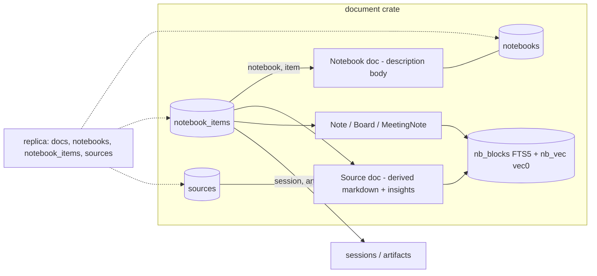

# 144 — Notebooks: a container over notes, persisted sources, a context dial, citations, search and ask

Status: design v0 · 2026-10-08 · extends 59 (documents), 143 (note flow), 10 (knowledge),
71 (boards), 49/66 (search), 53 (meetings), 122 (web reading), 43/45 (voice), 31 (link/attachments), 69 (replication);
§18 lists the amendments. Decisions in §0 are Sky's rulings of 2026-10-08 (knowledge
decisions/theuth-notebooks-design-rulings-2026-10-08); recon evidence in 144-recon-*.md and 144-research-field.md.

Scope: one new container (the notebook), one new persisted thing (the source), and the four behaviours a
notebook product is judged on — what the model sees, how answers cite, how the corpus is searched, and what
the notebook can generate. Everything rides the document substrate 59 built and 69 replicated: a notebook
and a source are `DocKind`s, membership is a replicated table, sharing is 59 §8 unchanged. Not here: images in
documents (59 §15), wikilinks, comments, Discover/Deep Research into the container (field §6 item 6 — a
routine, 40/108), per-member chat in shared notebooks (D13 → §17).

## 0. Decisions in one screen

1. **A notebook is a new entity with an optional `project` link, not the document face of `project`.**
   `DocKind::Notebook` + a replicated `notebooks` row (`project`, `archived_ms`) + a many-to-many
   `notebook_items` table over notes, sources, sessions and artifacts (§3). Rejected: reusing the `project`
   label tasks and sessions carry (`crates/agent/src/lib.rs:1061-1063`) as the container (one string shared by
   work and documents, no description, no membership, nothing to share); no container (sources + citations on
   notes only — the field ranks the container third of what users notice, 144-research-field.md §6).
2. **A source is a read-only `DocKind::Source`.** Block ids, Yjs, replication, sharing, export and `doc_read`
   for free; original bytes in the attachment store (`crates/rpc/src/api.rs:1266-1270`). Rejected: an artifact
   lineage (immutable versions, no block ids for citations, not shareable with a notebook).
3. **Nine origins in wave 1**: file, URL, meeting, pasted text, past session, Confluence page, Jira issue,
   YouTube, audio file, video file (§4.1). Rejected: deferring YouTube/audio/video (Sky typed the full list).
4. **Three columns — sources | chat | notes — stacked with tabs under 768 px; notes keep the paper look.**
   The chat column is 143's input bar that grows into the mini session panel (§12). Rejected: a two-pane
   notebook with the chat in a drawer (the field's "inputs → chat → outputs" shape is the one every peer kept).
5. **Wave 1 is shell-first plus citations into notes**: container, sources, save-answer-as-note, per-notebook
   chats, chips into existing note blocks, and the block index with embeddings (D9) — §16. Rejected:
   citations-first or search-first (both hang off source ids and a container).
6. **A four-state dial `off | mention | summary | full` per item per thread, default "summary if an insight
   exists else full when under budget, mention above it"**, a pre-turn estimate in the composer, budgeted
   injection with an explicit truncation notice, never a silent empty context (§5). Rejected: open-notebook's
   page-state-only three-state dial (resets on reload; `open-notebook: frontend/src/app/(dashboard)/notebooks/[id]/page.tsx:71-110`).
7. **One default insight per source at ingest on a cheap model; more on demand from the source page**
   (§4.3). Stored as typed children of the source, promotable to a note with provenance. Rejected: a prompt
   store of seeded transformations (`open-notebook: 5.surrealql:21-143`) — theuth has skills.
8. **Citations are `theuth://` links**: `[label](theuth://notes/<id>#<block>)`, `theuth://sources/<id>#<block>`,
   `theuth://knowledge/<id>`, `theuth://meetings/<id>@mm:ss`, `theuth://sessions/<id>#<turn>` — the board anchor
   grammar (71 §2.3) extended; rendered as numbered chips with a References footer; one allow-list sentence per
   turn (§6). Rejected: bare `[note:id]` tokens (whole-item, do not survive copy, not links).
9. **Embeddings from wave 1 on a local ModernBERT-family retrieval model on the candle stack already in
   `crates/decision`; no provider path** (§7). `notebooks.embedding_model` names a local checkpoint directory,
   never a `provider/model`. Rejected: a provider embedding role (Sky: "can't we just use modernBERT locally").
10. **Ask across notebooks is in scope, wave 3**: plan → parallel branches → partial answers → one synthesis
    with chips into each notebook, built on subagents and hybrid `search()` retrieval (§9). Rejected:
    vector-only brute-force Ask (`open-notebook: graphs/ask.py:134-140`).
11. **Every generated overview is in, including audio** (§10): briefing / FAQ / timeline / mind map as
    regenerable notebook artifacts, and an audio overview — outline → script → TTS in-house with a second
    Pocket TTS voice. Rejected: an external podcast library (`open-notebook: commands/podcast_commands.py:20-24`).
12. **Sharing a notebook grants all its notes and sources at the same role, live**; later additions are
    included automatically; removal from the notebook revokes (§11). Rejected: per-item re-sharing.
13. **Owner-only chat in a shared notebook (v1).** Members and guests see sources, notes and the answers the
    owner promotes into notes; "ask the owner's agent" is §17. Rejected: per-member private threads in v1.
14. **Nothing of 59's sharing or realtime collaboration may regress**: the notebook is itself a document kind
    and membership rides document replication (`crates/document/src/store.rs:43-44` `TABLES`, 69), so every
    engine and every member sees the same lists live. §16 names the exact checks.
15. **Process**: prose explanations first, then cards with recommended defaults; two plain-language re-asks.
    Recorded so the next design asks the same way.

**Writer's calls** (the rulings left these open; each is marked "(writer's call)" where it lands):
- W-a §3: the notebook's description is the body of its own Y.Doc; the lists are rows, not blocks.
- W-b §3: three replicated tables (`notebooks`, `notebook_items`, `sources`) beside `docs`, not fields in `meta.json`.
- W-c §3: a source's `DocId` is `for_binding(Binding::Source(origin_key))` — the same URL/file/meeting is one source everywhere (dedupe for free).
- W-d §4.1: YouTube route `auto` = captions first, `yt-dlp` audio → local STT as the fallback; both configurable.
- W-e §4.2: one source = one document, capped at `max_source_bytes` (no chunked documents).
- W-f §4.3: insights are a titled block section at the end of the source document, not a sibling kind.
- W-g §5: the dial is stored on the session (per thread) server-side; the per-device memory is only the default for a new thread.
- W-h §5: `notebooks.context_budget_tokens` default 40 000.
- W-i §6: `theuth://` links may carry `?s=<sha8>` for block drift; `doc_insert` refuses a dead `theuth://` target the way it refuses a dead `Excerpt`.
- W-j §7: default embedding checkpoint `gte-modernbert-base` (CLS pooling, the pooling the candle stack already does); FTS5 and `vec0` are two tables in one sqlite file joined by rowid.
- W-k §8: a session binds to at most one notebook; the binding is a `notebook` column on `sessions`.
- W-l §10: the audio overview is a two-voice `Sequence`-style script, one `Speak` per turn, concatenated to one Opus/MP3 artifact.

## 1. Why

The gaps are structural, not cosmetic (144-recon-theuth-notes.md §19): no container above a note — the list is
`doc_list('note') ∪ doc_list('board')` by `updated_ms` (`crates/desktop/ui/src/components/notes/useNotes.ts:4`);
no persisted source — `read_file`/`scrape_url`/`transcribe` return turn text and it vanishes
(`crates/tools/src/doc.rs:1-4`); no context control — the standing prompt says "none of its content is in your
context yet" and the model fetches (`crates/agent/src/attach.rs:19`); no citation grammar for notes or sources in
answers — only `code:` anchors on boards resolve (`crates/desktop/ui/src/components/board/blocks.ts:63-68`); no
vector or block-level search — notes are nucleo-fuzzed from ≤ 500 files re-read per query
(`crates/document/src/search.rs:14-16`, `:56-57`); no ask pipeline, no audio overview, no save-answer-as-note, no
per-note chat history (`crates/desktop/ui/src/lib/note-chat.ts:1-2` "nothing is pinned server-side").

What users notice, ranked (144-research-field.md §6): (1) citations that resolve to a highlighted passage and
survive copy/save/export — the whole trust story of NotebookLM and its biggest workaround industry; (2) a
visible per-source in / insights-only / out switch on every ask, never a silent empty-context answer; (3) one
container holding sources, chats, notes and outputs; (4) cross-notebook ask with citations into each — the most
repeated NotebookLM complaint and unshipped by Google; (5) living sources with fetched / changed / re-fetch; (6)
research runs that deposit cited sources; (7) persistent per-notebook chat; (8) regenerable overviews.

Why the agent-centred model needs a corpus and a container to feel like a notebook: theuth's bet is the agent
(144-CARD §1) — it fetches what it needs per turn, which is right for one question and wrong for a week of
work on one subject. Without persisted sources the agent re-reads the same PDF every session and cannot cite
a block of it; without a container the user has nowhere to look that shows inputs, chats and outputs together;
without a dial the user cannot see or bound what the model saw. The notebook adds the three things the
corpus-centred products have and keeps everything the agent-centred one does better: block tools under a risk
gate, one CRDT truth, E2E sharing, mesh replication, boards, meetings → notes, local voice (recon §20).

What 143 already gave the note page (`docs/design/143-note-flow.md`, as-builts W1/W2): the sidebar Note row
that creates and pops out (`crates/desktop/ui/src/components/sidebar/AppSidebar.tsx:181-190`, `:269-277`), the
sidebar order Chat · Talk · Note · Meeting · Attention · Agents · Library, A4 paper on `.bn-editor`
(`crates/desktop/ui/src/styles.css:605-613`), the popout `?new` flag (`crates/desktop/ui/src/lib/popout.ts:13-14`),
and NoteChat's two shapes — an input bar with no session, a resizable mini session panel once one exists
(`crates/desktop/ui/src/components/notes/NoteChat.tsx:21-29`, `:81-86`, `:93-101`). The notebook's chat column
is that component with a different `about` and a notebook binding (§8, §12).

## 2. Facts relied on

Re-opened in this worktree (branch `docs/144-notebooks`, cut from main 018fee18) on 2026-10-08.

| path:line | what it establishes |
|---|---|
| `crates/document/src/meta.rs:83-101` | `DocKind` has seven variants: `Knowledge, Artifact, MeetingNote, Note, AgentCharter, TaskThread, Board` |
| `crates/document/src/meta.rs:118-120` | `free_standing()` is `Note \| Board` — what lists among the notes |
| `crates/document/src/meta.rs:133-151` | `Binding` has six variants; `Note` = "no other owner" |
| `crates/document/src/meta.rs:175-184` | derived paths: `documents/<id>/note.md`, `charter.md`, `thread.md`, `knowledge/<c>.md`, `meetings/<m>/notes.md` |
| `crates/document/src/meta.rs:20`, `:27-34` | `DocId::for_binding` = uuid v5 under `NAMESPACE` of `Binding::key()`; `Note` gets a v7 |
| `crates/document/src/meta.rs:308-341` | `DocMeta`: title, binding, derived, members, links, `last_export`, `authors` (block id → member static) |
| `crates/document/src/meta.rs:396-411` | `DocumentChanged { doc, kind, title, updated_ms, deleted }` bus event; the notes list refreshes on it |
| `crates/document/src/meta.rs:446-468` | `Principal`: `Owner \| Agent{session} \| Helper \| Member{pub_} \| File` |
| `crates/document/src/store.rs:35-44` | `docs(id, kind, title, binding, created_ms, updated_ms, bytes, members_n, deleted_ms, hlc)`; `TABLES = ["docs"]` is the replicated set |
| `crates/document/src/store.rs:843-844`, `:862-864` | delete = `.trash/<id>` + soft row; the row stays a tombstone (a delete loses to a newer column write) |
| `crates/document/src/lib.rs:232-236`, `:300-306` | `replica::attach(&pool, store::TABLES)` + `announce_unstamped`; the flat mirror replicates as `doc_files` rows |
| `crates/replica/src/lib.rs:1-10`, `:105` | small-record replication, per-column LWW under an HLC; `attach(pool, tables)` |
| `crates/replica/src/apply.rs:6-11` | a delete wins iff its HLC is above every column write of the row |
| `crates/replica/src/files.rs:1-7` | files-as-rows mirror `(path PK, bytes, mtime_ms, deleted, hlc)`, flat, dot-files ignored |
| `crates/document/src/hub.rs:1-6` | the yrs server is a hub duty; every other engine serves `doc_read`/`Outline`/`Markdown` from the mirror and answers writes `NotHub` (-32011) |
| `crates/document/src/mirror.rs:3-8`, `:10-14` | flat `<id>.meta.json` + `<id>.snapshot.yjs`; merge-on-apply, foreign bytes never overwrite |
| `crates/document/src/share.rs:5-9` | join proof `HMAC-SHA256(sha256(secret), handshake_hash ‖ guest_pub)`; the hash is sealed with the mesh key |
| `crates/document/src/actor.rs:46-47`, `:934-936` | 48 KiB base64 chunks and `MAX_UPDATE_B64 = 48 KiB`; helper transactions are not capped there |
| `crates/document/src/tools.rs:24-36` | the documents `PROMPT`: outline first, smallest run of blocks, `doc` = id / `knowledge:` / `meeting:`, member blocks are untrusted |
| `crates/document/src/tools.rs:102-111` | `resolve()` accepts a `DocId`, `meeting:<id>`, `knowledge:<id>`, `agent-charter:<name>` |
| `crates/document/src/tools.rs:208-212`, `:335-350`, `:407-410` | `check_excerpts` validates `Excerpt`s and `](code:` links at insert via `codeindex::Locate`; `Missing` is refused with the current lines |
| `crates/document/src/tools.rs:508-509` … `:794-795` | `doc_read` ReadOnly; `doc_insert/replace/delete/move/create` Mutating |
| `crates/document/src/tools.rs:777-787`, `:870` | `doc_create(title, markdown?, kind: note\|board, root?)` returns `theuth://notes/<id>` |
| `crates/document/src/search.rs:1-3`, `:14-16`, `:56-57` | the `notes` category: nucleo over derived markdown, `MAX_NOTES 500`, 160-char snippets, "reads every note file per query" |
| `crates/codeindex/src/locate.rs:32-44`, `:49-59`, `:75-79` | `LocateAnchor.text_sha` = sha256 of the quoted lines; `LocateStatus = Same \| Changed \| Moved \| Missing`; `text_sha()` |
| `crates/artifact/src/tools.rs:340-351`; `crates/artifact/src/export.rs:17-23` | `doc_export` Mutating, `ExportFormat::{Markdown, Pdf}` (A4 via Typst) |
| `crates/agent/src/attach.rs:17-31`, `:42-54` | the attachments `PROMPT` and `Kind = Note \| Knowledge \| Artifact \| Session \| Meeting`; per-kind read tools incl. `session_read`, `meeting_read(from_ms/to_ms)` |
| `crates/desktop/ui/src/lib/attach.ts:15`, `:52` | the same five kinds and the `[attached …]` regex on the client |
| `crates/search/src/lib.rs:68-82`; `crates/rpc/src/search.rs:593-598` | `SearchCategory` = Sessions, Artifacts, Knowledge, KnowledgeHistory, Notes, Meetings; `search()` returns exact identities |
| `crates/tools/src/doc.rs:1-4`, `:11` | PDF/Word/PowerPoint/Excel/ODF/RTF/EPUB → GFM via `anydoc`, `MAX_BYTES = 25 MiB`; used by `read_file` and web fetch |
| `crates/tools/src/mcp.rs:1-8` | MCP tools register under their own names from `<data_dir>/mcp/*.json`; `config.yaml` overrides risk per tool |
| `crates/scrape/src/lib.rs:1-3`; grep `youtube\|etag\|cache` over `crates/scrape/src` | scrape = fetch first, obscura on thin pages; **no** YouTube, no ETag/cache/change tracking (not found) |
| `docs/design/122-web-reading.md:1198-1200` | 122 explicitly left caching/conditional GET and page change tracking out — freshness is designed here |
| `docs/design/122-web-reading.md:344-358` | `PageMeta { title, description, author, published, lang, canonical, site_name }` on every fetch |
| `crates/meeting/src/note.rs:1-7`; `crates/meeting/src/transcript.rs:34-49` | one `MeetingNote` per meeting; `Segment { id, track, speaker, t0_ms, t1_ms, text, words }` |
| `crates/meeting/migrations/0002_segments.sql:3-10`; `crates/meeting/src/store.rs:413` | FTS5 `segments(meeting, seg, t0, t1, speaker, text)`; `search()` one meeting or all |
| `crates/rpc/src/api.rs:1320-1324`, `:1266-1270` | `transcribe(path)` → `voice::Transcript`; `put_attachment` stores `<data_dir>/attachments/<sha16>.<ext>` for m4a/mp4/webm/ogg/opus/mp3/wav/pdf |
| `crates/voice/src/stt.rs:1-7`, `:26-29` | symphonia demux → 16 kHz → Parakeet TDT, 180 s pieces; Nemotron streaming for live |
| `crates/voice/src/speak.rs:10`, `:31-39`; `crates/voice/src/model.rs:17-21`, `:84-98` | `SpeechOptions::default().voice(name)` per utterance; voices = `voices/<name>.safetensors` registered with `add_voice_file` |
| `crates/voice/src/lib.rs:401-415`, `:428`, `:642-645` | `VoiceConfig { voice, model_dir, stt_model_dir, dictation_model_dir }`, default voice `peter_yearsley`, `<data_dir>/models/pocket-tts` |
| `Cargo.toml:109`, `:121-123` | `ptts` git-pinned (features `sp`); `candle-core/nn/transformers 0.11` |
| `crates/decision/src/candle/mod.rs:1-4`, `:270-272`; `crates/decision/src/candle/model.rs:659` | ModernBERT + decision head in candle on Metal f16 / CPU f32; the pooled state is `xs.i((.., 0))` — `[CLS]` pooling |
| `crates/decision/src/candle/config.rs:100-102`; `crates/decision/src/lib.rs:47-49`, `:342-348` | `model_type` must be `modernbert`; checkpoints under `<data_dir>/models/decision[-<name>]/` |
| `crates/decision/src/engine.rs:84-87`; `crates/models/src/accelerator.rs:1`, `:12-14` | `Scores.embedding: Option<Vec<f32>>` already flows out of the engine; `models.accelerator` picks Metal/WebGPU/CUDA/CPU |
| grep `sqlite-vec\|sqlite_vec\|vec0` over `crates`, `Cargo.toml` | not found — sqlite-vec is a new dependency |
| `crates/runtime/src/side_call.rs:80-90`; `crates/agent/src/lib.rs:2926-2927` | `ModelRole::{Escalate, Title, Vision, Session, Named}`; `agent.title_model` "cheap and fast; unset = the session's model" |
| `crates/agent/migrations/0015_session_lifecycle.sql:5`; `crates/agent/src/lib.rs:1061-1063` | `sessions.project TEXT NULL`; the effective project label on session info |
| `crates/desktop/ui/src/components/notes/NoteChat.tsx:21-29`, `:74-76`, `:81-86`, `:93-101`, `:118` | 143 D10: bar vs panel by `state.session`; `Composer pinned={doc}` leads every message with the marker; `onCreated` binds the session |
| `crates/desktop/ui/src/lib/note-chat.ts:1-2`, `:28-29`, `:37-41` | localStorage + zustand per note; `EMPTY.open = true`; `panelHeight` clamp |
| `crates/desktop/ui/src/lib/popout.ts:13-14`, `:49`, `:69` | note target `fresh?: true` → `?new=true`; `noteOpenMode` |
| `crates/desktop/ui/src/components/sidebar/AppSidebar.tsx:181-190`, `:269-277`, `:281`, `:298`, `:306`, `:313-314` | 143 D1–D3 as built: Note row creates then pops out; order Chat · Talk · Note · Meeting · Attention · Agents · Library |
| `crates/desktop/ui/src/lib/nav.ts:18-26`; `crates/desktop/ui/src/components/library/Page.tsx:31-34` | Library tabs Artifacts · Knowledge · Notes · Meetings · Skills · Secrets · Tools; `Column` = `max-w-3xl px-6 py-4` |
| `crates/desktop/ui/src/components/notes/NotePage.tsx:83-90`, `:107-115`, `:146-155`, `:160-161` | `?new` selects the title; slash "Ask theuth…" prefills `about block <id>: `; actions; `NoteChat` as `below` |
| `crates/desktop/ui/src/components/editor/DocumentPage.tsx:159-166`, `:176-184`; `crates/desktop/ui/src/hooks/use-mobile.ts:3-5` | `ParticipantStrip` + `ShareAction` on every document page; rail 260 px desktop / 40 % sheet mobile; one breakpoint, 768 px |
| `crates/desktop/ui/src/styles.css:605-613`, `:630-636` | 143 D6 as built: A4 via a `::before` float with percentage `padding-top`, not `aspect-ratio` |
| `crates/desktop/ui/src/components/chat/MessageAssistant.tsx:7`, `:54` | the chat renderer is Streamdown; `markdownComponents = { td, img }` — no custom `a` |
| `crates/desktop/ui/src/components/board/BoardReader.tsx:390-398`; `crates/desktop/ui/src/components/chat/surface/anchor.ts:5-7` | `code:` hrefs become anchor spans only in the board reader; `Anchor := CodeAnchor \| BlockAnchor(block:<id>)` |
| `crates/surface/src/spec.rs:69`, `:77`, `:91` | `Timeline`, `Graph`, `Tree` json-render components exist (overviews, §10) |
| `docs/design/10-knowledge.md:333-334` | "the upgrade is an embedding column in the same table (sqlite-vec) … not a new store" |
| `docs/design/59-documents.md:499-507`, `:1089-1092`, `:1103-1105` | 8 MiB per document / 48 KiB per update; images open; block-level hits need outline ids in the index |
| `docs/design/137-endless.md:287`, `:290-291` | the UI's token estimate convention `≈ bytes/3`; meetings endless is recorded, not built |
| `docs/design/143-as-built-W2.md:24-27` | the input bar measures 133 px desktop / 137 px mobile; the panel 320 px |

## 3. Shape: notebook, source, membership



### 3.1 Two new kinds

`DocKind` (`crates/document/src/meta.rs:83-101`) gains two variants after `Board`:

```rust
/// A notebook (144 §3): the container. Its body is the description the agent reads as a prompt block;
/// its lists are `notebook_items` rows. Free-standing like a note; listed under Notebooks, never among notes.
Notebook,
/// A source (144 §4): read-only derived markdown of something fetched — a file, a page, a meeting, a
/// session, a Confluence page, a Jira issue, a video, an audio file, pasted text — plus its insights.
/// Bound by its origin key so the same thing is one document everywhere. Never lists as a note.
Source,
```

`Binding` (`meta.rs:133-151`) gains `Notebook` (no natural key — `DocId::for_binding` returns a v7 like `Note`,
`meta.rs:29-34`) and `Source(String)` whose string is the **origin key** (§4.1 table): `url:<canonical>`,
`file:<sha256>`, `meeting:<id>`, `session:<id>`, `mcp:<server>/<tool>/<sha256(args)>`, `youtube:<video id>`,
`text:<sha256>`. So a URL added to two notebooks is one `Source` document with two `notebook_items` rows, minted
identically on every engine (writer's call W-c; open-notebook has no dedupe — `open-notebook: 1.surrealql:4-11`,
field issue #257). Derived paths (`meta.rs:175-184`): `documents/<id>/notebook.md` and
`documents/<id>/source.md`, so `grep`/`read_file`/harvest see them like notes. `free_standing()`
(`meta.rs:118-120`) stays `Note | Board`: the notes list does not change.

**Read-only** for `Source`: `ApplyUpdate` from `Principal::Owner`/`Member` is refused with `source_readonly`
(the `viewer_readonly` path, `meta.rs:194`); `Principal::Helper` imports (ingest, insights) and `Principal::File`
are the only writers. The editor opens a source with `editable: false`. `doc_insert`/`doc_replace` on a source
refuse except for the insights section (§4.3) and only from the insight job.

### 3.2 The notebook document (writer's call W-a)

The notebook **is** a document: `title` = the notebook name (`DocMeta.title`), the Y.Doc body = the description
("Prove the DR path end to end; every claim cited…") — collaboratively editable, block-addressable, exported to
`notebook.md`, snapshotted, shareable with 59 §8 unchanged. Rejected: description as a column (not
collaborative, not undoable, a second editor); lists as blocks in the Y.Doc (membership must be one `WHERE
notebook = ?` for the guest grant check in §11, and a per-row LWW merge, not a text merge).

### 3.3 Three replicated tables (writer's call W-b)

In `documents/index.sqlite` beside `docs` (`crates/document/src/store.rs:35-44`), `TABLES` becomes
`["docs", "notebooks", "notebook_items", "sources"]`, attached by the same `replica::attach` call
(`crates/document/src/lib.rs:232-236`) — per-column LWW under an HLC (`crates/replica/src/lib.rs:1-5`), the
69 contract for small records.

```sql
CREATE TABLE IF NOT EXISTS notebooks (
  id TEXT PRIMARY KEY,            -- the DocId of the Notebook document
  project TEXT,                   -- optional task-board project label (51 §3), free text like sessions.project
  archived_ms INTEGER,            -- NULL = live
  hlc TEXT);
CREATE TABLE IF NOT EXISTS notebook_items (
  id TEXT PRIMARY KEY,            -- "<notebook>:<kind>:<item>" (deterministic, so two engines agree)
  notebook TEXT NOT NULL, kind TEXT NOT NULL, item TEXT NOT NULL,   -- kind ∈ source|note|session|artifact
  added_ms INTEGER NOT NULL, added_by TEXT NOT NULL,                 -- Principal as text: owner|agent:<session>|member:<pub8>
  removed_ms INTEGER,             -- soft removal (a delete would lose to a newer column write, replica/apply.rs:6-11)
  hlc TEXT);
CREATE INDEX IF NOT EXISTS nbi_notebook ON notebook_items(notebook); CREATE INDEX IF NOT EXISTS nbi_item ON notebook_items(kind, item);
CREATE TABLE IF NOT EXISTS sources (
  id TEXT PRIMARY KEY,            -- the DocId of the Source document
  origin TEXT NOT NULL,           -- SourceOrigin as JSON (§13)
  status TEXT NOT NULL,           -- new|queued|running|completed|failed
  error TEXT, attempts INTEGER NOT NULL DEFAULT 0,
  blob TEXT,                      -- attachment path of the original bytes (api.rs:1266) on the hub, NULL for pasted/session/meeting/mcp
  fetched_ms INTEGER, content_sha TEXT, changed_since INTEGER,       -- §4.2 freshness
  bytes INTEGER, words INTEGER, duration_ms INTEGER, pages INTEGER,  -- what the card shows
  meta TEXT,                      -- PageMeta / file name / video title etc. as JSON
  insights INTEGER NOT NULL DEFAULT 0,
  hlc TEXT);
```

`note` items are `Note | Board | MeetingNote` documents (a meeting source adds its summary note as a `note`
item too, §4.1); `session` items are `SessionId`s (owner-only, never shown to guests, §11); `artifact` items are
`call_id`s (overviews, §10). Items for the same `(notebook, kind, item)` are one row by construction of `id`;
"remove then add again" flips `removed_ms` back to NULL — a column write that merges (`replica/src/apply.rs:6-11`).

### 3.4 Ids, delete, archive

- Notebook id: `DocId::new()` (v7, `meta.rs:23-25`). Source id: `DocId::for_binding(&Binding::Source(key))`
  (v5, `meta.rs:27-34`). Item id: the text triple above — deterministic, no clock needed.
- **Delete a notebook**: the UI asks `notebook_delete_preview(id)` → `{ notes, sources, sources_exclusive,
  sources_shared_elsewhere: [(title, n_other_notebooks)] }` and shows "also in N other notebooks" per shared
  source (`open-notebook: domain/notebook.py:184-192`, technique only). `notebook_delete(id, delete_exclusive_sources:
  bool)`: trash the Notebook document (`store.rs:843-844`), set `removed_ms` on its items, and — when asked —
  trash the sources that no other live notebook references. Notes are **never** deleted with a notebook: they
  are the user's documents and go back to the flat list. Members of the notebook get `Closed{Deleted}` on the
  notebook and lose their derived grants (§11).
- **Archive**: `archived_ms` set; the notebook leaves the Notebooks tab's default list (an "Archived" filter
  shows it), its chats stop appearing in the per-notebook list, nothing else changes; unarchive clears it.
- **Remove an item**: `removed_ms`; a source in no live notebook is listed under Library › Sources as
  "unfiled" and is swept with `.trash` only on explicit delete.

### 3.5 How this rides `replica`/69 (D14)

Every engine holds the four tables (`replica::attach`, `lib.rs:232`) and the flat mirror of every document
(`lib.rs:300-306`; `mirror.rs:3-8`), so `notebook_list`, `notebook_items_list`, `source_list` and `doc_read` of a
source answer **on any engine** from the local replica, exactly as `doc_read` does today (`hub.rs:4-5`). Writes
(`notebook_create`, `source_add`, item add/remove, ingest, insights) are hub-only like every document write
(`hub.rs:1-3`); off the hub they return `NotHub` and the RPC layer forwards (69 Y). Membership changes land as
ordinary replica batches, so a member list open on another engine updates within the replica's commit→feed hop,
and the live editors see `DocEvent::Members`/`Meta` as today. Ingest happens on the hub (it holds the attachment
blob and the helper); the resulting snapshot mirrors to every engine as it does for any document. A source's
**original bytes** are not replicated (the attachment dir is per engine, 31 §9) — "Open original" off the hub
forwards to the hub (§17).
