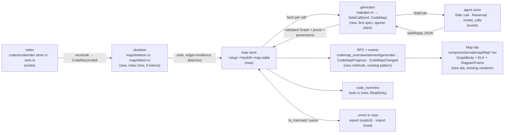

# 147 — CodeMap perspectives: generated architecture diagrams as the map's main view

Status: design v0 · 2026-10-08 · extends 73 §0.1/§6, 60 §0.7 + entry points + resolver, 65 (Mermaid → Graph ingestion),
71 (board snapshot); where this doc and 00 disagree, 00 wins.

Sky's ask, verbatim (2026-10-08 17:33): *"https://github.com/oh-my-mermaid/oh-my-mermaid ~/Develop/theuth/ this is what we
want as the first visualization view of the codemap in theuth. when the agent uses the codeindex tool, it enables the codemap
to be viewable in the UI. but the current view is really minimal. So what I want you to do is plan a port of this idea into
theuth, so that when codeindex is generated for a codebase, a real code map is generated with mermaid diagrams like this repo
does, and a navigable view of those diagrams is the main view in the codemap. the goal is reduced cognitive load, to make it
easier for a user to understand how a codebase works without much effort."*

Scope: one stored, generated map per indexed root — perspectives → drillable elements → one small diagram and a few prose
fields each — produced half by the index (structure, free, at index time) and half by a model (partition, names, edge
labels, prose, on first open, charged to the opening session); a **Map** tab that becomes the CodeMap panel's default view;
one read-only agent tool over the same data; export/import of oh-my-mermaid's `.omm/` layout; the index fixes the skeleton
needs. Not in this doc: changes to the Here / Fit / Change lenses beyond becoming tabs beside Map (S4); human editing of
generated prose (§17); a hosted/shared map; a watcher (60 §0.8, 73 scope line); any new diagram grammar — every diagram is
the typed `Graph` of 65; the mock of the Map tab (`docs/design/assets/147-codemap-map.html`, made in parallel, referenced in
§11). Recon evidence: `147-recon-theuth.md`, `147-recon-omm.md` (ideas only — Sky's standing rule on omm's MIT code),
`147-recon-field.md`, `147-recon-spike.md` + `assets/147-spike/`.

## 0. Decisions in one screen

1. **Hybrid generation: the index decides structure, a model decides words (Sky, 2026-10-08, S1).** Units, sizes, every
   edge with its evidence, entry points, detector hits and every drill-down below the top level come from the index at
   index time, zero tokens (§5). A model groups the top level, chooses and labels edges, writes the prose (§6). **No
   budget cap, no confirmation: the model work is charged to the session in which the CodeMap was opened** — S1 verbatim:
   "Hybrid, but there's no budget the cost is just folded into that sessions cost." Rejected: model-only generation (omm's
   shape; 4 of 29 of its own claims wrong after two weeks, `147-recon-omm.md` T3.2; ICSA 2026: the general Claude Code
   agent fails clarity on 71.8 % of views, `147-recon-field.md:62`) and structure-only (theuth's depth-2 top level is 60
   nodes / 342 edges, `147-recon-theuth.md:432` — "correct data, fails as a diagram").
2. **The model pass runs on the FIRST OPEN of the CodeMap for a root (Sky, S2); the structure map is produced free at
   index time.** Before anyone opens the panel the root has a capped structure view (§5.6). Rejected: generating on every
   index (cost with nobody looking); a routine with its own session and budget (contradicts S1).
3. **The map lives in theuth's data dir; "Export to repo" writes an omm-compatible `.omm/`; an existing `.omm/` is read
   and shown (Sky, S3).** Rejected: writing into the repository by default (60 §0.7 — "Nothing is written inside the user's
   repository", `60-codeindex.md:17`).
4. **Here / Fit / Change stay as EQUAL TABS beside a new Map tab; Map is the default tab; the lenses are otherwise
   unchanged (Sky, S4).** Rejected: lens overlays on the map plus secondary tabs (Sky overrode it).
5. **Perspectives: the full omm catalogue (12), the model's choice — any perspective the code evidences (Sky, S5).**
   Eligibility is decided by index detectors (§7); the model chooses among the eligible ones and must take
   `overall-architecture`. Rejected: architecture + up to 2 picked by evidence (Sky overrode it).
6. **[orch] O1 — the generator is an engine-owned pipeline of no-tools side calls.** Each call is one `SideCall { session:
   opener, role, system, user, budget, kind: CallKind::CodeMap }` asked of the agent actor (`crates/runtime/src/side_call.rs:
   99-112`; handled `crates/agent/src/supervisor.rs:3658-3678`, run by `Side::call`, `crates/agent/src/loop_/side.rs:83-168`),
   reserved and settled against the opening session in `model_calls` under its own kind. Every reply is JSON validated by
   the engine; one repair round per call; then the element falls back to its structure view. Rejected: a subagent child
   (spike: interactive exploration $3–5 vs a generator $0.50–0.70 for the same repo, `147-recon-spike.md:106-107`); a
   schedule routine (own session + budget — S1); omm's one-tool-call-per-field agent loop (62 elements ≈ 70 Bash calls,
   `147-recon-omm.md:359-361`).
7. **[orch] O2 — Mermaid at the boundary only.** The model writes a `flowchart` with ids the engine handed it; the engine
   parses it with merman's flowchart parser (`merman 0.7` with `ascii`, `crates/surface/Cargo.toml:17`, re-exporting
   `merman-core 0.7.0` — `Cargo.lock:11823-11824`) into the typed `Graph` (65 §3.1, `crates/surface/src/spec.rs:525-563`);
   nodes carry `ref`, edges carry evidence; a parse or anchor error is returned located, once, for repair; export lowers
   back with `graph::to_mermaid` (`crates/surface/src/graph.rs:89`). §6.5 verifies the parser API. Rejected: storing raw
   `.mmd` rendered by mermaid.js (no `ref`, no unit contract, no validation — invalid LLM Mermaid is the field's #1
   complaint, `147-recon-field.md:47`); omm's regex parsers + dagre from a CDN.
8. **[orch] O3 — identity from anchors, never slugs.** `unit:<root-relative path>` for crates/packages/directories/files,
   `sym:<moniker>` for symbols, `cluster:<sha8 of its sorted member ids>` for a model-made group, `ext:<name>` for an
   external system; the same unit in two perspectives is the same node id, so the detail pane says "also in …". Rejected:
   omm's directory-name slugs (collide — `147-recon-omm.md:53-56`).
9. **[orch] O4 — grounding.** Every node anchored to paths that exist in the index at write time; every edge `backed`
   (manifest dep · N imports · N refs · a call site `path#L`) or `inferred` (dashed, reason shown); ≤ 12 nodes per diagram,
   hard cap 20 (73 §0.3 + the 2026-09-28 survey); every node is a door (child diagram or file list); hidden things are
   counted bundles. Rejected: silent cuts and unanchored prose (the DeepWiki-class complaint, `147-recon-field.md:49`).
10. **[orch] O5 — the skeleton at index time, zero tokens** (§5): units, sizes, rank share per directory, edges with
    evidence, entry points, per-perspective detectors, generated-bindings and process/socket edges (inferred). Below the top
    level the drill-down *structure* is the skeleton's; the model only names, labels and describes. Rejected: letting the
    model draw sub-diagrams from scratch (the spike's drill-downs were 100 % index-derived in structure,
    `147-recon-spike.md:77`).
11. **[orch] O6 — freshness by facts hash** (§8): per element, a hash of its deterministic sub-skeleton; `CodeReconciled` →
    recompute → stale elements hatched + the word `stale`; refreshed on the next CodeMap open (charged to that session),
    never on a timer; deterministic parts update live. Rejected: regenerate on every reconcile; omm's docs-dir watcher.
12. **[orch] O7 — its own SQLite per root beside the index** (§9): `<data_dir>/codeindex/<slug>-<hash8>-map.sqlite`, own
    schema version, survives the index's "schema change is `rm`" rebuilds; provenance per element. Rejected: tables inside
    the index DB (an index schema bump deletes paid prose — `SCHEMA_VERSION` mismatch removes the file,
    `crates/codeindex/src/store.rs:101-110`); a board per root as primary store; in-repo files by default (S3).
13. **[orch] O8 — the viewer is the Map tab** (§11): sidebar tree + canvas (one element's diagram, one level live, group
    nodes show a bounded thumbnail of their child diagram, drill with an animated zoom, breadcrumbs, Esc/Back up, route
    state) + detail pane; rendered by `GraphBody`/`GraphSvg` + the ELK worker + `DiagramFrame`; < 600 px panel and phones =
    list form, no SVG (73 §0.9). Rejected: omm's whole map in one SVG with zoom-threshold reveal; mermaid.js static SVG; a
    second renderer.
    **[orch] O8b — diagram direction follows the canvas aspect** (from the mock, 2026-10-08 18:45): the 11-node theuth
    top level is 6 ELK layers deep and needs ~1 050 px of canvas at 100 % laid out LR, so in the docked side pane (360–920
    px) the map is laid out top-to-bottom (TB, fits at ~86 %) and LR only when the canvas is wider than tall and ≥ ~1 000 px
    (pop-out); chosen per layout pass, never animated while idle; edge labels hidden below ~70 % zoom and shown for the
    selection (§11.3). Node second line = abbreviated path (first two anchors + `+N`), full anchors in the detail pane; edge
    labels ≤ 4 words; **numbers on edges come from evidence, never from the model** (§6.6 rule 7). Rejected: always-LR like
    omm (6.5 px labels at 72 % in the pane).
14. **[orch] O9 — tabs `Map | Here | Fit | Change`; the panel opens on Map, pinned.** 73's auto-follow applies only when the
    user is on a lens tab or presses *Follow agent*; agent lens activity is a dot on that lens tab. Rejected: switching away
    from Map on every `code_*` call.
15. **[orch] O10 — activity marks on the Map (veto-able):** elements whose anchors contain files the agent read via
    `code_*` or edited this session (`codemap.trail[].target`, `codemap.edited[root]`) get a small `read` / `edited` mark. No
    lens logic moves into the Map (S4).
16. **[orch] O11 — one read-only agent tool, `code_overview`** (§12), returning the perspective list or one element; it
    counts as a `code_*` call (`CodeToolRan` → availability) and never starts generation (S2). The `codeindex` skill gains
    a section. Rejected: a writing tool (the generator owns writes).
17. **[orch] O12 — export, import, snapshot** (§13): explicit per-root export to omm's layout; `<root>/.omm/` imported at
    skeleton time as read-only "Imported" perspectives; snapshot an element to a board as a `Graph` fence with refs (73 §6.8).
18. **[orch] O13 — index work first (P0):** JS/TS/Python entry-point conventions; TS NodeNext `.js` → `.ts` resolution;
    process/socket and generated-bindings detectors; per-directory rank-share query; a touch must not re-persist the whole
    rank (709 ms, `73-as-built-CODEMAP-ENGINE.md:53`).
19. **[orch] O14 — amendments to 73, 60, 65 and the skill in the same commit series** (§18).

**Writer's calls** (decided here because the code proved a call under-specified; none touches S1–S5):

- **W1. `CallKind`, `ModelRole`, `SideCall` live in `runtime`, not `agent`** (`crates/runtime/src/side_call.rs:19-36, 80-91,
  99-112`): codeindex sends a `SideCall` through the kameo registry exactly as `decision::escalate` does
  (`crates/decision/src/escalate.rs:186-202`) — no `codeindex → agent` crate edge, the dependency order
  `runtime ← tools ← codeindex ← rpc` (73 §3) stands. O1 pointed at `loop_/side.rs`; that file holds `Side::call` and
  `role_model` (`side.rs:37-61`), the plumbing behind the message.
- **W2. The exact model chain:** `codeindex.codemap.model` set → `ModelRole::Named(id)` → the catalog (`side.rs:57-59`);
  unset → `ModelRole::Session` → the opening session's model (`side.rs:41-47, 56`). Not `Title`/`Escalate`: those tiers are
  chosen for one-line outputs; a partition call needs the session's model. One key, one chain. `ponytail:` a second key for
  the description batches (a cheap tier is ~10× cheaper, spike §8) when per-repo cost shows up in practice.
- **W3. A session `Budget`, when one exists, still gates the calls — by construction, not by this design.** `Side::call`
  snapshots `Shared.budget` and `Reserved::open` refuses over the cap (`side.rs:113-127`, `crates/agent/src/loop_.rs:
  2746-2757`). S1 adds no cap; it does not remove the one a routine session already carries. §6.9 lists the refusal as a
  failure mode.
- **W4. Entry points: the walker already reads `package.json` `main`/`bin`/`exports` and pyproject scripts**
  (`crates/codeindex/src/walk.rs:307-353`). omm's 0 entries come from `bin: dist/cli.js` pointing at a gitignored build
  output that is not in `files`, so `Graph::load` drops it (`crates/codeindex/src/rank.rs:326-330`). O13's fix is therefore
  (a) map a manifest target under `dist|build|out|lib` back to its `src/` source by stem (`dist/cli.js` → `src/cli.ts`),
  (b) add convention fallbacks when a manifest names nothing indexed (`src/index.ts`, `src/main.ts`, `src/cli.ts`,
  `index.js`, `main.py`, `app.py`, `manage.py`, `src/<pkg>/__main__.py`), (c) framework files (`app/**/page.tsx`,
  `pages/**`, `src/routes/**`) as entry points of the `route-page-map` perspective only.
- **W5. The `codeindex` skill is not in the tree** (`~/.theuth/skills/codeindex.md`, 56 lines, data dir only; no
  `include_str!` ships it — `git ls-files` finds no skill file for codeindex). The build wave ships it as
  `crates/codeindex/codeindex.md` behind a `pub const CODEINDEX_SKILL: &str = include_str!(…)` the way `document/board.md`
  is shipped (`crates/document/src/tools.rs:64`), installed like dreaming's bundled files (`crates/dreaming/src/lib.rs:
  141-159`, never overwriting a user-edited copy). Otherwise O14's "skill gains a section" has no file to change.
- **W6. Thumbnails hide labels below 50 % scale.** omm scales a child diagram into 320×220 and its labels land at ~6 px
  (`147-recon-omm.md:582-583`); ours draw boxes and the group title only, the child's labels appear on drill.
- **W7. Depth cap 3, then list form.** The spike's map reached depth 3 on theuth (~120 elements extrapolated,
  `147-recon-spike.md:108`); below depth 3 the skeleton's structure is shown as the file/symbol list without model prose.
  Not a money cap (S1) — a reading cap: a fourth level is a file.

## 1. Why

- **What the panel shows today is an instrument, not a map.** Here is a ranked tree of the agent's last `code_map`
  neighbourhood (≤ 2 000 rows), Fit a butterfly around the last symbol (≤ 20 nodes), Change an impact ripple of the last
  `code_impact` (`crates/codeindex/src/lens.rs:21-26`; `crates/desktop/ui/src/components/codemap/CodeMapPanel.tsx:31,
  117-128`). Every view is a neighbourhood of the agent's last call; nothing names a part of the system ("what is
  `crates/runtime` for?"), nothing descends from the whole to a part, nothing carries a sentence of prose — the index has
  no row describing a file or directory (`store.rs:29-99`: `files`, `symbols`, `imports`, `refs`, `cochanges`, `meta`). 73
  gave this up on purpose (`73-codemap.md:472`: "LLM summaries in the render path; a stored CodeMap"); Sky's ask reopens
  exactly those two items.
- **Cognitive load is the brief, and the load today is paid by the reader.** 73's own words: "reduce cognitive load … how
  it works together" (`73-codemap.md:5`). A reader who wants "how does this codebase work" from today's panel must run
  the agent's tools in their head: pick a file, read callers, pick another. The field's answer is a named top-level
  partition with ≤ ~8 doors, each door a smaller picture, every box linked to code (C4's ladder, Shneiderman's
  overview-zoom-detail; `147-recon-field.md:12, 57-58`).
- **What omm gets right:** the shape — a handful of perspectives chosen per codebase from a 12-row catalogue, each a
  recursively drillable tree of elements, every node a human name *and* the path it covers, every edge labelled with *why*,
  a fixed reading order of short prose fields (description → context → constraint → concern → todo → note), a stamp of the
  commit it was written at (`147-recon-omm.md` T1 items 1–8). **What it gets wrong:** the mechanisms — model-only
  generation with no deterministic skeleton and no verification (4/29 claims wrong or stale, including "renders with
  Mermaid.js" when it loads dagre, `147-recon-omm.md:557`), free-text slugs as identity, two regex Mermaid parsers in two
  dialects, one SVG for the whole repository, no URL state, no search, no Back, a `fs.watch` on the docs directory that
  fails silently (T2, T3.3).
- **What the field teaches, with numbers.** The survivors converged on one generation shape — static index → cluster →
  model names/describes → recurse → render + prose, every node linked to lines (CodeBoarding, CodeWiki, DeepWiki, Codemaps;
  `147-recon-field.md:8`). Grounding beats prose: the one product that drew pictures without a reliable code anchor at
  scale (CodeSee) is dead (`:9, :30`). The top three complaints: invalid Mermaid from the model (GitDiagram #29, 70
  comments, ≥ 13 issues), tokens/time on first run (Understand-Anything #76 and three more), unusable at scale (2 747
  nodes freeze a browser, UA #14) (`:10, :47-49`). Accuracy is the open wound: ICSA 2026 over 340 repos / 4 137 views —
  best agent 22.6 % clarity failures, completeness fails on 73–88 % of views, the general-purpose Claude Code agent worst
  at 71.8 % (`:62`). Hence every rule below: facts from the index not file names (L1), parse-validate-repair-or-list (L2),
  perspectives by evidence not by force (L3), a top level that is a door (L4), one diagram per level (L5), anchors on every
  node and edge (L6), incremental by construction (L7), list first (L11), provenance recorded (L12).
- **The spike proved the split on this repository** (`147-recon-spike.md`): the deterministic top level of theuth is 68
  nodes / 366 edges (49 crates + 12 UI folders + 7 dirs); in-degree tiering gives three true and useless tiers; a model
  made an 11-node top level with 92 % index-backed edges (45 of 49, `assets/147-spike/ledger.json` summary), and every
  drill-down below it was 100 % index-derived in structure. Cost as a generator: ≈ 10 calls, ≈ $0.50–0.70 on a frontier
  model, 1–2 min; full omm-style recursion to depth 3 ≈ $2–3 (`:107-108`).

## 2. Facts relied on (recon 2026-10-08, main @ 5cddad8e)

Every row re-opened in this worktree on 2026-10-08; colon form `path:lines`. Corrections to the recon sheets are marked ✎.

### A. theuth engine (codeindex, rpc)

| # | Fact | Where |
|---|---|---|
| A1 | One derived SQLite per root under `<data_dir>/codeindex/`, file `<slug>-<hash8>.sqlite` (`db_file_name`: `/`→`-`, first 8 hex of SHA-256); `SCHEMA_VERSION = "4"`; mismatch → remove and rebuild; WAL, `busy_timeout` 5 s | `crates/codeindex/src/root.rs:33-36`; `store.rs:21, 101-110, 137-143`; `lib.rs:52` (`DIR = "codeindex"`) |
| A2 | Tables `meta`, `files(path UNIQUE, mtime_ns, size, language, package, lines, parse_errors, is_test, rank)`, `symbols(… signature, docs, exported, rank, moniker)`, `symbols_fts`, `symbols_tri`, `imports(specifier, target_file, names, line, provenance)`, `refs(from_symbol, name, kind, line, qualifier, to_symbol, candidates, provenance, confidence)`, `cochanges` | `store.rs:27-99` |
| A3 | Walk: `ignore`-based, `.codeindexignore`, `MAX_FILES = 50_000`; `entry(root, rel)` for one file (touch) | `walk.rs:11, 37-40, 76-79` |
| A4 | ✎ Entry points: `walk::entry_points(root, manifests)` spans `:227-360` (recon: `:227-267`) and reads `Cargo.toml` (`[lib] path`/`src/lib.rs`, `src/main.rs`, `[[bin]]`, `src/bin/*`), **`package.json` `main`/`bin`/`exports`** (`:307-321`) and pyproject project/poetry `scripts` (`:322-353`); `Graph::load` keeps only entries that are indexed non-test files (`rank.rs:301-330`) — omm's `bin: dist/cli.js` is gitignored, hence 0 entries (W4). The comment "60 §17 item 9" at `rank.rs:301` points nowhere: 60 §17 (`60-codeindex.md:342-353`) has no entry-point item; the as-built is `60-as-built-CI-RANK.md:90-100` | `walk.rs:227-360`; `rank.rs:301-330` |
| A5 | Rank graph: `Graph::load` = parsed files, symbols, cross-file refs, imports (not `mod:`), co-changes, entry points; `persist` writes `files.rank`, `symbols.rank`, `meta.entry_points`; `component(path)` = depth-2 prefix; `COVERAGE_SHARE = 0.05`; `DAMPING 0.85`, `MAX_ITER 50`, seeds `SEED_MENTIONED 1.0 / SEED_EDITED 2.0 / SEED_COCHANGE 0.5 / SEED_ENTRY 1.0`; `RECENT_NS` = 48 h | `rank.rs:19-21, 40-49, 59-62, 247, 757-786` |
| A6 | Store queries the skeleton reuses: `import_edges` (distinct file→target, not `mod:`), `map_facts(since_ns)` (importers/callers/recent), `map_state` = `(files rows, max mtime_ns)`, `map_cache_get/put` (derived bodies keyed on index state), `test_subjects`, `ranked_symbol_rows`, `callers_of` | `store.rs:1184-1191, 1200, 1240-1246, 1252-1262, 1326, 1373, 1444` |
| A7 | TS resolver: `oxc_resolver::ResolveOptions { tsconfig: Auto, condition_names, extensions [.ts .tsx .js .mjs .cjs .jsx .d.ts], main_fields }` — no `extension_alias`, so NodeNext `./x.js` → `x.ts` fails (omm: 107/188 unresolved, `147-recon-theuth.md:334-336`); the option exists upstream (`oxc_resolver 11.24.3`, `Cargo.lock:14497-14498`; `options.rs:83 pub extension_alias: Vec<(String, Vec<String>)>`) | `crates/codeindex/src/resolve/ts.rs:20-35` |
| A8 | Freshness: `POOL_LRU = 8`; `SUSPECT_GONE_PERCENT = 80` + `SUSPECT_ROOT_HINT`; `RECONCILED_GATE = 250 ms`; `RootIndex { pool, write: Mutex, background, seq, gate, suspect, truncated }`, `next_seq`/`seq`/`snapshot()`; `reconcile(ri, force)`; `touch(ri, paths)` with the `ponytail:` "every touch re-persists the rank (~300 ms)"; `write` calls `rank::persist` | `index.rs:25-34, 53-61, 83-93, 199, 371, 417-419, 468, 533` |
| A9 | Events: `CodeindexEvent::{CodeToolRan{session, root, call_id, tool (ts union of six), args, summary, seq}, CodeReconciled{root, reparsed, removed, more, stale, pending, suspect_root, hint, git_head, seq}}`, `#[serde(tag="type")]`, ts-rs; `RECONCILED_PATHS = 200`; published by `ran!`/`tool_ran` after every `Tool::call` | `event.rs:14, 21-75`; `tools.rs:188-220`; bridge `crates/rpc/src/bridge.rs:17, 139, 204`; bindings `export.rs:129-143` |
| A10 | Tools: `code_find/outline/refs/map/symbol/impact` + `project_profile`, all `Risk::ReadOnly`, `DIRECT = false`, `RETURNS = "dict"`; `PROMPT` block; `register` | `tools.rs:25, 47, 242-250, 323-367, 490-539, 773-782, 1154-1252, 1529-1632, 2013-2022` |
| A11 | Lenses: `HERE_LIMIT 2000`, `FIT_LIMIT 20`, `CHANGE_CAPS [20,30,30,30]`; `open_indexed` requires the db file **and** `meta.last_reconcile_at` else "not indexed; run a code_* tool first"; `here`/`change` cached in `map_cache:` when not stale; `touch(None)` = forced reconcile; `lens_handler!` wires `Here/Fit/Change/Touch` on `CodeindexActor` | `lens.rs:21-26, 314-325, 393, 414-418, 542-544, 595, 695, 871`; `lib.rs:207-224` |
| A12 | RPC: flat snake_case, positional; `codeindex_stats`, `code_locate`, `codemap_here/fit/change/touch` (trait), impls via `send(&codeindex()?, …)`; `codeindex()` maps `NOT_RUNNING` → "codeindex is disabled" | `crates/rpc/src/api.rs:1062-1112, 2607-2610, 4909-4999` (✎ the as-built's `:907-940`/`:3940-4004` have drifted) |
| A13 | Plugin: `CodeindexConfig { enabled, sync_limit 64, max_file_bytes, cochange_commits 300, languages }`, `#[serde(default)]`; `start` → `Codeindex::new(cfg, data_dir).with_runtime(rt)` → actor → `outline_hook` → `tools::register` | `lib.rs:54-84, 229-263` |
| A14 | Locate: `LocateAnchor{path, start?, end?, symbol?, text_sha?}`, `LocateStatus = Same|Changed|Moved|Missing`, `text_sha` = sha256 hex | `locate.rs:19-79, 128` |
| A15 | Crate deps: tree-sitter + 5 grammars, sqlx, gix, ignore, kameo, cargo_toml, globset, oxc_resolver, toml, sha2; `ts` feature | `crates/codeindex/Cargo.toml:9-43` |
| A16 | Measured (debug, this repo): `codemap_here` warm 13 ms engine / 44 ms wall; miss 176 ms; `codemap_fit` 7 ms; `codemap_change` WORKTREE 206 ms cold / 2–4 ms cached; `codemap_touch` unchanged 25 ms, changed **709 ms** (rank 324); rank persist 323–329 ms | `73-as-built-CODEMAP-ENGINE.md:42-57` |

### B. theuth UI (CodeMap panel, diagram stack)

| # | Fact | Where |
|---|---|---|
| B1 | Panel: `LENSES = ['here','fit','change']`, `REFETCH_MS 200`, `TOUCH_MS 500`, `GRAPH_MIN_W 600`, `WIDE_W 1080`; `useCodemapApi` (mock only under `VITE_CODEMAP_MOCK`); `"?"` root → `codeindex_stats(null)`; one `createRenderQueue`; `limitFit = popped ? 40 : 20`; touch coalesced; node actions (ask/fit/change) via `appendDraft`/`pin`; snapshot via `toGraphFence`; **Reconcile** = `codemap_touch(root, null)`; keys `1/2/3`, `p`; empty states "run a code_* tool first" / "no symbol yet…"; tabs nav; `PoppedCodeMap` | `CodeMapPanel.tsx:31-36, 48-51, 80-85, 117-128, 173-183, 222-226, 232-241, 250-251, 269, 290, 308-309, 495-498` |
| B2 | Host: `codemap-panel-width`, `MIN_W 360 / MAX_W 920 / DEFAULT_W 480`, clamp to `innerWidth/2`; `useCodemapAvailable` = `codemap.roots.length > 0`; `CodeMapButton` (dot while `last.seq` unseen); `CodeMapPane` docked right of the chat leaf; `CodeMapSheet` under 768 px | `CodeMapHost.tsx:18-26, 29, 50-57, 84-97` |
| B3 | Slice: `MAX_ROOTS 8`, `MAX_TRAIL 20`, `MAX_EDITED 200`; `trailTarget` (definition `path#Lstart` → outline path → first focus → impact range); `codeToolRan`, `codeEdited` (`edit`/`write_file`), `codeFromHistory` (`"?"`); wired in the reducer and on history load | `lib/codemap/slice.ts:4-60`; `store/reduce.ts:3, 56-57, 771-772, 991`; `store/sessions.ts:4-5, 288-290, 433-436, 595-598` |
| B4 | Lens machine: `Lens`, `LensParams`, `LensState{mode, lens, auto, params, focus, callId}`, `initialLens`, `lensFor` (`is_error` never switches), `onCodeToolRan`, `pin`, `follow`, `replay` | `lib/codemap/lens.ts:4-86` |
| B5 | Layout + labels: `Slot/Slots`, `placeSlot` (never-move), `columnsLayout`, `bandsLayout` (caps 12/16/16/16), `NODE_GAP 24`, `BAND_GAP 40`; `BADGE`/`GRAPH_STATE` (changed→danger, impacted→active, transitive→muted, test→done, stale→hatch), `kindGlyph`, `shortLabels`, `anchorOf` | `lib/codemap/layout.ts:6-11, 20-48, 165-168`; `labels.ts:4-50` |
| B6 | Fence: `toGraphFence(Snapshot)` → `json-render` `Graph`, `MAX = 12`, `ref` on every node | `lib/codemap/fence.ts:6-47` |
| B7 | Types from ts-rs bindings (`ChangeFile … MapRow`), `CodeTool` union of six, `CodeToolRan`/`CodeReconciled` = `Extract<CodeindexEvent, …>`, `CodemapApi` (four positional methods), `CodemapSlice`, `TrailRow`; `disconnectedCodemap`, `mockCodemap` | `lib/codemap/types.ts:12-54`; `api.ts:13-54` |
| B8 | Renderer: `GraphBodyProps { graph, layout, tokens, markerId: string|null, units?, highlight?, onSelect?, badges?, … }` (the legacy `highlight`/`onSelect` path is the codemap's), `paint(state)`, `Shape`, `Label`, `NodeIcon`, `ArrowMarkers`/`markerFor`, `EdgePath`, `useGraphUnits` (the unit contract: nodes then edges as units) | `components/chat/surface/Graph.tsx:38-63, 108-111, 155, 164-177, 213, 250-256, 306-315` |
| B9 | ELK: `graph-layout.ts` re-exports the kernel (`lib/diagram/elk.ts`: `LruCache(64)`, in-flight sharing, `new Worker(graph-layout.worker.ts)`, `LAYOUT_TIMEOUT_MS = 2000`); `GraphData` (loose `GraphProps`), `structuralHash`, `graphNodeSize` (label + `sub` + `tag` lines, icon width), `toElk` (groups as compound nodes, `parent` nests), `layout`, `useElkLayout`, `fixedLayout` | `lib/graph-layout.ts:2-6, 18-61, 101-125, 154`; `lib/diagram/elk.ts:37, 174, 203` |
| B10 | `DiagramFrame`: pan/zoom surface, hover toolbar Copy PNG · Save PNG… · Save SVG… · Fullscreen, shared by mermaid and every Graph-family card | `components/chat/DiagramFrame.tsx:18-20, 173-191, 206, 247, 276` |
| B11 | `Mermaid.tsx`: mermaid 12 (`package.json:50` `^12.0.0`), `securityLevel 'strict'`, `htmlLabels false`, lazy `import('mermaid')` after `fonts.ready`, 80 ms render queue, `svgCache` LRU 64; `MermaidFence` → `DiagramFrame` | `components/chat/Mermaid.tsx:2-4, 20-25, 56-60, 71-72, 81-84, 112-115` |
| B12 | Pop-out: `PopoutTarget |= {kind:'codemap', session, root}`, id/path/parse/`popoutSession`; route `/codemap/$session/$root` → `PoppedCodeMap`; header `HeaderId 'codemap'`, `headerOrder` shed slot | `lib/popout.ts:21-22, 39-40, 54-55, 78, 101-102`; `routes/codemap.$session.$root.tsx:2-8`; `lib/header.ts:46, 73, 89` |
| B13 | Graph spec (Rust): `GraphProps{nodes, edges, groups?, direction?, legend?}`, `GraphNode{id, label ≤ 80, kind?, group?, state?, ref?, sub? ≤ 40, tag? ≤ 12, icon?}`, `GraphKind`, `GraphState`, `GraphEdge{from, to, label?, style?, …}`, `GraphGroup{id, label, parent?, kind?}`; caps `MAX_GRAPH_NODES 120 / EDGES 240 / GROUPS 12 / LABEL 80 / GROUP_DEPTH 3 / LEGEND 5` (✎ recon: `lib.rs:50-52`; nested groups exist since 123) | `crates/surface/src/spec.rs:525-563, 569, 594, 611, 654`; `lib.rs:50-56, 71-73` |
| B14 | Lowering: `surface::to_mermaid(&Component)` → `graph::to_mermaid(&GraphProps)` (`flowchart LR|TB`, `subgraph`, shapes by kind, `-->`/`-.->`, ids sanitised by `mermaid_ids`); `mermaid_lines(src, width)` via `merman::ascii::HeadlessAsciiRenderer`, `None` on unsupported; the fixture oracle "every valid fixture lowers to mermaid that merman draws" | `crates/surface/src/lib.rs:278-281`; `graph.rs:30, 70-73, 89, 303-315`; `mermaid.rs:1-38` |

### C. Model-call machinery

| # | Fact | Where |
|---|---|---|
| C1 | ✎ `CallKind { Round, Compaction, Harvest, Title, Vision, Escalate, Dream, Endless }` (`model_calls.kind`, snake_case strings, ts-rs), `ModelRole { Escalate, Title, Vision, Session, Named(String) }`, `SideCall { session, role, system, user, budget: Duration, kind }`, `SideReply { text, model, input_tokens, output_tokens, latency }` — in **runtime**, "so `decision` … can send one without a crate edge to `agent`" | `crates/runtime/src/side_call.rs:1-5, 19-36, 80-91, 99-127` |
| C2 | `Agents` handles `SideCall`: forwards to the session's live native actor; `Acp` → "session runs on an external harness"; unknown → "no live session"; the supervisor never waits on the provider | `crates/agent/src/supervisor.rs:3655-3678` |
| C3 | `Side::call(model, system, user, budget, kind)`: one user message, no tools, `Frame { tools: &[] }`, `Reserved::open(store, rt, session, request_id, 0, turn, kind, model, budget)` then stream to `End`, `select!` on `closed` (→ `Cancelled`) and `timeout(budget)`; `reserved.settle(status, usage, model)` either way | `crates/agent/src/loop_/side.rs:78-168` |
| C4 | Model chain: `role_model`: `Escalate` → escalate → title → session; `Title` → title → session; `Session` → the session's model or its resolution error; `Named(id)` → `catalog.resolve(id, configured(auth))`; `Side.budget` = `Shared.budget` snapshot | `side.rs:33-75` |
| C5 | `Budget { nanos, currency, since }`, `SetBudget`; `Reserved::open` refuses when `spent + estimate > nanos` ("a ledger the store cannot read is an accounting refusal, never a free pass") | `crates/agent/src/lib.rs:454-489`; `loop_.rs:2723-2758` |
| C6 | Title precedent: `title::due(…)` gate → `state.title_model = true` → one side call on `ModelRole::Title`; `agent.title_model` / `escalate_model` config, unset = session model | `loop_.rs:5131-5146`; `lib.rs:2926-2935, 2976-2978` |
| C7 | Cost attribution = `model_calls` rows keyed by `owner_id` (the session) and `kind` | `loop_.rs:9588-9592`; `cost.rs:413-421` (`SpendOwnerKind`) |
| C8 | `decision` sends a `SideCall { role: Escalate, kind: Escalate, budget }` through a `SideCaller` closure (kameo lookup + `ask`) | `crates/decision/src/escalate.rs:12-20, 186-202` |
| C9 | Skills shipped by crates: `include_str!("../board.md")` (`BOARD_SKILL`), `visualize.md`, `decide.md`, `loops.md`/`routines.md`, dreaming's `skill.md` + `install_files` (never overwrites a user's copy); ✎ **no** `codeindex.md` in the tree — it exists only at `~/.theuth/skills/codeindex.md` | `crates/document/src/tools.rs:64`; `crates/surface/src/prompt.rs:11`; `crates/dreaming/src/lib.rs:45-50, 136-159` |

### D. oh-my-mermaid (ideas only; `147-recon-omm.md`)

| # | Idea | Evidence |
|---|---|---|
| D1 | Vocabulary element / perspective / group / leaf; identity = directory path (the weakness) | `:46-59` |
| D2 | 12-perspective catalogue with "don't force perspectives that don't exist in the code" | `:107-123` |
| D3 | Recursive drill-down; leaf = single file / trivial wrapper / external system; no depth cap; validator's soft 5–15 nodes | `:81-91` |
| D4 | Two-line node label `Name\npath`; every edge labelled (74/74); `graph LR` default, TD for hierarchies | `:92-94, 165-168, 516-518` |
| D5 | Seven fields `description, diagram, constraint, concern, context, todo, note`; sidebar order Meta → Description → Constraints → Concerns → Context → Todo → Notes; in practice 1 paragraph per node (1 constraint, 1 context, 0 others over 62 elements) | `:220-231, 519` |
| D6 | `meta.yaml`: `created, updated, update_count, last_field, git_commit?, git_branch?, prev_diagram?, kind, title, children[], parentPath[]`; nested writes never record git info | `:259-263` |
| D7 | Viewer: one SVG, child diagram scaled into 320×220 inside its parent node, reveal thresholds 27.5 % / 50 % of viewport, click = select + sidebar + 380 ms focus animation; no search / URL state / Back / keyboard traversal; mobile = nav drawer + bottom sheet 50–70 vh | `:142-151, 308-333` |
| D8 | Empty state names the next action; `omm tree`/`validate`/`diff` as text fallbacks; set-diff of nodes/edges between generations | `:469-478` |

### E. Field survey and spike (`147-recon-field.md`, `147-recon-spike.md`)

| # | Fact | Where |
|---|---|---|
| E1 | ICSA 2026 (arXiv 2603.21178): 340 repos, 4 137 views; clarity failures zero-shot 40 %, few-shot 30.8 %, custom agent 22.6 %, Claude Code general 71.8 %; completeness fails 73.6–88.3 %; "summarization is the bottleneck"; control/data-flow views generate most reliably | `147-recon-field.md:62` |
| E2 | CodeWiki (ACL 2026): hierarchical decomposition + recursive agents, 68.79 % on CodeWikiBench vs DeepWiki lower | `:63` |
| E3 | Complaints ranked: invalid Mermaid (GitDiagram #29 70 comments, ≥ 13 issues; Swark #7 cycles), first-run tokens/time (UA #76 19 c, #46, #212, #472; omm #20; CodeBoarding #298 205 k-token prompt), scale (UA #14 2 747 nodes), too high-level / too small (CodeViz "5 items … not useful", BigGo on DeepWiki), no verification | `:46-52` |
| E4 | Lessons L1–L12 (index not file names; validate-repair-or-list; perspectives by evidence; top level ≤ 8 and a door; one diagram per level; anchor everything; incremental by manifest; budget and say the cost; task-scoped maps; every map is agent context; list first; provenance) | `:66-90` |
| E5 | Spike numbers: deterministic 76 s wall, zero tokens; judgement 303 s / 22 `code_outline` + 18 grep + 6 reads; 33 nodes / 49 edges / 35 descriptions; 45 index-backed + 3 inferred + 1 partial edges; 66 anchor paths, 0 missing after one fix; top level 68 nodes / 366 edges (334 Cargo path deps + 31 UI folder imports + 1 bindings edge); hubs runtime 37 / tools 31 / platform 24 / agent 21 in-degree, theuth 40 / rpc 37 / tui 29 out | `147-recon-spike.md:9-15, 39-52, 56-57` |
| E6 | Cost model: generator ≈ 10 calls × ~12 k in / 1.5 k out → **$0.50–0.70 frontier, ≈ $0.05 small model for descriptions**, 1–2 min; ≈ $0.015 per element; depth-3 full recursion ≈ $2–3, 5–8 min; refresh 0–2 calls per typical commit | `:104-109` |
| E7 | Judgement calls the index cannot make: where `agent` belongs; which 16 of 57 cluster edges to draw; non-manifest edges (WebSocket + gitignored ts-rs bindings, relay process, ACP children); grouping inside codeindex; which RPC method is *the* user turn | `:61-69` |
| E8 | Directory measurements: theuth depth 2 = 60/61 connected nodes, 342 edges, 35 containers > 12 children, 16 > 20 (worst `ui/src/lib` 163); rank share `crates/desktop` 53.3 %; omm ≤ 8 nodes at every depth; portal/2gP fits at depth 2–3 (10–11 nodes) but 23 leaf containers > 12 | `147-recon-theuth.md:421-455` |

### What is missing

| Gap | Today | This doc |
|---|---|---|
| A stored element record (perspective → element → diagram + prose) | nothing; `map_cache:*` holds lens bodies only (A6) | §4, §9 |
| A generator | none; boards are written by hand (`147-recon-theuth.md:62-65`) | §6 |
| Drill-down navigation (tree, breadcrumbs, back, search, deep link) | lens tabs, trail, detail line (B1) | §11 |
| Per-element staleness | whole-root `map_state` + board-anchor `LocateStatus` (A6, A14) | §8 |
| A perspective catalogue | three activity lenses (A11) | §7 |
| Edge verification against the index | refs/imports exist, no check (A6) | §5.3, §6.6 |
| Mermaid → typed `Graph` | lowering only (B14) | §6.5 |
| TS NodeNext resolution; JS/TS/Python entry conventions | A7, A4 | §5.7 (O13) |
| An agent tool over the map | none | §12 |
| Per-directory rank share / dir→dir edge aggregates as RPC | computable from `files.rank`, `imports`, `refs` (E8: sub-second) | §5.2 |
| Phone list form of a nested map | lists for lenses only (B2) | §11.9 |

## 3. Shape



Owners: `crates/codeindex/src/map/{mod,skeleton,detect,gen,store,validate,export}.rs` (engine, new module beside
`lens.rs`), `crates/rpc/src/api.rs` + `bridge.rs` + `export.rs` (new methods/events on the 73 §5 pattern),
`crates/desktop/ui/src/components/codemap/{Map,MapTree,MapCanvas,MapDetail,MapList}.tsx` + `lib/codemap/map.ts` (UI),
`crates/codeindex/src/tools.rs` (the tool), `crates/codeindex/codeindex.md` (the skill, W5). The agent crate changes by one
`CallKind` variant and one `impl` arm in `runtime` (`side_call.rs:19-75`), nothing else; codeindex gains no crate dependency
(the merman flowchart parser is reached through `surface`, which codeindex does not depend on today — §6.5 decides where
the parse lives).

## 4. The map model

### 4.1 Element tree

A **root** has an ordered list of **perspectives**; a perspective is a tree of **elements**; every element has one
**diagram** (a `Graph` whose nodes are its children) or none (a leaf), **fields** (prose), **anchors** (the index paths it
covers), **edges** (between its children, each with evidence) and **provenance**. The perspective is itself the root element
of its tree. Depth ≤ 3 (W7); below that an element is a leaf whose detail pane lists files and symbols from the index live.

### 4.2 Identity (O3)

Node id grammar (one string, stable across generations and perspectives): `unit:<path>` (a workspace member, a directory,
a file; root-relative, forward slashes), `sym:<moniker>` (`<lang>:<path>#<Qualified.Name>(<kind>)`, `symbols.moniker`,
`store.rs:53`), `cluster:<sha8>` (sha256 of the sorted member node ids, first 8 hex — a model-made group is keyed by what it
contains, so renaming it changes nothing and re-partitioning it changes everything), `ext:<name>` (an external system the
model names: `anthropic-api`, `sqlite`), `bundle:<parent id>` (the counted remainder under one parent). An **element id** is
`<perspective>/<node id>`; the same `unit:` node in two perspectives yields two elements that the detail pane cross-links
("also in request-lifecycle"). Perspective ids are the 12 catalogue kinds (§7) or `imported:<dir name>` for a read `.omm/`.

### 4.3 Fields (omm's seven, reading order)

`description` (always, 2–5 sentences, says what it is and which paths it covers), then when present `context` (why it is
shaped this way), `constraint` (rules it obeys), `concern` (risks — only when a metric trips: file > 5 k lines, in-degree >
15 on a non-foundation unit, a back-edge in a layering, a cycle), `todo`, `note`. `diagram` is the seventh and is typed, not
prose. Empty fields are omitted in every view (D5).

### 4.4 Edges and evidence (O4)

```rust
pub enum MapEvidence {
    Manifest { from: String, to: String, kind: String /* cargo-path | npm-workspace | pyproject */ },
    Imports  { count: u32, sample: String /* path#L */ },
    Refs     { count: u32, sample: String /* path#L */, confidence: f64 },
    Call     { site: String /* path#L */, from: String, to: String /* monikers */ },
    Bindings { generator: String, output_dir: String },            // ts-rs export.rs → bindings/
    Process  { site: String, verb: String /* spawn | dial | listen */ },
    Inferred { reason: String },                                   // model-asserted, dashed
}
pub struct MapEdge { pub from: String, pub to: String, pub label: String /* ≤ 4 words, no counts */, pub backed: bool,
                     pub evidence: Vec<MapEvidence> /* backed: ≥ 1 non-Inferred */ }
```

`backed` is computed, never declared: an edge the model draws between nodes A and B is `backed` iff the skeleton holds ≥ 1
manifest/import/ref/call/bindings/process edge from any member of A to any member of B; otherwise the model must give a
reason and the edge is `inferred` (dashed; the reason in the detail pane). An edge whose endpoints share no evidence *and*
carry no reason is a validation error (§6.6).

### 4.5 Rust types (`crates/codeindex/src/map/mod.rs`, ts-rs under `ts`; every reply carries `meta`)

```rust
pub struct MapMeta { pub root: PathBuf, pub seq: u64, pub schema: u32, pub state: MapState, pub index_state: String,
                     pub git_head: Option<String>, pub stale_elements: u32, pub job: Option<MapJob>, pub ms: u32 }
pub enum MapState { None /* no index */, Structure /* skeleton only */, Generating, Ready, Partial /* some elements failed */ }
pub struct MapJob { pub id: String, pub session: SessionId, pub started_ms: u64, pub stage: String, pub done: u32,
                    pub total: u32, pub calls: u32, pub cost_nanos: u64, pub currency: String, pub error: Option<String> }
pub struct MapIndex { pub meta: MapMeta, pub perspectives: Vec<MapPerspective>, pub profile: ProfileLine }
pub struct MapPerspective { pub id: String, pub kind: String, pub title: String, pub origin: MapOrigin, pub elements: u32,
                            pub stale: u32, pub tree: Vec<MapTreeRow> /* pre-order, ≤ depth 3 */ }
pub enum MapOrigin { Structure, Generated, Imported }
pub struct MapTreeRow { pub id: String, pub node: String, pub parent: Option<String>, pub depth: u8, pub name: String,
                        pub path: Option<String>, pub kind: String, pub children: u32, pub leaf: bool, pub stale: bool,
                        pub origin: MapOrigin, pub marks: Vec<String> /* read | edited */ }
pub struct MapElement { pub meta: MapMeta, pub id: String, pub node: String, pub perspective: String,
                        pub parent: Option<String>, pub crumbs: Vec<(String, String)> /* (id, name) root→self */,
                        pub name: String, pub path: Option<String>, pub kind: String, pub members: Vec<String>,
                        pub anchors: Vec<MapAnchor>, pub fields: MapFields, pub diagram: Option<GraphProps>,
                        pub mermaid: Option<String> /* to_mermaid(diagram), for Copy */, pub edges: Vec<MapEdge>,
                        pub children: Vec<MapChild>, pub also_in: Vec<String> /* element ids */, pub stale: bool,
                        pub origin: MapOrigin, pub provenance: Option<MapProvenance>, pub listing: Option<MapListing> }
pub struct MapChild { pub id: String, pub node: String, pub name: String, pub path: Option<String>, pub kind: String,
                      pub files: u32, pub lines: u32, pub share: f32, pub leaf: bool, pub stale: bool,
                      pub thumbnail: Option<GraphProps> /* the child's diagram, ≤ 12 nodes, labels dropped client-side */ }
pub struct MapAnchor { pub path: String, pub line_start: Option<i64>, pub line_end: Option<i64>, pub exists: bool }
pub struct MapFields { pub description: String, pub context: Option<String>, pub constraint: Option<String>,
                       pub concern: Option<String>, pub todo: Option<String>, pub note: Option<String> }
pub struct MapProvenance { pub model: String, pub git_head: Option<String>, pub index_state: String, pub generated_ms: u64,
                           pub call_ids: Vec<String>, pub cost_nanos: u64, pub currency: String, pub input_tokens: u32,
                           pub output_tokens: u32, pub repaired: bool, pub facts_hash: String }
pub struct MapListing { pub files: Vec<(String, u32 /* lines */, f32 /* share */)>, pub symbols: Vec<MapRow> /* ≤ 50 */,
                        pub more: u32 }                                                 // leaves and depth > 3
pub struct MapHit { pub element: String, pub name: String, pub path: Option<String>, pub chain: Vec<String> /* element ids */ }
pub struct MapExport { pub dir: PathBuf, pub elements: u32, pub files: u32, pub skipped: Vec<String> }
```

TS mirrors are ts-rs bindings (`export.rs`, the row list grows by these names), re-exported from `lib/codemap/types.ts`
like `HereLens` is (`types.ts:12-22`); 64-bit fields `ts(type = "number")` as `lens.rs` does. `GraphProps` is already a
binding (`graph-layout.ts:8-9`).

### 4.6 Imported elements

A `<root>/.omm/` is read into perspective `imported:<dir>` with `origin: Imported`: its `diagram.mmd` parses through the
same path (§6.5), node labels' second line is checked against `files.path` (a hit → `unit:<path>` anchor, `exists: true`; a
miss → `exists: false`, drawn hatched), fields copied, `meta.yaml` `git_commit`/`updated` into provenance (`model:
"imported"`). Imported elements are read-only; their staleness is `unknown` and the badge says so (O12).

## 5. The skeleton — what the index decides

Computed in `map/skeleton.rs` at the end of every `reconcile`/`touch` that wrote (`index.rs:199, 371`), from the index
store alone — no walk, no file reads except manifests already indexed. Measured by the recon: every aggregate below ran in
well under a second per root on the existing SQLite (E8, `147-recon-theuth.md:484-485`).

### 5.1 Units

1. **Workspace members**: Cargo `[workspace] members` expanded as the resolver already does (60 §6.1 `cargo_toml` +
   `globset`), `package.json` `workspaces`, pyproject (project root). Each member = `unit:<dir>` with its manifest path.
2. **Top-level directories** of the root that hold parsed files and are not members' parents (`docs`, `scripts`, `site`).
3. **Large sub-folders**: inside a unit, any directory with ≥ 40 parsed files becomes a unit of depth +1 (theuth:
   `crates/desktop/ui/src/{lib,components,store,…}`; spike §4 did the same by hand). `ponytail:` fixed 40; a share-based
   threshold if a flat repo over-splits.
4. **Files and symbols** are the leaves below; a unit of ≤ 2 parsed files is a leaf (omm's "single file / trivial wrapper").

Per unit: `files`, `lines` (Σ `files.lines`), `symbols`, `tests` (`files.is_test`), `share` = Σ `files.rank` / Σ all (one
`GROUP BY` on the component prefix — E8 shows it discriminates: 53 % / 48 % / 46 % in one directory for three roots),
`recent` (any file within `RECENT_NS`), `entry` (any entry point inside), the top 5 ranked symbols (signature ≤ 200,
`SIGNATURE_CHARS`) for the model's facts.

### 5.2 Edges with evidence

- **Manifest deps**: Cargo `[dependencies]` with `path =` (ground truth for a workspace: 334 of theuth's 366 top-level
  edges, E5), npm workspace deps, pyproject local paths → `MapEvidence::Manifest`.
- **Imports**: `store::import_edges` (file→file, `store.rs:1184-1191`) aggregated unit→unit with counts and one sample
  `path#L` (the `imports.line`) → `Imports`.
- **Refs**: cross-file refs with `confidence ≥ 0.5` (the `Graph::load` edge set, `rank.rs:257-259`) aggregated the
  same way → `Refs`; a ref whose `to_symbol` is known yields `Call { site, from, to }` when the model asks for a call site.
- **Generated bindings** (O5, inferred): a file matching `export.rs`/`ts_rs`/`export_bindings` plus a directory named
  `bindings/` under another unit → `Bindings`, flagged inferred-by-detector (not model-inferred; drawn solid with the
  detector named).
- **Process/socket edges** (O5, inferred): refs or string literals to `Command::new`, `spawn`, `TcpStream::connect`,
  `WebSocket`, `jsonrpsee`, `listen` in one unit and a `main`/`bin` entry in another → `Process { site, verb }`; the spike's
  case (`ui/src/rpc/transport.ts` → `crates/rpc`, E7) is this edge.

Thresholding: per source unit, edges whose weight is < 2 % of that unit's out-weight are folded into the bundle count
(theuth depth 2: weights are heavy-tailed, 5 846 counts over 342 edges, E8 item 6) — the model never sees a 1-count edge
except as "+N minor edges".

### 5.3 Entry points, detectors, bundles, caps

Entry points: `meta.entry_points` (A4) with the W4 fixes. Detectors (§7) run as indexed queries over `symbols.name`,
`symbols.signature`, `imports.specifier`, `files.path` and `refs.name` — never a file read; each yields `{ kind, hits,
samples: Vec<path#L> ≤ 3, confidence }`. Bundles: beyond the cap the rest of a level is one `bundle:` node with its member
list, drawn as `+N …` (73 §0.3). Caps: ≤ 12 nodes per diagram by default, 20 hard (a model that returns 13–20 is accepted
with a warning in provenance; 21+ is a repair).

### 5.4 Facts hash (O6)

Per element: sha256 over the sorted list of `(anchor path, files.mtime_ns, files.size)` of every file under its anchors
plus the sorted `(from, to, kind, count)` of its sub-skeleton edges. `(mtime_ns, size)` is the index's own sync key
(60 §0.8); a touch that rewrites identical bytes marks the element stale and costs one refresh on the next open.
`ponytail:` content hashes (`locate::text_sha`) per anchor file if false stales annoy — one read per file per reconcile.

### 5.5 Drill-down structure below the top level

For a group element the children are the skeleton's: a workspace member → its modules (files grouped by directory, merged
when a directory has ≤ 2 files), a large folder → its sub-folders and files, a file → its top-ranked symbols. Edges =
import/ref counts between children. The model receives this structure and returns names, edge labels and prose only; it
cannot add or remove a child (a merge of siblings is allowed and recorded as a `cluster:` — spike §5 item 4 merged
`parse+lang+resolve`).

### 5.6 The structure-only view (before any model call)

Top level = the ≤ 12 units with the largest `share` + one bundle; names = basenames; edges = the thresholded aggregates with
mechanical labels (`334 Cargo deps`, `37 imports`); fields empty; `origin: Structure`. This is what the panel shows while
`Generating`, what it shows for an ACP session (C2) and what `code_overview` returns before first open.

### 5.7 Worked example: theuth (`assets/147-spike/skeleton.json`, `147-recon-theuth.md` O4)

| level | nodes | edges | verdict |
|---|---|---|---|
| depth 1 (`crates`, `packages`, `docs`, `scripts`, …) | 5 | 8 | useless — 95 % of rank in `crates` |
| depth 2 (workspace members + top dirs) | **60–68** | **342–366** | correct data, fails as a diagram: 5× the cap |
| in-degree tiers (≥ 15 base · ≥ 25 out assemblers · rest) | 3 | 3 | true and useless: "39 plugins" is the product |
| model partition (spike) | **11** | **16 drawn of 57 cluster edges** | 92 % backed; the two omitted hub fans (`* → foundation` 9 edges, `theuth-bin → *` 10) named in the description |
| drill-down `content-stores` / `codeindex` | 5 / 9 | 6 / 16 | 100 % index-derived structure; model named and labelled |

Hence the model *must* partition the top level of a workspace; everything below it the skeleton already holds. The
structure-only view for theuth is the 12 largest units by share (`crates/desktop` 53 %, `crates/agent` 5.7 %, …) + `+49
more` — honest, navigable, not yet an explanation.

### 5.8 Index work first (O13), in `crates/codeindex`

1. `resolve/ts.rs:23-33`: `extension_alias: [(".js", [".ts", ".tsx", ".js"]), (".mjs", [".mts", ".mjs"]), (".cjs",
   [".cts", ".cjs"])]` — the NodeNext rule; omm's 107 unresolved imports become edges.
2. `walk.rs:227-360`: W4 (a)–(c).
3. `map/detect.rs`: the bindings and process detectors (§5.2) and the perspective detectors (§7).
4. `store.rs`: `dir_shares(depth)`, `dir_edges(depth, min_weight)`, `unit_listing(prefix)` — the three aggregates.
5. `index.rs:417-419`: defer `rank::persist` when a touch burst (> 4 files in 2 s, 73 §7) is in flight — the skeleton
   recompute rides the same deferral, so a stale mark never costs 709 ms per keystroke.

## 6. The generator — what the model decides

### 6.1 Trigger (S2) and attachment

The Map tab mounts → `codemap_overview(root)` → `meta.state`. `Structure` with no `job` → the panel calls
`codemap_generate(root, session, null)`; `Generating` → it attaches (progress events by root). Stale elements present on a
later open → `codemap_generate(root, session, null)` again, which generates only elements with `facts_hash` ≠ stored or
without prose. Never from `code_*` calls, never from the agent tool, never on a timer. The engine keeps one job per root
(`Mutex<HashMap<PathBuf, JobHandle>>` on `Codeindex`); a second opener gets the running `MapJob` back.

### 6.2 Stages

| stage | calls | input (engine-assembled facts, JSON) | output JSON (validated) |
|---|---|---|---|
| **A. select perspectives** | 1 | `profile` (`project_profile`, `profile.rs:13`), units table (handle `n1…`, path, files, lines, share, in/out degree, entry, recent), hub list, per-perspective detector summary (`eligible`, hits, 3 samples), imported perspective names | `{ perspectives: [{ kind, title, why }] }`; must contain `overall-architecture`; `kind` ∈ eligible set; ≤ 6 (`ponytail:` raise if a repo evidences more) |
| **B. per-perspective top level** | 1 each | units + thresholded edges with evidence summaries (`e1…`), a candidate tiering, the perspective's detector facts, for flow perspectives the entry-point chains of stage D | `{ fields: {description, context?, constraint?, concern?}, nodes: [{ id: "g1", name, members: ["n3","n7"] }], mermaid: "flowchart LR …", edges: [{ from: "g1", to: "g2", label, evidence: ["e4","e9"] \| reason }] }` |
| **C. drill-down naming** | ⌈elements / 10⌉ | per element: its sub-skeleton (children with path, files, lines, top-5 signatures; edges with counts and one sample) — ~1 k tokens each, 10 per call | `{ elements: [{ id, name, fields: {description, concern?}, edge_labels: { "e1": "…" } }] }` |
| **D. flow perspectives** (`request-lifecycle`, `data-flow`, `pipeline`, `orchestration`) | 1 per entry point ≤ 4 | an entry point + its call chain from `callers_of`/`callees_of`-style ref walks (depth ≤ 6, best confidence first, ≤ 30 sites), handler/route detector hits | `{ steps: [{ id, name, site: "path#L", from, to }], mermaid, edges: [...] }` — return paths allowed as `inferred` with a reason (ICSA: flow views generate most reliably, E1) |

Order: A → B for every perspective (parallel, ≤ 3 in flight) → D for flow perspectives → C in batches, breadth-first, so the
top level is readable after the second round-trip. Progress = `CodeMapProgress` per stage/element (§10).

### 6.3 Prompts (content outline; text lives in `map/gen.rs`, a pure function of config like `RegisterPrompt`)

System: the role ("name and explain structure the index already measured; never invent a node or a path"); the rules —
use only the handles given, every edge labelled with *why* in ≤ 4 words and never a count (the engine renders counts from
evidence, §6.6 rule 7), two-line node labels are built by the engine (the model gives `name` only), ≤ 12 nodes, `flowchart`
(the engine chooses the direction at render time, O8b), no `classDef`/`style`/`click`, don't force a
perspective the code does not evidence, an edge without evidence needs a reason, prose 2–5 sentences, English ids; the
12-row catalogue with each row's question (§7); output = one JSON object, nothing else. User: the stage's facts JSON. A
repair user message = the previous output + the located error list (§6.6).

### 6.4 Model and cost (S1, W2, W3)

`CallKind::CodeMap` (string `codemap`) added to `side_call.rs:19-75`; each call `SideCall { session: opener, role:
Named(cfg.codemap.model) | Session, system, user, budget: 120 s, kind: CodeMap }` through the kameo registry (C8's shape);
`Reserved::open` → `model_calls` row owned by the opening session → the session's cost line and `SpendReport` show it under
`codemap`. No cap added; a session that already carries a `Budget` is refused at its cap (W3). The job records
`cost_nanos`/tokens per element from `SideReply` (`side_call.rs:116-127`) into provenance.

### 6.5 Mermaid → `Graph` (O2): the parser, verified

`merman 0.7` re-exports `merman_core::*` (`~/.cargo/registry/src/*/merman-0.7.0/src/lib.rs:103`). Entry point:
`merman::Engine::new().parse_diagram_for_render_model_sync(text, ParseOptions::strict())` →
`ParsedDiagramRender { meta, model: RenderSemanticModel::Flowchart(FlowchartV2Model) }`
(`merman-core-0.7.0/src/lib.rs:53-64, 365`; `src/diagram/mod.rs:62-67, 218-223`). The model: `FlowchartV2Model { direction,
nodes: Vec<FlowNode { id, label, layout_shape, classes, … }>, edges: Vec<FlowEdge { id, from, to, label, edge_type,
stroke, … }>, subgraphs: Vec<FlowSubgraph { id, title, nodes }>, class_defs, … }` (`src/diagrams/flowchart/model.rs:6-113`).
Errors: `merman::Error::DiagramParse { diagram_type, message }` where `message` is the lalrpop error's `Debug`
(`src/diagrams/flowchart.rs:100-103`), which carries byte offsets — the engine maps the offset to `line:col` for the repair
message. Verdict: it parses the subset we ask for (nodes with quoted labels, `-->|"label"|` edges, `-.->`, `subgraph`),
so **no subset parser is written**. Mapping: `FlowNode.id` must be a handle the engine issued (`g1`, `n3`) else error;
`label` is ignored (the engine builds `Name` + `sub: path` from the skeleton); `layout_shape` → `GraphKind`; `FlowEdge.from/
to/label` → `MapEdge`; `stroke == "dotted"`/`-.->` → `inferred` unless evidence is cited; `subgraph` → `GraphGroup`.
Where it runs: `surface` already depends on merman and owns `GraphProps`; codeindex depends on neither
(`crates/codeindex/Cargo.toml:9-35`). Decision: a `surface::graph::from_mermaid(text, allowed_ids) -> Result<GraphProps,
Located>` beside `to_mermaid` (`graph.rs:89`), and codeindex gains `surface = { workspace = true }` — one edge, both in 00
§10's order (`document` → `codeindex` already exists for anchors, `crates/document/Cargo.toml:15`). `[INFERENCE]` that `surface`
sits below `codeindex` in 00 §10; if not, the parse moves into `codeindex` behind the same signature.

### 6.6 Validation (every call, in order; one repair round, then fall back)

1. JSON parses (strict → `jsonrepair` as `surface::parse` does, 65 §2.1) and matches the stage's serde struct
   (`deny_unknown_fields`).
2. Mermaid parses (§6.5); node ids ⊆ issued handles; every `members` entry is a unit handle; members partition the units
   (no unit in two groups; uncovered units → the engine adds the bundle).
3. Caps: ≤ 12 nodes (20 hard), edges ≤ 2 × nodes, labels ≤ 80 chars, edge labels ≤ 4 words, description ≤ 120 words.
4. Anchors: every node resolves to ≥ 1 indexed path (`files.path`) — a `cluster:` through its members.
5. Edges: `backed` computed against the sub-skeleton; an edge with no evidence and no `reason` is an error; a model-cited
   `evidence` handle that does not join the endpoints is an error.
6. Perspective choice (stage A): kinds ⊆ eligible; `overall-architecture` present.
7. Edge labels say *why*, never *how many*: a label containing a digit, `N`, `deps`, `imports`, `refs`, `calls`, `×` is
   rejected (repair message: "counts are rendered from evidence; write the reason") — the mock found a model-written
   `→ mesh · 4 deps` where the ledger's evidence was one `document→mesh` Cargo dep. The engine renders counts
   (`5 Cargo deps`, `37 imports`) from `MapEdge.evidence` beside the model's label; the model never sees a slot for them.
Error → one repair message listing `path · what · expected` lines (the `<surface_error>` shape of 30 §5); a second failure
→ the element keeps `origin: Structure` for its diagram (structure view + listing) and whatever prose validated, with
`provenance.repaired = true` and the error in the job log. Nothing invalid is ever stored as a diagram.

### 6.7 Concurrency, cancellation, resume

One job per root; stages B run ≤ 3 calls concurrently, C batches sequentially (prose for 10 elements per call). The job
task is `tokio::spawn`ed by the engine and owns no session state: each call names the opening session; if that session
closes, the in-flight call ends `cancelled` (`side.rs:141-148`) and the job stops with `stage: "cancelled"`. Elements
already stored stay. The next `codemap_generate` from any session resumes with the remaining elements (facts hash present,
prose absent). `codemap_cancel(root)` aborts the task the same way. Two sessions opening the same root race on one job; the
second attaches.

### 6.8 Failure modes

| condition | what the user sees | what the engine does |
|---|---|---|
| session not live (history view) or ACP (C2) | Map in structure view + line "generation needs an open native session" | `codemap_generate` → `ASK_FAILED` with the supervisor's text; no job |
| provider error / timeout on one call | element badge `needs model`, structure shown | repair not attempted on transport errors; element left for the next open |
| invalid output twice | diagram = structure view, prose kept if valid | `repaired: true`, error in `jobs.error_log` |
| session `Budget` exhausted (W3) | job stops, chip `budget exhausted · N elements left` | `Reserved::open` refusal ends the job, nothing retried this open |
| index stale (`pending > 0`) or `suspect_root` | chip from 73 §6.5; no generation | skeleton waits for `CodeReconciled` with `pending 0`; `suspect_root` blocks the job |
| root not indexed | "run a code_* tool first" (lens rule) | `open_indexed` refuses (`lens.rs:314-325`) |
| model picks an ineligible perspective | nothing (repaired or dropped) | §6.6 step 6 |
| `codeindex.enabled: false` | no panel ever (no `CodeToolRan`) | plugin not started (`lib.rs:242-245`) |

## 7. Perspectives and their evidence

Catalogue = omm's twelve (D2), chosen by the model among the eligible ones (S5); `overall-architecture` always eligible and
always chosen. Eligibility is a detector threshold; the detector's hits are the facts the model receives for that
perspective.

| perspective | question it answers | eligible when the index shows | facts its calls receive | diagram form |
|---|---|---|---|---|
| `overall-architecture` | what exists and how pieces relate | always | units, shares, thresholded edges, hubs, tiering | partition `flowchart LR`, ≤ 12 groups |
| `request-lifecycle` | how a request enters and is handled end to end | ≥ 1 route/RPC handler: `#[method(name` (jsonrpsee), axum/actix routers, express `app.get`, FastAPI `@app.*`, Flask `@route` | entry points + handler sites + call chains (stage D) | ordered steps LR, return edges dashed |
| `data-flow` | where data comes from, transforms, lands | ≥ 2 of: storage client, HTTP client, parser/serializer modules (`serde`, `sqlx`, `reqwest`, `fetch`) | sources/sinks with sites, the units between them, import counts | sources → transforms → sinks |
| `dependency-map` | what depends on what, what is shared | ≥ 3 workspace members or ≥ 10 units with manifest/import edges | manifest deps, in/out degree, hubs | layered by in-degree tier |
| `external-integrations` | what the system connects to and why | ≥ 1 HTTP client or SDK import to a non-workspace package with a host-like literal nearby | units with the imports, the externals as `ext:` nodes | system ↔ externals |
| `state-transitions` | how state changes and what triggers it | ≥ 1 enum named `*State\|*Status\|*Phase` with ≥ 3 variants and ≥ 3 `match`/`switch` sites | the enum's variants (signatures), match sites, transition call sites | states as nodes, triggers as labels |
| `route-page-map` | page structure and navigation | ≥ 3 UI route files (`routes/**`, `app/**/page.tsx`, `pages/**`, react-router/tanstack route calls) | route files, their imports | tree TD |
| `command-surface` | command hierarchy and dispatch | CLI parser detected (`clap` derive `#[command]`, `commander`, `argparse`, `cobra`) with ≥ 3 subcommands | command symbols, dispatch sites | tree TD, > 3 leaves bundled (D8) |
| `extension-points` | extension architecture and registry | a registry pattern: ≥ 3 impls of one trait/interface registered through one call (`register`, `defineComponent`, `Plugin`) | the trait, impl sites, registry site | hub + spokes |
| `pipeline` | stage topology | ≥ 3 units/symbols named `stage\|step\|pipeline\|phase` chained by single-caller refs | the chain with sites | LR chain |
| `orchestration` | publisher/subscriber/broker topology | an event bus or queue: `publish`/`subscribe` pairs (`rt.publish`), kafka/amqp/nats/redis-streams imports, `EventEmitter` | publishers, subscribers, event types | pub → bus → sub |
| `storage` | storage topology | ≥ 2 storage clients (sqlite/sqlx/rusqlite, postgres, redis, s3, fs stores, Yjs docs) | clients with sites, owning units | units ↔ stores |

Detectors are name/import heuristics over the index (§5.3) and say so: each hit carries `confidence` (`import` 0.9,
`name-pattern` 0.6) and the perspective's eligibility needs the thresholds above; the model may still decline an eligible
one ("don't force", D2) and must say why in stage A's `why`. For theuth the detectors fire on: request-lifecycle
(`#[method(name` ×~200, `api.rs`), dependency-map (49 members), external-integrations (`reqwest`, provider SDKs),
state-transitions (`AgentState`, `Idle|Running|Awaiting|Error|Cancelled`, `crates/agent/src/lib.rs:1352-1370`),
route-page-map (`routes/*.tsx`), command-surface (`t` binary), extension-points (`Plugin`, `RegisterTool`, `defineComponent`),
orchestration (`rt.publish`/`rt.subscribe`), storage (sqlite stores per crate) — nine of twelve `[INFERENCE]` until the
detectors run.

## 8. Freshness and provenance

- **Facts hash** per element (§5.4) recomputed after every write (`reconcile`, background completion, `touch`) in the same
  pass as the skeleton; cheap: a `GROUP BY` over `files` under each anchor prefix.
- **Stale marking**: hash ≠ stored → `elements.stale = 1`; the panel draws the element hatched with the word `stale`
  (73 §6.5's encoding, `labels.ts:8` `stale → hatch`); its ancestors show a stale count in the tree.
- **What updates live** (no model): the structure view, listings, `MapChild.files/lines/share`, bundle counts, anchors'
  `exists`, activity marks. `CodeMapChanged { root, elements, stale, seq }` tells the panel which elements to refetch.
- **Refresh**: on the next CodeMap open (any session) → `codemap_generate` regenerates stale elements only (their diagram
  if the sub-skeleton changed, their prose always), charged to that session (S1/S2); never on a timer, never on reconcile.
  Spike's estimate: 0–2 calls per typical commit (E6).
- **Provenance per element** (`MapProvenance`): model id, `git_head` at generation, `index_state` (`map_state`'s
  `(files, max mtime_ns)` string), time, the `model_calls` request ids, cost and tokens from `SideReply`, `repaired`,
  `facts_hash`. Shown as one line at the foot of the detail pane: `written by claude-… at 5cddad8e · 2026-10-08 18:40 ·
  $0.012 · 2 calls` and as `imported · unknown freshness` for `.omm/` elements. A regenerated element keeps its previous
  diagram's node/edge id sets in `elements.prev_diagram` so the panel can show `map changed: +2 nodes −1 edge` (D8).

## 9. Data on disk

`<data_dir>/codeindex/<slug>-<hash8>-map.sqlite` (+ `-wal`, `-shm`), `slug-hash8` = `root::db_file_name` minus
`.sqlite` (`root.rs:33`), so `ls ~/.theuth/codeindex/` pairs each index with its map. Opened with the index's `open_db`
options (WAL, `busy_timeout`; `store.rs:137-143`), `CREATE … IF NOT EXISTS`, own `MAP_SCHEMA_VERSION = 1` in `meta`;
mismatch = remove and rebuild (60 §0.7's rule — a map schema bump costs one regeneration, the *index's* bump costs nothing
here: that is the point of the second file). Derived and deletable: `rm` → structure view on next index, prose regenerated
on next open.

```sql
meta         (key TEXT PRIMARY KEY, value TEXT)            -- schema_version, root, index_state, git_head, skeleton_ms
perspectives (id TEXT PRIMARY KEY, kind TEXT, title TEXT, origin TEXT /*structure|generated|imported*/, why TEXT,
              order_no INTEGER, eligible TEXT /*JSON detector summary*/, created_ms INTEGER, updated_ms INTEGER)
elements     (id TEXT PRIMARY KEY /*<perspective>/<node>*/, perspective TEXT, node TEXT, parent TEXT, depth INTEGER,
              order_no INTEGER, name TEXT, path TEXT, kind TEXT /*unit|file|symbol|cluster|external|bundle*/,
              members TEXT /*JSON node ids*/, leaf INTEGER, origin TEXT, stale INTEGER, facts_hash TEXT,
              diagram TEXT /*GraphProps JSON*/, prev_diagram TEXT, description TEXT, context TEXT, constraint_ TEXT,
              concern TEXT, todo TEXT, note TEXT, model TEXT, git_head TEXT, index_state TEXT, generated_ms INTEGER,
              call_ids TEXT /*JSON*/, cost_nanos INTEGER, currency TEXT, input_tokens INTEGER, output_tokens INTEGER,
              repaired INTEGER, error TEXT)
edges        (element TEXT, from_node TEXT, to_node TEXT, label TEXT, backed INTEGER, evidence TEXT /*JSON MapEvidence[]*/,
              PRIMARY KEY (element, from_node, to_node))
anchors      (element TEXT, path TEXT, line_start INTEGER, line_end INTEGER, PRIMARY KEY (element, path, line_start))
jobs         (id TEXT PRIMARY KEY, session TEXT, started_ms INTEGER, finished_ms INTEGER, stage TEXT, done INTEGER,
              total INTEGER, calls INTEGER, cost_nanos INTEGER, currency TEXT, error TEXT, error_log TEXT)
CREATE INDEX elements_parent ON elements(perspective, parent, order_no);
CREATE INDEX elements_node ON elements(node);           -- "also in"
CREATE INDEX elements_stale ON elements(stale);
CREATE INDEX anchors_path ON anchors(path);             -- file → element chain (search, activity marks)
```

Survives an index rebuild: everything (the map file is untouched by `store::open`'s removal, `store.rs:101-110`); after the
rebuild the next skeleton pass recomputes facts hashes — elements whose sub-skeleton is unchanged stay fresh, the rest go
stale. `codeindex.enabled: false`: the plugin never starts, the file stays where it is (like the index). Deletion: `rm` the
three files; a future `codeindex_forget(root)` is not in this doc.

## 10. Events and RPC — the contract

Written so the engine worker (W1–W2 in §15) and the UI worker (W3) build in parallel from the same JSON; fixtures under
`crates/desktop/ui/src/components/codemap/__fixtures__/map-*.json` are the artifact contract, as 73's were.

### 10.1 Events (`crates/codeindex/src/event.rs`, two new `CodeindexEvent` variants, `#[serde(tag = "type")]`, ts-rs)

```json
{ "type": "CodeMapProgress",
  "root": "/Users/…/theuth",                        // no `session`: global, the UI filters by root (73 §12.3)
  "job": "01J…", "session": "<opener SessionId>",   // who pays; informational
  "stage": "select | top | flow | describe | done | failed | cancelled",
  "done": 14, "total": 61,                          // elements with prose / elements planned
  "element": "overall-architecture/cluster:9f3a1c2e",   // the element just finished, when one did
  "calls": 7, "cost_nanos": 310000000, "currency": "USD",
  "error": null,
  "seq": 57 }

{ "type": "CodeMapChanged",
  "root": "/Users/…/theuth",
  "elements": ["overall-architecture", "overall-architecture/unit:crates/codeindex"],   // refetch these (≤ 200, then `more`)
  "stale": ["overall-architecture/unit:crates/codeindex/unit:crates/codeindex/src"],   // newly stale
  "more": 0,
  "seq": 58 }
```

Rules: `CodeMapProgress` once per stage change and per element finished, gated like `CodeReconciled` (≥ 250 ms per root,
trailing kept, `index.rs:34`); `CodeMapChanged` after every skeleton pass that changed anything and after every stored
element; both carry `root` + `seq` from the root's counter (`next_seq`, `index.rs:83`); both join `forward!`/`subscribe`
(`bridge.rs:139, 204` — one type, already there) and `WireEvent`. `CodeToolRan.tool`'s ts union gains `code_overview`
(`event.rs:33-38`).

### 10.2 RPC (`crates/rpc/src/api.rs`, flat snake_case, positional; `send(&codeindex()?, …)` as `:4934-4999`)

```
codemap_overview (root: String)                                                 -> MapIndex
codemap_element  (root: String, element: String)                               -> MapElement
codemap_generate (root: String, session: String, element: Option<String>)      -> MapJob      // S2 trigger; attaches
codemap_cancel   (root: String)                                                -> MapJob
codemap_search   (root: String, query: String, limit: Option<u32>)             -> Vec<MapHit>  // name, or a path → chain
codemap_export   (root: String)                                                -> MapExport   // writes <root>/.omm/ (S3)
```

Semantics: all require an indexed root (`open_indexed`, A11) → else `ASK_FAILED` "not indexed; run a code_* tool first";
none reconciles; none walks. `codemap_overview` on a root with no map file returns `state: None`/`Structure` after the
skeleton pass (the first pass runs inline if missing, < 1 s). `codemap_generate` returns the running job when one exists;
`element` set = *Regenerate element* (that subtree only); `session` must be a live native session (C2) else `ASK_FAILED`
with the supervisor's message. `codemap_export` refuses when `<root>/.omm/` exists and was not written by theuth (its
`config.yaml` lacks our `generator:` key) unless the UI passes the confirmation (§17 Q3) — v0: refuse, say which.
Replies carry `meta.seq`; a reply older than the shown `seq` is dropped (73 §4).

### 10.3 Actor messages (`crates/codeindex/src/map/mod.rs`, wired by `lens_handler!`-style macro, `lib.rs:208-224`)

`Overview { root } → MapIndex`, `Element { root, element } → MapElement`, `Generate { root, session, element } → MapJob`,
`Cancel { root } → MapJob`, `Search { root, query, limit } → Vec<MapHit>`, `Export { root } → MapExport`; all `Result<_,
String>`. The generator task holds an `ActorRef<Agents>` looked up by `AGENT_ACTOR` (`crates/agent/src/lib.rs:143`) — via
`runtime`'s registry lookup, no `agent` dependency (C1).

### 10.4 Config (`CodeindexConfig`, `lib.rs:58-70`, `#[serde(default)]`)

```yaml
codeindex:
  codemap:
    model: ""          # provider/model for generation; empty → the opening session's model (W2)
```

## 11. UI — the Map tab

Mock: `docs/design/assets/147-codemap-map.html` (three frames + a legend; the mock wins on pixels, this section on
behaviour). **Frame A** — desktop side pane 880 × 660, Map tab, `Overall architecture` with `Content stores` selected while
generation runs: header chips `theuth ▾ · 1,278 files · 41,906 symbols · 14 calls`, progress line `Mapping perspectives ·
5 of 9 · next: data-flow`, search field `Find element or file…`, tree (Clients / RPC facade / Agent loop / …, depth-3 rows
such as `Git facts` carrying a hatched `stale` badge), TB canvas at 86 % with the zoom strip `− 86% + fit`, detail pane with
Description, `Inside · 5` (the children as a drill link), `Edges · 2` (`rpc → here · 5 Cargo deps · backed`, `→ mesh ·
document→mesh · backed`), the provenance line `written by claude-… · HEAD 5cddad8e · 3 min ago · $0.04` and the four actions.
**Frame B** — the same pane drilled into `Content stores › codeindex` (click/Enter zooms in, Esc goes up), detail pane
closed, LR-shaped module diagram with one hatched node whose badge word is `stale`. **Frame C** — phone / narrow pane 380 px:
below 600 px the map is a list under the tabs `Map Here Fit Change`, title `Overall architecture · 49 crates in 11 layers ·
15 of 16 edges · written 3 min ago`. **Legend** (six encodings): backed edge (solid, index evidence); inferred edge (dashed,
the model's claim); `stale` (hatched + the word); `edited · read` marks; group thumbnail (`n inside ›` drills); counted
bundle `fan-in (9)` — edges hidden as a count in the footnote, never a hairball.

### 11.1 Layout

`CodeMapPanel` gains a fourth tab and a default: `TABS = ['map','here','fit','change']`, initial tab `map` pinned
(`CodeMapPanel.tsx:31` grows; `initialLens` unchanged for the three lenses). The Map body is three regions in the ≥ 600 px
panel: **tree** (left, 200 px, collapsible to a 28 px rail), **canvas** (centre), **detail** (right 280 px at ≥ 1080 px
panel/window width, else below the canvas as a collapsible drawer). Header row unchanged except the tabs.

```
laptop, panel 920 px (Map tab)
┌ CodeMap · theuth ·· 3 255 files · 31 161 symbols · fresh · 4 calls ···· [map●] here  fit  change · ⊡ ⤢ ✕ ┐
│ overview ▸ content stores                                   /  search                                   │
│ ▾ overall-architecture (11)   ┌──────────────────────────────────────────────────────────┐ Content stores │
│   ▸ clients                   │ ┌ knowledge ┐  ┌ document ┐   ┌ artifact ┐              │ crates/{…}     │
│   ▸ rpc                       │ └───────────┘  └──────────┘   └──────────┘              │ Five crates    │
│   ▸ agent                     │        ╲ board anchors │  replica feeds ╱               │ that own …     │
│   ▾ content stores  ~1        │  ┌ codeindex ░▒▓ ┐   ┌ search ┐                         │ ─ concern ─    │
│       knowledge               │  │ ▭ ▭ ▭ ▭ ▭ ▭ ▭ │   └────────┘                         │ codeindex      │
│       codeindex ● read        │  └───────────────┘                                      │ has no …       │
│   ▸ foundation                │  +1 more                                                 │ edges (6) ▸    │
│ ▸ request-lifecycle (5)       └──────────────────────────────────────────────────────────┘ written by …   │
│ ▸ imported: .omm (3)  imported                                                              ⊡ ⤢ ↻ ⎘      │
├─ trail ────────────────────────────────────────────────────────────────────────────────────────────────┤
│ 12:04 code_refs RegisterTool · …                                                                        │
└──────────────────────────────────────────────────────────────────────────────────────────────────────────┘
```

### 11.2 Tree

`MapTree`: perspectives as roots (name, element count, `stale N`, `imported`), elements pre-order to depth 3 from
`MapPerspective.tree`, virtualised with `@tanstack/react-virtual` (Here's list, `package.json:29`), 22 px rows, mono 11 px
(73 §6.5). Row = fold toggle · name · path suffix (shortest distinguishing, `shortLabels`) · badges (`stale`, `imported`,
`read`/`edited` marks, `+N` for bundles). Click = select (canvas drills to it), ▸/▾ = fold only. Keyboard: ↑/↓ move, →/←
fold, Enter drill, Esc up one level.

### 11.3 Canvas

`MapCanvas` renders the selected element's `diagram` through `GraphBody` (`Graph.tsx:306-315`, the codemap's
`highlight`/`onSelect` path) with the ELK layout from `graph-layout.ts:101` (hash-cached, worker, 2 s time-box → the list
form of the element while the layout is late), inside `DiagramFrame` for pan/zoom/export (B10). **Direction** (O8b): per
layout pass, `direction = canvas.width > canvas.height && canvas.width ≥ 1000 ? 'LR' : 'TB'` — the docked pane (360–920 px)
always gets TB (theuth's 11-node top level: 6 ELK layers, ~1 050 px LR at 100 % vs a fit at ~86 % TB, frame A); a pop-out
wider than tall gets LR. The direction is part of the layout hash, so a resize across the threshold is a new layout, applied
at the next layout pass and never animated while idle (73 §0.6). **Labels**: node line 1 = child name, line 2 (`sub`, the
spec's mono second line, `spec.rs:558`) = abbreviated path — the first two anchors joined by `·` plus `+N` when more
(`crates/knowledge · crates/document +3`), full anchors in the detail pane; `tag` = `+N` on bundles; `ref` = the first
anchor; `state` by stale (hatch via `GraphBody.hatch`) and marks (`badges`). **Edges**: label = the model's *why* (≤ 4
words) followed by the engine-rendered count from evidence (`board anchors · 5 Cargo deps`); `dashed` for `inferred`;
tooltip = the evidence summary (`37 imports · sample crates/rpc/src/api.rs#L1079`). Edge labels are hidden below ~70 %
zoom and always shown for the selected node's edges (frame A shows them at 86 %). One level live: the diagram shows the
element's children only; nothing beyond the cap is ever drawn (73 §6.5 "never drawn").

**Thumbnails** (O8, W6): a child with a `thumbnail` renders it inside its node box, box grown to 168×104 px; the child's
layout comes from the same ELK cache keyed by its hash; drawn as rects + edges only, labels hidden (scale < 0.5), the
group title on top. ≤ 12 thumbnails × ≤ 12 nodes = ≤ 144 small rects — bounded, unlike omm's recursive whole-map render.
**Drill**: click/Enter on a group → CSS `transform` from the thumbnail's rect to the canvas (240 ms, 71 M7; none under
`prefers-reduced-motion`), then the child's full diagram mounts (new picture, 73 §6.6 rule 6). Leaf → the detail pane's
listing (files, symbols) and no canvas change. Esc/Back → zoom out to the parent with the inverse transform.
**Breadcrumbs** above the canvas: `MapElement.crumbs`; click = jump. **Search** (`/`): `codemap_search`; a name hit selects;
a path hit highlights the element chain in the tree and the matching node on the canvas.

### 11.4 Detail pane

Order (D5, with 73's honesty chips first): chips (`stale` · `imported` · `needs model` · `inferred edges: 2`), **name**
and path, `description`, then `context`, `constraint`, `concern`, `todo`, `note` when present, **anchors** as code links
(`path#La-Lb` → *Ask about this* on click, the 73 §6.8 draft grammar), **edges** list with evidence (`backed` solid ·
`inferred` dashed + reason), **also in** (other perspectives' elements for the same node), **provenance line** (§8).
Actions: **Explain in chat** (`appendDraft(session, "`<path>`", "[codemap <root> · map · <element>]")`, `Composer.tsx:110`),
**Snapshot to board** (`toGraphFence`-shaped fence from `diagram`, ≤ 12 nodes with `ref`), **Regenerate element**
(`codemap_generate(root, session, element)`), **Copy Mermaid** (`MapElement.mermaid`).

### 11.5 Route state and deep links

Per-window state `{ tab, element }` lives in the panel; the pop-out URL carries it: `/codemap/$session/$root?tab=map&el=<id>`
(`routes/codemap.$session.$root.tsx:5` gains `validateSearch`); *Open in new window* passes the current element. Browser
Back inside the popped window = Esc (history entries per drill). The docked pane remembers `{ tab, element }` per root in
the panel component only (73 §4: per window, not persisted).

### 11.6 States

- **Empty (no index)**: "run a code_* tool first" (B1's line).
- **Structure** (first open, job not started): structure view + a one-line banner "Generating the map in this session's
  cost… ($ shows in the session's cost line)" the moment `codemap_generate` is sent; no confirmation (S1).
- **Generating**: the structure view stays; the tree fills as `CodeMapProgress` arrives (`14 / 61 · $0.31`); elements
  gain names as they land (`CodeMapChanged` → refetch of the visible element only, through the panel's 200 ms queue).
- **Ready / Partial**: badges `needs model` on failed elements; **Retry** = *Regenerate element*.
- **Stale**: hatched + word; a header chip `stale · N elements` with **Refresh now** (= `codemap_generate(root, session,
  null)`); auto-refresh happens anyway on the next open (O6).
- **Error**: engine text verbatim (as lenses do), e.g. "session runs on an external harness" → structure view stays usable.
- **First-open experience**: Map tab, the `overall-architecture` structure view with real unit names and sizes within one
  RPC; the model-written partition replaces it after stage B (target < 30 s, §14); the user can drill the structure view
  while prose arrives.

### 11.7 Tabs and auto-follow (S4/O9)

`Map` is pinned by default. On `Here | Fit | Change`, 73 §6.1's machine runs unchanged (`lens.ts:66-86`). A `CodeToolRan`
while on Map: the lens the call would show gets the auto-dot (73's pinned semantics), the Map does not move; *Follow agent*
switches to that lens in `auto`. Keys: `1` Map, `2` Here, `3` Fit, `4` Change (today `1/2/3` = here/fit/change,
`CodeMapPanel.tsx:250` — a renumbering the as-built must note), `p` follow/pin, `/` search, Esc up/close.

### 11.8 Activity marks (O10)

`codemap.trail[].target` and `codemap.edited[root]` (B3) → `anchors_path` lookup client-side over the tree's `path`s
(prefix match) → `marks: read | edited` on tree rows and a 6 px dot + word in the node's badge slot. Marks are session
state; they never trigger generation or lens logic.

### 11.9 Pop-out and phone

Pop-out: unchanged mechanism (B12); popped canvas gets the 20-node hard cap's full use and thumbnails at 200×120. Phone
(< 768 px) and panel < 600 px: `MapList` — the tree as an indented list, tap = detail sheet (50–70 vh, swipe-down, D7's
numbers) with the fields, anchors and a text adjacency list of the diagram (`to_mermaid`'s fallback form, 65 §3.3); no SVG,
no thumbnails, no hover-only affordance; tap on a group = drill the list.

## 12. The agent's side

### 12.1 `code_overview` (`crates/codeindex/src/tools.rs`, `Risk::ReadOnly`, `DIRECT = false`, `RETURNS = "dict"`)

Args: `{ root?: PathBuf, element?: String /* element id or a path */, perspective?: String, budget?: u32 }`. Without
`element`: the perspective list with each perspective's top-level element names, paths, one-line descriptions, counts,
`state`, stale counts. With `element` (or a path → the deepest element whose anchors contain it): `{ id, name, path, fields,
mermaid /* to_mermaid(diagram) */, children: [{ id, name, path, leaf, stale }], edges: [{ from, to, label, backed, evidence
}], anchors, stale, provenance }`. Envelope: the shared `Envelope { root, indexed_files, stale, pending, dropped,
truncated_walk }` (60 §8) plus `map_state`. Text form: the perspective tree as indented lines (omm's `tree`, D8) then the
mermaid, cut at `budget` with `dropped`. Publishes `CodeToolRan { tool: "code_overview" }` through `ran!` (A9) → the
panel's availability flips like any `code_*` call; `lensFor` returns `null` for it (no lens switch). It never calls
`codemap_generate` (S2): on a root in `Structure` it returns the structure view and `hint: "open the CodeMap to generate
names and prose"`.

### 12.2 Skill (`crates/codeindex/codeindex.md`, W5) — new section "The map"

Outline: what the map is (perspectives → elements, index-grounded, model-named); when to call `code_overview` (first
contact with a repo, before briefing a child, when the user asks how something works); how to read `backed` vs `inferred`
and `stale`; that `mermaid` in the reply can be pasted into a board (71) and that `code_symbol`/`code_refs` are the next
step from an element's anchors; that the tool never generates and costs no tokens. `PROMPT` (`tools.rs:25`) gains one
clause naming `code_overview()`.

### 12.3 Prompt impact and risk

One clause in the plugin prompt (pure function of config, 60 §0.12). Risk `ReadOnly`; the reply contains model-written
prose from the map store — the same trust level as `symbols.docs` (60 §11: untrusted source text) and labelled by the
envelope's `generated: true`. No write path; no new permission.

## 13. Export, import and snapshots

### 13.1 Export to repo (S3/O12, explicit)

`codemap_export(root)` writes `<root>/.omm/`: `config.yaml` (`version: "0.1.0"`, `generator: theuth-147`, `language:
English`), one directory per element nested by containment (perspective → children by `name` kebab-cased, collisions
suffixed `-2`), `diagram.mmd` = `graph::to_mermaid(diagram)` (`graph.rs:89`) with omm's two-line labels, `description.md`
and the present `context.md`/`constraint.md`/`concern.md`/`todo.md`/`note.md`, `meta.yaml` with omm's fields (D6:
`created`, `updated`, `update_count: 1`, `last_field`, `git_commit`, `git_branch`, `kind: perspective|nested-class`,
`title`, `children[]`, `parentPath[]`) plus `theuth: { element, facts_hash, model, backed_edges, inferred_edges }`.
Structure-only elements export their structure diagram and no prose. The walk ignores `.omm/` for parsing (it is docs);
`gitignore` is the user's business. Refusal rule: §10.2.

### 13.2 Import

At skeleton time, `<root>/.omm/` present → `imported:<dir>` perspectives (§4.6): each `diagram.mmd` through §6.5 with
`allowed_ids = any` (slugs become `ext:`-style free nodes unless their label path matches an indexed file → `unit:`), fields
copied, `meta.yaml` provenance. Stage A receives the imported perspectives' titles and descriptions as context ("these
exist; do not duplicate them"). Imported perspectives are never regenerated, exported or marked stale.

### 13.3 Snapshot to board

The detail pane's **Snapshot to board** builds a `json-render` `Graph` fence from `diagram` — already `GraphProps` with
`ref` on every node — via the `fence.ts` path (B6); copy or *Ask to add to board* (73 §6.8). No new RPC.

## 14. Budgets — latency, size, cost

| path | estimate | basis |
|---|---|---|
| skeleton pass after a write | < 1 s on theuth (3 255 files), < 100 ms on omm | recon aggregates ran sub-second (E8); `map_facts` is already two `GROUP BY`s at 176 ms miss (A16) |
| `codemap_overview` warm | < 30 ms engine | store lookup; tree ≤ ~150 rows |
| `codemap_element` warm | < 30 ms engine; ≤ 60 KB JSON with 12 thumbnails | 12 × `GraphProps` ≤ 12 nodes |
| `codemap_search` | < 20 ms | `anchors_path` + `elements.name LIKE` |
| first diagram on screen (structure view) | one RPC + ELK ≤ 100 ms warm (65 §9 step 3) | 12 nodes |
| first model-written top level | **< 30 s** target (stage A + B for `overall-architecture`, ~12 k in / 1.5 k out each) | spike: 10 calls ≈ 1–2 min total |
| full generation, theuth-size | 1–2 min; 5–8 min if depth 3 is dense | E6 |
| calls / $ per repo (frontier model) | small (omm, 8 elements): 3–4 calls, **$0.05–0.10**; medium (portal/2gP, ~30 elements): 6–8 calls, **$0.30–0.50**; theuth (~61 elements at depth ≤ 3, ~120 if every unit is a group): 10–16 calls, **$0.70–1.50** | $0.015 per element + 1 call per perspective top level (E6); ≈ $0.05 total on a small tier for the describe batches (W2 knob) |
| refresh per typical commit | 0–2 calls, < $0.05 | E6 |
| memory | engine: nothing resident beyond the job; UI: ≤ 150 tree rows + one element + 12 thumbnails ≈ 100 KB | — |
| events | `CodeMapProgress` ≥ 250 ms apart; `CodeMapChanged` per stored element (≤ ~60 per generation) | 73 §5.1 gate |

All estimates are marked as such until the as-built records them; the spike's numbers are the only measured ones.

## 15. Phases and checks (build waves)

Contract first, then four parallel waves; one commit per row, `cargo check --workspace` and the UI trio green per commit.
No wave runs builds mid-flight on the shared Mac; each proof is a runnable command listed, run once at the end of the wave.

| # | wave | files owned | delivers | runnable proof |
|---|---|---|---|---|
| C | contract | `crates/codeindex/src/map/mod.rs` (types), `event.rs` (variants), `crates/rpc/src/api.rs` trait + `export.rs`, `ui/src/components/codemap/__fixtures__/map-*.json`, map store DDL | §4.5 types, §10 events/RPC signatures (impls `todo!()`-free: return `ASK_FAILED "not built"`), fixtures for `MapIndex`/`MapElement` (theuth's 11-node partition from `assets/147-spike/omm/` transcribed) | `just ts-desktop` regenerates bindings; `api.test.ts` methods.json parity passes; fixtures `parseSpec`-valid |
| W1 | engine skeleton + index fixes (O13) | `resolve/ts.rs`, `walk.rs`, `rank.rs`, `store.rs` aggregates, `index.rs` deferral, `map/skeleton.rs`, `map/detect.rs`, `map/store.rs` | §5 in full, structure view, facts hash, `CodeMapChanged`, `codemap_overview/element/search` on structure | `cargo test -p codeindex`: `nodenext_js_specifier_resolves_to_ts`, `entry_points_fall_back_to_conventions`, `skeleton_caps_and_bundles`, `facts_hash_changes_on_touch`, `touch_burst_defers_rank_persist` (709 → < 100 ms per file); a bun script over the headless engine prints theuth's structure view (≤ 12 + bundle) and omm's import count (> 100 resolved) |
| W2 | generator | `map/gen.rs`, `map/validate.rs`, `surface/src/graph.rs::from_mermaid`, `runtime/src/side_call.rs` (`CodeMap`), `jobs` | §6 in full, `codemap_generate/cancel`, `CodeMapProgress`, provenance | `cargo test -p surface`: `from_mermaid_round_trips_every_valid_fixture` (to_mermaid → from_mermaid → equal node/edge sets), located error on a bad edge; `cargo test -p codeindex`: `generate_with_fake_side_caller_validates_and_repairs` (a `SideCaller` fake returns one invalid then one valid JSON → `repaired: true`), `ineligible_perspective_is_dropped`, `edges_without_evidence_need_a_reason`; headless smoke on theuth with a real model: `jobs` row shows calls/cost, `model_calls.kind = "codemap"` owned by the opener |
| W3 | UI Map tab | `components/codemap/{Map,MapTree,MapCanvas,MapDetail,MapList}.tsx`, `lib/codemap/map.ts`, `CodeMapPanel.tsx` tabs, `routes/codemap.$session.$root.tsx` search | §11 on the mock adapter (fixtures + replayed events), then the engine | vitest: tree builds from `MapPerspective.tree`, keyboard table, thumbnail label-hiding below 0.5, search chain highlight, tabs `1–4`; browser smoke at 1440/1024/390: Map default, drill animation, Esc up, deep link `?tab=map&el=…`, phone list; **must not regress**: 73's lens tests (34), `Fit`/`Change` list forms < 600 px, pop-out label/url round trip, `codemap_here` warm path untouched |
| W4 | agent tool + skill + export/import + snapshot | `tools.rs` (`code_overview`), `crates/codeindex/codeindex.md` + install, `map/export.rs`, import in `skeleton.rs`, detail-pane actions | §12, §13 | `cargo test -p codeindex`: `code_overview_publishes_code_tool_ran`, `export_writes_omm_layout_that_reimports_equal` (export → import → same node/edge sets, `omm validate`-shaped files), `imported_omm_is_read_only`; a scratch chat: `code_overview()` text form shows the tree; export on omm's own repo reproduces its 3 perspectives |

W1 ∥ W2 ∥ W3 after C; W4 after W1 (tool/export need the store) and may start its skill text at once. Must-not-regress
across every wave: 73 §7's lens latencies (A16), availability flow (one `CodeToolRan` → button), pop-out, phone Sheet,
`lens_rpcs_never_walk`.

## 16. Rejected

- **A subagent child as the generator** — interactive exploration cost $3–5 and 25 turns on the spike vs ≈ 10 calls as a
  generator (E6); ICSA's worst clarity numbers are the general agent's (E1). Side calls with engine-assembled facts (O1).
- **A schedule routine / dreaming-shaped job** — its own session and `budget:` (C5) contradict S1; and it would run with
  nobody looking (S2). The machinery stays available for a future "refresh maps nightly" the user asks for.
- **Raw `.mmd` rendered by mermaid.js** — no `ref`, no unit contract, no validation; the field's #1 complaint (E3). Mermaid
  only at the model boundary (O2).
- **A subset Mermaid parser of our own** — merman's flowchart parser covers the subset and ships already (§6.5).
- **Tables inside the index DB** — `SCHEMA_VERSION` mismatch deletes the file (A1); paid prose must not die with a parser
  change (O7).
- **A board per root as the primary store** — boards are stored explanations with per-anchor staleness and Yjs cost; a
  60-diagram map is not a document (73 §0.1's reasoning still holds for the *primary* store); boards stay the snapshot
  target (§13.3).
- **In-repo storage by default** — 60 §0.7/§13 (`60-codeindex.md:17, 315`); explicit export instead (S3).
- **omm's directory-name identity** — collides and dies on rename (D1); anchors (O3).
- **The whole map in one SVG with zoom-threshold reveal** — unbounded canvas, the survey's anti-pattern; one level live,
  bounded thumbnails (O8).
- **A second renderer (xyflow, dagre, cytoscape)** — 65 §0.4 "one React renderer"; 73 §10 rejected dagre.
- **Switching away from Map on every `code_*` call** — the map is the reader's; the dot is the agent's (O9).
- **Regenerate on every reconcile; a watcher** — cost with nobody looking; 60 §0.8 (O6).
- **Free-text `budget`/`cap` on generation** — S1.
- **A `Title`-tier model for everything** — a partition call needs the session's model (W2).
- **An element cap** — S1's spirit; depth 3 + leaf rule bound the tree instead (W7).

## 17. Open

1. **Human edits to prose** (field L12, D5's `note`/`todo`): which fields may the user edit in the detail pane, where do
   edits live (a `human_*` column that regeneration never overwrites?), and do they export? Default: none in v0; the
   `note` field is the candidate.
2. **Live cost in the panel**: show `$0.31 · 7 calls` from `CodeMapProgress` in the header during generation and the total
   in the perspective row afterwards? Default: yes, mono chip, since S1 folds it into the session's cost and the user should
   see it move. Sky may prefer silence.
3. **Export overwrite rules**: when `<root>/.omm/` exists and is not ours — refuse (v0), merge by element path, or write
   beside it as `.omm-theuth/`? Default: refuse with the reason; the UI offers "export anyway" only after Sky rules.
4. **Perspective count ceiling** (stage A ≤ 6, `ponytail:`): theuth evidences nine; let the model take all nine on first
   open (≈ +9 calls, ≈ +$0.30) or cap and offer the rest as *Generate* buttons per perspective (field L8)? Default: cap 6,
   buttons for the rest.
5. **Description model tier** (W2's second key): one key or two?
6. **Mark semantics** (O10): `read` from `code_*` targets only (today's slice) or also from `read_file`/`grep` paths (the
   reducer does not record them, `slice.ts:37-38`)? Default: `code_*` + edits, as the slice already holds.
7. **Depth for flat repos**: a monolith with one unit of 400 files splits into large sub-folders at ≥ 40 files (§5.1) —
   measure on portal/2gP's `components/compliance` (38 children, E8) before fixing the number.
8. **`code_overview` in subagent briefs** (field L9/L10): should `spawn_subagent` templates inline an element's description
   + anchors as the brief's "where to look"? Out of this doc; noted for 19/08.

## 18. Amendments (O14; same commit series as W4's docs commit)

- **73-codemap.md:7** (scope line): replace "no LLM in the render path" with "no LLM in the *render* path — the Map tab
  renders stored, validated `Graph`s; the model runs in the generator (147 §6), never at render time".
- **73-codemap.md:11** (§0.1): append "*Amended by 147 (2026-10-08):* the CodeMap gains a stored, generated map per root
  (147 §9) shown in a Map tab; the three lenses remain live views and store nothing."
- **73-codemap.md:247-262** (§6.1): add after the diagram: "*147:* the machine runs only while a lens tab is active; on the
  Map tab a `CodeToolRan` sets the auto-dot and nothing else (147 §11.7); keys are `1` Map, `2` Here, `3` Fit, `4` Change."
- **73-codemap.md:402-403** (§6.7): "lens tabs" → "tabs `Map | Here | Fit | Change`, Map default and pinned (147 §11.1)".
- **73-codemap.md:472** (§9): strike "LLM summaries in the render path; a stored CodeMap (snapshot into a board instead)"
  → "LLM summaries at render time (generated ahead by 147 §6 and stored, 147 §9; still never in the render path)".
- **60-codeindex.md:17** (§0.7): append "*147:* the generated map (147 §9) is a second derived file beside the index,
  `<slug>-<hash8>-map.sqlite`; writing into the repository happens only on the explicit Export of 147 §13."
- **60-codeindex.md:216** (§6.1 TS/TSX/JS): append "`extension_alias` maps `.js|.mjs|.cjs` specifiers to their TS sources
  (NodeNext; 147 §5.8)." and a new bullet "**Entry points** (CI-RANK as-built; 147 W4): manifest targets under build
  directories map back to `src/` by stem; convention fallbacks when a manifest names nothing indexed."
- **60-codeindex.md:315** (§13 "Putting the index in the repo"): append "— and the map (147): export is explicit."
- **65-graph-diagrams.md:60-61** (§3.3): append "*147:* the inverse, `graph::from_mermaid(text, allowed_ids) ->
  Result<GraphProps, Located>` over merman's flowchart model, is the ingestion path for model-written diagrams; `to_mermaid
  ∘ from_mermaid` is identity on node/edge sets (fixture-tested)."
- **65-graph-diagrams.md:116** (§7): "click-to-open-file on nodes (a sink stays a sink)" → add "— in chat; the CodeMap's Map
  tab uses `GraphBody`'s `onSelect` to drill (147 §11.3), not the catalog component".
- **Skill `codeindex.md`** (shipped as `crates/codeindex/codeindex.md`, W5): new section "The map" (147 §12.2).
- **00**: no crate added; one dependency line `codeindex → surface` if §6.5's placement stands (recorded in the as-built).

## Status

Not built. Design v0 written 2026-10-08 on `docs/147-codemap-perspectives` from the four recon sheets, the spike assets and
this tree at `5cddad8e` (every `path:lines` re-opened the same day). Contract wave C can start now; W1–W3 in parallel
after it.
