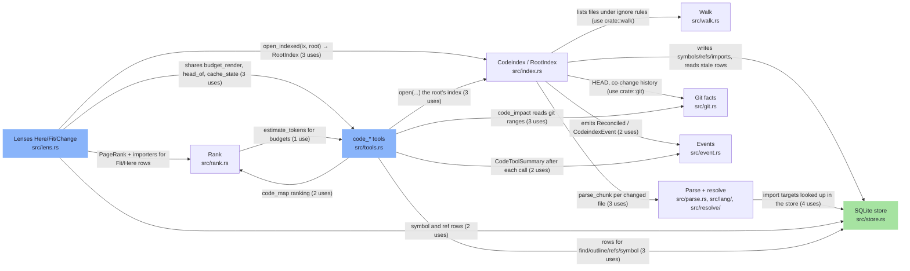

# R4 — SPIKE report: omm-layout map of theuth, index first, model judgement second

Date 2026-10-08 · tree ~/Develop/theuth (main) · output /Users/Sky.Moore/.theuth/briefs/2026-10-08/codemap-omm/spike/
Files: `skeleton.json` (deterministic), `.omm/` (35 elements, 5 diagrams), `ledger.json` (33 nodes, 49 edges with evidence).
Machine rules kept: nothing written inside ~/Develop/theuth, no builds, read-only shell (git ls-files, wc, awk, test -e).

## 1. Wall time per phase (wall clock, python `time.time()`; the `<time>` stamps agree: 17:41 → 17:49)

| phase | wall | what |
|---|---|---|
| read brief + AXES + omm SKILL/README + codeindex skill | ~20 s | 5 reads, 28 KB |
| deterministic (skeleton.json) | **76 s** | project_profile, code_map ×2 (budget 1500 / 6000), Cargo.toml, git ls-files + wc -l aggregated by awk, 49 Cargo.toml dep tables, UI `@/` import counts |
| judgement (5 diagrams, 35 descriptions, 5 concerns) | **303 s** | 22 code_outline, 18 grep, 6 targeted read_file windows, 46 write_file |
| ledger (parse diagrams, check 66 anchor paths, classify 49 edges) | ~60 s | 1 shell, 1 write |
| **total to artefacts** | **≈ 8 min** | report writing excluded |

The 40-minute cap was not approached. The deterministic phase is dominated by one 7 s shell job (49 awk passes over Cargo.toml) and the two code_map calls (~5 s); the judgement phase is dominated by model turns, not tools.

## 2. Tool calls by kind (counted as I went)

| kind | calls | notes |
|---|---|---|
| read_file | 11 | brief, AXES, SKILL, README, Cargo.toml, spill file, 5 code windows of 6–40 lines |
| shell | 9 | ls-files, sizes, Cargo deps, UI imports, codeindex sizes, anchor check, tree listing |
| code_map | 2 | 44 rows at 1500, 179 rows at 6000; indexed_files 3,255, dropped 3,355 |
| project_profile | 1 | kind cargo, commands from the justfile |
| code_outline | 22 | 17 codeindex modules (import edges), lens/tools/index detail, rpc lib |
| grep | 18 | request-lifecycle anchors (send_input, exec_chat_stream, Invoke, bridge subscribe, Composer) |
| write_file | 48 | skeleton, 46 .omm files, ledger |
| load_skill | 1 | codeindex |
| code_refs / code_find / code_symbol / glob | 0 | not needed: outlines and Cargo gave every edge |
| **total** | **112** | of which 65 % in the judgement phase |

Bytes read (sum of `len()` of every tool result): **370,611** (~95 k tokens if it had all entered context; most stayed in python variables — the printed slices were roughly a third of that).
Bytes written: skeleton.json ~45 KB, `.omm/` 46 files ≈ 21 KB, ledger.json ≈ 18 KB.

## 3. What was produced

| perspective / element | nodes | edges | depth | elements with description |
|---|---|---|---|---|
| overall-architecture | 11 | 16 | 1 | 1 + 11 |
| overall-architecture/content-stores | 5 | 6 | 2 | 5 |
| overall-architecture/content-stores/codeindex | 9 | 16 | 3 | 9 |
| overall-architecture/world-access | 3 | 3 | 2 | 3 |
| request-lifecycle | 5 | 8 | 1 | 1 + 5 |
| **total** | **33** | **49** | ≤ 3 | **35** (budget 35), 5 concern.md, 5 diagram.mmd |

omm conventions kept: kebab-case ids = child directory names, two-line labels `Name\npath`, every edge labelled, `graph LR`, omm's four classDefs where they apply, no child references its parent.

Edge grounding (ledger.json): **45 index-backed / 3 inferred / 1 partial = 92 % index-backed by existence.** The three inferred are return paths in request-lifecycle (stream deltas back, ToolOutput back) and the bridge→UI push whose exact site I did not read; the partial one is `clients → rpc`: `tui→rpc` is a Cargo dep but the desktop crate has no Cargo edge to rpc at all — it speaks WebSocket (`ui/src/rpc/transport.ts#L22-L43`).
Edge *labels* are a different matter: all 49 "why" strings were written by me; 20 of them are mechanical (Cargo dep counts, `use crate::x` counts) and could be emitted by the index; 29 needed a read (a call site, a doc comment, a tool description).
Anchor paths: 66 distinct paths checked with `test -e`; 1 was wrong on first pass (fixed, §7), 0 missing after.

## 4. Skeleton (deterministic phase) in numbers

- Top-level node count: **68** (49 crates + 12 UI `src/` folders + 7 repo dirs: assets, deploy, docs, packages, scripts, site, vendor). Edges: **366** (334 Cargo path deps between workspace crates, 31 UI folder→folder `@/` import edges, 1 bindings edge).
- Hubs by Cargo in-degree: runtime 37, tools 31, platform 24, **agent 21**, replica 16, secrets 15, mesh 15. By out-degree: theuth 40, rpc 37, tui 29.
- Sizes: crates 1,258 files; desktop UI `ui/src` 763 files / 106 k lines; agent 187 / 172 k; vendor 605 k lines (excluded from the map).
- code_map: at budget 6000 the 179 ranked rows aggregate to `ui/src/lib` (0.16 of rank mass), `ui/src/store`, `ui/src/components`, tools, runtime… — useful as a *weight*, useless as a *partition* (see §6).

## 5. The 5 hardest judgement calls (what the index could not tell me)

1. **Where `agent` belongs.** 21 crates import it (artifact, browser, meeting, talk, sandbox, update…). By degree it is foundation; by meaning it is the core. I kept it as its own layer and wrote the contradiction into concern.md. No metric decides this.
2. **Which 16 of 57 cluster edges to draw.** Every layer depends on foundation (9 edges) and `theuth-bin` imports everything (10 edges). Drawing them makes a hairball; omitting them hides the truth. I omitted and said so in the description. The index can compute the fan-in; deciding it is "implied" is taste.
3. **Edges that are not in any manifest.** desktop UI → engine is a WebSocket with ts-rs bindings that are gitignored (`ui/src/rpc/bindings/`), the relay is a separate process, ACP children are spawned processes. Cargo and imports see none of it; grep of `transport.ts` and `client.ts` did.
4. **Grouping inside codeindex.** 16 modules, cap 12: I merged parse+lang+resolve into one node (they only make sense together) and dropped locate/profile/root/outline_hook into the concern text. The import graph shows the edges; it does not say which modules are "one idea".
5. **Which method is *the* user turn.** `api.rs` is 8,029 lines with `send_input`, `steer`, `send_message` (peer mail), `create_session`. My first grep landed on `send_message` and I nearly drew a peer-messaging path as the request lifecycle; only reading `Composer.tsx#L750` and `voice-key.ts#L219` (steer when running, send_input otherwise) settled it.

Honourable mentions: naming layers (`world-access`, `orchestration` are my words, nothing in the tree says them); whether `replica` is mesh or foundation (Cargo decided: tools and secrets import it, so foundation); the edge purpose of `document→codeindex` (board anchors — known from the codeindex skill, not from a call site I read).

## 6. What a deterministic-only top level would look like

- **Node count 68** (crates + UI folders + repo dirs), **366 edges**. Against omm's "≤ 12 nodes or recurse" rule this is a failure as a diagram and a success as data: every node has a path, files, lines, in/out-degree, and every edge has a manifest line behind it.
- A mechanical reduction that *does* work: tier by Cargo in-degree (≥ 15 → base: runtime, tools, platform, agent, replica, secrets, mesh; out-degree ≥ 25 → assemblers: theuth, rpc, tui; the rest → plugins, 39 crates). Three tiers, true, and nearly useless for understanding: "39 plugins" is the whole product.
- Graph community detection on the 334-edge Cargo graph would give 6–12 communities, but the hubs (runtime/tools/agent) pull everything into one blob; it would still need a model to name and prune.
- The `code_map` PageRank cannot seed a top level: its top rows at budget 1500 are `lib/speech.test.ts`, `page-theme.ts`, `runtime/src/lib.rs`, `Composer.tsx` — test files and shared helpers outrank architecture. It is the right weight for *Fit* and *Here*, the wrong partition for *overall*.
- Where deterministic *does* beat the model: the drill-downs. The content-stores diagram (5 nodes, 6 Cargo edges) and the codeindex module diagram (9 nodes, 16 `use crate::` edges) are 100 % index-derived in structure; I added names, grouping and labels only. Below the top level, the index is the map.

## 7. Mistakes I caught myself

1. Put `replica` in the mesh layer; the aggregated edge list then showed `foundation → mesh` (tools→replica, secrets→replica), a back-edge that cannot exist in a layering. Moved it. The index caught a human-style error in seconds.
2. Wrote a node label `crates/agent/src/supervisor.rs, loop_.rs`; the anchor check flagged `loop_.rs` as missing (relative). Rewrote as `crates/agent/src/{supervisor,loop_}.rs`. A ledger pass with `test -e` is cheap and necessary.
3. `git ls-files` output was truncated at 64 KiB by the shell tool; my first per-crate count was wrong (only 11 crates appeared). Switched to `wc -l | awk` aggregation in the shell and used the spill file for the Cargo dep table.
4. First request-lifecycle grep matched `send_message` (peer mail), not the user turn (`send_input`). Caught by reading the Composer.
5. First `clients` size counted `crates/desktop` without its `ui/src` split-out (38 k vs 144 k lines). Recomputed.
6. Nearly over-spent the 35-element budget (plan was 41); trimmed world-access to 3 nodes and request-lifecycle to 5 rather than skip descriptions.

## 8. Recommendation: what a theuth generator should compute vs ask a model

**Compute deterministically (the skeleton — everything in `skeleton.json` plus a little more):**
- Units: workspace members (Cargo, package.json workspaces, pyproject), top-level dirs, and sub-folders of any unit over N files (UI `src/*`). Sizes (files, lines), `[NEW]` recency from git, test file counts.
- Edges with evidence: manifest deps (Cargo path deps = ground truth), folder→folder import counts, module→module `use crate::` counts (code_outline imports), plus two non-manifest detectors worth adding: generated-bindings edges (ts-rs `export.rs` → `bindings/`) and process/socket edges (a crate that spawns or dials another binary) — flagged `inferred` with the grep hit.
- Degree stats, back-edge check for any proposed layering, hub list, PageRank weights (for node sizing only).
- Anchor validation (`test -e` on every path, line ranges inside file length) and the ledger itself.
- The drill-down diagrams below the top level: nodes = modules/files of the unit, edges = import counts. Structure complete without a model; the model only names, groups and labels.

**Ask a model (judgement, with the skeleton in its context):**
- The ≤ 12 top-level partition and its names, given the 68 nodes + degree table + a candidate tiering. One call, ~10 k tokens in.
- Which edges to draw and the "why" label of each, given per-edge evidence (dep list, or a 10-line call-site window picked by grep for the top-weighted symbol). One call per diagram.
- description.md per element (2–5 sentences) from sizes + outline + the unit's top-ranked symbols; concern.md only when a metric trips (file > 5 k lines, in-degree > 15 on a non-foundation crate, back-edge, cycle).
- Non-structural perspectives (request-lifecycle, data-flow): these need reading call sites — budget them as a separate, optional pass seeded by grep on entry points (RPC methods, main, handlers).
- The viewer should show the ledger status on every edge (index-backed / inferred) — that is the honest difference from omm.

**Cost, extrapolated from this run (theuth: 3,255 indexed files, 49 crates, 1.2 k tracked files outside vendor):**
- Deterministic: ~80 s wall, zero tokens; all of it is already in codeindex except the manifest-dep and anchor-check passes (small).
- Judgement as I did it interactively: ~25 model turns, ~370 KB of tool output touched, ≈ 1.0–1.3 M input tokens cumulative (context re-sent per turn) and ≈ 15 k output tokens → roughly **$3–5 on a frontier model, $1–2 with prompt caching, ≈ 5 min wall.**
- Judgement as a generator should do it (skeleton pre-computed, one call per diagram + one per 10 descriptions, no re-sent context): 5 diagrams + 4 description batches + 1 partition call ≈ 10 calls × ~12 k in / 1.5 k out ≈ 120 k in / 15 k out → **≈ $0.50–0.70 frontier, ≈ $0.05 on a small model for descriptions**, 1–2 min wall. Per-repo cost scales with the number of elements, not the repo size: budget ≈ $0.015 per element on a frontier model.
- Full omm-style recursion (every element analysed until leaf; theuth would reach ~120 elements at depth 3) ≈ 3–4× that: **$2–3 frontier**, 5–8 min — still cheaper than this spike, because the skeleton removes the exploration tokens.
- Refresh: recompute the skeleton (seconds); re-ask the model only for diagrams whose node set or edge set changed (hash of the deterministic sub-skeleton per element), so a typical commit costs 0–2 calls.

**One-line verdict:** the index gives nodes, sizes, edge existence and the whole of every drill-down; the model is needed for exactly three things — the top-level partition, the words on the edges, and the prose — and with the skeleton in hand those cost under a dollar per repo.


## Appendix A — skeleton.json: the 22 largest top-level nodes by lines (of 68)

| path | files | lines | code_map rank mass (budget 6000) | ranked rows |
|---|---|---|---|---|
| vendor | 59 | 605,705 | 0.0000 | 0 |
| crates/agent | 187 | 172,172 | 0.0087 | 9 |
| docs | 542 | 143,812 | 0.0000 | 0 |
| crates/desktop/ui/src/components | 462 | 72,248 | 0.0309 | 15 |
| crates/decision | 40 | 45,455 | 0.0085 | 7 |
| crates/desktop | 302 | 38,454 | 0.0038 | 3 |
| crates/models | 7 | 37,347 | 0.0022 | 2 |
| crates/tui | 13 | 28,234 | 0.0000 | 0 |
| crates/surface | 357 | 24,359 | 0.0019 | 2 |
| crates/tools | 24 | 21,883 | 0.0293 | 17 |
| crates/desktop/ui/src/lib | 202 | 19,547 | 0.1607 | 48 |
| packages | 69 | 19,070 | 0.0082 | 6 |
| crates/web | 72 | 17,867 | 0.0068 | 7 |
| crates/meeting | 37 | 17,019 | 0.0000 | 0 |
| crates/codeindex | 50 | 16,056 | 0.0000 | 0 |
| crates/telegram | 17 | 15,781 | 0.0000 | 0 |
| crates/slack | 17 | 15,513 | 0.0000 | 0 |
| crates/rpc | 72 | 15,306 | 0.0000 | 0 |
| crates/artifact | 43 | 14,770 | 0.0000 | 0 |
| crates/tasks | 21 | 14,416 | 0.0038 | 2 |
| crates/double | 23 | 14,175 | 0.0000 | 0 |
| crates/document | 15 | 13,749 | 0.0000 | 0 |

## Appendix B — cluster→cluster Cargo edges (top 24 of 56 after moving `replica` to foundation)

| edge | crate edges | examples |
|---|---|---|
| orchestration → foundation | 24 | app→runtime, app→tools, app→platform, double→runtime… |
| channels → foundation | 22 | a2a→runtime, a2a→secrets, link→platform, link→runtime… |
| content-stores → foundation | 17 | artifact→runtime, artifact→tools, artifact→surface, artifact→platform… |
| world-access → foundation | 16 | browser→runtime, browser→tools, computer→runtime, computer→platform… |
| local-models → foundation | 12 | decision→runtime, decision→platform, decision→tools, meeting→runtime… |
| mesh → foundation | 11 | mesh→replica, mesh→runtime, mesh→tools, mesh→platform… |
| agent → foundation | 10 | acp→tools, acp→platform, acp→replica, agent→platform… |
| channels → orchestration | 9 | signal→double, signal→roster, signal→tasks, slack→double… |
| clients → foundation | 8 | desktop→platform, tui→runtime, tui→platform, tui→tools… |
| orchestration → content-stores | 7 | app→artifact, dreaming→knowledge, dreaming→document, roster→artifact… |
| orchestration → agent | 7 | app→agent, double→agent, dreaming→agent, roster→agent… |
| orchestration → mesh | 7 | double→mesh, dreaming→mesh, roster→mesh, roster→sandbox… |
| rpc → orchestration | 7 | rpc→schedule, rpc→roster, rpc→tasks, rpc→app… |
| theuth-bin → orchestration | 7 | theuth→schedule, theuth→tasks, theuth→roster, theuth→update… |
| channels → agent | 6 | a2a→agent, nodes→acp, nodes→agent, signal→agent… |
| rpc → foundation | 6 | rpc→platform, rpc→runtime, rpc→tools, rpc→surface… |
| rpc → channels | 6 | rpc→signal, rpc→slack, rpc→telegram, rpc→link… |
| theuth-bin → foundation | 6 | theuth→runtime, theuth→platform, theuth→tools, theuth→surface… |
| theuth-bin → world-access | 6 | theuth→web, theuth→browser, theuth→scrape, theuth→routes… |
| theuth-bin → channels | 6 | theuth→link, theuth→nodes, theuth→a2a, theuth→signal… |
| rpc → content-stores | 5 | rpc→document, rpc→knowledge, rpc→codeindex, rpc→search… |
| theuth-bin → local-models | 5 | theuth→voice, theuth→talk, theuth→decision, theuth→models… |
| clients → orchestration | 5 | tui→double, tui→schedule, tui→tasks, tui→roster… |
| orchestration → local-models | 4 | double→decision, double→meeting, double→talk, double→voice |

## Appendix C — the two diagrams that matter most (verbatim from `.omm/`)

`overall-architecture/diagram.mmd`:

```mermaid
graph LR
    clients["Clients\ncrates/desktop/, crates/tui/"]
    rpc["RPC facade\ncrates/rpc/"]
    agent["Agent loop\ncrates/agent/, crates/acp/, crates/cursor/"]
    foundation["Foundation\ncrates/{runtime,platform,tools,surface,markdown,secrets,oauth,replica}/"]
    content-stores["Content stores\ncrates/{knowledge,document,artifact,search,codeindex}/"]
    local-models["Local models + speech\ncrates/{models,decision,voice,meeting,talk}/"]
    world-access["World access\ncrates/{web,browser,scrape,routes,search-providers,computer}/"]
    channels["Channels + peers\ncrates/{signal,slack,telegram,a2a,link,nodes,relay}/"]
    mesh["Mesh + sync\ncrates/{mesh,sessionsync,sandbox}/"]
    orchestration["Orchestration\ncrates/{roster,tasks,schedule,double,dreaming,app,update}/"]
    theuth-bin["t binary\ncrates/theuth/"]

    clients -->|"jsonrpsee WebSocket, ts-rs bindings (ui/src/rpc/transport.ts)"| rpc
    rpc -->|"send_input → ask(AGENT_ACTOR, SendInput)"| agent
    rpc -->|"lens, doc, knowledge, artifact methods (5 Cargo deps)"| content-stores
    rpc -->|"schedule, tasks, roster, double, app, update methods (7 deps)"| orchestration
    rpc -->|"channel settings and link/pairing methods (6 deps)"| channels
    agent -->|"registry.ask(Invoke(ToolCall)) via tools::registry"| foundation
    agent -->|"HTTP client for providers (agent→web)"| world-access
    channels -->|"inbound messages become session input (6 deps)"| agent
    channels -->|"desks, tasks, the owner's double (9 deps)"| orchestration
    orchestration -->|"wake sessions, run prompts, spawn desks (7 deps)"| agent
    orchestration -->|"engine stats, sandboxes, replication (11 deps)"| mesh
    content-stores -->|"replica change feeds, mesh engine ids (4 deps)"| mesh
    local-models -->|"meeting/talk drive a session (2 deps)"| agent
    world-access -->|"browser_run picks actions with the decision model"| local-models
    mesh -->|"sandbox + sessionsync own agent sessions (2 deps)"| agent
    theuth-bin -->|"main() builds Runtime, starts every plugin"| foundation

    classDef entry fill:#89b4fa,stroke:#89b4fa,color:#1e1e2e
    classDef store fill:#a6e3a1,stroke:#a6e3a1,color:#1e1e2e
    class clients,channels entry
    class content-stores store
```



`overall-architecture/content-stores/codeindex/diagram.mmd` (structure 100 % from code_outline imports; names and labels mine):



## Appendix D — `.omm/` tree written (46 files)

```
overall-architecture/agent/concern.md
overall-architecture/agent/description.md
overall-architecture/channels/description.md
overall-architecture/clients/concern.md
overall-architecture/clients/description.md
overall-architecture/concern.md
overall-architecture/content-stores/artifact/description.md
overall-architecture/content-stores/codeindex/concern.md
overall-architecture/content-stores/codeindex/description.md
overall-architecture/content-stores/codeindex/diagram.mmd
overall-architecture/content-stores/codeindex/event/description.md
overall-architecture/content-stores/codeindex/git/description.md
overall-architecture/content-stores/codeindex/index/description.md
overall-architecture/content-stores/codeindex/lens/description.md
overall-architecture/content-stores/codeindex/parse-resolve/description.md
overall-architecture/content-stores/codeindex/rank/description.md
overall-architecture/content-stores/codeindex/store/description.md
overall-architecture/content-stores/codeindex/tools/description.md
overall-architecture/content-stores/codeindex/walk/description.md
overall-architecture/content-stores/description.md
overall-architecture/content-stores/diagram.mmd
overall-architecture/content-stores/document/description.md
overall-architecture/content-stores/knowledge/description.md
overall-architecture/content-stores/search/description.md
overall-architecture/description.md
overall-architecture/diagram.mmd
overall-architecture/foundation/description.md
overall-architecture/local-models/description.md
overall-architecture/mesh/description.md
overall-architecture/orchestration/description.md
overall-architecture/rpc/concern.md
overall-architecture/rpc/description.md
overall-architecture/theuth-bin/description.md
overall-architecture/world-access/browser/description.md
overall-architecture/world-access/description.md
overall-architecture/world-access/diagram.mmd
overall-architecture/world-access/scrape/description.md
overall-architecture/world-access/web/description.md
request-lifecycle/agent-session/description.md
request-lifecycle/description.md
request-lifecycle/diagram.mmd
request-lifecycle/diagram.mmd
request-lifecycle/model-provider/description.md
request-lifecycle/rpc-api/description.md
request-lifecycle/tool-registry/description.md
request-lifecycle/web-ui/description.md
```
