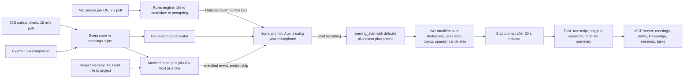

# 158 MEETINGS-AROUND — detection, calendar, project series, speaker suggestions, templates, and theuth over MCP

Status: DESIGN — planned, not built. Sky's rulings 2026-10-10 12:55 (`decisions/theuth-meeting-notetakers-rulings-2026-10-10`);
study `docs/studies/2026-10-10-local-meeting-notetakers.md` (main b9a9139c).

Worktree `theuth-158`, branch `docs/158-meetings-around`, cut from origin/main b4e5833a. Every `path:line` below was re-opened in
this worktree on 2026-10-10. Techniques borrowed from the four studied products are named by appendix letter and the appendix's
own `path#L` cite; no code was copied.

## 0. Decisions in one screen

**Sky's rulings (fixed — the design never reopens them).**

| # | Ruling | Where it lands |
|---|---|---|
| R1 | Robust meeting detection from WHICH APP holds the mic; the companion surfaces it in the notch/island and asks whether to start recording | §4 sensor + rules, §5 prompt |
| R2 | One-tap start uses default meeting settings — "default settings for the model and everything if there isn't already" | §6 defaults |
| R3 | The prompt carries one line: "By starting the recording you acknowledge the recording is lawful." | §5 copy, verbatim |
| R4 | Calendar = the macOS Calendar app (EventKit through the macOS companion) + a subscription URL for everything else; "the long url is the security"; read-only; no Google/Microsoft OAuth | §7 |
| R5 | When calendars are synced, determine which event the detected meeting is and seed context from it | §8 |
| R6 | An agent tool, usable in meeting review, that suggests speaker names from calendar info and what it hears/sees in the transcript | §10 |
| R7 | A project tied to a meeting is the meeting-series answer; the pre-meeting brief is generated from the last meetings in the project | §9 |
| R8 | "it doesn't crash, minimal if any crash recovery"; device switching OUT; only the computer the user is on; mobile later | §17 (+ one filter change, D13) |
| R9 | Echo cancellation outside macOS "if you think we need it" — the design decides with evidence | §13 |
| R10 | All data accessible over MCP; start the server and copy the JSON block from Settings; rmcp streamable HTTP; stdio via the TUI binary | §12 |
| R11 | No local-only mode; everything is local by default; a local model is the user's business | §17 |
| R12 | One design doc planning ALL the waves now | this file, §16 |

**Orchestrator's design calls (D1–D16), as adopted or changed.**

| # | Adopted / changed | Note |
|---|---|---|
| D1 | Adopted, refined (W-a, W-b) | sensor in the engine, polled every 2 s; macOS `kAudioProcessPropertyIsRunningInput`, Windows capture-endpoint sessions, Linux PipeWire `Stream/Input/Audio` |
| D2 | Adopted, refined (W-l) | 15 s hold, 10 min cooldown, deny-list incl. BOTH theuth processes (engine `t` and the companion) |
| D3 | Adopted (W-e, W-q) | both companions; no clock timeout — the prompt leaves when the app releases the mic ≥ 30 s; the desktop Meetings page shows the same prompt as a banner |
| D4 | Adopted | "Stop recording?" after 30 s release; never silent auto-stop |
| D5 | Changed (W-f) | two model keys, not three: `meeting.model` and `meeting.summary_model`; "transcript language" stored but inert until the multilingual tier (§14) |
| D6 | Adopted (W-d, W-k) | ICS parser = bounded VCALENDAR reader + `rrule` 0.14 for expansion; events live in `meetings.sqlite` |
| D7 | Adopted | scoring in §8 with thresholds and worked examples |
| D8 | Adopted | seed = manifest + `started.` line + alias cache + topics + speaker candidates |
| D9 | Adopted, one conflict (W-c) | meeting sessions are hard-wired to project `meetings` today; the meeting's project replaces it when set |
| D10 | Adopted, "sees" deferred (W-g) | window-read participant names → §14 |
| D11 | Adopted, writes deferred (W-h, W-i, W-j) | stdio bridge is `t mcp` without `--session`; W5 ships read tools; audit is a JSONL file |
| D12 | Adopted (W-o) | measure-first counter in the post pass; AEC3 only if the gate trips |
| D13 | Adopted — it IS a few lines (W-n) | finalise-on-start at the plugin-start filter; no UI |
| D14 | Adopted (W-p) | templates are markdown files with YAML front matter under `<data_dir>/meetings/templates/` |
| D15 | Adopted | each item with a gate and seam in §14 |
| D16 | Adopted | §17 |

**Writer's calls (every one marked inline too).**

- W-a Sensor and rules engine live in the engine (`crates/meeting/src/detect/`), not in the companions; companions render two new bus events. Reason: the per-OS process enumeration already lives at `crates/meeting/src/capture/system.rs:130`, `:240`, `:344`; the companions are plain RPC clients (`docs/design/134-companion-windows.md:317-319`).
- W-b Polling every 2 s instead of Core Audio property listeners; cost ≈ one `AudioObjectGetPropertyData` per process object per tick. Listeners are the upgrade if the tick ever shows in `top`.
- W-c The meeting session's `project` becomes the meeting's project when one is set, else today's `meetings` label (`crates/meeting/src/lib.rs:1936`).
- W-d ICS: our own ~150-line VCALENDAR line reader (unfold, split, VEVENT/VTIMEZONE, RECURRENCE-ID overrides) + the `rrule` crate for RRULE/RDATE/EXDATE expansion with IANA zones; Windows zone names mapped by a bounded table.
- W-e No clock timeout on the detection prompt; it withdraws when the detected app releases the mic for 30 s (D4's threshold) or when a meeting starts.
- W-f One live model key (`meeting.model`: topics, briefs, the pre-meeting brief writer) and one summary key (`meeting.summary_model`, `None` = same); both fall back to `agent.model` (`crates/agent/src/supervisor.rs:10372`).
- W-g Reading participant names from the meeting window is deferred to §14 (accessibility reads are fragile and Anarlog's is the same code path that can type into chat).
- W-h The stdio bridge is `t mcp` with no `--session` (clap: `session` becomes `Option<String>`); `t mcp --session <id>` is byte-for-byte unchanged.
- W-i W5 ships the read catalogue only. RPC methods bypass `tools.policy` (`crates/tools/src/registry.rs:973-992` gates registry tools, not RPC), so write tools need a gate design — §14.
- W-j MCP audit = append-only `<data_dir>/mcp/server-audit.jsonl`, one line per call; no table.
- W-k Calendar sources and events are tables in `meetings.sqlite` (`crates/meeting/src/store.rs:22`), migration `0003_calendar.sql`.
- W-l The ignore list is config, `meeting.detect.ignore: Vec<String>` — bundle id on macOS, image name on Windows, `application.name` on Linux; "Never for <App>" appends to it with `runtime::write_config_value` (`crates/runtime/src/lib.rs:109`).
- W-m A running meeting app is never a prompt by itself; it only scores the calendar match (join-link host ↔ app, §8).
- W-n D13 is in: the plugin-start filter at `crates/meeting/src/lib.rs:3783-3790` gains one arm.
- W-o The echo gate is a counter in the post pass (mic segments whose text duplicates a system segment within 2 s), logged per meeting; it ships in W6's first slice.
- W-p Templates: markdown + YAML front matter files; built-ins embedded in the binary; a built-in is upgraded only while unedited (D `D-openwhispr-source-recon.md:126`).
- W-q The desktop Meetings page (`crates/desktop/ui/src/components/meeting/MeetingList.tsx`) shows the detection prompt as a banner on every OS; the Tauri `Island.tsx` does not change. Linux has no companion, so this is the only Linux surface.

**Waves.**

| Wave | Delivers | Owns | Size |
|---|---|---|---|
| W1 | detection sensor + rules + bus events; island prompt in both companions + page banner; meeting defaults; D13 finalise-on-start | `crates/meeting/src/detect/`, `MeetingConfig`, Settings › Meetings, both islands | L |
| W2 | EventKit via the macOS companion; ICS subscriptions; event store; matching + seed | `crates/meeting/src/calendar/`, Settings › Calendar, companion `Calendar/` | L |
| W3 | project on a meeting; remembered per UID/title; pre-meeting brief | manifest + store, prompt chip, start form, `brief_writer.rs` | M |
| W4 | `meeting_suggest_speakers` tool + Review accepts; templates; note prompt rules; dictionary as preferred names | `speakers.rs`, `post/`, `note.rs`, `summary.rs`, `Review.tsx`, start form | M |
| W5 | rmcp streamable-HTTP server; `t mcp` stdio bridge; read catalogue; Settings › MCP | new `crates/mcp-server`, `crates/theuth/src/mcp.rs`, Settings | M |
| W6 | echo gate (+ AEC3 if tripped); hybrid search; export; decisions schema; guard pass; multilingual; evals; window-read names; MCP writes | capture, post, search, autoresearch | L, gated |

## 1. Why

The study's verdict (`docs/studies/2026-10-10-local-meeting-notetakers.md:11-13`): **theuth is ahead during the meeting and
behind before and around it.** None of Meetily, Anarlog, OpenWhispr or Minutes runs tool-backed AI while the call is live;
theuth writes factual briefs with tools (`crates/meeting/src/tools.rs:26-57`), reuses them from an alias cache with no model
call (`crates/meeting/src/cache.rs:412`), and shows them on an island that never takes focus and is hidden from capture
(`crates/desktop/companion/Sources/Companion/Island/IslandWindow.swift:16-31`). Where theuth trails, all four agree: a meeting
starts only by hand (the only "calendar" in the crate is a stop-word list, `crates/meeting/src/oracle.rs:381-382`), one fixed
summary form (`crates/meeting/src/note.rs:21-35`), no MCP server for outside agents (`crates/theuth/src/mcp.rs:1-6` serves
theuth's own ACP children), no echo cancellation off macOS (`crates/meeting/src/capture/system.rs:106-116`).

Sky's words (2026-10-10 12:55, verbatim from `158-input-sky-rulings-2026-10-10.md`):

- "ok yeah we need a robust meeting detection based on which app is using the mic, and the companion app should surface that in
  the notch window and ask if you want to start recording the meeting, there should be default settings for the model and
  everything if there isn't already. and a single line, “by starting the recording you acknowledge the recording is lawful”"
- "we need a calendar integration for sure, I think the lightest weight option is just having a subscription to a caldav I think
  is what it's called, where you create a URL and you can see everything in the calendar that way, the long url is the security.
  We should also if they have calendars synced try to determine which meeting is being detected and use that to seed context. We
  should probably give the agents a tool to use in meeting review to suggest speaker names based on the calendar info and what it
  hears/sees in the transcript."
- "I think being able to tie a project to a meeting is probably the meeting series answer. that way we can generate the pre
  meeting brief based on the last meetings in the project."
- "We wrote ours in rust. it doesn't crash, minimal if any crash recovery. device switching is out of scope. we only record
  meetings on the computer user is currently using. mobile meetings is a down the road thing."
- Q3: "yeah in general all the data should be accessible over mcp, and we should be able to start the mcp server and copy the mcp
  json block from the settings. rmcp streamable http transport. tui for stdio support." Q4: "we don't even have a concept for
  this. all our transcription and everything is local by default." Q5: "Let's just write a design doc to plan all the waves now."

What he described as "caldav" is an ICS/iCal secret-address feed (webcal): one URL, GET, read-only. That is what §7 builds.

## 2. Facts relied on

| Fact | `path:line` | What it means for 158 |
|---|---|---|
| `processes()` enumerates Core Audio process objects with `kAudioProcessPropertyPID`, `BundleID`, `IsRunningOutput` | `crates/meeting/src/capture/system.rs:130-139`, `:217-220` | the macOS sensor adds one property read (`IsRunningInput`) to an existing loop |
| Windows `processes()` walks `IAudioSessionManager2` sessions on the default **render** endpoint, `active` = `AudioSessionStateActive`, name via `image_name` | `system.rs:239-302` | the sensor repeats the walk on the default **capture** endpoint (`eCapture`) |
| Linux `processes()` lists PipeWire nodes with `media.class = Stream/Output/Audio`, `active` always true | `system.rs:344-396` | the sensor filters `Stream/Input/Audio`; a node's existence is the signal |
| `ProcessInfo { pid, name, bundle_id, active }` | `crates/meeting/src/lib.rs:234-243` | the detected app is a `ProcessInfo`; `bundle_id` is `None` on Windows |
| mic opens with `Aec::Vpio`; `Aec::None` → `Degradation::MicNoAec` | `crates/meeting/src/capture/mic.rs:37-43` | the engine process holds the meeting mic; VPIO is the only AEC |
| `supported()`: macOS `Full`, else `Partial("no echo cancellation; headphones recommended")` | `system.rs:108-116` | §13's baseline |
| `MeetingState` Idle…Failed; `MeetingEvent` 15 variants, `#[serde(tag = "type")]` | `lib.rs:149-170`, `:265-398` | two variants are added; companions decode by `type` |
| `MeetingConfig` keys and defaults, `live_tools` default list | `lib.rs:531-566`, `:580-611` | §6 adds keys to this struct; `rt.section("meeting")` loads it (`lib.rs:3766`) |
| `StartMeeting { process, title, context, consent, session_model, memory }` | `lib.rs:627-646` | the frozen start shape; §15 extends it additively |
| `Manifest` has `title, context, process, consent_at, session_model, memory, tracks, note` — no project, no event | `crates/meeting/src/store.rs:77-119` | §15 adds `project`, `event`, `template` |
| the meeting session is created with `project: Some("meetings")` | `lib.rs:1933-1944` | W-c |
| `started_line` = `[meeting 00:00:00] started. context: …`; `title + context` is alias-scanned before it | `crates/meeting/src/session.rs:99-103`, `lib.rs:2264-2282` | the seed path for §8 |
| `SetLiveDiarization` writes `meeting.live_diarization` with `runtime::write_config_value` | `lib.rs:3575-3584` | the pattern every §6 setter copies |
| `write_config_value(path, section, key, value)` and `write_nested_config_value` | `crates/runtime/src/lib.rs:109`, `:137` | nested `meeting.detect.*` keys are writable today |
| `meeting_*` RPCs: start/stop/status/list/get/…/speaker_enroll/live_diarization | `crates/rpc/src/api.rs:1723-1835` | every §15 RPC follows this trait's shape; `subscribe_events` at `api.rs:2482` |
| the Bridge forwards `MeetingEvent` on the broadcast bus | `crates/rpc/src/bridge.rs:207` | new variants reach companions with no bridge change |
| 148 chain: child pick → desk model → `agent.subagents.model` → `default_model`; root session = `default_model` | `crates/agent/src/supervisor.rs:904-931`, `:10372` | `meeting.model` sits in front of `agent.model` for the meeting root |
| `SetModel` with no session writes `agent.model` | `supervisor.rs:8158-8162` | the meeting default must NOT reuse that path |
| `projects(name PK, icon, color, updated_at)`; label is `sessions.project` | `crates/agent/migrations/0018_project_style.sql:5-10` | a project is a string label with optional style |
| `set_session_project`, `list_project_styles`, `set_project_style` | `api.rs:593-607` | the project RPCs the chip and start form use |
| `project: Option<String>` on tasks, notebooks, routines | `crates/tasks/src/types.rs:221`, `crates/document/src/notebook.rs:99`, `crates/schedule/src/file.rs:400` | the label already spans theuth; no new table |
| sessions carry `retention: tools::Retention { Durable, Private }` | `crates/agent/src/lib.rs:1235-1237`, `crates/tools/src/resources.rs:18-24` | "Private sessions excluded" = `retention == Private` |
| vault: `get/list/set/delete/expand/redact`; RPCs `list_secrets`, `set_secret`, `delete_secret` | `crates/secrets/src/vault.rs:422-579`, `api.rs:2432-2448` | ICS URLs and the MCP token are vault rows |
| dictionary: `lookup`, `lookup_scoped`, `list(scope)`, `Entry { canonical, kind, spoken, variants, scope }` | `crates/voice/src/dictionary/mod.rs:103`, `:188-193`, `:323` | §11's "Preferred names" block reads `list(None)` |
| `Policy { read_only, mutating, destructive }` → `PolicyAction`; enforced in `registry.rs::effective` | `crates/tools/src/lib.rs:549-570`, `crates/tools/src/registry.rs:973-992` | W-i |
| `t mcp --session`: `Shim { session, client: Arc<WsClient> }` serving three tools over `rmcp::transport::stdio()` | `crates/theuth/src/mcp.rs:24-28`, `:174-187` | the stdio bridge extends this file |
| rmcp features: workspace client-only; `crates/theuth` adds `server`, `transport-io` | `Cargo.toml:203`, `crates/theuth/Cargo.toml:71-72` | §12 adds `transport-streamable-http-server` |
| engine RPC = jsonrpsee on `rpc.listen` (default `127.0.0.1:7777`), `Authorization: Bearer <data_dir>/token`, no CORS | `crates/rpc/src/lib.rs:44-55`, `:271-293` | the MCP server is a second loopback listener with its own token |
| `speakers::MATCH = 0.6`, `best_match` filters `>= MATCH`, max by cosine | `crates/meeting/src/speakers.rs:15`, `:98-105` | §10 adds a margin and mutual uniqueness on top |
| `summary::form_for` picks `note::summary_form(doc)` or `SUMMARY_FORM` | `crates/meeting/src/summary.rs:29-34`, `note.rs:21-35` | §11's template hook |
| `StartForm.tsx`: pid, title, context, model, endless, consent `CONSENT` string | `crates/desktop/ui/src/components/meeting/StartForm.tsx:33`, `:37-46` | the manual start keeps its fields; gains project + template + event |
| Settings › Meetings today: hotkeys (local), live speaker labels, oracle pointer, enrolled speakers | `crates/desktop/ui/src/components/settings/Meetings.tsx:29-74` | §6 adds sections to this component |
| island visible iff live or Always show; non-activating panel; `sharingType .none` | `IslandModel.swift:34-43`, `IslandWindow.swift:16-31` | the prompt is a new reason to be visible; same window |
| Windows: `WS_EX_NOACTIVATE`, `WDA_EXCLUDEFROMCAPTURE`, `ShouldShow = IsLive || AlwaysShow` | `ToolWindow.cs:43-51`, `IslandWindow.cs:119`, `IslandModel.cs:201` | same |
| companions decode events by `type` (`MeetingWire.Decode`, `MeetingEvent.decode`) and hydrate from `meeting_status` | `MeetingWire.cs:44-76`, `Store+Meeting.swift:11-45` | new variants need both decoders + `Status` fields |
| EventKit, `EKEventStore`, calendar entitlements: absent in `crates/desktop` | `crates/desktop/companion.entitlements.plist:7-8` (empty dict) | §7 adds the usage string + entitlement to the companion only |
| no `ical`, `rrule`, `chrono-tz`, AEC crate in the lock; `reqwest 0.13` (rustls, json, stream) and `hyper-util` are | `Cargo.lock:9018` (hyper-util), `Cargo.toml:172` | W-d, §12's HTTP stack |

## 3. Shape

| Box | New vs existing |
|---|---|
| Mic sensor | new module beside `capture/system.rs::processes()`; same OS APIs, one more property / endpoint |
| Rules engine | new; emits two `MeetingEvent` variants on the existing bus (`lib.rs:265-398`) |
| Island prompt | new island state in both companions; same window, focus and capture rules (`IslandWindow.swift:16-31`, `ToolWindow.cs:43-51`) |
| EventKit | new companion module + one new RPC the companion calls to push events |
| ICS subscriptions | new engine module; `reqwest` already in the workspace |
| Event store | new tables in the existing `meetings.sqlite` (`store.rs:22`) |
| Matcher, project memory | new; reads the store |
| Pre-meeting brief writer | new; reuses the brief cache (`cache.rs`) and the live toolset's tools |
| `meeting_start` | existing RPC (`api.rs:1731-1732`); `StartMeeting` gains optional fields |
| Live seed | existing paths: `started_line`, alias scan (`lib.rs:2264-2282`), topics |
| Stop prompt | new island state; `meeting_stop` unchanged |
| Post | existing pipeline; new tool `meeting_suggest_speakers`; template-aware `form_for` |
| MCP server | new crate; read-only wrappers over existing RPC handlers |
