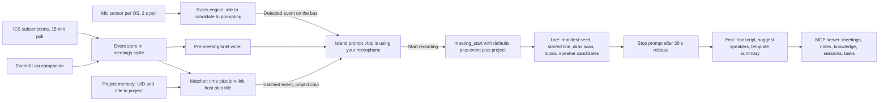
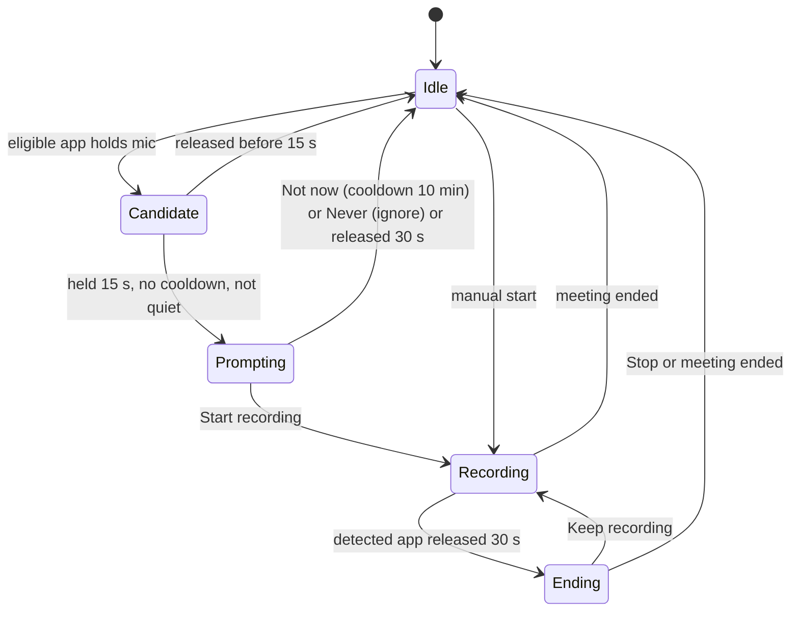

# 158 MEETINGS-AROUND — detection, calendar, project series, speaker suggestions, templates, and theuth over MCP

Status: DESIGN — planned, not built. Sky's rulings 2026-10-10 12:55 (`decisions/theuth-meeting-notetakers-rulings-2026-10-10`);
study `docs/studies/2026-10-10-local-meeting-notetakers.md` (main b9a9139c).

Worktree `theuth-158`, branch `docs/158-meetings-around`, cut from origin/main b4e5833a. Every `path:line` below was re-opened in
this worktree on 2026-10-10. Techniques borrowed from the four studied products are named by appendix letter and the appendix's
own `path#L` cite; no code was copied.

## 0. Decisions in one screen

**Sky's rulings (fixed — the design never reopens them).**

| # | Ruling | Where it lands |
|---|---|---|
| R1 | Robust meeting detection from WHICH APP holds the mic; the companion surfaces it in the notch/island and asks whether to start recording | §4 sensor + rules, §5 prompt |
| R2 | One-tap start uses default meeting settings — "default settings for the model and everything if there isn't already" | §6 defaults |
| R3 | The prompt carries one line: "By starting the recording you acknowledge the recording is lawful." | §5 copy, verbatim |
| R4 | Calendar = the macOS Calendar app (EventKit through the macOS companion) + a subscription URL for everything else; "the long url is the security"; read-only; no Google/Microsoft OAuth | §7 |
| R5 | When calendars are synced, determine which event the detected meeting is and seed context from it | §8 |
| R6 | An agent tool, usable in meeting review, that suggests speaker names from calendar info and what it hears/sees in the transcript | §10 |
| R7 | A project tied to a meeting is the meeting-series answer; the pre-meeting brief is generated from the last meetings in the project | §9 |
| R8 | "it doesn't crash, minimal if any crash recovery"; device switching OUT; only the computer the user is on; mobile later | §17 (+ one filter change, D13) |
| R9 | Echo cancellation outside macOS "if you think we need it" — the design decides with evidence | §13 |
| R10 | All data accessible over MCP; start the server and copy the JSON block from Settings; rmcp streamable HTTP; stdio via the TUI binary | §12 |
| R11 | No local-only mode; everything is local by default; a local model is the user's business | §17 |
| R12 | One design doc planning ALL the waves now | this file, §16 |

**Orchestrator's design calls (D1–D16), as adopted or changed.**

| # | Adopted / changed | Note |
|---|---|---|
| D1 | Adopted, refined (W-a, W-b) | sensor in the engine, polled every 2 s; macOS `kAudioProcessPropertyIsRunningInput`, Windows capture-endpoint sessions, Linux PipeWire `Stream/Input/Audio` |
| D2 | Adopted, refined (W-l) | 15 s hold, 10 min cooldown, deny-list incl. BOTH theuth processes (engine `t` and the companion) |
| D3 | Adopted (W-e, W-q) | both companions; no clock timeout — the prompt leaves when the app releases the mic ≥ 30 s; the desktop Meetings page shows the same prompt as a banner |
| D4 | Adopted | "Stop recording?" after 30 s release; never silent auto-stop |
| D5 | Changed (W-f) | two model keys, not three: `meeting.model` and `meeting.summary_model`; "transcript language" stored but inert until the multilingual tier (§14) |
| D6 | Adopted (W-d, W-k) | ICS parser = bounded VCALENDAR reader + `rrule` 0.14 for expansion; events live in `meetings.sqlite` |
| D7 | Adopted | scoring in §8 with thresholds and worked examples |
| D8 | Adopted | seed = manifest + `started.` line + alias cache + topics + speaker candidates |
| D9 | Adopted, one conflict (W-c) | meeting sessions are hard-wired to project `meetings` today; the meeting's project replaces it when set |
| D10 | Adopted, "sees" deferred (W-g) | window-read participant names → §14 |
| D11 | Adopted, writes deferred (W-h, W-i, W-j) | stdio bridge is `t mcp` without `--session`; W5 ships read tools; audit is a JSONL file |
| D12 | Adopted (W-o) | measure-first counter in the post pass; AEC3 only if the gate trips |
| D13 | Adopted — it IS a few lines (W-n) | finalise-on-start at the plugin-start filter; no UI |
| D14 | Adopted (W-p) | templates are markdown files with YAML front matter under `<data_dir>/meetings/templates/` |
| D15 | Adopted | each item with a gate and seam in §14 |
| D16 | Adopted | §17 |

**Writer's calls (every one marked inline too).**

- W-a Sensor and rules engine live in the engine (`crates/meeting/src/detect/`), not in the companions; companions render two new bus events. Reason: the per-OS process enumeration already lives at `crates/meeting/src/capture/system.rs:130`, `:240`, `:344`; the companions are plain RPC clients (`docs/design/134-companion-windows.md:317-319`).
- W-b Polling every 2 s instead of Core Audio property listeners; cost ≈ one `AudioObjectGetPropertyData` per process object per tick. Listeners are the upgrade if the tick ever shows in `top`.
- W-c The meeting session's `project` becomes the meeting's project when one is set, else today's `meetings` label (`crates/meeting/src/lib.rs:1936`).
- W-d ICS: our own ~150-line VCALENDAR line reader (unfold, split, VEVENT/VTIMEZONE, RECURRENCE-ID overrides) + the `rrule` crate for RRULE/RDATE/EXDATE expansion with IANA zones; Windows zone names mapped by a bounded table.
- W-e No clock timeout on the detection prompt; it withdraws when the detected app releases the mic for 30 s (D4's threshold) or when a meeting starts.
- W-f One live model key (`meeting.model`: topics, briefs, the pre-meeting brief writer) and one summary key (`meeting.summary_model`, `None` = same); both fall back to `agent.model` (`crates/agent/src/supervisor.rs:10372`).
- W-g Reading participant names from the meeting window is deferred to §14 (accessibility reads are fragile and Anarlog's is the same code path that can type into chat).
- W-h The stdio bridge is `t mcp` with no `--session` (clap: `session` becomes `Option<String>`); `t mcp --session <id>` is byte-for-byte unchanged.
- W-i W5 ships the read catalogue only. RPC methods bypass `tools.policy` (`crates/tools/src/registry.rs:973-992` gates registry tools, not RPC), so write tools need a gate design — §14.
- W-j MCP audit = append-only `<data_dir>/mcp/server-audit.jsonl`, one line per call; no table.
- W-k Calendar sources and events are tables in `meetings.sqlite` (`crates/meeting/src/store.rs:22`), migration `0003_calendar.sql`.
- W-l The ignore list is config, `meeting.detect.ignore: Vec<String>` — bundle id on macOS, image name on Windows, `application.name` on Linux; "Never for <App>" appends to it with `runtime::write_config_value` (`crates/runtime/src/lib.rs:109`).
- W-m A running meeting app is never a prompt by itself; it only scores the calendar match (join-link host ↔ app, §8).
- W-n D13 is in: the plugin-start filter at `crates/meeting/src/lib.rs:3783-3790` gains one arm.
- W-o The echo gate is a counter in the post pass (mic segments whose text duplicates a system segment within 2 s), logged per meeting; it ships in W6's first slice.
- W-p Templates: markdown + YAML front matter files; built-ins embedded in the binary; a built-in is upgraded only while unedited (D `D-openwhispr-source-recon.md:126`).
- W-q The desktop Meetings page (`crates/desktop/ui/src/components/meeting/MeetingList.tsx`) shows the detection prompt as a banner on every OS; the Tauri `Island.tsx` does not change. Linux has no companion, so this is the only Linux surface.

**Waves.**

| Wave | Delivers | Owns | Size |
|---|---|---|---|
| W1 | detection sensor + rules + bus events; island prompt in both companions + page banner; meeting defaults; D13 finalise-on-start | `crates/meeting/src/detect/`, `MeetingConfig`, Settings › Meetings, both islands | L |
| W2 | EventKit via the macOS companion; ICS subscriptions; event store; matching + seed | `crates/meeting/src/calendar/`, Settings › Calendar, companion `Calendar/` | L |
| W3 | project on a meeting; remembered per UID/title; pre-meeting brief | manifest + store, prompt chip, start form, `brief_writer.rs` | M |
| W4 | `meeting_suggest_speakers` tool + Review accepts; templates; note prompt rules; dictionary as preferred names | `speakers.rs`, `post/`, `note.rs`, `summary.rs`, `Review.tsx`, start form | M |
| W5 | rmcp streamable-HTTP server; `t mcp` stdio bridge; read catalogue; Settings › MCP | new `crates/mcp-server`, `crates/theuth/src/mcp.rs`, Settings | M |
| W6 | echo gate (+ AEC3 if tripped); hybrid search; export; decisions schema; guard pass; multilingual; evals; window-read names; MCP writes | capture, post, search, autoresearch | L, gated |

## 1. Why

The study's verdict (`docs/studies/2026-10-10-local-meeting-notetakers.md:11-13`): **theuth is ahead during the meeting and
behind before and around it.** None of Meetily, Anarlog, OpenWhispr or Minutes runs tool-backed AI while the call is live;
theuth writes factual briefs with tools (`crates/meeting/src/tools.rs:26-57`), reuses them from an alias cache with no model
call (`crates/meeting/src/cache.rs:412`), and shows them on an island that never takes focus and is hidden from capture
(`crates/desktop/companion/Sources/Companion/Island/IslandWindow.swift:16-31`). Where theuth trails, all four agree: a meeting
starts only by hand (the only "calendar" in the crate is a stop-word list, `crates/meeting/src/oracle.rs:381-382`), one fixed
summary form (`crates/meeting/src/note.rs:21-35`), no MCP server for outside agents (`crates/theuth/src/mcp.rs:1-6` serves
theuth's own ACP children), no echo cancellation off macOS (`crates/meeting/src/capture/system.rs:106-116`).

Sky's words (2026-10-10 12:55, verbatim from `158-input-sky-rulings-2026-10-10.md`):

- "ok yeah we need a robust meeting detection based on which app is using the mic, and the companion app should surface that in
  the notch window and ask if you want to start recording the meeting, there should be default settings for the model and
  everything if there isn't already. and a single line, “by starting the recording you acknowledge the recording is lawful”"
- "we need a calendar integration for sure, I think the lightest weight option is just having a subscription to a caldav I think
  is what it's called, where you create a URL and you can see everything in the calendar that way, the long url is the security.
  We should also if they have calendars synced try to determine which meeting is being detected and use that to seed context. We
  should probably give the agents a tool to use in meeting review to suggest speaker names based on the calendar info and what it
  hears/sees in the transcript."
- "I think being able to tie a project to a meeting is probably the meeting series answer. that way we can generate the pre
  meeting brief based on the last meetings in the project."
- "We wrote ours in rust. it doesn't crash, minimal if any crash recovery. device switching is out of scope. we only record
  meetings on the computer user is currently using. mobile meetings is a down the road thing."
- Q3: "yeah in general all the data should be accessible over mcp, and we should be able to start the mcp server and copy the mcp
  json block from the settings. rmcp streamable http transport. tui for stdio support." Q4: "we don't even have a concept for
  this. all our transcription and everything is local by default." Q5: "Let's just write a design doc to plan all the waves now."

What he described as "caldav" is an ICS/iCal secret-address feed (webcal): one URL, GET, read-only. That is what §7 builds.

## 2. Facts relied on

| Fact | `path:line` | What it means for 158 |
|---|---|---|
| `processes()` enumerates Core Audio process objects with `kAudioProcessPropertyPID`, `BundleID`, `IsRunningOutput` | `crates/meeting/src/capture/system.rs:130-139`, `:217-220` | the macOS sensor adds one property read (`IsRunningInput`) to an existing loop |
| Windows `processes()` walks `IAudioSessionManager2` sessions on the default **render** endpoint, `active` = `AudioSessionStateActive`, name via `image_name` | `system.rs:239-302` | the sensor repeats the walk on the default **capture** endpoint (`eCapture`) |
| Linux `processes()` lists PipeWire nodes with `media.class = Stream/Output/Audio`, `active` always true | `system.rs:344-396` | the sensor filters `Stream/Input/Audio`; a node's existence is the signal |
| `ProcessInfo { pid, name, bundle_id, active }` | `crates/meeting/src/lib.rs:234-243` | the detected app is a `ProcessInfo`; `bundle_id` is `None` on Windows |
| mic opens with `Aec::Vpio`; `Aec::None` → `Degradation::MicNoAec` | `crates/meeting/src/capture/mic.rs:37-43` | the engine process holds the meeting mic; VPIO is the only AEC |
| `supported()`: macOS `Full`, else `Partial("no echo cancellation; headphones recommended")` | `system.rs:108-116` | §13's baseline |
| `MeetingState` Idle…Failed; `MeetingEvent` 15 variants, `#[serde(tag = "type")]` | `lib.rs:149-170`, `:265-398` | two variants are added; companions decode by `type` |
| `MeetingConfig` keys and defaults, `live_tools` default list | `lib.rs:531-566`, `:580-611` | §6 adds keys to this struct; `rt.section("meeting")` loads it (`lib.rs:3766`) |
| `StartMeeting { process, title, context, consent, session_model, memory }` | `lib.rs:627-646` | the frozen start shape; §15 extends it additively |
| `Manifest` has `title, context, process, consent_at, session_model, memory, tracks, note` — no project, no event | `crates/meeting/src/store.rs:77-119` | §15 adds `project`, `event`, `template` |
| the meeting session is created with `project: Some("meetings")` | `lib.rs:1933-1944` | W-c |
| `started_line` = `[meeting 00:00:00] started. context: …`; `title + context` is alias-scanned before it | `crates/meeting/src/session.rs:99-103`, `lib.rs:2264-2282` | the seed path for §8 |
| `SetLiveDiarization` writes `meeting.live_diarization` with `runtime::write_config_value` | `lib.rs:3575-3584` | the pattern every §6 setter copies |
| `write_config_value(path, section, key, value)` and `write_nested_config_value` | `crates/runtime/src/lib.rs:109`, `:137` | nested `meeting.detect.*` keys are writable today |
| `meeting_*` RPCs: start/stop/status/list/get/…/speaker_enroll/live_diarization | `crates/rpc/src/api.rs:1723-1835` | every §15 RPC follows this trait's shape; `subscribe_events` at `api.rs:2482` |
| the Bridge forwards `MeetingEvent` on the broadcast bus | `crates/rpc/src/bridge.rs:207` | new variants reach companions with no bridge change |
| 148 chain: child pick → desk model → `agent.subagents.model` → `default_model`; root session = `default_model` | `crates/agent/src/supervisor.rs:904-931`, `:10372` | `meeting.model` sits in front of `agent.model` for the meeting root |
| `SetModel` with no session writes `agent.model` | `supervisor.rs:8158-8162` | the meeting default must NOT reuse that path |
| `projects(name PK, icon, color, updated_at)`; label is `sessions.project` | `crates/agent/migrations/0018_project_style.sql:5-10` | a project is a string label with optional style |
| `set_session_project`, `list_project_styles`, `set_project_style` | `api.rs:593-607` | the project RPCs the chip and start form use |
| `project: Option<String>` on tasks, notebooks, routines | `crates/tasks/src/types.rs:221`, `crates/document/src/notebook.rs:99`, `crates/schedule/src/file.rs:400` | the label already spans theuth; no new table |
| sessions carry `retention: tools::Retention { Durable, Private }` | `crates/agent/src/lib.rs:1235-1237`, `crates/tools/src/resources.rs:18-24` | "Private sessions excluded" = `retention == Private` |
| vault: `get/list/set/delete/expand/redact`; RPCs `list_secrets`, `set_secret`, `delete_secret` | `crates/secrets/src/vault.rs:422-579`, `api.rs:2432-2448` | ICS URLs and the MCP token are vault rows |
| dictionary: `lookup`, `lookup_scoped`, `list(scope)`, `Entry { canonical, kind, spoken, variants, scope }` | `crates/voice/src/dictionary/mod.rs:103`, `:188-193`, `:323` | §11's "Preferred names" block reads `list(None)` |
| `Policy { read_only, mutating, destructive }` → `PolicyAction`; enforced in `registry.rs::effective` | `crates/tools/src/lib.rs:549-570`, `crates/tools/src/registry.rs:973-992` | W-i |
| `t mcp --session`: `Shim { session, client: Arc<WsClient> }` serving three tools over `rmcp::transport::stdio()` | `crates/theuth/src/mcp.rs:24-28`, `:174-187` | the stdio bridge extends this file |
| rmcp features: workspace client-only; `crates/theuth` adds `server`, `transport-io` | `Cargo.toml:203`, `crates/theuth/Cargo.toml:71-72` | §12 adds `transport-streamable-http-server` |
| engine RPC = jsonrpsee on `rpc.listen` (default `127.0.0.1:7777`), `Authorization: Bearer <data_dir>/token`, no CORS | `crates/rpc/src/lib.rs:44-55`, `:271-293` | the MCP server is a second loopback listener with its own token |
| `speakers::MATCH = 0.6`, `best_match` filters `>= MATCH`, max by cosine | `crates/meeting/src/speakers.rs:15`, `:98-105` | §10 adds a margin and mutual uniqueness on top |
| `summary::form_for` picks `note::summary_form(doc)` or `SUMMARY_FORM` | `crates/meeting/src/summary.rs:29-34`, `note.rs:21-35` | §11's template hook |
| `StartForm.tsx`: pid, title, context, model, endless, consent `CONSENT` string | `crates/desktop/ui/src/components/meeting/StartForm.tsx:33`, `:37-46` | the manual start keeps its fields; gains project + template + event |
| Settings › Meetings today: hotkeys (local), live speaker labels, oracle pointer, enrolled speakers | `crates/desktop/ui/src/components/settings/Meetings.tsx:29-74` | §6 adds sections to this component |
| island visible iff live or Always show; non-activating panel; `sharingType .none` | `IslandModel.swift:34-43`, `IslandWindow.swift:16-31` | the prompt is a new reason to be visible; same window |
| Windows: `WS_EX_NOACTIVATE`, `WDA_EXCLUDEFROMCAPTURE`, `ShouldShow = IsLive || AlwaysShow` | `ToolWindow.cs:43-51`, `IslandWindow.cs:119`, `IslandModel.cs:201` | same |
| companions decode events by `type` (`MeetingWire.Decode`, `MeetingEvent.decode`) and hydrate from `meeting_status` | `MeetingWire.cs:44-76`, `Store+Meeting.swift:11-45` | new variants need both decoders + `Status` fields |
| EventKit, `EKEventStore`, calendar entitlements: absent in `crates/desktop` | `crates/desktop/companion.entitlements.plist:7-8` (empty dict) | §7 adds the usage string + entitlement to the companion only |
| no `ical`, `rrule`, `chrono-tz`, AEC crate in the lock; `reqwest 0.13` (rustls, json, stream) and `hyper-util` are | `Cargo.lock:9018` (hyper-util), `Cargo.toml:172` | W-d, §12's HTTP stack |

## 3. Shape



| Box | New vs existing |
|---|---|
| Mic sensor | new module beside `capture/system.rs::processes()`; same OS APIs, one more property / endpoint |
| Rules engine | new; emits two `MeetingEvent` variants on the existing bus (`lib.rs:265-398`) |
| Island prompt | new island state in both companions; same window, focus and capture rules (`IslandWindow.swift:16-31`, `ToolWindow.cs:43-51`) |
| EventKit | new companion module + one new RPC the companion calls to push events |
| ICS subscriptions | new engine module; `reqwest` already in the workspace |
| Event store | new tables in the existing `meetings.sqlite` (`store.rs:22`) |
| Matcher, project memory | new; reads the store |
| Pre-meeting brief writer | new; reuses the brief cache (`cache.rs`) and the live toolset's tools |
| `meeting_start` | existing RPC (`api.rs:1731-1732`); `StartMeeting` gains optional fields |
| Live seed | existing paths: `started_line`, alias scan (`lib.rs:2264-2282`), topics |
| Stop prompt | new island state; `meeting_stop` unchanged |
| Post | existing pipeline; new tool `meeting_suggest_speakers`; template-aware `form_for` |
| MCP server | new crate; read-only wrappers over existing RPC handlers |

## 4. Meeting detection

### 4.1 The signal (D1)

The signal is **a process holding an input stream**, never "a meeting app is running" (OpenWhispr: "a running app never
prompts by itself (FaceTime idles in the background)", D `D-openwhispr-source-recon.md:24-26`; Minutes narrows the mic signal to
the call app's process family "so a dictation tool holding the mic does not validate an idle Zoom", E
`E-minutes-source-recon.md:24`). Where theuth already enumerates processes for the *output* side, the sensor asks the same
objects about the *input* side.

| OS | Today (`capture/system.rs`) | Sensor (new `crates/meeting/src/detect/sensor.rs`) |
|---|---|---|
| macOS | `kAudioHardwarePropertyProcessObjectList`, per object `kAudioProcessPropertyPID`, `BundleID`, `IsRunningOutput` (`system.rs:136-139`, `:217-220`) | same list, read `kAudioProcessPropertyIsRunningInput` (the property OpenWhispr's Swift helper listens on, D `D-openwhispr-source-recon.md:34`; Anarlog's `is_running_input`, B `B-anarlog-engine-recon.md:25`); skip `com.apple.CoreSpeech` (Siri, D `:34`) and our own pid as `processes()` does (`system.rs:213-218`) |
| Windows | `GetDefaultAudioEndpoint(eRender, eMultimedia)` → `IAudioSessionManager2` → `IAudioSessionControl2::GetProcessId`, `AudioSessionStateActive` (`system.rs:267-302`) | the same walk on `eCapture` for both `eConsole` and `eCommunications` (they can differ), de-duplicated by pid; name via the existing `image_name` (`system.rs:311`); `bundle_id` stays `None` |
| Linux | PipeWire registry nodes `Stream/Output/Audio` with `application.process.id` (`system.rs:368-376`) | nodes `Stream/Input/Audio`; a node's existence is "holding the mic" (PipeWire has no cheap running bit, `system.rs:393-396`); best effort, same 500 ms sync guard (`system.rs:399-417`) |

flexaudio 0.2 exposes capture (`SourceKind::Mic`, `SystemLoopback`, `ProcessLoopback`) and no enumeration at all
(`158-input-capture-flexaudio.md`; `system.rs:5-7` "flexaudio has no enumeration, so the process list is per OS here"), so the
sensor is per-OS code in the meeting crate exactly like `processes()`. **W-a:** it runs in the engine, not in the companions —
one implementation, both islands, the page banner, and `examples/capture_probe.rs` get it; the companions stay RPC clients.

Signature: `pub fn mic_holders() -> anyhow::Result<Vec<ProcessInfo>>` — `active` means "input running" here. The sort and
own-pid skip are shared with `processes()` (`system.rs:119-125`).

### 4.2 Polling, cost (W-b)

A `tokio::time::interval(2 s)` tick calls `mic_holders()` in `spawn_blocking`; a tick that finds the previous call still running
is skipped. Cost per tick: macOS ≈ N property reads (N = process objects Core Audio knows, typically 10–40, each a `size`+`get`
pair as in `system.rs:186-210`), microseconds; Windows one COM init + session enumeration (`system.rs:245-251`), milliseconds;
Linux a PipeWire connect + registry replay bounded at 500 ms (`system.rs:412-416`) — so Linux ticks every 5 s. Nothing on this
path allocates per frame; it is a list of a few dozen structs every 2 s. Anarlog registers property listeners and falls back to a
1 s poll when registration fails (B `B-anarlog-engine-recon.md:24`); the poll is the simpler side of that design and the listener
is the upgrade if the tick ever shows in `top`. `ponytail: 2 s poll; Core Audio/WASAPI session listeners if latency or CPU matters.`

The tick runs only while `meeting.detect.enabled` is true and the meeting plugin is enabled (`lib.rs:3771-3774`).

### 4.3 Identities and the ignore list (D2, W-l)

`AppId` (a `String`): macOS `bundle_id` (fallback `name`); Windows the lowercase basename of the image (`zoom.exe`); Linux
`application.name` from the node props (`system.rs:384`). It is the key for cooldowns, "Never for", and project memory (§9).

Default `meeting.detect.ignore` (deny-list, not allow-list — Anarlog's policy, B `B-anarlog-engine-recon.md:28`):

- theuth itself, **both processes**: the engine (own pid, already skipped) and the companion `io.theuth.mac.companion`
  (`scripts/bundle-companion.sh:12`) / `Theuth.Companion.exe`, which hold the mic for dictation, the voice key and
  point-and-say (`crates/desktop/companion/Sources/Companion/Voice/VoiceRecorder.swift:26-43`;
  `crates/desktop/companion-windows/src/Theuth.Companion/Voice/VoiceRecorder.cs:10-13`); and the desktop shell `io.theuth.mac`
  (`crates/desktop/tauri.conf.json:6`) for the Tauri dictation path;
- other dictation apps: Wispr Flow, superwhisper, VoiceInk, MacWhisper, Voice Memos (Anarlog's category list, B `:28`);
- screen recorders: OBS, Loom, Cap, Screen Studio, CleanShot, Kap (B `:28`);
- voice assistants: `com.apple.CoreSpeech`, `com.apple.Siri`.

"Never for <App>" appends the `AppId` to the list with `runtime::write_nested_config_value(…, "meeting", "detect", "ignore", …)`
(`crates/runtime/src/lib.rs:137`); Settings › Meetings lists and removes entries. The false positive Minutes shipped — a dictation
tool holding the mic fires call detection (G `G-web-survey.md:92`, issue #244) — is a regression test (§4.7).

### 4.4 The rules engine as a state machine (D2, D4)



Rules, in order:

1. **Eligible** = holder whose `AppId` is not in `meeting.detect.ignore`. Holders that are ignored are invisible to every rule.
2. **Hold ≥ 15 s** continuously before any prompt (Anarlog's `mic_usage_tracker` sustain, B `B-anarlog-engine-recon.md:29`). The
   candidate clock restarts if the app drops out of a tick.
3. **Quiet**: no prompt while `MeetingState` is Starting/Recording/Paused/Stopping (the island is already busy), while a theuth
   dictation or talk is live (`dictation_status`, `crates/rpc/src/api.rs:1614`; `talk_start`, `api.rs:1695` — the engine
   knows its own voice state), or during a cooldown for that `AppId`. Quiet pauses the candidate clock; it does not reset it.
4. **One prompt per overlap**: several eligible holders at once produce ONE `Detected` naming the longest-held app, the others in
   `also` (OpenWhispr's rule, G `G-web-survey.md:286-290`).
5. **Not now** → 10-minute cooldown for that `AppId` (B `:29`); **Never for** → §4.3.
6. **Presence is context**: a running Zoom/Teams/Meet tab never prompts (W-m); it only scores the calendar match (§8).
7. **Ending**: while a meeting that was started from a prompt (or whose `StartMeeting.process` pid equals a holder) records, and
   the detected app has held no input stream for ≥ 30 s, emit `AppReleased`; the island asks "Stop recording?". Nothing stops by
   itself: recording outranks intelligence (`158-input-wth-meeting-decisions.md:44`; `docs/design/53-meetings.md:181-189`).
   OpenWhispr's auto-end waits for app exit or 60 s silence (D `D-openwhispr-source-recon.md:37-38`); theuth asks instead.
8. **Withdraw** (W-e): a `Detected` prompt nobody answered is cleared with `DetectionCleared{reason: Released}` once the app has
   released the mic for 30 s, or `{reason: Started}` when any meeting starts. No wall-clock timeout.

### 4.5 Events and how companions subscribe

Two new `MeetingEvent` variants (`lib.rs:265-398`, `#[serde(tag = "type")]`), published with `rt.publish` like `State`
(`lib.rs:1254-1257`) and forwarded by the bridge unchanged (`crates/rpc/src/bridge.rs:207`):

- `Detected { app: ProcessInfo, app_id: String, since: String, also: Vec<ProcessInfo>, event: Option<EventMatch>, project: Option<String>, brief: Option<Vec<String>> }`
  — `event`/`project`/`brief` are filled by W2/W3 and `None` before.
- `DetectionCleared { app_id: String, reason: Cleared }` with `Cleared = NotNow | Never | Released | Started`.
- `AppReleased { meeting: MeetingId, app: ProcessInfo, released_for_s: u32 }` — the "Stop recording?" trigger; re-sent every 30 s
  while the state holds so a late-joining island asks too.

`Status` (`lib.rs:686-712`) gains `detection: Option<Detection>` so `meeting_status` hydrates a companion that connects
mid-prompt (the Swift store already seeds from status, `Store+Meeting.swift:30-45`; Windows `IslandController.Hydrate`,
`IslandController.cs:142-162`). Companions subscribe exactly as today: `subscribe_events(null, null)` (`RpcClient.swift:79-82`;
`docs/design/134-companion-windows.md:373-375`), decode by `type` (`MeetingWire.cs:44-76`, `Models.swift:857-876`) — both
decoders gain the three variants.

RPCs (§15): `meeting_detection() -> Option<Detection>`, `meeting_detection_dismiss(app_id, never: bool)`,
`meeting_detection_enabled() -> bool`, `set_meeting_detection_enabled(on)`. Start is the frozen `meeting_start` with
`StartMeeting.source = Some(Source::Detected { app_id })` and `process = Some(app.pid)`.

### 4.6 Interaction with dictation and talk

The engine's meeting mic is `voice::mic::Capture::open_with(Aec::Vpio)` (`capture/mic.rs:38-39`); dictation from a companion
streams the companion's own PCM (`crates/desktop/companion/Sources/CompanionCore/AskRpc.swift:34` "`None` would open the ENGINE's mic"). So three processes can hold a mic
for theuth. The sensor ignores all three (§4.3); the quiet rule (§4.4 step 3) covers the case where the user dictates *during*
an eligible app's hold. Nothing here changes who owns the mic: the detector never opens a device.

### 4.7 Tests

- `detect/rules.rs` unit tests with `tokio::time::pause()` (Anarlog pins cooldowns the same way, B `B-anarlog-engine-recon.md:238`):
  held 14 s → nothing; 15 s → one `Detected`; Not now → silence for 10 min then a prompt again; two holders → one event with
  `also`; ignored holder alone → nothing; ignored + eligible → the eligible one; live meeting → nothing; dictation live → the clock
  pauses, prompt after dictation ends + remaining hold; release 29 s → nothing, 30 s → `AppReleased`; `Never` → ignore list grows
  and the app never prompts; a dictation app (Minutes #244) → nothing.
- `sensor.rs`: one test per OS behind `cfg(target_os)` that calls `mic_holders()` and asserts it returns (empty is fine);
  `examples/capture_probe.rs` (`crates/meeting/examples/capture_probe.rs:1-4`) prints holders beside `processes()` for the manual
  per-host proof.
- Live proof (W1): on a Mac, open FaceTime or Zoom, wait 15 s → island prompt; "Not now" → quiet 10 min; start → recording; mute
  Zoom → nothing; quit Zoom → "Stop recording?" after 30 s. Same on Windows with Teams.

## 5. The island prompt

### 5.1 Rules it inherits

The prompt is a **state of the existing island**, in both companions (D3). It therefore inherits: never takes focus
(`.nonactivatingPanel`, `becomesKeyOnlyIfNeeded`, `IslandWindow.swift:16-20`; `WS_EX_NOACTIVATE`, `IslandWindow.cs:119`),
hidden from capture (`sharingType = .none`, `IslandWindow.swift:27`; `WDA_EXCLUDEFROMCAPTURE`, `ToolWindow.cs:51`), every
control clickable (149 ruling D3, `docs/design/149-as-built-island-fix.md:31-33`), the eye tint for exposure (`§E`,
`:136-139`), and `show()` via `orderFrontRegardless` (`IslandWindow.swift:36-37`). Visibility gains one reason: `visible =
alwaysShow || live(slice) || slice.prompt != nil` (`IslandModel.swift:43`; `IslandModel.cs:201`). The 149 "no linger" rule
stands: when the prompt clears and nothing is live, the window fades in ≤ 300 ms (`IslandPanel.swift:156-170`).

### 5.2 States and copy

**(a) Detected** — no calendar match.

```
╭──────────────────────────────────────────────────────────────╮
│ ● Zoom is using your microphone                     [⋮]  [👁]│
│                                                              │
│   [ Start recording ]   [ Not now ]                          │
│   By starting the recording you acknowledge the recording    │
│   is lawful.                                                 │
╰──────────────────────────────────────────────────────────────╯
```

**(b) Detected + event** — W2 fills `event`, W3 `project`.

```
╭──────────────────────────────────────────────────────────────╮
│ ● Zoom is using your microphone                     [⋮]  [👁]│
│   Weekly sync · 10:00–10:30                 ⟨ Invesco ⟩  [▾] │
│                                                              │
│   [ Start recording ]   [ Not now ]                          │
│   By starting the recording you acknowledge the recording    │
│   is lawful.                                                 │
╰──────────────────────────────────────────────────────────────╯
```

`[▾]` opens the "Which meeting is this?" list (top 3 candidates + "None of these"); `⟨ Invesco ⟩` is the project chip
(click → project list, §9).

**(c) Upcoming brief** — W3; the matched event starts in ≤ 5 min and a pre-meeting brief is cached; shown alone (before any
mic hold) or above (b) when both apply.

```
╭──────────────────────────────────────────────────────────────╮
│ ◔ Weekly sync in 4 min                               ⟨ Invesco ⟩│
│   • Last time: cutover moved to Nov 3 (decided by Dana)      │
│   • Open: SRE-2386 owner still unassigned                    │
│   • Open question: who signs the DR runbook                  │
│   [ Start recording ]   [ Dismiss ]                          │
│   By starting the recording you acknowledge the recording    │
│   is lawful.                                                 │
╰──────────────────────────────────────────────────────────────╯
```

**(d) Stop?** — during a recording, after `AppReleased`.

```
╭──────────────────────────────────────────────────────────────╮
│ ● rec 00:41   Zoom stopped using your microphone 30 s ago    │
│   Stop recording?        [ Stop ]   [ Keep recording ]       │
╰──────────────────────────────────────────────────────────────╯
```

Copy, exactly: `<App> is using your microphone` · optional `<Title> · <hh:mm>–<hh:mm>` · optional project chip · primary
`Start recording`, secondary `Not now`, overflow `⋮` → `Never for <App>` (and, from W2, `Which meeting is this?`) · the lawful
line verbatim from R3: **"By starting the recording you acknowledge the recording is lawful."** It is a sentence, not a
checkbox; tapping Start sends `consent: true` (`StartMeeting.consent`, `lib.rs:636-638`, "Required") and the engine records
`consent_at` as it does today (`store.rs:94-95`). The manual start form keeps its checkbox and `CONSENT` text
(`StartForm.tsx:33`, `:162-171`) — §18 Q4 asks whether the two wordings should converge.

`<App>` is `ProcessInfo.name` (`proc_name`, else the bundle id's last component, `system.rs:221-223`); on Windows the image
basename without `.exe`. Degradations are shown as today's badges after start, not in the prompt.

### 5.3 Buttons, keyboard, accessibility

| Control | Mouse | Keys (island is key only after a click on it, `IslandWindow.swift:42-45`, `IslandPanel.swift:74`; Windows `TakeForeground` on press, `IslandWindow.cs:766-773`) |
|---|---|---|
| Start recording | click | `⏎` (default button) |
| Not now | click | `⎋` — the existing `.islandEscape` path (`IslandPanel.swift:374-384`) |
| Never for App | ⋮ menu | `N` inside the menu |
| Which meeting | `[▾]` | `↑`/`↓` move, `⏎` picks (reuses the brief-cycling monitor, `IslandPanel.swift:333-371`, gated off while the list is open) |
| Stop / Keep | click | `⏎` = Keep (safe default), `⌃⇧M` hold = Stop (the existing stop chord, `docs/design/149-companion-native.md:463-466`) |

Accessibility: the prompt view is one `NSAccessibility` group labelled with the first line; buttons carry their titles;
the lawful line is static text in the group (VoiceOver reads it after the buttons). Windows: `AutomationProperties.Name` on
the same elements. Colours are system (`systemOrange`/`systemGreen` only for the eye, as ruled, `149-as-built-island-fix.md:136-139`);
no new tints.

### 5.4 What "Start recording" calls

One frozen RPC, `meeting_start(StartMeeting)` (`api.rs:1731-1732`), with:

```
process:        Some(app.pid)            // the detected app, so its audio is tapped, not all system audio
title:          event.title or None      // W2
context:        event.description/agenda  // W2 (first 1 000 chars)
consent:        true                      // the lawful line was shown
session_model:  None                      // → meeting.model → agent.model (§6)
memory:         None                      // → agent.endless.default_meeting (lib.rs:642-645)
source:         Some(Detected{app_id})    // new, §15
event:          Some(EventRef)            // new, W2
project:        remembered project or None // new, W3
template:       None                      // → default template (§11)
```

The companion calls nothing else: the engine fills defaults (§6) server-side so a one-tap start from the Mac, Windows and the
page banner behave identically. The companion has no `meeting_start` wrapper today (grepped `meeting_start|meetingStart` in
`crates/desktop/companion*` — only the Windows seed tool at `tools/Theuth.Companion.Seed/Program.cs:222` calls it); both
`RpcClient.swift:321-348` and `Theuth.Companion.Rpc` gain one.

### 5.5 Page banner (W-q)

`MeetingList.tsx` (`crates/desktop/ui/src/components/meeting/MeetingList.tsx:35-59` is the header) shows the same prompt as a
band under the header while `meeting_status().detection` is set: same copy, same two buttons, the lawful line. It reuses the
`StartForm`'s `startOptions` (`StartForm.tsx:37-46`) with the detected pid and `consent: true`. On Linux this is the only
surface; on macOS/Windows it is the fallback when the companion is not alive (`crates/desktop/ui/src/lib/companion.ts:11-27`).
