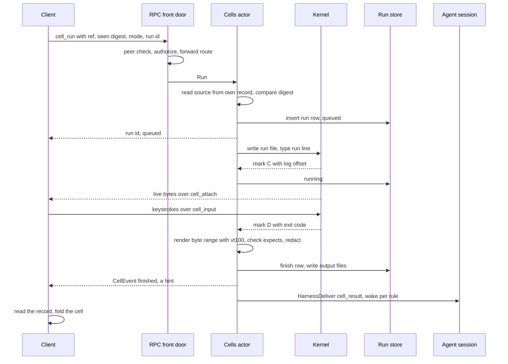

# 171 — CELLS: code the user runs with one press, in chat, notes and notebooks

Status: BUILT on integrate/171 2026-11-03 — see 171-as-built.md (W1 + W2 merged and gated; the §17.4 live proof is pending: it did not run because the memory gate held).

Status: design v0 · 2026-11-03 · proposed — Sky asked for the design and ruled R1 (no licence gate; least code, highest quality); the forks F1–F7 in §0/§18 are open with their recommended defaults applied · extends 59, 109, 120, 126, 143, 144/157, 155, 163, 164, 167 (§19 lists the amendments) · recon: 171-recon-ours.md, 171-recon-theirs.md, 171-recon-field.md · mock: docs/design/assets/171-cells.html

Status: 171F fix wave (2026-11-04): see 171f-as-built.md

Every `path:line` below was re-opened in `~/Develop/theuth-171` (branch `docs/171-cells`, base origin/main 6eba65b1) on 2026-11-03. nteract cites are `~/Develop/spike-171/nteract-nteract/<path>:<line>` (short form `nteract:` below) or the elements clone `nteract-elements:`. The calls this design implements are `docs/design/171-calls.md` D1–D20; the ask and the evidence are `docs/design/171-axes.md`.

## 0. Decisions in one screen

1. **One grammar (D1).** A cell is a fenced block in a runnable language whose body starts with `#|` option lines (`//|` for JavaScript); the same text works in a chat reply, `doc_insert` markdown, a note code block and an exported `.md`. A fence without the header is a snippet (copy only). Rejects a `present_cells` tool, Runme JSON in the info string, an `app` screen, and "every bash fence is runnable". Why the body: a note's code block stores one prop, `language` (`packages/documents/src/schema.ts:73`).
2. **A closed option set (D2).** `cwd name label danger after expect env python review private timeout`; `on` reserved for wave 3; unknown keys warn. Note-level defaults live in a leading ```` ```cells ```` block (writer's call W-c; notes have no front matter, §0 Calls vs tree 1). Rejects open-ended metadata. §3.2.
3. **Human press only; what you saw runs (D3).** A run starts only from an owner-only RPC sent by a desktop/web/phone client on a press or shortcut, carrying the digest of the text on screen; the engine reads the source from its own record and refuses a mismatch with "this cell changed — look again". Nothing else can start one: no tool, runtime function, MCP tool, routine, subagent, ACP child, double, guest, channel, nor the in-process owner console peer the MCP server and ACP bridge use (W-n). Rejects routing through `tools.policy` and nteract's agent-runs-cells model. Guard shape: `nteract:crates/notebook-protocol/src/protocol.rs:738-745`.
4. **Engine-owned kernels, one per (scope, spec) (D4).** Scope = chat session or document. Shell kernels are PTY jobs marked `cell` (invisible to `jobs()`, refused by `send`/`cancel_job`); `python` is a local interpreter running theuth's stdlib-only shim; `monty` is an isolated tool-less checkout; JavaScript and a Jupyter backend are wave 3. Idle shutdown after 12 h. Rejects Jupyter-for-everything and a process per run. `crates/tools/src/pty.rs:987`.
5. **The user's real environment (D5).** Kernels start from the login-shell environment captured once per engine start (refreshable); the cell's language picks the program (a `bash` cell runs bash even when the login shell is zsh); theuth rc snippets emit OSC 133 marks and OSC 7 cwd so completion and exit codes are exact. Rejects the engine's launchd env and prompt-pattern waits. `crates/platform/src/env.rs:2` (only `PATH` is probed today).
6. **Code enters by sourcing a run file (D6).** Every run writes the exact code to a file and `source`s it; a missing cwd blocks the run (never a fallback); a whole-cell run `cd`s and exports first, a line/selection run does so only when the previous run came from another cell. Rejects typing into the PTY. §5.6.
7. **Interpreters resolve deterministically (D7).** The agent picks: `#| python: monty` when the cell is pure computation (sufficiency checked by Monty's type checker at presentation), otherwise the project's interpreter. `auto`: nearest `.venv`/`venv` → uv project → pyenv/conda → `python3` on the login PATH → Monty only when none exists and the cell is sufficient (F7). The chip shows what will run and is a menu of `interpreters(cwd)`. Rejects a kernel picker separate from the project toolchain (Zed's trap, `https://zed.dev/docs/repl`). §6.
8. **Jupyter's output model; the engine cleans terminals (D8).** nbformat v4 outputs plus `exit` and `expect`. Shell runs stream live into an xterm the user can type into; when the run ends the engine renders its byte range through `vt100` into plain text for the record and the agent. Record first, broadcasts are hints; Stop never waits behind output. Rejects client-side regex cleaning. `Cargo.toml:270` (`vt100 = "0.18"`).
9. **nteract's components, theuth's tokens (D9, R1).** Adopt nteract/nteract `src/components` (production) and the elements registry where production lacks a piece; @uiw/react-codemirror (already a dependency) for the editor; xterm for live shells; HTML only inside 120's frame. New UI code is only what nothing provides: run-line, run-selection, gutter run, bash language wiring, the chat fence, the note branch. Rejects writing our own output renderers. §16.
10. **Chat placement (D10).** Cells render inline as the agent writes them; ≥ 2 cells get a runbook bar whose Run all names its boundary; a kernel strip shows whenever a kernel lives; finished cells fold; a re-presented `name` supersedes the older cell. Rejects a side panel. Mock panel A.
11. **What the agent sees (D11).** One `<cell_result>` per finished run: attributes plus emulator-cleaned output, head+tail capped at 8 KiB, vault values and credential patterns masked; `private` sends exit/expect only; `<cell_error>` once for invalid cells; read-only `cell_runs`/`cell_output`/`interpreters`. Rejects streaming partial output into context. `crates/agent/src/supervisor.rs:3093` (`job_result` is the model).
12. **Wake rule (D12, F1 a).** A result joins a running turn; otherwise it waits quietly for the next turn unless `review: true` (or the press of "Ask theuth") starts one. §9.3.
13. **Safety without confirmations (D13).** Consequence labels, danger styling, Run-all boundaries, `after` gates that show the preview's summary on the armed button, a deterministic lint, secrets substituted only at run time and scrubbed everywhere, nothing ever re-run automatically. Rejects a second confirmation dialog (`https://www.nngroup.com/articles/confirmation-dialog/`). §12.
14. **Notes (D14).** A note code block whose body starts with `#|` is a cell: no schema change, no new node, no Yjs change; `CodeBlock.tsx`'s render mounts the cell; run state lives in an engine run store, never in the Y.Doc. Rejects outputs in the CRDT. `crates/desktop/ui/src/components/editor/CodeBlock.tsx:16`.
15. **Sharing (D15).** Members edit, only the owner runs, on the owner's engine; a member-changed cell reads "Run Alice's edit"; guests see replicated latest outputs, never a Run button. Rejects edit-implies-run (`nteract:docs/adr/hosted-room-authorization.md` per 171-recon-theirs.md §3.11). §13.
16. **Surfaces (D16).** Desktop, web and phone run cells (the host chip names the engine when it is not this device); TUI shows code with "run in the app"; Slack/Telegram/Signal send code plus a "Run in theuth" link; a long run that ends unfocused notifies. §14.
17. **Audit (D17).** Every run is a durable record: presser, exact code and digest, presented digest, cwd, interpreter, env names, times, exit, expect, output digest, log path. §8.4.
18. **Prompting (D18).** A ≤ 18-line `## User cells` block in attended sessions plus a binary-owned `cells` skill; "prep it, don't apply" means present cells, sticky until lifted; today's "commands to run stay a plain code block" is amended in both places it lives. §10.
19. **Where it lands (D19).** New plugin crate `crates/cells`; the pure grammar in `crates/surface/src/cell.rs`; RPC in `crates/rpc`; delivery through `agent::HarnessDeliver`; UI in `components/cells/`. §15.
20. **Waves (D20).** W1 CHAT-SHELL, W2 PYTHON-NOTES, W3 REACH. §17.

**Forks for Sky** (default applied; §18 explains each)
- F1 Wake rule — **(a)** only `review: true` or "Ask theuth" starts a turn.
- F2 Outputs in shared notes — **(a)** the latest run's text (capped, scrubbed) replicates to members.
- F3 Phone — **(a)** the phone runs every cell, danger included, with the same label.
- F4 Editing agent cells in chat — **(a)** allowed, "edited" badge, the agent sees what ran.
- F5 JavaScript — **(a)** wave 3, node/deno/bun through the same shim protocol.
- F6 Engine restart — **(a)** 109 R1 unchanged; quit and `t update` offer "Wait for <label>" or "Stop it and quit".
- F7 What `auto` means for Python — **(a)** the local interpreter first (nearest .venv → uv → pyenv/conda → python3), Monty only when none exists; the agent writes `python: monty` on purpose for pure computation.

**Writer's calls**
- W-a Placement: plugin crate `crates/cells` (actor `CELLS_ACTOR`), grammar and lint in `crates/surface/src/cell.rs` because agent, document, tui and the three channel crates already depend on `surface` (§15.1).
- W-b Note kernels' PTY jobs use a deterministic kernel session id (UUIDv5 of the doc id); clients attach through `cell_attach`/`cell_input`, one path for chat and notes (§5.1).
- W-c Note defaults in a leading ```` ```cells ```` block holding `#|` lines (§3.3).
- W-d Chat cells run on the session's owner (`forward::route`); note cells on the document's hub (§5.1, §13).
- W-e Python shim protocol: newline-delimited JSON on the shim's stdin and a private dup of its stdout; nine frame types (§5.8).
- W-f Run store `~/.theuth/cells/cells.sqlite` + `~/.theuth/cells/<run>/`; 30 days, latest run per cell kept forever (§8.4).
- W-g Latest-output replication: a fifth replicated table `cell_latest` in `documents/index.sqlite` (§13.2).
- W-h OSC 133/OSC 7 are emitted by the engine-typed run line (no prompt hooks); marks are scanned on the job's log path, which gives byte offsets (§5.5).
- W-i `<cell_error>` is a pass inside `check_fences`, one round per turn, hidden on the desktop like `<surface_error>` (§9.2).
- W-j Kernel strip sits directly on the composer (transcript · dots · to-do · kernel strip · composer); in notes it is a pill in the header (§11.5).
- W-k Config keys beyond the calls: `max_kernels`, `monty_workers`, `pty_cols/rows`, `kill_after_secs`, `correct_rounds`, `after_max_age_mins`, `render_scrollback`, `ui_tail_lines`, `export_output_bytes`, `replicate_bytes`, `retention_days`, `store_max_mb`, `login_env_timeout_secs` (§15.4).
- W-l Prompt heading `## User cells`, not `## Cells` (§10.1).
- W-m Quiet delivery generalises 145's park: `HarnessDeliver { wake: false }`, re-parked at start from the run store (§9.3).
- W-n Cell RPCs refuse `RpcPeer::internal()` callers (MCP server 158, ACP bridge, TUI) unless forwarded (§12.1).
- W-o The block is present in attended channel sessions (Slack/Telegram/Signal), absent for unattended runs and subagents (§10.6).
- W-p Kill is enabled 5 s after Stop (mock panel B) (§7.3).
- W-q Chat identity is `(session, entry, ordinal-among-cells)` unless `name` is set (§3.4).
- W-r Run all is an engine pass (`cell_run_all`), not a client loop of RPCs (§5.10).

**Calls vs tree**
1. D2 puts note defaults in "the note's front matter block": only knowledge documents carry one (`docs/design/59-documents.md:485`, `packages/documents/src/schema.ts:4`) → a ```` ```cells ```` block (W-c).
2. 171-recon-ours.md §1.2 says streamdown passes no `meta`: wrong — 2.6.0 passes `meta?: string` (`~/Develop/theuth/crates/desktop/ui/node_modules/streamdown/dist/index.d.ts:304-316`). D1 is unaffected: notes and channels drop the info string.
3. D18 names the block `## Cells`; the runtime block already calls a Monty invocation "a cell" (`crates/agent/src/repl.rs:35`, `:81`) → `## User cells` (W-l).
4. D8 "reuse whatever emulator the PTY layer has": it is `vt100` 0.18 with 512 history rows (`Cargo.toml:270`, `crates/tools/src/pty.rs:71`), not alacritty → a second, render-only `vt100` parser with 10 000 rows per finished run (§8.3).
5. D4 "PTY on the existing layer": `StartPty` always runs `$SHELL -lc <command>` (`crates/platform/src/shell.rs:45-49`) → `StartArgs` gains an explicit `program` (§15.1).
6. D8 "reusing TerminalViewer's attach": `subscribe_pty`/`pty_input` authorize by chat session (`crates/rpc/src/api.rs:2847`); a note kernel has none → `cell_attach`/`cell_input`; `Terminal` gains a source prop and keeps 167's keys (W-b).
7. D3 "authenticated owner client": `rpc::client::Local` gives the MCP server, the ACP bridge and the TUI the owner console's peer on every call (`crates/rpc/src/client.rs:24-31`, `crates/mcp-server/src/lib.rs:6-8`) → explicit refusal (W-n).
8. D12 "delivered quietly": no quiet input exists; `inject` admits `Automatic`, which starts a turn on an idle session (`crates/agent/src/supervisor.rs:1496`, `:1540`) → W-m.
9. D11 "notebook chats get a `<notebook_changes>` notice": that notice is computed from document versions at turn start (`crates/agent/src/notebook_context.rs:700`, `:851`) and a run changes no document → bound notebook chats get a quiet, body-less `<cell_result>` (ids and exit only, 157's rule kept) and the notice builder is untouched (§9.6).
10. D16 "Run in theuth deep link": `theuth://c/<session>` exists but the route drops everything after the path (`crates/desktop/src/lib.rs:607-619`) → the route keeps `?cell=` (§14.3).
11. D19 `skills/cells.md`: skills are binary-owned constants written by `first_run` (`crates/theuth/src/main.rs:1324-1336`) → `crates/cells/cells.md` via `include_str!`, written to `~/.theuth/skills/cells.md`.
12. D9 `@uiw/codemirror-extensions-langs`, `anser`, `escape-carriage` are not installed (`crates/desktop/ui/package.json:39-41` has only react-codemirror and xterm) → three new UI dependencies (§16).
13. F6 (a) "the graceful quit screen names running cells": 163's overlay has no buttons by design (`docs/design/163-graceful-quit.md:56`) → the choice is a sheet shown before `requested` is dispatched (§5.4).
14. D9 "one `Cell` component … editor @uiw/react-codemirror" for notes too: a note's code text is a Yjs fragment edited by BlockNote (fact 7); a CodeMirror over it would need a second Yjs binding → note cells keep BlockNote's code content inside the shared `Cell` chrome; CodeMirror serves chat cells and the raw view (§4.2).

## 1. Why

Sky's ask, verbatim (2026-11-03 16:58, `docs/design/171-axes.md`):

> https://github.com/nteract/elements
> https://nteract-elements.vercel.app/docs
> https://github.com/nteract/nteract
> https://uiwjs.github.io/react-codemirror/
> Practical recommendation for your setup
> Start with nteract/elements for the cell chrome, toolbars, and output area (Shadcn-native).
> Use @uiw/react-codemirror (or Monaco) for the editor itself if you need finer control — style it with your existing Shadcn theme.
> Implement the interaction layer yourself:
> Run cell → send whole cell source over RPC to Rust
> Run selection / current line → extract the relevant code and send that
> Run in order → sequential RPC calls with shared kernel/session state on the backend
>
> Feed the results (stdout, stderr, rich MIME data, images, etc.) into the output renderers from nteract/elements or @runtimed/components.
> This gives you a Jupyter-like experience (cells, sequential execution, rich outputs) while keeping full control of the Rust backend and RPC protocol. You avoid having to speak the full Jupyter kernel protocol unless you want to.
>
> So I want you to write a design document for a new feature and enhancement to theuth.  right now we have the notebooks, but I don't think they have any code execution capability or anything like that.  So I want to add that as part of the notes and notebooks using these UI elements properly styled to match theuths theme.   In addition to that, I want an agent to be able to present cells to me with a specific cwd and stuff running either bash or python, and the ability for the agent to select a local python interpreter if one exists or use the built in monty if it's sufficient for the use case.  The idea being that the agent can present a shell command to me in a chat that I explicitly told it to prepare but not run, and then I can click a button to run a single line or the entire script and both I and the agent can see the output.  I can watch it live in the chat, and the agent can see it in context once it completes.
>
> So it's give the agent a way to allow me to press a button to execute bash or python (separate from how we execute tools/mcps now, this is a user facing thing, not replacing or changing the tools/mcp setup in any way)
>
> and allow notes and notebooks to have the same kind of jupyter notebooks setup but suppport both bash and python, maybe even javascript too.
>
> Let's think through this and figure out how we can align the feature with the design principles of theuth and achieve the goal of the feature while reducing the users cognitive load and making work more efficient for the user.
>
> we also need to think through the prompting to explain to the agent when to use it.  For example I often when working with infrastructure as code will tell it, you know prep all the code but don't apply it because production danger, just present me with the commands to run.  so when I request something like this, the agent should understand that means, show me these cells in chat or in the notebook, so I can actually execute the commands without leaving the agent window.

Then, after the licence finding: *"why do we care if there's no license. the focus is the least code and highest quality product. we don't care about the license issues."* (R1, `docs/design/171-calls.md`).

**The cost of today** (Sky's October DR runs, `docs/design/171-axes.md` "User evidence"):
- Desks write **run sheets** as notes: a checkbox heading per step, a ```` ```bash ```` block, `You should see: <exact output>`, stop lines ("If it doesn't say exit 0, stop and tell theuth"), `; echo "exit $?"` appended to surface exit codes, `--profile/--context` on every line. Sky copies each block into Terminal.app and ticks by hand. **Agents tick nothing.**
- Sky's login shell is zsh; bash blocks pasted into interactive zsh break (`${PIPESTATUS[0]}`, a trailing `# comment` without `interactive_comments`), so sheets say "type `bash` first", and macOS `/bin/bash` is 3.2.
- The step-by-step mode ("go one step at a time … allow me to review the output, and then tell you what to do next") ran on an agent PTY: `start('exec "$SHELL" -i')`, `send()` per block, `wait(pattern=<prompt>)`, OSC/CSI escapes and pulumi spinner frames hand-stripped with regexes, output scanned by hand for `AKIA…`, `eyJ…`, `aws_session_token` before showing, a scratch file plus `show`, a comparison with "You should see", and the agent typing `yes` into pulumi's arrow-key prompt. When Sky typed himself, theuth only saw the screen through the ~1 min idle wake.
- The field agrees on the failure class: Cursor's Shell Mode lists the same traps — `$SHELL`, 30 s timeout, no prompts, no `cd` persistence (`https://cursor.com/docs/cli/shell-mode`); a human approval did not stop the 2026 `terraform destroy` because the consequence was not on screen (`https://botmonster.com/ai/terraform-incident-claude-code-wiped-production-database/`).

**What changes for Sky.** He says "prep the preview and up, don't apply" and the agent's reply holds three cells: export the state, preview, apply. Each shows its folder, its shell and what it will do; the apply button reads "Apply to ir-prod1", stays disarmed until the preview succeeded with the expected "3 to update", and then shows that preview's counts on itself. He presses; the output streams into the cell in a real terminal, he answers pulumi's prompt in place, and when the run ends the agent has a clean, capped, credential-masked copy and checks it against the expectation. Long or repeatable procedures land in a note as the same cells, so a run sheet *runs* and records who ran what, when, with which exit — instead of being ticked by hand.

**What this is NOT.** Not a tool: no registry entry, no `tools.policy` row, no approval card, no double involvement, no MCP exposure. Not agent execution: the agent presents, edits and reads; it never runs, types into a kernel, or ticks a run sheet. Not a coding feature: no editor integration, no test runner. Nothing in tools, MCP, policy or approvals changes (§17.4 must-not-regress).

## 2. Facts relied on

| # | fact | where | used in |
|---|---|---|---|
| 1 | Custom chat fences are streamdown `plugins.renderers`, matched by language before the built-in code block | `crates/desktop/ui/src/components/chat/MessageAssistant.tsx:31-39` | §4.1 |
| 2 | `FenceContext{running, hasLaterAssistant, session?, entry?}` | `crates/desktop/ui/src/components/chat/surface/JsonRenderFence.tsx:15` | §3.4, §4.1 |
| 3 | `session` is undefined in read-only renderings | `crates/desktop/ui/src/components/chat/MessageAssistant.tsx:298-301` | §4.1, §11.2 |
| 4 | streamdown 2.6.0 renderers get `{code, isIncomplete, language, meta?}` | `~/Develop/theuth/crates/desktop/ui/node_modules/streamdown/dist/index.d.ts:304-316` | §0, §3.1 |
| 5 | The engine keeps the whole trimmed info string as `lang` and compares by equality | `crates/surface/src/fences.rs:13`, `:72`, `:94` | §3.1 |
| 6 | A note's `codeBlock` has one prop, `language` | `packages/documents/src/schema.ts:73` | §0, §4.2 |
| 7 | Only `render` of the code block is ours; node and Yjs fragment are the default's | `crates/desktop/ui/src/components/editor/CodeBlock.tsx:16-18` | §4.2 |
| 8 | Markdown import keeps the fence info string verbatim in `language` | `crates/desktop/ui/src/components/editor/codeLanguages.ts:10` | §3.1 |
| 9 | Only knowledge documents carry a frontmatter block | `docs/design/59-documents.md:485`; `packages/documents/src/schema.ts:4` | §3.3 |
| 10 | One Yjs update ≤ 48 KiB; a document ≤ 8 MiB | `crates/document/src/actor.rs:947`, `:357` | §4.2, §13 |
| 11 | `doc_read` outlines a code block as `[code:<language>] …` | `packages/documents/src/convert.ts:425` | §9.6 |
| 12 | Member blocks are labelled `doc-member:<pub8>` | `crates/document/src/tools.rs:34`; `crates/document/src/share.rs:262` | §13.1 |
| 13 | Guests (mode 2) may call 11 methods only | `crates/link/src/conn.rs:538` | §12, §13 |
| 14 | Replicated tables beside `docs`: `["docs","notebooks","notebook_items","sources"]`, attached by `replica::attach` | `crates/document/src/store.rs:65`; `crates/document/src/lib.rs:238` | §13.2 |
| 15 | `@Run` mints `UserActivation` and goes through the registry | `crates/tools/src/registry.rs:183` | §12 |
| 16 | Admission check `authorize(ext, session)` | `crates/rpc/src/api.rs:2847` | §7, §15.2 |
| 17 | `send_input` asks `forward::route` before acting | `crates/rpc/src/api.rs:3589`; `crates/rpc/src/forward.rs:1` | §5.1, §15.2 |
| 18 | `rpc::client::Local` makes every call as the owner console (`RpcPeer::internal()`); the MCP server reaches the engine through it | `crates/rpc/src/client.rs:24-31`; `crates/link/src/types.rs:420-423`; `crates/mcp-server/src/lib.rs:6-8` | §12.1 |
| 19 | Guests are distinguishable: `RpcPeer::guest()` | `crates/link/src/types.rs:438-441` | §12.1 |
| 20 | `StartPty{session, call_id, args, cwd, …}` | `crates/tools/src/pty.rs:987` | §5.2 |
| 21 | PTY jobs run `$SHELL -lc <command>` on Unix, pwsh/powershell on Windows | `crates/platform/src/shell.rs:45-49` | §5.2, §6.4 |
| 22 | PTY budget 512 MiB ≈ 80 live PTYs engine-wide | `crates/tools/src/jobs.rs:59-62` | §5.10 |
| 23 | Every pipe/PTY chunk passes `Log::push`, which runs `secrets::redact` before log, tail and event | `crates/tools/src/jobs.rs:592-598` | §8.3, §12 |
| 24 | `JobOutput` is coalesced to one per 500 ms and lossy | `crates/tools/src/jobs.rs:50` | §8.1 |
| 25 | PTY screen is `vt100` 0.18 with 512 history rows; `portable-pty` 0.9 | `Cargo.toml:269-270`; `crates/tools/src/pty.rs:71`, `:1436` | §5.5, §8.3 |
| 26 | `vt100` hands unknown OSC sequences to `Callbacks::unhandled_osc` | `~/.cargo/registry/src/index.crates.io-1949cf8c6b5b557f/vt100-0.18.1/src/callbacks.rs:69` | §5.5 |
| 27 | The engine answers terminal queries; the viewer swallows them (167) | `crates/tools/src/pty.rs:2460`; `crates/desktop/ui/src/components/chat/TerminalViewer.tsx:170` | §5.10, §11 |
| 28 | Two viewers fight over PTY size; exactly one sizes it | `crates/desktop/ui/src/components/chat/TerminalViewer.tsx:32` | §5.10 |
| 29 | The agent's `shell` is an embedded brush shell per session; state last-finished-wins | `crates/tools/src/shell.rs:1`, `:45` | §5.2, §6.5 |
| 30 | Login shell = `$SHELL`; only `PATH` is probed from it today | `crates/tools/src/shell.rs:205`; `crates/platform/src/env.rs:2`, `:12` | §5.4 |
| 31 | `<job_result>` wrapper; the only model-delivery path for jobs | `crates/agent/src/supervisor.rs:3093`, `:2821` | §9.1 |
| 32 | `inject` admits an `Automatic` input; 145 parks inputs for talk sessions | `crates/agent/src/supervisor.rs:1504`, `:1540-1556` | §9.3 |
| 33 | `HarnessDeliver{session, kind, text, wrapped}` is a public message to `Agents` | `crates/agent/src/supervisor.rs:2726-2742` | §9.3, §15 |
| 34 | `<surface_error>` is built in surface and rendered hidden on the desktop | `crates/surface/src/prompt.rs:330`; `crates/desktop/ui/src/lib/injected.ts:54-58` | §9.2 |
| 35 | `check_fences` runs after each reply; `CHECKED_LANGS = ["mermaid","openui"]` | `crates/agent/src/loop_.rs:5904`, `:3037` | §9.2 |
| 36 | Prompt blocks: unattended sessions drop `app`; attended = depth 0 and not scheduler-opened | `crates/agent/src/loop_.rs:3207-3221`, `:4240-4241` | §10.6 |
| 37 | The sentence to amend lives in the surface block and in the visualize skill | `crates/surface/src/prompt.rs:289`; `crates/surface/visualize.md:42` | §10.4 |
| 38 | Binary-owned skills are rewritten by `first_run` | `crates/theuth/src/main.rs:1324-1336` | §10.2 |
| 39 | Tool-less Monty profile (sensors), own pool | `crates/agent/src/sensor/bridge.rs:1-6`; `crates/agent/src/sensor/mod.rs:184` | §5.9 |
| 40 | Monty: 512 MiB heap, 60 s per request, type check before run, `/cwd` read-only, print buffered per call | `crates/agent/src/repl.rs:42`, `:53`, `:1027`, `:1104`, `:1274` | §5.9, §6.2 |
| 41 | `find_cpython` (engine PATH only) is the one interpreter lookup | `crates/agent/src/sensor/mod.rs:701` | §6.1 |
| 42 | Vault hooks `mentions`/`expand`/`redact` are process-global; placeholder text `{{secret:` | `crates/tools/src/secrets.rs:54-72` | §12 |
| 43 | Jobs die with the engine; no adoption; keeper not chosen | `docs/design/109-durability.md:28`, `:42`, `:46` | §5.4, §18 F6 |
| 44 | nteract daemon: guarded execute; record-then-read; server-side stream terminal; env redaction before storage | `nteract:crates/notebook-protocol/src/protocol.rs:738-745`; `nteract:docs/adr/execution-pipeline.md:30-44`; `nteract:crates/runtimed/src/stream_terminal.rs:1-7`; `nteract:crates/runtimed/src/output_redaction.rs:1-5` | §5, §8 |
| 45 | Approvals miss 1 in 3 threats; consequence-named buttons | `https://scalex.dev/blog/ai-agent-permissions-stats/`; `https://developer.hashicorp.com/terraform/cloud-docs/run/manage` | §12 |

## 3. The cell

### 3.1 Grammar

A cell is a closed fenced code block whose **language word** is runnable and whose **body starts with one or more header lines**:

````text
```<language>[ anything]          ← language = first word of the info string; the rest is ignored
#| key: value                      ← header: consecutive lines from the first body line
#| key                             ← bare key = true (booleans only)
<code>                             ← everything after the first non-header line; this is what runs
```
````

- **Runnable languages** (first word, case-insensitive): `bash`, `zsh`, `sh`, `pwsh` (alias `powershell`), `python` (alias `py`); wave 3: `javascript`/`js`, `typescript`/`ts` with the `//|` prefix. Every other language is never a cell.
- **Header line**: `#|`, optional spaces, a key `[a-z]+`, then `: value` or nothing. Value = the rest of the line, trimmed, one pair of surrounding double quotes removed. Repeatable keys (`expect`, `env`) repeat the line. The header ends at the first line that does not start with `#|`; `#|` lines later in the code are ordinary comments (Quarto's rule, `https://quarto.org/docs/reference/cells/cells-jupyter.html`).
- **What runs** is the code without the header; line numbers in the UI count code lines from 1. The header is shown as chips (§11.1), never sent to the kernel.
- **Why the body**: the info string reaches streamdown as `meta` (fact 4) and the engine as part of `lang` (fact 5), but it is folded into a note's `language` prop (fact 8), shown verbatim in the TUI box header, and stripped by copy/paste into a terminal. The `#|` header survives all of them and stays a comment if pasted into a shell or a `.py` file.
- **Not a cell**: a fence without a header (a snippet — copy only, D1); a fence in a user bubble, a harness input card, a tool result or a subagent's relayed text (only assistant markdown and notes render cells, §4.1); a fence still streaming (`isIncomplete`) or in a reply whose turn is still running (renders as code with a dim "ready when the reply ends"); a read-only rendering (archive, search pages: `session` undefined, fact 3).

The parser is one pure Rust module, `surface::cell` (`parse(lang, body) -> Option<Cell>`, `lint(&Cell) -> Vec<Chip>`, `validate(&Cell, &Scope) -> Vec<Problem>`), mirrored by ~60 lines of TypeScript in `components/cells/grammar.ts`; one shared fixture file (`crates/surface/tests/cells.json`: input → parsed JSON) is read by both test suites so the two parsers cannot drift.

### 3.2 Options (v1, closed set)

| option | type | default | meaning | example |
|---|---|---|---|---|
| `cwd` | absolute path or `~/…`; relative only under a note default | note default; in chat **required** | folder the cell runs in; must exist at press (D6) | `#\| cwd: ~/dr-t6/frp-integration/stacks/sa-frp-integration` |
| `name` | slug `[a-z0-9-]{1,48}` | none (identity falls back to position, §3.4) | stable id; the same name presented later supersedes | `#\| name: preview-ir-prod1` |
| `label` | text ≤ 40 chars | `Run` | the Run button's text, naming the consequence | `#\| label: Apply to ir-prod1` |
| `danger` | bool | `false` | red outline; never in Run all; no keyboard run; phone shows the label in full | `#\| danger` |
| `after` | a `name` in the same scope | none | arms only when that cell's latest run succeeded (exit 0, every expect met) **and** ran its current code; the armed button shows that run's summary | `#\| after: preview-ir-prod1` |
| `expect` | text, or `/regex/` (repeatable) | none | must appear in the cleaned output; met/missed per item | `#\| expect: 3 to update` |
| `env` | `KEY=value` (repeatable) | none | exported before a whole-cell run; values may hold `{{secret:NAME}}` | `#\| env: AWS_PROFILE=ir-prod1` |
| `python` | `monty` \| `auto` \| `.venv` \| `uv` \| absolute path | note default, else `auto` | which interpreter runs a python cell (§6) | `#\| python: .venv` |
| `review` | bool | `false` | the agent wakes when this run, or the Run-all pass containing it, ends (F1) | `#\| review` |
| `private` | bool | `false` | the agent gets exit and expect only, never output | `#\| private` |
| `timeout` | duration `30s` \| `10m` \| `2h` | none (Monty: 60 s, §5.9) | Stop is sent when it elapses; Kill 5 s later | `#\| timeout: 20m` |
| `on` | reserved (wave 3) | — | a sandbox VM or mesh engine; v1 warns "not yet" | `#\| on: sandbox:build` |

### 3.3 Note-level defaults (writer's call W-c)

The first ```` ```cells ```` block in a note (any position, conventionally right under the title) holds note defaults as header lines and nothing else:

````markdown
```cells
#| cwd: ~/dr-t6/frp-integration
#| shell: /opt/homebrew/bin/bash
#| python: .venv
```
````

- Keys: `cwd` (absolute; a cell's relative `cwd` resolves against it, Runme's combine rule `https://docs.runme.dev/configuration/document-level/`), `shell` (the program that runs `bash`/`zsh`/`sh` cells in this note — the answer to "which bash", §6.5), `python` (default for python cells). Unknown keys warn.
- It renders as one line, "Cell defaults · ~/dr-t6/frp-integration · bash 5.2 (Homebrew) · .venv", editable in place. A second `cells` block is a lint warning and ignored.
- Why not front matter: notes have no frontmatter block (fact 9) and an import without it turns a leading `---` into a code block (`docs/design/59-documents.md:485-486`). A `cells` code block needs no schema change and round-trips through markdown, BlockNote, export and channels.

### 3.4 Identity (writer's call W-q)

| where | identity (`CellRef`) | source of truth the engine reads at press |
|---|---|---|
| chat | `Chat{session, entry, ordinal}`; `ordinal` = 1-based position among the **cells** (not fences) of assistant message `entry` | the stored assistant message text (transcript row), parsed by `surface::cell` |
| chat, with `name` | the same `CellRef`, plus the lineage key `(session, name)` used by superseding and `after` | as above |
| note | `Note{doc, name}` when `#\| name:` is set — survives the agent's `doc_replace`, which mints new block ids | the live Y.Doc of `doc`, read by the document actor (§15.2 `CodeBlockText`) |
| note, no name | `Note{doc, block}` (BlockNote block id) | as above |

The **cell digest** is SHA-256 over the cell's full text (header + code) with LF line ends and the final newline trimmed; the run record keeps both the presented digest and the digest of the code that actually ran (after a user edit, §7.1).

### 3.5 Versions and superseding

- **Chat.** A later assistant message in the same session that presents the same `name` supersedes every earlier cell with that name: its Run is disabled with "Replaced by a newer version ↓" (a link scrolls to it), its outputs stay. `after` always refers to the newest version of a name. A cell re-presented after a `<cell_error>` in the same turn supersedes the broken one the same way. A regenerated reply has a new `entry`; runs of the old reply stay in the run store and show in the session's run list as "from an earlier version of this reply".
- **Notes.** The block is the cell. Editing its text after a run turns the latest run **stale**: "ran an earlier version" with the old code one click away; nothing re-runs.
- **`after` and edits.** An `after` gate checks that the gating run's code digest equals the gating cell's *current* code digest, so editing the preview disarms the apply until the edited preview has run.

### 3.6 Validation

**Errors** — the cell renders as invalid (reason on the cell, no Run button) and, in chat, the agent gets one `<cell_error>` for the reply (§9.2):

| code | rule |
|---|---|
| `cwd_missing` | a chat cell without `cwd`; a note cell without `cwd` and without a note default |
| `cwd_relative` | a relative `cwd` with no note default to resolve it against |
| `bad_option` | wrong type: bad duration, bad `/regex/`, `env` not `KEY=value`, `name` not a slug, `label` over 40 chars |
| `python_option` | `python:` on a non-python cell, or an unknown value |
| `after_unknown` / `after_cycle` | `after` names no cell in scope, itself, or a cycle |
| `name_duplicate` | two cells with one `name` in the same reply or note |
| `secret_unknown` | a `{{secret:NAME}}` naming no vault entry (names checked, values never read) |
| `secret_in_code` | a placeholder in the code; placeholders belong in `#\| env:` and the code uses `$NAME` (keeps secret values out of the run file's code and out of every echo) |
| `monty_insufficient` | `python: monty` and Monty's type check fails (the cell offers the one-press switch, §6.2) |
| `empty` | no code after the header |

**Warnings** — a chip on the cell, never `<cell_error>`: unknown option key; `on:` (wave 3); `cwd` not found at presentation ("arms when the folder exists", D6); a second `cells` block; a likely-changing command (`pulumi up`, `terraform apply|destroy`, `kubectl apply|delete`, `helm upgrade|uninstall`, `aws … delete-*|put-*|create-*`) with neither `label` nor `danger`.

### 3.7 Lint (D13 c — deterministic chips, never blocking)

| chip | detection | Run all stops before it |
|---|---|---|
| "N invisible characters" | U+200B–200F, U+202A–202E, U+2066–2069, U+FEFF anywhere in the cell; the editor highlights each | yes |
| "pipes a download into a shell" | `curl`/`wget`/`iwr` output piped or substituted into `sh`/`bash`/`zsh`/`python`/`iex` | yes |
| "runs decoded base64" | `base64 -d`/`--decode`/`b64decode` feeding `sh`/`eval`/`exec`/`iex` | yes |
| "calls a script theuth edited" | the code invokes a file (`./x.sh`, `bash x`, `python x.py`, `make t` → `Makefile`, `npm run t` → `package.json`) that this session's agent wrote or edited (the session's `tool_calls` journal); the chip opens the diff | yes |
| "skips the tool's own prompt" | `--yes`, `-y`, `-auto-approve`, `--force`, `--skip-preview` on a `danger` cell | no (danger already stops Run all) |
| "asks for your password" | `sudo` | no |
| "uses secret NAME" | each `{{secret:NAME}}` (name only) | no |

### 3.8 Worked example — the sa-frp-integration runbook, as the agent writes it

Sky: "prep the preview and up for sa-frp-integration on ir-prod1 — don't apply, production". The reply:

`````markdown
Three steps. Run them in order; the apply arms after the preview matches.

```bash
#| name: export-ir-prod1
#| label: Export state
#| cwd: ~/dr-t6/frp-integration/stacks/sa-frp-integration
#| env: AWS_PROFILE=ir-prod1
#| expect: Exported to
pulumi stack export -s ir-prod1 --file /tmp/sa-frp-integration-ir-prod1-pre.json
echo "Exported to /tmp/sa-frp-integration-ir-prod1-pre.json"
```

```bash
#| name: preview-ir-prod1
#| label: Preview
#| cwd: ~/dr-t6/frp-integration/stacks/sa-frp-integration
#| env: AWS_PROFILE=ir-prod1
#| expect: 3 to update
pulumi preview -s ir-prod1 --refresh=false --diff
```

```bash
#| name: apply-ir-prod1
#| label: Apply to ir-prod1
#| danger
#| after: preview-ir-prod1
#| review
#| cwd: ~/dr-t6/frp-integration/stacks/sa-frp-integration
#| env: AWS_PROFILE=ir-prod1
#| expect: 3 updated
pulumi up -s ir-prod1 --refresh=false --diff
```
`````

What the engine and UI make of it: a runbook bar "Run all · stops before Apply to ir-prod1" (danger boundary, §7.2); one `bash` kernel for the session; the apply disarmed with "after: Preview" until the preview exits 0 with its expect met, then armed with "armed by preview ✓ 14:31 · ~3 update · 0 replace · 0 delete" (the counts come from the gating run's cleaned output, §7.5); no `--yes` on the danger cell, so pulumi's own arrow-key prompt appears in the live terminal and Sky answers it in place (mock panel B); `review` on the apply makes the agent read the result and report in one or two lines (§9.3).

## 4. Where cells live

### 4.1 Chat replies

- One new streamdown renderer, `CellFence`, registered in `plugins` beside the three that exist (fact 1) for `['bash','zsh','sh','pwsh','powershell','python','py']` (`language: string | string[]`, fact 4). It parses the body with `grammar.ts`; **no header → it returns streamdown's own `CodeBlock`** (exported, `~/Develop/theuth/crates/desktop/ui/node_modules/streamdown/dist/index.d.ts:394`, `:630`) with the same props, so snippets look exactly as today.
- With a header it mounts the shared `Cell` component (§11.1) with `ref = Chat{session, entry, ordinal}` from `FenceContext` (fact 2). The ordinal is counted by a per-message counter in a small `CellOrdinals` context that `MessageAssistant` provides next to `FenceContext` (streamdown renders fences in document order; the counter resets per message render).
- Runnable only when: `session` is defined (not a read-only view, fact 3), `isIncomplete` is false, and `running` is false for the turn that wrote the message. Before that the cell shows its chips and code with a dim "ready when the reply ends".
- Cells render only in assistant markdown. User bubbles, harness input cards (`<subagent_result>`, `<job_result>`, …), tool results and relayed peer text never mount `CellFence`, so injected text from another agent or a web page cannot become a Run button (the relayed body is "no more trusted than a web page", `crates/agent/src/frame.rs:63`).

### 4.2 Notes (D14)

- `CodeBlock.tsx`'s `render` gains one branch before the diagram branch (`crates/desktop/ui/src/components/editor/CodeBlock.tsx:126`): `cellOf(block.props.language, text)` → `<NoteCell block={…} editor={…}/>`; `language` first word `cells` → `<CellDefaults/>`. The ProseMirror node, the Yjs fragment and the helper are untouched (fact 7). Diagrams in note code blocks keep working (must-not-regress, §17.4).
- The editor shown for a note cell is BlockNote's own code content (`contentRef`), not CodeMirror: the Y.Doc stays the only text and collaboration, undo and attribution keep working. CodeMirror is used where theuth owns the text: chat cells (F4 edits) and the raw toggle. Run-line and run-selection in a note read the BlockNote selection inside the code block (§7.1).
- **Make it a cell / Make it plain code** — two items in the block's side menu (`DocSideMenu`, `crates/desktop/ui/src/components/editor/Editor.tsx:100`) on a runnable-language code block: the first inserts `#| name: <slug of the nearest heading>` as the first line, the second removes the header lines. Both are ordinary text edits (one Y.Doc transaction), undoable.
- The slash menu gains "Cell" (a third `codeBlock` entry beside "Diagram", `crates/desktop/ui/src/components/editor/Editor.tsx:183`): `language: bash`, content `#| name: step-1`.
- Run state, outputs and kernels live outside the Y.Doc (§8.4); the latest run per cell replicates to members as capped text (F2, §13.2).

### 4.3 Notebooks (144, 157)

A notebook is a container over notes; its notes open in `NotePane`, the same editor (171-recon-ours.md §4.1), so note cells work there unchanged. The notebook's chat column is an ordinary bound session: its cells are chat cells with the session's kernel. What a notebook adds is the notice to its chat when a note cell runs (§9.6) and the guest view of replicated outputs (§13).

### 4.4 Exported markdown

Every markdown rendering the engine produces for a reader of a note — `doc_read` (§9.6) and a user's `.md` export — writes each cell as its fence, then, when the cell has a run, an ```` ```output ```` fence with the latest run's cleaned text (capped at `cells.export_output_bytes`, 8 KiB, head+tail) and one line `ran 14:38 · exit 0 · 33 s · expect ✓`. The derived `note.md` mirror (59 §4.3) stays source-only, because it is a sync artifact that is re-imported. `.ipynb` import/export is wave 3 (runtimed's `nbformat` crate, 171-recon-theirs.md §4.3).

### 4.5 Conversions

| action | where | what happens |
|---|---|---|
| Make it a cell / Make it plain code | note side menu | toggles the header (§4.2) |
| Open as note | chat runbook bar (≥ 1 cell) | the UI composes markdown — the reply's prose and cells, each followed by its latest run as an `output` block and run line (§4.4) — and creates a note with it (`doc_create`, owner); the chat gets a link card. Output blocks are plain history text; the note's cells start with no runs and their own note kernel: `cd`/exports do not move across |
| Save answer as note / Promote into note | notebook sessions (144 §8) | unchanged; cells travel as text |
| `doc_insert` / `doc_create` with `#\|` fences | agent | the blocks are cells (D14) |

### 4.6 Placement rule (chat vs note)

- **Chat** for up to about five one-off steps tied to the conversation (the preview → apply example).
- **Note** for longer or repeatable procedures, a "run sheet", anything Sky will come back to, or when the session is a notebook chat (then a note in that notebook). The agent writes the note with `doc_insert`/`doc_create` and posts one line in chat with the link; the note's runs report back to the session that wrote the cells (§9.6).
- Never both: the agent does not paste the same cells into chat and a note.

## 5. Kernels

### 5.1 Scope, keying and placement

- **Key.** `KernelId = (Scope, Spec)`. `Scope::Session(SessionId)` for chat cells, `Scope::Doc(DocId)` for note cells. `Spec` is the resolved program: `Shell{kind: bash|zsh|sh|pwsh, path}`, `Python{path}`, `Monty`. Each distinct interpreter path is its own kernel: a note with a `.venv` cell and a `python: /usr/bin/python3` cell has two python kernels, and the kernel strip lists both.
- **Which engine (W-d).** Chat: the session's owner — every cell RPC asks `forward::route` first, exactly like `send_input` (fact 17): a user session is taken here, an agent desk is forwarded. Notes: the document's hub — document writes are hub-only and forwarded (144 §3.5), and cell RPCs on a doc follow the same rule, so one note has one kernel per spec across the mesh.
- **Owning session for PTY jobs (W-b).** A chat kernel's PTY job belongs to the chat session, so `CloseSessions` closes it with the session. A note kernel's job belongs to a deterministic **kernel session id**, UUIDv5(`cells`, doc id): the jobs layer uses the id for the log path and the `jobs` row only (`crates/tools/src/jobs.rs:1036`), it never appears in a session list, and deleting the note closes it.
- **Clients never attach by job id.** Live bytes, typing and Stop go through `cell_attach` / `cell_input` / `cell_stop`, authorized by the cell's scope (§15.2), so chat and notes share one path and the agent-facing `send`/`cancel_job` stay unrelated.

### 5.2 Specs

| spec | process | started through | state that persists between runs | interrupt | wave |
|---|---|---|---|---|---|
| `bash`, `zsh`, `sh` | the resolved shell binary on a PTY (`-i`, theuth rc, §5.5) | `Jobs` `StartPty` with `cell: true` and an explicit `program` (§15.1) — never `$SHELL -lc` (fact 21), never the agent's brush shell (fact 29) | cwd, exports, functions, aliases, shell options | Ctrl-C (`\x03`) into the PTY | W1 |
| `pwsh` | `pwsh -NoLogo -NoExit` on a PTY (Windows; macOS/Linux when installed) | same | location, variables, functions | Ctrl-C | W1 |
| `python` | the resolved interpreter running `~/.theuth/cells/shim.py` (§5.8) on pipes, own process group | the cells actor (`tokio::process`; the jobs layer's pipe jobs have stdin `/dev/null`, `crates/tools/src/jobs.rs:1747`) | the module namespace, imports, cwd, `os.environ` | SIGINT to the group (Unix); `interrupt` frame (Windows) | W2 |
| `monty` | a checkout from the cells' own Monty pool, no tool table (§5.9) | the cells actor | the Monty heap (names not starting with `_`) | the run's checkout is cancelled | W2 |
| `node`/`deno`/`bun` | the runtime running a JS shim with the same frames | the cells actor | the REPL context | SIGINT | W3 (F5) |
| `jupyter:<kernelspec>` | an interpreter with ipykernel, or `deno jupyter` | runtimed's `jupyter-zmq-client` + `jupyter-protocol` (171-recon-theirs.md §4.4) | the Jupyter kernel | `interrupt_request` | W3 |

Rejected: Jupyter for everything (ipykernel in every venv, no bash kernel, no stdin prompts — 171-recon-theirs.md §3.12); a fresh process per run (no `cd sub` then `ls`, no exports carried).

### 5.3 Lifecycle

| state | entered when | leaves to |
|---|---|---|
| `starting` | the first run for a key arrives | `ready` on the rc's ready mark (shell) or the shim's `status ready` (python); `dead` on spawn failure |
| `ready` | idle, no run | `busy` on the next queued run; `closed` after `cells.kernel_idle_hours` (12) idle, on Close, on session close or doc delete |
| `busy` | a run is executing | `ready` at the run's end; `dead` if the process exits mid-run (`exit` in a cell): the run ends with the process's exit code and the strip says "kernel exited — the next run starts a new one" |
| `dead` / `closed` | — | `starting` on the next run (a fresh kernel; the strip says "new kernel — cd, exports and variables reset") |
| `lost` | the engine stopped or crashed while the kernel lived | nothing: 109 R1 — the kernel is gone and a running run ends `lost` (next list) |

- **Restart** (kernel strip) = Close then start on the next run. **Close** = Stop any run, kill the process group, release the PTY.
- **Engine restart.** Kernels are jobs, and jobs are not durable (fact 43). At start the cells actor settles every `running` run row `lost`, keeps its log and the PTY's last screen (the `pty_screens` row 109 already writes), delivers `<cell_result exit="lost">` to the scope's session quietly (§9.3), and the cell reads "lost — engine restarted" with the last screen, the log path and a **Run again** button. Nothing is replayed.
- **Graceful quit and `t update` (F6 a).** Before the desktop dispatches `requested` (163 D5), `App.tsx` asks `cell_live()`; when a run is in flight it shows a sheet *before* the overlay: "Apply to ir-prod1 is running (2:14) · sa-frp-integration", buttons **Wait for Apply to ir-prod1** (the quit proceeds by itself when the last run ends; the sheet ticks down live), **Stop it and quit** (Stop, Kill 5 s later, then quit) and **Cancel**. `t update` prints the same list and asks `wait / stop / cancel` on a TTY; without a TTY it refuses unless `--stop-cells`. The engine's drain is untouched: once the quit proceeds, `KillAll` kills what is left (109 D3), so no process outlives the engine.

### 5.4 Environment capture (D5)

- `platform::env::login_env(shell, timeout) -> BTreeMap<String, String>` beside `login_path` (`crates/platform/src/env.rs:12`), same harness (stdin null, own session, timeout): `$SHELL -l -i -c 'env -0'`, parsed on NUL. Captured once per engine start on first use, cached; **Refresh environment** in the kernel strip re-captures and offers Restart for live kernels.
- Dropped before use: `PWD OLDPWD SHLVL _ TERM COLUMNS LINES` and every `THEUTH_*`; set: `TERM=xterm-256color`, `COLORTERM=truecolor`, `THEUTH_CELL=1` (so a user's rc can tell).
- Windows has no login shell: the engine's own environment is the user's (a GUI app inherits it from Explorer); `login_env` returns it.
- The engine's launchd environment is never used for a kernel; a capture failure (timeout, broken rc) makes kernels start with the engine environment plus the login `PATH` and a warning chip "your shell's environment could not be read — Refresh" on the kernel strip.

### 5.5 Shell integration and terminal parsing (writer's call W-h)

The engine types one **run line** per run; the run line itself emits the marks, so no prompt hooks are needed and bash 3.2, Homebrew bash, zsh, dash and pwsh behave identically:

```sh
printf '\033]133;C\007'; . '/Users/sky/.theuth/cells/kernels/k7/run.sh'; printf '\033]133;D;%s\007\033]7;file://%s%s\007' "$?" "$(hostname)" "$PWD"
```

```powershell
[Console]::Write("`e]133;C`a"); . 'C:\Users\sky\.theuth\cells\kernels\k7\run.ps1'; $c = if ($?) { 0 } elseif ($LASTEXITCODE) { $LASTEXITCODE } else { 1 }; [Console]::Write("`e]133;D;$c`a`e]7;file://localhost/$($PWD.Path)`a")
```

The rc files are binary-owned (written at start under `~/.theuth/cells/rc/`), each a few lines:

| shell | started as | rc does |
|---|---|---|
| bash | `<bash> --noprofile --rcfile ~/.theuth/cells/rc/bash.rc -i` | `. ~/.bashrc` if readable; `PS1= PS2=`; `unset PROMPT_COMMAND`; `printf '\033]133;A\007'` (ready) |
| zsh | `ZDOTDIR=~/.theuth/cells/rc/zsh <zsh> -i` | sources the user's `~/.zshenv` and `~/.zshrc`; `setopt interactive_comments`; `PROMPT= RPROMPT=`; `precmd_functions=()`; ready mark |
| sh | `ENV=~/.theuth/cells/rc/sh.rc <sh> -i` | `PS1= PS2=`; ready mark |
| pwsh | `pwsh -NoLogo -NoExit -Command ". ~/.theuth/cells/rc/rc.ps1"` | dot-sources `$PROFILE` if present; `function prompt { '' }`; ready mark |

**Reading the marks.** For a `cell: true` PTY job, `Log::push` (fact 23) scans each chunk *after* redaction for `ESC ] 133 ; A|C|D[;n]` and `ESC ] 7 ; file://…` terminated by BEL or ST, with a 32-byte carry for a sequence split across chunks (the responder's carry is the precedent, `crates/tools/src/pty.rs:2460`), and sends `Mark{kind, exit, cwd, offset}` to the cells actor on the channel given in `StartPty`; `offset` indexes the log file as written. `vt100`'s `Callbacks::unhandled_osc` (fact 26) was the alternative and is not used: it gives no byte offset. A run's output is exactly the log range `[C, D)`; the D mark's number is the exit code; OSC 7 updates the kernel's live cwd for the strip.

### 5.6 How code enters a shell kernel (D6)

1. **Preconditions at press**: the cell's cwd exists (else the run is refused "folder not found — this cell will not start anywhere else"); the kernel is `ready` or `busy` (then the run queues, §5.10).
2. **Run file.** The engine writes `~/.theuth/cells/kernels/<kernel>/run.sh` (`run.ps1` for pwsh), mode 0600: a prologue when the CWD rule says so, then the exact code (whole cell, the line, or the selection). Placeholders are expanded into the prologue only (§12, invariant 9); the file is deleted when the D mark arrives. The run record stores the unexpanded code.
3. **Run line** typed into the PTY (§5.5). Nothing is typed ahead onto a program's prompt: the shell reads one line and runs it; a program that reads stdin (pulumi's prompt, `read -p`) gets only what the user types into the live terminal. An incomplete construct (an unclosed `if`, a dangling quote) is a syntax error of the sourced file — it fails at once with the shell's message instead of hanging in a `>` continuation prompt.
4. **CWD rule** — the prologue is `cd -- '<cwd>'` plus one `export KEY='value'` per `env` line, written when the run is a **whole-cell run**, or a **line/selection run whose kernel's previous run came from a different cell or which is the kernel's first run**.

Worked example — cell A (`cwd: ~/x`, `env: P=1`), code `cd sub` / `ls`; cell B elsewhere:

| press | prologue? | runs in |
|---|---|---|
| Run A | yes (whole cell) | `cd ~/x; export P=1; cd sub; ls` → lists `~/x/sub` |
| then line 2 of A | no (previous run was A) | `ls` in `~/x/sub` — the `cd sub` holds |
| then Run B, then line 2 of A | yes (previous run was B) | `cd ~/x; export P=1; ls` → lists `~/x` |
| fresh kernel, selection of lines 1–2 of A | yes (first run) | `cd ~/x; export P=1; cd sub; ls` |

Python applies the same rule in the shim (`os.chdir`, `os.environ.update`) via the `cwd`/`env` fields of `execute`; Monty mounts the cell's cwd at `/cwd` per run.

### 5.7 Windows

`pwsh` cells are native (`pwsh.exe`, else `powershell.exe`, the same choice the PTY layer makes, `crates/platform/src/shell.rs:45-55`); `bash` cells run Git Bash's `bash.exe` when found, else WSL's `bash.exe` with the cwd translated (`wslpath`), else the cell is invalid with "no bash on this machine — install Git for Windows or WSL". `zsh`/`sh` follow the same lookup. The PTY layer uses a Job Object instead of a process group; Stop is Ctrl-C into the console either way.

### 5.8 The python shim (writer's call W-e)

`crates/cells/shim.py`, stdlib only, Python ≥ 3.8, ≤ 250 lines, embedded with `include_str!` and written to `~/.theuth/cells/shim.py` at start (binary-owned, like the sensor shim). Launched as `<python> -u ~/.theuth/cells/shim.py` with the login environment plus `MPLBACKEND=Agg`. At start the shim keeps a private duplicate of fd 1 for frames, then points fd 1 and 2 at a pipe it forwards as `stream` frames — so output from C extensions and subprocesses is captured too. Frames are one JSON object per line; `id` is the run id.

| # | frame | direction | fields | meaning |
|---|---|---|---|---|
| 1 | `execute` | engine → shim | `id, code, mode, cwd?, env?` | run `code` in the kernel namespace; `cwd`/`env` present when the CWD rule says so; the last expression of a `cell`/`selection` run is displayed (Jupyter's rule), and a `line` run of a bare expression echoes its value like a REPL (a statement line prints nothing; Monty the same, 171F4) |
| 2 | `stream` | shim → engine | `id, name: stdout\|stderr, text` | output, flushed every 50 ms or 4 KiB |
| 3 | `display` | shim → engine | `id, data: {mime: payload}, metadata` | `display()` calls and every open matplotlib figure after the run (PNG, then closed) |
| 4 | `result` | shim → engine | `id, data, count` | the last expression's MIME bundle: `_repr_html_`, `_repr_markdown_`, `_repr_svg_`, `_repr_png_`, `_repr_json_`, always `text/plain` (`repr`) |
| 5 | `error` | shim → engine | `id, ename, evalue, traceback[]` | an uncaught exception; traceback trimmed to frames in the user's code |
| 6 | `input_request` | shim → engine | `id, prompt, password` | `input()` / `getpass()` was called; the cell shows an input line |
| 7 | `input_reply` | engine → shim | `id, value` | the user's answer (never logged when `password`) |
| 8 | `interrupt` | engine → shim | — | Windows only: `_thread.interrupt_main()`; Unix uses SIGINT to the group, which also wakes blocking calls |
| 9 | `status` | shim → engine | `state: ready\|busy\|idle, id?, ok?` | `ready` once at start; `idle` with `id` and `ok` ends a run (written after its last output — the record-then-read order, fact 44) |

Kill (5 s after Stop) kills the process group; the kernel is `dead` and the next run starts a fresh one.

### 5.9 The Monty kernel

- **Isolation.** The sensor runner's tool-less profile is the precedent (fact 39): a cells-owned `monty-pool` `Pool` (`cells.monty_workers`, 4), `ReplConfig { type_check: true, type_check_stubs: None, limits: MAX_MEMORY 512 MiB (`crates/agent/src/repl.rs:42`), … }`, an empty tool table — every name lookup that is not a Monty builtin fails — `/cwd` mounted read-only at the cell's cwd, no `/spill`. No file writes, no network, no subprocess, no secrets, by construction.
- **State.** The kernel holds its checkout between runs, so names persist (except `_`-prefixed ones, Monty's rule). The fifth Monty kernel evicts the least recently used idle one ("Monty kernel stopped to make room").
- **Limits.** One run is one protocol turn: 60 s wall clock (`REQUEST_TIMEOUT`, `crates/agent/src/repl.rs:53`); `timeout:` above 60 s is a validation warning. `MemoryError` kills the worker: the run ends `error`, the kernel is `dead`.
- **Buffering.** Print output is collected per run by the synchronous callback (`crates/agent/src/repl.rs:1274`) and appears when the run ends; the cell says "Monty shows output when the run ends". The last expression is displayed as `text/plain` (Monty has no `_repr_*`).
- **Type check at presentation.** `interpreters`/`auto` resolution and the `monty_insufficient` check call the pool's check-only path (the `feed` call with type checking, `crates/agent/src/repl.rs:1621`) once per presented cell digest, cached (§6.2).

### 5.10 Queueing and concurrency

- **FIFO per kernel**, one run at a time. A press while the kernel is busy queues the run: the cell shows "queued · 2nd" and its Stop removes it (`cancelled`, never ran). Runs on different kernels of the same scope run concurrently.
- **Second press on the same cell** while it is queued or running is not a new run: the RPC returns the existing run id and the client attaches to it. Run ids are minted by the client (`r_` + ULID, nteract's client-minted `execution_id`, 171-recon-theirs.md §14) so a retried RPC is idempotent; a reused id with a different cell or digest is refused.
- **Two clients.** Both see the same run: the engine is the only writer, each client attaches. Either can press Stop. Typing is accepted from any attached owner client; the record keeps which devices typed and how many keystrokes, never what (passwords go through here, §8.4).
- **Run all is an engine pass**, not a client loop (nteract's `RunAllCells`, 171-recon-theirs.md §14): `cell_run_all` enqueues the cells in order, stops at the boundaries of §7.2, and survives the window closing or the phone locking.
- **PTY size.** Kernel PTYs are fixed at `cells.pty_cols` × `cells.pty_rows` (100 × 30); inline viewers never send a resize (two viewers fight over size today, fact 28); a wider program scrolls horizontally in the cell.
- **Budget.** At most `cells.max_kernels` (16) live kernels engine-wide; each shell kernel also counts against the 512 MiB PTY budget (fact 22). Over the cap the oldest idle kernel is closed with a note on its strip; with none idle the run is refused "16 kernels are busy — close one".

## 6. Interpreters

### 6.1 `auto` for python cells (D7)

`auto` resolves **per scope** (the reply in chat, the note in notes), so the python cells written together share one kernel:

1. The first hit walking up from the cell's cwd (to `$HOME`, or `/` when the cwd is outside it) — the user's real environment wins, so adding an import never flips a scope's kernel (and its variables) to a different interpreter:
   1. `.venv/bin/python` or `venv/bin/python` (`Scripts\python.exe` on Windows) — chip `.venv`;
   2. the nearest `pyproject.toml` with a `uv.lock` beside it → `uv python find` run there on the login PATH — chip `uv:<project dir name>`;
   3. `.python-version` up the tree or `PYENV_VERSION` in the login env → `pyenv which python` — chip `pyenv:<version>`; else `CONDA_PREFIX` in the login env → `$CONDA_PREFIX/bin/python` — chip `conda:<env>`;
   4. `python3` on the login PATH (`py -3` on Windows) — chip `system`.
2. None → **Monty** when every `auto` python cell in the scope is Monty-sufficient (§6.2), chip `auto → Monty`; else the cell is invalid: "No Python for this folder" with a link to the interpreter menu.

Monty is otherwise chosen on purpose: the agent writes `#| python: monty` when the cell is pure computation on the standard library (the §10.1 rule) — Sky's words, "the ability for the agent to select a local python interpreter if one exists or use the built in monty if it's sufficient for the use case". Fork F7 (§18) asks whether `auto` itself should prefer Monty.

No discovery runs anything but `uv python find`/`pyenv which` and each candidate's `--version` (cached per path and mtime). Today only `find_cpython` on the engine PATH exists (fact 41); the new code is `crates/cells/src/interp.rs`.

### 6.2 Monty sufficiency (checked at presentation)

A cell is Monty-sufficient when (a) a static scan finds only imports from Monty's stdlib list (the list the runtime block teaches, `crates/agent/src/repl.rs:82-84`) and no `open(`, `subprocess`, `socket`, `urllib`, `requests`, `os.system`, `os.popen`, `exec(`, `eval(`; and (b) Monty's type check passes (§5.9). The check runs in the engine when the cell is first seen (a finished reply, an opened note), cached by digest, and its result rides `cell_state` (§15.2). A failing check on an explicit `python: monty` shows the reason, "Monty can't run this cell: line 1: no module named pandas — Monty runs the standard library only; use a local python", with a **Use Python** press that rewrites the header to `#| python: auto` (a chat edit, F4, or a note text edit). Names defined by earlier Monty cells do not fail the check (171F B10).

### 6.3 The chip and its menu

- Python chip text: `Python 3.12 · .venv (~/Develop/costs)`, `Python 3.13 · uv:costs`, `Python 3.11 · conda:base`, `Python 3.12.4 · pyenv:3.12.4`, `Python 3.9 · system`, `Monty · sandboxed` — nteract's env-source vocabulary (`nteract:crates/notebook-protocol/src/connection.rs:995-1041` per 171-recon-theirs.md §3.5). A cell with `python: auto` or no `python:` shows the chip label `auto → <the picked interpreter>` (e.g. `auto → python 3.14.8 (system)`), in chat and in notes (171F B27).
- Shell chip text: `bash 5.2 (Homebrew)`, `bash 3.2 (macOS)`, `zsh 5.9`, `sh (dash)`, `pwsh 7.4`.
- The chip is a menu of `interpreters(cwd)` with each entry's `why`; choosing one writes the `#| python:` header (python) or the note default `shell:` (shells). The agent reads the same list (§9.5).

### 6.4 `interpreters(cwd)` shape

```rust
pub struct Interpreter {
    pub kind: InterpreterKind,        // Python | Monty | Bash | Zsh | Sh | Pwsh | Node | Deno | Bun
    pub source: String,               // ".venv" | "uv:costs" | "pyenv:3.12.4" | "conda:base" | "system" | "Monty" | "homebrew" | "macOS"
    pub path: Option<PathBuf>,        // None for Monty
    pub version: Option<String>,      // "3.12.4", "5.2.37"
    pub why: String,                  // "nearest .venv: ~/Develop/costs/.venv"
    pub auto: bool,                   // what `auto` (python) or the default (shells) picks for this cwd
}
```

Served by RPC `cell_interpreters(cwd)` and the runtime function `interpreters(cwd)`; cached 60 s per (cwd, login-env generation).

### 6.5 Windows and the three bashes

- **Windows**: `pwsh` is native; `bash` is Git Bash, else WSL (§5.7); python `auto` uses `Scripts\python.exe` and `py -3`.
- **Three bashes on a Mac** (171-recon-ours.md §13.1): the agent's embedded brush (never used for cells, fact 29), `/bin/bash` 3.2, and a bash 5 on the login PATH (Homebrew). A `bash` cell runs, in order: the note default `shell:`, else the first `bash` on the login PATH (Homebrew's when its bin precedes `/bin`, the usual setup), else `/bin/bash`. The chip always names version and source; on 3.2 a hint chip says "bash 3.2 — no associative arrays, no `${x,,}`", the PIPESTATUS/`mapfile` class of run-sheet surprises.
- **zsh** is only used for `zsh` cells. Sky's login shell being zsh no longer matters: a `bash` cell runs bash (D5).

## 7. A run, end to end



### 7.1 Modes

| mode | how | what runs | CWD rule |
|---|---|---|---|
| cell | the Run button (label text); Shift+Enter in the editor (then focus moves to the next cell) | the whole code | prologue always |
| line | hover ▶ in the line gutter; Mod+Enter with no selection | the caret's line | prologue only if the previous run came from another cell (§5.6) |
| selection | the "Run selection ⌘↵" pill on a selection; Mod+Enter with a selection | exactly the selected text | as line |
| Run all | the runbook bar (chat) or the note header | every cell in order, as `cell` runs | always |

- **Edited cells (F4).** A chat cell is editable (CodeMirror) until a run starts; an edit shows the "edited" badge and the press sends `edited: <code>`; line and selection runs use the edited text. The engine still checks `seen` against the presented text (the guard is against stale presentation, not against the user's own edit), runs the edited code, and records both digests with `edited = true`, operator = the pressing device.
- **Danger cells** run only from their button: no Shift+Enter, no line, no selection, never in Run all. The keyboard shortcut on a danger cell shows "press Apply to ir-prod1 to run this".

### 7.2 Run all and its stop rules

The engine pass (`cell_run_all{scope, cells, pass}`, §5.10) runs the scope's cells in order and **stops before** a `danger` cell, a cell with a blocking lint chip (§3.7), an invalid cell, a cell whose cwd is missing, or an unarmed `after` cell; it **stops at** a non-zero exit, a missed expect, Stop, a timeout or a lost kernel. Superseded cells are skipped. The bar's label names the first boundary it can see in advance: "Run all · stops before Apply to ir-prod1"; afterwards it reads "Run all · stopped at a failed step (2/3)" with the reason one click away. A pass that contains a `review: true` cell wakes the agent once, when the pass ends (F1). The pass's end rides `cell_state.pass` (`PassEnd{pass, total, ran, stopped}`; `stopped.before` tells a boundary from a failed run) and the note header and the bar read it (171F B11).

### 7.3 Stop and Kill (writer's call W-p)

- **Stop**: Ctrl-C into the shell PTY; SIGINT to the python group (`interrupt` frame on Windows); cancel the Monty checkout. A queued run is removed.
- **Kill** is enabled 5 s after Stop (mock panel B) and closes the cell's kernel (the process group and the shell); the run ends `killed`, and the next run starts a fresh kernel — variables and cwd reset (171F B16). Python and Windows kernels are killed (`dead`) as before.
- Stop and Kill travel on their own lane: `cell_stop` is handled by the cells actor ahead of output work and the output reader never holds a lock Stop needs — nteract's interrupt took 2–5 s under a chatty progress bar until lifecycle got its own channel (`nteract:docs/adr/execution-pipeline.md:60-98`, 171-recon-theirs.md App. C).

### 7.4 stdin and live terminals

- **Shell runs** show the kernel PTY live in an xterm inside the cell (§11.1). The user can type and use arrows (pulumi's "Do you want to perform this update?"), with 167's key mapping and the engine as the one query responder (fact 27). The xterm streams from the run's C mark, so the cell shows this run only; it freezes into the static view when the run ends (§8.3).
- **Python** `input()` shows an inline input line under the output (`input_request` → `input_reply`); `getpass` masks it and the value is never stored.
- **Monty** has no stdin.
- Typing is the user's, never the agent's: `cell_input` is owner-only like `cell_run`, and the agent's `send` refuses cell kernels (§12).

### 7.5 `expect` and the run's summary

- Expectations are checked on the cleaned text (§8.3): a plain item is a substring test; `/regex/` is a Rust regex (multi-line, no look-around). Each item is met or missed. A run **succeeded** when exit is 0 and every expect is met.
- The run's **summary** (used by folding and by `after`): a plan summary when the output has one — counts from lines like `3 to update`, `Plan: 1 to add, 2 to change, 0 to destroy` rendered as `~3 update · 0 replace · 0 delete` — else the lines that met an expect, else the last non-empty line; capped at 80 characters.

### 7.6 `after` gates

The engine computes `armed` and pushes it with the cell's state: the named cell's latest run succeeded, ran the cell's current code (§3.5), in the same scope (chat: the newest version of the name), and is younger than `cells.after_max_age_mins` (60). Disarmed, the button reads "after: Preview" and is disabled; armed, a green line above the code reads "armed by preview ✓ 14:31 · ~3 update · 0 replace · 0 delete". An older preview disarms: "the preview is more than 1 h old — run it again".

### 7.7 Timeouts and notifications

- `timeout:` sends Stop when it elapses and Kill 5 s later; the run ends `timeout`.
- A run longer than `cells.notify_after_secs` (30) that ends while the window is not focused posts a system notification "Apply to ir-prod1 · exit 0 · 2:14" through the existing `notifyIfHidden` (`crates/desktop/ui/src/lib/notify.ts:6-12`); clicking opens the cell. The phone and the companions get it through the same client rule (155 §7.6).

## 8. Outputs

### 8.1 The model (D8)

A run's outputs are a list of nbformat v4 outputs plus two theuth fields — the shape nteract's `OutputArea` consumes (`nteract-elements:registry/cell/OutputArea.tsx:33-50` per 171-recon-theirs.md §1.5):

| output | produced by | contents |
|---|---|---|
| `stream` | shells (one, the static render), python, Monty | `name: stdout\|stderr`, `text` (ANSI kept for the user's view) |
| `display_data` | python `display()`, matplotlib figures | `data: {mime: payload}`, `metadata` |
| `execute_result` | python / Monty last expression | `data`, `metadata`, `execution_count` |
| `error` | python / Monty exceptions | `ename`, `evalue`, `traceback[]` |
| run `exit` | every run | `code` \| `signal` \| `timeout` \| `killed` \| `lost` \| `cancelled`, `secs` |
| run `expect` | runs with `expect` | `[{item, met}]` |

Live shell bytes are not outputs: they stream to the xterm (§7.4); `JobOutput` events stay what they are, coalesced and lossy (fact 24), and nothing here reads them.

### 8.2 MIME handling

Priority: `text/html`, `image/svg+xml`, `image/png`, `image/jpeg`, `text/markdown`, `application/json`, `text/plain` (nteract's `mime-priority.ts`, `nteract:src/components/outputs/mime-priority.ts`). Where each renders:

| MIME | renders in | why |
|---|---|---|
| `text/plain`, ANSI streams | main DOM (`ansi-output`) | text only |
| `image/png`, `image/jpeg` | main DOM `` from the run's files | no script |
| `application/json` | main DOM JSON tree | no script |
| `text/html`, `image/svg+xml`, `text/markdown` | **120's sandboxed frame only** (`HtmlPage`, `crates/desktop/ui/src/components/chat/HtmlPage.tsx:81`) — `theuth-page:` scheme, `sandbox="allow-scripts allow-forms"`, never `allow-same-origin` (`docs/design/120-inline-pages.md:267-270`) | program output can carry script; agent-authored HTML must not reach the network or the app (nteract's own frame keeps `connect-src *`, 171-recon-theirs.md §6.1 Avoid) |
| plotly, vega, widgets | not in v1: the `text/plain` fallback | wave 3 if asked |

### 8.3 Terminal bytes → static view and agent text

At the D mark the cells actor copies the log range `[C, D)` to `runs/<run>/term.log` and feeds it to a fresh render-only `vt100::Parser` sized like the kernel PTY with **10 000 scrollback rows** (nteract's figure, fact 44; the live parser keeps 512, fact 25). Paging the scrollback with `set_scrollback`, as the PTY layer's history pages do, it writes:

- `out.ansi` — rows with SGR attributes (`rows_formatted`) for the static view (`ansi-output`, colours as theuth tokens, §11.8);
- `out.txt` — plain text (`contents`), trailing blanks trimmed: carriage returns resolved, spinner frames collapsed to their last state, every escape gone. This is the record's text, the input to `expect`, the agent's copy (after §9.4) and the replicated text (F2).

Rows scrolled past the 10 000-row scrollback are kept in front of the render (up to 8 MiB; past that "N more lines are in term.log"), so `out.txt`, `expect` and `cell_output` reach line 1; agent-copy cuts are line-aligned (171F B17). The agent never strips escapes again (§1).

### 8.4 The run store (writer's call W-f)

`~/.theuth/cells/cells.sqlite`, engine-local (runs are processes on this engine; replication of the latest note output is §13.2):

```sql
CREATE TABLE IF NOT EXISTS cell_runs (
  id TEXT PRIMARY KEY,              -- r_<ulid>, minted by the pressing client
  scope TEXT NOT NULL,              -- session:<uuid> | doc:<id>
  cell TEXT NOT NULL,               -- CellRef JSON
  lineage TEXT,                     -- (scope, name) key when named
  mode TEXT NOT NULL,               -- cell | line | selection
  pass TEXT,                        -- run-all pass id
  kernel TEXT NOT NULL,             -- KernelId JSON
  interpreter TEXT NOT NULL,        -- "bash 5.2 (Homebrew) /opt/homebrew/bin/bash"
  cwd TEXT NOT NULL,
  env_names TEXT NOT NULL,          -- JSON array of names, never values
  presented_sha TEXT NOT NULL,      -- digest the user saw
  code_sha TEXT NOT NULL,           -- digest of what ran
  edited INTEGER NOT NULL,
  pressed_by TEXT NOT NULL,         -- device id + desktop|web|phone
  typed TEXT,                       -- JSON {device: keystroke count}, never contents
  state TEXT NOT NULL,              -- queued|running|done|failed|stopped|timeout|killed|lost|cancelled
  exit INTEGER, signal TEXT, secs REAL,
  expect TEXT,                      -- JSON [{item, met}]
  summary TEXT,
  output_sha TEXT, output_bytes INTEGER,
  log TEXT, log_from INTEGER, log_to INTEGER,   -- job log path and byte range (shells)
  queued_ms INTEGER NOT NULL, started_ms INTEGER, ended_ms INTEGER,
  delivery TEXT,                    -- joined | parked | woke | none
  consumed_ms INTEGER               -- the parked result joined a turn
);
CREATE INDEX IF NOT EXISTS cell_runs_scope ON cell_runs(scope, queued_ms);
CREATE INDEX IF NOT EXISTS cell_runs_lineage ON cell_runs(lineage, ended_ms);
```

Files under `~/.theuth/cells/runs/<run>/`: `code` (the code that ran, placeholders unexpanded), `term.log` (shells), `out.ansi`, `out.txt`, `outputs.json` (python/Monty nbformat list), `img-<n>.png`. Kernel scratch (`kernels/<kernel>/run.sh`) is deleted per run. **Retention**: runs older than `cells.retention_days` (30) are deleted except the latest run of every cell (by lineage or `CellRef`), plus a `cells.store_max_mb` (2048) cap that evicts the oldest non-latest runs first. The audit fields of D17 are all columns above.

### 8.5 Rich outputs

Images render inline from the run's files (fetched by `cell_output_file`); HTML, SVG and markdown outputs (a DataFrame's `_repr_html_`, a matplotlib SVG) go through `page_put` into the 120 frame, themed by 120's bridge; the agent gets the `text/plain` of each bundle only. Guests get text only in v1 (F2 a); images for guests are wave 3.

### 8.6 Long output

While running: the xterm scrolls (its own scrollback); its box keeps the cursor row in view — a prompt with no newline shows where it waits (the box grows by its own horizontal scrollbar, and under the 60vh cap it scrolls from the bottom unless the user scrolls up), and a running `input()` prompt reaches the input line through `cell_state`'s live latest. Finished: the static view shows the last `cells.ui_tail_lines` (200) lines with "show all 4 812 lines" (paged through `cell_output`), a copy button (clean text) and "Open log". The fold summary (§11.1) never grows with output.

### 8.7 Ordering contract

The record is written before anything is announced: (1) output files and the finished row are committed, (2) then `CellEvent::Finished` is published, (3) then the `<cell_result>` is delivered. Clients treat events as hints and read the record (`cell_run_get`); a reconnecting client calls `cell_state(scope)` and never replays events. This is nteract's rule — status written after the last output, broadcasts advisory — learnt from an agent reading three of five outputs (`nteract:docs/adr/execution-pipeline.md:30-54`).

## 9. What the agent sees and does

### 9.1 `<cell_result>` (D11)

Built by `crates/cells/src/deliver.rs` from the committed row (§8.7), modelled on `job_result` (fact 31), handed to `Agents` as `HarnessDeliver{session, kind: "cell <name>", text, wrapped, wake}` (fact 33):

```text
<cell_result name="preview-ir-prod1" run="r_01JC7Q2M8V" exit="0" secs="41" cwd="~/dr-t6/frp-integration/stacks/sa-frp-integration" interpreter="bash 5.2 (Homebrew)" expect="met 1/1" edited="false" pressed="desktop · Sky's MacBook" at="14:31">
expect ✓ 3 to update
summary ~3 update · 0 replace · 0 delete
output 1.9 KiB, complete:
Previewing update (ir-prod1):
     Type                              Name                          Plan       Info
     pulumi:pulumi:Stack               sa-frp-integration-ir-prod1
 ~   ├─ aws:secretsmanager:Secret      frp-api-credentials           update     [diff: ~tags]
 ~   ├─ aws:iam:Policy                 replica-read                  update     [diff: ~policy]
 ~   └─ aws:iam:Role                   frp-integration-role          update     [diff: ~managedPolicyArns]
Resources:
    ~ 3 to update
    4 unchanged
</cell_result>
```

- **Attributes**: `name` (or `cell="<ordinal>"` with `message="<entry>"` when unnamed), `run`, `exit` (code, signal name, `timeout`, `killed`, `lost`, `cancelled`), `secs`, `cwd`, `interpreter`, `expect="met n/m"` or `"missed k/m"`, `edited`, `pressed` (client kind and device name), `at`; `in="note <doc> \"<title>\""` for note cells; `pass="<id>" pass_end="true"` on the last result of a Run-all pass.
- **Body**: expect lines (✓/✗ per item), the summary, then the cleaned text (§8.3) after redaction (§9.4), **head + tail capped** at `cells.agent_bytes` (8 KiB: 6 KiB head, 2 KiB tail) with the middle replaced by `… 14 212 bytes cut — cell_output("r_01JC7Q2M8V", offset=6144) reads them …`. An edited run adds `code that ran (edited):` with the code (capped 2 KiB) so the agent knows what actually ran (F4). Python/Monty runs list each output's `text/plain` and an `error`'s `ename: evalue` plus the last traceback frame.
- **Private** cells: attributes plus the expect lines and `output kept from theuth (private)`; nothing else, ever (`cell_output` refuses too).
- **Desktop card**: `injected.ts` gains `cell_result: 'name="'` in `CARD` (`crates/desktop/ui/src/lib/injected.ts:53`) rendered as one quiet line in the transcript ("theuth read · Preview · exit 0 · 41 s"), because the output is already on screen in the cell. 172 edits neighbours in this file: the cells W1 UI worker rebases on it (§17.4).

### 9.2 `<cell_error>` (writer's call W-i)

Produced where `<surface_error>` is (fact 35): `check_fences` gains a third pass that runs `surface::cell::validate` over every runnable-language fence with a header in the finished reply (scope for `after`/duplicate checks = the session's cells so far). Errors only (§3.6), never warnings:

```text
<cell_error>
Your reply presents 1 user cell the user cannot run. Re-present each corrected cell (same name) in your next reply; say nothing about the error.
- cell 3 "apply-ir-prod1": after_unknown — `after: preview` names no cell; cells here: export-ir-prod1, preview-ir-prod1
</cell_error>
```

At most `cells.correct_rounds` (1) per turn, counted apart from the surface rounds; it continues the turn exactly like a surface correction (the reply is persisted, the correction is the next input, `crates/agent/src/loop_.rs:5917-5940`). The desktop renders it as nothing: `HIDDEN` gains `cell_error` beside `surface_error` (`crates/desktop/ui/src/lib/injected.ts:58`); the broken cell shows its own invalid state. Text lives in `surface::prompt` beside `surface_error` (`crates/surface/src/prompt.rs:330`).

### 9.3 The wake rule and the delivery paths (D12, F1 a; writer's call W-m)

| situation when the run ends | delivery | `HarnessDeliver.wake` |
|---|---|---|
| a turn is running in the session | joins it at its next round, like a `<job_result>` | `true` |
| idle; neither the cell nor its pass has `review` | **parked**: joins the next turn, whoever starts it (Sky's next message, a waking input) | `false` |
| idle; the cell has `review: true`, or it ends a pass containing one | starts one turn when the run (or the pass) ends; parked results of the same pass join it | `true` |
| the user presses **Ask theuth** on a finished output | starts a turn with that run's result (un-parked if parked) | `true` |
| engine restart found the run `running` | `<cell_result exit="lost">` with the last screen's text, parked (or waking if `review`) | per rule |

- **Parking** generalises 145's talk park (`crates/agent/src/supervisor.rs:1550-1556`): `HarnessDeliver` gains `wake: bool` (default `true`, so existing senders are unchanged); a `wake: false` input is admitted and parked until the session's next turn opens for any reason, then joins it in arrival order. Parked items are in memory; the cells actor makes them survive a restart: it subscribes to `AgentEvent`, marks a session's parked runs `consumed_ms` at its next turn start, and at engine start re-parks runs with `delivery = parked` and no `consumed_ms`.
- A session owned by another engine gets the result through `inject`'s existing `harness_outbox` path (`crates/agent/src/supervisor.rs:1504-1530`); the run itself always happens on the owner (§5.1), so this only matters after a takeover mid-run.

### 9.4 Redaction for the agent

1. **Vault values**, best effort on every chunk before the log (fact 23), then exactly over the whole cleaned text at finish with `tools::secrets::redact` (fact 42) — "`run`'s pass over the whole render is the exact one" (`crates/tools/src/jobs.rs:592-595`).
2. **Credential patterns** (new, `crates/cells/src/redact.rs`), applied to the agent's copy, to `cell_output`, and to replicated text (F2); the user's own static view keeps them (it is his terminal) and its footer says "2 values masked for theuth":

| pattern | mask |
|---|---|
| `\b(AKIA\|ASIA)[0-9A-Z]{16}\b` | `[masked aws-key-id]` |
| `aws_secret_access_key` / `SecretAccessKey` followed by `=`/`:`/`"` and a 40-char value | `[masked aws-secret]` |
| `aws_session_token` / `SessionToken` value (≥ 100 chars) | `[masked aws-session-token]` |
| `\beyJ[\w-]{10,}\.[\w-]{10,}\.[\w-]{10,}` (JWT) | `[masked jwt]` |
| `\bgh[pousr]_[A-Za-z0-9]{36,}`, `\bxox[abposr]-[\w-]{10,}` | `[masked token]` |
| `-----BEGIN [A-Z ]*PRIVATE KEY-----` … `-----END [A-Z ]*PRIVATE KEY-----` | `[masked private key]` |

3. **Private cells** send no output at all (§9.1).

### 9.5 Runtime functions (read-only)

Registered by the cells plugin as `Risk::ReadOnly` runtime functions; they read, never run:

```python
cell_runs(scope="this", name=None, limit=20)      # scope: "this" (the session) or a note doc id
# -> [{run, name, cell, state, exit, secs, at, expect, summary, edited, private, pressed}]
cell_output(run, offset=0, limit=8000)            # cleaned, vault-redacted, credential-masked text
# -> {text, offset, total_bytes, next}            # refused for private runs
interpreters(cwd)                                 # -> [Interpreter] (§6.4)
```

Scope rule: a session reads its own chat runs and the runs of notes it may `doc_read`.

### 9.6 Note cells, as the agent meets them

- **`doc_read`** shows each cell with its latest run: in outline form `[cell:bash preview-ir-prod1 · ran 14:38 · exit 0 · 33 s · expect ✓] pulumi preview -s ir-prod1 … (1 line)`, in markdown form the fence, the `output` fence and the run line (§4.4). The outline line is the helper's `[code:<language>]` row (fact 11) rewritten by the Rust `doc_read` tool through a process-global `RunAnnotations` hook in `crates/document`, installed by the cells plugin — the `tools::secrets` hook pattern (`crates/tools/src/secrets.rs:44-48`) — because `cells` depends on `document`, not the reverse.
- **`doc_insert`/`doc_create`** of a `#|` fence creates a cell (D14); validation errors come back in the tool result ("cell 2: after_unknown …"), not as `<cell_error>`.
- **Origin session**: a note cell's `<cell_result>` goes to the session whose agent last wrote that block (`Principal::Agent{session}`, the attribution 59 §5.5 keeps; `DocEvent::Authored`, `crates/document/src/actor.rs:343`); a block the owner wrote reports to nobody.
- **Notebook chats**: every session bound to a notebook containing the note (144 §8) that is not the origin session gets a body-less quiet `<cell_result … in="note …">` — ids and exit only, read with `cell_output` — 157's "never the content" rule (`crates/agent/src/notebook_context.rs:700`) without touching the `<notebook_changes>` builder.

### 9.7 What the agent can never do

Start, stop, restart or close a kernel; type into one; press Run, Run all or Ask theuth; tick a run sheet (cells replace ticking; the prompt forbids editing checkboxes to report progress). Concretely: no tool, runtime function or MCP method maps to `cell_run`, `cell_run_all`, `cell_stop`, `cell_input`, `cell_kernel_*`; `send` and `cancel_job` on a kernel job answer "this terminal belongs to a user cell — ask the user to press Run"; `jobs()` does not list kernel jobs (§12, invariants 2–4).

## 10. Prompting

### 10.1 The `## User cells` block, verbatim (writer's call W-l)

`crates/cells/src/prompt.rs` `PROMPT`, a constant (prompt blocks must never change per session, the frame-cache rule of `crates/agent/src/frame.rs`). The heading says **user** cell because the runtime block already calls the agent's own `python` invocation "a cell" (fact: `crates/agent/src/repl.rs:35`, `:81`).

```text
## User cells
A user cell is a fenced block the user runs with one press in theuth: ```bash, ```zsh, ```sh, ```pwsh or ```python whose first lines are `#| key: value` options. A fence without `#|` lines stays a snippet to read.
Present cells instead of running anything when the user asks you to prepare but not run ("prep it, don't apply", "give me the commands", "I'll run it", "step by step, I'll review each output", "make me a run sheet"), when a step changes production or shared state you were not told to change, needs their login, SSO or MFA, is interactive, or they want to watch it.
That mode is sticky for the work until the user lifts it: read-only checks stay yours (unless they said hands off entirely); every changing step becomes a cell.
Every cell gets `#| cwd:` (absolute). One action per cell, checks before changes, explicit --profile, --context or -s on every command.
Every changing step gets `#| label:` naming its consequence ("Apply to ir-prod1") and `#| danger`; an apply gets `#| after:` naming its preview's `#| name:`; take `#| expect:` from the run sheet's "You should see"; add `#| review` when you promised to read the output.
Secrets go in `#| env: KEY={{secret:NAME}}` and the code uses $KEY. Never add --yes or -auto-approve to a danger cell unless asked.
Python: `#| python: monty` for pure computation on the standard library (no packages, no network, no subprocess, no files outside the cwd); otherwise the project's interpreter (auto, .venv, uv or a path) — interpreters(cwd) lists them.
Up to five one-off steps go in chat. Longer or repeatable procedures go in a note (doc_insert the same fences) with one line in chat linking it.
When a run ends you receive <cell_result>: check each expect, report the counts that matter in one or two lines, and propose the next cell or a corrected one under the same name.
You never run a user cell, never run its command yourself, never type into its terminal, never tick a run sheet's boxes. Load the cells skill before writing a runbook.
```

Eleven lines; the cap is 18.

### 10.2 The `cells` skill (outline)

Binary-owned: `crates/cells/cells.md` (`include_str!`), one tuple `("cells.md", cells::SKILL.to_owned())` added to `first_run`'s list (`crates/theuth/src/main.rs:1324-1336`); front matter `name: cells`, `description: Write user cells and runbooks the user runs with one press — load before presenting commands to run, a run sheet, or a note with cells.`

1. **What a user cell is** — the grammar (§3.1), the options table (§3.2), note defaults (§3.3).
2. **When to present** — the triggers and the not-triggers (§10.3), the sticky mode, what "hands off entirely" means.
3. **Writing rules** — cwd, one action, checks first, explicit context flags, label/danger/after/expect/review/private/env/timeout, names that read like steps (`preview-ir-prod1`), no `cd` lines in place of `cwd`, no `bash -c` wrappers.
4. **Interpreters** — Monty when sufficient, else the project's; how to read `interpreters(cwd)`; one python interpreter per note.
5. **Chat or note** — the placement rule (§4.6); run sheets as notes: a heading per step, a cell per action, "You should see" becomes `expect`, stop lines become `after` and Run all's boundaries.
6. **After a result** — check expect; one or two lines of what matters; propose the next cell; supersede by `name` only when the cell changes; `exit="lost"` means check the real state (a stack lock, a half-applied change) before proposing anything; never ask "shall I run it?".
7. **Anti-patterns** (§10.5).
8. **Three worked examples**:
   - *IaC preview → apply in chat* — the three-cell reply of §3.8, with the one-line report the agent gives after the preview result ("Preview matches: 3 updates (secret tags, policy replica ARN, role managed policy), nothing replaced or deleted. Apply when ready.").
   - *A DR step-by-step run sheet in a note* — headings "1. Check replica lag", "2. Promote replica", "3. Verify writer endpoint", each with one cell; step 2 `danger` + `after: check-lag`; `expect` lines copied from the old "You should see"; a ```` ```cells ```` defaults block with the stack folder; the chat line "Run sheet: DR ir-prod1 failover (note)".
   - *Data exploration* — a Monty cell for a sanity sum over five numbers, a `.venv` cell for `pandas.read_csv(...)` with a DataFrame result, and what Monty's "can't run this: no module named pandas" means.

### 10.3 Trigger phrases

| present cells | do not |
|---|---|
| "prep it, don't apply", "don't run it", "production danger, just present me with the commands" (Sky's words) | work the user asked the agent to do ("fix the build", "run the tests") — tools as today, under policy |
| "give me the commands", "I'll run it", "present the commands", "show me what you'd run" | read-only investigation the agent may run itself (`kubectl get`, `pulumi stack ls`) unless "hands off entirely" |
| "step by step, I'll review each output", "go one step at a time" | a snippet in an explanation ("the flag looks like this") |
| "make me a run sheet", "write the runbook" | commands for another machine the user will paste elsewhere — plain code block |
| a step changes production/shared state the user has not told the agent to change; needs SSO/MFA; is interactive; the user wants to watch | unattended runs (the block is absent, §10.6) |

### 10.4 Amendments to existing prompt text

Both copies of the one sentence change together (fact 37); `visualize.md` is rewritten from `surface::visualize_skill()` at every start, so the source file is what changes.

| where | today (verbatim) | becomes |
|---|---|---|
| `crates/surface/src/prompt.rs:289` | `\| a snippet the reader will read, not run \| json-render Code (copy button) — commands to run stay a plain code block \|` | `\| a snippet the reader will read, not run \| json-render Code (copy button) — commands the user runs in their own terminal stay a plain code block; commands the user asked to run here are user cells \|` |
| `crates/surface/visualize.md:42` | `` \| a snippet to read, not run \| `Code` (copy button); commands to run stay a plain code block \| inline backticks for six lines \| `` | `` \| a snippet to read, not run \| `Code` (copy button); commands the user runs in their own terminal stay a plain code block; commands the user asked to run here are user cells (`cells` skill) \| inline backticks for six lines \| `` |

The runtime block's "a cell is type-checked before it runs" stays: it is about the agent's own `python`, and the new text never says "cell" without "user".

### 10.5 Anti-patterns (in the skill)

- Presenting cells for work the user asked the agent to do itself, or asking "shall I run it?".
- Running the presented command through `shell`/`start` "to check", or typing into a cell's terminal.
- A cell per line of a script, or one 60-line cell doing five actions.
- `cd` lines instead of `#| cwd:`; relative paths in chat.
- A changing step without `label` and `danger`; `--yes`/`-auto-approve` on a danger cell.
- Regex soup in `expect`; expecting text the tool does not print.
- Re-presenting unchanged cells every turn (supersede only on change).
- Editing a note's checkboxes to report progress; a run is the record.
- Secrets in code; `bash -c "$(…)"` wrappers that hide the real script.

### 10.6 Where the block registers (writer's call W-o)

- The cells plugin asks `RegisterPrompt{plugin: "cells", text: PROMPT}` at start (`crates/tools/src/registry.rs:386`; the `app` plugin is the precedent, `crates/app/src/lib.rs:376`).
- `prompt_blocks` drops it exactly where it drops `app`: the unattended arm becomes `"app" | "cells" => None` (`crates/agent/src/loop_.rs:3218`). Unattended = a subagent or a scheduler-opened root (`crates/agent/src/loop_.rs:4240-4241`) — nobody there can press Run.
- It stays in attended **channel** sessions (Slack/Telegram/Signal are attended, 171-recon-ours.md §11.1): Sky can say "prep it" from his phone's Slack; the channel shows the code and a "Run in theuth" link (§14.3) and he presses on the phone app. Toolsets whose `prompts` list omits `cells` drop it through the existing filter (`crates/agent/src/loop_.rs:3215`).

## 11. UI

### 11.1 Cell anatomy

One `Cell` component (`crates/desktop/ui/src/components/cells/Cell.tsx`) serves chat, notes and notebooks; `CellFence` (chat) and `NoteCell` (notes) only supply the ref, the editor and the scope.

| part | contents | built from |
|---|---|---|
| container | border, danger outline (1.5 px status-danger), focus ribbon | nteract `CellContainer` (`nteract:src/components/cell/CellContainer.tsx`), ribbons re-coloured to tokens |
| header | state dot · **label** (or name) · chips: language, interpreter, cwd (mono, middle-ellipsis), host (only when not this device), name, `after:`, `expect:`, lint/danger chips · execution count `[3]` · the Run button (label text) | elements `CellHeader`, nteract `ExecutionCount`, our chips (shadcn `Badge`) |
| armed line | "armed by preview ✓ 14:31 · ~3 update · 0 replace · 0 delete" (green) or a notice row: folder not found, replaced by a newer version, changed by Alice, Monty can't run this | ours (one row component) |
| editor | chat: CodeMirror (`basicSetup: false`, line numbers, theuth theme, shiki colours) read-only until edited; note: BlockNote's code content (§4.2); both highlighted by one shiki (`crates/desktop/ui/src/lib/shiki.ts`) with the message fences' grammars and github-light/dark themes | `@uiw/react-codemirror` (`crates/desktop/ui/package.json:39`) + `shiki` |
| gutter | line numbers; a ▶ on the hovered line (run line); "Run selection ⌘↵" pill on a selection | ours (CM `gutter()`/`GutterMarker`; for notes a positioned overlay) |
| output | live: xterm with an accent outline and "the terminal is live — type or use arrows"; finished: static ANSI text, rich outputs, the input line for `input()` | `Terminal` (`crates/desktop/ui/src/components/chat/TerminalViewer.tsx:98`, new `source` prop), nteract `OutputArea` + `ansi-output` + media router, `HtmlPage` for HTML |
| footer | exit badge (✓ exit 0 / ✗ exit 1), duration, expect badge, "ran 14:02" (notes), "edited", "2 masked for theuth", private note, **Ask theuth**, show/hide output, history ▾ (this cell's runs) | elements `ExecutionStatus` (re-coloured), ours |
| fold | finished cells fold to one line: state · label · `exit 0 · 41 s · expect ✓` · summary · "show output"; the latest cell in a reply stays open | ours |
| raw toggle | shows the `#\|` header as text (chips hide it by default) | ours |

### 11.2 States

| state | looks | button | when |
|---|---|---|---|
| ready | hollow dot | label, enabled | valid, never run or last run done |
| queued | "queued · 2nd" badge | Stop | waiting for the kernel (§5.10) |
| running | accent spinner, live xterm, elapsed `0:41` | Stop (Ctrl-C); Kill after 5 s | between marks C and D |
| done | ✓ green dot, folded | label ("Run again" when `after`-gated cells follow) | exit 0, every expect met |
| failed | ✗ red dot, output open | label | non-zero exit or a missed expect |
| stopped | ■ dot, "stopped by you" | label | Stop |
| timeout | ■ dot, "timed out after 5.3 s"; footer "timed out" | label | the run's timeout (§7.7); a later timeout never overwrites a Stop/Kill |
| killed | ■ dot, "killed — the kernel was closed; the next run starts fresh"; footer "killed" | label | Kill (§7.3) |
| lost | ⚠ "lost — engine restarted" with last screen and log path | **Run again** | 109 R1 (§5.3) |
| superseded | dimmed, "Replaced by a newer version ↓" | disabled | a later reply re-presented the name |
| stale | "ran an earlier version" on the last run | label | note text changed since the run |
| edited | italic "edited" chip, "theuth will see the code that actually ran" | label | F4 edit in chat |
| invalid | red notice row with the reason (§3.6) | none | validation error |
| armed | green armed line | label, enabled | `after` satisfied (§7.6) |
| disarmed | "after: Preview" | disabled | `after` not satisfied |
| guest | latest output, "latest run · owner · 14:31", "Only the owner can run cells" | none | a guest or member view (§13) |

A read-only rendering (archive, search) shows code and chips with no button (fact 3).

### 11.3 Runbook bar (chat, ≥ 2 cells)

In the message flow, right after the reply's last cell (a solid row, not sticky; 171F B1): **Run all · stops before Apply to ir-prod1** (primary button; label from §7.2), progress segments (green done, red failed, outlined danger next) with "2/3", the kernel state of the reply's own cells' kernels ("bash · idle", "bash + python · busy"), and a ⋯ menu with **Open as note** (§4.5; a second press opens the same note). A step whose cell was replaced follows `superseded_by`: the bar counts and runs the newest version (171F B8).

### 11.4 Kernel strip (chat; writer's call W-j)

A thin row attached to the top of the composer whenever the session has a live kernel: dot (green idle, accent busy), `bash 5.2 · idle`, live cwd from OSC 7 (mono, ellipsis), **Restart**, **Close**, and a ⋯ menu (Refresh environment, Open log folder). Two or more kernels collapse to "2 kernels ▾". The bottom stack becomes transcript · dots · to-do · **kernel strip** · composer (`crates/desktop/ui/src/routes/c.$session.tsx:148-151`, 112 §1 order kept): it sits with the composer because it is about what the next press will do, and the mock draws it that way.

### 11.5 Notes: header strip and paper

The note header carries the kernel as a pill beside the breadcrumb: `python · .venv 3.12 · idle · Run all` (one pill per live kernel; Run all runs the note top to bottom). Cells on the paper use the paper background (`--sheet`), a lighter code area, and the same chips; the `cells` defaults block renders as one muted line. Notebook note panes and popped-out notes get the same header (they mount the same editor).

### 11.6 Phone

The mock's 390 px panel: 48 px touch targets, the runbook bar stacked, the Run button full width under the code for danger cells, the label in full (F3 a: the same label is the whole consent). While a shell run is live a key row sits under the xterm — ↑ ↓ ⏎ Esc Tab ^C — because pulumi's arrow-key prompt cannot be answered from an iPhone keyboard otherwise; it sends through `cell_input`. xterm 6's touch scrolling uses the viewer's existing workaround (`crates/desktop/ui/src/components/chat/TerminalViewer.tsx:133`).

### 11.7 Keyboard map

| keys | where | action |
|---|---|---|
| Shift+Enter | cell editor | run the cell, focus the next cell (not on danger cells) |
| Mod+Enter | cell editor | run the selection, else the caret line (not on danger cells) |
| Mod+. | cell or live terminal | Stop; again after 5 s = Kill |
| Esc | cell editor | leave the editor (chat cells return to read-only if unedited) |
| Mod+Shift+Enter | runbook bar or note header focused, or anywhere in a note's editor (body or a cell; 171F4 N5) | Run all |
| typing, arrows | live terminal | sent to the program (167's mapping) |

### 11.8 Theming

CSS variables only; no hex in components.
- nteract components already use shadcn semantic classes; the fixed palettes are replaced once when copied in: ribbons (`gutter-colors.ts`), stream colours in `ansi-output` (stdout → `text-foreground`, stderr → `text-destructive`), status badges → `--status-*` tokens (171-recon-theirs.md §1.6).
- ANSI's 16 colours are `--ansi-*` variables (nteract's convention, 171-recon-theirs.md §1.6) defined once in theuth's stylesheet from its chart and status tokens, light and dark.
- CodeMirror: one `EditorView.theme` reading `var(--…)`, memoised extensions (171-recon-theirs.md §16 trap 7). Syntax colours are shiki tokens as mark decorations (`cells/shiki-marks.ts`, re-tokenized after a pause in typing), so a chat cell, a note cell and a message fence of the same code look alike; plain `$NAME` stays the foreground, as in github-light/dark.
- xterm keeps the viewer's fixed soot canvas in both themes (`crates/desktop/ui/src/components/chat/TerminalViewer.tsx:27-29`), as the mock does.
- HTML outputs take theuth's theme through 120's bridge (`docs/design/120-inline-pages.md` §7).

### 11.9 Accessibility

The Run button's accessible name is its label ("Apply to ir-prod1"); disabled buttons carry the reason as description. State changes are announced politely ("Preview finished, exit 0, expect met") through one live region on `<body>`, never inside a cell, and a cell's live terminal has no live status line: a modal menu or dialog keeps every `[aria-live]` node visible (`aria-hidden`'s `hideOthers`), so one inside a note cell wrote `aria-hidden` onto the editor's blocks and ProseMirror redrew them — with `history ▾` open, forever (CELLHIST, `docs/design/cellhist-notes.md`). Gutter ▶ and the selection pill have keyboard equivalents (Mod+Enter). The live xterm offers xterm's screen-reader mode; the static view is plain text. Spinners honour `prefers-reduced-motion`. Danger is never colour-only: the chip says "danger".

### 11.10 The mock, panel by panel (`docs/design/assets/171-cells.html`)

- **A Chat** — the §3.8 runbook: runbook bar, cell 1 folded with a selection pill, cell 2 open with expect met and a hovered line ▶, cell 3 danger and armed, the kernel strip on the composer. Matches §11.1–§11.4. Deliberate difference: cell 1 exports `AWS_PROFILE` in its code; the design's example uses `#| env:` (both work; the skill prefers `env`).
- **B Running** — the danger cell live: "running 0:41", Stop (Ctrl-C), Kill (enabled 5 s after Stop), pulumi's arrow prompt answered in place. Matches §7.3–§7.4. The `$ pulumi up …` first line is drawn by the client above the run's bytes (the run line itself is before mark C, §5.5).
- **C Note** — paper look, header pill, a `.venv` cell with a DataFrame and an SVG chart, a Monty cell (`[1]`, 4 ms, "no tools, no network"), and a "Monty can't run this" cell. Deliberate difference: the mock labels that cell `auto → Monty`; in this design `auto` would pick the `.venv` silently (§6.1), and the warning belongs to an explicit `python: monty`.
- **D Variants** — superseded, "Run Alice's edit", lint chips, cwd missing, failed with Run all stopped, guest view, edited in chat, private. Matches §11.2 and §13.
- **E Phone** — 390 px, danger cell, stacked bar, 48 px targets. Addition not in the mock: the key row of §11.6.

## 12. Safety and trust boundary

### 12.1 Invariants (each has a test in §17)

1. **Human press only.** `cell_run`, `cell_run_all`, `cell_stop`, `cell_input`, `cell_ask`, `cell_kernel_restart`, `cell_kernel_close` require an authenticated `RpcPeer` (fact 18) that is **not a guest** (`guest()`, fact 19) and **not `RpcPeer::internal()`** unless the request carries the `Forwarded` marker (`crates/rpc/src/forward.rs:99`) — the forwarding engine already applied this check. The internal peer is the owner console that `rpc::client::Local` hands to the MCP server (158), the ACP agent half (`t --acp`, driven by an editor or a parent harness, `crates/rpc/src/acp.rs:1-6`) and the TUI; none of them is a press (W-n). The TUI's wave-3 run key gets its own explicit marker.
2. **Not a tool.** The cells plugin registers three read-only runtime functions and nothing else (§9.5); no tool, runtime function, MCP catalogue entry or ACP method starts, stops, types into or restarts a kernel.
3. **Agent PTY tools do not reach kernels.** `send` and `cancel_job` refuse jobs started with `cell`; `jobs()` omits them; the supervisor never builds `<job_result>`/`<job_idle>` for them.
4. **Not the double, routines, subagents, ACP children, guests or channels.** A run raises no `ApprovalRequested`/`AskRequested`, the two events the double can answer (`docs/design/126-double.md:112-113`); routines, subagents and ACP children have no RPC peer; guests fail invariant 1; channel adapters have no cell methods (a link only, §14.3).
5. **What you saw runs.** The engine reads the source from its own record (the stored message, the live Y.Doc) and compares its digest with the press's `seen`; a mismatch, a superseded cell or a non-final message is refused "this cell changed — look again". The button payload carries no code except the user's own edit (F4), which is recorded as `edited` with both digests.
6. **Member text is acknowledged.** A note cell whose block was last written by a member since the owner's last run requires `member_ack = <pub8>` on the press (the "Run Alice's edit" button sends it).
7. **Danger is enforced in the engine.** A `danger` cell refuses `mode != cell` and is never enqueued by `cell_run_all`, whatever the client sends.
8. **`after` is enforced in the engine.** An unarmed `after` cell is refused `disarmed` (§7.6).
9. **Secrets at the boundary.** Placeholders are allowed only in `env` (§3.6) and expanded only into the run file's prologue (mode 0600, deleted at mark D); the editor, the record, events, outputs, the agent's copy and replication only ever hold the placeholder; vault values are scrubbed on the log path and exactly at finish (§9.4); audit stores env **names**.
10. **Redaction for the agent.** Every agent-bound and replicated text passes the credential patterns (§9.4); a `private` cell's output never leaves the run store except to the owner's own clients.
11. **No automatic re-run.** Only `cell_run`/`cell_run_all` create runs; a lost run is never retried or resumed; Run all never continues after a restart; "Run again" is a new press.
12. **Lint is visible.** Lint chips never block a single press and always stop Run all (§3.7).
13. **Audit before announce.** The run row (D17 fields, §8.4) is committed before `RunFinished` and before delivery; keystrokes are counted per device, never stored.
14. **The owner's engine runs it.** Chat runs happen on the session owner, note runs on the document's hub (§5.1); no cell runs on a member's or guest's machine.
15. **No approval bypass, in either direction.** Cells never read or write `tools.policy`, `approvals`, `SetApprovals` or session approval opt-outs; no "trust this session" switch exists for Run all.

### 12.2 Threats

| threat | mitigation | enforced in | test |
|---|---|---|---|
| injected text (a web page, a peer, a member) becomes a one-click command | only assistant markdown and notes mount cells, and only with the agent-written header; label, chips and lint on screen | `CellFence` mount rule; `surface::cell` | UI: a fence in a `<subagent_result>` card renders as code |
| the agent, MCP client or ACP parent starts a run | no tool; internal peer refused | rpc guard (invariant 1) | rpc: `RpcPeer::internal()` → refused; registry lists no cell tool |
| the double answers for Sky | no approval or ask event exists | by construction | run publishes neither event |
| the agent rewrites the cell after Sky looked | digest guard | cells actor | changed text → `changed` |
| a member edits a shared cell to exfiltrate | "Run Alice's edit" + diff; `member_ack` | cells actor + UI | member-written block without ack → refused |
| a guest presses Run | not on `GUEST_METHODS`; guest peer refused | link + rpc | guest call → refused |
| credentials reach the model | vault redaction, patterns, `private` | `crates/cells/src/redact.rs` | fake vault value and `AKIA…`, `eyJ…` in output → masked in `<cell_result>` and `cell_output` |
| a secret value persists on disk | prologue-only expansion; 0600; deleted at D; record keeps the placeholder | cells actor | run file gone after the run; `code` file holds the placeholder |
| a familiar script name hides a payload (64.7 % approved, `https://scalex.dev/blog/ai-agent-permissions-stats/`) | "calls a script theuth edited" chip with the diff | lint + `tool_calls` journal | agent edits `deploy.sh`, cell runs it → chip |
| `curl … \| sh`, invisible characters | chips; Run all stops | lint | fixtures |
| apply on a stale or different preview (the 2026 `terraform destroy`) | `after` with digest, age and summary on the button | cells actor | edited preview → disarmed; 61-min-old preview → disarmed |
| double press, replayed RPC | client-minted run id | cells actor | same id twice → one run |
| engine restart mid-apply leaves a locked stack | quit/update wait (F6 a); `lost` with last screen; no replay | desktop + cells | live proof §17 |
| an output flood starves Stop | separate lifecycle lane | cells actor | `yes` flood, Stop < 500 ms |
| HTML output reaches the network or the app | 120 frame only | UI | 120's exposure probe |
| runaway kernels exhaust PTYs | `max_kernels`, PTY budget | cells actor | 17th kernel closes the oldest idle |

## 13. Sharing, replication, export

### 13.1 Who may do what (D15)

| role | sees cells | edits cell text | runs | sees outputs |
|---|---|---|---|---|
| owner (any of Sky's devices) | yes | yes | yes, on the owner's engine | full, local store |
| editor member | yes | yes (Y.Doc, as today) | no | latest replicated text (F2) |
| viewer member / link guest | yes | no | no | latest replicated text (F2) |

A member's text is untrusted input (59 §11, `docs/design/59-documents.md:1020`): the block's last author comes from the member-label map (`crates/document/src/share.rs:262`); when it is a member and the owner has not run that text, the cell shows "Changed by Alice since your last run · Review diff" (the diff against the code of the owner's last run, or "Written by Alice · Review" if never run) and the button reads **Run Alice's edit** (invariant 6). Sharing a note never shares compute: editor ≠ runner (nteract's hosted rule, 171-recon-theirs.md §3.11).

### 13.2 Latest-output replication (F2 a; writer's call W-g)

144 put small replicated records beside `docs` in `documents/index.sqlite` (`docs/design/144-notebooks.md:188-190`); this adds a fifth table, created where `sources` is and appended to `TABLES` (`crates/document/src/store.rs:65`), attached by the same `replica::attach` (`crates/document/src/lib.rs:238`) — per-column LWW under an HLC:

```sql
CREATE TABLE IF NOT EXISTS cell_latest (
  id TEXT PRIMARY KEY,                 -- "<doc>:<name or block id>"
  doc TEXT NOT NULL, cell TEXT NOT NULL,
  run TEXT NOT NULL, state TEXT NOT NULL, exit INTEGER, secs REAL,
  expect TEXT, summary TEXT, code_sha TEXT NOT NULL, ended_ms INTEGER NOT NULL,
  text TEXT NOT NULL,                  -- cleaned, vault-redacted, credential-masked, head+tail ≤ cells.replicate_bytes (16 KiB); "" for private
  hlc TEXT);
CREATE INDEX IF NOT EXISTS cell_latest_doc ON cell_latest(doc);
```

The hub upserts one row after each note-cell run. Members' and guests' clients read it with a new read-only method `cell_latest(doc)`, membership-checked per call like `notebook_get`, added to `GUEST_METHODS` (`crates/link/src/conn.rs:538`, 11 → 12). Not the Y.Doc: outputs would count against 48 KiB per update and 8 MiB per document (fact 10), would sit in every collaborator's undo history, and multi-writer output state is the Jupyter AI v3.1 data-loss race (`https://jupyter-ai.readthedocs.io/en/stable/releases/v3.1.0.html`).

### 13.3 Export and search

- `.md`: cells plus latest outputs (§4.4). `.ipynb`: wave 3 — a python note exports as a notebook whose cells keep the `#|` header in their source (Quarto-compatible); shell cells export as `%%bash` cells.
- Search: cell source is block text and is indexed like every block (144 §7.1); outputs are not indexed in v1 (not in the document); the agent finds runs with `cell_runs`.

## 14. Surfaces and channels

### 14.1 Surfaces (D16)

| surface | shows | runs | notes |
|---|---|---|---|
| desktop (Tauri, macOS/Windows/Linux) | the `Cell` | yes | same bundle everywhere |
| web (relay) | the `Cell` | yes, on the engine | a relay peer is `remote()`, still an owner device |
| phone (iOS app, relay) | the `Cell`, phone layout (§11.6) | yes, danger included (F3 a) | key row for prompts |
| share-link guest (`/d`) | note cells read-only with latest outputs | no | §13 |
| TUI | code box with a dim `run in the app` line | no (wave 3 run key) | the box header already prints the info string (171-recon-ours.md §11.2) |
| Slack / Telegram / Signal | the fence as code plus a "Run in theuth" link | no | §14.3 |

### 14.2 Which machine runs it — the host chip

The cell's engine is the chat session's owner or the note's hub (§5.1). When that is not the engine this client is attached to, the header shows a host chip ("on Sky's Mac mini") and the press is forwarded there (`forward::route`; document hub forwarding). `on:` (a sandbox VM or another mesh engine) is wave 3; v1 warns.

### 14.3 Channels

The Slack, Telegram and Signal adapters send a cell fence as ordinary code — the header lines stay, they are the cell's text — followed by one line `Run in theuth: theuth://c/<session>?cell=<name or ordinal>`. The desktop route keeps the query and scrolls to the cell (`crates/desktop/src/lib.rs:607-619` today drops it); the phone app handles the same link. 164's picture fences are untouched (`docs/design/164-channel-pictures.md:19-20`): a cell fence is never a picture. No run is ever started from a channel message.

## 15. Contract

Frozen for the wave; the contract worker C lands types, stubs and no-op handlers first (§17). Naming follows `crates/rpc/src/api.rs` (snake_case methods, `#[method(name = "…", with_extensions)]`, subscriptions with `unsubscribe`/`item`) and every wire type is `ts-rs` exported through `export!` (`crates/rpc/src/export.rs:1`, `:16`).

### 15.1 Rust types (`crates/cells/src/types.rs`; grammar types in `crates/surface/src/cell.rs`)

```rust
pub enum CellRef { Chat { session: SessionId, entry: String, ordinal: u32 }, Note { doc: DocId, key: NoteKey } }
pub enum NoteKey { Name(String), Block(String) }
pub struct CellOptions {                       // surface::cell
    pub cwd: Option<String>, pub name: Option<String>, pub label: Option<String>, pub danger: bool,
    pub after: Option<String>, pub expect: Vec<Expect>, pub env: Vec<(String, String)>,
    pub python: Option<PythonChoice>, pub review: bool, pub private: bool,
    pub timeout_secs: Option<u64>, pub on: Option<String>, pub unknown: Vec<String>,
}
pub enum Expect { Text(String), Regex(String) }
pub enum PythonChoice { Monty, Auto, Venv, Uv, Path(PathBuf) }
pub enum Scope { Session(SessionId), Doc(DocId) }
pub enum ShellKind { Bash, Zsh, Sh, Pwsh }
pub enum KernelSpec { Shell { kind: ShellKind, path: PathBuf }, Python { path: PathBuf }, Monty }
pub struct KernelId { pub scope: Scope, pub spec: KernelSpec }
pub enum KernelPhase { Starting, Ready, Busy, Dead, Closed }
pub struct KernelState { pub id: KernelId, pub phase: KernelPhase, pub label: String, pub cwd: Option<String> }
pub enum RunMode { Cell, Line { line: u32 }, Selection { from: u32, to: u32 } }   // code offsets, header excluded
pub struct RunId(pub String);                  // "r_" + ULID, client-minted
pub enum RunState { Queued, Running, Done, Failed, Stopped, Timeout, Killed, Lost, Cancelled }
pub enum ExitStatus { Code(i32), Signal(String) }
pub struct ExpectResult { pub item: Expect, pub met: bool }
pub struct CellRun {
    pub id: RunId, pub cell: CellRef, pub mode: RunMode, pub pass: Option<String>, pub kernel: KernelId,
    pub interpreter: String, pub cwd: String, pub env_names: Vec<String>, pub presented_sha: String,
    pub code_sha: String, pub edited: bool, pub pressed_by: String, pub state: RunState,
    pub exit: Option<ExitStatus>, pub secs: Option<f64>, pub expect: Vec<ExpectResult>,
    pub summary: Option<String>, pub output_bytes: Option<u64>, pub queued_ms: i64,
    pub started_ms: Option<i64>, pub ended_ms: Option<i64>,
}
pub enum CellOutput {                          // nbformat v4
    Stream { name: String, text: String },
    DisplayData { data: BTreeMap<String, serde_json::Value>, metadata: serde_json::Value },
    ExecuteResult { data: BTreeMap<String, serde_json::Value>, metadata: serde_json::Value, count: u32 },
    Error { ename: String, evalue: String, traceback: Vec<String> },
}
pub struct Armed { pub by: RunId, pub at_ms: i64, pub summary: String }
pub struct CellState {
    pub cell: CellRef, pub digest: String, pub problems: Vec<Problem>, pub chips: Vec<Chip>,
    pub armed: Option<Armed>, pub superseded_by: Option<CellRef>, pub latest: Option<CellRun>,
    pub stale: bool, pub member_edit: Option<String>, pub interpreter: Option<Interpreter>,
}
pub struct Interpreter { /* §6.4 */ }
pub struct Mark { pub kind: MarkKind, pub exit: Option<i32>, pub cwd: Option<String>, pub offset: u64 }   // tools::pty
```

Changes to existing types: `tools::pty::StartPty` gains `program: Option<(PathBuf, Vec<String>)>` and `cell: Option<mpsc::Sender<Mark>>` (internal fields — the model-facing `StartArgs` schema is untouched); `link::RpcPeer` gains `is_internal()`; `agent::HarnessDeliver` gains `wake: bool` (serde default `true`).

### 15.2 RPC methods (`rpc::Api`; all on the `CELLS_ACTOR` behind them)

| method | params | returns | auth | routing |
|---|---|---|---|---|
| `cell_run` | `cell: CellRef, seen: String, mode: RunMode, run: RunId, edited: Option<String>, member_ack: Option<String>` | `CellRun` | press guard (invariant 1) + `authorize` (chat) / owner (doc) | `forward::route` (chat) / hub (doc) |
| `cell_run_all` | `scope: Scope, cells: Vec<(CellRef, String)>, pass: String` | `String` (pass id) | press guard | as above |
| `cell_stop` | `run: RunId, kill: bool` | `()` | press guard | as above |
| `cell_input` | `run: RunId, data: String` (base64) | `()` | press guard | as above |
| `cell_ask` | `run: RunId` | `()` — wakes the session with that result | press guard | session owner |
| `cell_attach` / `cell_detach` | subscription: `run: RunId` | items `tools::pty::PtyChunk` from mark C | owner, not guest | as above |
| `cell_state` | `scope: Scope, cells: Vec<CellRef>` | `{cells: Vec<CellState>, kernels: Vec<KernelState>}` | owner, not guest | as above |
| `cell_run_get` | `run: RunId` | `{run: CellRun, outputs: Vec<CellOutput>}` (text capped) | owner, not guest | as above |
| `cell_output` | `run: RunId, offset: u64, limit: u32, ansi: bool` | `{text, offset, total, next}` | owner, not guest | as above |
| `cell_output_file` | `run: RunId, name: String` | base64 bytes | owner, not guest | as above |
| `cell_runs` | `scope: Scope, limit: u32` | `Vec<CellRun>` | owner, not guest | as above |
| `cell_interpreters` | `cwd: String, engine: Option<String>` | `Vec<Interpreter>` | owner, not guest | local, or the named engine |
| `cell_kernel_restart` / `cell_kernel_close` | `kernel: KernelId` | `()` | press guard | as above |
| `cell_env_refresh` | — | `()` | press guard | local |
| `cell_live` | — | `Vec<CellRun>` (running, this engine) | owner, not guest | local |
| `cell_latest` | `doc: DocId` | `Vec<CellLatest>` (§13.2) | owner, member or guest; membership per call | any engine (replica) |

Document-actor message (internal, not RPC): `CodeBlockText { doc, key: NoteKey } -> Result<{block, language, text, last_author: Principal}>`, read with yrs from the live Y.Doc.

### 15.3 Events, runtime functions, input tags

- Bus event `CellEvent` (fanned out by the RPC bridge to `subscribe_events`): `RunQueued{run}`, `RunStarted{run}`, `RunFinished{run}`, `KernelChanged{kernel}`, `CellsChanged{scope}` (validation, armed or supersede state recomputed). Hints only; clients re-read (§8.7).
- Runtime functions (agent, `Risk::ReadOnly`): `cell_runs`, `cell_output`, `interpreters` (§9.5).
- Input tags: `<cell_result …>` (§9.1), `<cell_error>` (§9.2). Desktop: `CARD.cell_result`, `HIDDEN.cell_error`.

### 15.4 Config (`cells:` section)

```yaml
cells:
  enabled: true
  kernel_idle_hours: 12       # D4
  max_kernels: 16
  monty_workers: 4
  pty_cols: 100
  pty_rows: 30
  kill_after_secs: 5          # Kill enabled after Stop; timeout → Kill
  agent_bytes: 8192           # D11 head+tail cap
  correct_rounds: 1           # <cell_error> rounds per turn
  notify_after_secs: 30       # D16
  after_max_age_mins: 60      # §7.6
  render_scrollback: 10000    # §8.3
  ui_tail_lines: 200
  export_output_bytes: 8192   # §4.4
  replicate_bytes: 16384      # §13.2
  retention_days: 30
  store_max_mb: 2048
  login_env_timeout_secs: 10
```

### 15.5 Files, migrations, bindings, new files

- `~/.theuth/cells/`: `cells.sqlite`, `shim.py`, `rc/{bash.rc, zsh/.zshenv, zsh/.zshrc, sh.rc, rc.ps1}`, `kernels/<kernel>/run.sh` (per run, deleted), `runs/<run>/{code, term.log, out.ansi, out.txt, outputs.json, img-<n>.png}`; `~/.theuth/skills/cells.md`.
- Migrations: `crates/cells/migrations/0001_cells.sql` (§8.4); `cell_latest` created beside `sources` in `crates/document/src/store.rs`; **no** `crates/agent/migrations` change (latest stays `0048_cost_calls_filters.sql`).
- Bindings: new types in `export!(…)`; method names added to `METHODS` (`crates/desktop/ui/src/rpc/api.ts:1240`) and the `Api` interface; `bindings/methods.json` regenerated by `just ts` (git-ignored, 171-recon-ours.md A.2 item 3).
- New files: `crates/cells/{Cargo.toml, cells.md, shim.py, migrations/0001_cells.sql, src/{lib.rs, types.rs, actor.rs, kernel.rs, shell.rs, python.rs, monty.rs, interp.rs, run.rs, render.rs, redact.rs, store.rs, deliver.rs, prompt.rs, tools.rs}}`, `crates/surface/src/cell.rs`, `crates/surface/tests/cells.json`, `crates/desktop/ui/src/components/cells/{Cell.tsx, CellFence.tsx, NoteCell.tsx, CellDefaults.tsx, RunbookBar.tsx, KernelStrip.tsx, grammar.ts, theme.ts, vendor/…}`.

### 15.6 Seams in existing crates (writer's call W-k covers the config above)

| crate / file | change |
|---|---|
| `crates/tools/src/pty.rs`, `jobs.rs` | `StartPty.program`, `StartPty.cell` (mark scan in `Log::push`); `jobs()` omits, `send`/`cancel_job` refuse cell jobs |
| `crates/agent` | `HarnessDeliver.wake` + parking; supervisor skips cell jobs; `prompt_blocks` unattended arm `"app" \| "cells" => None`; `check_fences` cell pass |
| `crates/surface` | `cell.rs`; `prompt::cell_error`; the sentence at `prompt.rs:289` and `visualize.md:42` |
| `crates/document` | `CodeBlockText`; `RunAnnotations` hook in `doc_read`; `cell_latest` table + read |
| `crates/platform/src/env.rs` | `login_env` |
| `crates/link` | `RpcPeer::is_internal`; `GUEST_METHODS` += `cell_latest` |
| `crates/rpc` | the methods of §15.2; press guard helper; exports |
| `crates/theuth/src/main.rs` | start the cells plugin; `cells.md` in `first_run` |
| `crates/desktop/src/lib.rs` | deep link keeps `?cell=` |
| `crates/desktop/ui` | §11; `injected.ts`; `MessageAssistant.tsx` renderer + `CellOrdinals`; `CodeBlock.tsx` branch; `Editor.tsx` menu items; `TerminalViewer.tsx` `source` prop; `App.tsx` quit sheet; `c.$session.tsx` kernel strip |
| `crates/slack`, `crates/telegram`, `crates/signal` | the "Run in theuth" line after a cell fence |

## 16. Adopt vs build

R1 decides every row: take the highest-quality existing piece, write only what nothing provides.

| piece | source | what we write | why |
|---|---|---|---|
| cell chrome | nteract/nteract `src/components/cell/CellContainer.tsx`, `ExecutionCount.tsx`, `CompactExecutionButton.tsx` (production); elements registry `CellHeader`, `CellControls`, `ExecutionStatus`, `RuntimeHealthIndicator` (production lacks them) | token re-colouring once; the labelled Run button | production is newer than the registry (171-recon-theirs.md §12) |
| output list + MIME router | nteract `src/components/cell/OutputArea.tsx`, `outputs/media-router.tsx`, `mime-priority.ts`, `json-output.tsx`, `image-output.tsx`, `traceback-output.tsx` | an adapter from `CellOutput`; HTML/SVG/markdown routed to `HtmlPage` instead of nteract's iframe | wrap, don't fork; 120's frame is stricter (§8.2) |
| ANSI text | nteract `src/components/outputs/ansi-output.tsx` (strips OSC, C0/C1) + `anser`, `escape-carriage` (npm, new) | stream colours → tokens | production version cleans what the agent hand-stripped |
| editor | `@uiw/react-codemirror` (installed, `crates/desktop/ui/package.json:39`) + the app's shiki (`shiki`, already under `@streamdown/code`) for bash/zsh/sh, pwsh, python, js/ts colours | one theme extension, keymaps, gutter ▶, selection pill | run-line, run-selection and gutter run exist nowhere (171-recon-theirs.md §1.4, §5) |
| live terminal | `@xterm/xterm` + theuth's `Terminal` (`TerminalViewer.tsx:98`), 167's keys, the engine responder | a `source` prop for `cell_attach`/`cell_input` | already ours, already right |
| HTML outputs | theuth's 120 frame (`HtmlPage.tsx:81`) | — | stricter sandbox than nteract's `connect-src *` |
| chat fence | streamdown renderers + `CodeBlock` fallback (installed) | `CellFence` | nothing renders a runnable chat fence |
| note branch | BlockNote code block, `CodeBlock.tsx` render (ours) | `NoteCell` branch, side-menu items | no schema change (59 §9.2) |
| shell kernels | theuth `Jobs`/PTY (`portable-pty`, `vt100`, log, redaction, responder) | `program` + `cell` fields, mark scan, run lines, rc files | the PTY layer is complete; nteract has no bash kernel |
| terminal → text | `vt100` 0.18 (installed) | a render-only parser per finished run | same emulator as the live screen; no alacritty dependency |
| python kernel | nothing fits (ipykernel is not in every venv; nteract has no stdin) | `shim.py` (≤ 250 lines) + `python.rs` | the only way to get stdin, display and interrupt in any venv |
| Monty kernel | `monty-pool =1.4.0` (installed) + the sensor profile | `monty.rs` | precedent exists (fact 39) |
| Jupyter backend (W3) | runtimed `jupyter-protocol` 2.0.3, `jupyter-zmq-client` 3.0.1, `nbformat` 3.0.0 (crates) | `jupyter.rs` | codec + sockets; we manage the process |
| guarded execute, record-then-read, server-side stream terminal, storage-boundary redaction, two-audience results | nteract's mechanisms (fact 44) | our implementations | ideas, not code: different runtime |
| engine actor, run store, delivery, prompt, skill | ours | `crates/cells` | nothing provides a human-only runner |

The new code is therefore: run-line, run-selection and gutter run; bash/zsh/pwsh language wiring; `CellFence`; `NoteCell`; the runbook bar and kernel strip; and the engine (`crates/cells`, the grammar, the seams of §15.6).

## 17. Build waves

Every wave starts with its contract worker **C**: types, RPC stubs, no-op handlers, bindings — merged before the others start. File ownership never overlaps inside a wave.

### 17.1 W1 CHAT-SHELL

| worker | owns |
|---|---|
| C1 contract | `crates/cells/src/types.rs`, `crates/surface/src/cell.rs` (+ `tests/cells.json`), `crates/rpc` method stubs + exports, `api.ts` `Api`/`METHODS`, `StartPty`/`RpcPeer`/`HarnessDeliver` field additions |
| E1 engine | `crates/cells` (actor, shell kernels, run files, marks, render, store, redact, deliver, runtime functions), `crates/tools/src/{pty,jobs}.rs` seams, `platform::env::login_env`, `crates/rpc` handlers + press guard, `crates/theuth/src/main.rs` |
| A1 agent | `HarnessDeliver.wake` + parking, supervisor skip, `prompt_blocks` arm, `check_fences` pass + `<cell_error>`, `crates/cells/src/prompt.rs`, `crates/cells/cells.md`, the two sentence amendments |
| U1 UI | `components/cells/*`, `CellFence`, `MessageAssistant.tsx`, `injected.ts`, `TerminalViewer.tsx` `source` prop, kernel strip in `c.$session.tsx`, quit sheet in `App.tsx`, vendored nteract pieces |

### 17.2 W2 PYTHON-NOTES

| worker | owns |
|---|---|
| C2 contract | `CodeBlockText`, `RunAnnotations`, `cell_latest` types and stubs |
| E2 engine | `python.rs` + `shim.py`, `monty.rs`, `interp.rs`, note scope (hub routing, kernel session ids, origin delivery, notebook result lines), `cell_latest` table and `GUEST_METHODS` |
| D2 documents | `crates/document` (`CodeBlockText`, `doc_read` annotations, `cell_latest`), `packages/documents` untouched |
| U2 UI | `NoteCell`, `CellDefaults`, `CodeBlock.tsx` branch, `Editor.tsx` menu items, note header pill, guest view, rich outputs through `HtmlPage` |

### 17.3 W3 REACH

JS kernels (F5 a), the Jupyter backend, `.ipynb` import/export, the TUI run key (with its own press marker), `on:` sandbox/mesh targets, images for guests; the detached PTY keeper only if Sky picks F6 b.

### 17.4 Proof list

Unit tests (each invariant of §12.1 has one): grammar fixtures shared by Rust and TS; validation and lint tables; CWD rule table (§5.6); mark scan across chunk splits; render of `\r` progress and a pulumi spinner; credential masks; digest guard; `after` with edited and old previews; idempotent run ids; danger refused for `line`/Run all; internal and guest peers refused; `send`/`cancel_job` refusal and `jobs()` omission; parked delivery joining the next turn; `<cell_error>` once per turn.

Live proof on a scratch engine (desktop and phone, recorded in the as-built):
1. The DR-style runbook end to end: three cells in chat, Run all stops before the danger cell, the apply arms with the preview's summary, the arrow-key prompt answered in the live terminal, the agent's one-line report after `review`.
2. The zsh trap gone: login shell zsh, a `bash` cell using `${PIPESTATUS[0]}` and a trailing `# comment` runs clean.
3. Secrets scrubbed: a `#| env: TOKEN={{secret:NAME}}` cell that echoes it and prints a fake `AKIA…` key — the user's view shows the placeholder for the vault value, the agent's copy shows both masked.
4. The agent cannot run: asked to "run the preview yourself", it refuses to touch the cell kernel; `send` to the kernel job fails; the MCP server and `t --acp` cannot call `cell_run`.
5. The double never sees a run: double at L3, a danger run raises no card and no double event.
6. Engine restart → lost: `kill -9` the engine mid-run; the cell reads "lost — engine restarted" with the last screen; the agent gets `exit="lost"`; nothing re-runs.
7. Graceful quit waits: quit during a 60 s run → "Wait for …" → the app quits after the run ends; "Stop it and quit" → Ctrl-C, Kill, quit.
8. A note in a notebook: a `.venv` DataFrame cell, a Monty cell, a member's edit showing "Run Alice's edit", the guest seeing the latest output without a Run button.

### 17.5 Must not regress

Tools, MCP, `tools.policy` and approvals untouched (diff shows no change in `registry.rs`, `approval.rs`, `crates/double`); agent PTY jobs and `TerminalViewer` in the header and pop-out; note collaboration, undo and attribution; diagrams in note code blocks; snippets in chat (a fence without a header renders exactly as today); channel pictures (164); 172's user-bubble and `injected.ts` work — U1 rebases on 172 and adds only the two map entries.

## 18. Open

| fork | mechanism | why it matters | choices | recommended |
|---|---|---|---|---|
| F1 wake rule | when a run ends and no turn is running, does the result start one? | Sky's own mode is "allow me to review the output, and then tell you what to do next" (2026-10-16) | (a) only `review: true` or Ask theuth; (b) after every Run-all pass; (c) also on any failure | **(a)** — the agent promises review with `review`; nothing talks over Sky |
| F2 shared-note outputs | does the latest run's output replicate to members? | a shared run sheet without outputs is half a record; images would multiply size | (a) latest text, capped 16 KiB, scrubbed; (b) owner only; (c) everything incl. images | **(a)** |
| F3 phone | may the phone press any cell? | the press is the consent; the label is identical on every device | (a) all, danger included; (b) non-danger only; (c) desktop only | **(a)** — DR happens away from the desk |
| F4 editing in chat | may Sky edit an agent cell before running it? | "ran exactly what the agent wrote" vs fixing a flag in place | (a) yes, "edited" badge, the agent sees what ran; (b) read-only in chat | **(a)** |
| F5 JavaScript | when do JS cells come? | Sky said "maybe even javascript"; same shim protocol | (a) wave 3; (b) wave 2; (c) never | **(a)** |
| F6 engine restart | a cell killed mid-`pulumi up` leaves a locked stack; 109 R1 says jobs die with the engine (`docs/design/109-durability.md:42`, keeper not chosen `:28`) | the quit/update case is the common one and is avoidable | (a) keep R1; quit and `t update` offer "Wait for <label>" / "Stop it and quit"; crash = lost; (b) the `t jobd` keeper for cell kernels; (c) only "lost" | **(a)** — least code, ruling intact |
| F7 `auto` for Python | when the agent writes no `#\| python:` (or writes `auto`), what runs? | Sky: "select a local python interpreter if one exists or use the built in monty if it's sufficient"; a Monty-first `auto` silently moves a scope to another kernel (losing its variables) the moment one cell imports pandas | (a) local interpreter first, Monty only when none exists, the agent picks Monty explicitly when sufficient; (b) Monty first whenever every `auto` cell in the scope is sufficient | **(a)** — predictable, the user's environment wins |

Genuinely open, found while writing:
1. **`auto` per scope** (§6.1) resolves once per scope so the python cells written together share one kernel; a scope whose cells disagree (one names `.venv`, another `monty`) runs two kernels, and the chips show both.
2. **Plan-summary extraction** (§7.5) recognises pulumi and terraform shapes only; other tools fall back to expect lines.
3. **Note-kernel session ids (W-b)** — verified only in part: `sessions.sqlite` does not turn foreign keys on (only `crates/codeindex/src/store.rs:142` and `crates/double/src/store.rs:185` call `.foreign_keys(true)`), so a `jobs` row whose `session_id` is a kernel id inserts even though `0033_durability.sql:78` declares `REFERENCES sessions(id)`; W2's contract worker confirms that nothing else resolves `jobs.session_id` to a live session — the boot reaper, 139's replication of `pty_screens` (`crates/agent/src/store/capture.rs:19`) to peers that never had the session — before the kernel id is frozen.
4. **SSO logins that open a browser** (`aws sso login`) open it on the engine's machine, not the phone; a phone press of such a cell needs the engine's desktop. No mitigation in v1 beyond the cell's own output.

## 19. Amendments to other docs

- **59 Documents** §9.2: note code blocks whose body starts with `#|` render as cells; still no schema change. §8.1: roles gain "editors never run cells". §11: threat row "the owner runs a member's edited cell" → "Run <name>'s edit".
- **109 Durability** R1/§5.6: cell kernels are jobs; a running cell ends `<cell_result exit="lost">`; §9.3 `t update` lists running cells first (F6 a).
- **120 Inline pages** §2: cell HTML/SVG/markdown outputs use the same frame and `page_put`.
- **126 Double** §4.4: cells raise no card; the double never answers a run.
- **143 Note flow**: the note header carries the kernel pill and Run all.
- **144/157 Notebooks**: §8 bound chats receive body-less `<cell_result>` lines; §11 `GUEST_METHODS` gains `cell_latest`; §3.3 `TABLES` gains `cell_latest`.
- **155 Activity** §6: `tcgetpgrp` foreground group is reused for Kill; cell jobs never raise `<job_idle>`.
- **163 Graceful quit** D5: a pre-quit sheet for running cells precedes the overlay.
- **164 Channel pictures** D1: adapters append "Run in theuth" after a cell fence; cell fences are never pictures.
- **167 PTY keys**: the cell's live terminal uses the same key mapping and the same single responder.
- **`crates/surface/src/prompt.rs:289` and `crates/surface/visualize.md:42`**: the sentence of §10.4.
