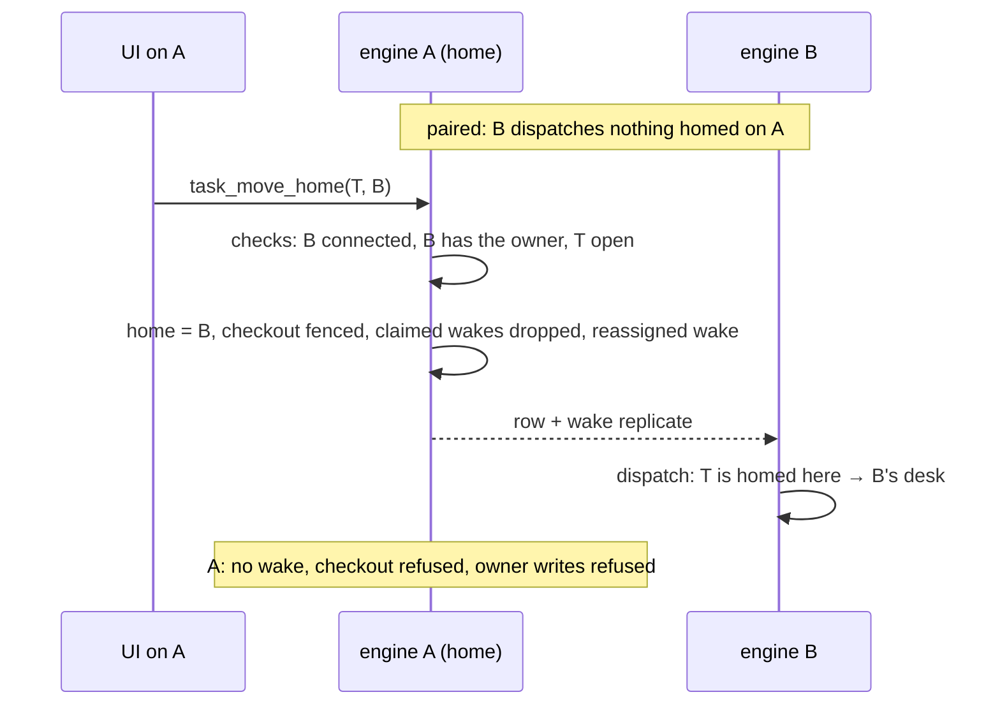

# 182 TASK-HOME — a task belongs to one (machine, agent) pair; only that machine works it

Status: built on `fix/task-home` (off `8316913d`, v2.18.11). Working notes, the before-repro, ambiguities and the
live proof: `182-notes.md`.

## Ask

Sky, 2026-11-08 00:02: "whenever the data is replicated between 2 nodes, everything that's on the tasks board for
agents is replicated as well which is fine, except for that if a task is in doing or in review or todo for the main
theuth Agent or any Agent that also exists on both machines because the agents aren't replicated across machines then
that Agent picks up that work and it's now being completed in 2 different places … So we need perhaps some kind of
like task ownership for a specific Node agent pair." Offline home ruling (2026-11-08 00:44): "Ask me".

## Root cause (as found on main)

The wakes, their claims and the checkouts were one replicated queue keyed by agent **name**, while agents are
per-engine files (theuth is on every engine). Every engine whose `Tasks.dispatching` was true dispatched every wake to
its own same-named desk; after a pairing or a partition heal both engines held the lease for ≥ 10 min (the incumbent
keeps it for `mesh.handover_secs`), and B's claim sweep un-claimed A's in-flight claims, so B redelivered them.
Schedules mirrored to both engines fired on both. Proof on the unmodified build: `182-notes.md` § Before.

## Decisions

| # | Decision | As built |
|---|---|---|
| D1 home | `tasks.home` TEXT: the engine id the ledger writes into `checkout.engine` | tasks migration `0009_home.sql` (`home`, plus the local `home_backfill` marker table); `Task.home: Option<String>` (serde default, TS `string \| null`) through `Row`, `COLS`, `put`. The column ships at the next attach (capture triggers are rebuilt from `PRAGMA table_info`); an old peer skips it. UI shows the engine name from `mesh_status` |
| D2 stamp | `Ledger::create` stamps `home = self.engine`; `create_for_schedule` the firing engine (D6 rule) | `Task.home = self.homed.then(engine)`; before `SetEngine` (`homed: false`, plugin start) a create is unhomed and `Ledger::set_engine` stamps every task this process created (local `created` event since the ledger's start). `task_place` / `where` unchanged |
| D3 gates | Only the home engine works a task; NULL home → the lease holder only | `Ledger::works(t)` = `home == engine`, or `lease()` (`mesh::is_hub`) for NULL. Gated: `dispatch` (wakes filtered by `ours()` before the busy set and the held report: a peer's claims never make a local agent busy), `held_wakes`, the claim sweep, the orphan sweep, `task_checkout` (`task <id> lives on <engine> — move it here first`; a NULL-home checkout by the lease holder homes it there), `task_inbox` (`TaskFilter.here`), the roster's `DeliverWake` backstop (`task <id> lives on <engine>, not here`). User actions (comments, moves, answers, reviews) stay allowed everywhere; the owner agent's own writes (`update`, `move_to`, `reassign`, `comment`/notes, `note_disposition`) on a task not worked here are refused `task <id> moved to <engine>; stop, it is worked there`; the roster's no-continuation and episode-close blocking skip tasks worked elsewhere |
| D4 desks | Desks and `Tasks.dispatching` stop depending on the lease | `wanted`, `allowed`, `desk_or_open`, the lazy theuth open in `DeliverWake`: no lease test. `SetDispatching` removed; Dispatch / Sweep always run. A lease change only logs (`lease_changed`); nothing closes desks or blocks tasks. `roster::lease` keeps only the `Follower` re-export (`Duties` / `apply` deleted). Lease-gated duties left: Slack, Signal and Telegram channels, link follow, OAuth refresh, document hub, legacy (unstamped) schedule ticks, the sandbox-ready unblock, the D9 Attention item |
| D5 one holder | Two holders that meet resolve at once by rank; deterministic tie without a stats row; keep the grace for a joiner | `mesh::lease::resolve` (pure): our heartbeat-seen claimers (`Seen.is_hub`) are the other holders. We hold + a claimer holds → `elect` over the two (+ claimers) with no incumbent (no handover grace; probation still filters: a proven holder beats an unproven one); a claimer without an `engine_stats` row → lowest engine id. We hold nothing + a claimer does → it is the incumbent (grace applies). An incumbent claimer without a row stays. A starting engine with stored peers now ends its warm-up on the first heartbeat (not the connect), so it sees the holder's `is_hub` first. Log reason `two holders` |
| D6 schedules | `engine:` front matter; stamped ticks only there; legacy on the lease holder | `Spec`/`FileArgs`/`ScheduleFile`/`ScheduleInfo` `engine`; stamped by `schedule` (`render_args`, so also `routine_draft`'s accept), the editor's create (`Put` of a new name), the autoresearch start (`schedule_file::text`) via `mesh::self_id` / `schedule::self_engine`. `tick` / `NextWake` use `fires_here` (stamp == self, else hub); the hub-regain re-arm only re-arms legacy entries. Task home: here when the engine has the agent (theuth always), else the single engine with it (D8), else NULL. `Confinement::Orphaned` ends (deletes) the file only on its own engine (legacy: only on a lone engine); autoresearch's `disable_all` skips other engines' study files. Loop counters stay engine-local |
| D7 backfill | Once per engine at SetEngine, only NULL rows | `set_engine`: marker `home_backfill(engine)`; `doing` → `checkout.engine`, a local `created` event → self, the rest stay NULL; one info line with the counts |
| D8 agents per engine | Replicated per-engine agent list | roster migration `0007_engine_agents.sql` (`id = <engine>/<name>`, `file_json` without body), attached to the replica; written by each engine from its files + theuth on every reconcile and at `SetSelf` (only changed rows rewrite; removed agents' rows deleted). `DeskRouter::engines_with` (store read through `Shared.store`, no actor hop); RPC `engine_agents_list`. The old name-only `agents` table is left alone |
| D9 offline ask | One Attention item per offline engine after `tasks.home_offline_ask_secs` (300) | `Ledger::note_peers` keeps the unreachable clock (sweep every 30 s and on demand); `HomesOffline` → `HomeOffline{engine, name, since_ms, tasks}` for engines past the threshold with agent-owned tasks in todo/doing, or blocked with a wake. The roster's Attention derive adds kind `home` (`home:<engine>`), only while this engine holds the lease (one mesh-wide), title `A has been offline 5 min — N tasks are waiting: …`, detail naming tasks whose agent is not here; alert class needs-you. Buttons: **Move them to <this engine>** → RPC `task_move_home_waiting(from)` (`MoveWaiting` → `MovedHome{moved, refused}`), **Keep waiting** → the existing `attention_snooze` 1 h. Existing machinery, no new state |
| D10 move | `task_move_home(task, to)` RPC + task tool | Ledger `move_home`: not done/cancelled, target this engine or connected, target has the owner (theuth always), user from anywhere / agents only from the home engine. Effect: `home = to`, a live checkout fenced (`orphaned`, epoch + 1), the old home's claimed wakes on the task deleted (not delivered twice, no stale busy), `home` event + thread line, owner woken `reassigned`. RPC: a live, non-desk, non-harness checkout session owned here moves first with 181's `session_move`; its refusal refuses the move. Tool `task_move_home{task, to}` (name or id), no session move. Off an offline home the move lands locally and replicates when it returns |
| D11 UI | Mock `task-home-mock.html` | Board chip `on <engine>`, foreign cards dimmed (still open), **Any machine** filter; task ⋯ menu (Reassign…, Move to ▸, Copy task id, Cancel task) with rows enabled/`Its session moves too`/`— no <agent> agent there`/`offline Nm`; detail `Home: <agent> on <engine>` + `<engine> is offline (since HH:MM)` + callout with Move to ▸; Attention `home` item with its two buttons; Agents page one row per (agent, engine) (List view); toasts; routines chip `other machine` for a schedule stamped elsewhere. Helpers in `components/tasks/home.ts` |

## Review round 1

| # | Finding | As built |
|---|---|---|
| M1 staggered upgrade | A peer that attached `home` (or `engine_agents`) after the rows went by recorded them unapplied | `ReplicaHandle::reannounce(table, filter, arg, columns)` emits the matching rows again under the clocks they hold (LWW-safe); `mesh::reannounce_on_connect` runs it on every `PeerEvent::Connected` — tasks: `home` of every homed row, roster: every `engine_agents` row |
| M2a boot race | A restarted old home resumed its desk turn and dispatched before replication said the task moved | Mesh first-sync latch: `mesh::synced()` is false on an engine with paired peers until every connected peer's first replica exchange landed (`replica::caught_up_with`), or `lapse_secs` with none connected (ceiling 5 × `lapse_secs`). Until then: no dispatch, no sweep, owner writes and agent checkouts refused (`NOT_SYNCED`), no desk opens. The agent actor holds every desk tree with an open turn at boot when `mesh.sqlite` lists a peer (`pause::sync_held`, the 179 hold); after the sync the roster resumes each tree, or — when the desk's last input names a task now worked elsewhere — closes its turns (`ReleaseTree`) |
| M2b capture | `Store::put` rewrote every column (`INSERT OR REPLACE`), re-announcing a stale `home`/`checkout` under a fresh clock | `INSERT … ON CONFLICT(id) DO UPDATE SET` every column: the capture trigger logs only columns that changed |
| M2c fence | The fence lived in `checkout.orphaned`, a column a replication race can revert | `fenced(t, c)` = `orphaned` or `home != checkout.engine`: the old session is superseded (`check_epoch`), a new home's checkout never conflicts with it, the sweep and `unblock` ignore it |
| M3 sandbox | The sandbox-ready unblock was lease-gated though the event is local | gate dropped |
| S1 create | A task created for an agent that lives elsewhere was homed on the creator | `create` stamps `home_for(owner)`: here if this roster has the agent (theuth, user-owned: here), else the single engine with it, else here. A wake for an agent this roster lacks is not delivered (`DeskRouter::has_agent`): one thread line, an Attention `misplaced:<task>` item (`hans isn't on b; it's on a`). A move also checks an agent reviewer |
| S2 | A wake whose task row has not replicated yet went to the lease holder | not worked anywhere until the row lands (its home works it) |
| S3 unknown homes | A home naming an engine nobody knows waited silently | D9 lists it (`node:<id>`, `an unknown machine (<short>)`); the backfill homes `doing` rows only on known engines; rosters of unpaired engines are not read (`known_engine`), not deleted (a delete would replicate) |
| S4 move order | The RPC moved the session, then the task move could still refuse | `MoveHome{check_only}` first; a moved session keeps the checkout (`checkout.engine = to`, not fenced, no `reassigned` wake) |
| S5 nudges | The old home judged its desk's turn on a moved task and nudged | `judge_turn` clears the serving wake when the task is worked elsewhere |
| S6 agent moves | Any agent on the home engine could move any task | the owner or its manager chain, on the home engine, under the cross-task write cap |
| S7 schedule fire | An agent on no engine left the fire's task legacy (NULL) | homed on the firing engine |
| S8 stamps | A stamp naming an unknown engine never fired; the `schedule` tool restamped a replaced file | `fires_here`: an unknown stamp fires on the lease holder; replacing keeps the file's stamp (legacy stays legacy) |
| S9 restart churn | A restarted higher-ranked engine took the lease from a connected holder at once | for its first `lapse` + 30 s it follows a claimer that has been up longer; rank decides later under the handover grace |
| S10 decisions | Decisions/reviews of tasks homed elsewhere | listed on every engine (the rows replicate); answering from any engine is a user write |
| S11 autoresearch | `disable_all` flipped unstamped study files on an engine with peers | left alone when `mesh.sqlite` lists a peer |
| #12 Attention | Two items per offline home (`node:` + `home:`) | one: `node:<id>`, kind `home` when tasks wait (`<name> is offline — N tasks are waiting: …`), kind `node` otherwise |

## Review round 2

| # | Finding | As built |
|---|---|---|
| Boot skip | A batch for a table whose plugin had not attached yet (tasks attaches after the replica) was skipped yet recorded applied: everything a peer changed while this engine was down was lost | `replica::apply` parks those changes (cap 65 536 per origin and table, 7-day TTL) and `attach` applies them; `attach` takes `write_lock` before it puts the tables in its map (the order `apply` uses), so no batch lands between the insert and the parked retry — a partial update never precedes its row's parked insert. `caught_up_with` is false while any table awaits its attach; after every plugin started (`replica::plugins_started`, called at the end of `t`'s `start_plugins`, so also by the TUI takeover's engine start) a table nobody attaches stops holding the sync. The roster's boot-hold decision also waits (≤ 10 s) for the tasks actor |
| Re-announce | Whole set on every connect, under the write lock | open tasks only (not done/cancelled); at most once per peer a minute |
| M3 | Unblock by sandbox name across the board | only tasks this engine works (`TaskFilter.here`) |
| `is_paired` | `false` before the mesh endpoint is up: a stamp for a paired peer fired on the hub | `Option<bool>`: unknown → a stamped schedule does not fire; a roster read keeps the engine |
| `has_agent` | An invalid agent file counted as "not here" and wrote the misplaced note | `None` for an invalid file: the wake is skipped quietly |
| Offline item | The title listed every waiting task | `<name> is offline — N tasks are waiting`; the first five titles and `and N more` in the detail |

## Flow

## Limits

- **Mixed versions.** An old-version engine ignores `home` and dispatches every task to its own desks; an old engine
  also lists a schedule with `engine:` as broken (unknown key). Both machines must run this version.
- **The first sync after a restart gates task work** for up to 5 × `mesh.lapse_secs` when a paired peer is connected
  but never completes its first exchange (an incompatible build); with no peer connected, `lapse_secs`.
- **The first sync covers the peers connected at that moment.** A paired peer that connects later (it was off, or
  slower to dial) syncs after task work started; what it changed meanwhile lands then. The fence (`home !=
  checkout.engine`) and the column-wise UPSERT bound the effect: a moved task is never worked here, a stale column
  never overwrites a newer one.
- **Changes that arrive before their table's plugin attached are parked** (`replica::apply`, up to 65 536 batches per
  origin and table, 7-day TTL) and applied at `attach`; the first sync waits for them. A table no plugin here ever
  attaches keeps its parked changes until the TTL.
- A held desk turn whose task moved is closed, not handed over: the new home's desk starts from the thread.
  Work outside the ledger already done in that turn (shell, files) stays where it ran.
- A task moved by an agent (`task_move_home` tool) leaves its work session where it is.
- `last_seen_ms` of a peer is now its disconnect time (`mesh::net::presence_remove`), which is what "offline since"
  shows; an engine that never connected since this process started shows its pairing time.
- The Attention item's threshold runs from the first time *this* lease holder saw the engine unreachable.
