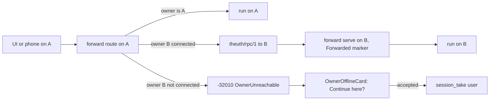
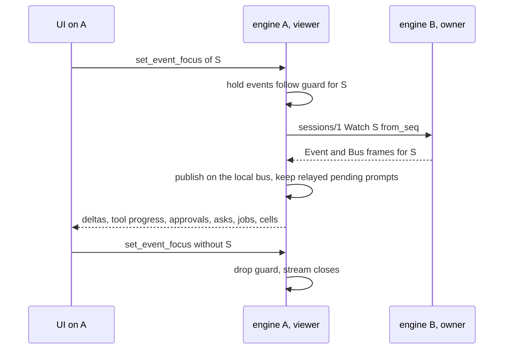

# 183 — Remote sessions, mesh messaging and A2A contacts

Status: DESIGN — rulings D1–D5 from Sky 2026-11-08 11:56; not built. Supersedes design 68 ruling 5 (user sessions follow you) for writes from a non-owner engine.

Inputs: `183-rulings.md` (fixed), `183-recon-mesh-messaging.md`, `183-recon-a2a-setup.md`,
`183-recon-session-stream.md`, `183-research-a2a-standards.md`, mock
`assets/183-network-and-remote-sessions.html` (panels 1–5). Base: origin/main `60c86602` (v2.18.12). Every
`path:line` below was re-opened in this worktree at that commit; recon lines that moved are corrected in §20.

## 0. Decisions in one screen

| Ruling | Mechanism | Section |
|---|---|---|
| D1 Run on the owner | `forward::classify` returns `Forward(owner)` for a user session whose owner is connected; the front door never takes on write. Only Continue here (`session_take user`), Move to (`session_move`) and the OwnerOfflineCard's "Continue here and resume" move a session | §4.1–§4.3 |
| D2 Owner offline → ask | Owner not connected → `-32010 OwnerUnreachable` at once (no `takeover_secs` wait, no `TakeReason::Write`); the existing `OwnerOfflineCard` offers Continue here; nothing runs until accepted; reads stay on the replica | §4.4 |
| D3 Same mesh ⇒ agents message by default; pairing ceremony is for separate harnesses, over an A2A standard | `agent.communication` defaults on for an engine with paired peers; a per-machine "Agents can message" switch; the forward leg leaves the Agents mailbox. Separate harnesses become **contacts**, paired by the A2A-standard ceremony of §7 | §6, §7 |
| D4 Settings go with the session | `sessions.approvals` and `sessions.communication` columns on the replicated row; the owner's registry and policy load them; the moved notice reports them | §4.5, §9.1 |
| D5 Design contacts now | Contact tier: local-only rows, no vault, no replication, A2A only, per-contact risk cap, first-contact Attention, fresh capped inbox session | §7, §8 |

Writer's calls:

- **W-1** Cells forward run/stop/input/ask to the owner through the existing `route_scope`; live PTY bytes (`cell_attach`) stay owner-local, the cell shows "live output on cloud-1" until the run settles. Reuses `FORWARDED` run scopes; no streaming proxy.
- **W-2** Terminals (`subscribe_pty`) and job PTYs stay owner-local in all phases: the unary `theuth/rpc/1` cannot carry a stream, and a generic stream proxy is design 183's largest risk for its smallest gain.
- **W-3** "Connected" means `owner ∈ transport.peers()` at call time; a connected owner that then times out (30 s) is also `-32010`. No retry inside the front door: the composer already retries once.
- **W-4** `sessions.approvals` is tri-state (`NULL` inherit, `'on'`, `'off'`), because today a session can only opt *out* of approvals (`registry.rs:987-991`); ask 7 ("turn on approvals there") is impossible on a node whose `tools.approvals` is false without a session pin.
- **W-5** Readers that depend on the owner's engine-local defaults (`get_approvals`, `get_communication`, `list_models`) forward to the owner; the session row alone answers when the owner is offline, with `global: null`.
- **W-6** The owner's `approval_timeout_secs` (300) is unchanged by relaying; the card shows the owner's deadline. Nobody answering still denies.
- **W-7** The sidebar running glyph for remote sessions is **rows-only**: `list_sessions` derives `running` for a row owned elsewhere from the replicated open turn, and the UI refetches the list on replicated `ContextChanged` (debounced). No summary event.
- **W-8** The moved notice is a typed user row (`HistoryEntry::Moved`, the advisory pattern) written by the taker after `set_owner`. Idle: in context. A turn open at the take: written outside context (UI only) and the model reads the extended `<engine_restart/>` instead, so no user row lands between a tool call and its result.
- **W-9** A cwd that does not exist on the taker never blocks a move: the seat falls back to the taker's home, the notice says so (`cwd_missing="true"`), and `sessions.cwd` keeps the original path so a move back restores it.
- **W-10** New chat on a machine = `CreateSessionOptions.engine`; the attached engine forwards the whole `create_session` to that engine with `forward::to_peer`. The target owns the session from epoch 1.
- **W-11** Machine facts ride the existing replicated `engine_stats` record: `+os`, `+os_name`, `+arch`, `+host`. `MeshStatus` gains `stats: Vec<EngineStats>`. No `engine_info` RPC.
- **W-12** `path_complete` and `list_models` gain a trailing `engine: Option<String>` (jsonrpsee treats a missing trailing optional as `None`, so old clients are unchanged).
- **W-13** Mesh messaging default: an *absent* `agent.communication` means on when the engine has ≥1 paired peer (source `mesh`); the first-run template stops writing `communication: false`; an untouched template line is commented out once on upgrade. An explicit value always wins.
- **W-14** The per-machine "Agents can message" switch is a **local** deny list `mesh.messaging_off: [engine id]` on the engine where it is flipped: it blocks peer messages both ways between this engine and that one. Local, so one machine cannot silence another's policy.
- **W-15** Agent messages to an offline owner keep failing fast; a retry with the same `request_id` re-forwards a `failed{OwnerUnreachable}` exchange. No queue (§6.4 gives the reasoning against D2).
- **W-16** Desk addressing: the roster sets the desk root's alias to `<agent>@<engine>`; `send_message` resolves aliases as today; no new address scheme.
- **W-17** Family pairing also gets Nearby (mDNS browse) and a 6-digit check code (mock panels 1, 2). Panel 2's "Let agents on both machines message each other" checkbox is dropped: D3 makes messaging the default.
- **W-18** The widened relay uses two new `theuth/sessions/1` frames (`Watch`, `Bus`). An old owner rejects `Watch` and the viewer falls back to `Events` (AgentEvent only); an old viewer never sees `Bus`.
- **W-19** The relay's pending prompts survive the viewer's snapshot: the viewer's `EventRelay` keeps the relayed `*Requested` set per followed session, and `PendingPrompts::collect` merges it.
- **W-20** to **W-27** are the Phase 3 calls, listed in §7.0.

What ships: **Phase 1** lets any machine (and the phone through the hub) operate, watch and configure a session
on another machine without moving it, tells the model plainly when a session does move, and starts new chats
on a chosen machine. **Phase 2** makes agents in one mesh message each other by default, off the Agents
mailbox, and replaces Settings › Mesh with Settings › Network (paths, latency, Nearby, code-checked pairing).
**Phase 3** adds contacts: separate harnesses found over mDNS or reached over the relay, paired with the A2A
ceremony, limited to exported agents under a per-contact risk cap.

## 1. Sky's asks and what this design answers

| # | Ask (short quote) | Answer | Sections |
|---|---|---|---|
| 1 | "a better UI for setting up network A2A … with mdns … as well as through the relay, agents can communicate if they're paired" | Inside one mesh this is already the transport; Phase 2 makes it visible and default (Settings › Network). Between separate harnesses: contacts (Phase 3) | §6, §7, §12.6–§12.7 |
| 2 | "if two nodes are in the same mesh, can those sessions communicate freely … I believe that was the intention" | Built as 69 P but behind three off-by-default switches and on the Agents mailbox. Phase 2: on by default (D3), off the mailbox, named desks, a refusal that names the engine | §2.1, §6 |
| 3 | "why doesn't the state of that session stream to other reachable nodes … and update live" | The 68 relay exists but never starts (`subscribe_events(null,null)`). Phase 1b: follow on focus, widened to approvals, asks, jobs and cells | §2.3, §5.1 |
| 4 | "do I have UI to start a session on a specific node" | No. Phase 1b: New chat on [machine ▾] with that machine's folders and models | §5.4, §12.5 |
| 5 | "a harness message to the agent/model that says, your session has moved to node: x, os: linux … custom UI … not a blob of xml" | Today nothing on an idle move; `<engine_restart/>` shows as raw XML. Phase 1b: `<session_moved/>` typed row + MovedCard; `<engine_restart/>` extended and carded; prompt header names the machine | §5.3, §11 |
| 6 | "sending a message from another machine … should not cause the session to move … just like … a paired pure UI device" | D1: forward to the owner; the phone gets the same fix because it rides the hub's front door | §4 |
| 7 | "control approvals from the three dots for a remote session … turn on approvals there without moving" | ⋯ menu: Approvals, Agent messaging, Model, Effort, forwarded; persisted on the row (D4); relayed approval cards | §4.5, §4.6, §12.2 |

## 2. As built today (v2.18.12)

### 2.1 Messaging across engines

| Fact | Where |
|---|---|
| `send_message` to `session:<uuid>` owned elsewhere: after `accept`, `remote_owner` → `forward_peer` → `communication::mesh::forward`, one `peer_deliver` JSON-RPC line on `theuth/rpc/1` | `crates/agent/src/supervisor.rs:5531-5534`, `:5552-5601`, `:5749-5753`; `crates/agent/src/communication/mesh.rs:89-149` |
| Owner intake: `peer_deliver` requires the `Forwarded` marker, then `Agents::peer_deliver` refuses a row not `here`, mirrors lineage and runs its own `deliver` | `crates/rpc/src/api.rs:3876-3891`; `crates/agent/src/supervisor.rs:5488-5526` |
| The owner never checks that the forwarding peer owns `envelope.from`: any paired engine may send as any session | `crates/rpc/src/api.rs:3883-3890` |
| Gates: sender and receiver each evaluate `Policy::route` (global ceiling, per-session opt-out, scope) | `crates/agent/src/communication.rs:1134-1155`; `crates/agent/src/supervisor.rs:5657` |
| `agent.communication` defaults off: code default and the first-run template | `crates/agent/src/lib.rs:3769`; `crates/theuth/src/main.rs:879` |
| Owner-side global off is reported as `denied: send_message: communication_disabled: communication for <from> is disabled globally…` — it names the sender's session, never the engine | `crates/agent/src/communication/mesh.rs:68-70`; `crates/agent/src/supervisor.rs:1903-1905`; `crates/agent/src/communication.rs:835` |
| Fail fast: owner not connected → `Failure::Unreachable` at once; a silent owner after 30 s | `crates/agent/src/communication/mesh.rs:32`, `:99-101`, `:129-138` |
| A retry with the same `request_id` returns the stale `failed` receipt, nothing re-sent | `crates/agent/src/store/communication.rs:622-635`; `crates/agent/src/supervisor.rs:5699-5705` |
| The mailbox stall: `impl Message<Deliver>` awaits the whole network leg inline, and the failure path asks `mesh::Status` inline | `crates/agent/src/supervisor.rs:5467-5473`, `:5571-5577`, `:5586-5588`; `crates/agent/src/communication/mesh.rs:169-183` |
| Off-mailbox precedent (176 E1): `DelegatedReply` + `ctx.spawn` | `crates/agent/src/supervisor.rs:5974-5991` |
| `PeerEnvelope{id, from, text, reply_to, request_id}`: no `chain` | `crates/agent/src/communication.rs:578-591` |
| Chain limit 256 is inherited only from a local sender | `crates/agent/src/communication.rs:96`; `crates/agent/src/supervisor.rs:2060-2068` |
| `discover_peers` rows owned elsewhere: `state: remote`, `engine`, no activity, no reachable flag; `query` matches name and address only | `crates/agent/src/supervisor.rs:6166-6201`, `:6019-6021` |
| Desks get no alias; other roots list as 8-char ids | `crates/roster/src/lib.rs:862-900`; `crates/agent/src/supervisor.rs:6142-6151` |

### 2.2 Discovery and pairing

| Fact | Where |
|---|---|
| Transport is iroh 1.2 QUIC, dial by Ed25519 endpoint id | `Cargo.toml:53-55` |
| mDNS is lookup only (`MdnsAddressLookup` resolves ids already paired); nothing browses or advertises | `crates/mesh/src/net.rs:500` |
| A lone engine joins no network: `join_network` runs only with stored peers or at first pairing | `crates/mesh/src/net.rs:455-457`, `:475` |
| Relay default `https://iroh.relay.theuth.io`; `mesh.relay` = URL, `public` or `none` | `crates/mesh/src/config.rs:55`; `crates/mesh/src/net.rs:366-377` |
| The pairing string is `1.<base32 json Payload{id, name, relay, addrs, token, vault_key}>`, token TTL 5 min | `crates/mesh/src/pairing.rs:19-39`, `:76-92` |
| The acceptor auto-accepts any live token: no prompt, no code | `crates/mesh/src/net.rs:946-1024` |
| The vault key travels; the bigger mesh's key wins | `crates/mesh/src/pairing.rs:204-222`; `crates/mesh/src/net.rs:629-648` |
| "Paired" = a `peers` row with `removed_ms` NULL, loaded into `Net.paired`; every ALPN is gated on it | `crates/mesh/migrations/0001_mesh.sql:5-11`; `crates/mesh/src/net.rs:391-396`, `:1189`, `:1237` |
| Unpair is a replicated tombstone; no key rotation exists in mesh or secrets | `crates/mesh/src/net.rs:774-795` |
| `theuth/rpc/1` answers the full JSON-RPC API as `RpcPeer::internal` | `crates/rpc/src/forward.rs:360-361` |
| `Peer{id, name, addrs, reachable, last_seen_ms, hub_pref}`; `MeshStatus` has no relay state, path or latency | `crates/mesh/src/types.rs:94-108`, `:230-246` |
| Mesh RPCs: `mesh_status`, `mesh_pairing_string`, `mesh_add`, `mesh_remove`, `mesh_set_hub` | `crates/rpc/src/api.rs:2543-2556` |

### 2.3 Liveness of a session owned elsewhere

| Fact | Where |
|---|---|
| The relay exists: owner `serve`, viewer `follower` re-publishing on the local bus | `crates/sessionsync/src/events.rs:309-334`, `:348-412` |
| It starts only from a per-session `subscribe_events`; `follow` has no other production caller | `crates/rpc/src/api.rs:9351`; `crates/sessionsync/src/events.rs:88` |
| The desktop opens one global `subscribe(null, null)`; `set_event_focus` only filters deltas and never follows | `crates/desktop/ui/src/App.tsx:257`; `crates/rpc/src/api.rs:9478-9500` |
| The relay subscribes to `AgentEvent` only; approvals, asks, jobs and cells are separate bus types | `crates/sessionsync/src/events.rs:144`; `crates/rpc/src/bridge.rs:216`, `:222-227`, `:266` |
| `ApprovalResolved{id, decision, timed_out}` carries no session | `crates/tools/src/approval.rs:61-68` |
| The pending-prompt snapshot is built from this engine's actors only | `crates/rpc/src/api.rs:2932-2960` |
| Replication is per commit: `ContextChanged{reason: "replicated"}` per applied batch | `crates/sessionsync/src/sync.rs:652-661` |
| The reducer drops a same-revision `ContextChanged`; partial upserts never bump `context_revision`, so 5 s partials replicate but never redraw | `crates/desktop/ui/src/store/reduce.ts:891`; `crates/agent/src/store/durability.rs:554-590`; `crates/agent/src/store.rs:3623-3625` |
| A replica's `load_session` says `running: false` | `crates/agent/src/supervisor.rs:7429-7439` |
| `ContextChanged` refreshes search only, not the sidebar | `crates/desktop/ui/src/lib/rpc.ts:216` |

### 2.4 Take on write

| Fact | Where |
|---|---|
| `classify`: `Here` / `Take` (user session) / `Forward(owner)` (desk) | `crates/rpc/src/forward.rs:86-93`, `:182-195` |
| `Take` sends `TakeSession{Write, by_user: true}`; an unreachable owner waits `takeover_secs` (300) | `crates/rpc/src/forward.rs:221-247`; `crates/sessionsync/src/owner.rs:150-152`; `crates/sessionsync/src/config.rs:25` |
| 37 `forward::route` call sites in `api.rs` (list in §4.2) plus cells' `route_scope` | `crates/rpc/src/api.rs:3812`…`:8945`; `crates/rpc/src/cells.rs:82-107` |
| Cell reads ask the owner and never take | `crates/rpc/src/cells.rs:109-147` |
| Approval and ask answers forward, never take | `crates/rpc/src/api.rs:3205-3221`, `:5000-5036` |
| `path_complete` already forwards | `crates/rpc/src/api.rs:4622-4642` |
| The phone talks to the hub; a send on a non-hub session takes it to the hub | `docs/design/139-mesh-durability.md:636-654` |
| The offline card exists and does D2's Continue here | `crates/desktop/ui/src/components/chat/OwnerOfflineCard.tsx:9-61`; `crates/desktop/ui/src/components/chat/Composer.tsx:1161` |

### 2.5 The moved notice

| Fact | Where |
|---|---|
| Idle take or move: `resume_on_take` returns `NoOpenTurn`; no row, no input | `crates/sessionsync/src/owner.rs:202-208` |
| Mid-turn resume: `<engine_restart at after kind from replayed interrupted/>`, `from` = engine id | `crates/agent/src/loop_.rs:8568-8585` |
| No UI renders `engine_restart`: it shows as raw XML on a tool card | `crates/desktop/ui/src/lib/injected.ts:22-57` (no `engine_restart` kind) |
| The wrapper parity test finds only tags with a closing `</name>`; `<engine_restart/>` and `<time/>` are self-closing | `crates/desktop/ui/src/lib/injected-wrappers.test.ts:41-54` |
| The TUI twin is `injected()` in the model, not a module | `crates/tui/src/model.rs:1175`, `:1516` |
| Typed-row precedent: `HistoryEntry::Advisory`, a user row with typed metadata that never opens a turn | `crates/agent/src/lib.rs:3018-3029`; `crates/agent/migrations/0034_advisor.sql:16` |
| The prompt header has persona, working directory and date; no machine or OS | `crates/agent/src/frame.rs:451-457` |

### 2.6 Per-session settings

| Fact | Where |
|---|---|
| Approvals bypass is a memory `HashSet` in the registry | `crates/tools/src/registry.rs:60`, `:776-803` |
| A session can only opt out: `!self.approvals || bypassed(s)` → Allow | `crates/tools/src/registry.rs:987-991` |
| The cap check runs first and denies regardless of approvals | `crates/tools/src/registry.rs:980-982` |
| Communication opt-out is a memory `HashSet` in `Policy` | `crates/agent/src/communication.rs:942`, `:1258-1270` |
| Model and effort persist on the row (replicated), resolved against the owner's catalog | `crates/agent/src/supervisor.rs:8682`, `:8713`, `:8751` |
| No per-session approvals getter (RPC or UI) | `crates/desktop/ui/src/components/settings/Approvals.tsx:13-18` |
| Approval timeout 300 s, then deny | `crates/tools/src/lib.rs:495`, `:531` |

### 2.7 New chat

| Fact | Where |
|---|---|
| `CreateSessionOptions` has no engine field | `crates/agent/src/lifecycle.rs:23-70` |
| `EngineStats{id, uptime_since_ms, class, availability_30d, harnesses, repos, display, gpu, accelerator}`: no os, arch or host | `crates/mesh/src/types.rs:113-138` |
| `engine_stats` is a replicated `mesh.sqlite` record; only `rpc/src/acp.rs` reads it | `crates/mesh/migrations/0001_mesh.sql:13-23`; `crates/rpc/src/acp.rs:281` |
| The only node picker is for tasks | `crates/desktop/ui/src/components/tasks/NewTaskSheet.tsx:131-137` |

## 3. Goals, non-goals, terms

### 3.1 Goals

| Ask | Goal (observable) |
|---|---|
| 6 | Typing, approving, steering, cancelling or changing a setting in a chat owned by B, from A or from the phone, runs on B; `sessions.owner` and `epoch` are unchanged |
| 6 | B offline: the OwnerOfflineCard appears; nothing runs until Continue here |
| 3 | A focused remote chat streams deltas, tool progress, approvals and asks within one relay hop; the sidebar shows remote sessions running |
| 7 | ⋯ menu on a remote chat toggles Approvals and Agent messaging and picks Model and Effort, on the owner; the value survives restart and move |
| 5 | Every move or take leaves one MovedCard in the transcript and one `<session_moved/>` the model reads; `<engine_restart/>` renders as a card |
| 4 | New chat on [machine ▾] creates the session owned by that machine, in a folder that exists there |
| 2 | Two sessions on two machines of one mesh, both left at defaults, exchange `send_message … await_reply` |
| 1 | Settings › Network shows each machine's path (LAN/relay/offline) and latency; Nearby pairs with a code |
| 1, D5 | Two separate harnesses pair as contacts over LAN or relay; a contact reaches only what is exported, under a cap |

### 3.2 Non-goals

- **Remote terminals and live PTY bytes** (W-2). `subscribe_pty` and `cell_attach` are jsonrpsee subscriptions
  (`crates/rpc/src/api.rs:317`, `:2328`); `theuth/rpc/1` is one request line and one response line
  (`crates/rpc/src/forward.rs:298-355`). Carrying streams needs a second stream proxy with its own back-pressure
  and auth; the replicated `pty_screens` already show the last screen. Revisit with design 68 option 3.
- **Merging two meshes across owners.** A contact never joins `peers`, never gets the vault key, never replicates.
- **A second forwarder.** Phase 1 and 2 reuse `forward::to_peer` and `communication::mesh::forward`.
- **Queueing agent messages for an offline owner** (W-15).
- **Vault key rotation on unpair.** Named as a gap in §8.4, not built here.
- **Replacing HTTP A2A.** It stays for non-theuth agents.

### 3.3 Terms

| Term | Meaning |
|---|---|
| owner | The engine in `sessions.owner`; the only writer and the only runner of the session's actor |
| viewer | Any other engine, or a device on the hub, showing the session from its replica |
| family (mesh) | Engines in one `peers` set: full trust, shared vault, replication, full RPC |
| contact | A separate harness paired by the §7 ceremony: local row, A2A only, capped |
| path | How a peer is reached now: `lan` (direct), `relay` (iroh relay), `offline` |
| forward | One unary JSON-RPC call over `theuth/rpc/1` to the owner, one hop, marked `Forwarded` |
| take / move | An ownership change: `session_take(user)` (Continue here) or `session_move` (Move to) |

## 4. Phase 1a — Operate a remote session without moving it

### 4.1 The front door (D1, D2)

`forward::classify` (`crates/rpc/src/forward.rs:182-195`) stops returning `Take`. The new rule, for a row
owned by another engine, is the same for user sessions and desks:

| Row | Owner connected (`owner ∈ transport.peers()`) | Owner not connected |
|---|---|---|
| missing, `owner = ''`, or `owner = self` | `Here` | `Here` |
| user session or desk owned by P | `Forward(P)` | `Offline(P)` → `-32010` at once (W-3) |

```rust
// crates/rpc/src/forward.rs — replaces :86-93
pub enum Route {
    Here,
    Forward(PeerId),
    Offline(PeerId),
}
pub async fn classify(store: &Store, session: SessionId, connected: &[PeerId]) -> anyhow::Result<Route>;
```

`route` (`:202-254`) loses its `Route::Take` arm and the `TakeSession{Write, by_user: true}` call (`:221-247`):
`Forward(P)` calls `to_peer` as desks do today (`:248-253`); `Offline(P)` returns
`unreachable(P, "not connected")` (`:407-428`), the payload the OwnerOfflineCard already parses. The
`sessions.takeover_secs` wait (`crates/sessionsync/src/owner.rs:150-152`) is no longer reached from a client
write; it stays for `TakeReason::Write` callers that are not the front door (none in `crates/rpc` after this
change) and for the orphan sweep.



### 4.2 The routed RPCs one by one

The 37 `forward::route` sites in `crates/rpc/src/api.rs`. After this change every one **forwards** when the
owner is connected and answers `-32010` when it is not; none takes.

| Method | Line | Kind | Note |
|---|---|---|---|
| `send_input` | 3812 | write | attachments travel by name (§4.3) |
| `steer` | 3849 | write | |
| `withdraw` | 3965 | write | |
| `cancel` | 3987 | write | |
| `compact` | 4213 | write | |
| `undo` / `redo` | 4229 / 4237 | write | |
| `session_memory` | 4269 | read that took | now a forwarded read |
| `endless_retry` / `endless_fold` / `endless_pause` | 4281 / 4289 / 4302 | write | |
| `set_session_compactor_model` | 4315 | write | resolves against the owner's catalog |
| `endless_zoom` / `endless_recall` | 4340 / 4355 | write | |
| `set_session_memory` / `set_session_view_bytes` | 4377 / 4401 | write | |
| `remove_context` / `regenerate` / `edit_turn` | 4420 / 4443 / 4458 | write | |
| `rename_session` / `pin_session` / `archive_session` | 4834 / 4847 / 4861 | write | the row replicates back |
| `delete_session` | 4870 | write | the delete replicates as row deletes |
| `set_session_project` | 4942 | write | |
| `set_model` / `set_effort` | 5096 / 5126 | write | owner's catalog (`crates/agent/src/supervisor.rs:8682`) |
| `harness_options` | 5233 | read that took | now a forwarded read |
| `set_harness_option` / `resume_child` | 5247 / 5270 | write | |
| `set_mcp_hidden` | 5307 | write | owner's MCP set |
| `set_approvals` | 5330 | write | persisted on the row (§4.5) |
| `set_communication` | 5354 | write | persisted on the row (§4.5) |
| `set_peer_scope` / `answer_peer_request` | 5369 / 5437 | write | |
| `use_skill` | 5508 | write | the owner's skills directory |
| `knowledge_harvest` | 6585 | write | |
| `resume_turn` | 8945 | write | resumes on the owner |

Not routed by `forward::route`, and how each behaves after this change:

| Call | Behaviour |
|---|---|
| `session_take(id, "user")` (Continue here, OwnerOfflineCard) | **takes** — the deliberate act |
| `session_move(id, to)` (Move to ▸) | **moves** (181), on the owner only |
| OwnerOfflineCard "Continue here and resume" | `session_take(user)`; the take resumes the open turn (`crates/sessionsync/src/owner.rs:95-96`) — **resume-here** |
| `resolve_approval`, `answer_ask` | forward, as today (`crates/rpc/src/api.rs:3205-3221`) |
| `path_complete` | forwards, as today (`crates/rpc/src/api.rs:4622-4642`); gains `engine` (W-12) |
| `load_session`, `list_sessions`, search, `session_owner`, `session_orphans` | local replica |
| `fork_session` (`crates/rpc/src/api.rs:4481`) | local: the fork is a new session owned here |
| `get_approvals` (new), `get_communication`, `list_models` | forwarded readers (W-5, §4.5) |
| `subscribe_pty`, `cell_attach` | owner-local streams (W-1, W-2) |
| `set_event_focus` | local; now also follows remote owners (§5.1) |

### 4.3 Cells and attachments

- **Cells (W-1).** `route_scope` (`crates/rpc/src/cells.rs:82-107`) already sends a chat-scoped cell call
  through `forward::route`; with §4.1 it forwards `cell_run`, `cell_run_all`, `cell_stop`, `cell_input`,
  `cell_ask` and the kernel calls (`crates/rpc/src/cells.rs:164`, `:202`, `:249`, `:269`, `:287`, `:533`,
  `:559`, `:596`, `:623`) instead of taking. The run id comes back in the forwarded reply and is recorded in
  `FORWARDED` (`crates/rpc/src/cells.rs:59`, read at `:75-77`) so later reads go to the owner. `CellEvent` reaches the viewer
  through the widened relay (§5.1). `cell_attach` on a forwarded run answers `-32014 RunsElsewhere{owner}`;
  the cell header shows "live output on cloud-1"; the final output arrives with the replicated rows.
- **Attachments.** Already by name: `ByName` turns `<data_dir>/attachments/<sha16>.<ext>` into
  `attachments/<sha16>.<ext>` and the owner fetches from the forwarder (`crates/rpc/src/forward.rs:16-20`,
  `:101-165`). No change.

### 4.4 Owner offline (D2)

- A write to a session whose owner is not connected returns `-32010` with
  `FrontDoorError::OwnerUnreachable{owner, last_seen}` (`crates/rpc/src/forward.rs:42`, `:60-68`). Nothing is
  queued and nothing runs.
- The composer shows the existing OwnerOfflineCard ("Owned by cloud-1, last seen 3 h ago. Continue here now?",
  `crates/desktop/ui/src/components/chat/OwnerOfflineCard.tsx:9-14`). **Continue here** calls
  `session_take(id, "user")`, then resends the draft; **Wait** keeps the draft.
- Reads keep working: `load_session` and the transcript come from the replica.
- ⋯ setters on an offline owner get the same card inline in the menu ("cloud-1 is offline — Continue here to
  change this").
- Approval cards relayed from an owner that drops are withdrawn on the viewer when the follow stream ends
  (§5.1); the owner's own timeout decides them.

### 4.5 Session settings in ⋯ (D4, ask 7)

Setters forward to the owner (§4.2). Readers forward too (W-5), because the effective value mixes the row
with the owner's engine-local defaults (`tools.approvals`, `agent.communication`). With the owner offline the
reader answers from the row with `global: null`.

Persistence (D4): two new replicated columns on `sessions` (§9.1), written by the owner's setter and loaded
by the owner's registry and policy on actor start, on take and on boot:

| Setting | Column | Applied by | Effective rule |
|---|---|---|---|
| Approvals | `sessions.approvals TEXT NULL` (`'on'`, `'off'`, `NULL` inherit) | `ToolRegistry` (`crates/tools/src/registry.rs:776-803`) | `on` → asks stay asks even with `tools.approvals: false`; `off` → asks become allow; `NULL` → `tools.approvals` (W-4). The cap check (`:980-982`) still runs first |
| Agent messaging | `sessions.communication INTEGER NULL` (`0` opted out, `NULL` inherit) | `Policy.opted_out` (`crates/agent/src/communication.rs:942`) | as today, but loaded from the row instead of memory-only (`:1258-1270`) |
| Model | `sessions.model` (exists) | owner, `crates/agent/src/supervisor.rs:8713` | unchanged |
| Effort | `sessions.effort` (exists) | owner, `crates/agent/src/supervisor.rs:8751` | unchanged |

`ToolRegistry.bypass: HashSet<SessionId>` (`crates/tools/src/registry.rs:60`) becomes
`pin: HashMap<SessionId, bool>`; `effective` (`:973-993`) reads the pin before `self.approvals`. A move carries
the column; the taker's registry applies it before the first tool call; the moved notice reports it (§5.3).

### 4.6 Whose policy; approval cards relayed

- **Policy.** The owner runs the tools, so the owner's `tools.policy` and `tools.approvals`, plus the row's
  pin, decide (`crates/tools/src/lib.rs:488-497`). A viewer never evaluates policy for a remote session.
- **Cards.** `ApprovalRequested` and `AskRequested` on the owner reach every viewer following the session
  (§5.1). The card reads "cloud-1 asks: run shell `cargo test -p replica`" with "mutating · relayed from
  cloud-1" (mock panel 3).
- **Answers.** Any viewer's Allow or Deny goes through `resolve_approval` → `route_question` → the owner
  (`crates/rpc/src/api.rs:3205-3221`, `:5000-5006`). The owner's approval actor takes the first answer;
  `ApprovalResolved` reaches every viewer and dismisses their card.
- **Timeout (W-6).** `approval_timeout_secs` (300, `crates/tools/src/lib.rs:495`, `:531`) runs on the owner
  only. The relayed card shows "denies at 11:47 on cloud-1". A pinned-on cloud session nobody watches still
  denies after 300 s; that is the owner's setting to change.

### 4.7 The phone and iPad

Devices talk to the hub, which dispatches into its own `Methods` (`docs/design/139-mesh-durability.md:636-654`).
The hub's front door is the code of §4.1, so a device's send on a session owned by a non-hub engine now
forwards from the hub instead of taking to the hub. Liveness is the same: the device's `set_event_focus` lands
on the hub, which follows the owner (§5.1). Nothing changes in `crates/link` or the app.

### 4.8 Authorization of forwarded calls

1. **Paired only.** `theuth/rpc/1` streams are accepted only from `Net.paired`
   (`crates/mesh/src/net.rs:1226-1238`); contacts (§7) never get this ALPN.
2. **Owner check.** `route` today returns `Ok(None)` for any `Forwarded` call (`crates/rpc/src/forward.rs:209-211`).
   It now classifies first: `Forwarded` and the row's owner is not this engine → `-32013 NotOwner{owner}`
   (new `FrontDoorError` variant, §10.3). The forwarder surfaces it; the replicated owner change follows.
3. **One hop.** `to_peer_within` refuses to forward a `Forwarded` call (`crates/rpc/src/forward.rs:278-280`);
   unchanged.
4. **Identity of `from` (Phase 2).** `peer_deliver` requires the `Forwarded` peer to own `envelope.from` (§6.5).

## 5. Phase 1b — Live remote sessions, the moved notice, new chat on a machine

### 5.1 Follow on focus, widened relay



- **Follow.** `set_event_focus` (`crates/rpc/src/api.rs:9478-9500`) keeps, per connection, a
  `HashMap<SessionId, sessionsync::events::Following>` for the focused sessions whose row is owned elsewhere;
  sessions leaving the set drop their guard; `forget_on_close` drops them all. The per-session
  `subscribe_events` follow (`:9351`) stays.
- **Widen (W-18).** The owner's `EventRelay` (`crates/sessionsync/src/events.rs:133-146`) also subscribes to
  `ApprovalRequested`, `ApprovalResolved`, `AskRequested`, `AskResolved`, `JobEvent` and `CellEvent`. The
  resolved events carry no session (`crates/tools/src/approval.rs:61-68`), so the relay keeps
  `prompts: HashMap<Uuid, SessionId>` filled from the requests. A viewer that sends the new `Msg::Watch` gets
  `Msg::Event` (AgentEvent, as today) and `Msg::Bus{kind, bytes}` for the others; `Msg::Events` keeps its
  AgentEvent-only meaning for old viewers. An old owner fails to decode `Watch` and closes the stream; the
  viewer then retries that owner with `Events` and remembers the downgrade until `PeerConnected`.
- **Pending prompts (W-19).** The viewer's relay keeps `relayed: HashMap<SessionId, PendingPrompts>` from
  `Bus` frames, cleared when the stream ends. `PendingPrompts::collect` (`crates/rpc/src/api.rs:2932-2960`)
  merges `sessionsync::events::relayed_prompts()`, so the subscribe snapshot and the post-`Lagged` snapshot keep
  relayed cards instead of dropping them.
- **Settle.** Event seq is per owner process and rows are ordered by log seq, so the UI keeps the rows as the
  truth: on `TurnFinished` and on replicated `ContextChanged` the chat runs `settle()` (re-read
  `load_session(settled_only)`, `crates/desktop/ui/src/routes/c.$session.tsx:255-287`).
- **Offline fallback: partial redraw.** `partial_upsert` (`crates/agent/src/store/durability.rs:554-590`)
  bumps `sessions.context_revision` with the upsert, so a replicated 5 s partial passes the reducer's
  same-revision check (`crates/desktop/ui/src/store/reduce.ts:891`) and redraws. That is the behaviour with no
  follow stream (owner on the far side of a slow relay, old owner, stream reconnecting).
- **Cost.** Only focused sessions stream; `ToolCallProgress` is already ≤ 1 per 250 ms per call
  (`crates/agent/src/lib.rs:3140-3143`); the queue per remote subscriber is 256 frames
  (`crates/sessionsync/src/events.rs:46`).

### 5.2 Running state in the sidebar (W-7)

Rows only. `list_sessions` reports `running: true` for a row owned elsewhere when the replica holds an open turn
for it (`Store::open_turn`, `crates/agent/src/store/durability.rs:699`). The UI refetches `list_sessions`
(debounced 1 s) on `ContextChanged{reason: "replicated"}`, which today refreshes search only
(`crates/desktop/ui/src/lib/rpc.ts:216`). The glyph moves at commit granularity (user row in, `finished_at`
out), within the +127 ms LAN append latency (`docs/design/68-sessions.md:160`). A summary event would buy
sub-commit precision for a glyph; not worth a second stream.

### 5.3 The moved notice (ask 5)

**Engine (W-8).** `Take::take` (`crates/sessionsync/src/owner.rs:111-190`), right after `set_owner` /
`set_fence` (`:165-172`) and before `resume_on_take` (`:188`), writes one `HistoryEntry::Moved` row through the
taker's store: a user-role row whose text is the model-facing `<session_moved/>` (§11.1) and whose typed
metadata lives in `messages.moved` (§9.1), the advisory pattern (`crates/agent/src/lib.rs:3018-3029`). It
never wakes the actor and never opens a turn. It replicates like every row, so the origin shows it too.

| Case | Row | Model reads |
|---|---|---|
| Idle Continue here / Move to / orphan take | `Moved`, in context | `<session_moved/>` before the next input |
| Open turn, resumed now (transfer, or user takeover) | `Moved`, context excluded | extended `<engine_restart/>` on the first tool response (`crates/agent/src/loop_.rs:8568-8585`) |
| Open turn, resume = ask (`Pending`) | `Moved` with `pending: true`, context excluded; it replaces the local note (`crates/sessionsync/src/owner.rs:229-238`) | `<engine_restart/>` when the user presses Resume |
| Old owner demoted | its local orphan note, unchanged (`crates/sessionsync/src/owner.rs:517-536`) | nothing |

The taker fills the record from its own facts: `to` and `host` (mesh name and hostname), `os`, `os_name`,
`arch` (W-11), `from` (the origin's mesh name), `cwd` (the seat's effective cwd, W-9), `at`, `reason`,
`jobs_left` (replicated `jobs` rows of the session still `running` on the origin), `runtime` (`reset` whenever
the session ever ran Python, since the heap is a local file, `crates/agent/src/repl.rs:6-7`), and `approvals`
(the effective value after the row's pin).

`<engine_restart/>` gains `to`, `os` and `cwd` for `transfer | takeover`, and `from` carries the mesh name
instead of the raw engine id.

**UI.** `Moved` is an entry kind rendered from typed metadata, like `advisory`; `engine_restart` is a text
wrapper. Files in §12.4. The parity test (`crates/desktop/ui/src/lib/injected-wrappers.test.ts:41-54`) learns
self-closing openers, so `<engine_restart/>`, `<session_moved/>` and `<time/>` must each have a classifier
kind or an explicit allow-list entry. The TUI twin (`crates/tui/src/model.rs:1175`, `:1516`) gains
`CardKind::Moved` and `CardKind::EngineRestart`.

### 5.4 The machine in the system prompt

`baseline_dated` (`crates/agent/src/frame.rs:451`) builds
`"{persona}\nMachine: {name} ({os_name}, {arch})\nWorking directory: {cwd}"`. The label is computed once per
process (`platform::process::machine()`, §14.4), next to `platform::process::hostname()`
(`crates/platform/src/process.rs:120`). A rename shows after a restart. The prompt prefix changes once per
machine, not per turn, so prompt caching is unaffected.

### 5.5 A cwd that does not exist on the taker (W-9)

The seat (`crates/tools/src/seat.rs:84-89`) checks `sessions.cwd` on take. Missing or not a directory → the
session is seated at the taker's home; `sessions.cwd` is not rewritten; the moved record has
`cwd_missing: true` and `cwd` = the fallback; the MovedCard shows "~/Develop/theuth does not exist on xeus —
working in ~". A later move to a machine where the path exists seats it there again. Blocking the move was
rejected: Continue here is the user's recovery path when the owner is gone, and a block would strand it.

### 5.6 New chat on a machine (ask 4)

- **RPC (W-10).** `CreateSessionOptions` (`crates/agent/src/lifecycle.rs:23-70`) gains
  `engine: Option<String>` (mesh id). `create_session` (`crates/rpc/src/api.rs:4876`) with `engine` set to
  another engine clears the field and calls `forward::to_peer(ext, engine, "create_session", (options,))`. Not
  connected → error "xeus is offline". The target creates the row with `owner = self`, epoch 1
  (`docs/design/68-sessions.md:57`), validates `cwd` exists there ("~/x does not exist on xeus") and returns
  `SessionOpen`.
- **Waiting for the row.** `classify` answers `Here` for a row it does not have
  (`crates/rpc/src/forward.rs:183-185`), so the forwarder waits for the new row to replicate before returning
  (bounded by `sessions.release_wait_secs`, 10 s; `docs/design/68-sessions.md:114`); the first `send_input`
  then forwards.
- **Machine facts (W-11).** `EngineStats` gains `os`, `os_name`, `arch`, `host`; `MeshStatus` gains
  `stats: Vec<EngineStats>` read from the replicated `engine_stats` rows (§9.2, §10.1).
- **Folders.** The target's `EngineStats.repos`, plus "Browse xeus…" which calls
  `path_complete(None, input, cursor, engine)` forwarded to the target (W-12).
- **Models.** `list_models(engine)` forwarded to the target; the default is the target's `agent.model`.
  Harnesses come from `EngineStats.harnesses`.

## 6. Phase 2 — Messaging across the mesh by default; Settings › Network

### 6.1 Same mesh ⇒ agents can message (D3, W-13)

- `AgentConfig.communication` (`crates/agent/src/lib.rs:3708`) becomes `Option<bool>`. Effective ceiling:
  explicit value (config, env or `/communication … always`) wins; absent → **on when the engine has at least
  one paired peer**, else off. `CommunicationState.source` gains `"mesh"`.
- The supervisor re-evaluates the default on `MeshEvent` peer added or removed and calls
  `Policy::set_global(on, "mesh")` (`crates/agent/src/communication.rs:1244-1252`) only when the key is absent.
- The first-run template (`crates/theuth/src/main.rs:879-881`) writes the line commented out. On upgrade, a
  config whose `communication:` line is byte-identical to the old template line is rewritten to the comment
  once, with `write_config_atomic`; any edited value is left alone.
- Unchanged: the per-session opt-out (now persisted, §4.5), root scope `owner | isolated`
  (`crates/agent/src/communication.rs:1145-1150`), and the receiver's own policy run in `peer_deliver`.
- The isolated scope stays isolated across the mesh: guest Slack/Telegram roots and `t --acp` roots cannot be
  reached from another engine, exactly as on one engine.

### 6.2 The per-machine switch (W-14)

`mesh.messaging_off: Vec<String>` (engine ids), default empty, on the engine where the switch is flipped.
`forward_peer` (sender) and `Agents::peer_deliver` (receiver) refuse when the other engine is on the list:
`agent messaging between <self> and <peer> is off on <self>`. The switch writes the local config through a new
`mesh_set_messaging(id, on)` RPC (§10.1).

### 6.3 The forward leg leaves the Agents mailbox

`impl Message<Deliver>` (`crates/agent/src/supervisor.rs:5467-5473`) becomes `DelegatedReply`, the 176 E1 shape
(`:5974-5991`):

1. In the mailbox: resolve, policy, `accept`, and — when `await_reply` — register the waiter **before** the
   network leg, so a fast reply finds it (`:5580-5583` relied on mailbox order).
2. `ctx.spawn`: `peer_mesh::forward` (`crates/agent/src/communication/mesh.rs:89-149`) and, on failure,
   `receipt_error` with its `mesh::Status` ask (`:169-183`), both off the mailbox.
3. Back in the mailbox (`ForwardOutcome{id, result}`): settle the receipt; on failure remove the waiter and
   `fail_exchange`.

Two engines sending to each other at once no longer hold each other's mailbox for 30 s.

### 6.4 Offline owners: fail fast (W-15)

A message to a session whose owner is offline fails at once with `failed {"OwnerUnreachable": …}`, as today.
New: a retry with the same `request_id` re-forwards when the stored exchange is `failed` with
`OwnerUnreachable` (`crates/agent/src/store/communication.rs:622-635` currently returns it as-is). Why not
queue: D2 says nothing runs on a session without its owner's or the user's say-so, and a queued message would
wake a session hours later, in a context the sender no longer holds, with no `await_reply` possible. A
failed receipt keeps the decision with the sending model, which can retry, pick another peer or tell the user.

### 6.5 Guards

| Guard | Today | After |
|---|---|---|
| Who may send as `from` | any paired engine (`crates/rpc/src/api.rs:3883-3890`) | `Forwarded(peer)` must equal `store.owner(envelope.from)`; else `-32002 peer_deliver: <peer> does not own <from>` |
| Chain | inherited only locally (`crates/agent/src/supervisor.rs:2060-2068`) | `PeerEnvelope.chain: u32` (serde default 0) = the sender's count; `enqueue_peer` starts from it; 256 holds across engines |
| Caps | 32 KiB, 16 recipients, 64 pending per recipient, 1024 per engine, 32 waits, 30 s, 120 s | unchanged |
| Hops | one | one |
| Refusal text | names the sender's session | names the engine: `denied: communication is off on xeus` |

### 6.6 Addressing and discovery (W-16)

- The roster names each desk root `<agent>@<engine>` with `SetPeerScope{scope: Owner, alias}` after
  `MarkDesk` (`crates/roster/src/lib.rs:891-899`). The alias replicates with `sessions.alias`.
- `resolve` (`crates/agent/src/supervisor.rs:1871-1877`): a `Relative(name)` that names no direct child falls
  back to an owner-scope root whose alias is `name`. `ops@xeus` parses as `Relative` already
  (`crates/agent/src/communication.rs:745-753`).
- `discover_peers`: `PeerInfo` gains `reachable: Option<bool>` (remote rows, from the `mesh::Status` ask the
  listing already makes, `crates/agent/src/communication/mesh.rs:185-201`); `query` also matches tags and
  engine (`crates/agent/src/supervisor.rs:6019-6021`).
- Policy refresh: `apply_lineage` (`crates/agent/src/supervisor.rs:1118-1149`) updates scope and alias for a
  known root when the replicated row changes, so a scope flipped on B reaches A's policy.

### 6.7 Settings › Network (mock panel 1)

Replaces Settings › Mesh (`crates/desktop/ui/src/components/settings/Mesh.tsx`;
tab at `crates/desktop/ui/src/components/settings/SettingsDialog.tsx:79`, pane `:129`).

| Section | Content | Data |
|---|---|---|
| This machine | name (editable, `mesh.name`), short id, chips `LAN · mDNS ✓` and `Relay · iroh.relay.theuth.io · 38 ms ✓`; switch "Let nearby machines find this one while pairing" | `MeshStatus.self_name`, `self_id`, `relay` |
| Nearby | engines found by mDNS browse, not paired: name, OS, address, **Pair…**; "Only shown while this page is open" | `mesh_nearby` (§10.1) |
| Machines in this mesh | per machine: OS and class, chip `LAN 2 ms` / `Relay 41 ms` / `offline 3 h`, `hub` badge, switch "Agents can message" (W-14), ⋯ Rename · Unpair | `MeshStatus.peers[].path`, `rtt_ms`, `stats[]`, `lease.holder` |
| Contacts | §7 | `contact_list` |
| Advanced (collapsed) | hub preference, SSH add-node, the pairing string and QR | today's `Mesh.tsx:114`, `:165-203`, `:214-266` |

`MeshStatus` gains `relay: RelayState` and per peer `path: PeerPath` and `rtt_ms: Option<u32>` (§10.1).
Path and RTT come from the iroh connection (`[INFERENCE]` iroh 1.2 exposes the selected path and RTT per
connection; the Phase 2 worker confirms the API before freezing). Rename edits the peer's display name
(`peers.name`, replicated) for a remote machine and `mesh.name` for this one.

### 6.8 Family pairing (W-17, mock panel 2)

- **Nearby.** While Settings › Network is open (or `t mesh pair` runs), the engine advertises and browses the
  DNS-SD service `_theuth-mesh._udp` with TXT `v=1`, `id=<endpoint id>`, `name=`, `os=`. It joins the network
  for that window even when lone (`crates/mesh/src/net.rs:455-457` keeps lone engines dark otherwise) and
  leaves it on close.
- **Ceremony.** Pair… dials the stranger on `theuth/mesh/1` with a new `PairRequest{name, nonce_a}`. Today a
  stranger must present a token (`crates/mesh/src/net.rs:946-983`); while pairing is open the acceptor instead
  answers `PairChallenge{nonce_b}` and shows the Attention dialog. Both sides display
  `code = u32(sha256(min(id_a,id_b) ‖ max(id_a,id_b) ‖ nonce_a ‖ nonce_b)[0..4]) mod 10^6` as `482 913`. Both
  users press Pair; then the existing `PairHello` path runs with a freshly minted token, vault key and merge
  unchanged (`crates/mesh/src/pairing.rs:204-222`). Either Cancel, or 120 s, ends it.
- The QUIC handshake already proves both endpoint ids, so the code defends only against pairing with the wrong
  nearby machine, which is the mDNS risk (§8.2).
- The dialog keeps the warning "Pairing shares your secrets vault, sessions and tasks — only pair your own
  machines." The string/QR path stays for machines not on the LAN.
