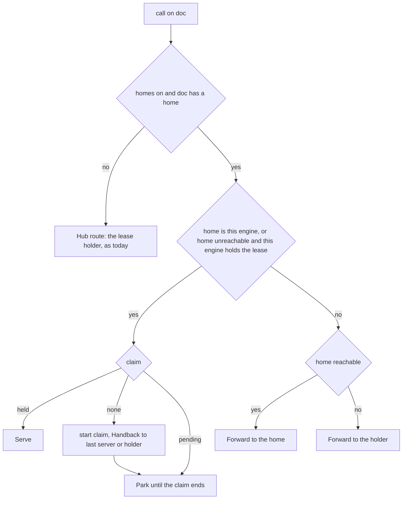
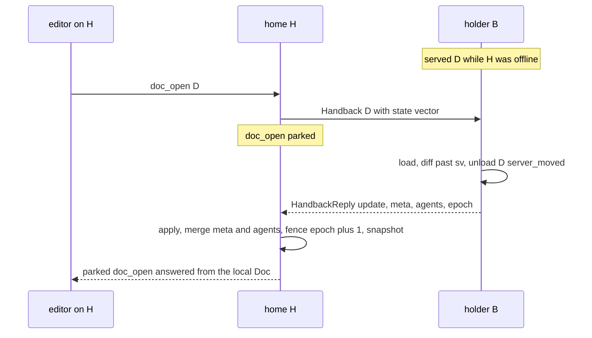
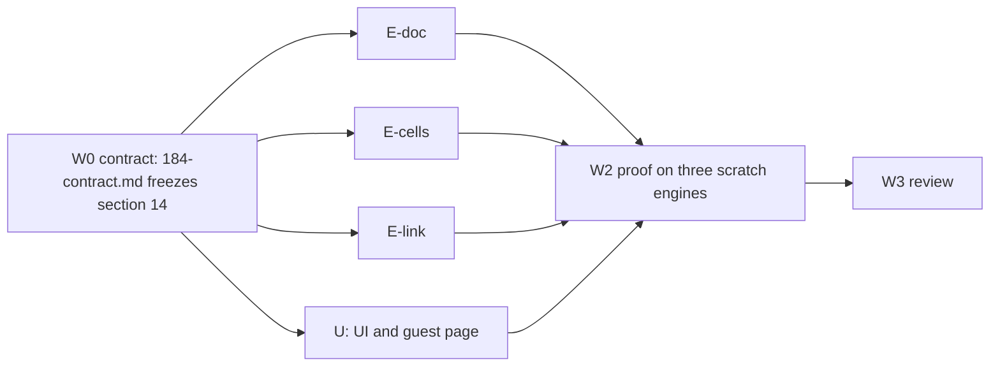

# 184 — Notes on any machine

Status: DESIGN — rulings from Sky 2026-11-09 11:10 (home = the making machine; never-hub machines may be homes; links name the home then the mesh; cells show the latest run anywhere); not built. Amends design 69 decision 11 (one live Doc on the hub) and design 171 W-d (note cells run on the hub).

Inputs: `184-rulings.md` (report, causes, rulings, and the later rulings Q1–Q5 of 11:47), `184-recon-notes-create.md`, `184-recon-cells-route.md`, `184-recon-sharing-relay.md`, and the orchestrator's mock `docs/design/assets/184-notes-any-machine.html`. Every `path:line` below was re-opened at main c553c363; paths are under `crates/` unless they start with `docs/` or `deploy/`. The desktop UI is `crates/desktop/ui/src` (written `ui/` below).

Revision R1 (2026-11-09): review findings M1–M5, S1–S7 and Sky's answers to the §17 questions are applied in place.

## 0. Decisions in one screen

| # | Decision | Where |
|---|---|---|
| D1 | Every note, board and meeting note gets `DocMeta.home` = the engine that made it; a task thread takes its task's home (182 D1). Knowledge, artifacts, charters, notebooks, sources and insight notes stay unhomed (hub-served). Existing documents have no home and stay hub-served, with no rewrite. | §4.1, §9 |
| D2 | One function decides who serves a document's live Doc: `route_doc(doc)`, with four outcomes: `Serve`, `Park`, `Forward(engine)`, refuse. Home set and homes on → the home when this engine can reach it, else the lease holder. No home → the lease holder, exactly as today. | §4.2 |
| D3 | A server claims a homed document before serving it: a `Handback` leg to the last server or the holder returns that engine's state past the claimant's state vector, its meta, its `agents.json` and its fence, and that engine unloads with `Closed{server_moved}`. Calls on the document park until the claim ends. | §4.3 |
| D4 | A fence (`serve_epoch`, `served_by`) in `meta.json` orders claims. `route_doc` alone decides who serves; the fence never unloads a server that cannot reach the home, so a partition gives two editable servers that converge through the mirror and say so on screen (Sky Q4). | §4.4 |
| D5 | Every (re)open makes the client push what the server lacks (`DocOpen.sv`), so updates acknowledged by a front door but lost in a hand-back reach the server. | §4.7 |
| D6 | Notes get "Move to ▸ machine": the server writes the new home and hands the live copy to that machine explicitly (Sky Q1). Boards, meeting notes and task threads are refused. | §4.8 |
| D7 | At unpair, the lease holder re-homes every document homed on the removed machine to itself, permanently and idempotently (Sky Q2). | §4.9 |
| D8 | Creation runs on the engine that will serve the new document: locally for notes, boards, meeting notes and same-engine task threads; over a new `Cmd::Create` docs leg otherwise (hub-only kinds, notebooks, a thread whose task lives elsewhere). A local create snapshots at once. | §5 |
| D9 | Exports, the quiet snapshot, the throwaway-cache rule and derived-file import follow the serving engine instead of the lease. | §4.6 |
| D10 | Note cells run on the viewer's engine (`note::route` deleted); the run reads the block and the note's markdown from the document's server over a `Block` leg; `cell_latest` gains a whole-row JSON `payload` carrying `engine` and is ungated; each cell shows the newest run from any engine, labelled "ran on <machine>". | §6 |
| D11 | In a mesh, the home mints v2 links `2.<home link id>.<mesh link id>.<doc>.<secret>`; with Link off on the home it mints a v1 mesh link (Sky Q3) whose id it reads, never mints; only the lease holder may mint `mesh/device_key`, and if no holder can answer Share says why and offers Retry. The guest tries the home for 5 s, then the mesh. v1 links parse and work. Join, member admin and guest reads go to the document's server. The holder reseals every document as today, homes reseal theirs, and the merge keeps the seal that opens. | §7 |
| D12 | Homes switch on only when the holder says so, and the holder says so only when every paired engine heard within 7 days advertises `docs_schema >= 2` on its authenticated mesh control connection (Sky Q5). Until then every path is today's. | §8 |
| D13 | One engine with no peers (paired phones included): nothing new appears and every path is byte-for-byte today's. | §16 |

Writer's calls:

| W | Call | Why, one line |
|---|---|---|
| W-a | `home` carries its own clock `home_ms`; merge takes the larger `home_ms`, ties to the greater engine id. | `updated_ms` moves with every edit, so a stale home would win the scalar rule. |
| W-b | Keep `DocError::NotHub{hub}` and `-32011`; the id now names the document's server. | `doc_forward` (`rpc/src/api.rs:3567-3586`) and old engines already forward to whatever id it names. |
| W-c | Hand-back by a direct leg, not by waiting for the mirror; calls on the document park on the claimant for at most `HANDBACK_TIMEOUT_MS` (Join at most `JOIN_PARK_MS`). | "Before it serves" needs an answer, the source's `updates.log` is not mirrored, and forwarding to a source that is unloading would ping-pong refusals. |
| W-d | The fence orders claims and flags two servers; it never unloads a server that cannot reach the home. | Unloading on the fence alone ping-pongs two partitioned servers every mirror round. |
| W-e | New close reason `server_moved`; the editor re-syncs on `slow`, `hub_moved` and `server_moved`, and every re-sync pushes the server's missing state. | Today `hub_moved` leaves the editor at "closed · hub_moved" (`ui/lib/doc/provider.ts:300-305`), and a front door acks updates before writing them (`document/src/relay.rs:464`). |
| W-f | A create runs on the would-be server (`route_home`), local when that is this engine; a forwarded keyed create returns the existing document. | One rule covers notes, threads homed elsewhere and hub-only kinds; a retried forward never makes a second document. |
| W-g | Mixed-version gate on a live, authenticated signal: a `Msg::DocsSchema{schema, homes_on}` frame on the `theuth/mesh/1` control connection, sent on connect and on change; the holder's `homes_on` is authoritative, and a follower is on only if the holder says so and its own floor agrees. | A replicated column is never rewritten by an older build (`mesh/src/store.rs:224-232`; `replica/src/engine.rs:696-704`); the gossip heartbeat's id is self-asserted (`mesh/src/lib.rs:681-692`), while the control connection's peer is the TLS-authenticated `remote_id` (`mesh/src/net.rs:83-92,1160-1166`). |
| W-h | `cell_latest` keeps one row per cell (`<doc>:<cell>`) and gains `payload TEXT` (the whole `CellLatest` as JSON, `engine` inside); readers prefer `payload`. | The replica logs changed columns only, so two engines' runs would mix old columns; one column is written whole. |
| W-i | The run reads block and markdown from the server; if that fails it reads the author through `Msg::Open` from the holder, and if the author is still unknown on a shared note the press asks the user to confirm instead of refusing. | A down server must not stop a cell, and invariant 6 must not be weakened by a stale author. |
| W-j | Only the home mints v2 links, and only when `mesh_status.peers` is non-empty. | The link id is the home's Link identity; a lone engine with a paired phone also has a mesh link id (`link/src/lib.rs:175-183`). |
| W-k | The guest dials the home for `HOME_DIAL_MS = 5000`, then the mesh. | The relay parks a socket for an unregistered id (`relay/src/relay.rs:448-459`), so only a client timeout ends the wait. |
| W-l | `after:` gates stay per engine; the disarmed and Run-anyway texts stay as they are. | Lineage lives in the local `cells.sqlite` (`cells/src/actor.rs:676-701`), and `ran_past` parses `disarmed_reason`'s wording (`cells/src/run.rs:157-199`). |
| W-m | Delete `note::route`, `Route`, `Docs::hub` instead of a `route()` that always answers Local. | A function with one answer is dead weight. |
| W-n | One actor message, `MoveHome{doc, to}`, serves the note Move to, task moves and the unpair re-home; on the server it hands over explicitly, elsewhere it writes the home and lets the reroute pass hand over. | Three callers, one mechanism. |
| W-o | The holder reseals every document (today's pass, unchanged), each engine also reseals what it serves or homes, and `merge_meta` keeps the seal that opens under the current key. | A set seal is never replaced by the merge today (`document/src/mirror.rs:152-160`), so a dead seal would stick after the retire grace. |
| W-p | A `CellLatestChanged{doc}` bus event from the replica feed makes the UI re-read `cell_latest`. | Doc-scope `CellEvent`s never cross engines (`sessionsync/src/events.rs:608-610`). |
| W-q | A home serves its own copy even when cut off from the mesh. | Sky Q4: both sides stay editable. |
| W-r | A reroute pass on every peer, lease, home or gate change unloads what this engine no longer serves and drops legs that point at the wrong server. | One place makes the hand-over in both directions; nothing waits for a client's next call. |
| W-s | A served document whose mirror files vanish under a tombstone is deleted (`Closed{deleted}`), not re-snapshotted. | A home that was cut off would otherwise resurrect a note the fallback deleted. |
| W-t | Parking re-sends the original actor message to the actor once the claim ends, for every message kind. | One mechanism covers editor legs, plugins' `Snapshot`/`Restore`/`SetDerived`/`ImportMarkdown` and RPC owner calls. |
| W-u | `Block` carries the presser's digest; the server parks the reply (no sleep in the actor) up to `BLOCK_WAIT_MS = 1000` for an update that makes its text match. | The keystroke rides the editor's leg and the read rides another, so the read can overtake the update. |
| W-v | With Link off on the home, the home builds the v1 mesh link from a pub-only read of `mesh/device_key` and the `link.relay` config; with no row yet it asks the holder, the only engine allowed to mint. | The row is minted with `set_if_version(None)` and replicates by LWW, so a second minter kills the loser's links; the code mints only at pairing for that reason (`secrets/src/vault.rs:414-416,436-450`; `link/src/lib.rs:162-164`). |

## 1. Sky's report and what this design answers

Sky, 2026-11-09 10:45 (`184-rulings.md:5`): a non-hub engine cannot create notes; a note made on the hub for it runs its cells on the hub with the hub's paths; cells should run on the machine they are viewed on; notes should be creatable anywhere and sync like everything else.

| Symptom | Verified cause | Answer |
|---|---|---|
| Agent tool and plugins cannot create off the hub | `CreateNote`, `CreateBoard`, `Create` open with `self.hub.gate_str()` (`document/src/actor.rs:1773,1750,1791` → `hub.rs:114-127`); `tools.rs:880,911,927` and the plugins ask the local actor with no forward | §5: local create, home = self |
| The UI's new note is born on the hub | `doc_create` re-issues the refusal to the hub (`rpc/src/api.rs:6771-6794`, `doc_forward` `:3567-3586`) | §5: the refusal is gone, so the note is born where it is made |
| Cells use the hub's cwd, `~`, interpreters, secrets | `cells/src/note.rs:212-219` returns the lease holder; `rpc/src/cells.rs:94-105` forwards every `Scope::Doc` call | §6: run where viewed |
| Sharing is tied to the hub | the live Doc lives on the hub (69 decision 11, `docs/design/69-devices.md:71`); links name the mesh (`api.rs:6157-6162`) | §7: the home serves and shares |

Rulings (`184-rulings.md:17-20`), fixed: (1) a note's home is the machine it was made on, it serves live editing, the hub serves while the home is offline, copies merge on return; (2) a `hub: never` machine may be a home; (3) links name the home first and the mesh second, old links keep working; (4) cells run where viewed, each shows the latest run from any machine labelled "ran on <machine>", the live terminal and history stay where it ran.

What changes in prior designs:
- 69 decision 11 (`69-devices.md:71`): "the hub holds the live Doc for any open document" becomes "the document's server (home, else hub) holds it". One live Doc per document stays the rule. Contract rule "every write is hub-only" (`69-contract-docs.md:71`) becomes "every write goes to the document's server".
- 69 decision 12 (`69-devices.md:72`): links name the home, then the mesh.
- 171 W-d (`171-cells.md:47,359`) and invariant 14 (`:963`): note cells run on the viewer's engine. "One kernel per spec across the mesh" becomes one per spec per engine.
- 171 §13.2 (`171-cells.md:1004-1014`): `cell_latest` is written by whichever engine ran the cell, not only the hub.

## 2. As built today (main c553c363)

### 2.1 Creation gate and callers

| Caller | Path | What happens off the hub |
|---|---|---|
| Gate | `document/src/hub.rs:114-127` `gate`/`gate_str`; `NotHub:` prefix `:44` | `NotHub:<holder>`, or `NotHub:` with no holder |
| `CreateBoard` / `CreateNote` / `Create` | `document/src/actor.rs:1750`, `:1773`, `:1791` → `create_doc` `:1806-1850` | refused before `create_doc` |
| UI / MCP `doc_create` | `rpc/src/api.rs:6771-6794`; `mcp-server/src/catalog.rs:899-902`; `ui/components/notes/create.ts:29-31` | `-32011` (`api.rs:3537,3554`) → `doc_forward` to the holder; the note is born on the hub |
| Agent tool `doc_create` | `document/src/tools.rs:880` (note), `:911` (board), `:927` (error) | model sees `NotHub:<id>` |
| Meeting note | `meeting/src/note.rs:166` `Create{MeetingNote}`, warn `:176` | silently missing |
| Task thread | `tasks/src/thread.rs:35` `Create{TaskThread}`, warn `:45`; called from `tasks/src/ledger.rs:864-871` | task without a thread |
| Dreaming journal | `dreaming/src/journal.rs:174` `CreateNote`, warn `:187` | warn |
| Autoresearch finalize | `autoresearch/src/finalize.rs:1170`, warn `:1179` | warn |
| Insights | `document/src/ingest/insights.rs:423` (inside hub-gated ingest, `:343,385`) | runs on the hub only |
| Ensure (knowledge, artifacts) | `document/src/actor.rs:1149` | `NotHub:` |
| ImportMarkdown (knowledge sync) | `document/src/actor.rs:1233`; caller `knowledge/src/store.rs:380-385` | `NotHub:`; the warning "knowledge → document import failed" (`knowledge/src/store.rs:384`) is `import_markdown`'s |
| NotebookCreate (RPC and agent tool) | `document/src/notebook.rs:681`; tool `document/src/nb_tools.rs:134-145` | RPC forwards (`api.rs:1157`); the tool sees `NotHub:<id>` |

### 2.2 Serving and mirror

| Fact | Path |
|---|---|
| `Hub{follower, holder, watcher}`; `holding()`; `route()` → `Ok(None)` serve, `Ok(Some(hub))` forward | `document/src/hub.rs:101-105,109,131-137` |
| Lease loss: export pending, `unload(id, HUB_MOVED)` every open doc; gain: `legs.clear()`, watcher | `hub.rs:169-206`, `HUB_MOVED = "hub_moved"` `:210` |
| Reseal when this engine gains the lease | `hub.rs:229-236` |
| Editor legs: `OpenDoc`, `ApplyUpdate`, `Subscribe`, `AwarenessUpdateMsg`, `Edit` route; `Join`, `SetName` route | `actor.rs:888,980,1028,1075,1357`; `share.rs:518,707` |
| `theuth/docs/1` frames: tags 0 Open … 9 Edit, "new variants append" | `document/src/relay.rs:56-139,143-156` |
| `Cmd` per leg; `Legs{transport, legs: HashMap<(Client, DocId), Sender<Cmd>>}`; `forward(hub, doc, client, cmd)` | `relay.rs:226-276,339-342,366-387` |
| Hub side turns frames into actor calls as one remote connection | `relay.rs:591-714` |
| Gated with `gate`/`gate_str`: Ensure 1149, ImportMarkdown 1233, UndoLastAgentEdit 1438, Rename 1870, DeleteNote 1962, Snapshot 2024, SetDerived 2047, Bind 2094, Restore 2144, Delete 2201 | `actor.rs` |
| Share gates: LinkCreate 434, LinkRevoke 478, MemberSet 620, MemberRevoke 668, MembersOf 755 | `document/src/share.rs` |
| Notebook gates: 681, 743, 865, 938, 1005; `PutCellLatest` 255; ingest `HubGate` 367 | `notebook.rs`, `cells.rs`, `ingest/mod.rs` |
| Holding checks that are not gates: export `actor.rs:447`, file watcher `:2219`, throwaway cache `:2274-2276`, quiet snapshot `:2461-2464` | `actor.rs` |
| Unload snapshots a non-empty log first | `actor.rs:733-738` |
| A serving engine merges a foreign snapshot into its live Doc (log, fan-out, export) | `actor.rs:2300-2332` |
| Meta merge: scalars from the newer `updated_ms`; members, links, authors union; `last_export` local | `document/src/mirror.rs:106-174` |
| `DocMeta` fields | `document/src/meta.rs:342-376` |
| Mirror files ↔ `doc_files` rows, 300 ms debounce | `document/src/lib.rs:356-363`; `replica/src/files.rs:29` |
| `snapshot_quiet_ms` 2000, `idle_unload_secs` 600 | `document/src/lib.rs:116,114` |
| `updates.log`, `snapshots/`, `agents.json` never mirrored | `document/src/store.rs:31-32`; `69-contract-docs.md:40` |
| RPC forwarding is one hop, never two (`Forwarded` stops a re-forward) | `rpc/src/forward.rs:310-337` |

### 2.3 Cells route

| Fact | Path |
|---|---|
| `note::route` ignores the doc, returns the holder via `HubGate` | `cells/src/note.rs:85-97,212-219`; `document/src/ingest/mod.rs:363-369` |
| `route_scope` forwards every `Scope::Doc` call; `read_scope` too | `rpc/src/cells.rs:82-107,113-130` |
| Routed RPCs: run 164, run_all 202, stop 249, input 269, ask 287, state 359, runs 491, run reads 425, kernel restart 538 and close 564; host chip `host_of` 382-410 (`note::route` at 397) | `rpc/src/cells.rs` |
| `attach` local only; `interpreters` local unless `engine` is given | `rpc/src/cells.rs:296-314,501-529` |
| Executing engine owns HOME, `is_dir`, `~`, interpreters, secrets, kernel, `cell_runs` | `cells/src/actor.rs:593-673,715,799-833,295-302,1093-1109`; `cells/src/note.rs:308-328`; `cells/migrations/0001_cells.sql:1` |
| Digest check refuses `Changed` | `cells/src/actor.rs:345-348` |
| `after:` arms from local `cells.sqlite` | `cells/src/actor.rs:676-701` |
| One kernel per `(Scope, Spec)` per engine | `cells/src/actor.rs:906-911` |
| `CodeBlockText` reads the local Doc (replica off the hub) | `document/src/cells.rs:43-61` |
| `CellLatest` (no engine column); `PutCellLatest` hub-gated | `document/src/cells.rs:108-133,245-260`; DDL `store.rs:65-72`; replicated `store.rs:76-82` |
| Writer agent = `last_author` of the block (from that engine's `agents.json`) | `cells/src/note.rs:376-395`; `document/src/actor.rs:295` |
| A result for a session owned elsewhere is queued to its owner | `agent/src/supervisor.rs:1730-1760` |
| UI: python chip asks the viewer's engine; press goes to `cell_run`; host chip | `ui/components/cells/NoteCell.tsx:65-68,160`; `CellDefaults.tsx:41`; `Cell.tsx:464` |
| UI re-reads cells on cell events | `ui/components/cells/store.ts:146-154` |

### 2.4 Sharing and relay

| Fact | Path |
|---|---|
| `doc_link_create`: local Link must be on, id = mesh device id else engine link id, URL `{origin}/d#1.{id}.{doc}.{secret}`, then `doc_forward` | `rpc/src/api.rs:6138-6184` (`:6151-6156`, `:6157-6162`, `:6180`, `:6183`) |
| `doc_join` guests only, forwarding inside the actor | `api.rs:6204-6240`; `share.rs:512-530` |
| Proof checked against the sealed hash; the mesh key is on every paired engine | `share.rs:140-156`; `secrets/src/vault.rs:2-6` |
| Reseal after a rotation, hub only | `share.rs:49-100` (gate `:68`); trigger `document/src/lib.rs:305-324` |
| Engine uplink `/h/<engine link id>` when Link is on; mesh uplink only on the holder | `link/src/lib.rs:112-117,489-500,557-558`; `link/src/follow.rs:200-233` (gate `:204`) |
| Relay: `/h/{id}` socket, `/d` is the SPA fallback served from `--web <dir>` | `relay/src/main.rs:48-50,115-121`; `relay/src/web.rs:32,61-77` |
| Bundle deploy: the relay image builds `crates/desktop/ui` into `/web` | `deploy/relay/Dockerfile:12-28,68,73` |
| Guest parse: exactly 4 parts, tag `1`, engine id decodes to 32 bytes | `ui/link/guest.ts:23-30` |
| Guest dial: one engine row, `LinkTransport`, `doc_join` | `ui/components/share/GuestApp.tsx:124,135,166` |
| Share copy "connects to this Mac through the relay" | `ui/components/share/ShareDialog.tsx:89` |
| Per-stream schema numbers (183 E-M3): `Hello{schema}` trailer, `schema_behind` | `sessionsync/src/types.rs:46-63,241-243`; `docs/design/183-notes.md:350` |
| Replicated per-engine advertisement `EngineStats`, re-sent every `capabilities_secs` | `mesh/src/types.rs:189-229`; `mesh/src/config.rs:35,71`; `mesh/src/store.rs:216-249,285-314` |
| Peer names: `mesh_status` → `MeshStatus{self_id, self_name, peers[{id, name, reachable}]}`; UI helper `engines(mesh)` | `mesh/src/types.rs:98,327-341`; `ui/components/tasks/home.ts:24-27` |
| Quarantined engines are not peers here | `mesh/src/store.rs:117-127`; `mesh/src/net.rs:1003-1041` |

## 3. Goals, non-goals, terms

Goals:
1. Any engine creates notes, boards and meeting notes, from the UI, the agent tool and every plugin, with no `NotHub` while the mesh is healthy.
2. The engine a note was made on serves its live editing; the hub stands in while it is offline; nothing typed on either side is lost, including updates a front door acknowledged before a hand-back.
3. Note cells run on the engine whose UI pressed them, with that engine's folders, interpreters and secrets, and every engine shows the newest result.
4. Share links reach the note's home first and the mesh second; every existing link keeps working.
5. One engine alone, and a mesh with an older engine in it, behave exactly as today.

Non-goals:
- No engine-to-engine Yjs update stream (recon option B, `184-recon-sharing-relay.md:105-108`). One live Doc per document stays.
- No backfill of `home` on existing documents. No "Move to" for boards, task threads or unhomed kinds.
- No relay protocol change. No new settings.
- Knowledge, artifacts, agent charters, notebooks, sources and insight notes do not get homes.
- Cell run history (`cell_runs`) and live terminals stay engine-local.

Terms:

| Term | Meaning |
|---|---|
| home | `DocMeta.home`: the engine that made the document (task thread: the task's home). `None` = unhomed. |
| homed kinds | `DocKind::Note`, `Board`, `MeetingNote`, `TaskThread` (`document/src/meta.rs:87-113`). |
| server | The engine that holds a document's live Doc now: the result of `route_doc`. |
| holder | The documents-hub lease holder (`mesh::LeaseState.holder`, `mesh/src/types.rs:273`). |
| fallback | The holder serving a homed document because it cannot reach the home. |
| reachable(e) | `e` is in the docs transport's connected peer set (`Transport::peers()`, as `rpc/src/forward.rs:335`). Unpaired and quarantined engines are never in it (`mesh/src/net.rs:1003-1041`). |
| homes on | The holder's `DocsSchema` frame says `homes_on: true`, and this engine's own floor agrees (§8). |
| claim | A server's record that it serves a homed document at a fence epoch. |
| front door | The engine a client (desktop UI, TUI, guest) is connected to; it forwards to the server over `theuth/docs/1`. |

## 4. A note's home and who serves it

### 4.1 The home

`DocMeta` gains four fields (§9.1): `home: Option<EngineId>`, `home_ms: i64`, `serve_epoch: i64`, `served_by: Option<EngineId>`.

| Kind | `home` at create | Why |
|---|---|---|
| Note | the creating engine | ruling 1; id is a fresh v7 (`meta.rs:22-33`), nothing can collide |
| Board | the creating engine | its frontmatter `root:` is the creator's absolute repository root (`actor.rs:1722-1738`; `tools.rs:896-907`) |
| MeetingNote | the recording engine (the meeting plugin runs where it records) | the binding is deterministic (`meta.rs:30-38`) but one engine records each meeting |
| TaskThread | `Task.home` (182 D1, `docs/design/182-task-home.md:26`); a NULL task home gives `None` | 182 D3: only the home works a task (`182-task-home.md:28`); the thread follows it |
| Knowledge | `None` | uuid-v5 id per concept: two engines creating one are two Yjs lineages with duplicated blocks (`69-contract-docs.md:11-14`); its derived file is synced by knowledge sync and watched on the hub only (`document/src/watch.rs:21`) |
| Artifact | `None` | uuid-v5 per `(session, name)`; the artifact store copies each settled export into a content-addressed blob (`meta.rs:198-214`) |
| AgentCharter | `None` | uuid-v5 per roster name; the roster copies each export into `agents/<name>.md` (`meta.rs:96`) |
| Notebook, Source | `None` | notebook rows and ingest are hub writes; source blobs are per engine, "Open original" forwards to the hub (`144-notebooks.md:222-231`) |
| Insight notes (`ingest/insights.rs:423`) | `None` | made inside hub-gated ingest (`insights.rs:343,385`) from the hub's blobs; they belong with their notebook |

Rules:
- `home` is set at create. It changes only through `MoveHome` (§4.8): the note's Move to ▸, a task's move (`tasks::Ledger::move_home`, `tasks/src/ledger.rs:1646`), and the unpair re-home (§4.9).
- A `hub: never` engine (`mesh/src/config.rs:24-25`; `lease.rs:135`) is a home like any other (ruling 2). It is never a fallback, because it never holds the lease.
- Existing documents have `home: None` from `#[serde(default)]`: hub-served exactly as today. No rewrite.
- With homes off (§8), a create stamps `home: None`: notes made in a mixed mesh stay hub-served for good.

### 4.2 `route_doc(doc)`

```rust
pub enum Route { Serve, Park, Forward(EngineId) }
fn route_doc(&mut self, doc: &DocId, relayed: bool) -> Result<Route, DocError>; // may start a claim
fn serves(&self, doc: &DocId) -> bool;   // homed: claim Held or Pending; unhomed or homes off: holding; never starts a claim
fn server_of(&self, doc: &DocId) -> Result<Option<EngineId>, DocError>; // read-only route; never starts a claim
```

`route_doc` sits beside `Hub::route` (`hub.rs:131-137`), which stays for unhomed documents. `Serve` answer here; `Park` wait for the claim (§4.3); `Forward(e)` hand to `e` over a docs leg; `Err` refuse.



1. `home_of(doc)`, memoized in `homes: HashMap<DocId, Option<EngineId>>`: filled from the open document's `meta.home` or one `store.read_meta(doc)`, then `pending_homes` (§5.3); updated on create, on every merged meta (`actor.rs:2334-2362`, `mirror_apply` `:2278-2283`) and on `MoveHome`; dropped on delete. No call reads `meta.json` twice.
2. No home, or homes off → `self.hub.route()` mapped to `Serve` / `Forward(holder)` / `Err`. Unhomed documents take exactly today's path.
3. Home = this engine, or home unreachable and this engine holds the lease (fallback) → by claim (§4.3): `Held` → `Serve`; `Pending` → `Park`; none → start a claim and `Park`, or `Held` at once when there is nobody to pull from → `Serve`.
4. Home reachable → `Forward(home)`.
5. Home unreachable, another engine holds the lease → `Forward(holder)`; no holder → `Err(NotHub{hub: None})`.
6. `relayed = true` (the call arrived over a docs leg, `Relayed<M>` in §10.2) and the answer is `Forward(e)`: forwarded once more only when this engine holds the lease and `e` is the home (the holder relays for a front door that cannot reach the home, as a non-hub front door relays guests today, `69-as-built-Y.md:30`); otherwise `Err(NotHub{hub: Some(e)})`. The home never forwards a relayed call and no other engine receives one, so no call loops; the RPC layer already forbids a second hop (`forward.rs:310-334`).

`serves` and `server_of` never start a claim: `serves` is what the export, snapshot, file-watch and throwaway-cache checks read (§4.6), and a document mid-claim counts as served, so the throwaway rule (`actor.rs:2274-2276`) never unloads it. `DocServer` (§10.2) answers `server_of`, mapping a claim in flight to this engine.

`reachable` reads `self.legs.transport` peers. The actor keeps `homes_on: bool` (§8) and the self id it already gets (`hub.rs:156-158`, `Hub::set_self` `:145-147`).

In a healthy mesh exactly one engine serves a homed document: the home serves only itself (rule 3), and the holder serves only while it cannot reach the home. The lease has one holder (182 D5, `182-task-home.md:30`).

### 4.3 Hand-back and claims

The actor keeps `claims: HashMap<DocId, Claim>`, `enum Claim { Pending { from: EngineId, rest: Vec<EngineId>, since: Instant, done: watch::Sender<bool> }, Held { epoch: i64 } }`. Claims apply to homed documents only, on the home or on a fallback holder (§4.2 rule 3).

Starting a claim:
1. Sources = `[meta.served_by, holder]`, deduplicated, without this engine, reachable ones only.
2. No source → `Held{epoch: meta.serve_epoch + 1}`, write the fence (§4.4), serve.
3. Else → `Pending{from: first source, rest}`. Send `Cmd::Handback{sv}` on the leg `(Client::Conn(None), doc)` (`relay.rs:201-206`) to it (`Msg::Handback`, tag 11).
4. Parking (W-t): a handler whose `route_doc` answers `Park` subscribes to the claim's `done` channel and spawns a task that waits for it, then re-sends the same message to the actor (`ctx.actor_ref().ask(m)`) and forwards the reply to the original `ReplySender`. Every routed message is `Clone`; the few whose reply is not delegated today (`Snapshot` `actor.rs:2023`, `Bind` `:2093`, `Delete` `:2200`, `DeleteNote` `:1961`, the share admin handlers) become `DelegatedReply`. The wait is bounded by `HANDBACK_TIMEOUT_MS` plus one re-send; `AwarenessUpdateMsg` is dropped instead of parked. A parked `Join` waits at most `JOIN_PARK_MS = 2000`, then answers `JoinError::Other("busy")`, which the guest page retries (§12.5), so a join always answers within the guest's 5 s `JOIN_DEADLINE` (`link/src/conn.rs:555,604-614`).
5. The source answers (§10.2): it loads the document (snapshot plus its own `updates.log`), encodes the update past `sv`, takes its meta, its `agents.json` map (`Open.agents`, else `store.read_agents`, `actor.rs:295`) and its fence, unloads the document with reason `server_moved` (snapshot first, `actor.rs:733-738`), and replies `HandbackReply{update, meta, agents, epoch}`.
6. The claimant applies `update` as `Principal::File` (log, fan-out, export). That apply clears agent and member authors of the blocks it touches (`actor.rs:384-394`), so it then merges `meta` with `merge_meta` (members, links and authors union; the seal that opens wins, §7.4) and inserts the source's `agents` entries for every block it lacks, writing `agents.json`. A guest admitted on the source is a member here, and a block an agent wrote on the source still names that agent here (§6.3).
7. Next source in `rest`, if any, the same way; then `Held{epoch: max(local, replies) + 1}`, write the fence, snapshot, `done.send(true)`. Every parked call re-sends in arrival order; then the reroute pass (§4.5) runs for the document: legs this engine held to the source close, so its own editors re-sync onto the local Doc (§4.7).
8. A source that answers `Closed{not_home}`, closes the leg, refuses with `NotHub`, or gives no answer within `HANDBACK_TIMEOUT_MS = 5000` counts as answered with nothing: warn `documents: hand-back from <e> failed (<reason>); continuing without it`, go on with `rest`, and end in `Held` as in step 7. Anything that source still holds reaches the mirror at its next snapshot and merges into the live Doc (`actor.rs:2300-2332`).
9. A claim is dropped when its document unloads (idle 600 s, the open cap, a reroute). The next load claims again; a source that has nothing answers an empty update.



The source answers a `Handback` from the document's home, from the holder claiming as fallback, or from the target of a `Handover` (§4.8); anything else gets `Closed{not_home}` and the source keeps serving. It answers even when its own `route_doc` already points at the claimant: `Handback` is not routed.

If the `HandbackReply` is lost after the source unloaded (the leg dies mid-reply), the claimant ends in `Held` by step 8 and the source's unload snapshot reaches it through the mirror within one debounce (`replica/src/files.rs:29`); the claimant's live Doc merges it (`actor.rs:2300-2332`). Editors on the source re-sync to the claimant and push what it lacks (§4.7). Nothing is lost; the source's last edits arrive a few seconds late.

### 4.4 The fence and two servers

`serve_epoch` and `served_by` are one pair in `meta.json`. Every claim bumps the epoch and names its engine; the merge (§9.1) takes the larger epoch, ties to the greater engine id. `updates.log` never leaves its engine, so the fence, not the log, is what tells a later server that someone else served.

A serving engine that merges an incoming fence which beats its own claim and names another engine:

| This engine | Other server reachable | Action |
|---|---|---|
| home | yes | Hand back from it (§4.3 step 3 on the open document), re-claim above its epoch. |
| home | no | Keep serving; `dual = Some(other)`; fan out `DocEvent::Server`; re-claim above its epoch once. |
| fallback | home reachable | Reroute pass unloads it (`server_moved`). |
| fallback | home unreachable | Keep serving; `dual = Some(home)`; fan out `DocEvent::Server`. No re-claim. |

Two servers happen only when the holder cannot reach the home while some client reaches the home: a partition, or the holder quarantining the home (quarantine is per engine, `mesh/src/net.rs:1036-1041`). Sky's ruling Q4: both sides stay editable and show a warning. Then:
- Each server keeps one live Doc and its editors see each other's edits only through the mirror: one snapshot of the other side plus the mirror debounce (300 ms) plus transport per hop, merged into the live Doc by `actor.rs:2300-2332`. A server snapshots after 2 s of quiet, or every `LOG_MAX_COUNT = 1000` records or 1 MiB while typing never pauses (`actor.rs:41-43,2459-2464`). Any engine paired with both carries the mirror between them.
- With no replication path at all, the two sides are two offline copies; Yjs joins them when a path returns (`69-contract-docs.md:51`).
- Both sides show it: the fallback's editors see the offline banner; an editor on a server with `dual` set sees "Also open on <machine> — edits merge within seconds" (§12.1).
- Meta writes apply on one side until it heals: a link revoked or a member removed on one server still admits on the other until the meta merges. Revocation is monotone in the merge (`mirror.rs:147-151`), and a member removal is a retain on one side that the union merge undoes (`mirror.rs:134-143`, `share.rs:668-672`). So a member removed during a partition comes back at heal; the owner removes them again. `ponytail:` no member tombstones; add a `removed_ms` to `Member` if this bites.
- It ends at the next reroute pass on which the holder reaches the home: the holder unloads; the home hands back from it (W-d: the home re-claims only when it merges a newer fence, so two partitioned servers never ping-pong).

### 4.5 The reroute pass

`DocumentActor::reroute(&mut self)`, run on `MeshEvent::Peer` (`mesh/src/types.rs:289`), `MeshEvent::Lease` (`:291`, today's `sync_hub` call at `hub.rs:230-236`), a merged meta whose `home` changed, `MoveHome`, and a `homes_on` flip:
1. For each open document with `server_of(doc) != Ok(None)` and no claim in flight: export when due, `unload(doc, SERVER_MOVED)` (snapshot first), drop its claim.
2. For each leg whose target is no longer `server_of(doc)`: drop it. `Legs.legs` becomes `HashMap<(Client, DocId), (EngineId, Sender<Cmd>)>` (`relay.rs:339-342`) so the pass knows each leg's target; `Legs::clear` (`:346-348`) goes.
3. For each open document with `dual = Some(e)` where `e` is now reachable and this engine is the home: hand back from `e`, clear `dual`, fan out `DocEvent::Server`.
4. On the holder only: the unpair re-home (§4.9).

`sync_hub` (`hub.rs:169-206`) keeps the watcher start and stop and the lease log line; its unload loop and both `legs.clear()` calls become one `reroute()`. An unhomed document still unloads on a lease loss with `hub_moved`, as today; a homed one unloads with `server_moved` only when its route moved.

Lease moves while the home is offline: the old holder's pass unloads its fallback documents (snapshot first); the new holder claims on the next call and, the old holder being reachable, hands back from it (`served_by` names it). Today a lease move loses nothing but serves the replicated files as they are (`69-devices.md:71`); a homed document now also gets the old holder's last seconds before the new holder serves.

### 4.6 Every hub-only handler

`gate_doc(doc)` = `route_doc(doc, relayed)` mapped to `Serve` → run, `Park` → park (§4.3 step 4), `Forward(e)` → `Err(NotHub{hub: Some(e)})` for handlers that have no leg, or the leg for those that do. The RPC layer's `doc_forward` sends a refused owner call to the id the error names (W-b), now the server. Plugins on the document's own server (the meeting plugin on the recording engine, dreaming on its engine) are served locally.

| Handler | Path | Today | 184 | Why |
|---|---|---|---|---|
| `OpenDoc`, `ApplyUpdate`, `Subscribe`, `AwarenessUpdateMsg`, `Edit` | `actor.rs:888,980,1028,1075,1357` | `hub.route()` | `route_doc` | the live Doc |
| `Join`, `SetName` | `share.rs:518,707` | `hub.route()` | `route_doc` | members live in the server's meta |
| `MayRead` | `notebook.rs:1029-1043` | local `admit` | local, then the server over `Cmd::MayRead` when the local check refuses and `server_of(doc)` is another engine | a guest admitted seconds ago is not in this replica yet; three refusals close the guest (`link/src/types.rs:340-346`) |
| `LinkCreate`, `LinkRevoke`, `MemberSet`, `MemberRevoke`, `MembersOf` | `share.rs:434,478,620,668,755` | `gate` | `gate_doc` | live meta writes; the RPC forwards (§7.2) |
| `Rename`, `Restore`, `UndoLastAgentEdit` | `actor.rs:1870,2144,1438` | `gate_str` | `gate_doc` | rewrite the live Doc; RPC `api.rs:6743-6824` forwards; the meeting plugin's `Restore` (`meeting/src/note.rs:218`) runs on the meeting note's home |
| `DeleteNote`, `Delete` | `actor.rs:1962,2201` | `gate_str` | `gate_doc` | the server unloads with `deleted`; the tombstone replicates (`69-contract-docs.md:25`) |
| `Snapshot`, `SetDerived` | `actor.rs:2024,2047` | `gate_str` | `gate_doc` | live writes; the meeting plugin calls both on its homed meeting note (`meeting/src/note.rs:198,244`), served by its home; artifact callers stay on the hub |
| `Bind` | `actor.rs:2094` | `gate_str` | `gate_doc` | `adopt_threads` (`tasks/src/thread.rs:96-123`) binds old, unhomed threads: the hub, as today |
| `ImportMarkdown` | `actor.rs:1233` | `gate_str` | `gate_doc` | dreaming's journal import (`dreaming/src/journal.rs:193`) runs on the journal's home (§5.1); knowledge and artifacts are unhomed → the hub, as today, so the knowledge warning (`knowledge/src/store.rs:384`) stays off the hub |
| `Ensure` | `actor.rs:1149` | `gate_str` | `route_home(None)`; forwarded by `Cmd::Create` (§5.2) | hub-only kinds, never refused while the holder is connected |
| `CreateNote`, `CreateBoard`, `Create` | `actor.rs:1773,1750,1791` | `gate_str` | `route_home` (§5) | ruling 1 |
| `NotebookCreate` | `notebook.rs:681` | `gate_str` | `route_home(None)`; forwarded by `Cmd::Create` | the agent tool (`nb_tools.rs:134-145`) asks the local actor; the RPC already forwards |
| Other notebook CRUD | `notebook.rs:743,865,938,1005` | `gate_str` | keep | notebooks are unhomed; RPC forwards |
| Ingest `Add`/`Refresh`, insights | `ingest/mod.rs:367,474,617`; `insights.rs:343,385` | `HubGate` | keep | source blobs are per engine (`144-notebooks.md:229-231`) |
| `PutCellLatest` | `cells.rs:255` | `gate_str` | none | §6.4 |
| `CodeBlockText` | `cells.rs:50-61` | local | `route_doc` over `Cmd::Block`, local fallback | §6.2 |
| `Lookup`, `Outline`, `Markdown`, `ListDocs` | `actor.rs:1122,1500,1640,1988` | local | local | replica reads (`69-contract-docs.md:72`) |
| `schedule_export` | `actor.rs:447` | `holding()` | `serves(doc)` | the server exports `note.md` (`meta.rs:207`) |
| `FileChanged` | `actor.rs:2219` | `holding()` | `serves(id)` after the lookup | the watcher stays hub-only (`hub.rs:173-181`, knowledge dir only); the check follows the document |
| Throwaway cache drop | `actor.rs:2274-2276` | `!holding()` | `!serves(id)` | a home must merge mirror news live, not drop its Doc; a claim in flight counts as served |
| Quiet snapshot | `actor.rs:2461-2464` | `holding()` | `serves(id)` | the server ships the mirror |
| `reseal` | `share.rs:68` | `holding()` | holding: every document, as today; else documents it `serves` or homes | §7.4 |

### 4.7 Acknowledged updates survive a hand-back

A front door acknowledges `Cmd::Update` before the frame is written (`relay.rs:455-466`). A hand-back unload, a `Closed{server_moved}` or a `Relayed` refusal ends the stream (`relay.rs:703-709`; leg end `:499-520`), and the provider has already acked those updates out of its queue (`provider.ts:331-344`). Its re-sync only pulls (`provider.ts:311-355`), and an update that depends on a lost one stays Yjs-pending. So updates typed in the last moments before a hand-back would be lost.

Fix, in the protocol every client already speaks:
- `DocOpen` gains `sv: String`, the server's base64 v1 state vector after it answered (`meta.rs:632-639`, `#[serde(default)]`).
- `#sync()` (`provider.ts:311-355`), after applying the server's state, requeues what the server lacks, in chunks under the 48 KiB cap (`MAX_UPDATE_B64`, `relay.rs:456`), so the push can never hit `#refused`, which acks and drops the queue (`provider.ts:246-252`):
  - The provider keeps every update it has sent in `#unconfirmed` (raw local updates, in order) instead of forgetting it at ack (`provider.ts:344`).
  - On each `DocOpen`, an entry is confirmed when `Y.encodeStateVectorFromUpdate(entry)` is covered by `opened.sv` (every client clock ≤ the server's); confirmed entries are dropped, the rest go back to the front of the queue, and the existing `#batch()` loop sends them in merged batches under the cap (`provider.ts:331-344`).
  - Then, if `Y.encodeStateAsUpdate(doc, unb64(opened.sv))` is non-empty and under the cap, it is sent too: the catch-all for anything the list missed (updates that depended on lost ones are already in the list).
  - `ponytail:` `#unconfirmed` is capped at 1 MiB, oldest dropped with a warning; a server that never answers `DocOpen` for that long is a reload case.
- Every open re-syncs: first open, `slow`, `hub_moved`, `server_moved`, a `Closed` whose reason starts with `NotHub:` (W-e), a reconnect, and the guest page's front-door switch.
- An old client ignores `sv` and keeps today's loss window; an old server sends none and the client skips the push.

### 4.8 Move to ▸ machine (Sky Q1)

`MoveHome{doc: DocId, to: EngineId}` (actor message) and RPC `doc_move_home(doc: DocId, to: String) -> DocSummary`.

| Check, in order | Refusal (error text, `ASK_FAILED`) |
|---|---|
| homes on | `notes cannot move until every machine runs this version` |
| kind is `Note` | Board: `boards stay on the machine whose folder they point at`; MeetingNote: `meeting notes stay on the machine that recorded them`; TaskThread: `move the task instead`; unhomed kinds: `this document is served by the hub` |
| `to` is this engine or reachable | `<machine> is offline` |
| `to != home` | `already lives on <machine>` |

On the server (the RPC first forwards to `server_of(doc)` with `forward::to_peer`, as §7.2 does):
1. Write `home = to`, `home_ms = now` into the live meta and `meta.json`; snapshot; update `homes`.
2. `to` is this engine → claim as §4.3. Else send `Cmd::Handover{meta}` (`Msg::Handover`, tag 13) to `to`. `to` merges the meta, so it is the home now, and claims with this engine as first source; this engine answers the `Handback` and unloads with `server_moved`. `to` replies `{epoch}` once `Held`.
3. Reply `DocSummary`. No reply within `HANDBACK_TIMEOUT_MS` → the home is already changed and replicating; the RPC answers `moved to <machine>; it has not taken the note yet` and the reroute pass finishes the hand-over.

Off the server (a task move on an engine that does not serve the thread, the unpair re-home): write `home`, `home_ms` locally, snapshot, reroute. The new home claims on its next call; with the old server reachable, `served_by` makes it the first source. This is 182 D10's "lands locally and replicates" (`182-task-home.md:35`).

`Thread::set_home(doc, to)` (`tasks/src/thread.rs`) sends `MoveHome` after `Ledger::move_home` saves the task (`tasks/src/ledger.rs:1646-1727`); the board and kind checks do not apply to it.

### 4.9 Unpair re-homes to the hub (Sky Q2)

Who: the lease holder, and only it. When: in its reroute pass (§4.5 step 4), so on every peer event (an unpaired engine's connections close, `mesh/src/net.rs:1003-1005`, which raises `MeshEvent::Peer`), every lease gain, and at start. The engine that performs the unpair runs it too when it holds the lease; any other engine waits for the holder.

What:
1. `removed = mesh::RemovedPeers` (new ask: ids of tombstoned rows in `Store::peer_entries`, `mesh/src/store.rs`; quarantined rows are not removed, `store.rs:117-127`).
2. For every document with `home_of(doc) ∈ removed` (one pass over `store.list`, as `reseal` does, `share.rs:75-97`): `MoveHome{doc, to: self}` off-server form: `home = self`, `home_ms = now`.

Idempotent: a re-homed document no longer matches `removed`, so a second pass, a second holder (182 D5 race, `lease.rs:166-204`) or a restart writes nothing; two holders writing at once converge on the greater `(home_ms, id)` (W-a). Permanent: re-pairing the machine later clears its tombstone and nothing re-homes back, as Sky ruled. A meeting note or thread re-homed this way is hub-served thereafter.

## 5. Creating documents from every caller

### 5.1 Who creates, and where

`CreateNote` and `Create` gain `home: Homing`; `CreateBoard` is always `Homing::Here` (its root is the creator's disk).

```rust
#[derive(Clone, Debug, Default, PartialEq, Eq)]
pub enum Homing { #[default] Here, Hub, Engine(EngineId) }
```

| Caller | Path | Message | `home` |
|---|---|---|---|
| UI and MCP `doc_create` | `rpc/src/api.rs:6784-6791` | `CreateNote` | `Here` |
| Agent tool `doc_create` (note, board) | `document/src/tools.rs:880,911` | `CreateNote` / `CreateBoard` | `Here` |
| Meeting note | `meeting/src/note.rs:166` | `Create{MeetingNote}` | `Here` |
| Task thread | `tasks/src/thread.rs:35` via `ledger.rs:864-871` | `Create{TaskThread}` | `Engine(task.home)`; `Hub` when `home` is NULL |
| Dreaming journal | `dreaming/src/journal.rs:174`; later `ImportMarkdown` `:193` | `CreateNote` | `Here`: the engine that dreams. Design 185 (not in this tree at c553c363) supersedes "each engine keeps its own journal": dreaming runs only on the hub, plus nodes cut off from it, so the journal is homed on the engine that dreamt it and its `ImportMarkdown` is served there |
| Autoresearch finalize | `autoresearch/src/finalize.rs:1170` | `CreateNote` | `Here` |
| Insight notes | `document/src/ingest/insights.rs:423` | `CreateNote` | `Hub` |
| Ingest source | `document/src/ingest/mod.rs:508` | `Create{Source}` | `Hub` |
| Knowledge, artifacts | `Ensure` callers | `Ensure` | unhomed (implicit `Hub`) |
| Notebook (agent tool) | `document/src/nb_tools.rs:134-145` | `NotebookCreate` | unhomed (implicit `Hub`) |

`Thread::create` (`tasks/src/thread.rs:15`) gains `home: Option<&str>`; the ledger passes `t.home.as_deref()` (`ledger.rs:861-871`). `Thread` gains `set_home(&self, doc: &str, home: &str)`, which `move_home` calls after it saves the new home (§4.8).

### 5.2 `route_home`

`route_home(home: Option<&EngineId>)` is `route_doc`'s rule 2-5 for a document that does not exist yet (no claim: a new document has no other copy). `Here` → `Some(self)`; `Hub` → `None`; `Engine(e)` → `Some(e)`; homes off → `None`.

| `route_home` | Action |
|---|---|
| `Ok(None)` | `create_doc` here with `meta.home` as computed, `home_ms = now`, `serve_epoch = 1`, `served_by = self`, claim `Held{1}` when homed. |
| `Ok(Some(e))` | `Cmd::Create` to `e` (`Msg::Create`, tag 10) on the leg `(Client::of(by), id)`: `id = DocId::for_binding(binding)` for keyed bindings, a fresh `DocId::new()` for a forwarded notebook create (a one-shot leg). Keyless note bindings never forward (`Here` routes to self). |
| `Err(NotHub{..})` | Refuse as today: no holder, no transport, or the target refused. |

The forwarded `Create` runs on `e` as `Relayed<Create>` with `home` rewritten to `Engine(<home>)` or `Hub`, so `Here` keeps meaning the original caller's choice. A task thread whose task lives on an offline engine is created by the holder with `home = <that engine>`: hub-served until the home returns, then handed back.

Idempotent (W-f): for a keyed binding (`!binding.keyless()`, `meta.rs:180-182`) the serving `Create` first runs `store.lookup(binding)` and answers the existing document's `DocSummary` when there is one. A forward retried after a dropped leg yields one document.

`Ensure` (`actor.rs:1143-1207`) uses `route_home(None)`: on the holder as today; elsewhere `Cmd::Create{req: Ensure{binding, markdown}}`, answered with the bound document's `DocSummary`. This does not end the knowledge warning: that is `import_markdown`'s (`knowledge/src/store.rs:380-385`), and `ImportMarkdown` of a knowledge document stays hub-only (§4.6). `NotebookCreate` (`notebook.rs:681`) uses `route_home(None)` and `CreateReq::Notebook` the same way, so the agent tool works off the hub.

### 5.3 First snapshot and the creator's open

- A local create snapshots as soon as its first import lands (`ImportReply::CreatedNote` in `finish_reply`, `actor.rs:811-823`, then `self.snapshot(id, None)`), on every engine. The mirror ships within its 300 ms debounce instead of the 600 s unload (`lib.rs:114`).
- The creator never races replication: for a local create the creator's engine is the server, so its own `doc_open`, the tool's `doc_insert` and the plugin's `Edit` are served by its own live Doc.
- A forwarded create returns `DocSummary` plus the home. The caller keeps `pending_homes: HashMap<DocId, EngineId>` until the document's `meta.json` arrives (`MirrorChanged` → `Applied::Created`, `actor.rs:2278-2283`) or 10 min pass, and `home_of` reads it, so the caller's next `Edit` goes to the home instead of to a holder that has no files yet (`Store::lookup` is `None` for a row without a directory, `store.rs:858-871`).
- `CheckCells` at insert still runs on the inserting engine (`document/src/tools.rs:867`; `note_cells.rs:47-66`) and still does not check that a cwd exists (`note_cells.rs:438`).

## 6. Cells run where they are viewed

### 6.1 The route goes

Ruling 4 and Sky's ask: the engine whose UI pressed ▶ runs the cell.
- Delete `note::route`, `enum Route`, `Live::hub` and `Docs::hub` (`cells/src/note.rs:46,85-97,212-219`) and the assertion in `hooks_against_a_fake_document_side` (`:920-921,953`) (W-m).
- `route_scope` (`rpc/src/cells.rs:82-107`): the `Scope::Doc` arm becomes `Ok(None)`. `read_scope` (`:113-130`) then answers Doc reads locally too.
- `host_of` (`rpc/src/cells.rs:382-410`): the Doc arm answers `None`; a note cell has no host chip, because it always runs here.
- `FORWARDED` (`rpc/src/cells.rs:59-77`) now only ever holds Session runs; unchanged code.
- `HubGate` (`document/src/ingest/mod.rs:361-369`) stays for ingest.

| RPC | Path | Runs on, after 184 |
|---|---|---|
| `cell_run`, `cell_run_all` | `rpc/src/cells.rs:164,202` | the viewer's engine |
| `cell_stop`, `cell_input`, `cell_ask` | `:249,269,287` | the viewer's engine (the run is local) |
| `cell_kernel_restart`, `cell_kernel_close` | `:538,564` | the viewer's engine's kernel for `(Doc, Spec)` |
| `cell_state`, `cell_runs`, `cell_run_get`, `cell_output`, `cell_output_file` | `:359,491,425-468` | the viewer's engine's `cells.sqlite` |
| `cell_attach` | `:296-314` | local, as today |
| `cell_interpreters` | `:501-529` | local unless `engine` is given, as today |
| `cell_latest` | `api.rs` (`171-cells.md:1115`) | the local replica, as today |

So the viewer's engine owns cwd resolution and its `is_dir` (`cells/src/actor.rs:625-627`; `note.rs:308-328`), `~` and HOME (`actor.rs:715`), interpreter resolution (`:799-833`), secret expansion (`:295-302,1093-1109`), the kernel (`:906-911`, `note.rs:35-38`), the `cell_runs` row (`:957-963`) and its `CellEvent`s. The python chip (`NoteCell.tsx:160`) and the cell defaults chip (`CellDefaults.tsx:41`) already ask the viewer's engine, so they become right with no change.

A guest cannot press (`cell_run` is not in `GUEST_METHODS`, `link/src/conn.rs:538-552`); it reads `cell_latest` from the front door's replica.

### 6.2 The run reads the block and the note from the server

`inspect_note` (`cells/src/actor.rs:593-673`) reads two things: the block through `note::source` → `CodeBlockText` (`actor.rs:600`; `document/src/cells.rs:43-61`), and the whole note through `note::markdown` (`actor.rs:607`), from which come the defaults (`defaults_of`, `:608`), the other cells' names and the `after:` target (`chat::cells_of`, `:609`). Off the server both are a replica 2-3 s old, or up to one snapshot of the server behind while it is typed in without a pause (`actor.rs:41-43`), so a press right after typing would fail the digest check with `Changed` (`actor.rs:345-348`) or use stale defaults.

`CodeBlockText` gains `seen: Option<String>` (the digest the press carries) and its reply gains `markdown: String`, the server's `Markdown{blocks: None, annotate: false}` of the note. The handler becomes `route_doc(doc, relayed)`:
- `Serve`: read the local live Doc. With `seen` set and the block's digest different, park the reply in `block_waits: HashMap<DocId, Vec<BlockWait{key, seen, deadline, reply}>>`; every applied update to the document re-checks the waiters and answers those whose digest now matches; `Tick` answers the rest at their deadline (`BLOCK_WAIT_MS = 1000`) with what it has (W-u). Nothing sleeps in the actor. The keystroke rides the editor's leg and this read rides another, so the read can arrive first.
- `Park`: park (§4.3 step 4).
- `Forward(server)`: `Cmd::Block{key, seen}` on the leg `(Client::Conn(None), doc)` (`Msg::Block`, tag 12); the server does the above.
- The leg refuses, closes, or gives no answer within `HANDBACK_TIMEOUT_MS`, or homes are off (rollout, rollback, the first seconds after start, no hub-eligible engine): read the block and markdown from the local replica (W-i), and the author like this:
  - The replica's meta has no members: no member can have written the block; run.
  - Members present: ask the holder for `DocOpen` over `Msg::Open` (tag 0, which every engine since 69 serves) with this replica's state vector; apply the returned state to a throwaway copy of the replica Doc for the block text, and take the block's member author from `DocOpen.meta.authors`. Invariant 6's member check (`cells/src/note.rs:249-268`) then runs as usual.
  - Author still unknown (no holder, or it does not answer): never refuse; answer `CellsError::MemberAck("?")`, which the UI turns into the confirm of §12.3; the re-press carries `member_ack = "?"`, which the guard accepts only while the author is unknown.
  - The writer agent cannot be found this way (`agents.json` is not in `DocOpen`), so a result may go undelivered; the run is not affected.

`note::markdown` in `inspect_note` uses the reply's `markdown` when the read went to the server. `last_author` now comes from the server's `agents.json` and `meta.authors`, the engine that applied the agent's or member's edit (the edit rode a leg to it, `actor.rs:1357-1369`), so the writer agent and the member guard are right wherever the run happens.

### 6.3 Results to the writer agent

- The run finds the writer session from `last_author` (`note.rs:383`) and delivers through `HarnessDeliver` (`cells/src/deliver.rs:349-370`). For a session owned by another engine, `inject_as` queues it to the owner over `Msg::Harness` (`agent/src/supervisor.rs:1730-1760`). Delivery across engines already works; only the author was wrong.
- The note `inject_as` appends today, `(produced on <me> after the session moved to <owner>)` (`supervisor.rs:1732`), is wrong for a cell run. When `from` starts with `cell `, the note reads `(ran on <me>)`.
- Quiet lines to sessions bound to the note (`note.rs:397-404`) use this engine's bindings, unchanged.

### 6.4 `cell_latest` is the latest run anywhere

- The replica logs only the columns an update changed (`replica/src/engine.rs:696-704`), so two engines' upserts of one row would replicate as a mix of both runs' columns. `cell_latest` therefore gains `payload TEXT NOT NULL DEFAULT ''`: the whole `CellLatest` as JSON, written whole by every upsert, so per-column LWW keeps one run's payload intact (W-h).
- `CellLatest` (`document/src/cells.rs:108-133`) gains `engine: String` with `#[serde(default)]`, the engine that ran it. `latest_row` (`cells/src/note.rs:478`) stamps the running engine's id (`mesh::self_id`, the 182 D6 helper, `182-task-home.md:31`).
- `put_cell_latest` (`cells.rs:198-203`) writes `payload` and, for pre-184 readers, the old columns as today. `Store::cell_latest` (`cells.rs:153-156`) parses `payload` when it is non-empty, else builds the row from the old columns with `engine = ""`.
- `PutCellLatest` (`cells.rs:247-260`) loses its gate. Each engine upserts after its own runs.
- The id stays `<doc>:<cell>`: one row per cell, the newest run from any engine. The row's HLC decides which run is newest.
- The document plugin subscribes to its replica handle (`replica/src/engine.rs:744-750`). A batch from a foreign origin touching `cell_latest` publishes `CellLatestChanged{doc}` for each document in it (W-p).

### 6.5 What each engine shows

A note cell's result area shows the newer, by `ended_ms`, of (a) this engine's latest run of the cell (`cell_state`) and (b) the `cell_latest` row:
- (a) newer, or (b) has `engine` = this engine or `''`: today's rendering, live terminal and Attach included.
- (b) newer and from another engine: its text, run line and expect verdict, with the run line `ran on <machine> · <age> · exit <n>` (§12.3). It has no terminal, no Attach and no Stop, and History lists only this engine's runs.
- The UI re-reads `cell_latest(doc)` on `CellLatestChanged` for an open note.

### 6.6 Cells: the remaining cases

| Case | Behaviour |
|---|---|
| `after:` gate | Arms from this engine's `cells.sqlite` only (`cells/src/actor.rs:676-701`). A predecessor run on another engine does not arm it; the disarmed text stays `after: <name> — run it first` (`cells/src/run.rs:157-183`), because `ran_past` parses it (`run.rs:188-199`); the cells skill says the gate is per machine (§11). Run anyway still works (W-l). |
| Two engines run one cell at once | One kernel each (`actor.rs:906-911`), two `cell_runs` rows on two disks, two whole-payload upserts; the later write wins the row and every engine shows that one run, never a mix. |
| `agents.json` | Stays engine-local (`store.rs:31-32`). The server's copy is the right one because the server applied the edits; §6.2 reads it there and a hand-back carries it (§4.3 step 6). |
| A secret named in a cell | Expanded from the running engine's vault (`actor.rs:295-302`). Vault rows are sealed under the one mesh key every paired engine shares (`secrets/src/vault.rs:2-6`). [INFERENCE] they replicate, so a name checked at insert (`note_cells.rs:57-60`) resolves on the viewer too. |
| A cwd that exists only on another machine | Greyed "Folder not found" on this engine (`surface/src/cell.rs:693-699`; `ui/components/cells/Cell.tsx:389,431,509`), and `FolderNotFound` at press (`actor.rs:361-365`). This is correct now: the press runs here. |
| Host chip | Gone for note cells (`Cell.tsx:464` gets `host = null` from `host_of`). Chat cells keep it. |
| Live terminal of another engine's run | Not shown. `cell_attach` stays local (`rpc/src/cells.rs:296-297`). |

## 7. Sharing from the home machine

### 7.1 Link format v2

| Version | Fragment | Parts | Minted when |
|---|---|---|---|
| v1 (today) | `1.<link id>.<doc>.<secret>` | 4 | every case below that is not v2: an unhomed document; the home offline (the fallback mints); Link off on the home (Sky Q3, §7.2); a lone engine, paired phones or not |
| v2 | `2.<home link id>.<mesh link id>.<doc>.<secret>` | 5 | the call runs on the document's home, its Link is on, both ids exist, and `mesh_status.peers` is non-empty (W-j) |

- `<home link id>` is the home's `LinkStatus.harness_id` (`link/src/types.rs:127`), the Noise static its engine uplink registers as `/h/<id>`. `<mesh link id>` is `LinkStatus.mesh.device_id` (`types.rs:74,135`), which the holder registers.
- Only the home knows its own link id, so only the home mints v2. A lone engine with a paired phone has `LinkStatus.mesh` too (`link/src/lib.rs:175-183`), so the peers check is what keeps a single engine's links byte-for-byte today's.
- `{origin}` is built from the relay as today (`rpc/src/api.rs:6163-6168`). The secret and the sealed hash are unchanged (`share.rs:43-47,447`).
- Guest parse (`ui/link/guest.ts:23-30`): tag `1` with 4 parts gives `engineIds = [id]`; tag `2` with 5 parts gives `engineIds = [home, mesh]`. Each id must decode to 32 bytes; the doc and secret rules are unchanged. `ShareTarget.engineId: string` becomes `engineIds: string[]`.
- Guest dial (`GuestApp.tsx:121-180`): try `engineIds[0]`. A connection that is not `open` within `HOME_DIAL_MS = 5000` is closed, and the next id is tried (W-k); the list wraps. A later drop reconnects through the same rotation. The `EngineProvider` store key stays `engineIds[0]` (`GuestApp.tsx:145`), so an offline queue survives a switch, and the re-sync pushes it (§4.7).
- The tension with 69 decision 13 (`69-devices.md:73`, retire engine link ids): a v2 link's first id dies with its engine. The mesh id is the fallback, and a v1 link never depended on it.

### 7.2 `doc_link_create` runs on the server

Today the local Link state is checked first, the URL is built locally, and only then is the call forwarded (`api.rs:6151-6183`). So a non-hub with Link off cannot share even a hub note, and a forwarded call builds its URL from the hub.

184, in a mesh (`mesh_status.peers` non-empty):
1. `owner(ext)`, then `DocServer{doc}` (§10.2) from the local actor.
2. `Ok(Some(server))` with `server` not this engine → `forward::to_peer(ext, server, "doc_link_create", params)`, and return its answer or its `-32010`. The server does steps 3-5.
3. `LinkCreate` (`share.rs:434`, now `gate_doc`): the meta write, as today.
4. Link on here → URL as §7.1: v2 when `meta.home == self` and a mesh link id exists, else v1 with today's id choice (`api.rs:6157-6162`).
5. Link off here (Sky Q3, W-v) → a v1 **mesh** link `1.<mesh link id>.<doc>.<secret>`; this engine never mints the key.
   - Mesh link id, read only: new link ask `MeshLinkId` → `secrets::mesh_device_key_existing` (`secrets/src/lib.rs:687-694`, needs no Link) → the public id of that key, computed and returned; the private key is dropped at once, never cached in Link state, and `LinkStatus.mesh` stays unset on a Link-off engine (`cache_mesh_identity`, `link/src/lib.rs:175-183`, is not called).
   - No row yet: the home asks the holder (`forward::to_peer(holder, "link_mesh_id", ())`, a new internal method). Only the lease holder may mint: on the holder `link_mesh_id` runs the existing minting path (`load_mesh_identity`, `link/src/lib.rs:151-160`) while it holds the lease, and answers `not the hub` otherwise. The holder's follow loop then loads the identity and registers the mesh uplink (`follow.rs:196-197`). A home that is itself the holder mints locally the same way.
   - No holder, or it does not answer: `doc_link_create` answers `ASK_FAILED` `mesh_link_unavailable`, and the dialog says why and offers Retry (§12.2). This is the one case Share cannot make a link.
   - Origin: `LinkStatus.relay` (config `link.relay`, default `wss://relay.theuth.io`, `link/src/types.rs:20,33,122`), present with Link off.
   - The guest reaches the holder's mesh uplink, which relays to the home (§7.3). That needs Link on at the holder; if it is off too, the guest waits at "Connecting…" (§13 row 33).
   - `LinkCreated` gains `via: "home" | "mesh"` for the dialog copy (§12.2).

A lone engine (no peers) runs today's code unchanged, including today's refusal with Link off (`api.rs:6151-6156`): nothing in a single engine changes.

`doc_link_revoke`, `doc_members`, `doc_member_set` and `doc_member_revoke` keep `doc_forward` (`api.rs:6079-6136,6186-6202`); their `NotHub` now names the server (W-b).

### 7.3 Join, links and members go to the server

- `Join` and `SetName` use `route_doc` (`share.rs:518,707`); link and member CRUD use `gate_doc` (§4.6).
- Any Link-on engine is a front door: both uplinks admit guests (`link/src/conn.rs:283-311`). A guest on the mesh id reaches the holder, whose `route_doc` sends its legs to the home. A guest on the home id is served by the home.
- The guest's read-only methods (`notebook_get`, `source_get`, `cell_latest`, …, `link/src/conn.rs:546-551`) check `MayRead` at the front door; a local refusal for a document served elsewhere asks the server over `Cmd::MayRead` (tag 14) before it counts against the guest's three refusals (`link/src/types.rs:340-346`).
- The proof opens on any paired engine, because the mesh key is shared (`secrets/src/vault.rs:2-6`; `share.rs:140-156`).
- Members and links merge by union (`mirror.rs:134-164`), and a hand-back merges the source's meta before the claimant serves (§4.3 step 6). So a guest admitted on the fallback is a member on the home.

### 7.4 Reseal: the holder for all, each server and home for its own

183 §6.9.11 (`docs/design/183-remote-sessions-and-a2a.md:592`; `183-notes.md:215,227`) re-seals share links after a vault rotation, on the hub (`share.rs:67-99`), and again when an engine becomes the hub (`hub.rs:229-236`, 183 R1).
- The holder keeps today's pass over every document, unchanged: its gate `holding()` (`share.rs:68`) stays. So the fallback's links open after the retire grace (`RETIRE_GRACE_MS = 10 min`, `secrets/src/vault/rotation.rs:24`), and a guest failing over to the mesh after any rotation still verifies (`share.rs:118-156`).
- Every other engine runs the same pass on the rotation trigger (`document/src/lib.rs:305-324`) over the documents it `serves` or homes (`home_of(doc) == self`). A claim also runs `reseal_links` (`share.rs:103-114`) on the claimed meta.
- `merge_meta` (`mirror.rs:118-174`) gains `opens: &dyn Fn(&ShareLink) -> bool` (the actor passes `open_hash(vault, link).is_some()`, `share.rs:118-123`). On a link present on both sides, the seal is: local if it opens; else incoming if it opens; else today's rule (a set seal is never replaced by an empty one, `mirror.rs:152-160`). So a re-seal written by any engine replaces a seal that no longer opens on this one, and a live seal is never replaced by a dead one.
- `Reseal`'s reply `bool` means "this engine ran a pass"; it is `true` on every engine with a vault.

### 7.5 The relay

No protocol change: `/h/{id}` routing, parking and registration (`relay/src/main.rs:116,181-227`; `relay.rs:230-237,448-459`) are id-agnostic, and every Link-on engine already registers its own id (`link/src/lib.rs:489-500,557-558`).

The `/d` page is the desktop UI build served from `--web` (`relay/src/main.rs:48-50`; `deploy/relay/Dockerfile:12-28,68,73`). It must parse v2 before any engine mints one. **Rollout step for Sky** (his deployment): rebuild and redeploy the relay image, or `just web-build` (`justfile:284-286`) and replace the relay's web dir, from a commit that contains §12.5, BEFORE upgrading the engines. An old page shows "This link no longer works" for a v2 link; v1 links work on both pages.

## 8. Mixed versions and upgrade

### 8.1 The gate, on a live signal

A pre-184 engine ignores `home`: it serves every open document while it holds the lease, refuses creates off the hub, and drops the new `Msg` tags (postcard decode fails, `relay.rs:168-175`, and the stream ends). New engines turn homes on only when every counted engine understands them (W-g).

A replicated column cannot carry this: an engine rolled back to an older build never rewrites a column it does not know (`put_stats` upserts a fixed column list, `mesh/src/store.rs:224-232`), and the replica logs only changed columns (`replica/src/engine.rs:696-704`), so every peer would keep its old `docs_schema = 2`. The gossip heartbeat is live but its `id` is self-asserted (`mesh/src/lib.rs:681-692`): any paired engine relaying gossip could speak for the holder. The signal therefore rides the authenticated per-peer control connection, in E-M3's shape (a version an old peer simply lacks, `sessionsync/src/types.rs:46-63,241-243`):

- `theuth/mesh/1` (`mesh/src/net.rs:41,83-92`) is TLS keyed to both engines' identities, and `Net::drive` accepts only paired peers (`net.rs:1160-1166`). `net::Msg` gains `DocsSchema { schema: u32, homes_on: bool }`, appended (an older engine logs and ignores a frame it cannot decode, `net.rs:90-92`). Each engine sends it on connect, beside `keys::on_connect` (`mesh/src/keys.rs:162-168`), and again whenever its `homes_on` changes. `mesh::DOCS_SCHEMA: u32 = 2` (1 = the 69 docs as built).
- The receiver records `(schema, homes_on, heard_ms)` under the connection's `remote_id`, never a claimed id. Last-seen is the same channel: `heard_ms` is refreshed while that peer's control connection is open (presence, `net.rs:1167`), written at most once a minute per peer (the `Touches` gate, `mesh/src/store.rs:485-506`) to the local, unreplicated table `peer_docs_seen` (§9.3). A peer connected for 5 s without a `DocsSchema` frame is recorded as `schema = 0`, the way 183 marks `old_build` (`183-remote-sessions-and-a2a.md:554,586`).
- Floor (each engine, over its own paired set, `Store::peers()`: paired, not quarantined, `store.rs:117-127`): a peer counts unless it was last heard (or, never heard, first listed by this engine) 7 days ago or more (`DOCS_STALE_MS = 7 × 86 400 000`, Sky Q5). A counted peer never heard counts as 0: off until heard. `floor_ok = every counted peer has docs_schema >= DOCS_SCHEMA`.
- The holder decides: it sends `homes_on = floor_ok`; every other engine sets `homes_on = holder's homes_on && floor_ok`, using the frame from the holder's own authenticated connection; no connection to the holder, or no frame yet, means off. Quarantine makes paired sets differ per engine; the holder's view wins mesh-wide, and an engine whose own floor fails stays off locally (it routes homed documents to the holder, whose rule 6 relays to the home). A lone engine is its own holder with no peers: on.
- New mesh ask `DocsGate` → `{floor_ok: bool, homes_on: bool}`. The document actor asks on every `MeshEvent` and every 30 s from `Tick` (`actor.rs:2439-2527`), starts with `homes_on = false` until the first answer, and runs the reroute pass when it flips.
- Skew: a flip reaches every connected engine in one frame plus the poll (≤ 30 s). Meanwhile one engine may route a homed document to its home while another routes it to the holder; rule 6 and the fence keep that to a relayed refusal or, at worst, a short two-server window that the reroute pass closes (§13 row 34).

### 8.2 With homes off

| Path | Behaviour |
|---|---|
| `route_doc` | `hub.route()` for every document, homed or not: today's serving |
| Creates | `route_home` gives `None`, stamps `home: None`; off the holder the tool and plugins refuse with `NotHub` as today; the UI's `doc_create` still forwards by `doc_forward` (`api.rs:6793`), which an old holder understands |
| New `Msg` tags 10-14 | never sent |
| `Ensure`, `NotebookCreate` off the holder | refused as today (the RPC forwards as today) |
| Move to ▸ | refused: `notes cannot move until every machine runs this version` |
| Unpair re-home | not run |
| Links | v1 only, today's id choice; Link off refuses as today |
| Reseal | the holder's pass, as today |
| Cells | run where viewed regardless: nothing in §6 needs a peer's cooperation. Reads use the replica plus a `Msg::Open` to the holder for the author, and confirm instead of refusing when it stays unknown (§6.2). An old engine skips the `payload` column (182 M1 pattern, `replica/src/tests.rs:723-800`) and reads the old columns |

### 8.3 Upgrade, rollback, stale machines

- No data migration. The new `DocMeta` fields default; the new columns are added in place (§9).
- Switching on: when the last counted engine runs 184 and its `DocsSchema` frame arrives, the holder sends `homes_on` to every connected engine in one frame. Only documents created from then on have homes.
- An old engine pairing in, or a new engine rolled back to an old build: its control connection carries no `DocsSchema` frame (recorded as 0 after 5 s), the holder's floor fails, and every engine turns homes off within one frame plus the poll. The reroute pass hands every homed document to the holder, `server_moved` on its editors; nothing is lost (each server snapshots at unload, and §4.7 requeues the rest).
- An old engine rewriting `meta.json` drops the new fields from its own copy. The merge keeps them on new engines, because an absent `home_ms` or `serve_epoch` (0) never beats a set one (§9.1).
- A paired machine unseen for 7 days stops counting (Sky Q5). If it returns on an old build, its silent control connection turns homes off and notes fall back to the hub until it upgrades.

## 9. Data model and migrations

### 9.1 `DocMeta` (`document/src/meta.rs:342-376`)

| Field | Type | serde | Written by | Merge (`mirror::merge_meta`, `mirror.rs:118-174`) |
|---|---|---|---|---|
| `home` | `Option<EngineId>` | `default` | `create_doc`, `MoveHome` | with `home_ms`: the side with the greater `(home_ms, home)` wins; `None` sorts below any id (W-a) |
| `home_ms` | `i64` | `default` (0) | `create_doc` (now), `MoveHome` (now) | as above |
| `serve_epoch` | `i64` | `default` (0) | a claim (§4.3): `max(local, sources) + 1` | with `served_by`: the greater `(serve_epoch, served_by)` wins |
| `served_by` | `Option<EngineId>` | `default` | a claim: this engine | as above |
| `links[].secret_hash_sealed` | unchanged | — | — | changed rule: the seal that opens under this engine's current key wins (§7.4) |

```rust
// in merge_meta, outside the `theirs_newer` scalar block
let key = |m: &DocMeta| (m.home_ms, m.home.as_ref().map(|e| e.0.clone()));
if key(incoming) > key(local) { local.home = incoming.home.clone(); local.home_ms = incoming.home_ms; }
let fence = |m: &DocMeta| (m.serve_epoch, m.served_by.as_ref().map(|e| e.0.clone()));
if fence(incoming) > fence(local) { local.serve_epoch = incoming.serve_epoch; local.served_by = incoming.served_by.clone(); }
```

- The rule doc at `mirror.rs:106-117` and `69-contract-docs.md:53-58` gains these lines. `merge_meta` gains the `opens` argument (§7.4); its tests (`mirror.rs:194-310`) pass `|_| false` for today's behaviour.
- `DocMeta` is also the wire `meta` of `doc_open`, so the UI reads `home` there.
- A `meta.json` with no new fields parses with defaults: existing documents and old engines' copies.

### 9.2 Process state (not persisted)

| `DocumentActor` field | Type | Cleared |
|---|---|---|
| `claims` | `HashMap<DocId, Claim>` (`Pending{from, rest, since, done: watch::Sender<bool>}` / `Held{epoch: i64}`) | on unload of the document |
| `homes` | `HashMap<DocId, Option<EngineId>>`, the `home_of` memo | on delete; updated on create, meta merge, `MoveHome` |
| `pending_homes` | `HashMap<DocId, (EngineId, Instant)>` | when the meta arrives, or after `PENDING_HOME_TTL = 600 s` |
| `Open.dual` | `Option<EngineId>` on the open-document record (`actor.rs:296-316`) | on unload, or by the reroute pass |
| `hub.homes_on` | `bool`, default `false` until the first `DocsGate` answer | recomputed (§8.1) |
| `legs.legs` | `HashMap<(Client, DocId), (EngineId, mpsc::Sender<Cmd>)>` | by the reroute pass |

Parked calls are not a field: each is a spawned task waiting on its claim's `done` channel (§4.3 step 4). `block_waits: HashMap<DocId, Vec<BlockWait>>` holds parked `Block` replies (§6.2), answered on a matching update or at their deadline by `Tick`.

### 9.3 Tables

| Table | Change | How | Replication |
|---|---|---|---|
| `cell_latest` (`document/src/store.rs:65-70`) | `payload TEXT NOT NULL DEFAULT ''` (whole `CellLatest` JSON, `engine` inside) | in `CREATE_CELL_LATEST`, plus `ALTER TABLE cell_latest ADD COLUMN payload TEXT NOT NULL DEFAULT ''` in `Store::open` beside `ADD_HLC`, tolerating "duplicate column" (`store.rs:195-212`) | already in `TABLES` (`store.rs:81`); capture triggers rebuild from `PRAGMA table_info` at attach (`replica/src/engine.rs:615-622`); an old peer skips the column |
| `peer_docs_seen` (mesh, new, local) | `id TEXT PRIMARY KEY, docs_schema INTEGER NOT NULL DEFAULT 0, homes_on INTEGER NOT NULL DEFAULT 0, first_ms INTEGER NOT NULL, heard_ms INTEGER` | `crates/mesh/migrations/0008_peer_docs_seen.sql` | never replicated (no `hlc`, not attached) |
| `engine_stats` (mesh) | none | — | — |
| `docs`, `notebooks`, `notebook_items`, `sources` | none | — | — |
| `cell_runs` (`cells/migrations/0001_cells.sql`) | none | — | engine-local, as today |

No row is rewritten. Existing documents keep `home: None`, which means hub-served.

### 9.4 Config

No new keys. Constants: `SERVER_MOVED = "server_moved"` (beside `HUB_MOVED`, `hub.rs:210`), `HANDBACK_TIMEOUT_MS = 5000`, `JOIN_PARK_MS = 2000`, `BLOCK_WAIT_MS = 1000`, `PENDING_HOME_TTL = 600 s` (document crate); `mesh::DOCS_SCHEMA = 2`, `mesh::DOCS_STALE_MS = 7 days`; `HOME_DIAL_MS = 5000` (`ui/link/guest.ts`).

## 10. RPC, wire and event changes

### 10.1 `theuth/docs/1` (`document/src/relay.rs`)

New `Msg` variants append (`relay.rs:142`). Each is answered by one `Msg::Event` whose `bytes` are the reply JSON, or by `Msg::Closed{reason}`.

| Tag | `Msg` | Fields | Direction | Reply JSON | Member streams |
|---|---|---|---|---|---|
| 10 | `Create` | `req: Vec<u8>` (`CreateReq` JSON) | caller → server | `Result<DocSummary, String>` | refused |
| 11 | `Handback` | `doc: String`, `sv: Vec<u8>` (Yjs v1 state vector) | claimant → source | `Result<HandbackReply, String>` | refused |
| 12 | `Block` | `doc: String`, `key: Vec<u8>` (`NoteKey` JSON), `seen: Option<String>` | reader → server | `Result<CodeBlockTextReply, String>` | refused |
| 13 | `Handover` | `doc: String`, `meta: Vec<u8>` (`DocMeta` JSON) | old server → new home | `Result<i64 /* epoch */, String>` | refused |
| 14 | `MayRead` | `doc: String` | front door → server | `Result<(), String>` | allowed (the principal is the stream's `Hello{member}`) |

`Create` has no `doc` field: its leg is keyed by the id of §5.2 and the server derives the id the same way. A stream that opened with `Hello{member: Some(..)}` (`relay.rs:115-118,616-621`) answers tags 10-13 with `Closed{not_owner}` and ends: they are owner-side calls.

```rust
#[derive(Serialize, Deserialize)]
pub enum CreateReq {
    Ensure { binding: Binding, markdown: String },
    Create { binding: Binding, title: String, markdown: String, by: Principal, home: Option<EngineId> },
    Notebook { title: String, description: String, project: Option<String>, by: Principal },
}
#[derive(Serialize, Deserialize)]
pub struct HandbackReply {
    pub update: String,                                   // base64 v1, the source's state past `sv`
    pub meta: DocMeta,
    pub agents: std::collections::BTreeMap<String, SessionId>, // the source's agents.json
    pub epoch: i64,
}
```

`CodeBlockTextReply` (`document/src/cells.rs:29-38`) gains `markdown: String`; `CodeBlockText` gains `seen: Option<String>` (§6.2). `NotebookCreate`'s reply rides as JSON in `DocSummary`'s place for `CreateReq::Notebook` (the notebook summary type, `notebook.rs`).

| `Cmd` | Fields | `Pending` |
|---|---|---|
| `Create` | `req: CreateReq`, `reply: ReplySender<Result<serde_json::Value, String>>` | `Create` |
| `Handback` | `sv: Vec<u8>`, `reply: ReplySender<Result<HandbackReply, DocError>>` | `Handback` |
| `Block` | `key: NoteKey`, `seen: Option<String>`, `reply: ReplySender<Result<CodeBlockTextReply, String>>` | `Block` |
| `Handover` | `meta: DocMeta`, `reply: ReplySender<Result<i64, String>>` | `Handover` |
| `MayRead` | `reply: ReplySender<Result<(), String>>` | `Unit` |

- Leg keys use the existing `Client` (`relay.rs:201-206`): owner-side calls ride `Client::Conn(None)`, a guest's `MayRead` rides `Client::Member(<static>)`.
- Hub side (`serve_stream`, `relay.rs:591-714`): every actor call it makes is wrapped in `Relayed(..)`, so `route_doc(.., relayed: true)` never forwards except by rule 6.
- New `Msg::Closed` reasons: `server_moved`; `not_home` (a `Handback` from an engine that is neither the home, the holder, nor a `Handover` target); `not_owner` (tags 10-13 on a member stream).
- `Closed{"NotHub:<id>"}` from `Relayed` makes the front door drop the leg; the client's next call routes afresh.

### 10.2 Document actor messages

| Message | Kind | Fields | Reply |
|---|---|---|---|
| `Relayed<M>(pub M)` | ask | wraps `OpenDoc`, `Subscribe`, `ApplyUpdate`, `AwarenessUpdateMsg`, `Join`, `SetName`, `Edit`, `Create`, `Ensure`, `NotebookCreate`, `Handback`, `CodeBlockText`, `MayRead` | `M`'s reply |
| `Handback` | ask | `doc: DocId`, `sv: Vec<u8>`, `from: EngineId` | `Result<HandbackReply, DocError>` |
| `Handover` | ask | `doc: DocId`, `meta: DocMeta`, `from: EngineId` | `Result<i64, String>`: merge meta, claim with `from` first, answer when `Held` |
| `MoveHome` | ask | `doc: DocId`, `to: EngineId`, `checks: bool` (`true` from the RPC: the kind and target checks of §4.8) | `Result<DocSummary, String>` |
| `DocServer` | ask | `doc: DocId` | `Result<Option<EngineId>, DocError>` = `server_of(doc)`; never starts a claim |
| `CreateNote` | ask, changed | `+ home: Homing` | unchanged |
| `Create` | ask, changed | `+ home: Homing` | unchanged |
| `CreateBoard` | ask | unchanged (always `Here`) | unchanged |
| `CodeBlockText` | ask, changed | `+ seen: Option<String>` | reply `+ markdown` |
| `HandbackDone` | tell, internal | `doc: DocId`, `from: EngineId`, `result: Result<HandbackReply, DocError>` | — |

Mesh: ask `DocsGate` → `DocsGateState{floor_ok: bool, homes_on: bool}`; ask `RemovedPeers` → `Vec<EngineId>`. Link: ask `MeshLinkId` → `Result<String, String>` (§7.2).

### 10.3 Events

| Event | Where | Shape |
|---|---|---|
| `DocEvent::Server` | per document, to subscribers (`meta.rs:578-625`) | `{type: "Server", server: EngineId, dual: EngineId \| null}` when `dual` changes |
| `DocEvent::Closed` | unchanged shape | new reason `server_moved` |
| `DocOpen` | `doc_open` reply (`meta.rs:632-639`) | `+ server: EngineId \| null`, `+ dual: EngineId \| null`, `+ sv: string` (base64 v1 state vector, §4.7), all `serde(default)` |
| `CellLatestChanged` | bus (`subscribe_events`, like `DocumentChanged`, `meta.rs:430-459`) | `{type: "CellLatestChanged", doc: DocId}` |
| `DocumentChanged` | unchanged | — |

An old client ignores `Server` (provider default branch, `provider.ts:306-307`) and the extra `DocOpen` fields.

### 10.4 RPC

One new method.

| Method | Change |
|---|---|
| `doc_move_home(doc: DocId, to: String) -> DocSummary` | new, owner only; forwarded to the server; §4.8 |
| `doc_create` | sends `CreateNote{home: Here}`; keeps `doc_forward` (`api.rs:6793`) for homes-off meshes |
| `doc_open` | reply gains `server`, `dual`, `sv`; `meta` gains the §9.1 fields |
| `doc_link_create` | in a mesh: routed to the server, which mints v2, or a v1 mesh link with Link off; reply `LinkCreated` gains `via: "home" \| "mesh"` (§7.2); a lone engine unchanged |
| `doc_join` | can answer the retryable `busy` during a hand-back (§4.3 step 4); `busy` does not count toward the guest's three refusals: the arm at `api.rs:6233-6238` calls `guest.refuse()` only for other errors |
| `doc_link_revoke`, `doc_members`, `doc_member_set`, `doc_member_revoke`, `doc_rename`, `doc_restore`, `doc_undo_agent`, `doc_delete` | unchanged code; `-32011` data now names the server and `doc_forward` goes there |
| `cell_run`, `cell_run_all`, `cell_stop`, `cell_input`, `cell_ask`, `cell_kernel_restart`, `cell_kernel_close`, `cell_state`, `cell_runs`, run reads | `Scope::Doc` is never forwarded |
| `cell_state` | `host` is `null` for note cells |
| `cell_latest` | rows gain `engine: string` (from `payload`) |
| `mesh_status` | gains `docs_homes_on: bool` (this engine's `homes_on`, from `DocsGate`), which the Move to item reads (§12.4) |

Error codes: unchanged. `-32011` (`api.rs:3537`) keeps its message, "another engine holds the hub lease" (`api.rs:3554`), because the UI never shows it for notes any more; its data names the server.

## 11. Model-facing text

After §6 a note cell runs on whichever machine the reader presses it on, so one machine's absolute path is wrong for the others.

| Where | Today | 184 |
|---|---|---|
| `cells/cells.md:32` (cwd row) | `absolute path or \`~/…\` (relative only under a note default)` … `required in chat; must exist when pressed` | `\`~/…\` or an absolute path in chat; in a note \`~/…\` or relative to the note's \`cells\` default` … `required in chat; must exist on the machine that presses it` |
| `cells/cells.md:46` (note defaults) | `shell` … `e.g. \`/opt/homebrew/bin/bash\`` | `shell` … `a program name such as \`bash\`, resolved on the machine that runs the cell; an absolute path only when every machine has it` |
| `cells/cells.md:64` | `` `#| cwd:` on every cell, absolute in chat. `` | `` `#| cwd:` on every cell: absolute or `~/…` in chat; in a note `~/…` or relative to the note's `cells` default, never one machine's absolute path (a note's cells run on whichever machine the reader presses them on). `` |
| `cells/cells.md:79` | `` `interpreters(cwd)` lists what can run in a folder … read it before choosing. `` | append: `It answers for your own machine; a note may be run on another, so prefer \`auto\` or \`.venv\` over a path in a note.` |
| `cells/cells.md:106` (anti-patterns) | `` `cd` lines instead of `#| cwd:`; relative paths in chat. `` | append: `one machine's absolute path (/Users/…, /opt/homebrew/…) in a note.` |
| `cells/cells.md:162-163` (run sheet example) | `#| shell: /opt/homebrew/bin/bash` | `#| shell: bash` |
| `cells/src/prompt.rs:13` | ``Every cell gets `#| cwd:` (absolute).`` | ``Every cell gets `#| cwd:`: absolute or ~/… in chat; in a note ~/… or relative to the note's ```cells``` default, since a note's cells run on whichever machine presses them.`` |
| `cells/src/prompt.rs:16` | `… — interpreters(cwd) lists them.` | `… — interpreters(cwd) lists them for your own machine.` |
| `cells/cells.md:36` (`after` row) | `arms only when that cell's latest run exited 0 …` | append: `on the machine that presses it (a run on another machine does not arm it)` |
| `cells/src/run.rs:157-199` (`disarmed_reason`, `ran_past`) | `after: <name> — run it first` … | unchanged: `ran_past` parses `disarmed_reason`'s wording, so neither changes (W-l) |

- `note::cell_cwd` already resolves `~` against the running engine's HOME and a relative cwd against the note default (`cells/src/note.rs:308-328`). The bash lookup for a bare `shell: bash` is the existing `resolve` (`cells/src/actor.rs:799-833`). No code change.
- The document tools need no text change: `doc_create` no longer answers `NotHub:<id>` (`tools.rs:927`), and no tool text mentions the hub.
- The prompt block is a constant (`prompt.rs:1-3`), so the frame-cache rule holds; the prompt tests (`prompt.rs:29-72`) update with the text.

## 12. UI

Machine names come from `mesh_status` (`self_name`, `peers[].name`, `mesh/src/types.rs:98,327-332`) through the existing `engines(mesh)` helper (`ui/components/tasks/home.ts:24-27`). An unknown id shows its first 8 characters. "In a mesh" means `mesh_status.peers` is not empty. No new settings. The mock is `docs/design/assets/184-notes-any-machine.html`, panels 1–4; names below are its examples (home `xeus`, hub `studio-mac`, viewer `Sky's MacBook`).

### 12.1 Note header chip and offline banner (mock panels 1 and 3)

New `ui/components/notes/ServerChip.tsx`, placed in the document bar before Share (`ui/components/editor/DocumentPage.tsx:239-244`). It is shown for notes, boards and meeting notes, only in a mesh. It reads `provider.meta.home` and `DocOpen.server`/`dual`, and updates on `DocEvent::Server` and on every re-open.

| State | Chip | Banner under the header (amber outline) |
|---|---|---|
| `server == home`, or unhomed (server = holder) | green dot · `On xeus` (`On <home or holder>`) | none |
| homed, `server != home` | grey dot · `On xeus · offline` | `**xeus is offline** — editing on studio-mac for now. Your changes merge back when xeus returns.` |
| `dual` set | green dot · `On xeus` | `**Also open on <machine>** — edits merge within seconds.` |
| not in a mesh, or the document is closed | no chip | none |

The chip's tooltip reads `This note lives on xeus; other machines edit it through it.`

### 12.2 Share dialog (mock panel 4)

`ui/components/share/ShareDialog.tsx`: in a mesh the title becomes `Share "<title>"` and the description (`:88-90`) depends on the case; the link field and Copy button follow, then a small line.

| Case | Description | Small line |
|---|---|---|
| Not in a mesh | unchanged: `Anyone with a link connects to this Mac through the relay and edits live; a viewer link only shows the document.` | none |
| Homed, `via: "home"` | `Anyone with this link can edit the note. It is served by xeus; if xeus is offline, by your mesh.` (viewer role: `can view`) | `Older links keep working.` |
| Homed, `via: "mesh"` (Link off on the home, Sky Q3) | `Anyone with this link can edit the note. It is served by your mesh, which passes it to xeus.` | `Link sharing is off on xeus, so this is a mesh link. Older links keep working.` |
| Link off on the home, no hub reachable (`mesh_link_unavailable`) | `Link sharing is off on xeus, and no hub is reachable to make a mesh link.` | `Turn on Settings › Link on xeus, or retry when the hub is back.` and a `Retry` button that calls `doc_link_create` again |
| Unhomed, in a mesh | `Anyone with this link can edit the document. It is served by your mesh.` | `Older links keep working.` |

The mock's last line ("Link sharing must be on for xeus") is superseded by Sky's Q3 ruling: the dialog never refuses for that reason. Its note "The relay connects guests straight to xeus; there's no hop through the hub" describes the v2 case.

### 12.3 Note cells (mock panels 1 and 2)

- Run button: a note cell without `label:` reads `▶ Run on this Mac` in a mesh when the UI's engine is the local one (the phrase the Share dialog uses today), else `▶ Run on <self_name>`. Not in a mesh: today's label.
- Run line under the code (`ui/components/cells/Cell.tsx`, where the host chip sits today, `:464`):
  - result from another engine (§6.5): `ran on xeus · 4 min ago · exit 0`, with `ran on <machine>` in the foreground weight; no Attach, no terminal, no Stop, no History link.
  - result from this engine: today's line, `just now · exit 0 · History`, and no label.
- `ui/components/cells/store.ts:146-154` adds `CellLatestChanged` to the events that re-read. The host chip never shows on note cells.
- A press answered `MemberAck("?")` (§6.2) opens the existing member-ack confirm with: title `Run this cell?`, body `This note is shared and <server, or "the hub"> can't be reached, so theuth can't tell who last edited this cell. Read it before you run it.`, buttons `Run` (re-press with `member_ack = "?"`) and `Cancel`.

### 12.4 Move to ▸ machine (Sky Q1)

The note's ⋯ actions (`ui/components/notes/NotePage.tsx:197` holds Rename) gain `Move to ▸`, a submenu laid out like the task one (`ui/components/tasks/MoveHome.tsx:19-51`): one row per machine, dot · name, subtitle under it.

| Row | Enabled | Subtitle |
|---|---|---|
| the current home | no | `lives here` |
| a reachable machine | yes | none |
| an unreachable machine | no | `offline Nm` |

- Shown only in a mesh, for notes. For a board the item is disabled with the tooltip `Boards stay on the machine whose folder they point at (root:).`; for a meeting note with `Meeting notes stay on the machine that recorded them.`; task threads show no item (the task's own Move to ▸ moves them). With homes off the item is disabled: `Notes can move once every machine runs this version.`
- Choosing a row calls `doc_move_home(doc, to)`; success toasts `Moved to <machine>`, an error toasts its text verbatim. The chip turns to `On <machine>` on the next `DocEvent::Server` or re-open.

### 12.5 Editor re-sync

`ui/lib/doc/provider.ts:300-305`: on `Closed` with reason `slow`, `hub_moved`, `server_moved`, or one starting with `NotHub:`, re-sync (`#sync()`) instead of `status: closed` (W-e); every `#sync()` requeues what the server lacks in chunks (§4.7). The status bar (`ui/components/editor/Editor.tsx:300-301`) shows `connecting` for the moment it takes.

### 12.6 Guest page

- `ui/link/guest.ts:23-30`: v1 and v2 parse (§7.1); `ShareTarget.engineIds: string[]`.
- `ui/components/share/GuestApp.tsx:121-180`: rotate through `engineIds` on `HOME_DIAL_MS`. Every new connection runs `doc_join` again (the joined flag `:157-160` becomes per connection), because each front door admits a guest connection separately (`link/src/conn.rs:555`). A `doc_join` error `busy` retries once after 1 s, inside the 5 s join deadline (§4.3 step 4). A `Closed{not_member}` after a server move re-joins once before ending the session. On `server_moved` the provider re-syncs and pushes (§12.5).
- Copy unchanged ("Connecting…", "Waiting for the owner's Mac through the relay.", `GuestApp.tsx:183`).

## 13. Failure modes and edge cases

| # | Case | Behaviour |
|---|---|---|
| 1 | Home goes offline mid-edit | A dead leg closes its subscriber with `hub_moved` (`relay.rs:499-520`), which now re-syncs and pushes (W-e, §4.7); each front door routes to the holder, which claims (no reachable source) and serves from its replica. The replica is the home's last shipped snapshot: after 2 s of quiet, or every `LOG_MAX_COUNT = 1000` records or 1 MiB while typing never pauses (`actor.rs:41-43,2459-2464`). Edits after it stay on the home and merge at return; a remote editor's unshipped edits are pushed by its re-sync. Banner: `<home> is offline — editing on <hub> for now`. The home's own editors keep editing on the home (W-q). |
| 2 | Home returns | The holder's reroute pass sees it reachable and unloads (snapshot). The home's open Doc merges that snapshot live (`actor.rs:2300-2332`); a home with the document closed claims on the next call and hands back from the holder (§4.3). Nothing typed on either side is lost. |
| 3 | Home crashes with an unsnapshotted log | Its `updates.log` replays at the next load (`store.load`, whose log counts `actor.rs:279-304` keeps), then the snapshot ships and the fallback's copy joins it on return. Acknowledged edits are in that log. |
| 4 | Lease moves while the home is offline | The old holder unloads (snapshot); the new holder claims, handing back from the old one when reachable (`served_by`), §4.5. |
| 5 | No holder and the home offline | `NotHub:` as today; the editor shows the error. A `hub: never` home that is online still serves. |
| 6 | Both serve (partition, or the holder quarantined the home) | §4.4: two editable live Docs joined through the mirror, both sides warned (Sky Q4); ends at the first reroute pass where the holder reaches the home. |
| 7 | Two holders for a moment (before 182 D5 settles, `lease.rs:166-204`) | Both may claim one unhomed or fallback document, as today; the fence orders them and the loser's reroute unloads it when its lease goes. |
| 8 | Unpaired home | The holder re-homes its documents to itself, permanently (§4.9, Sky Q2). The removed machine keeps its own copy; edits made there no longer reach the mesh. Re-paired later, its notes stay on the hub. |
| 9 | Quarantined home (183 R4) on some engines | Those engines route to the holder; the holder, if it still reaches the home, relays to it (§4.2 rule 6). If the holder quarantined it too, row 6. A quarantine is not an unpair: nothing is re-homed. |
| 10 | Note deleted on its server | `DeleteNote` → `gate_doc` → the server deletes, `Closed{deleted}`; the tombstone replicates (`69-contract-docs.md:25`); other engines trash on the mirror removal (`store.rs:565-569`). |
| 11 | Note deleted by the fallback while the home was cut off and serving | On return the home's `MirrorChanged` finds its mirror file gone under a tombstone and runs `delete_doc` (W-s), instead of returning at `actor.rs:2291-2293` and re-snapshotting. The home's last edits are in `.trash/<id>` (`actor.rs:787-808`). |
| 12 | Guest connected during a hand-back | The guest's leg closes `server_moved`; the page re-syncs and pushes; membership was merged by the hand-back; a `doc_join` that lands mid-claim parks ≤ 2 s or answers `busy` and is retried (§4.3 step 4). An old `/d` page stops at "closed" until reloaded (§7.5). |
| 13 | Guest on a v2 link when the home goes offline | The connection drops; after `HOME_DIAL_MS` the page dials the mesh id, re-joins with the same proof and continues on the fallback. |
| 14 | Guest admitted on the home seconds before it went offline | The fallback's meta may lack the member: `Closed{not_member}`; the page re-joins once; the link has replicated, so the proof passes. A guest read at a front door whose replica lacks the member asks the server (`Cmd::MayRead`) before counting a refusal. |
| 15 | A cell running during a hand-back | The run is the viewer's process and is unaffected; its result goes to `cell_latest`, a table, not the document. |
| 16 | Press right after typing | `Block` reads the server's live Doc, waiting up to 1 s for the keystroke's update (W-u), so the digest matches. If the server is unreachable, the replica is read, and `Changed` is possible (W-i). |
| 17 | Two engines run one cell at once | Two kernels, two histories; the later whole-payload `cell_latest` write wins on every engine, never a mix (§6.4). |
| 18 | `after:` predecessor ran on another machine | Not armed here; the warning text is unchanged; Run anyway works (W-l). |
| 19 | Writer agent's session lives on another engine | The author comes from the server's `agents.json`; the result is queued to the owner (`supervisor.rs:1730-1760`) with `(ran on <engine>)`. |
| 20 | Mixed versions | Homes off until the holder's `DocsSchema` frame says on, which needs every counted engine's frame at `docs_schema >= 2`; then today's behaviour everywhere (§8.2). |
| 21 | An old engine re-joins after homes were on | Its silent control connection turns homes off: every homed document goes to the holder with `server_moved`; back to homes when it upgrades (§8.3). |
| 22 | `hub: never` home | Serves its notes; never a fallback; its notes fall back to the holder when it is offline. |
| 23 | Meeting recorded on a laptop | Home = the laptop; the transcript writer edits its local live Doc. The laptop sleeps: the holder serves the last shipped snapshot, which during a long uninterrupted transcript is at most 1000 records or 1 MiB old (`actor.rs:41-43`); the rest arrives on wake, and notes typed on the desktop meanwhile merge back. |
| 24 | Task thread of a moved task | `move_home` sends `MoveHome(thread, to)`; every engine reroutes; the new home claims, handing back from the old one if reachable, else from the holder. Off an offline old home the move lands locally (182 D10, `182-task-home.md:35`) and the thread follows. |
| 25 | Vault rotation (183 P2) | The holder re-seals every document as today; each server and home re-seals its own; the merge keeps whichever seal opens (§7.4). |
| 26 | Agent on A edits a note homed on B | `Edit` rides a leg to B (`actor.rs:1357-1369`, the E2 path). |
| 27 | Forwarded create whose target drops mid-call | The leg closes; the caller gets `NotHub:<id>`; plugins warn as today, the tool shows the error. A retry of a keyed create returns the document the first attempt made (§5.2). |
| 28 | A creator goes offline before its first snapshot ships | The snapshot is written right after the first import (§5.3) and ships on reconnect; until then only the creator has the note. |
| 29 | A fallback asked for a homed note it never received | The load fails `not found`, as for any unreplicated document today. |
| 30 | A front door with a stale view of the home | The call reaches a server that is not serving; `Relayed` refuses `NotHub:<server>`; the leg drops, the editor re-syncs on that `Closed` (§12.5), and the next call routes afresh (§4.2 rule 6). |
| 31 | Peer flapping every few seconds | Each flap unloads and re-claims; editors re-sync and push each time; nothing is lost. `ponytail:` no damping; add a hold-down on the reroute pass if a flaky link makes this visible. |
| 32 | `MoveHome` from two engines at once | The greater `(home_ms, id)` wins on every engine (W-a); clock skew can pick the older move, the same ceiling as 182's `home`. |
| 33 | Mesh link (Link off on the home) while the holder's Link is off too | No engine registers the mesh id; the guest waits at "Connecting…" until an engine with Link on holds the lease. The dialog cannot see the holder's Link state; the small line already says it is a mesh link. |
| 34 | Gate skew: engines disagree on `homes_on` for up to one frame plus the 30 s poll | An engine still off routes a homed document to the holder; the holder, already on, relays to the home (rule 6), or, still off, serves it itself while the home serves too: a short two-server window that the fence flags and the next reroute pass closes. |
| 35 | A 184 engine rolled back to an older build | Its control connection sends no `DocsSchema` (recorded 0 after 5 s); the holder sends `homes_on: false` and every engine reroutes homed documents to the holder (§8.3). The old engine itself serves only as holder, as today. |
| 36 | Updates a remote front door acked, then lost in a hand-back | The leg ends before the frames are written (`relay.rs:455-466,703-709`); the client's re-sync pushes `encodeStateAsUpdate(doc, opened.sv)`, which contains them (§4.7). |
| 37 | Guest fails over to the mesh after a rotation's retire grace | The holder re-sealed every link at rotation (`share.rs:67-99`), and the merge keeps the seal that opens, so the fallback verifies the proof (§7.4). |
| 38 | A link revoked or a member removed on one side of a partition | Applies only on that side until heal. A revoke wins at merge (monotone, `mirror.rs:147-151`); a removed member comes back at merge (union, `mirror.rs:134-143`) and the owner removes them again (§4.4). |
| 39 | `HandbackReply` lost after the source unloaded | The claimant ends `Held` after the timeout; the source's unload snapshot reaches it through the mirror and merges live; editors push what is missing (§4.3). |
| 40 | Move to a machine that drops mid-hand-over | The home is already written and replicating; the RPC answers `moved to <machine>; it has not taken the note yet`; the holder serves as fallback until the target returns and claims (§4.8). |
| 41 | Unpair while the holder is offline | Nothing re-homes until an engine holds the lease; its reroute pass at lease gain re-homes, once (§4.9). |
| 42 | A member stream sends `Create`, `Handback`, `Block` or `Handover` | `Closed{not_owner}`; the stream ends (§10.1). |
| 43 | Press on a shared note while its server is unreachable, or with homes off | Never refused: the author comes from the holder's `DocOpen.meta.authors`; if still unknown, the confirm of §12.3 asks first (§6.2). A note with no members runs from the replica. |
| 44 | Move to on a board, a meeting note or a task thread | Refused with `boards stay on the machine whose folder they point at` / `meeting notes stay on the machine that recorded them` / `move the task instead`; the UI disables or hides the item (§12.4). |
| 45 | Why meeting notes do not move | The meeting plugin calls `Snapshot`, `Restore`, `SetDerived` and `Delete` on its note through the local actor (`meeting/src/note.rs:198-244`; `meeting/src/lib.rs:3149,4251`), and the summary turn aborts on the first error (`meeting/src/summary.rs:149-151`); a meeting note served elsewhere would break both. It stays on the recording engine, as created (§4.1). |
| 46 | Mesh link wanted, Link off on the home, no `mesh/device_key` yet and no holder reachable | `mesh_link_unavailable`; the dialog explains and offers Retry (§12.2). No engine but the holder ever mints the key (W-v). |
| 47 | A paired engine relays gossip claiming to be the holder | Irrelevant to the gate: `homes_on` and `docs_schema` are read only from each peer's own authenticated control connection (§8.1). |

## 14. Frozen contracts

Builders implement these names and types exactly; a change needs the contract owner.

| Contract | Frozen as |
|---|---|
| `DocMeta` fields | `home: Option<EngineId>`, `home_ms: i64`, `serve_epoch: i64`, `served_by: Option<EngineId>`, all `#[serde(default)]`; merge rules of §9.1; `merge_meta(local, incoming, opens)` |
| Homed kinds | `Note`, `Board`, `MeetingNote`, `TaskThread`; movable by the user: `Note` only |
| `Homing` | `enum Homing { Here, Hub, Engine(EngineId) }`, default `Here`; on `CreateNote` and `Create` as `home` |
| Routing | `enum Route { Serve, Park, Forward(EngineId) }`; `route_doc(doc, relayed) -> Result<Route, DocError>` (may start a claim); `serves(doc) -> bool` and `server_of(doc) -> Result<Option<EngineId>, DocError>` (never start one); `gate_doc`, `route_home`; rules 1-6 of §4.2 |
| Docs wire | `Msg::Create{req}` = 10, `Msg::Handback{doc, sv}` = 11, `Msg::Block{doc, key, seen}` = 12, `Msg::Handover{doc, meta}` = 13, `Msg::MayRead{doc}` = 14; reply JSON as §10.1; 10-13 refused on member streams; `CreateReq`, `HandbackReply{update, meta, agents, epoch}` |
| Close reasons | `server_moved`, `not_home`, `not_owner`; `hub_moved` unchanged |
| `DocOpen` | `+ server: Option<EngineId>`, `+ dual: Option<EngineId>`, `+ sv: String`; the client pushes `encodeStateAsUpdate(doc, sv)` on every (re)open |
| `DocEvent::Server` | `{type: "Server", server: EngineId, dual: Option<EngineId>}` |
| Bus | `CellLatestChanged{doc: DocId}` |
| Actor messages | `Relayed<M>`, `Handback{doc, sv, from}`, `Handover{doc, meta, from}`, `MoveHome{doc, to, checks}`, `DocServer{doc}`; `CodeBlockText{doc, key, seen}` → `CodeBlockTextReply{.., markdown}` |
| RPC | `doc_move_home(doc, to) -> DocSummary`; `LinkCreated.via: "home" \| "mesh"`; `mesh_status.docs_homes_on: bool` |
| `cell_latest` | `+ payload TEXT NOT NULL DEFAULT ''` (whole JSON, written whole); `CellLatest.engine: String` |
| Mesh | `net::Msg::DocsSchema{schema: u32, homes_on: bool}` on `theuth/mesh/1`, sent on connect and on change; table `peer_docs_seen` (migration `0008_peer_docs_seen.sql`, local); `mesh::DOCS_SCHEMA = 2`, `DOCS_STALE_MS = 7 days`; asks `DocsGate -> DocsGateState{floor_ok, homes_on}`, `RemovedPeers -> Vec<EngineId>` |
| Link | ask `MeshLinkId -> Result<String, String>` (pub-only read, never mints); internal RPC `link_mesh_id() -> String` (mints on the holder only); error `mesh_link_unavailable`; v2 `2.<home link id>.<mesh link id>.<doc>.<secret>` only in a mesh; v1 unchanged |
| Constants | `SERVER_MOVED`, `HANDBACK_TIMEOUT_MS = 5000`, `JOIN_PARK_MS = 2000`, `BLOCK_WAIT_MS = 1000`, `PENDING_HOME_TTL = 600 s`, `HOME_DIAL_MS = 5000` |
| Error | `DocError::NotHub{hub}` and `-32011` keep their names; the id is the server; `JoinError::Other("busy")` is retryable |
| Copy | §11 and §12 strings verbatim; `disarmed_reason`/`ran_past` unchanged |

## 15. Waves, ownership and proofs

### 15.1 Waves



- **W0 contract.** `docs/design/184-contract.md`: §14 as Rust and TS signatures, plus the seams between slices: `DocumentActor::route_doc`/`server_of` and `Cmd::Block` (E-doc, used by E-cells), `document::cells::watch_latest(handle: ReplicaHandle, rt: Runtime)` (E-cells, called by E-doc from `lib.rs`), `Homing` on `CreateNote` and `MoveHome` (E-doc, used by E-link's `doc_create`/`doc_move_home`), `DocsGate`/`RemovedPeers` (E-link, used by E-doc), `MeshLinkId` (E-link).
- **W1 engine and UI, in parallel.** Each slice builds and tests its own crate once at the end of the slice. Each writes `docs/design/184-as-built-<slice>.md`.
- **W2 proof.** One runner, the live checks of §15.3, on a build of W1.
- **W3 review.** A reviewer reads the full diff against §14 and §16; a security reviewer reads §7 (link parsing, guest failover, forwarded `doc_link_create`, the mesh-link mint, `MayRead` forwarding, member-stream refusals) and §6.2's fail-closed rule.

### 15.2 Ownership by file

| Slice | Files |
|---|---|
| E-doc | `document/src/{hub.rs, actor.rs, relay.rs, meta.rs, mirror.rs, share.rs, tools.rs, lib.rs, notebook.rs, nb_tools.rs}`, `document/src/ingest/{mod.rs, insights.rs}` (the `home: Hub` constructors only), `document/tests/*` except `replicate.rs`, `tasks/src/{thread.rs, ledger.rs}`, `meeting/src/note.rs`, `dreaming/src/journal.rs`, `autoresearch/src/finalize.rs` |
| E-cells | `cells/src/{note.rs, actor.rs, prompt.rs}`, `cells/cells.md`, `rpc/src/cells.rs`, `document/src/cells.rs`, `document/src/store.rs`, `document/tests/replicate.rs`, `agent/src/supervisor.rs` (the `inject_as` note at `:1732` only) |
| E-link | `rpc/src/api.rs`, `mesh/src/{types.rs, store.rs, lib.rs}`, `mesh/migrations/0008_peer_docs_seen.sql`, `link/src/{lib.rs, types.rs}` (`MeshLinkId`) |
| U | `ui/lib/doc/provider.ts`, `ui/components/editor/DocumentPage.tsx`, `ui/components/notes/{ServerChip.tsx (new), NotePage.tsx, MoveNote.tsx (new)}`, `ui/components/share/{ShareDialog.tsx, GuestApp.tsx}`, `ui/link/guest.ts`, `ui/components/cells/{Cell.tsx, NoteCell.tsx, store.ts}`, `ui/rpc/api.ts` (event, row and method types) |

### 15.3 Live proof (three scratch engines)

Setup: scratch engines A, B and C, each with its own data dir, all paired. A has `mesh.hub: prefer`, B has `mesh.hub: never` (a non-hub home, ruling 2), C has `mesh.hub: eligible`. Two engines are not enough: moving the lease while the home is offline needs a second hub-eligible engine besides A, and a `served_by` that names neither the home nor the new holder needs a third. Link is on for all unless a check says otherwise. A scratch relay serves the W1 `/d` bundle. The desktop UI connects to each engine in turn. "Typing" means a scripted keystroke stream into the editor, one character every 100 ms, numbered so every character can be checked. Pass conditions are observed in the UI and in `documents/<id>/meta.json` on each engine.

| # | Check | Pass when |
|---|---|---|
| 1 | Create on the non-hub: on B, the UI's New note, the agent tool `doc_create`, the agent tool `notebook_create`, and a task created on B | All exist; the note's and thread's `meta.json` have `home` = B's id; copies reach A within 5 s; `grep -c NotHub` on B's log is 0. |
| 2 | Edit from both | With the note open on A and on B, text typed on either appears on the other within 1 s. A's chip reads `On <B>`. B's log shows the claim; A's shows no `serving` of it. |
| 3 | Home offline, fallback, return | Stop B. A's chip turns to `On <B> · offline` with the banner within 30 s, and A accepts typing. Restart B with the note open there and type on B too. Within 10 s of B's return the markdown is identical on A and B and holds every line typed on both sides; A's chip is back to `On <B>`. |
| 4 | Type through a hand-back | Type on A (a remote front door for B's note) for 60 s while B is stopped at 10 s and restarted at 30 s, and while a Move to C and back runs at 45 s. Every numbered character is present, in order, on A, B and C at the end; none is duplicated. |
| 5 | Lease move while the home is offline, third-engine `served_by` | Stop B; type on A (A serves, `served_by` = A). Stop A; C takes the lease within the election time and serves from its replica; type on C. Start A, then B. At the end the markdown is identical on all three and holds every typed line; B serves; B's log shows a `Handback` from the engine its fence named. |
| 6 | A cell on the non-hub uses its own cwd | In a note homed on A, a cell `#| cwd: ~/scratch184` with body `pwd; hostname` (the folder exists on both). Pressed on B, it prints B's HOME path and B's hostname. `cell_runs` has the row on B and none on A. |
| 7 | "ran on" label | After 6, A's cell shows B's output with `ran on <B> · … · exit 0` and no Attach. Pressed on A, the label is gone on A, and B shows `ran on <A>`. Pressed on A and B within 1 s of each other: every engine shows one run's text and exit, never a mix. |
| 8 | Fresh text at press | On B, type one character into the cell and press ▶ within 300 ms (the keystroke rides the editor's leg, the read the `Block` leg). It runs with no `Changed` refusal and the output reflects the new text. |
| 9 | Share from the non-hub home with a guest through the relay | On B, Share gives a URL whose fragment starts `2.`. A private browser opens it through the scratch relay, joins and edits; the edit appears on B and A. B's log shows the guest admitted on B's own uplink. |
| 10 | Guest failover | With the guest from 9 connected, stop B. Within 15 s the guest page reconnects through the mesh id and edits again; A shows them. |
| 11 | Rotation, retire, failover | Rotate the vault key on A (Settings › Network). Wait past the 10 min retire grace. Open the link from 9 in a new private browser with B stopped: it joins through the mesh on A. Restart B: the guest moves back to B on its next reconnect and is admitted. |
| 12 | Partition and heal | Block traffic between A and B with a firewall rule on A, leaving C connected to both. Type on A and on B. Both show a banner (offline on A's side, "Also open on" on B's when B merges A's fence). Remove the rule: within 30 s both banners are gone and the markdown is identical on all three, holding every line. |
| 13 | Link off on the home | Turn Link off on B. Share on B never refuses: the URL fragment starts `1.<mesh link id>.` and the dialog shows the mesh-link small line. A guest joins through A and edits; B shows the edits. |
| 14 | Move to ▸ | On A, move a note homed on B to C from the ⋯ menu while typing on A. The toast says `Moved to <C>`; every engine's meta has `home` = C; the chip reads `On <C>`; no typed character is lost. On a board and on a meeting note the item is disabled with its tooltip. |
| 15 | Unpair re-homes | With a note homed on C, unpair C from A. Within one reroute pass every remaining engine's meta has `home` = A for that note. Re-pair C: the home stays A. A second unpair pass writes nothing (`home_ms` unchanged). |
| 16 | Mixed version | Replace C with the c553c363 build before any homes exist: on A a new note gets no `home`; B's tool `doc_create` refuses with `NotHub` as today; a press on a shared note on B with A stopped asks the §12.3 confirm instead of refusing. Restore C: homes come on within 30 s of C's `DocsSchema` frame. |
| 17 | Rollback | With homes on and notes homed on B, replace C with the c553c363 build. Within 20 s A and B show homes off: every homed note is served by A with `server_moved` closes, and no edit typed during the switch is lost. Restore C: homes return. |
| 18 | A v1 link still works | A link minted before the upgrade (or on A for an unhomed knowledge document) opens, joins and edits on the W1 page. |
| 19 | Single engine | A alone, unpaired from B and C but with a paired phone: no chip, no Move to, Share copy `this Mac`, the link fragment is `1.<mesh device id>.…` exactly as today, cells run as today. |

## 16. Must not regress

Most users run one engine. For them nothing new appears and every path is the same as today:
- A lone engine is its own hub (`Follower::default()` holds, `hub.rs:8-11`; `69-devices.md:50`). `route_doc` answers `Serve` for every document: unhomed through `hub.route()`, homed because the home is itself. No claim ever pulls (no reachable source), so no `Handback` is sent. It has no control connections, so no `DocsSchema` frame is sent; its gate is on with no peers, and nothing depends on that.
- No chip, no banner, no Move to (no peers), unchanged Share copy, and links byte-for-byte today's: the v2 and mesh-link paths need `mesh_status.peers` non-empty, so a lone engine with a paired phone still mints `1.<mesh device id>.…` and still refuses with Link off (W-j, §7.2). No "ran on" label (every `cell_latest` row is its own), no host chip change in chat cells.
- Creation, export, quiet snapshot and import run exactly where they run now, on the one engine. New on-disk data: `home`, `home_ms`, `serve_epoch`, `served_by` in new `meta.json` files, the `payload` column, and an empty `peer_docs_seen` table.
- Behaviour changes a lone engine can see: a new note snapshots right after its first import instead of 2 s later (§5.3); `DocOpen` carries `sv`, and the provider's push after a re-open is empty unless an update was really lost (§4.7).

Also unchanged:
- Every unhomed document (all existing ones, knowledge, artifacts, charters, notebooks, sources) is served, exported, watched, re-sealed and forwarded as today; a lease loss still closes them with `hub_moved`.
- The holder's reseal pass over every document (`share.rs:67-99`, 183 R1).
- Chat cells: `Scope::Session` routing (`rpc/src/cells.rs:90-93,113-147`), owner forwarding and the host chip.
- The RPC layer's one-hop forwarding (`forward.rs:310-337`) and every `-32011` client.
- Guests on v1 links, the `GUEST_METHODS` list (`link/src/conn.rs:538-552`), rate limits and `JOIN_DEADLINE`.
- The `after:` texts and `ran_past` (`cells/src/run.rs:157-199`).
- The relay binary.
- Tests that must keep passing: `hub.rs` gate tests (`:284-308`), the relay leg tests (`relay.rs:716-1334`), `merge_meta` tests (`mirror.rs:194-310`, with `opens = |_| false`), `cell_latest` replication (`document/tests/replicate.rs:257-307`, extended with `payload`), the replica's late-column test (`replica/src/tests.rs:723-800`). The route assertion at `cells/src/note.rs:953` is deleted with `route` (W-m).

## 17. Open questions for Sky

All five are answered (Sky, 2026-11-09 11:47, `184-rulings.md` "Later rulings"):

1. **Move a note: answered, yes.** "Move to ▸ machine" for notes, handing home and live copy to the chosen machine; boards refused as Sky ruled, and meeting notes refused too because the meeting plugin drives its note through the local actor (§4.8, §12.4, §13 row 45).
2. **Unpaired home: answered, re-home to the hub.** The holder re-homes, idempotently and permanently (§4.9).
3. **Link off on the home: answered, mesh link.** The home builds a v1 mesh link from a read-only key id; only the holder ever mints the key, and the one case Share cannot make a link (no key yet and no holder reachable) says why and offers Retry (§7.2, §12.2).
4. **Partition: answered, both stay editable** with the warning (§4.4, W-q).
5. **Stale engine: answered, ignore after 7 days** on a live, authenticated control-connection signal (§8.1, §8.3).

No new questions.

## 18. Size, order of work, and corrections to recon

### 18.1 Size

| Slice | Estimate |
|---|---|
| E-doc | ~1300 lines: `route_doc` with `Park`, claims and parking, hand-back with agents, `Handover`/`MoveHome`, unpair re-home, reroute, fence and seal merge, five leg messages, `Relayed`, member-stream refusals, `DocServer`, create routing with idempotence, `pending_homes`, `homes` memo, reseal scope, tombstone follow; plus ~700 lines of tests (hand-back loses nothing, parked calls re-send, relayed never loops, fence and seal merge, reroute both ways, create routing, re-home idempotence) |
| E-cells | ~350 lines: route deletion, `Block` with parked `seen` wait and markdown, the replica fallback with the holder's `DocOpen` author and the `?` confirm, `payload` column, ungated put, replica watch, delivery note, skill and prompt text; ~200 lines of tests |
| E-link | ~300 lines: `doc_link_create` routing, v2 and mesh-link URLs, `link_mesh_id`, `doc_move_home`, the `DocsSchema` frame, `peer_docs_seen`, `DocsGate`, `RemovedPeers`, `MeshLinkId`; ~150 lines of tests |
| U | ~500 lines: chip and banner, Share copy, Move to menu, ran-on run line and Run label, provider re-sync and push, guest v2 parse, rotation and `busy` retry; ~200 lines of tests |

### 18.2 Order of work

W0 first: the four slices compile against frozen signatures. In E-doc: `route_doc`, `Relayed` and parking before the call sites, then claims and hand-back, then creation, then the reroute pass, `MoveHome` and the re-home. E-cells can stub nothing: `Cmd::Block` is in the contract, and the local-replica fallback (W-i) runs before E-doc lands. U builds against the contract's TS types. Proofs 16 and 17 need the c553c363 build kept aside.

### 18.3 Corrections to the recons (at c553c363)

| # | Recon | Said | Actually |
|---|---|---|---|
| 1 | notes-create :71, sharing :87 | share.rs gates 367, 411, 553, 601, 688 | 434, 478, 620, 668, 755; Join 451 → 518; sealed hash 380 → 447; `verify` 73-89 → 140-156; Join impl 445-532 → 512-599 |
| 2 | notes-create :57,88; sharing :22 | `api.rs:6105-6128` (URL), `6099-6104` (Link check) | `api.rs:6157-6180`, `6151-6156`; impl 6086-6132 → 6138-6184 |
| 3 | notes-create :66 | `api.rs:6691-6772` (Restore … Rename forwards) | `api.rs:6743-6824` |
| 4 | notes-create :27-28; sharing :24,74 | `api.rs:3499`, `3513-3521`, `3529-3548`, `3516` | `3537`, `3551-3559`, `3567-3586`, `3554` |
| 5 | notes-create :44; sharing :59 | `document/src/lib.rs:336-341` (doc_files mirror) | `lib.rs:356-362`, `mirror::start` at 363 |
| 6 | notes-create :57; sharing :47 | `link/src/follow.rs:200,215`; `187-220`, gate `:191` | `213,228`; `200-233`, gate `:204` |
| 7 | sharing :46 | `link/src/lib.rs:445-456,513-515` | `489-500,557-558`; `start_uplink` 112-117 |
| 8 | sharing :38 | `doc_subscribe` `api.rs:9449-9487` | `api.rs:9615-9653` (more than the +52 shift) |
| 9 | all three | `desktop/ui/src/…` | `crates/desktop/ui/src/…` |
| 10 | notes-create :52 | on a lease move "editors reopen on the new holder" | The provider re-syncs only on `slow`; `hub_moved` leaves "closed · hub_moved" (`provider.ts:300-305`; `Editor.tsx:300-301`). Fixed by W-e. |
| 11 | cells :29 | results "will not reach a hub-hosted writer agent" | Cross-engine delivery works through the harness outbox (`agent/src/supervisor.rs:1730-1760`). The gap is that `last_author` comes from the reading engine's `agents.json`; fixed by §6.2. |
| 12 | sharing :9,100 | P2 `Reseal` in the fb2388c4 worktree | On main: `share.rs:49-100`, `document/src/lib.rs:305-324`, `hub.rs:229-236` |
| 13 | brief §7 | "the 183 pattern of advertised schema versions" | 183 E-M3 is a per-stream trailer (`sessionsync/src/types.rs:46-63,203-214,229-243`; `agent/src/store.rs:670`). No mesh-wide advertisement exists; §8 adds a `DocsSchema` frame on the authenticated `theuth/mesh/1` control connection, not a replicated `EngineStats` column (an old build never rewrites it) and not the gossip heartbeat (its id is self-asserted). |
| 14 | none (found here) | — | An open document returns early when its mirror file vanishes (`actor.rs:2291-2293`), so a server does not follow a peer's delete. Harmless with one server; W-s fixes it for homes. |
| 15 | notes-create (contract cites) | `69-contract-docs.md` inner cites `actor.rs:1882`, `mirror.rs:107`; deterministic ids at `:14` | `actor.rs:2261`, `mirror.rs:118`; ids at `:11` (ceiling `:14`) |
| 16 | cells :23 | "one kernel per spec across the mesh" at `171-cells.md:47` | At `:359`; W-d's one-liner is `:47`; the `cell_latest` DDL is `:1004-1011` |
| 17 | sharing :43 | `mesh/src/net.rs:344-351` as docs-ALPN plumbing | Those lines are `InboundItem`/`Presence`; the docs ALPN is `replica/src/lib.rs:56` |
| 18 | cells :20; notes-create :80 | `rpc/src/cells.rs:120` (read_scope route), `relay.rs:127-138` (Edit) | `:121`; `Msg::Edit` is `relay.rs:131-138` (its doc comment starts at 127) |
| 19 | R0 of this design | the knowledge warning at `knowledge/src/store.rs:384` is `Ensure`'s and ends with `Cmd::Create` | It is `import_markdown`'s (`knowledge/src/store.rs:380-385`); it stays while knowledge `ImportMarkdown` is hub-only. |
| 20 | R0 of this design | rewording the disarmed `after:` text | The text lives in `cells/src/run.rs:157-183` and `ran_past` (`:188-199`) parses it; R1 keeps it. |
