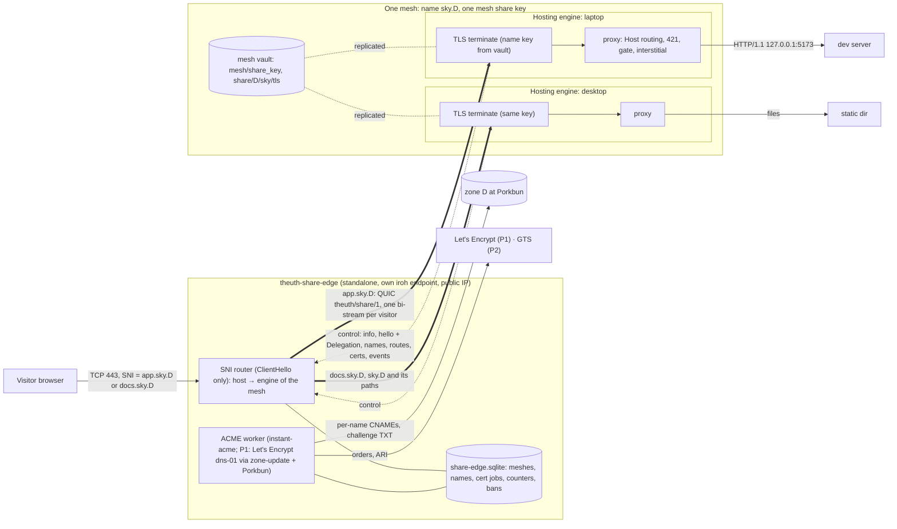
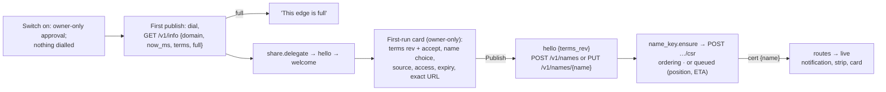

# 210 — Public web sharing (share edge)

Status: design, rev 8, 2026-11-23 · history in 210-public-share-appendix.md

Extends 31 (link relay and its client, the model for the edge's split; threat model), 67 (mesh, ALPNs), 184 (document
share links), 191 (contacts, cross-mesh admission), 205 (`show_web`, which names localhost tunnelling as a non-goal
at `docs/design/205-web-view-tile.md#L24-L25`; this doc is that goal). Nothing here is built. Background material
(building-block audit, zone-update source notes, PSL, `.zip`, deploy detail, alternatives, review dispositions) is in
`docs/design/210-public-share-appendix.md`; sections moved there keep their numbers (§4.6, §6.6, §6.8, §8.4, §11,
§14), so a reference such as "§11.9" means that section of the appendix.

Vocabulary. **Hosting engine**: the theuth engine on whose machine the shared thing runs; it terminates TLS with its
mesh's name key. **Mesh**: one owner's family of paired engines (doc 67), which the edge knows as one identity, the
public half of the mesh share key (§5.7). **Edge**: the standalone service `theuth-share-edge` (`crates/share-edge`),
reachable on TCP 443 at a public IP, that routes visitors to hosting engines by SNI and never decrypts; theuth
contains only its client. **Operator**: whoever runs an edge and owns its domain `D`, a value in the edge's config
(`domain`); the worked example is `tun.zip`, the owner's public edge. **Name**: the one DNS label under `D` that a
mesh holds (`sky.tun.zip` reserved, `k3f7q2.tun.zip` random), bound to the mesh share key, with one wildcard
certificate `{<name>.D, *.<name>.D}` whose key every family machine holds. **Share**: one published source at one
public URL, `https://<label>.<name>.D/` or `https://<name>.D/<path>/`. **Visitor**: anyone who opens that URL.
**Path Z**: Let's Encrypt over `dns-01` with records written through zone-update's Porkbun provider, the only
validation path in P1. **Path P**: Google Trust Services over `dns-persist-01`, designed here, enabled in P2.

## 1. Context and problem

The owner's request (2026-11-22): share web pages publicly as a theuth user, hosted on any node of the mesh; reserve
a subdomain; several apps on paths or sub-labels; automatic Let's Encrypt certificates; a clear "you are on the
public internet" interface with an easy stop; "basically a mini ngrok", in the spirit of anomalyco's opentunnel.

Binding owner decisions this design is written to (dates and wording in the appendix's revision history): automatic
certificates and admission for anyone who has theuth, no accounts; the domain is the edge's variable, never
compiled into the client; the edge is blind (D1) and a standalone service (D2); one name per mesh with one wildcard
certificate per name (D5, D7, D21); Let's Encrypt over Path Z is the P1 primary and only active path, Path P at GTS
is designed behind the same traits and enabled in P2 (D6, D7, §6.0); the public edge launches `open` with `invite`
as the brake (D19, §9.5); approval is owner-only (D10); Porkbun hosts `tun.zip`'s DNS on the owner's current
account with a scoped key (§6.4); a lost rekey race is the operator's judgement (D20, §5.7); the lease holder dials
the edge for removal duties even with its own sharing switch off, with a disclosure (D22).

What exists today:

- **Nothing is served over HTTP to anyone but the user.** OpenUI apps call engine tools through `app_call_tool`
  (`crates/app/src/rpc_artifacts.rs#L31-L32`); `show_web` (`crates/artifact/src/webview.rs#L64-L68`) only opens a URL
  in a tile. The one local listener is the token-gated JSON-RPC server
  (`crates/rpc-compose/src/bootstrap.rs#L115-L127`), whose token is the whole engine.
- **The link relay is an end-to-end encrypted dumb pipe**: `theuth-relay` maps `/h/{id}` to one harness socket
  (`crates/relay/src/main.rs#L116-L119`), keeps no state (31 decision 1, `docs/design/31-link.md#L19-L26`) and "can
  see that they are connected, not what they say" (`docs/design/31-link.md#L453-L460`).
- **The relay is a separate binary with its own client in the engine**: `crates/relay` builds `theuth-relay`
  (`crates/relay/Cargo.toml#L8-L10`) with `platform` as its only workspace crate (`crates/relay/Cargo.toml#L14`),
  deployed from `deploy/relay/` by `just relay-docker-push` (`justfile#L359`); the engine side is `crates/link`
  (`crates/link/src/uplink.rs#L137-L158`), pointed by `link.relay` (`crates/link/src/types.rs#L32`). The share edge
  copies this split (D2).
- **The mesh already carries authenticated QUIC streams to other meshes**: `theuth/a2a/1`
  (`crates/mesh/src/net.rs#L45`) behind `A2aGate` (`net.rs#L2038-L2074`); HTTP over one iroh stream is an existing
  pattern (`serve_http`, `crates/a2a/src/contacts/reach.rs#L222-L249`).
- **There is no role advertisement**, only `EngineStats` (`crates/mesh/src/types.rs#L192-L234`); engines learn of an
  edge only from a ticket (§5.5).

opentunnel ([README](https://raw.githubusercontent.com/anomalyco/opentunnel/dev/README.md), MIT, v0.6.2) is "a blind
TLS tunnel": the server reads only the ClientHello and routes on SNI; the client holds the key and terminates TLS;
one wildcard certificate per tunnel through DNS-01 from a client CSR. This design takes that shape and replaces its
WebSocket bridge, bearer tokens and MySQL with iroh QUIC, mesh-delegated engine keys, the mesh vault and sqlite.

## 2. Goals, and what is not one

- G1. A user publishes a local dev server (a `localhost` port) or a static directory at a public `https://` URL with
  one tool call or one Settings action, through an edge.
- G2. The edge never sees plaintext: doc 31's "relay sees only ciphertext" holds for shared content (§9.1).
- G3. Publishing is always an act of the owner in person that names the exact URL, source, expiry and access mode;
  no policy switch, double, app press, other chat user or agent-driven click can grant it. The one residual, an
  agent holding the RPC token through an unapproved shell, is stated in §7.2.
- G4. While anything is public the user cannot miss it, on every client, and one press stops everything.
- G5. Each mesh holds one name `<name>.D`, reserved (first claim wins) or random; the shares of all its machines live
  under it; quotas, a release cooldown and inactivity expiry (D5, D21).
- G6. Several apps per mesh under that name, from any machine, on one-level sub-labels or `dir` path mounts; a new
  sub-label goes live at once under the existing wildcard certificate.
- G7. The operator configures ACME once; certificates for every tenant appear and renew without the operator.
- G8. Anyone who has theuth can publish with no account and no configuration through the shipped default edge; any
  operator can run another (D15, D16).
- Not goals (v1): live OpenUI apps (§5.6); TCP/UDP tunnels other than HTTPS; HTTP/3 to visitors; content scanning;
  edge-side request logs or interstitials (§11.1); edge HA; accounts, billing, OAuth gates.

## 3. Decisions

| # | Decision |
|---|---|
| D1 | **Blind SNI edge.** The edge reads the ClientHello's SNI and copies bytes; the hosting engine terminates TLS with its mesh's name key, which the edge never holds (§4.2, §11.1). |
| D2 | **The edge is a standalone service, `theuth-share-edge`; theuth has only a client**, as `theuth-relay` and `crates/link` (§4.3). No theuth runtime, vault or mesh on the public box (§9.1); its own image, version and deploy (§8.4). |
| D3 | **Transport is iroh QUIC on ALPN `theuth/share/1`**: control requests as HTTP/1.1, one per bi-stream the engine opens, and one bi-stream per visitor TCP connection carrying raw TLS (§5.3). WebSocket carrier is P3 (§4.4). |
| D4 | **Authentication is the engine key under a mesh delegation** presented in `hello` (§5.7); no accounts. Admission `open` · `invite` · `closed`, limits per mesh, engine and client network (§9.4). |
| D5 | **One name per mesh, every share under it**: reserved `[a-z0-9-]{3,32}` or random 6×`[a-z2-7]`, allocated lazily at the first publish or reserve (§5.2). Shares are `<label>.<name>.D` (one label) or `<name>.D/<path>`; release and expiry start a cooldown (§5.2, §9.2). |
| D6 | **Certificate capacity in P1 is Let's Encrypt's**: 45 new names per 7 days under `D`'s registered-domain limit, ARI renewals exempt, half held for invited meshes, a visible slot queue and a limit-adjustment request (§6.5). It does not depend on a PSL listing (§6.6). |
| D7 | **One wildcard certificate per name; ACME on the edge, keys in the mesh.** The lease holder creates the name key and CSR in the mesh vault (§6.2); the edge orders behind a `Ca` trait over Path Z in P1, with Path P a configuration change in P2 (§6.0). |
| D8 | **No edge secret in any theuth vault; name keys and the mesh share key are mesh-vault rows** (§8.3). The edge reads the Porkbun key (and in P2 the GTS EAB) from env or a file. |
| D9 | **Sources in P1: `port` (loopback) and `dir`**, never theuth's own listeners, checked on every upstream connect; `dir` serves the canonical path opened without following links (§5.6). `artifact` is P2. |
| D10 | **`share_publish` is `Risk::Destructive` and human-only, which means owner-only**, on every channel and Settings action (§7.2). Residual: an unapproved shell can resolve the row over RPC; closed in P2 by presence-bound resolution. |
| D11 | **Master switch "Allow public sharing", default off, per machine**, in the plugin's own `share.sqlite`, never `config.yaml` or env (§8.1). Default expiry 8 h; interstitial on. |
| D12 | **One store, many indicators** on every machine of the mesh, with one-press Stop and mesh-wide Stop all (§7.4). |
| D13 | **Abuse limits from opentunnel**, counted per mesh, engine and network, plus global budgets, bans, a live admission switch, an abuse URL and versioned terms (§9.4). |
| D14 | **Three crates**: `share-edge` (binary), `share-proto` (wire contract), `share` (client plugin); `share-edge` never depends on `runtime`, `mesh`, `secrets`, `replica` or a plugin (§4.3, §10). |
| D15 | **The owner's edge is a shipped default with two pinned keys** (live and cold standby); a pasted ticket overrides it (§5.5). Nothing dials it on a fresh install. |
| D16 | **The domain is the edge's configuration**, sent in `GET /v1/info` and `welcome`; edge rows are keyed `(domain, name)` (§5.3). |
| D17 | **Every P1 name has its own two DNS records** `<name>.D` and `*.<name>.D` (CNAME → `edge.D`), written before its first order and deleted on release, because the challenge TXT would otherwise blank a wildcard-only name (§6.4). Porkbun's 2,500 records per zone caps P1 at 1,200 names. |
| D18 | **The engine dials the edge from its mesh endpoint** with `Net::dial_alpn` and a per-connection transport config, without `join_network`, so nothing is published (§5.3, §11.14). |
| D19 | **Bounded admission, launched open**: lazy allocation, a names cap counted at slot time, paced global buckets, invite share, byte budgets and an egress throttle; `invite` is the live brake (§9.4, §9.5). |
| D20 | **Names survive a new machine without a handover**; transfer is only to another mesh (§5.2). A lost mesh key or a lost rekey race is the operator's judgement, without a recovery code (§5.7, §11.16). |
| D21 | **Names belong to the mesh**: the edge binds a name to the mesh share key; each engine attaches with its own key and a 24 h delegation from the lease holder; removal rekeys the mesh at every registered edge (§5.7). Sub-labels route to the engine that registered them, others get `421` (§5.4). |
| D22 | **The lease holder performs removal duties even with its own switch off**, at every edge in the replicated `share_edges` table, only on removal events (§5.7). Settings › Sharing discloses it on every machine. |

## 4. Architecture

### 4.1 Picture



The hosting engine dials out, so it works behind NAT, and over the iroh relay (`mesh.relay`,
`crates/mesh/src/config.rs#L62`) when UDP is blocked. Edge host: public IPv4 (and IPv6), inbound TCP 443 and the
edge's iroh UDP port, outbound HTTPS to its iroh relay, the ACME directories and Porkbun's API. **No TCP 80**: DNS
validation needs no inbound port, and `.zip` is on the HSTS preload list (§6.8).

### 4.2 A visitor connection, step by step

1. The visitor resolves `app.<name>.D` → `*.<name>.D` CNAME → `edge.D` (§6.4) → edge IP; opens TCP 443.
2. Edge accept loop: per-IP rate limit (`governor`, IPv4 or IPv6 /64), global, per-IP and per-tunnel connection caps
   (§9.4). It reads up to 16 KiB within 5 s into `rustls::server::Acceptor` until `Accepted::client_hello()` yields
   SNI and ALPN (a post-quantum key share spans several segments, so the reader loops). No SNI, unknown host, a host
   more than one label below a name, a banned name, no live tunnel, or ALPN offering `acme-tls/1` (§6.7) → TCP
   reset. The edge never presents a certificate on 443.
3. Lookup `host → route → tunnel` (§5.4). At 256 visitor streams on the tunnel the visitor is reset; otherwise the
   edge opens a bi-stream (`open_bi` within 5 s), writes the PROXY v2 preamble (§5.3), the buffered ClientHello,
   then copies both ways through the metered, shaped copy of §9.6. Idle reset after 15 min; a visitor that stops
   reading for 5 s is reset.
4. The hosting engine reads the preamble, runs `tokio_rustls::TlsAcceptor` with the name's `CertifiedKey` (ALPN
   `h2`, `http/1.1`) and serves with `hyper_util::server::conn::auto::Builder`.
5. The proxy routes by `Host`/`:authority` and longest path prefix to one of this engine's shares. **A host this
   engine does not route gets `421 Misdirected Request`** (RFC 9110 §15.5.20; the coalescing case of §5.4). Then
   the share's gate, interstitial and limits; bodies stream; `Upgrade: websocket` is forwarded with
   `hyper::upgrade::on` and `copy_bidirectional` over HTTP/1.1 to the upstream.

### 4.3 Where the edge runs

The edge is the binary `theuth-share-edge` from `crates/share-edge`: its own process, config file, data dir and iroh
endpoint; theuth contains only the client (`crates/share`), as `crates/link` is `theuth-relay`'s client. It needs a
public IP with TCP 443 and a UDP port, a persistent iroh key, a sqlite file, the Porkbun credential and an operator
interface, and nothing from theuth. It is not `theuth-relay` itself: the relay is deliberately stateless and has no
iroh endpoint (§11.3); the engine-role variant is §11.12. `cargo tree -p share-edge` must list no `runtime`, `mesh`,
`secrets`, `replica` or plugin crate.

### 4.4 Transport: iroh first, WebSocket later

iroh gives key-addressed dialing, hole punching, an HTTPS relay fallback and per-stream flow control; theuth already
depends on it (`iroh` 1.2 in the workspace, 1.4.1 in `Cargo.lock`, QUIC stack n0's `noq`). yamux over WebSocket is
right for a greenfield tunnel, not here (§11.5). For networks that block the iroh relay or force an HTTP CONNECT
proxy, P3 adds a WebSocket carrier (`wss://<edge>/share/1`, yamux, a Noise `NK`-style proof of the endpoint key)
with the same semantics. Whether iroh honours `HTTPS_PROXY` is not verified [INFERENCE; check before P3].

### 4.5 The hosting engines, in the mesh

The name is the mesh's (D21); a share belongs to the engine whose loopback the source lives on. Each engine keeps
its own tunnel, attached with its own key and a delegation (§5.7). Any UI of the family sees every share through the
replicated `shares` table and stops one by forwarding `share.stop` to its engine with `rpc_forward::to_engine` over
`theuth/rpc/1` (`crates/agent/src/rpc_forward.rs#L411-L436`); Stop all goes once to the edge (§7.4). A sleeping
engine's tunnel drops; the edge resets its visitors and frees its routes; other machines show its shares
**offline**.

### 4.6 Building blocks

Moved to the appendix (§4.6): every crate, version, licence and what theuth writes itself, plus rejected candidates.
Dependencies the builder adds: `instant-acme` 0.8.5, `zone-update` =0.12.3 (`async`, `porkbun`), `rcgen` 0.14.10,
`x509-parser` 0.18.1, `ppp` 2.3.0, `governor` 0.10.4, `iroh-tickets` 1.0.0; the rest is in the tree.

## 5. Protocol and data model

### 5.1 Share record (hosting engine, `share.sqlite`, replicated)

Attached with `replica::attach(pool, TABLES)` as the vault is (`crates/secrets/src/lib.rs#L900`); a replicated table
needs a single-column primary key and an `hlc TEXT` column, and table names are global (`crates/replica/src/lib.rs#L104-L108`).
Counters are not in the row; they travel as events. DDL: §5.8.

| field | notes |
|---|---|
| `id` | UUIDv7; tool and RPC argument |
| `engine` | the hosting engine; only it serves and mutates the row; UIs show it as the machine |
| `edge`, `domain` | which edge, and its domain |
| `host` | `<name>.D` or `<label>.<name>.D` under a held name; at most one live row per host across the mesh (§5.4) |
| `path` | `/` or `/app1` (`[a-z0-9-/]`, ≤ 64, no trailing slash) |
| `url` | `https://{host}{path}/` exactly as the approval card showed it |
| `source` | `{"port":5173}` · `{"dir":"/abs/path"}` |
| `access` | `public` · `password`; the hash is in the local `share_secrets` table, never the row |
| `interstitial` | default true |
| `created_ms`, `live_ms`, `expires_ms` | expiry counts from `live_ms`; null only for a reserved-name share started from Settings |
| `created_by` | `{session, call_id}` or `"settings"` |
| `approved_by` | `{approval_id, surface}`: always the owner through the approval row (§7.2) |
| `state` | `pending` (no certificate yet, §7.6) · `live` · `offline` · `stopped` with `stopped_ms`, `stopped_by` (`user`, `expiry`, `edge_ban`, `budget`, `switch_off`, `source_gone`) |

Stopped rows are kept 30 days for Settings history.

### 5.2 Names, meshes and holding rules (edge, `share-edge.sqlite`)

DDL in §5.8. A name row carries `(domain, name)`, `kind` (`random` · `reserved`), `owner` (the mesh id), its state
(`allocated` → `queued` → `slotted` → `valid`; or `released`, `banned`), the stored CSR and its SPKI hash, the
issuing CA, `not_after` and the ARI window, whether its two DNS records exist, `created_ms`, `last_attach_ms`,
`first_live_ms`, transfer and release fields, and the client network and ASN that created it.

- **Name rules** (in `share-proto`, so the client refuses a bad name before asking): reserved `[a-z0-9-]{3,32}`, no
  leading or trailing `-`, no `xn--`, not in `reserved_words` (built in: `www`, `api`, `admin`, `login`, `mail`,
  `abuse`, `status`, `support`, `secure`, `account`, `theuth`, `edge`, `ns1`, `ns2`; plus the operator's list) and
  not matching the operator's brand blocklist (§9.4); random: 6 characters `[a-z2-7]` drawn by the client.
- **Lazy allocation**, the one statement of it: a name exists only after an explicit `POST /v1/names` (random) or
  `PUT /v1/names/{name}` (reserved) that the client sends after the terms at a first publish or a reserve (§7.6).
  Turning sharing on, attaching or opening Settings costs no name, record or slot.
- **Holding:** a mesh holds at most one random name, only while it holds no reserved one, plus `reserved_per_mesh`
  (1 in P1) reserved names; per network limits in §9.4. An allocated name must post a CSR within 1 h or it is
  evicted; it counts against `names_max` only once it holds a certificate slot (§9.4). Each certificated name costs
  two DNS records (D17); shares and sub-labels cost nothing.
- **Primary:** the mesh's name new shares use, kept in the replicated `share_names` table: the newest reserved name,
  else the random one, changeable in Settings. Claiming the first reserved name makes it primary; the random name is
  released when its last share on any machine stops, and its still-queued job is dropped so the reserved name takes
  that queue position.
- **Claim and release:** first claim wins; a second claimant gets `name_taken`, or `cooldown` while
  `reclaim_after_ms = max(released_ms + 30 days, cert_not_after)` is in the future. Release (the client first stops
  the name's shares on every machine) or inactivity expiry (random 30 days, reserved 90 days without an attach by any
  engine of the mesh, warned 14 and 3 days ahead) deletes the records, revokes the certificate (§6.3) and drops the
  routes. Until `reclaim_after_ms` only the previous owner mesh may claim it again, and a random name is not
  re-allocated.
- **Transfer to another mesh (D20):** `POST /v1/names/{name}/transfer {to_mesh}` from a delegated engine of the
  holding mesh sets `transfer_to` for 7 days; when `to_mesh` claims the name it gets it with no cooldown, the old
  certificate is revoked (`cessationOfOperation`) and the new mesh orders with its own key. The same identifier set
  makes that order a renewal for Let's Encrypt's limits (§6.3): no new-name slot. The offline signed `Handover` is P2.
- **Presence and expiry warnings:** the client attaches only while needed (a share live or pending, a name or
  certificate operation, Settings › Sharing open, or a removal duty, D22), so switching sharing on is no continuous
  presence log. The client tracks `last_attach_ms` and the expiry windows from `welcome.limits`, and warns 14 and
  3 days before a held name expires ("Keep sky.tun.zip"); Keep attaches once.

The claim needs no signature beyond the delegation: the edge accepts it only on a connection whose QUIC handshake
proved the engine key and whose current `hello` carried a valid delegation of the mesh (§5.7).

### 5.3 Protocol on `theuth/share/1`

**Glue.** `share_proto::ALPN = "theuth/share/1"`, not a mesh ALPN (not in `crates/replica/src/lib.rs#L41-L59`, not
in `STREAM_ALPNS`, `crates/mesh/src/net.rs#L506-L515`). **Edge:** a plain `iroh::protocol::Router` on its own
`Endpoint` (`iroh.key`, `alpns = [ALPN]`) with one `ProtocolHandler` that runs admission and owns the admitted
`Connection`. **Engine:** dials only, through a generic
`Net::dial_alpn(addr: EndpointAddr, alpn: &[u8], transport: QuicTransportConfig) -> Connection` in `crates/mesh`,
modelled on `Net::a2a_stream` (`net.rs#L851-L905`), with no `share-proto` dependency. It calls
`Endpoint::connect_with_opts` with `ConnectOptions::new().with_transport_config(transport)` (iroh 1.4.1
`src/endpoint.rs` L1146–L1149) under `CONNECT_TIMEOUT`, and does **not** call `join_network`
(`net.rs#L755-L784`), whose effects are one-way and which publishes to pkarr, n0 DNS and mDNS with discovery on;
it inserts only the relay URLs it needs (the ticket's and `mesh.relay`) and dials the ticket's addresses. Disclosed
in Settings › Sharing: while sharing, the engine holds a connection to its iroh relay [INFERENCE: iroh dials a
remote's relay URL without a home relay of its own; P0-3]. Both sides use `Connection` directly
(`Transport::open/accept`, `crates/replica/src/types.rs#L123-L142`, cannot open streams on a connection the other
side dialed); `share` depends on `iroh` as `a2a` does (`crates/a2a/Cargo.toml#L23`).

**Control plane: HTTP/1.1, one request per bi-stream the engine opens**, served by an axum `Router` through
`hyper::server::conn::http1::Builder::serve_connection` as a2a's `serve_http` does; the remote endpoint id rides in a
request extension. JSON bodies ≤ 64 KiB, errors `4xx {code, …}`. Only `GET /v1/info` is answered before `hello`;
everything else needs a valid delegation on the current connection (§5.7). Pre-`hello` connections are capped and
time out (§9.4).

| request | body | answer |
|---|---|---|
| `GET /v1/info` (before `hello`) | none | `200 {v, edge:"theuth-share-edge/<ver>", domain, edge_id, now_ms, min_client, admission, terms_url, terms_rev, abuse_url, full}` |
| `POST /v1/hello` (repeated with each renewed delegation) | `{v:1, delegation: {body, sig}, invite?, client:"theuth/<ver>", terms_rev?}` | `200` welcome `{v, now_ms, min_client, mesh, names: [{name, kind, state, ca, spki, not_after, queue?}], routes: [{host, engine}], revoked: [engine], stop_all_ms, domain, limits, terms_url, abuse_url, terms_rev, terms_ok, full}` · `403 {code: banned \| network_quota \| admission_closed \| invite_required \| bad_delegation \| revoked \| engines_quota}` · `403 {code: delegation_not_yet_valid \| delegation_expired, now_ms}` · `409 {code: mesh_rekeyed, to}` · `426 {code: client_too_old}` |
| `GET /v1/names/{name}` | none | `200 {available, reason?}` (rate-limited per network) |
| `POST /v1/names` | `{name}` (a client-drawn random candidate) | `201 {name}` · `409 {code: name_taken}` · `403 {code: terms_required \| quota \| network_quota \| banned}` · `429 {code: paced, retry_after_s}` · `503 {code: edge_full}` |
| `PUT /v1/names/{name}` · `DELETE /v1/names/{name}` | claim: none (`{handover}` in P2) | `200 {name}` · `200 {name, reclaim_after_ms}` · `409 {code: name_taken \| cooldown}` · `403 {code: terms_required \| quota \| banned}` · `400 {code: invalid, reason}` · `429 {code: paced}` · `503 {code: edge_full}` |
| `POST /v1/names/{name}/transfer` | `{to_mesh}` | `200 {transfer_until_ms}` · `403 {code: not_owner}` |
| `PUT /v1/routes` | `{hosts: [..]}`, this engine's full set | `204` · `409 {code: route_conflict, conflicts: [{host, engine}]}` with nothing applied; each host `<name>.D` or `<label>.<name>.D` of a held name (§5.4) |
| `POST /v1/names/{name}/csr` | CSR DER; `?rotate=true` for a rotation (§6.3) | `200 {chain_pem, not_after}` · `202 {eta_s, queue_pos?}` (also the answer for the CSR of a running job) · `409 {code: csr_mismatch, spki}` (a different CSR without `rotate`, §6.2) · `403 {code: csr_names \| quota \| network_quota \| banned \| terms_required}` |
| `GET /v1/names/{name}/cert` | none | `200 {chain_pem, not_after}` · `404` |
| `GET /v1/events` | none | SSE held for the connection: `queue {name, position, eta_s}`, `cert {name}`, `routes {host, engine?}`, `stats {host, conns, bytes}` every 30 s, `drain {secs}`, `kill {host?, reason}` with `reason` ∈ `edge_ban`, `budget`, `stop_all`, `revoked`, `mesh_rekeyed`, `delegation_expired` |
| `GET /v1/mesh` | none | `200 {mesh, engines: [{engine, attached, last_ms, revoked_ms?}], routes, stop_all_ms}` |
| `POST /v1/mesh/stop` | none | `200 {stop_all_ms}`: closes every tunnel of the mesh with `kill {reason: stop_all}`; never refused to a delegated engine |
| `POST /v1/mesh/revoke` | `{engines: [..]}` | `200 {revoked}`: appends to the mesh's revoke list and closes those engines' tunnels (§5.7) |
| `POST /v1/mesh/rekey` | `{body, sig_old, sig_new}`, a signed `Rekey` | `200 {mesh}` · `409 {code: mesh_rekeyed, to}` · `403 {code: bad_signature}` |

Liveness is QUIC keep-alive and `Connection::closed()`.

**Versioning.** Within a major, changes are additive only (new optional fields with `#[serde(default)]`, unknown
fields ignored; new endpoints, events and error codes). Renaming, removing or changing the meaning of a field,
status, event or the visitor preamble is a new major (`theuth/share/2`, `/v2/`). An edge serves the current and
previous major for 6 months (two ALPNs on one `Router`); a client offers both through
`ConnectOptions::additional_alpns` (iroh 1.4.1 `src/endpoint.rs` L1798–L1801). A client older than `min_client`
gets `426` and shows "Update theuth to share through this edge". `share-proto` carries golden JSON fixtures of every
request and answer, tested in both `share-edge` and `share`.

**Visitor stream** (edge opens): a PROXY v2 header built with `ppp` (visitor address and port, SNI in
`PP2_TYPE_AUTHORITY`, the edge's connection id in custom TLV `0xE0`), then raw TLS both ways. Stream FIN = TCP FIN,
reset = RST.

**Stream limits.** QUIC's `max_concurrent_bidi_streams` limits streams the *peer* opens, and the edge opens visitor
streams, so `dial_alpn` passes a config with `max_concurrent_bidi_streams(256)` and windows sized for 256 streams;
the mesh endpoint's config (`crates/mesh/src/net.rs#L546-L554`) is untouched. The edge enforces the same 256 with
its own counter and gives `open_bi` 5 s. One tunnel connection per engine key: a new one replaces the old after
`hello`. Closing a connection removes that engine's routes; other engines' routes stay.

### 5.4 Routing tables

- **Edge:** `DashMap<host, Route { name, mesh, engine, conn }>` filled from each engine's `routes`, cleared per
  engine on disconnect; exact match only; a host must be `<name>.D` or `<label>.<name>.D` (`[a-z0-9-]{1,63}`) of a
  name the engine's mesh holds.
- **Several engines under one name:** each sub-label routes to the engine that registered it. The bare name and all
  its path mounts belong to the engine holding the bare-name route, because a blind edge never sees the path; a path
  mount for a `dir` on another machine is refused, naming that machine, and the card offers a sub-label. First route
  wins; a second engine gets `route_conflict`, and the UI names the holder ("served by Studio"); a freed host is
  announced with a `routes` event. The replicated `shares` table lets clients refuse a held label before asking.
- **HTTP/2 coalescing and `421`, the one statement of it:** browsers reuse an h2 connection for any host its
  certificate covers that resolves to the same IP (RFC 9113 §9.1.1), so a request for `docs.sky.D` can arrive on a
  connection to the laptop that serves `app.sky.D`. Every hosting engine answers `421 Misdirected Request` for any
  `Host`/`:authority` it does not route, and the browser retries on a new connection whose SNI the edge routes
  correctly. h2 is kept: HTTP/1.1-only costs up to six streams per visitor and host against the 256 cap. If P0-5
  shows a browser that does not retry, an engine offers only `http/1.1` in ALPN for SNIs of a name whose routes span
  more than one engine.
- **Hosting engine:** `ArcSwap<HashMap<host, Vec<(path_prefix, ShareId)>>>` of this engine's shares; longest prefix
  wins; `/app1` matches `/app1` and `/app1/…`, not `/app10`; a host without an entry gets `421`, a host without a `/`
  share a plain 404.

### 5.5 Finding an edge

Engines learn of an edge only from `share.edge`, a value in the plugin's store (D11), never advertised over the mesh:

- **`default`** (shipped, D15): the tickets of the owner's public edge, live key and cold standby, compiled into
  `crates/share`'s config type as `link.relay`'s default is (`crates/link/src/types.rs#L32`). Settings shows it as
  "<domain> (theuth default edge)" with the domain and operator from `GET /v1/info`.
- **A pasted ticket**: `ShareEdgeTicket { addr: EndpointAddr, invite: Option<[u8; 16]> }` in `share-proto`,
  implementing `iroh_tickets::Ticket` with `KIND = "theuthedge"` (prefix plus lowercase base32 of postcard bytes,
  as `EndpointTicket`). The invite is a 128-bit secret the edge stores hashed with a use count and expiry; under
  `admission: invite` it is required in the first `hello` of a mesh. `theuth-share-edge ticket` prints it.
- **`none`**: publishing is refused with "No sharing edge configured".

The ticket pins the edge's endpoint key, so the default adds no trust root beyond the release; a DNS discovery
record would compile a domain into the client (D16). The default ticket carries the edge's relay URL and public UDP
addresses (`iroh.public_addrs`), so the client dials without `join_network` and without pkarr [INFERENCE: a changed
edge IP is still reached through the relay URL; P0-3]. The default edge is dialed only for the needs listed in §5.2;
a fresh install never contacts it.

**Key loss and rotation.** The edge's `iroh.key` lives in a persisted, backed-up data dir. The shipped default pins
two keys; the client dials the standby when the live key is unreachable for 10 minutes and the standby answers. An
edge on the standby key sends `retire {key}` in `welcome`, signed by the standby key, after which clients never dial
the old key. Losing both keys needs a theuth release. A signed rotation record is proposed for P2 (§12 Q18).

### 5.6 Sources and the proxy

| source | serves | refused |
|---|---|---|
| `port` | `http://127.0.0.1:<port>` or `[::1]` | non-loopback hosts; ports in the own-listener registry; a listener owned by theuth or a descendant; a port not listening; all re-checked on **every upstream connect** |
| `dir` | files under an absolute directory | `data_dir` and its ancestors, `$HOME` itself, any path with a dot-segment component (dotfiles 404) |

- **`dir` containment without a race (F-m8).** Per request the proxy canonicalises the path, checks it is under the
  canonical root and outside the refused set, and then opens **the canonical path**, not the requested one, with
  no symlink following on any component where the OS offers it (Linux `openat2` with `RESOLVE_NO_SYMLINKS`, macOS
  `O_NOFOLLOW_ANY`), else `O_NOFOLLOW` plus an `fstat` check that the opened file's device and inode equal the
  canonical path's. The body streams from that file descriptor; `tower-http`'s `ServeDir` is not used for `dir`
  (it reopens by path). P1 serves full bodies with `ETag` from size and mtime; `Range` is P2. A link to `~/.aws`
  inside the tree 404s; a link swapped in between check and open fails the open.
- **Own-listener registry and process check.** A `runtime` set that `rpc-compose::bootstrap::serve` and every plugin
  binding a TCP listener write their port into; because it misses listeners of processes theuth starts (a headless
  browser's debug port, MCP servers, sandbox VNC), the proxy also resolves the listening socket's owning PID (a
  socket-table crate such as `listeners` or `netstat2`, chosen in M1; `procfs` is in the tree for Linux) and refuses
  theuth's PID or a descendant ("that port is theuth itself").
- **Headers.** Incoming `Forwarded`/`X-Forwarded-*`/`X-Real-IP` are stripped; the proxy sets `X-Forwarded-For`,
  `-Proto: https`, `-Host`, `-Prefix`. `Host` is rewritten to `localhost:<port>` (Vite's `allowedHosts`); a
  `Location` or `Content-Location` whose origin is the upstream becomes the public URL with the mount prefixed.
- **Loopback warning** on the card for `port` sources: the upstream sees a loopback peer.
- **Path mounts** strip the prefix, which breaks apps with absolute asset URLs, so `port` sources are always a
  sub-label in P1; path mounts are for `dir` only.
- **Live OpenUI apps are excluded**: a visitor's press would be the owner's consent
  (`crates/tools/src/registry.rs#L288-L300`). A frozen tool-less publish is P3.

### 5.7 Mesh identity, delegation, removal and rekey (D21, D22)

**The mesh share key.** The mesh already shares the vault, sealed under a mesh data key every paired engine holds
(`crates/secrets/src/vault.rs#L1-L11`), and in it `mesh/device_key`, an X25519 key registered as the hub's second
relay uplink (`crates/secrets/src/vault.rs#L453-L457`, `crates/link/src/mesh_uplink.rs#L1-L14`). Neither can own a
name (symmetric; cannot sign; reusing the device id would let edge and relay operators join logs). So the mesh gets
**`mesh/share_key`**: a 32-byte Ed25519 secret (`iroh_base::SecretKey`), base64url, whose public half is the **mesh
id**. `writable_name` already accepts `mesh/<name>` (`crates/secrets/src/vault.rs#L258-L268`). It is minted only by
the synced lease holder, the predicate of `crates/link/src/rpc_support.rs#L9-L23`, with
`set_if_version(…, expected: None)` (`crates/secrets/src/vault.rs#L704-L718`), as `mesh_device_key` does
(`crates/secrets/src/vault.rs#L458-L481`). The lease predicate, not the compare-and-set, is what keeps two engines
from minting: `set_if_version` is a local check, and two engines writing one name in one sync gap mint the same
`(name, version)` id, after which per-column LWW keeps one ciphertext (`crates/secrets/src/vault.rs#L894-L896`). The
dual-holder window remains (`crates/mesh/src/lease.rs#L449-L454`), so the holder writes, waits for the row to
settle and re-reads before using it (the settle rule below). An engine without a family is its own holder.

**Delegation** (`share-proto`):

```rust
pub struct Delegation {
    pub v: u8,             // 1
    pub domain: String,    // D, from GET /v1/info
    pub edge: PublicKey,   // the edge's endpoint id: good at this edge only
    pub mesh: PublicKey,   // the mesh id
    pub engine: PublicKey, // the engine's iroh endpoint id
    pub issued_ms: u64,    // min(holder's clock, edge now_ms carried in the request)
    pub expires_ms: u64,   // issued_ms + 24 h
}
pub struct Signed { pub body: Vec<u8> /* postcard */, pub sig: [u8; 64] }
// sig = Ed25519 by mesh/share_key over b"theuth/share/delegation/1\0" ‖ body
```

On the wire `body` and `sig` are base64url, so the edge verifies the exact signed bytes. `share-proto` uses
`iroh_base::SecretKey::sign`/`PublicKey::verify`, `postcard`, a base64 encoder (`data-encoding`, in the tree) and a
serde helper for `[u8; 64]` (`serde-big-array` or a hand-written visitor) — no theuth crate, so `share-edge` checks
it standalone. `Rekey` and `Handover` use the same `Signed` shape under their own tags. There is no serial: a
delegation is bound to one engine key, which must equal the QUIC peer, so replay buys nothing that `expires_ms` does
not already bound.

**The edge's check on `hello`:** signature verifies under `mesh`; `engine` equals the QUIC peer; `edge` and `domain`
are the edge's own; `issued_ms − 5 min ≤ now < expires_ms`, else `403 {code: delegation_not_yet_valid |
delegation_expired, now_ms}`; `expires_ms − issued_ms ≤ delegation_max_ttl` (25 h); the mesh is not banned or
rekeyed away; the engine is not revoked; fewer than `engines_per_mesh` engines attached. The connection is bound to
`(mesh, engine)` until expiry; a renewed delegation arrives in a repeated `hello`, and at expiry without one the
edge closes with `kill {reason: delegation_expired}`.

**Issuance and clocks (F-M1).** An engine first calls `GET /v1/info` (domain, edge id, `now_ms`), then asks the lease
holder `share.delegate {engine, edge, domain, edge_now_ms}` over `theuth/rpc/1` (`rpc_forward::to_peer`,
`crates/agent/src/rpc_forward.rs#L443-L474`). The holder signs only for a live peer, not tombstoned or quarantined
(`Store::peers`, `crates/mesh/src/store.rs#L161-L178`), and itself, with `issued_ms = min(own clock, edge_now_ms)`,
so a holder clock that runs ahead never yields a not-yet-valid delegation; a holder clock that runs behind shortens
the delegation by its lag. When `|holder clock − edge now_ms| > 5 min`, or the edge answers either clock code, the
client shows **"The clock on <machine> is off by N min: sharing may stop. Fix the system time."** in Settings and on
the card. Renewal at 12 h with jitter; at once after a rekey.

**Partitions (F-m2).** Election runs over this engine and its *connected* peers
(`crates/mesh/src/lib.rs#L658-L682`), and an engine with no connected peer elects itself (`lone_laptop_is_hub`,
`crates/mesh/src/lease.rs#L433`); `synced()` is set once per start (`crates/mesh/src/lib.rs#L125-L139`). So a machine
cut off from the hub becomes its own holder and signs its own delegations: there is no 12 h cliff for an honest
machine, and expiry is no barrier to a removed one. Holder-only issuance only stops an honest removed machine that
knows it was removed; the boundary against a dishonest one is the rekey.

**Registered edges (D22, F-M5).** Edge choice is per machine (§8.1), so the mesh records where it is known: the
replicated table `share_edges` holds one row per `(edge, domain)` at which an engine of the mesh received a
`welcome` (written by that engine, with the ticket), deleted when the mesh's last name there is released or the edge
answers an unknown mesh. Removal duties run on the lease holder **whatever its own "Allow public sharing" switch
says**, only when `share_edges` has a row, and only on removal events (a tombstone, a lease gain with a pending
rekey, a pending row's retry): never hourly, never otherwise. Settings › Sharing on every machine says so: *"When a
machine is removed from your mesh, the hub contacts <edge> to revoke it there, even if sharing is off on the hub."*

**Removal and rekey (F-M2, F-M3).** Every tombstone `Mesh::unpair` writes (`crates/mesh/src/lib.rs#L974-L989`) after
`mesh/share_key` exists triggers a rekey at every `share_edges` edge, whether or not that edge ever saw the removed
engine: a machine that never attached still holds the key. `GET /v1/mesh` only supplies the engine ids to revoke.
The holder runs this state machine; its row `share_rekeys` is replicated (a new holder resumes it) and its secrets
live in a local stash, `<data_dir>/share/rekey.stash`, a 0600 file written with `platform::files::write_private`
(`crates/platform/src/files.rs#L7-L10`):

| state | action | next |
|---|---|---|
| `revoking` | `POST /v1/mesh/revoke {engines: [removed]}` at each edge with the current key's delegation: closes the removed engine's tunnels now, before any vault work | `waiting_vault` |
| `waiting_vault` | wait until the vault's current key (`vault.current_key()`, `KeyInfo.members`, `crates/secrets/src/vault.rs#L119-L131`) excludes the removed engine. `Mesh::unpair` only warns when that rotation fails (`crates/mesh/src/lib.rs#L984-L987`); after 10 min Settings shows "Vault key rotation after removing <machine> has not finished: names are revoked at the edge but not yet rekeyed", and an attention item | `writing` |
| `writing` | put the current key `K` and a fresh `K'` in the stash (`old`, `pending`), then `set_if_version("mesh/share_key", K', Some(v))`. `Ok(None)` (another writer) → drop `K'` from the stash | `settling` |
| `settling` | wait until `synced()` and `rekey_settle_secs` (60 s, P0-6) have passed since the write, then re-read the row: its value `S` is the settled key, whoever wrote it | `sending` |
| `sending` | `POST /v1/mesh/rekey` with `Rekey {domain, edge, old: K.pub, new: S.pub, revoke, issued_ms}` signed by `K` and `S`, at each edge. `200` → `confirming`. `409 {to}` with `to = S.pub` → another holder did it → `confirming`. `409 {to}` with `to` = a public key in this engine's stash → chain `Rekey {old: to, new: S}` signed from the stash → `confirming`. Any other `to` → `contested` | |
| `confirming` | `GET /v1/mesh` until the edge's mesh id equals `S.pub`; then fresh delegations for live peers, name-key rotation (§6.3), stash entries deleted | `done` |
| `contested` | wait `rekey_heal_secs` (1 h) for whichever engine holds `to`'s secret to chain-heal; then the client shows "Your names were moved by another machine: contact <operator>" with the evidence of §5.7 below | operator |

Edge unreachable in any state: the row keeps its state with `next_at_ms` (backoff 1 min doubling to 1 h) and resumes
on lease gain and on reconnect. A crash between `writing` and `sending` resumes from the stash and the row. **Heal
rule:** any engine whose stash holds the secret of the edge's current mesh id while the vault's settled key differs
sends the chained `Rekey` itself, holder or not; only the engine that wrote a losing ciphertext can hold that
secret. The edge applies a `Rekey` atomically: every name, quota, invite and route of `old` moves to `new`; the
`revoke` list *replaces* the mesh's revoke list (so a revoke a thief sent under the old key does not survive);
`old` is marked `rekeyed_to = new` and every tunnel under `old` gets `kill {reason: mesh_rekeyed}`. A quarantined
engine is only not renewed, never a rekey trigger. A removed engine that still runs gets `revoked` or
`mesh_rekeyed`, drops its stale `mesh/share_key` and `share/*` rows and, if its owner turns sharing on again, starts
as a mesh of its own.

**Lost rekey race: operator judgement (F-M6, owner 2026-11-23).** A compromised machine holds the old key and can send
its own `Rekey` first; the edge keeps the first and the names belong to the thief's key. There is no cryptographic
tiebreak: thief and owner both held the old key, and no recovery code exists (§11.16). `admin recover <name|mesh>
--to-mesh <id>` is the operator's decision on what it can weigh: whether the claimant can sign a fresh challenge
with the key the edge held *before* the contested rekey (both sides can, so this only rules out strangers); the
order and timing of the two rekeys against the claimed theft and the unpair; which side's engines
were attached in the weeks before (`mesh_engines` history); what the contested names serve now (phishing → ban); and
out-of-band identity (the contact address on earlier abuse or support mail, the terms acceptance, a report to the
device vendor or police). A thief and an owner may be indistinguishable; the operator may then decline, and the
names expire into the normal cooldown. Mitigations, stated in Settings: unpair a lost machine promptly (the window
runs from compromise to unpair); the immediate `revoking` step closes the removed machine's tunnels within seconds;
the 24 h delegation lifetime bounds how long delegations signed before the removal remain usable.

### 5.8 Storage schemas

**Edge, `share-edge.sqlite`** (sqlx migrations; routes live in memory only):

```sql
CREATE TABLE meshes (mesh TEXT PRIMARY KEY /* mesh id */, created_ms INTEGER NOT NULL, net TEXT NOT NULL,
  asn INTEGER, invited INTEGER NOT NULL DEFAULT 0, rekeyed_to TEXT, rekeyed_ms INTEGER, stop_all_ms INTEGER,
  banned TEXT /* json {reason, ms, by} */);
CREATE TABLE mesh_engines (mesh TEXT NOT NULL REFERENCES meshes(mesh), engine TEXT NOT NULL,
  first_ms INTEGER NOT NULL, last_ms INTEGER NOT NULL, net TEXT NOT NULL, revoked_ms INTEGER,
  PRIMARY KEY (mesh, engine));
CREATE TABLE names (domain TEXT NOT NULL, name TEXT NOT NULL,
  kind  TEXT NOT NULL CHECK (kind IN ('random','reserved')),
  owner TEXT REFERENCES meshes(mesh),     -- NULL once released
  state TEXT NOT NULL CHECK (state IN ('allocated','queued','slotted','valid','released','banned')),
  created_ms INTEGER NOT NULL, last_attach_ms INTEGER, first_live_ms INTEGER,
  transfer_to TEXT, transfer_until_ms INTEGER, released_ms INTEGER, reclaim_after_ms INTEGER,
  csr BLOB, csr_spki BLOB,                -- sha256(SPKI): welcome.names[].spki, csr_mismatch
  ca TEXT, chain_pem TEXT, not_after_ms INTEGER, ari_start_ms INTEGER, ari_end_ms INTEGER,
  records INTEGER NOT NULL DEFAULT 0,     -- 1 once <name>.D and *.<name>.D exist
  net TEXT NOT NULL, asn INTEGER, banned TEXT, PRIMARY KEY (domain, name));
CREATE INDEX names_owner ON names(owner);
CREATE TABLE cert_jobs (id TEXT PRIMARY KEY /* uuid v7 */, domain TEXT NOT NULL, name TEXT NOT NULL,
  kind  TEXT NOT NULL CHECK (kind IN ('new','renew','rotate')),
  state TEXT NOT NULL CHECK (state IN ('queued','ordering','done','failed','dropped')),
  class TEXT NOT NULL CHECK (class IN ('invited','open')),
  mesh TEXT NOT NULL, net TEXT NOT NULL, first_of_mesh INTEGER NOT NULL, ca TEXT, order_url TEXT,
  enqueued_ms INTEGER NOT NULL, lease_until_ms INTEGER, attempts INTEGER NOT NULL DEFAULT 0,
  next_at_ms INTEGER NOT NULL, last_error TEXT);
CREATE INDEX cert_jobs_ready ON cert_jobs(state, class, next_at_ms);
CREATE TABLE buckets (name TEXT PRIMARY KEY /* le_invited, le_open, open_new_names, relayed_new_meshes */,
  tokens REAL NOT NULL, updated_ms INTEGER NOT NULL);
CREATE TABLE counters (scope TEXT NOT NULL, key TEXT NOT NULL,
  period TEXT NOT NULL CHECK (period IN ('day','week','month')), start_ms INTEGER NOT NULL,
  count INTEGER NOT NULL, PRIMARY KEY (scope, key, period, start_ms));   -- e.g. ('net_certs','198.51.100.0/24','week',…)
CREATE TABLE usage (day INTEGER NOT NULL, mesh TEXT NOT NULL, net TEXT NOT NULL, invited INTEGER NOT NULL,
  bytes INTEGER NOT NULL, PRIMARY KEY (day, mesh, net));
CREATE TABLE invites (hash BLOB PRIMARY KEY, uses_left INTEGER NOT NULL, expires_ms INTEGER NOT NULL,
  created_ms INTEGER NOT NULL, note TEXT);
CREATE TABLE bans (kind TEXT NOT NULL, value TEXT NOT NULL, reason TEXT NOT NULL, ms INTEGER NOT NULL,
  by TEXT NOT NULL, PRIMARY KEY (kind, value));
CREATE TABLE dns_records (host TEXT NOT NULL, type TEXT NOT NULL, value TEXT NOT NULL, name TEXT,
  provider_id TEXT, created_ms INTEGER NOT NULL, PRIMARY KEY (host, type, value));   -- reconciliation
CREATE TABLE conn_log (ms INTEGER NOT NULL, sni TEXT NOT NULL, visitor TEXT NOT NULL, mesh TEXT, engine TEXT,
  bytes_up INTEGER NOT NULL, bytes_down INTEGER NOT NULL);   -- deleted after 30 days (§12 Q17)
CREATE INDEX conn_log_ms ON conn_log(ms);
CREATE TABLE audit (ms INTEGER NOT NULL, cmd TEXT NOT NULL, args TEXT NOT NULL, ref TEXT);
```

Reconciliation (Path Z): at start and hourly the worker lists `_acme-challenge.*` TXTs and per-name CNAMEs in the
zone and deletes those that no running job or `records = 1` name explains; `dns_records` is what the edge believes
it wrote.

**Client, `share.sqlite`**: four replicated tables (`replica::attach(pool, &["shares", "share_names",
"share_edges", "share_rekeys"])`, each with a single-column key and `hlc`) and three local ones:

```sql
CREATE TABLE shares (id TEXT PRIMARY KEY, engine TEXT NOT NULL, edge TEXT NOT NULL, domain TEXT NOT NULL,
  host TEXT NOT NULL, path TEXT NOT NULL, url TEXT NOT NULL, source TEXT NOT NULL, access TEXT NOT NULL,
  interstitial INTEGER NOT NULL, created_ms INTEGER NOT NULL, live_ms INTEGER, expires_ms INTEGER,
  created_by TEXT NOT NULL, approved_by TEXT NOT NULL, state TEXT NOT NULL, stopped_ms INTEGER,
  stopped_by TEXT, hlc TEXT);
CREATE TABLE share_names (id TEXT PRIMARY KEY /* "<edge>/<domain>/<name>" */, edge TEXT NOT NULL,
  domain TEXT NOT NULL, name TEXT NOT NULL, kind TEXT NOT NULL, is_primary INTEGER NOT NULL DEFAULT 0,
  released_ms INTEGER, hlc TEXT);
CREATE TABLE share_edges (id TEXT PRIMARY KEY /* "<edge>/<domain>" */, edge TEXT NOT NULL, domain TEXT NOT NULL,
  ticket TEXT NOT NULL, registered_ms INTEGER NOT NULL, deleted_ms INTEGER, hlc TEXT);   -- D22
CREATE TABLE share_rekeys (id TEXT PRIMARY KEY /* uuid v7 */, removed TEXT NOT NULL /* json [engine] */,
  tombstone_ms INTEGER NOT NULL, from_pub TEXT, to_pub TEXT,
  state TEXT NOT NULL,   -- revoking | waiting_vault | writing | settling | sending | confirming | contested | done
  edges_done TEXT NOT NULL DEFAULT '[]', attempts INTEGER NOT NULL DEFAULT 0, next_at_ms INTEGER NOT NULL,
  updated_ms INTEGER NOT NULL, hlc TEXT);   -- §5.7; never a secret
-- local, never replicated
CREATE TABLE settings (key TEXT PRIMARY KEY, value TEXT NOT NULL);   -- enabled, edge, defaults
CREATE TABLE share_secrets (share TEXT PRIMARY KEY, password_phc TEXT NOT NULL);
CREATE TABLE edge_state (edge TEXT PRIMARY KEY, last_attach_ms INTEGER, terms_rev TEXT, clock_skew_ms INTEGER,
  live_key TEXT, retired_keys TEXT);
```

### 5.9 Client connection state machine

One per edge, in `crates/share`:

| state | entered when | does | leaves to |
|---|---|---|---|
| `idle` | nothing needs the edge (§5.2) | nothing; no connection | `dialing` on a need |
| `dialing` | a need | `Net::dial_alpn` to the live key (or the standby, §5.5); backoff 1 s doubling to 5 min with ±20% jitter | `info`; `idle` when the need ends |
| `info` | connected | `GET /v1/info`: `426` → `blocked(update)`; record domain and clock skew | `delegating` |
| `delegating` | info ok | `share.delegate` on the lease holder; failure → retry with backoff, Settings shows the reason | `hello` |
| `hello` | delegation | `POST /v1/hello`; clock codes → show "clock is off", retry after 5 min; `revoked` → `removed`; `mesh_rekeyed` → wait for the vault's new `mesh/share_key`, then `delegating`; `banned`, `admission_closed`, `invite_required` → `blocked(reason)` | `attached` |
| `attached` | welcome | open `/v1/events`; apply `stop_all_ms`; `PUT /v1/routes`; fetch missing chains; re-`hello` at 12 h | `draining`, `dialing` on loss, `delegating` on `delegation_expired` |
| `draining` | `drain {secs}` | keep serving; at the deadline close and dial again after 1–5 s jitter | `dialing` |
| `blocked(r)` | terminal answer | shows `r`; retried only on a user action or config change | `dialing` |
| `removed` | `revoked`/removed from the family | stops shares, deletes stale `mesh/share_key` and `share/*` rows | `idle` |

On connection loss the engine's shares turn `offline` after 10 s without a reconnect and back to `live` once routes
are re-sent; `kill {budget}` and `kill {edge_ban}` stop the named shares (`stopped_by`).

## 6. Certificates (ACME)

### 6.0 Validation paths: Z in P1, P in P2

**Path Z (P1, primary and only active path).** Let's Encrypt over `dns-01`. Per name the edge writes the two records
of D17 before the first order, then for each of the two authorizations of `{<name>.D, *.<name>.D}` writes the TXT at
`_acme-challenge.<name>.D`, waits for Porkbun's authoritative servers to answer it, readies the challenge, polls to
`valid`, deletes the TXT and waits 60 s before the second (§6.1). Renewal from ARI with the stored CSR. The P1
configuration is `acme.primary: letsencrypt`, `cas.gts.enabled: false`.

**Path P (P2).** Google Trust Services over `dns-persist-01` (draft-ietf-acme-dns-persist-01,
[announcement](https://developers.google.com/public-key-infrastructure/updates/september2026-dns-persist-01)): one
static `_validation-persist.D TXT "pki.goog; accounturi=<GTS account>; policy=wildcard"` authorises every name below
`D`, reused up to 8 days, so no DNS write per order and no per-name records (names under `*.D CNAME edge.D`). It is
enabled by setting `cas.gts.enabled: true` once the operator has a GTS EAB (§13), after the P2 entry checks:

1. GTS issues `{<name>.D, *.<name>.D}` from the one record at `_validation-persist.D`.
2. Reuse and revocation: whether GTS re-reads the record per order, so removing it stops issuance within 8 days;
   `persistUntil` yearly.
3. `ChallengeType::Unknown("dns-persist-01")` end to end through `instant-acme` 0.8.5 [INFERENCE: `set_ready` posts
   the empty object the draft expects].
4. GTS's ARI support and its CAA enforcement of `accounturi` and `validationmethods=dns-persist-01`.
5. Whether a PSL-listed `D` still lets GTS use the record at `D`: not testable by a spike (nobody controls a listed
   suffix); answered from GTS support or the Baseline Requirements text before any PSL submission (§12 Q10).

P2 accounting (F-M7), concise: GTS's 100 `newOrder` per hour per project counts *all* orders, so renewals and
rotations take the GTS bucket first and new names get the rest; a job overflows from GTS to Let's Encrypt only on GTS
failure or when Let's Encrypt's ETA for the job is shorter, never after a fixed delay, so a burst on GTS's open half
cannot drain Let's Encrypt's open slots; a name issued by Let's Encrypt moves back to GTS at its next renewal, and
its two records are deleted, freeing Porkbun capacity. **Losing GTS** (outage, account or policy) for longer than
the renewal slack would push every GTS name to Let's Encrypt as a new certificate at 45 per week, which cannot carry
a fleet above about 200 names; the first fallback is therefore GTS over `dns-01` (`cas.gts.validation: dns-01`, CAA
method changed with it), then Let's Encrypt (§12 Q19). Cost of Path P: Google holds the account that can issue any
`<name>.D` with no DNS write; the draft may change the record format (one static record to update).

**One shape for both.** The worker sees two traits; either path drops in by configuration, and both are tested
against Pebble and a fake zone (§10; Pebble ≥ v2.10.1 includes draft `dns-persist-01`, merged 2026-02-17,
[PR #536](https://github.com/letsencrypt/pebble/pull/536) [INFERENCE: release that first carries it not checked]):

```rust
// share_edge::acme
trait Ca {                 // one impl per configured CA; an instant-acme Account inside
    async fn issue(&self, names: [&str; 2], csr: &[u8], v: &dyn Validator) -> Result<Chain>;
    async fn renewal_window(&self, chain: &Chain) -> Option<Window>;   // ARI where offered
    async fn revoke(&self, chain: &Chain, reason: Reason) -> Result<()>;
}
trait Validator {          // per-authorization work
    fn challenge(&self) -> &'static str;   // "dns-01" | "dns-persist-01"
    fn parallel(&self) -> bool;            // dns-01: false (one TXT at a time, §6.1); persist: true
    async fn prepare(&self, ident: &str, key_auth: &str) -> Result<()>;   // dns-01: DnsZone::set_txt + wait
    async fn cleanup(&self, ident: &str) -> Result<()>;                    // dns-01: DnsZone::clear_txt
}
// share_edge::dns::DnsZone { ensure_cname, delete_name, set_txt, clear_txt } (§6.1); NameRecords is a no-op for
// names a persist-validated CA issues.
```

### 6.1 Stack

- **ACME:** `instant-acme` 0.8.5 (features `aws-lc-rs`, `time`, `x509-parser`): DNS-01, EAB, ARI
  (`Account::renewal_info`, `NewOrder::replaces`), revocation, `Order::finalize_csr`. theuth writes no ACME
  protocol code.
- **DNS:** `zone-update` =0.12.3, `default-features = false, features = ["async", "porkbun"]`, behind the thin
  `DnsZone` trait. What its source requires of `DnsZone` (details and line cites in the appendix, §6.1):
  - match the deserialised `Provider` once and keep the concrete `porkbun::Porkbun`, because the boxed trait object
    exposes no `CNAME` call;
  - read back every write **and every delete**, because deletes never check the HTTP status and Porkbun's
    `status: "ERROR"` body is never read;
  - TTL is fixed at 300 s while Porkbun's minimum is "typically 600"; P0-1 records Porkbun's answer, and if it
    rejects 300 the provider is patched in-repo to send 600 and the patch offered upstream;
  - at most one TXT at a name at a time (its lookups fail on two), hence serialised authorizations;
  - names go into the URL path unencoded, so `*.sky` is measured in P0-1;
  - every call runs in `spawn_blocking` inside the worker's panic boundary; a panic is a failed attempt with
    back-off and an operator alert.
- **Cached first value:** Let's Encrypt's recursors cap TTLs at 60 s
  ([community](https://community.letsencrypt.org/t/dns01-validation-timeouts/116844), "subject to change"), so the
  worker waits 60 s after clearing the first TXT; P0-2 confirms it.
- **Hosting engine key and CSR:** `rcgen` 0.14.10, P-256. **CSR check on the edge:** `x509-parser` 0.18.1
  (`verify`): signature, then SANs. aws-lc-rs is installed as the process crypto provider before any `ServerConfig`,
  as the relay does (`crates/relay/src/main.rs#L88-L90`).

### 6.2 Issuance flow

1. **Name key through the lease holder (F-M4).** After the terms and an allocation (§7.6), the publishing engine
   looks up the vault row `share/<domain>/<name>/tls` (§8.3). If none exists it calls
   `share.name_key.ensure {domain, name}` on the lease holder over `theuth/rpc/1`; the holder (same predicate as
   minting `mesh/share_key`) creates a P-256 key and CSR, writes the row with `set_if_version(…, None)`, applies the
   settle rule of §5.7 (wait, re-read) and answers with the settled row's SPKI hash. The publishing engine waits for
   that row to replicate, then posts its CSR to `/v1/names/{name}/csr`. Any engine of the mesh posts the row's CSR
   for a held name without a valid certificate on a later attach.
2. **Edge checks:** the CSR parses and verifies; its SANs are exactly `{<name>.D, *.<name>.D}`; the name is held by
   the attached engine's mesh, not banned, not in cooldown; the per-name, per-mesh, per-network and global budgets
   allow it (§6.5, §9.4). For a name whose stored CSR differs: the same CSR → that job's state; a different CSR with
   `rotate: true` → a rotation (§6.3); a different CSR without it → `409 {code: csr_mismatch, spki}` naming the SPKI
   the edge holds, also while a job for that name runs. Else `403 {code: csr_names | quota | network_quota | banned}`.
3. **Queue.** The edge enqueues a durable `cert_jobs` row and answers `202 {eta_s, queue_pos}`. A new name needs a
   slot (§6.5); while none is free the job is `queued` and the edge sends `queue {position, eta_s}` events. One worker
   leases jobs, one in flight per name; failures back off with `backon`.
4. **Worker** (Path Z): ensure the name's two records (§6.4), new order, one authorization at a time as in §6.0,
   finalize with the stored CSR, inside the panic boundary.
5. **Delivery:** the edge stores the chain and sends `cert {name}` to every attached engine of the mesh; each fetches
   `GET …/cert` and swaps its `CertifiedKey` in an `ArcSwap` only when the chain's public key equals its vault row's.
   The chain is never written to the vault (it changes every renewal; keeping it out makes the key the row's unit of
   change, §8.3).
6. **Mismatch and heal.** `welcome.names[].spki` carries the SPKI hash of the CSR the edge holds. An engine whose
   vault row differs keeps serving its current pair (or nothing, on a first issuance) and waits for the row to
   change. If the mismatch lasts `csr_heal_secs` (15 min) with no rotation pending in `share_rekeys` or a running
   job, the lease holder rotates the name with the vault's settled key (`rotate: true`, §6.3): same identifier set,
   so no new-name slot. This heals the first-publish race where two machines in one sync gap posted different CSRs.
7. A new share needs none of this: the wildcard covers `<label>.<name>.D` and the bare name covers paths, so a
   publish goes live as soon as its `routes` land.

### 6.3 Renewal, revocation and rotation

- **ARI** every 6 h with jitter; renew inside the window, fallback at two thirds of lifetime. An ARI renewal naming
  its predecessor with `replaces` is "exempt from all rate limits"
  ([rate limits](https://letsencrypt.org/docs/rate-limits/#ari-renewals), 2026-08-05); a non-ARI order for the same
  identifier set is exempt from the per-domain limit but counts against 5 per identical set per 7 days. So only new
  names consume the weekly budget. The renewal reuses the stored CSR; no engine need be online.
- No renewal for a name unattached for 90 days. Profile `classic` (90 days); `tlsserver` (45 days) configurable.
- **Revocation** on release, inactivity expiry or a ban (`cessationOfOperation`, or `keyCompromise` on a report),
  with the records deleted. Browsers do not reliably check revocation, hence the cooldown to `not_after` (§5.2).
- **Rotation**, after a removal (§5.7 `confirming`), on a heal (§6.2 step 6) or on "Rotate key" in Settings: the
  lease holder makes a new key and CSR, writes the row's next version (`set_if_version(…, Some(v))`), settles and
  re-reads (§5.7), and posts the settled row's CSR with `rotate: true`. The edge orders at the name's CA (same
  identifier set: no new-name slot) and, once the new chain is out, revokes the old certificate (`keyCompromise`
  when the removal was marked compromised, else `superseded`). After a removal the row is sealed under the rotated
  vault key (`crates/mesh/src/keys.rs#L481-L491`), which `waiting_vault` waited for.

### 6.4 The account and the DNS credential

One ACME account per CA per edge, created by `theuth-share-edge acme register` (§8.5) before the first `run`,
stored in `<data_dir>/acme/<ca>.json` (0600).

**Porkbun, the one statement of it (owner, 2026-11-23).** `tun.zip` is registered at Porkbun and its DNS is hosted
there, on the owner's current account. The edge's key is a dedicated API key on that account, restricted to the
domain `tun.zip`, the `dns` permission only (Porkbun's scopes: `dns` covers DNS records and URL forwarding, while
nameservers, DNSSEC, contacts and transfers are the separate `domains` scope,
[full reference](https://porkbun.com/llms-full.txt)) and the edge's egress IPs or CIDRs; API access is opted in for
`tun.zip` only (Domain Management → Details; Porkbun's default is per-domain opt-in,
[getting started](https://porkbun.com/llms/guides/getting-started)). Every other section refers here. Calls outside
the key's scopes fail with `INSUFFICIENT_SCOPE`, `DOMAIN_NOT_ALLOWED` or `IP_NOT_ALLOWED`. Residual: the `dns` scope
covers CAA and every record name, so the key can rewrite CAA and repoint names: it is issuance-capable (§8.2, §9.2).
A separate Porkbun account holding only `tun.zip` was considered and is optional (§11.17). The first Path Z test uses
a **Porkbun sandbox key** (`pk1_sb_…`/`sk1_sb_…`): it sees only sandbox data, with DNS simulated, so it exercises the
API calls and zone-update's behaviour but cannot validate a real order (P0-1); the scoped live key follows (P0-2).

**Why every P1 name has its own records (D17).** RFC 4592 lets `*.D` answer `x.<name>.D` only while no name
between exists; the challenge TXT at `_acme-challenge.<name>.D` makes `<name>.D` an empty non-terminal, so a
wildcard-only name would answer NODATA and its sub-labels NXDOMAIN during every issuance and renewal, cached for the
zone's negative TTL. So before a name's first order the edge writes `<name>.D CNAME edge.D` and
`*.<name>.D CNAME edge.D` (TTL 600) and deletes both on release; `edge.D` holds the only `A`/`AAAA` (`edge` is a
reserved word). P1 publishes no `*.D` record, so unclaimed names do not resolve. Per name: 2 writes before the first
order, about 4 writes plus lookups per order, 2 deletes on release. The SOA negative TTL is measured in P0-2.

**Quotas** ([Porkbun API](https://porkbun.com/api/json/v3/spec)): 2,500 records per zone (`ZONE_RECORD_LIMIT`); the
fixed records take about ten, so `limits.names_max` is 1,200 in P1 (it rises in P2, when GTS names need no records,
with `limits.le_names_max: 1200` then bounding only Let's Encrypt names). Rates: 20 requests per 2 s per key,
answered with `429` and `Retry-After`, in observe mode today; an order is under ten calls; the job runner honours
`429`. Porkbun keeps automatic restore points before the first write to a zone each hour
(`GET /dns/history/{domain}`, `POST /dns/restore/{domain}`), which the runbook uses after a bad bulk change.

**Own authoritative DNS** (`hickory-server`) is a P2 option (§11.10).

### 6.5 Certificate capacity and the slot queue (P1: Let's Encrypt only)

Limits ([rate limits](https://letsencrypt.org/docs/rate-limits/), 2026-08-05): **50 new certificates per registered
domain per 7 days**, refilling 1 per 202 minutes, override available; 5 per identical identifier set per 7 days;
300 new orders per account per 3 h; 5 failed authorizations per identifier per account per hour; 10 new accounts
per IPv4 per 3 h. Until `tun.zip` is on the PSL, every name certificate is a new certificate of `tun.zip`. So P1
onboards about 45 names a week, half of them invited; ARI renewals and rotations are free.

| budget | value | why |
|---|---|---|
| new-name certificates | 45 per 7 days (`acme.cas.letsencrypt.new_certs_per_week`), two token buckets refilled continuously: invited 23, open 22 (`acme.invite_share: 0.5`) | under 50; 5 kept for re-issue |
| orders, all kinds | 200 per 3 h (`orders_per_3h`) | under 300 |
| per name | 5 orders per day, 4 per 7 days on one CSR | under the duplicate limit |
| per mesh | 2 new-name certificates per 7 days | a random name, then a reserved one |
| per client network (open meshes only) | 2 new-name certificates per 7 days; at most 2 queued names | §9.4 |
| queue | `acme.queue_max: 2000` queued names; beyond it `POST /v1/names` answers `503 edge_full` | |
| failure cool-down | after 2 failed authorizations for a name: 1 h, doubling to 24 h | under 5 per hour |

**Slot queue: order and ETA (F-M9).** A queued job carries its class (`invited` if its mesh entered by invite, else
`open`), its mesh, whether it is the mesh's first name, its client network key (IPv4 /24 or IPv6 /48) and
`enqueued_ms`. Each class drains its own bucket; an invited token unused for 24 h spills into the open bucket. Order
within a class: every mesh's first name before any additional name; then round-robin across network keys (each key
gets one slot per round, in order of its oldest job); FIFO within a key. ETA: the worker computes the class's order
once per change, and for position `p` with `t` whole tokens available and refill interval `r` (7 days ÷ bucket size)
answers `eta_s = max(0, p − t) × r + (time to the next token)`, plus 3 min per job ahead for the order itself. The
client shows position and ETA ("Waiting for a certificate slot: position 3, about 1 day"), refreshed by `queue`
events. A job that gets a slot moves its name to `slotted` (counted against `names_max`, §9.4) and writes its
records.

Before launch the owner files the Let's Encrypt rate-limit adjustment for `tun.zip`
([form](https://isrg.formstack.com/forms/rate_limit_adjustment_request); "a few weeks" per
[CertKit](https://www.certkit.io/docs/ca-rate-limits/)), and `new_certs_per_week` is raised when it lands. A
terminating fallback for waiting users is rejected (it decrypts, §11.1). The PSL is not a capacity plan: its
guidelines refuse entries whose purpose is rate limits (§6.6). In P2 GTS adds its own bucket (§6.0).

### 6.6 Public Suffix List

Moved to the appendix (§6.6) with the submission requirements. What the main design depends on: **never listed is
the planning case**; until listed, every tenant is the same site to browsers, so cookies set for `Domain=D` reach
other tenants (cookie tossing), `SameSite` does not separate tenants (cross-tenant CSRF), and password managers may
offer one tenant's logins on another's page. The engine's own gates use per-share `__Host-` cookies and check
`Sec-Fetch-Site: same-origin`; Settings and the terms disclose the rest (§9.1). The submission waits for §12 Q10.

### 6.7 Custom domains (P3)

The user CNAMEs `app.example.org` to `<name>.D`; the edge validates with TLS-ALPN-01, diverting ClientHellos with
ALPN `acme-tls/1` to a challenge responder, after an `ask(host)` check. Until P3 the edge resets every ClientHello
offering `acme-tls/1` (§4.2), so a modified client cannot answer TLS-ALPN-01 for `x.<name>.D` through its tunnel and
spend `D`'s budget.

### 6.8 The `.zip` TLD as `D`

Moved to the appendix (§6.8). In short: `.zip` is HSTS-preloaded (no TCP 80), has a phishing reputation, and some
networks block the whole TLD, so some visitors cannot open a share; one tenant's abuse can get all of `tun.zip`
flagged, which §9.4's monitoring and bans answer. A second domain on the same edge is P2 (§12 Q9).

## 7. User interface and consent

### 7.1 Tools (hosting engine)

```
share_publish { source: {port: u16} | {dir: String},
                label?: String, name?: String, path?: String,
                expiry?: "1h" | "8h" | "24h" | "7d", access?: "public" | "password" }
    // Risk::Destructive, HUMAN_ONLY, DIRECT, RETURNS "dict" → {id, url, expires_ms}
share_list  {}                       // Risk::ReadOnly
share_stop  { id: String | "all" }   // Risk::ReadOnly for policy: it only removes exposure, so it never asks
```

`name` picks one of the mesh's held names (default the primary); `label` is the sub-label (random 6 characters for
`port` sources without one); `path` mounts a `dir` source. The model cannot extend an expiry or flip a share to
public: those are new publishes or Settings actions under the same approval. `share_publish` is refused in contact
and peer turns, in sessions bound to a non-owner chat thread, and while the master switch is off ("Public sharing is
off in Settings › Sharing"). A password is never a tool argument: the engine generates it and shows it to the user.

### 7.2 Human-only approval is owner-only

"Human-only" means **the owner, in person, on a surface the owner controls**: the desktop, web or iOS client, the
TUI at the console, or the owner's own Slack, Telegram or Signal account; never another chat user, the double, an app
press, a policy switch or the agent driving a UI (rejected alternative §11.13).

| place | change |
|---|---|
| `crates/tools/src/lib.rs#L353-L366` (`Tool` consts) | `const HUMAN_ONLY: bool = false;`, carried into the tool spec |
| `crates/tools/src/registry.rs#L1363-L1390` (`effective`) | a human-only tool is at least `Ask`; skip the `Ask → Allow` rewrite by the session pin and `tools.approvals: false` (`lib.rs#L549-L551`); `Deny` still denies |
| `crates/tools/src/registry.rs#L1498-L1505` (app bridge) | a `UserActivation` does not answer a human-only `Ask` |
| `crates/tools/src/approval.rs#L44-L55` | `ApprovalRequested.human_only: bool` (`#[serde(default)]`) |
| `crates/tools/src/approval.rs#L360-L366` (`Message<ResolveBy>`) | refuse any `by` but a human for a human-only row |
| `crates/tools/src/approval.rs` (new) | `pending_human_only() -> bool` on the approval actor |
| `crates/double/src/actor.rs#L714-L724` | never train on or answer a `human_only` approval |
| `crates/slack/src/channel.rs#L1077-L1092` (`handle_click`) | for a `human_only` card, `permitted` is `click.user == self.owner` only |
| `crates/telegram/src/channel.rs#L2103-L2108` | the same predicate, also at `#L2143-L2144` |
| `crates/signal/src/commands.rs#L136-L139` | no change: `/approve` and `/deny` are `OWNER_ONLY` (`#L165-L167`) |
| `crates/tui/src/model/approvals.rs` | render "only you can answer" |
| `share` plugin | `share_publish` refused in a session bound to a non-owner thread |
| `crates/computer/src/ax.rs#L89-L95` (`is_self`) | while `pending_human_only()`: input-producing `computer_*` tools refuse when the target or frontmost window `is_self`; `applescript` and `shortcuts` (`crates/computer/src/native.rs#L158`) refuse outright |
| `crates/browser/src/tools.rs#L405-L425` (`landed`, `NAVIGATES`) | **F-m7**: while `pending_human_only()`, every acting `browser_*` call (`click`, `fill`, `type`, `press`, `evaluate`, `navigate`, …) refuses when the page it starts from, or a `navigate` target, is an origin of this engine's own web client (the RPC listener's origin and every configured web-client origin): "theuth's own window can't be driven while your approval is pending" |
| `crates/desktop/ui/src/lib/describe.ts`, `components/chat/ApprovalCard.tsx` | the share layout (§7.3); no "always allow" |

Timeout (300 s) denies.

**The share RPC surface.** No method publishes without the approval row.

| method | callers | gate |
|---|---|---|
| `share.list` | any client | none |
| `share.stop {id \| "all"}` | every surface, family engines | never gated; forwarded to the share's engine; `all` stops the mesh at the edge (§7.4) |
| `share.publish {…}` · `share.extend {id, expiry}` · `share.set_access {id, access}` | Settings, card | the owner-only approval row |
| `share.settings.get` · `share.settings.set {enabled?, edge?, defaults?}` | Settings | turning sharing on and changing the edge need the approval row; off and defaults do not |
| `share.names.check {name}` | Settings, first-run card | none |
| `share.names.reserve {name}` · `share.names.transfer {name, to_mesh}` | Settings | the approval row |
| `share.names.release` · `share.names.primary` · `share.names.rotate` | Settings | a UI confirmation |
| `share.terms.accept {edge, terms_rev}` | first-run card | recorded with the approval that carries it |
| `share.delegate {engine, edge, domain, edge_now_ms}` · `share.name_key.ensure {domain, name}` | family engines → lease holder | internal; answered only by the synced lease holder for a live peer (§5.7, §6.2) |

**Residual, stated plainly.** `resolve_approval` (`crates/tasks/src/rpc_hub.rs#L40-L49`) records `Answerer::Human`
for every caller (`crates/tools/src/approval.rs#L352-L358`), and the RPC token is the file `<data_dir>/token`
(`crates/rpc-compose/src/bootstrap.rs#L116`). An agent whose shell runs unapproved can read it and resolve its own
publish; `osascript` from such a shell is the same residual. G3 holds while shell commands are approved or
sandboxed; Settings warns when sharing is on and approvals are off. P2: **presence-bound resolution**, a signature by
an owner device key unlocked by Touch ID or a console prompt.

### 7.3 The approval card

```
┌──────────────────────────────────────────────────────────────────────┐
│ ⚠  Publish to the public internet                       destructive │
│                                                                      │
│   https://app.sky.tun.zip/                                           │
│   Name     sky.tun.zip  (your mesh's, reserved)                      │
│   Source   localhost:5173 on Sky's MacBook  (dev server)             │
│   Access   Anyone with the link                                       │
│   Expires  in 8 hours (18:40)                                         │
│   Edge     tun.zip · default edge, operated by its owner · terms ↗    │
│                                                                      │
│   Anyone on the internet who has this link can open this app. The   │
│   app sees visitors as coming from this computer: do not share       │
│   anything that trusts "localhost".                                  │
│                                                                      │
│   [ Deny ]                                  [ Publish for 8 hours ]  │
└──────────────────────────────────────────────────────────────────────┘
```

The URL is computed before the ask and is exactly what goes live. The first publish to an edge is the first-run
variant (§7.6). While a name waits for a slot, a later publish is refused with "No certificate yet for
`<name>.<domain>` — waiting for a slot (about 1 day)". A label live on another machine is refused before the card,
naming that machine; the edge's `route_conflict` is the authority.

### 7.4 While live: indicators and one-press stop

One zustand store `store/public-shares.ts` (apart from document sharing's `components/share/ShareDialog.tsx`), fed
by `share.changed@1` (full record, also for replicated changes) and `share.traffic@1` (this engine's counters, at
most one per share per 5 s), seeded by `share_list` from the replicated table:

1. **Window strip**, red, on every machine of the mesh while any share is live (`VmDesktop.tsx#L35-L41` is the
   colour precedent): `● Sharing publicly · 2 live (1 on this Mac, 1 on Studio) · 14 visitors [Manage] [Stop all]`.
   Visitor counts cover this machine's shares; others' counts are P2.
2. **Tray**: `tray_menu` (`crates/desktop/src/lib.rs#L458-L483`) gains "Stop public sharing (2)" and a red-dot icon.
3. **Chat card** at the call: URL with copy, source, time left, visitors, last visit, **Stop**, **Extend** (re-asks).
4. **Settings › Sharing** (`components/settings/Sharing.tsx`): this machine's switch; the edge with its announced
   domain and operator; per held name its state ("Getting a certificate…", "Waiting for a certificate slot —
   position 3, about 1 day", "Ready"), Reserve, Change, Release (cooldown shown), Transfer, Rotate key; the live
   shares of every machine with Stop, then Stop all; defaults; 30-day history; the disclosures of §9.1 and D22; the
   clock warning (§5.7); "Can't renew sharing: <hub machine> unreachable since 14:02" when a delegation request
   fails; the rekey states of §5.7 when one is pending.
5. **Attention items**: `AttentionKind::Share` (`crates/roster/src/attention.rs#L44-L88`) on a first visitor, 10 min
   before expiry, an edge ban, a source that stops answering, a stalled vault rotation, a contested rekey.
6. **Hidden window**: the meeting island `NSPanel` (`components/meeting/Island.tsx`) shows "LIVE · Stop" while
   anything is live and no window is visible.
7. **OS notifications** via `tauri-plugin-notification` (`crates/desktop/Cargo.toml#L22`): "Live: <url>" on every
   publish and "First visitor on <host>", each with Stop.
8. **TUI**: a red status segment `● public · 2 live` (`crates/tui/src/model/status.rs`); `/share` and
   `/share stop [id|all]` (`crates/tui/src/model/slash.rs`).
9. **Slack, Telegram, Signal**: a "live" message with URL, expiry and Stop, pinned where a bot may pin, edited to
   "stopped" at the end; owner-only `/share stop [id|all]` and `/share`.
10. **iOS and web** get 1, 3, 4, 5 from the same bundle.

**Stop.** Never gated: the RPC `share.stop` and the tool `share_stop`. On the hosting engine the route leaves the
proxy table, open visitor streams for that host are reset, a `routes` update goes to the edge. A share on another
machine is forwarded to its engine (`rpc_forward::to_engine`); if unreachable, "stopping when Studio is back" (its
tunnel is down anyway). **Stop all** sends `POST /v1/mesh/stop` on the engine's own connection (attaching first if
needed): the edge kills every tunnel of the mesh and records `stop_all_ms`; the engine then forwards `share.stop all`
to reachable engines; an offline engine stops every share with `live_ms < stop_all_ms` from its next `welcome`
before it sends routes. An engine that cannot reach the edge hands Stop all to the lease holder. The master switch
off is Stop all for that machine plus refusal of new publishes. Quitting the engine stops its shares; only
reserved-name shares started from Settings without expiry resume on restart.

### 7.5 Visitor side, served by the hosting engine

- **Interstitial** (default on): the first `Sec-Fetch-Mode: navigate` HTML request per browser per share gets "This
  is an app a theuth user is sharing from their own computer. Neither theuth nor `<operator>` checked it. Don't
  enter passwords you use elsewhere. Report abuse ↗". Continue sets a signed `__Host-` cookie (`cookie`'s signed jar,
  key `<data_dir>/share/cookie.key`). Enforced by honest clients only (blind edge).
- **Password gate**: an engine-served form, argon2id, a signed `__Host-share-<id>` cookie; 10 attempts per IP per
  minute; at most 2 hashes at once per engine with 16 waiting, else `429`; the POST needs `Sec-Fetch-Site:
  same-origin`.
- Per-share limits: 64 concurrent requests, 100 req/s, idle upstream 60 s (WebSocket 15 min), no buffering.

### 7.6 First run: switch-on to first live share



1. **Switch on** in Settings, or from the tool's "Public sharing is off: turn it on?", through an owner-only
   approval. Nothing is dialled, allocated or ordered.
2. **First publish.** The client dials and calls `GET /v1/info`: the domain, the edge's clock, terms URL and revision,
   `full`. A full edge ends here ("This edge is full: try again later, or use another edge"). It gets a delegation
   for that domain (§5.7) and sends `hello` without `terms_rev`.
3. **First-run card**: the approval card plus **Terms** (link, revision, an "I accept" checkbox enabling Publish) and
   **Name** (a random candidate the client drew and checked, or a reserved name checked live). Deny or the 300 s
   timeout leaves nothing on the edge.
4. **On Publish**: `hello` with the accepted `terms_rev`, then `POST /v1/names {name}` or `PUT /v1/names/{name}`; a
   race re-raises the card with a new candidate.
5. **Certificate**: `share.name_key.ensure`, then the CSR. **ordering** ("Getting a certificate for sky.tun.zip…",
   1–3 min under Path Z) or **queued** ("Waiting for a certificate slot: position 3, about 1 day. The share goes
   live by itself when it arrives." with Cancel). The share is `pending`; expiry counts from going live.
6. **Live** on `cert {name}`: fetch, `routes`, `live`, notification. Later publishes under the name, from any
   machine of the mesh, skip 2–5 and go live in about a second.

`terms_rev` is the edge's explicit config value; the edge refuses name and CSR requests from an engine whose last
`hello` did not carry the current revision (`403 terms_required`).

## 8. Operator summary

Full operator detail (Kubernetes options and manifests, systemd and compose, health checks) is in the appendix
(§8.4). This section is the normative part: switch and config, DNS, secrets, admin protocol.

### 8.1 Config

The engine's `config.yaml` carries only defaults:

```yaml
share:
  default_expiry: 8h
  max_live: 5
  interstitial: true
```

The master switch and the edge choice are **not** config keys: theuth merges `Env::prefixed("THEUTH_")` over
`config.yaml` (`crates/theuth/src/main.rs#L1598-L1600`), which the agent can write. Both live only in the local
`settings` table of `share.sqlite`, written by `share.settings.set` (§7.2) and applied live; a `share.enabled` or
`share.edge` key in config or env is ignored with a warning. The switch is per machine (it guards that machine's
loopback); the edge choice is per machine too, and the mesh's registrations are tracked in `share_edges` (§5.7).

The edge reads `theuth-share-edge run --config <path>` (default `/etc/theuth-share-edge/config.yaml`): figment YAML
plus env with prefix `THEUTH_SHARE_EDGE_` and `__` as separator, env winning; secrets never in the file (§8.3).

The complete `config.example.yaml` with every key and default is in the appendix (§8.1); the defaults are stated
normatively where they act: certificate budgets in §6.5, admission limits in §9.4, metering in §9.6, protocol
timeouts in §4.2 and §5.3. Sections: `domain`, `data_dir`, `listen` (443; 8443 in k8s), `listen_http` (off),
`iroh` (`listen` UDP 7850, `relay`, `public_addrs`, `pkarr`), `admin` (socket and `/metrics` port), `admission`,
`reserved_per_mesh`, `engines_per_mesh`, `delegation_max_ttl` (top level, 25 h), `reserved_words`,
`brand_blocklist_file`, `terms_url`, `terms_rev`, `abuse_url`, `abuse_contact`, `require_caa`, `acme` (`primary:
letsencrypt`, `invite_share`, `queue_max`, `cas.letsencrypt.*`, `cas.gts.enabled: false` and its P2 keys), `dns`
(`provider: porkbun`, `zone`, `credential_file`, `target`) and `limits`.

`admin reload` re-reads `admission`, `limits`, `reserved_words`, the brand file, `terms_rev`, the terms and abuse
URLs and `acme.primary`; the rest needs a restart.

### 8.2 DNS

```
; tun.zip at Porkbun (registrar and DNS host, §6.4). DNSSEC on (below).
tun.zip.                      CAA    0 issue "letsencrypt.org; accounturi=<edge's LE account URL>; validationmethods=dns-01"
tun.zip.                      CAA    0 issuewild "letsencrypt.org; accounturi=<edge's LE account URL>; validationmethods=dns-01"
edge.tun.zip.                 A      203.0.113.7                  ; and AAAA 2001:db8::7
; per name, written by the edge before its first order, deleted on release, TTL 600 (D17):
sky.tun.zip.                  CNAME  edge.tun.zip.
*.sky.tun.zip.                CNAME  edge.tun.zip.
_acme-challenge.sky.tun.zip.  TXT    "<token>"                    ; only during an order, one at a time
; P2, when cas.gts.enabled: CAA issue and issuewild "pki.goog; accounturi=<GTS account URI>;
; validationmethods=dns-persist-01", _validation-persist.tun.zip TXT, *.tun.zip CNAME edge.tun.zip.
; _psl.tun.zip TXT only once a PSL request is filed (§12 Q10).
```

`accounturi` and `validationmethods` (RFC 8657, [Let's Encrypt CAA](https://letsencrypt.org/docs/caa/)) limit
issuance to the edge's account and the DNS method, so neither TLS-ALPN-01 through a tunnel nor HTTP-01 can yield a
certificate for `D`. With `require_caa: true` the edge resolves `D`'s CAA at start and daily and refuses to start
(at runtime: flips to `closed` and alerts) unless every enabled CA has `issue` and `issuewild` with its account and
method; `theuth-share-edge acme register` prints the exact lines (§8.5). The staging account differs from the
production one: P0-2 runs before the CAA lines exist, or adds the staging account's lines for its duration.

**DNSSEC** is on for `tun.zip`: Porkbun signs zones on its nameservers and publishes the DS when it is the
registrar ([KB](https://kb.porkbun.com/article/216-how-to-enable-porkbuns-cloudflare-dnssec)); validating CAs then
refuse spoofed challenge and CAA answers. The owner turns it on once in the website (DNSSEC is in Porkbun's `domains`
scope, which the edge's key does not have; the API exposes DS records and, for agent names, `/ans/enableDnssec`)
[INFERENCE: works for `.zip`; check at setup].

### 8.3 Secrets

The edge has no vault. Each secret comes from exactly one of a file or an env var (both set, or a credential in the
YAML: refuse to start):

| secret | file (config) | env var | Kubernetes |
|---|---|---|---|
| Porkbun key (§6.4) | `dns.credential_file` | `THEUTH_SHARE_EDGE_DNS__CREDENTIAL` | Secret `theuth-share-edge`, key `dns.json`, mounted read-only at `/run/secrets/theuth-share-edge/` |
| GTS EAB (P2) | `acme.cas.gts.eab_file` | `THEUTH_SHARE_EDGE_ACME__CAS__GTS__EAB` | same Secret, key `acme-gts-eab.json` |

The edge re-reads the file before each order, so rotating the Porkbun key needs no restart. The DNS value is
`{"key": "pk1_…", "secret": "sk1_…"}` as zone-update's `porkbun::Auth` names them; the edge adds
`"name": "porkbun"` and deserialises a `zone_update::Provider`. Generated in `data_dir`, never supplied: `iroh.key`
(0600, created like the engine's `<data_dir>/mesh/identity`, `crates/mesh/src/identity.rs#L22-L40`) and
`acme/<ca>.json`. Losing `iroh.key` strands clients until they fail over to the standby; losing an ACME account
breaks the CAA `accounturi` until DNS is updated.

**Client side: mesh-vault rows**, written only through `set_if_version` (`crates/secrets/src/vault.rs#L704-L718`),
replicated with the vault (tables `crates/secrets/src/store.rs#L16-L17`), sealed under the mesh vault key:

- `mesh/share_key` (§5.7): fits `mesh/<name>`, no vault change.
- `share/<domain>/<name>/tls`, e.g. `share/tun.zip/sky/tls`: JSON `{gen, key_pem, csr_der}`. New
  `SHARE_PREFIX = "share/"` beside `MESH_PREFIX` and `SANDBOX_PREFIX` (`crates/secrets/src/vault.rs#L249-L256`),
  with `sandbox/`'s rule that every segment is a `valid_name`, added to `writable_name`. `list` already hides every
  name with a `/` (`crates/secrets/src/vault.rs#L618-L627`); the placeholder grammar has no `/`
  (`crates/secrets/src/vault.rs#L48`); the unpair preview names only `oauth/` and slash-free rows
  (`crates/secrets/src/vault/rotation.rs#L854-L870`).

The row's unit of change is the key: the chain is never stored, so LWW cannot pair one machine's key with another's
chain. Local only: the cookie key `<data_dir>/share/cookie.key` (0600, `platform::files::create_private`,
`crates/platform/src/files.rs#L60-L63`), the rekey stash (§5.7), password hashes in `share_secrets`. Cost: every
family machine and its backups carry every name key and the mesh share key (§9.2).

### 8.4 Deploy

Summary; detail in the appendix (§8.4). The edge ships like `theuth-relay`: image
`ghcr.io/skymoore/theuth/share-edge` (static musl, `FROM scratch`), pushed by `just share-edge-docker-push`, its own
`version` and `share-edge-v*` tags, in the workspace. `deploy/share-edge/`: `README.md`, `Dockerfile`,
`compose.yaml`, `theuth-share-edge.service`, `config.example.yaml`, `k8s/`. The owner's edge runs in Kubernetes as
one Deployment (`replicas: 1`, `strategy: Recreate`), a 1 Gi RWO PVC, and a `type: LoadBalancer` Service with its
own IP, TCP 443 → 8443 and UDP 7850, `externalTrafficPolicy: Local` (not the HAProxy ingress: its wildcard host
rules match one label only). Backups: the PVC (`iroh.key`, `acme/`, `share-edge.sqlite` via `.backup`), with a
restore drill before launch. Health: `/healthz`, `/metrics`, and a canary share fetched from outside through 443.

### 8.5 Admin socket, CLI and bootstrap

**Protocol.** A Unix socket at `admin.socket`, mode 0600, owned by the edge's user; the edge also checks the peer's
uid (`SO_PEERCRED` on Linux, `getpeereid` on macOS) equals its own. Newline-delimited JSON, any number of requests
per connection, answered in order:

```
→ {"id": 1, "cmd": "ban", "args": {"kind": "name", "value": "evil", "reason": "phishing report 123"}}
← {"id": 1, "ok": true, "result": {"closed_tunnels": 1}}
← {"id": 2, "ok": false, "error": {"code": "not_found", "message": "no name evil"}}
```

`share-proto` defines `AdminRequest`/`AdminResponse` as serde enums tagged by `cmd`; the CLI
`theuth-share-edge admin <cmd> [args]` maps one to one and prints the result as YAML (`--json` for raw). Commands:
`status`, `list [names|meshes|tunnels]`, `queue`, `mesh <id>` (names, engines, revoke list, rekey history), `ban
<name|mesh|key|net> --reason`, `unban`, `release <name>`, `evict-unpublished`, `recover <name|mesh> --to-mesh <id>
--ref <ticket>` (§5.7), `admission <open|invite|closed>`, `invite new [--uses N --expires 7d]`, `caa-check`,
`revoke-cert <name>`, `reload`, `pause`, `resume`, `brake-status`. Every mutating command is logged with the
operator's `--ref`.

**Bootstrap (F-m3).** `theuth-share-edge acme register [--ca letsencrypt|gts] --config <path>` runs without the
edge running: it creates the ACME account (with EAB for GTS), writes `acme/<ca>.json` and prints the account URI and
the exact CAA lines for §8.2. Order: register → put the CAA lines in the zone → `run` (which refuses to start under
`require_caa` until they resolve). `theuth-share-edge ticket [--standby <pubkey>]` prints the edge ticket for
`share.edge`.

## 9. Abuse, security and threat model

### 9.1 What changes against doc 31

| | link relay (31) | share edge (210) |
|---|---|---|
| content | ciphertext | ciphertext: TLS terminates on the hosting engine |
| who talks | harness id, IPs | **visitor IPs, the full hostname of every visit**, the mesh id and its engine keys, byte counts, timing |
| who can read | the ends | **anyone with the URL** |
| operator power | none over content | **the operator owns `D`, its DNS and ACME account, so it can mint a certificate for any `<name>.D`**; visible in CT, not prevented |

The blind edge protects against a curious or compromised edge process, not a malicious domain owner. Settings ›
Sharing: *"Shared apps are public: anyone with the link can open them. The edge (`<operator>`) forwards encrypted
connections and sees which address was visited and from where, not the pages."* While `D` is not on the PSL: *"Every
app on `<domain>` counts as the same site to browsers: another app there can make your visitors' browsers send
requests to your app with their cookies, and password managers may offer logins saved for one app on another."*
Mesh names add: *"The edge also sees which of your machines share under your name."* D22 adds its sentence (§5.7).
The terms carry all of them. The standalone edge holds the name table, routes, connection metadata, ACME accounts,
its iroh key and the Porkbun key, and nothing of any user's engine; toward engines it holds only connections they
dialed.

### 9.2 Threats

| threat | answer |
|---|---|
| Prompt injection makes the agent publish | owner-only approval with exact URL, source, expiry (D10, §7.2); switch off by default and set only through that approval (§8.1); refused in contact, peer and non-owner-thread turns |
| A non-owner chat user approves | human-only cards accept only the owner (§7.2) |
| The agent clicks Publish in theuth's own window or web client | while a human-only card is pending: `computer_*` input to theuth's windows, script tools, and `browser_*` acting calls on the engine's own web origins are refused (§7.2) |
| The agent resolves the approval over RPC | **residual in P1** (§7.2); Settings warns; presence-bound resolution in P2 |
| The agent publishes the engine itself or secrets | listener registry and process-tree check on every connect; `dir` refusals, per-request containment, canonical no-follow open (§5.6) |
| A port is re-bound after publish | the check runs on every upstream connect |
| Visitor exploits the shared app; app trusts loopback | the user's app on the internet: loopback warning, password gate, 8 h expiry, per-share limits, forwarding headers stripped and set |
| Tenant A gets a certificate for or routes B's names | CSR SANs and routes must be under names of the attached engine's mesh (§6.2, §5.4) |
| Name squatting | lazy allocation; 1 reserved per mesh, 6 per network; slot wait and per-mesh, per-network certificate caps; 1 h eviction of allocated names without a CSR; 90-day expiry; reserved words and brand blocklist; ban |
| Released name re-claimed by a stranger | revocation, record deletion, cooldown to `max(30 days, not_after)` (§5.2) |
| Phishing and brand names; one tenant gets all of `D` flagged | no `xn--`, reserved words, brand blocklist; interstitial (client-enforced); Safe Browsing and Search Console monitoring with automatic route kill and the brake (§9.4, §9.5); ban by name, mesh, engine key or network |
| Cross-tenant cookies, CSRF, credential offers | §6.6; the engine's gates use `__Host-` cookies and `Sec-Fetch-Site`; disclosed |
| Sybil meshes or engine keys exhaust names, slots or bytes | §9.4: every budget per mesh and per network tiers (address, /24, /64, /48, /32, ASN); names counted at slot time; global paced buckets; invite share; egress throttle; the brake |
| Random URL guessed | `<name>.D` is in CT within minutes; sub-labels are guessable; use `password` |
| Edge DoS | ClientHello bound 5 s / 16 KiB; per-IP, per-tunnel, global and pre-`hello` caps; `/v1/info` rate limit; resets, no certificate work on the visitor path |
| Open proxy or bulk transfer | per-mesh and per-network byte budgets, per-tunnel shaping, global egress throttle (§9.6) |
| Tenant-driven issuance via TLS-ALPN-01 | `acme-tls/1` reset; CAA `accounturi` and `validationmethods`; `open` refused without CAA |
| Porkbun key theft | scoped key (§6.4) that is still issuance-capable; held only by the edge process; DNSSEC on; CT monitoring of `D`; Porkbun restore points to undo; rotate the key and audit the zone |
| ACME account key theft | `acme/<ca>.json` 0600, backups encrypted; deactivate, re-register, update CAA (and in P2 the persist record) |
| A family machine is compromised | it holds `mesh/share_key` and every name key: until removal it can attach, take free labels and present the names' certificate where it intercepts traffic. Unpair → immediate revoke at every registered edge, rekey, name-key rotation and revocation (§5.7, §6.3). **Residual, in Settings:** one machine exposes every name of the mesh; a stolen name key stays usable for interception until `not_after` (≤ 90 days); a thief who rekeys first takes the names, and only the operator's judgement returns them (§5.7) |
| Stale or replayed delegation | ≤ 24 h, capped at `delegation_max_ttl`; bound to one edge, domain and engine key; refused for revoked engines and rekeyed meshes |
| A family engine takes another's label; coalesced h2 to the wrong engine | first route wins with `route_conflict`; `421` (§5.4) |
| Malicious edge | sees §9.1 metadata, can drop or misroute, can mint certificates as domain owner (CT-visible); self-host or choose the operator |
| Spoofed ticket | the ticket pins the edge key; DNS for `D` points at the real edge |
| Visitor IP in logs | 30 days for abuse handling (`conn_log`), in the terms (§12 Q17) |

### 9.3 Edge kill switch

`ban <name|mesh|key|net>` closes the affected tunnels with `kill`, removes routes, refuses `hello`, claims and CSRs,
and marks the record; the hosting engine shows "Stopped by the edge operator: <reason>". `admin pause` closes every
tunnel and refuses `hello` until `resume`.

### 9.4 Admission limits

Mesh keys and engine keys are free, so names, certificates and bytes are counted per **mesh**, transport limits per
**engine**, and every limit that matters also per **client network**: the IPv4 address or IPv6 /64 of the tunnel's
direct path, with looser tiers per IPv4 /24 and IPv6 /48 (× `wide_net_factor` 4), IPv6 /32 (× 16) and origin ASN
(× 64, from a local `ip2asn` table such as iptoasn.com's TSV, refreshed weekly; absent → tier off). Invited meshes
leave every per-network onboarding count (F-m9) and draw on the invite share.

| scope | limit | default |
|---|---|---|
| per mesh | random · reserved names | 1 (only while no reserved) · 1 |
| per mesh | new-name certificates | 2 per 7 days |
| per mesh | engines attached · engine keys first seen | 8 · 8 per day |
| per mesh | bytes, all engines | 20 GiB per day |
| per tunnel | routes · visitor streams · bandwidth · new connections | 64 · 256 · 50 Mbit/s burst 64 MiB · 50/s burst 200 |
| per network (open meshes) | meshes first seen · claims and allocations · new-name certificates · queued names | 5 per day · 30 per hour burst 10 · 2 per 7 days · 2 |
| per network | reserved names held · tunnels · bytes | 6 · 10 · 50 GiB per day |
| per /24, /48 · /32 · ASN | the per-network limits × | 4 · 16 · 64 |
| global, open meshes | new names allocated | 500 per day, paced (`open_new_names_day`) |
| global | relayed newcomer meshes | 20 per day, paced 1 per hour, burst 4 |
| global | names holding a slot (`names_max`) · queued (`queue_max`) | 1,200 · 2,000 |
| global | visitor connections · pre-`hello` connections · `hello` deadline | 20,000 · 256 · 10 s |
| global | egress | throttle non-invited tunnels to 2 Mbit/s while over the month's pace (§9.6) |
| per visitor IP (/64) | connections · new connections | 64 · 20/s |

- **Names cap counted at slot time (F-M8).** A name counts against `names_max` only once its job gets a slot
  (`slotted`); an `allocated` name that has not posted a CSR within `allocated_ttl` (1 h) is evicted; queued names
  are bounded by `queue_max` and `queued_per_net`. At `names_max` the edge first evicts names whose `first_live_ms`
  is null 7 days after allocation (records deleted, certificate revoked, no cooldown), then answers
  `503 {code: edge_full}`, and `/v1/info` and `welcome` carry `full: true`.
- **`first_live_ms` is set on the first visitor bytes**, not on a route: the first visitor stream of the name, from a
  visitor address outside every network the mesh's tunnels use, that carries at least 1 KiB from the engine.
- **Global paced bucket for open new names**: 500 per day, refilled continuously; `POST /v1/names` and first claims
  from open meshes answer `429 {code: paced, retry_after_s}` when empty. Invited meshes bypass it.
- **Relayed newcomers**: an engine reachable only through the iroh relay shows the edge the relay, not its network
  [INFERENCE: iroh reports the relay as a relayed path's address; P0-3]; such meshes share one paced bucket, are
  re-counted against their network once a direct path appears, and invited meshes bypass it. Residual: one
  relay-only actor can take that bucket's 20 a day; it cannot reach the invite share.
- **Brand blocklist**: `brand_blocklist_file`, one lowercase brand per line; a reserved claim whose label, with `-`
  and digits removed, contains a listed brand or is within edit distance 1 of one is refused
  (`400 {code: invalid, reason: brand}`); random names are not checked. Operator-maintained, reloadable.
- **Interstitial** is required on an `open` edge (`welcome.limits.interstitial: required`; the client hides the off
  switch); a modified client can skip it.
- **Terms** accepted before the first allocation (§7.6). Proof-of-work on `hello` is P2 if Sybils appear.

### 9.5 Launch: open on day one, `invite` as the brake

The owner's edge launches `admission: open` with every bound above on from the first hour.

**Launch prerequisites** (not traffic gates): one backup restore drill; the CAA check passing (§8.2); the P0 results
recorded (§10); terms, abuse page and retention statement live; alerting wired to a person; **`tun.zip` verified as a
Domain property in Google Search Console** (Security Issues alerts by mail) and **Safe Browsing monitoring of live
hosts**: hourly lookups of every live route's `https://<host>/` against the Safe Browsing Lookup API v4, or Google's
Web Risk API if the operator's use is commercial [licence terms to confirm at setup], plus the
[Transparency Report site status](https://transparencyreport.google.com/safe-browsing/search) for `tun.zip` daily.

**Monitoring**, from `/metrics`, hourly for 14 days, then daily; each line alerts:

1. **Certificates**: Let's Encrypt weekly use above 60% of either bucket; queue ETA p95 above 24 h; any failed order.
2. **Names**: slotted names above 80% of `names_max`; the open-names bucket empty on 2 consecutive days; any
   `edge_full`.
3. **Bytes**: egress above pace (the throttle engaged); a mesh or network at its daily budget 3 days running.
4. **Abuse**: a report older than 24 h; more than 1% of the day's meshes banned; **any Safe Browsing hit** (the edge
   kills that name's routes at once, pending review) **or any Search Console security issue for `tun.zip`**.
5. **Operations**: canary down; daily CAA check failing; Porkbun errors.

**The brake** is `theuth-share-edge admin admission invite`: admitted meshes keep working, new meshes need an
invite, no release or restart. Pulled on: an `edge_full`, a queue ETA above 72 h, either Let's Encrypt bucket empty
for a week, a Search Console security issue for `tun.zip`, a second Safe Browsing hit within 7 days, or an abuse
spike not cleared within a day. `admission closed` and `admin pause` are harder brakes. Back to `open` after 7 clear
days.

### 9.6 Byte metering and shaping

The edge meters at its splice, the only place it sees bytes: each visitor stream's `copy_bidirectional` runs over
counting wrappers (`AsyncRead`/`AsyncWrite`) that add both directions to the tunnel's atomic counters. Every second a
task folds tunnel counters into per-mesh and per-network in-memory totals and checks budgets; every 60 s (and at
shutdown) it flushes them into `usage` and the monthly egress total into `counters`. Shaping is a per-tunnel
`governor` limiter in bytes (quantum 16 KiB) awaited inside the copy loop in both directions, at `tunnel_mbit`;
while monthly egress is above pace (`egress_month` × elapsed fraction of the month) every tunnel of a non-invited
mesh is re-rated to `throttle_mbit`, and back when under pace. A mesh or network over its daily budget gets
`kill {reason: budget}` on every tunnel and refusal of new routes until the day rolls (UTC). The hosting engine's
`stats` events carry the same counters for the card; the edge's numbers are authoritative.

## 10. Phasing

### P0: spike, numbered checks

Each item has a pass line and what it decides. Owner inputs, in order: a **Porkbun sandbox key** (P0-1); then
**API access switched on for `tun.zip`**, the **scoped live key** of §6.4, and **permission to write staging records
in the live zone** (`p0-*.tun.zip` CNAMEs and `_acme-challenge.p0-*.tun.zip` TXTs, deleted after each run) (P0-2);
two paired test machines (P0-6).

1. **P0-1 Porkbun sandbox through zone-update.** With a `pk1_sb_` key on a sandbox-registered domain: create, read,
   delete `A`, `CNAME` at `<n>` and `*.<n>`, `TXT` at `_acme-challenge.<n>`; two TXT at one name; the 300 s TTL;
   a delete of a missing record; `429` handling. *Pass:* every write and delete reads back as intended; Porkbun's
   answer to TTL 300 recorded. *Decides:* whether zone-update is patched in-repo (TTL, encoding of `*`, delete status)
   before M1.
2. **P0-2 Let's Encrypt staging in the live zone.** A script orders `{p0x.tun.zip, *.p0x.tun.zip}` from LE staging:
   two CNAMEs, serialised TXTs, the 60 s wait, cleanup. *Pass:* a certificate in under 5 min; no record left; during
   the order `x.p0x.tun.zip` resolves through the CNAME at Porkbun's servers and two public resolvers; SOA negative
   TTL recorded. *Decides:* D17's record shape, the 60 s wait and Path Z as the only P1 path.
3. **P0-3 Transport.** Edge binary and `Net::dial_alpn` without `join_network`: direct, UDP blocked (relayed),
   through a LoadBalancer with `iroh.public_addrs`, edge restart, 256-stream cap and `open_bi` timeout, the remote
   address iroh reports for relayed and direct paths, no pkarr or mDNS publication. *Pass:* attach within 10 s in
   every case; the 257th visitor reset; relayed paths distinguishable. *Decides:* D18 as written and the relayed
   newcomer rule (§9.4).
4. **P0-4 Visitor path.** SNI router with the `acme-tls/1` reset, PROXY v2, TLS termination, proxy to Vite with HMR.
   *Pass:* HMR works through the edge; added latency and throughput recorded. *Decides:* the `tunnel_mbit` default.
5. **P0-5 `421` coalescing.** Two engines, one name, current Chrome, Firefox, Safari. *Pass:* each retries a `421`
   on a new connection. *Decides:* h2 everywhere, or `http/1.1` for multi-engine names (§5.4).
6. **P0-6 Mesh races.** Two machines publish a first name in one sync gap; a rekey with the hub's switch off; a
   rekey after a partition heal with two holders; a removal whose vault rotation is made to fail. *Pass:* within
   `csr_heal_secs` the edge's SPKI equals the vault row on every machine; every rekey ends with `GET /v1/mesh` equal
   to the vault's key; the failed rotation shows its Settings state and resumes. *Decides:* `rekey_settle_secs` and
   `csr_heal_secs`.
7. **P0-7 Clocks.** Hub clock +10 min, and −30 h. *Pass:* +10 min attaches (min rule); −30 h shows "clock is off"
   with the measured offset. *Decides:* nothing new; confirms F-M1.
8. **P0-8 Test rig.** Pebble (with draft `dns-persist-01`) plus a fake `DnsZone` and fake `Ca`, in CI. *Pass:* an
   issuance, renewal, rotation and revocation run against Pebble over `dns-01`, and one over `dns-persist-01`.
   *Decides:* whether P2's Path P is tested on Pebble or only through the fake `Ca`.
9. **P0-9 Bootstrap.** `acme register` against LE staging, CAA lines printed, `run` refused until they resolve.
   *Pass:* as stated. *Decides:* the bootstrap order of §8.5.

Crates touched: new `share-edge`, `share-proto`, `share`; `mesh` (`Net::dial_alpn` only). Gates: `just check`,
`just clippy`, `just test` for those crates; `cargo tree -p share-edge` lists no `runtime`, `mesh`, `secrets`,
`replica` or plugin crate; `cargo tree -p mesh` lists no `share-proto`.

### P1: public product, four ordered milestones

- **M1 — single machine, Path Z, consent UI.** One engine as its own holder: `mesh/share_key` and delegation (self),
  `/v1/info`, `hello`, names (lazy allocation, one reserved per mesh, claim, release, cooldown, expiry warnings),
  routes, `share_publish`/`list`/`stop` and the share RPC, owner-only approval on every channel including the
  `computer_*`, script and `browser_*` refusals, master switch in the plugin store, sources `port` and `dir`
  (§5.6), proxy, password gate, interstitial, strip, tray, card, island badge, notifications, TUI and channel stop,
  first-run flow with terms, Settings › Sharing; ACME Path Z with the per-name records, ARI renewal, revocation,
  DNS↔sqlite reconciliation, the client state machine (§5.9), both DDLs (§5.8), `acme register`. *Exit:* a fresh
  install publishes `app.<random>.tun.zip` from LE staging end to end; Stop all works from every surface.
- **M2 — mesh identity and rekey.** Delegations from the lease holder with the clock rule, `share.name_key.ensure`,
  vault `share/` rows, several engines under one name (`route_conflict`, `421`), `share_edges` and D22's
  disclosure, the rekey state machine with stash and heal, revoke, name-key rotation, `csr_mismatch` heal, online
  transfer. *Exit:* the three-engine family test (publish from two, stop one from the third, Stop all, unpair one
  and watch revoke, rekey and rotation) and P0-6's races pass in CI against a fake edge and once live.
- **M3 — slot queue and limits.** Token buckets and the queue order and ETA (§6.5), per-mesh, per-network and tier
  counters, names cap at slot time, paced buckets, brand blocklist, byte metering, shaping and egress throttle
  (§9.6), `queue` events and their UI. *Exit:* a load test with 200 synthetic meshes across 20 networks against
  Pebble shows fair ordering, correct ETAs (±20%) and no limit bypass.
- **M4 — admission, operations, launch.** `open`/`invite`/`closed`, invites, bans, admin socket and CLI (§8.5),
  metrics and alerts, Safe Browsing and Search Console monitoring, CAA check, two pinned default-edge keys, tickets,
  the versioning rule with golden fixtures, `deploy/share-edge/` and `just share-edge-docker-push`, terms and abuse
  pages, backup drill, LE limit adjustment filed. *Exit:* §9.5's prerequisites met; launch `open`.

Crates: `share-edge`, `share-proto`, `share`; `secrets` (`share/` prefix); `tools`; `double`; `slack`, `telegram`,
`signal`; `tui`; `computer`; `browser`; `roster`; `runtime` (listener registry); `mesh`; `rpc-compose`; `desktop`;
`deploy/share-edge/`; `justfile`. Gates: P0's, plus `just test` for `secrets`, `slack`, `telegram`, `signal`, `tui`,
`computer`, `browser`, `tools`; `cargo test -p rpc-compose --test wire_golden`; `just ts-desktop`;
`just wire-schema-accept`; `cargo test -p theuth --test wire_schema_snapshot`; `bun run check`, `bun run test`; ACME
against Pebble and LE staging, never production in CI; the edge image from `deploy/share-edge/compose.yaml` against
the previous theuth release.

### P2 and P3

| phase | ships |
|---|---|
| **P2** | **Path P at GTS** behind the same traits (`cas.gts.enabled: true` after the P2 entry checks of §6.0, the GTS EAB and CAA lines, §13), with the F-M7 accounting; `*.D` record and names beyond 1,200; `artifact` source; path mounts for `port`; PROXY v2 and `preserve_host` to the upstream; QR codes; `allowlist` admission; more than one reserved name per mesh; several domains per edge; signed edge rotation record; presence-bound approval; offline `Handover`; live visitor counts across machines; `Range` for `dir`; own authoritative DNS if needed (§11.10); proof-of-work on `hello` if needed |
| **P3** | custom domains (§6.7); WebSocket carrier; frozen tool-less OpenUI publish; iOS Live Activity; CT monitoring of own names; multi-edge HA |

## 11. Alternatives considered

Moved to the appendix with numbering kept: §11.1 terminating edge; §11.2 opentunnel as a dependency; §11.3 extending
`theuth-relay`; §11.4 flat per-share and two-level names; §11.5 yamux; §11.6 third-party edges; §11.7 pingora, rpxy,
sozu; §11.8 Caddy on-demand TLS; §11.9 per-hostname TLS-ALPN-01; §11.10 authoritative DNS on the edge; §11.11
`dns-update`; §11.12 the edge as an engine role; §11.13 owner plus thread user; §11.14 a dedicated iroh endpoint;
§11.15 names per engine; §11.16 an owner-held recovery code for lost rekey races (rejected, owner 2026-11-23);
§11.17 a dedicated Porkbun account (optional, not required); §11.18 GTS as the P1 primary (deferred to P2).

## 12. Open questions for the owner

Answered and removed (detail in the appendix's revision history): Q1 validation path (Let's Encrypt over Path Z in
P1, GTS Path P in P2), Q2 launch posture (`open`, `invite` brake), Q3 approval (owner-only), Q4 reserved names
(immediately), Q6 DNS provider (Porkbun, current account, scoped key), Q7 per-mesh names; and the final review's four
questions: lost rekey race (operator judgement, §5.7), Porkbun account (current), hub with sharing off (yes, with
disclosure, D22), fallback order (now Q19, P2). Numbers are kept so references stay valid. Only Q16 and Q17 block P1
(UI and terms); the rest have defaults P1 is built to.

5. **Transfer to another mesh:** online transfer in P1 (recommended), the offline signed `Handover` in P2.
8. **Per-network onboarding caps:** 5 new meshes per network per day and 2 open certificate requests per network per
   7 days (§9.4). Too tight for a university or carrier NAT? An invite lifts a mesh out of every network count.
9. **`.zip` reputation:** `tun.zip` alone at launch, or plan a second domain (P2)?
10. **PSL timing:** hold the submission until GTS support or the Baseline Requirements answer whether a listed `D`
    still lets GTS use the record at `D` (P2 entry check 5); never listed is the planning case.
11. **Sub-labels as the default for several apps**, path mounts for `dir` only in P1 (§5.6).
12. **Default expiry:** 8 h with 1 h, 24 h, 7 d, and no expiry only for reserved-name shares from Settings.
13. **Interstitial required on `open` edges**, including password-gated shares?
14. **Name quotas, expiry and cooldown** as in §5.2 and §9.4.
15. **Random name length:** 6 base32 characters; 8 if the table approaches millions.
16. **Model-initiated publishing at all** (needed before M1 UI): the model may *ask* under owner-only approval
    (recommended), or Settings-only publishing.
17. **Edge connection-log retention** (needed before the M4 terms): 30 days proposed.
18. **Edge key rotation:** ship the signed rotation record in P2, or accept that losing both keys needs a release?
19. **P2 fallback when Path P or GTS fails:** GTS over `dns-01` first, then Let's Encrypt (recommended, §6.0), or
    Let's Encrypt directly at about 45 names a week?

## 13. What the owner must provide

**For P0** (in order):

- [ ] **Porkbun sandbox key** (`pk1_sb_…`/`sk1_sb_…`, created at porkbun.com/account/api) for P0-1.
- [ ] **API access switched on for `tun.zip`** (Domain Management → `tun.zip` → Details), on the current account.
- [ ] **The scoped live key** (§6.4): a new key restricted to `tun.zip`, the `dns` permission only, and the edge's
      egress IPs or CIDRs (for P0, the test host's address). Delivered as `{"key": "pk1_…", "secret": "sk1_…"}` to
      the edge only (§8.3), never in a ConfigMap, the repo or a theuth vault; issuance-capable, so treat it as such.
- [ ] **Permission to write staging records in the live zone** for P0-2 (`p0-*` CNAMEs and challenge TXTs, deleted
      after each run).

**For P1**:

- [ ] DNSSEC switched on for `tun.zip` at Porkbun (website; §8.2); registration more than 2 years ahead with
      auto-renew on.
- [ ] A Kubernetes cluster (or host) for the edge: `type: LoadBalancer` Service with its own static IP, TCP 443 and
      UDP 7850, `externalTrafficPolicy: Local`, a backed-up 1 Gi RWO PVC, pull access to
      `ghcr.io/skymoore/theuth/share-edge`; its IPv4 and IPv6 for `edge.tun.zip`; outbound HTTPS; no TCP 80.
- [ ] ACME contact email; an abuse address a person reads; terms and abuse pages outside `tun.zip` stating the log
      retention (§12 Q17).
- [ ] The CAA lines printed by `acme register` put into the zone (§8.5).
- [ ] The Let's Encrypt rate-limit adjustment request for `tun.zip`
      ([form](https://isrg.formstack.com/forms/rate_limit_adjustment_request)), weeks before launch.
- [ ] Google Search Console Domain property for `tun.zip` and the Safe Browsing (or Web Risk) API key (§9.5).
- [ ] Confirm the default-shipped edge with two pinned keys; generate the standby key offline; a named person on the
      alerts for the first 14 days.
- [ ] PSL request only after §12 Q10 is answered: `tun.zip` in the PRIVATE section by the registrant, `_psl` TXT kept
      forever, rationale = tenant isolation, not rate limits (§6.6).

**For P2 (optional, enables Path P):** a Google Cloud project with the **Public CA API** enabled
(`gcloud services enable publicca.googleapis.com`), the role `roles/publicca.externalAccountKeyCreator`, and one EAB
key id and HMAC per ACME account (`gcloud publicca external-account-keys create`; staging keys via the
`preprod-publicca.googleapis.com` endpoint override), used within 7 days, delivered as `acme-gts-eab.json` (§8.3).
**Cost:** certificates and the ACME API are free: "There is no charge for requesting certificates from Public CA"
([tutorial](https://docs.cloud.google.com/certificate-manager/docs/public-ca-tutorial)), and "Certificates issued by
the Public CA feature of Certificate Manager are free of charge"
([pricing](https://cloud.google.com/certificate-manager/pricing)); the charges on that page are for deploying
certificates through Certificate Manager to Google load balancers, which this design does not do. **Billing
account:** the pricing page states "You need a billing account to use Certificate Manager", and Google's Public CA
pages do not say whether enabling `publicca.googleapis.com` alone requires one [not verified]. Plan on linking a
billing account to the project (no charges expected for this use) and confirm when enabling the API. Quotas are per
project: 100 `newOrder` per hour ([quotas](https://docs.cloud.google.com/certificate-manager/docs/quotas)). Deleting
the project invalidates its ACME accounts.

## 14. Review dispositions

Moved to the appendix: rev 6's table for the first review (§14) and the final review's table (F-M1…F-N5).
