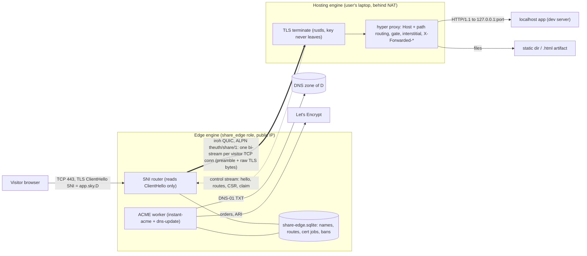

# 210 — Public web sharing (share edge)

Status: design, 2026-11-22 · revised 2026-11-22: ACME and open admission in P1; domain configurable (tun.zip) · rev 3 2026-11-22: one name per user, wildcard per name via DNS-01, Caddy and TLS-ALPN-01 rejected.
Extends 31 (link relay, threat model), 67 (mesh, ALPNs, `EngineStats`), 184 (document
share links), 191 (contacts, cross-mesh admission), 205 (`show_web`, which names localhost tunnelling as a non-goal
at `docs/design/205-web-view-tile.md#L24-L25`; this doc is that goal). Recon of the tree, of
[anomalyco/opentunnel](https://github.com/anomalyco/opentunnel) and of the Rust crates was done on 2026-11-22. Nothing
here is built.

Vocabulary. **Hosting engine**: the theuth engine on whose machine the shared thing runs (the dev server, the
directory); it holds the TLS key. **Edge**: an engine with the `share_edge` role, reachable on TCP 443 at a public
IP, that routes visitors to hosting engines by SNI and never decrypts. **Operator**: whoever runs an edge and owns
its domain `D`, a configuration value (`share_edge.domain`) that the edge announces to clients; the worked example
everywhere is `tun.zip`, the domain of the owner's public edge. **Name**: the one DNS label under `D` that a hosting
engine holds (`sky.tun.zip` reserved, or `k3f7q2.tun.zip` random), bound to that engine's key, with one wildcard
certificate `{<name>.D, *.<name>.D}`; every share of that engine lives under it. **Share**: one published source at
one public URL, `https://<label>.<name>.D/` or `https://<name>.D/<path>/`. **Visitor**: anyone on the internet who
opens that URL.

## 1. Context and problem

The owner's request (2026-11-22): share web pages publicly through the relay as a theuth user; hosted on some node
in the mesh, not necessarily the hub; a user building an app shares it; users can reserve a subdomain; different
apps can be served on paths; a Let's Encrypt integration so the operator gets certificates automatically; a clear
interface saying "you are on the public internet" with an easy stop; "basically a mini ngrok", in the spirit of
anomalyco's opentunnel.

Revision of the same day (owner, binding): automatic certificates (ACME DNS-01, Let's Encrypt) and admission for
*anyone who has theuth* ship in P1, with no account; the tunnel domain is a variable, never hard-coded, with `tun.zip`
as the worked example; reserved subdomains are in P1. §6.5–§6.8, §9.4, §10 and §13 carry the consequences.

Revision 3 of the same day (owner, binding): the edge stays blind (Caddy considered and rejected, §11.8); one name
per user with every share under it replaces the earlier two-level `<random16>.<ns>.D` namespaces and the separate
flat reserved `<name>.D` (D5); certificates are one wildcard per name over DNS-01 with the operator's DNS token (D7,
D17); per-hostname TLS-ALPN-01 and the edge as authoritative DNS are rejected (§11.9, §11.10).

What exists today:

- **Nothing is served over HTTP to anyone but the user.** OpenUI apps render client-side and call engine tools
  through `app_call_tool` (`crates/app/src/rpc_artifacts.rs#L31-L32`); `show` pages are in-memory `theuth-page:`
  documents; `show_web` (`crates/artifact/src/webview.rs#L64-L68`) only opens a URL in a tile. The one local
  listener is the token-gated JSON-RPC server (`crates/rpc-compose/src/bootstrap.rs#L115-L127`), whose token is
  the whole engine.
- **The link relay is an end-to-end encrypted dumb pipe.** `theuth-relay` maps `/h/{id}` to one harness socket
  (`crates/relay/src/main.rs#L116-L119`), keeps no state and no accounts (31 decision 1,
  `docs/design/31-link.md#L19-L26`), and its disclosure sentence is "It can see that they are connected, not what
  they say" (`docs/design/31-link.md#L453-L460`). Its frames cap at 64 KiB and its TLS is a static PEM pair
  (`crates/relay/src/main.rs#L85-L97`); a new uplink silently replaces an old one (`crates/relay/src/relay.rs#L231`).
- **The mesh already carries authenticated QUIC streams between engines**, including engines of *other* meshes:
  `theuth/a2a/1` (`crates/mesh/src/net.rs#L45`) is served by `A2aGate` (`net.rs#L2038-L2074`), which asks a
  plugin-installed `ContactAlpn::admit` (`net.rs#L58-L74`, installed at `crates/a2a/src/lib.rs#L1265`). HTTP over a
  mesh stream is an existing pattern (`crates/a2a/src/contacts/discovery.rs#L105`).
- **There is no role advertisement**, only `EngineStats` (`crates/mesh/src/types.rs#L192-L234`), replicated as
  `engine_stats`.

opentunnel ([README](https://raw.githubusercontent.com/anomalyco/opentunnel/dev/README.md),
[server.md](https://raw.githubusercontent.com/anomalyco/opentunnel/dev/docs/server.md),
[trust-boundary.md](https://raw.githubusercontent.com/anomalyco/opentunnel/dev/docs/trust-boundary.md); MIT, Rust
server and client, v0.6.2 of 2026-11-04) is "a blind TLS tunnel": the server reads only the ClientHello, routes on
SNI, and the client holds the key, terminates TLS and forwards plaintext to a local port. Each tunnel gets
`<id>.opentunnel.xyz` plus `*.<id>` routes, one wildcard certificate per tunnel through DNS-01, ordered by the server
from a CSR the client made. This design takes that shape and replaces its WebSocket bridge, bearer tokens and MySQL
with what theuth already has: iroh QUIC, engine keys, sqlite.

## 2. Goals, and what is not one

- G1. A user publishes a local dev server (a `localhost` port) or a static directory / `.html` artifact at a public
  `https://` URL with one tool call or one Settings action, through an edge that may be any engine with a public IP.
- G2. The edge never sees plaintext: doc 31's "relay sees only ciphertext" holds for shared content too (§9.1
  states exactly what changes).
- G3. Publishing is always a human act that names the exact URL, source, expiry and access mode; no policy switch,
  no double, no app press can grant it.
- G4. While anything is public the user cannot miss it, on every client, and one press stops everything at once.
- G5. Names: each hosting engine holds one name `<name>.D`, a reserved one it chose (first claim wins, bound to its
  key) or else a short random one, and all of its shares live under it; quotas, a release cooldown and inactivity
  expiry (D5).
- G6. Several apps per user under that name, on one-level sub-labels (`app.<name>.D`) or paths (`<name>.D/app1`);
  a new sub-label goes live at once, because the name's wildcard certificate already covers it.
- G7. The operator configures ACME once (Let's Encrypt, staging for tests) and certificates for every tenant
  appear and renew without touching the operator.
- G8. Anyone who has theuth can publish with no account and no configuration: the client ships with the owner's
  public edge as its default (D15, §5.5), any operator can run another edge, and the domain is the edge's, never the
  client's (D16).
- Not goals (v1): live OpenUI apps (§5.6); TCP/UDP tunnels other than HTTPS; HTTP/3 to visitors; content
  scanning; edge-side request logs or interstitials (impossible with a blind edge, §11.1); edge HA across several
  nodes; accounts, billing, OAuth gates.

## 3. Decisions

| # | Decision |
|---|---|
| D1 | **Blind SNI edge.** The edge parses the TLS ClientHello, reads SNI, and copies bytes. The hosting engine terminates TLS with a key it generated and never exported. Path mounts, access gates, interstitials and `X-Forwarded-*` live in the hosting engine's proxy. A terminating edge is rejected for v1 (§11.1). |
| D2 | **The edge is an engine role**, `share_edge:` config section (off by default), advertised as an optional `EngineStats.share_edge` field. Any engine with a public IP and TCP 443 can be it; the hub is irrelevant. A dedicated operator deploy is a headless `theuth` with only that role on. `theuth-relay` is not touched (§11.3). |
| D3 | **Transport is an iroh QUIC ALPN `theuth/share/1`.** The hosting engine dials the edge by endpoint id and keeps one connection; it opens one control stream; the edge opens **one bidirectional QUIC stream per visitor TCP connection** on that connection. No custom multiplexer. iroh's relay fallback already carries the connection over HTTPS when UDP is blocked; a WebSocket carrier is P3 (§4.4). |
| D4 | **Authentication is the engine key**, proven by the QUIC handshake; there are no accounts. Admission is a `ShareEdgeAlpn::admit(remote)` hook patterned on `ContactAlpn`, with policy `family` · `invite` · `open`. The owner's public edge runs `open` from P1, with limits counted per key **and per client network**, because keys cost nothing (§9.4). Unlike `A2aGate` it does not refuse family peers. |
| D5 | **One name per user, every share under it.** A hosting engine holds one name `<name>.D`: reserved (chosen, `[a-z0-9-]{3,32}`, first claim wins, bound to the engine key) or, while it holds none, random (6 characters of lowercase base32 `[a-z2-7]`, e.g. `k3f7q2`). Shares are `<label>.<name>.D` (exactly one sub-label) or `<name>.D/<path>`; `a.b.<name>.D` is not supported, because a wildcard covers one label. Quota per key: one random name, only while the key holds no reserved name, and up to `reserved_per_key` (3) reserved names, one of them primary (the name new shares use); each held name is one certificate slot. Release or inactivity expiry (random 30 days, reserved 90 days unattached) deletes the name's DNS records, revokes its certificate and starts a cooldown: another key may claim it only after `max(30 days, the old certificate's not_after)` (§5.2, §9.2). Two-level namespaces and flat per-share names are rejected (§11.4). |
| D6 | **Certificate capacity does not depend on the Public Suffix List.** Without a PSL entry every name certificate counts against `D`'s 50 new certificates per 7 days (ARI renewals are exempt), so the edge queues new names with a visible "waiting for a certificate slot" state, the owner requests a Let's Encrypt limit adjustment for `D`, and an EAB-backed second CA (Google Trust Services) takes overflow (§6.5). Slots are counted per name, never per share. The PSL entry is still submitted, for cookie isolation between tenants, with no promise of acceptance (§6.6). |
| D7 | **One wildcard certificate per name over DNS-01; ACME on the edge, keys on the hosting engine.** The hosting engine generates key and CSR for exactly `{<name>.D, *.<name>.D}`; the edge checks the CSR names against the name bound to that key, writes `_acme-challenge.<name>.D` TXT through `dns-update` with a zone-scoped token held in its non-replicated `local/` vault prefix (D8), orders with `instant-acme` from Let's Encrypt or the overflow CA, renews from ARI reusing the stored CSR, and runs orders as durable jobs under a global budget. A new sub-label needs no order. Shipped in P1; there is no hand-installed certificate path. Per-hostname TLS-ALPN-01 and the edge as authoritative DNS are rejected (§11.9, §11.10). |
| D8 | **The DNS token never enters the replicated vault.** New non-replicated vault table `vault_local`, names under `local/`, sealed with the engine's own key (§8.3). The hosting engine's TLS key uses the same table. |
| D9 | **Sources in v1: `port` (loopback only), `dir`, `artifact` (a `.html` from `show`).** Never the RPC listener or any port the engine owns; never live OpenUI apps. The proxy rewrites `Host` to the upstream, strips and re-sets `X-Forwarded-*`, and can prepend a PROXY v2 header. |
| D10 | **`share_publish` is `Risk::Destructive` and human-only**: a new `Tool::HUMAN_ONLY` flag that `tools.approvals: false`, a session pin, the double and an app press cannot satisfy (§7.2). Stop is never gated. |
| D11 | **Master switch "Allow public sharing", default off**, owned by the share plugin and applied live. Default expiry 8 h; access `public` or `password`; a first-visit interstitial on by default. |
| D12 | **One store, many indicators**: a red strip in the window chrome, a tray state and Stop item, a chat card with a visitor count, Settings › Sharing, attention items; the same React store for desktop, web and iOS. Share records are a replicated table so any engine's client sees and stops any share in the family. |
| D13 | **Abuse limits from opentunnel, counted per key and per client network** (IPv4 address, IPv6 /64 and /48), plus per-key name and certificate caps, a global issuance budget, an edge ban per key, name or network, a live admission switch, an operator abuse URL linked from every interstitial, the interstitial on by default, and operator terms the client shows before the first publish to that edge (§9.4). |
| D14 | **One crate, `crates/share`**: `host` (records, tools, TLS terminate, proxy) and `edge` (SNI router, names, ACME) modules; ACME and DNS dependencies behind a cargo feature `edge`. It earns a crate (00 §1.6): new dependencies, its own sqlite, an ALPN, tools and RPC. |
| D15 | **The owner's edge is a shipped default.** `share.edge` defaults to `default`, an edge ticket compiled into theuth's config defaults, as `mesh.relay` defaults to `https://iroh.relay.theuth.io` (`crates/mesh/src/config.rs#L62`); a pasted ticket or a family-advertised edge overrides it, `none` disables it. Nothing dials it until the user turns on "Allow public sharing" (§5.5). |
| D16 | **The domain is the edge's configuration, never the client's.** `share_edge.domain` (example `tun.zip`) is sent in `welcome`; the client builds every URL from it and has no domain constant. Edge rows are keyed by `(domain, name)` from day one, so one edge serving several domains is additive later (P2). |
| D17 | **Per-name DNS records, written by the edge.** When a name is claimed or allocated, the edge writes `<name>.D` and `*.<name>.D` (CNAME → `edge.D`, which holds the only `A`/`AAAA`) and deletes both on release. A single `*.D` record is not enough: the challenge TXT at `_acme-challenge.<name>.D` makes `<name>.D` exist as an empty non-terminal (RFC 4592), which would blank the name during every issuance (§6.4). About 2 records per name plus a transient TXT, so the provider and plan must fit the name count (§13). |

## 4. Architecture

### 4.1 Picture



The hosting engine dials out, so it works behind NAT, and over the iroh relay
(`mesh.relay`, default `https://iroh.relay.theuth.io`, `crates/mesh/src/config.rs#L62`) when UDP is blocked.
Edge host requirements: a public IPv4 address (and IPv6, for `AAAA`); inbound TCP 443 (visitors, SNI); inbound UDP on
the mesh port (iroh QUIC direct paths); outbound HTTPS to its iroh home relay (so relayed hosting engines reach it),
to the ACME directories and to the DNS provider API. **No TCP 80**: DNS-01 needs no inbound port, and `.zip` is a
TLD on the browsers' HSTS preload list (§6.8), so no browser sends `http://` to a `tun.zip` name. An edge on a
domain without HSTS preload may turn on `listen_http` for a redirect.

### 4.2 A visitor connection, step by step

1. Visitor resolves `app.<name>.D` → the name's `*.<name>.D` CNAME → `edge.D` (§6.4) → edge IP; opens TCP 443.
2. Edge accept loop: per-IP token bucket (IPv4 or IPv6 /64), global and per-name connection caps. It reads
   up to 16 KiB within 5 s, feeding a copy into `rustls::server::Acceptor` until `Accepted::client_hello()` yields
   the SNI. (A post-quantum hybrid key share makes Chrome's ClientHello span more than one TCP segment, so the
   reader must loop.) No SNI, unknown host, a host more than one label below a name, banned name or no live tunnel →
   TCP reset. No certificate is ever presented by the edge on 443.
3. Lookup `host → route → tunnel connection` (§5.4). The edge opens a bi-stream on that connection, writes the
   preamble (§5.3), then the buffered ClientHello bytes, then `copy_bidirectional` until either side closes.
   Idle reset after 15 min; a visitor that stops reading for 5 s is reset (opentunnel's limits).
4. Hosting engine accepts the stream, reads the preamble (visitor IP, SNI), runs `tokio_rustls::TlsAcceptor` with
   the name's `CertifiedKey` (ALPN `h2`, `http/1.1`), and serves the decrypted connection with
   `hyper_util::server::conn::auto::Builder` (HTTP/1.1 and h2, upgrades).
5. The proxy routes by `Host` (the sub-label) and longest path prefix to a share; applies the share's gate (password cookie),
   the interstitial, rate limits; forwards to the upstream; streams bodies; forwards `Upgrade: websocket` with
   `hyper::upgrade::on` on both sides and `copy_bidirectional` (Vite and Next HMR need it). Upgrade requests go to
   the upstream over HTTP/1.1.

### 4.3 Where the edge runs, and why not `theuth-relay`

The edge is `share::edge`, started by the share plugin when `share_edge.enabled` is true on that engine. It needs
an iroh endpoint (the mesh's, via a new ALPN handler), a sqlite file, the vault (for the DNS token), config and
RPC (operator commands). An engine has all of these; `theuth-relay` has none and is deliberately stateless (31
decision 1). Two deploy shapes, one code path:

- **Family node.** The operator's always-on box (a home server with a forwarded 443, a VPS already in the mesh)
  turns the role on in Settings or `config.yaml`. Its family discovers it from `engine_stats`.
- **Dedicated edge.** A container running `theuth --headless` with `share_edge.enabled: true`, nothing else on
  (`deploy/share-edge/`, new), published to other meshes as an edge ticket (§5.5). The owner's public edge for
  `tun.zip` runs this way, on a host or LoadBalancer IP of its own: a Kubernetes Ingress cannot carry it, because an
  Ingress wildcard host covers a single label and `x.sky.tun.zip` has two below `tun.zip`
  ([hostname wildcards](https://kubernetes.io/docs/concepts/services-networking/ingress/#hostname-wildcards)), so the
  HAProxy passthrough used for `iroh.relay.theuth.io` (`deploy/relay/k8s/rwx-dev/ingress-iroh.yaml`) is not reused.

`share::edge` depends on a narrow tunnel trait (§5.3), not on `Net`, so a thin standalone binary is possible later
without a second implementation; nothing in v1 needs it.

### 4.4 Transport: iroh first, WebSocket later

iroh gives key-addressed dialing, hole punching, an HTTPS relay fallback and per-stream flow control with no head-of-line
blocking across visitors; theuth already depends on it (`iroh` 1.2 in the workspace, 1.4.1 in `Cargo.lock`; upstream
1.5.0 of 2026-11-19 runs on n0's `noq`, not quinn). The research recommends yamux over TLS/WebSocket as the primary
transport for a hub-and-spoke edge ([yamux](https://github.com/paritytech/yamux) 0.14.1); that is the right call for a
greenfield tunnel, not for theuth, where it would add a second transport, a second auth scheme and our own window
tuning. Cases iroh does not cover: a corporate network that blocks the iroh relay host or forces an HTTP CONNECT proxy.
For those, P3 adds a WebSocket carrier (`wss://<edge>/share/1`, `tokio-tungstenite`, already a workspace dependency)
with yamux on top and the same control and stream semantics, authenticated by a Noise `NK`-style proof of the
endpoint key as the link relay does. Whether iroh honours `HTTPS_PROXY` for its relay connections is not verified
here [INFERENCE: it may; check before P3].

### 4.5 The hosting engine, in the mesh

The share belongs to the engine whose loopback the source lives on, not to the hub: a dev server on the laptop is
published by the laptop's engine. A UI attached to another engine of the family (the phone through the hub) sees the
share through the replicated `shares` table and stops it by forwarding `share_stop` to the owner over
`theuth/rpc/1` (`crates/replica/src/lib.rs#L52`). Hub handover does nothing to a share. If the hosting engine
sleeps, its tunnel drops, the edge resets visitors, and the record shows **offline** until it reconnects or expires.

## 5. Protocol and data model

### 5.1 Share record (hosting engine, `share.sqlite`, replicated)

Attached with `replica::attach(pool, TABLES)` like the vault (`crates/secrets/src/lib.rs#L906`). Counters are not in
the replicated row (they would churn the feed); they travel as events.

| field | type | notes |
|---|---|---|
| `id` | ULID text | stable; tool and RPC argument |
| `engine` | endpoint id | the hosting engine; only it serves and mutates the row |
| `edge` | endpoint id + domain | which edge |
| `host` | text | `<name>.D` or `<label>.<name>.D` (one sub-label), under one of the engine's held names |
| `path` | text | `/` or `/app1` (no trailing slash, `[a-z0-9-/]`, ≤ 64) |
| `url` | text | `https://{host}{path}/` exactly as the approval card showed it |
| `source` | tagged JSON | `{"port":5173}` · `{"dir":"/abs/path"}` · `{"artifact":"<call_id>"}` |
| `access` | `public` · `password` | password hash (argon2id) in `vault_local`, never in the row |
| `interstitial` | bool | default true |
| `preserve_host` | bool | default false (§5.6) |
| `proxy_protocol` | `none` · `v2` | default none |
| `created_ms`, `expires_ms` | u64 | `expires_ms` null only for a reserved-name share started from Settings |
| `created_by` | `{session, call_id}` or `"settings"` | provenance for the card |
| `approved_by` | `human` + approval id | always human (D10); recorded for audit |
| `state` | `live` · `offline` · `stopped` | `stopped` keeps `stopped_ms`, `stopped_by` (`user`, `expiry`, `edge_ban`, `switch_off`, `source_gone`) |

Stopped rows are kept 30 days for the Settings history, then deleted.

### 5.2 Name record (edge, `share-edge.sqlite`, not replicated)

| field | notes |
|---|---|
| `domain`, `name` (PK) | `domain` is the `share_edge.domain` it was issued under (D16); a reserved `name` is `[a-z0-9-]{3,32}`, no leading/trailing `-`, no `xn--` (homographs), not in `reserved_words` (operator list; default includes `www`, `api`, `admin`, `login`, `mail`, `abuse`, `status`, `support`, `secure`, `account`, `theuth`, `edge`, `ns1`, `ns2`); a random one is 6 characters `[a-z2-7]` |
| `kind` | `random` (allocated on a key's first attach while it holds no reserved name — which only happens once the user has turned sharing on, §5.5) · `reserved` |
| `owner` | endpoint id that claimed it; the claim arrived on that key's authenticated connection |
| `created_ms`, `last_attach_ms` | inactivity expiry: `random` after 30 days unattached, `reserved` after 90 |
| `released_ms`, `reclaim_after_ms` | set on release or expiry; `reclaim_after_ms = max(released_ms + 30 days, cert_not_after)`; until then only the previous `owner` may claim the name again, and a random name is not re-allocated (§9.2) |
| `csr` | last CSR (DER), reused for renewal |
| `cert_not_after`, `ari_window` | renewal state |
| `cert_state`, `ca` | `none` · `queued` (position in the slot queue, §6.5) · `ordering` · `valid` · `failed` · `revoked`; which CA issued the current chain |
| `net` | client network (§9.4) that created it, for per-network quotas |
| `banned` | reason, time, operator; refuses attach, routing and issuance |

Holding rules (D5): a key holds at most one `random` name, and only while it holds no `reserved` one, plus up to
`reserved_per_key` (default 3) reserved names; per client network, §9.4. Each held name is one certificate slot (§6.5)
and two DNS records (§6.4); shares and sub-labels cost neither. The hosting engine keeps which held name is
**primary** (the one new shares use, shown as "Your name") in `share.sqlite`: the newest reserved name, else the
random one, changeable in Settings › Sharing. Claiming the first reserved name makes it primary; the random name is
released once its last share stops, and a still-queued certificate job for it is dropped so the reserved name takes
that slot. Releasing a name stops its live shares first (the client asks). First claim wins; a second claimant gets
`name_taken`, or `cooldown` while `reclaim_after_ms` is in the future. Transfer is release plus a claim by the other
key after the cooldown. On release or expiry the edge deletes the name's records, revokes its certificate (§6.3) and
drops its routes. The claim needs no detached signature:
the edge only accepts it on the QUIC connection whose TLS handshake proved the key, and the edge is the sole
authority for `D`. A signature becomes necessary only if claims are ever replicated between several edges (not v1).

### 5.3 Tunnel framing on `theuth/share/1`

- **Mesh glue.** `ALPN_SHARE = "theuth/share/1"` beside the others (`crates/replica/src/lib.rs#L41-L59`), **not**
  in `STREAM_ALPNS` (`crates/mesh/src/net.rs#L506-L515`, family only). A `ShareGate` handler in the router
  (`net.rs#L577-L594`) asks an installed `ShareEdgeAlpn` (set like `Net::set_contacts`, `net.rs#L843`) and hands the
  admitted `Connection` to it as a `replica::Tunnel` (new trait: `open_bi`, `accept_bi`, `remote`, `close(code,
  reason)`, `closed()`), because the edge must open streams on a connection the other side dialed — the existing
  `Transport::open/accept` (`crates/replica/src/types.rs#L123-L142`) cannot express that. The dialing side gets the
  same trait from `Net::share_connect(edge, hints)`, modelled on `Net::a2a_stream` (`net.rs#L851`).
- **Control stream** (host opens the first bi-stream): frames are `u32 BE length ‖ JSON`, ≤ 64 KiB, each with `"t"`.

| t | dir | body | answer |
|---|---|---|---|
| `hello` | H→E | `{v:1, invite?, client:"theuth/<ver>"}` | `welcome {names: [{name, kind, cert_state}], domain, limits, terms_url, abuse_url, terms_rev}` or `error {code: banned | network_quota | admission_closed | invite_required}` |
| `claim` / `release` | H→E | `{name}` | `claimed {name}` · `released {name, reclaim_after_ms}` · `error {code: name_taken | cooldown | quota | invalid | banned}` |
| `routes` | H→E | `{hosts: [..]}` full set | `ok`; the edge forwards only these SNIs, each `<name>.D` or `<label>.<name>.D` of a name this key holds; replaces, not merges |
| `csr` | H→E | `{name, der}` | `cert {name, chain_pem, not_after}` · `pending {eta_s, queue_pos?}` · `error {code: csr_names | quota | network_quota | banned}` |
| `queue` | E→H | `{name, position, eta_s}` while the name waits for a certificate slot | none |
| `stats` | E→H | `{host, conns, bytes}` every 30 s | none |
| `drain` | E→H | `{secs}` | host reconnects after the deadline (edge restart) |
| `kill` | E→H | `{host?, reason}` | edge ban; the host marks shares `stopped_by: edge_ban` |
| `ping` | both | `{}` | `pong` |

- **Visitor stream** (edge opens): preamble `u16 BE length ‖ JSON {sni, peer:"ip:port", edge_conn:u64, ts_ms}`, then
  raw TLS bytes both ways. Stream FIN = TCP FIN; stream reset = TCP RST.
- Limits applied by the edge's transport config: 256 concurrent bi-streams per tunnel connection, one tunnel
  connection per key (a new one replaces the old after `hello`, like the link relay, but only for the same key).
- Closing the connection removes every route of that key from the edge table immediately; that is how Stop all
  takes effect at the edge (§7.4).

### 5.4 Routing tables

- **Edge:** `DashMap<String /*host*/, Route { name, key, conn: Weak<dyn Tunnel> }>` filled from `routes` and cleared
  on disconnect; a host is accepted only if it is `<name>.D` or `<label>.<name>.D` (exactly one label,
  `[a-z0-9-]{1,63}`) for a name held by that key; `a.b.<name>.D` is refused, since the wildcard would not cover it.
  Exact match only; no wildcard lookup. Host → name → engine is all the edge knows.
- **Hosting engine:** `ArcSwap<HashMap<host, Vec<(path_prefix, ShareId)>>>`: the host (bare name or sub-label) selects
  the entry, the longest path prefix selects the share, and the share names the local source (port, directory,
  artifact). `/app1` matches `/app1` and `/app1/…`, not `/app10`. A host with no `/` share returns a 404 page listing
  nothing.

### 5.5 Finding an edge

A theuth install with no configuration must be able to share, and the client must know no domain (D16). `share.edge`
takes one of:

- **`default`** (the shipped value, D15): the edge ticket of the owner's public edge, compiled into theuth's config
  defaults the way `mesh.relay` is. Settings shows it as "<domain> (theuth default edge)" with the domain and
  operator the edge announced in `welcome`.
- **A pasted ticket**, `theuth-edge:1.<endpoint-id>[.<invite>]`, from any operator. The ticket names the edge's key,
  not its domain; the domain arrives in `welcome`. The invite is a random 128-bit secret the edge stores hashed, with
  a use count and expiry; `admission: invite` requires one in `hello` the first time a key attaches, after which the
  key is remembered.
- **`family:<endpoint-id>`**: an edge of the user's own family, advertised as `EngineStats.share_edge:
  Option<EdgeAd { domain, admission }>` (`#[serde(default)]`, the existing pattern at
  `crates/mesh/src/types.rs#L214-L233`). Settings › Sharing lists advertised edges beside the default.
- **`none`**: no edge; publishing is refused with "No sharing edge configured".

Why a shipped default rather than paste-only or a DNS lookup: "anyone who has theuth" means zero steps, and a
paste-only design makes the first publish a hunt for a ticket. The ticket pins the edge's endpoint key, so the
default adds no trust root beyond the release itself; a DNS discovery record (`_theuth-edge.<domain>`) would compile
a domain into the client, which D16 forbids, and add DNS as a trust root. Privacy: the default edge is dialed only
after the user turns the master switch on; a fresh install never contacts it. Cost: the edge's endpoint key must be
stable (persisted, backed-up `data_dir`); rotating it needs a theuth release, and clients still on the old ticket
show "edge unreachable — paste a new ticket", which the operator also publishes on its page outside `D`. The ticket
carries no addresses: the hosting engine finds the endpoint through iroh discovery (`mesh.discovery`), and an
optional address hint in the ticket serves installs with discovery off.

### 5.6 Sources and the proxy

| source | serves | refused |
|---|---|---|
| `port` | `http://127.0.0.1:<port>` or `[::1]` | non-loopback hosts (no LAN routers, v1); ports in the engine's own-listener registry; a port that is not listening at publish time |
| `dir` | files under an absolute directory, `tower-http::ServeDir` | `data_dir` and its ancestors, `$HOME` itself, any path with a dot-segment component (`.ssh`, `.git`, `.env`) — dotfiles 404 |
| `artifact` | one `.html` artifact's bytes with the 120 page headers (`CSP: sandbox allow-scripts allow-forms`, `nosniff`, `no-referrer`) | any other kind |

- **Own-listener registry (new).** A `runtime` set that `rpc-compose::bootstrap::serve` and every plugin binding a
  TCP listener (a2a, the share proxy itself, the desktop dev server in debug builds) write their port into. `port`
  sources in the set are refused with "that port is theuth itself". This is the hard deny-list; the RPC token must
  never be one hop from the internet.
- **Headers.** Incoming `Forwarded`/`X-Forwarded-*`/`X-Real-IP` are stripped; the proxy sets `X-Forwarded-For`
  (preamble peer), `X-Forwarded-Proto: https`, `X-Forwarded-Host` (public host), `X-Forwarded-Prefix` (path mount).
  `Host` is rewritten to `localhost:<port>` because dev servers refuse unknown hosts (Vite's `server.allowedHosts`);
  `preserve_host: true` passes the public host instead. Optional PROXY v2 header (`ppp` 2.3.0) per share for upstreams
  that read it.
- **Loopback warning.** The upstream sees a loopback peer; anything that trusts "local means me" (a debug admin
  page, Jupyter without a token) is exposed. The approval card says so for `port` sources (§7.3).
- **Path mounts strip the prefix.** Apps that emit absolute URLs (`/assets/x.js`, `/@vite/client`) break under
  `/app1`; for `port` sources the default is therefore a sub-label (`app1.<name>.D`, served at `/`), and a path
  mount is offered for `dir`/`artifact` and for apps built with a base path. This is the evidence-driven refinement
  of the owner's "apps on paths".
- **Live OpenUI apps are excluded.** Their `Query`/`Mutation` go through `app_call_tool` into the owner's tool
  registry, where a press is consent (`crates/tools/src/registry.rs#L288-L300`); a visitor's press would be the
  owner's consent. A frozen, tool-less publish is P3 (§10).

## 6. Certificates (ACME)

### 6.1 Stack

`instant-acme` 0.8.5 (features `aws-lc-rs`, `time`, `x509-parser` for ARI; the only maintained client with DNS-01,
EAB and ARI) and `dns-update` 0.6.2 (Stalwart; Cloudflare, Route 53, Google, Hetzner, DigitalOcean, OVH, RFC 2136 with
TSIG, 70+ providers), both behind a `share::edge::acme::{Ca, DnsWriter}` trait pair so either can be swapped. The
hosting engine generates its key and CSR with `rcgen` (P-256) [version to pin in P1; not evaluated in the research].
The crypto provider is aws-lc-rs, installed as the process default before any `ServerConfig` is built, as the relay
does (`crates/relay/src/main.rs#L88-L90`).

### 6.2 Issuance flow

1. Hosting engine attaches (only while the master switch is on), gets `welcome {names, domain}`; for each held name
   without a valid cert, it creates a P-256 key in `vault_local` (`local/share/tls/<name>`) and sends
   `csr {name, der}`.
2. Edge validates: the CSR parses, its SANs are exactly `{<name>.D, *.<name>.D}`, `<name>` is held by this key, not
   banned and not in cooldown, the per-name budget (5 orders per day), the per-key and per-network caps (§9.4) and the
   global budget allow it. Anything else is `error {code: csr_names | quota | network_quota | banned}` — opentunnel's
   pre-order check.
3. Edge enqueues a durable job (`cert_jobs` table: `name`, `state`, `ca`, `lease_until`, `attempts`, `next_at`) and
   returns `pending {eta_s, queue_pos}`. A job for a name without a certificate needs a **slot** of the
   new-certificate budget (§6.5); while none is free it stays `queued` and the edge pushes `queue {position, eta_s}`,
   which the client shows as "Waiting for a certificate slot" (§7.4). One worker leases jobs; one in flight per name.
4. Worker: ensures the name's records `<name>.D` and `*.<name>.D` exist (written at claim time, §6.4); new order for
   both identifiers at the chosen CA; for each DNS-01 authorization writes TXT `_acme-challenge.<name>.D` (both
   identifiers share that name: two values in one rrset), waits until the zone's authoritative servers answer it,
   tells the CA to validate, polls, finalizes with the stored CSR, deletes the TXT.
5. Edge stores the chain, pushes `cert {chain_pem}` on the control stream (or on next attach). The hosting engine
   swaps its `CertifiedKey` in an `ArcSwap`; live TLS sessions keep the old one.
6. A new share needs none of this: the wildcard already covers `<label>.<name>.D` and the bare name covers paths, so
   a publish goes live as soon as its `routes` update lands.

### 6.3 Renewal and revocation

- ARI polling every 6 h with jitter (`instant-acme` ARI support); renew inside the suggested window, fallback at two
  thirds of lifetime. Confirmed on [rate limits](https://letsencrypt.org/docs/rate-limits/#ari-renewals) (updated
  2026-08-05): an ARI renewal is "exempt from all rate limits" when the order names the certificate it replaces,
  shares at least one identifier with it, and that certificate was not already replaced through ARI. So only *new*
  names consume the per-domain budget. Non-ARI renewals of the same identifier set are exempt from the
  per-domain and per-account limits but still count against 5 per identical set per 7 days.
- The renewal reuses the stored CSR, so the key never changes and the hosting engine need not be online.
- No renewal for a name unattached for 90 days (opentunnel), which also ends `reserved` expiry.
- Profile `classic` (90 days) by default; `tlsserver` (45 days) is configurable
  ([profiles](https://letsencrypt.org/docs/profiles/)). Lifetimes are shrinking: everything is ARI-driven, never a
  fixed schedule.
- On release, inactivity expiry or a ban the edge revokes the name's certificate (`instant-acme` supports it; reason
  `cessationOfOperation`, or `keyCompromise` on a reported compromise) and deletes its DNS records. Browsers do not
  reliably check revocation [INFERENCE: Let's Encrypt has ended OCSP; Chrome consults only CRLSets], so the cooldown
  before another key may claim the name runs at least to the old certificate's `not_after` (§5.2). Routing stops at
  once, which is what matters for a blind edge.

### 6.4 The account and the DNS credential

One ACME account per edge (new accounts are limited to 10 per IP per 3 h), credentials JSON in `vault_local`
(`local/share_edge/acme_account`). The DNS credential is `local/share_edge/dns`. Scoping, best first:

1. **`D` is a dedicated registered domain** (`tun.zip`): the whole zone is the tunnel zone, nothing else lives in it,
   and the token is scoped to that zone (a Cloudflare API token with DNS edit on the `tun.zip` zone only; Route 53 IAM
   limited to that hosted zone). A `D` below a domain that hosts other things is first delegated as its own zone (NS
   records at the parent).
2. RFC 2136 with a TSIG key whose update policy allows only the per-name records and TXT under
   `_acme-challenge.*.D`.

**A wildcard `*.D` is not enough.** RFC 4592 ([§2.2.1](https://www.rfc-editor.org/rfc/rfc4592#section-2.2.1)) does not
limit a wildcard to one label: `*.D` also answers `x.<name>.D`, but only while no name between `D` and the query name
exists. The DNS-01 TXT at `_acme-challenge.<name>.D` makes `<name>.D` exist as an empty non-terminal; while it is
present `<name>.D` answers NODATA and `x.<name>.D` NXDOMAIN (the RFC's `_telnet._tcp.host1.example` case), and
resolvers cache that for the zone's negative TTL. A live name would go dark at every issuance and ARI renewal. So when
a name is claimed or allocated, before its first order, the edge writes `<name>.D CNAME edge.D` and
`*.<name>.D CNAME edge.D`, and deletes both on release; `edge.D` holds the only `A`/`AAAA` (`edge` is a reserved
word). No `*.D` record exists: an unclaimed name is NXDOMAIN, so scanners never reach the edge for it. TTL 300 s on
these records and on the SOA negative TTL, so a name looked up just before it existed recovers quickly. Cost: about
two records per name, plus two transient TXT values per order. Cloudflare free zones created on or after 2024-09-01
allow 200 records ([quota](https://developers.cloudflare.com/dns/manage-dns-records/)), under 100 names: the public
edge needs a paid plan or a provider without a small per-zone quota [other providers' quotas not checked here]; the
choice is the owner's (§13).

**Own authoritative DNS** (the edge answering for `D` with `hickory-server`) removes the token and the quota but adds
port 53 and DNS operations to the edge; rejected for P1, kept as a P2 option (§11.10).

### 6.5 Certificate capacity under Let's Encrypt limits

Limits ([rate limits](https://letsencrypt.org/docs/rate-limits/), updated 2026-08-05): **50 new certificates per
registered domain per 7 days**, refilling 1 per 202 minutes, counted across all accounts, override available; 5 per
identical identifier set per 7 days, no override; 300 new orders per account per 3 h, override available; 5 failed
authorizations per identifier per account per hour; 10 new accounts per IPv4 address per 3 h. Let's Encrypt finds the
registered domain with the PSL, so until `tun.zip` is listed every `{<name>.tun.zip, *.<name>.tun.zip}` certificate
is a new certificate of `tun.zip`. ARI renewals are exempt (§6.3); random and reserved names each consume one slot,
one per name, never per share. **On Let's Encrypt alone P1 can therefore onboard about 50 names in a burst and then
about 7 per day** (1 per 202 min). Installs that never turn sharing on cost nothing (§5.5).

Options evaluated:

- **(a) Queue.** Always on. FIFO by first request, capped per network (§9.4), a key's first name before any key's
  additional reserved names (a second name is extra on top of a working one). The client shows the position and an
  ETA; publishing while queued is refused with "No certificate yet for `<name>.<domain>` — waiting for a slot (about
  9 h)". Free,
  honest, slow under load.
- **(b) Let's Encrypt rate-limit adjustment** for the registered domain `tun.zip` through the
  [request form](https://isrg.formstack.com/forms/rate_limit_adjustment_request); the rate-limit page offers overrides
  for this limit. Processing takes "a few weeks" per [CertKit](https://www.certkit.io/docs/ca-rate-limits/) [Let's
  Encrypt's page states no time]. Free, keeps one CA, not guaranteed: file it before launch.
- **(c) Overflow CA with EAB.** Google Trust Services counts quotas per Google Cloud project (100 new orders per hour)
  and publishes no per-registered-domain limit ([quotas](https://docs.cloud.google.com/certificate-manager/docs/quotas),
  summarized by [CertKit](https://www.certkit.io/docs/ca-rate-limits/)); its EAB secret binds one ACME account and
  must be used within 7 days. ZeroSSL states no ACME rate limits but caps EAB credentials per user and day
  ([ACME docs](https://zerossl.com/documentation/acme)). `instant-acme` supports EAB. Choose GTS: published numbers.
  The edge sends a job to the overflow CA when the Let's Encrypt queue ETA exceeds `acme.overflow.after`; renewals
  stay with the issuing CA (ARI where that CA offers it [not verified for GTS], else two thirds of lifetime). Costs:
  a second account and credential, CAA must list both CAs (§8.2).
- **(d) Terminating fallback** with an operator-held `*.D`: waiting users get e.g. `<label>-<name>.D` (one label, so
  one wildcard covers it) served by the edge's own key. The edge would decrypt those users' traffic, which breaks G2
  and D1 for them and turns the §9.1 disclosure into "the operator can read this share"; one stolen key exposes every
  waiting tenant. Rejected; it is §11.1's terminating mode by another name.
- **Not an option: the PSL as a capacity plan.** The PSL refuses entries "whose sole purpose is to circumvent rate
  limits of third parties (such as Let's Encrypt rate limits - use their form instead)" (§6.6).

**Recommendation: (a) + (b) + (c).** The queue with its UI state ships in P1 because it is needed even with more
capacity (bursts, failures); the adjustment request is filed before public launch; GTS overflow is configured and on
for the public edge. (d) is rejected. The PSL entry is pursued for cookie isolation only.

| budget | value | why |
|---|---|---|
| new certificates, Let's Encrypt | 45 per 7 days, token bucket (`acme.new_certs_per_week`) | under 50 per registered domain; 5 kept for re-issue after key loss; raised after an override or the PSL entry |
| overflow CA | after a 6 h queue ETA (`acme.overflow.after`); 80 orders per hour | under GTS's 100 per hour per project |
| global orders, Let's Encrypt | 200 per 3 h (`acme.orders_per_3h`) | headroom under 300 |
| per name | 5 orders per day, 4 per 7 days on the same CSR | under the duplicate limit |
| per key | 2 new-name certificates per 7 days | a random name, then a reserved one; Sybil keys still compete for the same slots |
| per client network | §9.4 | keys are free |
| failure cool-down | after 2 failed authorizations for a name: 1 h, doubling to 24 h | under 5 per hour |

### 6.6 Public Suffix List

With `D` in the PSL private section, each `<name>.D` is a registrable domain: browsers reject a tenant's cookie for
`Domain=D`, and Let's Encrypt counts the 50-per-week limit per name. Requirements from the
[guidelines](https://github.com/publicsuffix/list/wiki/Guidelines) (page of 2025-05-23, read 2026-11-22):

- A pull request to [publicsuffix/list](https://github.com/publicsuffix/list) adding `tun.zip` to the PRIVATE section,
  sorted by organisation name, headed `// <Organisation> : <url>` and `// Submitted by <name> <email>` (an address of
  the requesting entity), with the PR template filled in (why, example names and expected results) and `make test`
  passing.
- **Authentication:** a TXT record `_psl.tun.zip` containing the PR URL, left in place after the merge ("missing _psl
  records will be a flag used in determination of domains to remove"). Private entries must come from the domain
  owner or an authorized representative: "We will not accept patches submitted by third party users of the service".
  The owner, as registrant, opens it.
- **Registration term:** more than 2 years left at submission, a statement saying so, and a commitment to keep more
  than a year left.
- **Rationale:** subdomains issued to mutually untrusting parties (true here). Declined: entries whose sole purpose is
  rate limits; small, temporary or exploratory projects ("projects not serving more then thousands of users are quite
  likely to be declined").
- **Review time:** "NO SERVICE LEVEL AGREEMENTS ON TIME", and after a merge there is no way to expedite propagation
  into browsers.

So the entry may be declined while the edge is young; nothing in P1 depends on it. Until it is listed, an app on
`a.D` can set `Domain=D` cookies that apps on `b.D` receive (cookie tossing): the engine's own gates use `__Host-`
cookies, which cannot carry a `Domain` attribute and are safe; tenant apps' own cookies are not, and Settings and the
terms say so. Once listed, the apex `D` is itself a public suffix: the Baseline Requirements forbid a wildcard
directly under a public suffix unless the applicant controls it, and a CA may refuse the apex [not verified per CA],
so the edge serves nothing on `D:443` (opentunnel uses a Cloudflare Origin CA cert for its apex for this reason), and
the abuse and terms pages live at an operator URL outside `D`. Shares under one name still share cookies with each
other — same owner, acceptable. A family-only edge (`admission: family`) does not need a PSL entry.

### 6.7 Custom domains (P3)

The user CNAMEs `app.example.org` to `<name>.D`; the hosting engine sends a CSR naming it; the edge verifies the CNAME
and validates with TLS-ALPN-01 — rejected as the general scheme (§11.9) but right here, where the edge holds no token
for the customer's zone: it can answer it itself, because the challenge connection's ClientHello carries ALPN
`acme-tls/1`, which the SNI router sees and diverts to a challenge responder instead of the tunnel. Issuance counts
against the customer's registered domain, not `D`. An `ask(host)` check before any order (registered custom domain,
owner online, not banned) prevents issuance driven by strangers pointing names at the edge.

### 6.8 The `.zip` TLD as `D`

`tun.zip` is the owner's choice and stays a variable (D16). Facts:

- `.zip` is a Google Registry TLD, open since May 2023, on the browsers' HSTS preload list as a whole TLD; the registry
  makes registrars warn that HTTPS is required ([policy](https://www.registry.google/policies/registration/zip/),
  [Netcraft](https://www.netcraft.com/blog/phishing-attacks-already-using-the-zip-tld)). Harmless here: the edge serves
  only HTTPS, and it removes TCP 80 (§4.1).
- **Reputation.** Netcraft found phishing on `.zip` within two weeks of launch and many brand and "installer/update"
  squats (same post); URLs mixing `@` and look-alike slashes with a `.zip` host read as file paths
  ([Rauch](https://medium.com/@bobbyrsec/the-dangers-of-googles-zip-tld-5e1e675e59a5)); SANS ISC advised blocking the
  TLD "until it is clear if it will be useful" ([diary](https://isc.sans.edu/diary/The+zip+gTLD+Risks+and+Opportunities/29838)),
  and vendors gave the same advice ([TechTarget](https://www.techtarget.com/news/The-potential-danger-of-the-new-Google-zip-top-level-domain/837760/)).
  Expect some corporate secure web gateways, DNS filters and home blocklists to block or down-rank the whole TLD
  [prevalence not measured]: visitors behind them cannot open a share at all.
- **Filename confusion.** SANS notes software may auto-link ZIP file names in text (same diary), so a chat message
  mentioning `report.zip` becomes a link; theuth always shows full `https://` URLs, so this affects visitors'
  perception, not routing.
- **Shared-domain blocklisting** [INFERENCE]: until the PSL entry, a blocklist may treat all of `tun.zip` as one site,
  so one tenant's phishing page can get every tenant blocked. Fast bans (§9.3) and the abuse inbox are the defence;
  this holds for any `D`, and `.zip`'s reputation raises the odds.

Tradeoff: a short, memorable, HTTPS-only name against a TLD that some networks block. The card and Settings always
show the edge's domain, so a user whose visitors cannot reach it can choose another edge; a second domain on the
same edge is P2 (D16).

## 7. User interface and consent

### 7.1 Tools (hosting engine)

```
share_publish { source: {port: u16} | {dir: String} | {artifact: String},
                label?: String, name?: String, path?: String,
                expiry?: "1h" | "8h" | "24h" | "7d", access?: "public" | "password" }
    // Risk::Destructive, HUMAN_ONLY, DIRECT, RETURNS "dict" → {id, url, expires_ms}
share_list  {}                       // Risk::ReadOnly
share_stop  { id: String | "all" }   // Risk::ReadOnly for policy: it only removes exposure, so it never asks
```

`name` picks one of the engine's held names (default the primary); `label` is the one sub-label (`app` →
`app.<name>.D`; for `port` sources without one, a random 6-character label); `path` mounts under the name or label
instead. A label or path never costs a certificate or a wait.

The model cannot extend an expiry or flip a share to public: those are new publishes (a new approval) or Settings
actions. `share_publish` is refused outright in contact and peer turns (the session cap) and when the master switch
is off ("Public sharing is off in Settings › Sharing"). A password is never a tool argument: the engine generates
one and shows it to the user in the card, not to the model.

### 7.2 Human-only approval: new code, and where

| place | change |
|---|---|
| `crates/tools/src/lib.rs#L353-L366` (`Tool` consts) | `const HUMAN_ONLY: bool = false;`, carried into the registry's tool spec |
| `crates/tools/src/registry.rs#L1363-L1390` (`effective`) | for a human-only tool: at least `Ask`, and skip the `Ask → Allow` rewrite by the session pin and `tools.approvals: false` (`lib.rs#L549-L551`); `Deny` still denies |
| `crates/tools/src/registry.rs#L1498-L1505` (app bridge) | a `UserActivation` does not answer `Ask` for a human-only tool: refused with "needs your approval in the chat" |
| `crates/tools/src/approval.rs#L44-L55` | `ApprovalRequested.human_only: bool` (`#[serde(default)]`) so UIs render "only you can answer" and the double skips it |
| `crates/tools/src/approval.rs#L360-L366` (`Message<ResolveBy>`) | refuse any `by` other than a human for a human-only pending row (defence if a caller ignores the flag) |
| `crates/double/src/actor.rs#L714-L724` | do not train on or answer a `human_only` approval |
| `crates/desktop/ui/src/lib/describe.ts`, `components/chat/ApprovalCard.tsx` | the share layout below; no "always allow" affordance |

Chat channels (Slack, Signal, Telegram) that render approvals get the same describe text including the URL; a
reaction there is a human. Timeout (300 s) denies, as today.

### 7.3 The approval card

```
┌──────────────────────────────────────────────────────────────────────┐
│ ⚠  Publish to the public internet                       destructive │
│                                                                      │
│   https://app.sky.tun.zip/                                           │
│   Name     sky.tun.zip  (yours, reserved)                            │
│   Source   localhost:5173 on Sky's MacBook  (dev server)             │
│   Access   Anyone with the link                                       │
│   Expires  in 8 hours (18:40)                                         │
│   Edge     tun.zip · default edge, operated by its owner · terms ↗    │
│                                                                      │
│   Anyone on the internet who has this link can open this app. The   │
│   app sees visitors as coming from this computer: do not share       │
│   anything that trusts "localhost".                                  │
│                                                                      │
│   [ Deny ]                                  [ Publish for 8 hours ]  │
└──────────────────────────────────────────────────────────────────────┘
```

The URL is computed before the ask (the label is chosen then) and is exactly what goes live. A user without a reserved
name sees the random one (`k3f7q2.tun.zip (yours, random) · reserve a name in Settings`). The first publish to an
edge also shows its terms revision once; acceptance is stored per edge and terms revision. While the name waits
for a certificate slot (§6.5) the approval is not raised: the tool returns "No certificate yet for `<name>.<domain>` —
waiting for a slot (about 9 h)" and the user sees the same state in Settings.

### 7.4 While live: indicators and one-press stop

One zustand store `store/public-shares.ts` (named apart from the existing document-sharing
`components/share/ShareDialog.tsx`), fed by `share.changed@1` (full record) and `share.traffic@1` (counters, at most
one per share per 5 s), seeded by `share_list`. Every surface reads it:

1. **Window strip** at the top of the main window and every pop-out, red (`VmDesktop.tsx#L35-L41` is the colour
   precedent), visible in every view:

   ```
   ● Sharing publicly · 2 live · 14 visitors          [ Manage ]  [ Stop all ]
   ```
2. **Tray.** `tray_menu` (`crates/desktop/src/lib.rs#L458-L483`) gains "Stop public sharing (2)" while anything is
   live, and the tray icon switches to a variant with a red dot (new: today only `set_visible` is used).
3. **Chat card** at the `share_publish` call: URL with copy and QR, source, time left, visitors, last visit,
   **Stop** and **Extend** (Extend re-asks, D10).

   ```
   ┌ Public · live ─────────────────────────────────────────── 7h 12m left ┐
   │ https://app.sky.tun.zip/                    [Copy] [QR] [Open]         │
   │ localhost:5173 · anyone with the link · 14 visitors · last 2 min ago   │
   │                                              [ Extend… ]  [ Stop ]     │
   └────────────────────────────────────────────────────────────────────────┘
   ```
4. **Settings › Sharing** (`components/settings/Sharing.tsx`, next to `Link.tsx`): the master switch, the edge
   (the shipped default, advertised family edges, a pasted ticket; with the domain and operator the edge announced),
   the certificate state ("Getting a certificate…", "Waiting for a certificate slot — position 12, about 9 h",
   "Ready"), **"Your name: sky.tun.zip"** (or the random one) with Reserve a name and Change name (claim, make
   primary, release with the cooldown shown; each held name with its own certificate state), shares listed as
   `x.sky.tun.zip` and `sky.tun.zip/path`, default expiry, interstitial default, live shares with Stop, history of
   the last 30 days, and the disclosure sentence (§9.1).
5. **Attention items**: `AttentionKind::Share` (beside `ContactFirst`, `crates/roster/src/attention.rs#L44-L88`) on
   the first visitor of a share, 10 minutes before expiry, on an edge ban, and when the source stops answering.
6. **Hidden window**: the meeting island `NSPanel` pattern (`components/meeting/Island.tsx`, `islandShow` in
   `lib/tauri.ts`) can show a small "LIVE · Stop" badge when no theuth window is visible (P1 if cheap, else P3).
7. **iOS and web client** get 1, 3, 4, 5 from the same bundle; an iOS Live Activity is P3.

**Stop.** RPC `share_stop {id | "all"}` on the share plugin, never gated (it is not a tool call). On the hosting
engine: the route leaves the proxy table (new requests 404 at once), open visitor streams for that host are reset, a
`routes` update goes to the edge; for `all` the tunnel connection is closed, which drops every route at the edge in
the same instant. On another family engine it forwards to the owner; if the owner is unreachable the UI says
"stopping when <machine> is back" — and the share is already unreachable, because its tunnel is down. Turning the
master switch off is Stop all plus refusal of new publishes. Quitting the engine stops everything; shares do not
resume on restart unless they were reserved-name shares started from Settings with no expiry.

### 7.5 Visitor side, served by the hosting engine

- **Interstitial** (default on, per share): the first `text/html` navigation (`Sec-Fetch-Mode: navigate`) per browser
  per share gets a page: "This is an app a theuth user is sharing from their own computer. Neither theuth nor
  `<operator>` checked it. Don't enter passwords you use elsewhere. Report abuse ↗ (operator URL)". **Continue**
  sets an HMAC `__Host-` cookie for that host. Non-HTML and API requests pass. Because the edge is blind, this is
  enforced by honest clients only; operators who need it guaranteed need a terminating edge (§11.1).
- **Password gate**: an engine-served form, argon2id check, an HMAC `__Host-` session cookie scoped to the share's
  path; 10 attempts per IP per minute (`governor` 0.10.4).
- Per-share limits: 64 concurrent requests, 100 req/s, idle upstream timeout 60 s (WebSocket 15 min), no buffering.

## 8. Operator guide

### 8.1 Config

```yaml
share:                        # every engine; the user's side
  enabled: false              # "Allow public sharing" (master switch), written by share_settings_set, applied live
  edge: default               # default = shipped ticket of the owner's public edge (D15) · a pasted
                              # theuth-edge:1.… ticket · family:<endpoint-id> · none
  default_expiry: 8h
  max_live: 5
  interstitial: true

share_edge:                   # only on the edge
  enabled: false
  domain: tun.zip             # D (D16): sent to clients in welcome, never compiled into clients
  listen: "[::]:443"
  listen_http: ""             # off; "[::]:80" (301 to https) only for a D outside an HSTS-preloaded TLD
  admission: open             # family | invite | open | closed (closed = existing keys only), applied live
  reserved_per_key: 3         # plus one random name, only while none is reserved (D5)
  random_name_len: 6          # base32 [a-z2-7]
  reclaim_cooldown: 30d       # minimum; never before the old certificate's not_after (§5.2)
  reserved_words: []          # added to the built-in list
  terms_url: https://example.com/share-terms     # outside D (§6.6)
  abuse_url: https://example.com/share-abuse     # outside D
  abuse_contact: abuse@example.com
  acme:
    directory: https://acme-staging-v02.api.letsencrypt.org/directory   # prod: https://acme-v02.api.letsencrypt.org/directory
    contact: mailto:ops@example.com
    profile: classic
    orders_per_3h: 200
    new_certs_per_week: 45    # per-registered-domain budget; raise after an override or the PSL entry
    overflow:                 # optional second CA with EAB (§6.5); omit to queue only
      directory: https://dv.acme-v02.api.pki.goog/directory   # GTS [URL to confirm when configuring]
      eab: local/share_edge/acme_overflow_eab
      after: 6h               # use it when the Let's Encrypt queue ETA exceeds this
      orders_per_hour: 80
  dns:
    provider: cloudflare      # any dns-update provider; rfc2136 with tsig
    zone: tun.zip
    credential: local/share_edge/dns
    target: edge.tun.zip      # per-name CNAME target; holds the A/AAAA (§6.4)
  limits:                     # §9.4; "net" = IPv4 address or IPv6 /64
    creates_per_ip_hour: 30   # name claims and random allocations per net, burst 10 (opentunnel)
    new_keys_per_net_day: 5
    certs_per_net_week: 4
    reserved_per_net: 6
    tunnels_per_net: 10
    v6_48_factor: 4           # the same limits per IPv6 /48, multiplied by this
    relayed_new_keys_day: 20  # global bucket for keys first seen over the iroh relay
    conns_per_tunnel: 256
    conns_per_ip: 64
    routes_per_tunnel: 64
    idle_secs: 900
```

The master switch is not a `ConfigFlagKey` (`crates/rpc-compose/src/api/contracts.rs#L155-L175`): those are read at
startup, and turning sharing off must take effect now. The share plugin owns `share_settings_set`, writes the key
with `runtime::write_config_value` and applies it live, as `SetApprovals` does for `tools.approvals`.

### 8.2 DNS

```
; tun.zip is a dedicated registered domain: the whole zone is the tunnel zone (§6.4)
tun.zip.                         NS     <provider's nameservers>     ; at the registrar
tun.zip.                         CAA    0 issue "letsencrypt.org; accounturi=<edge's LE account URL>"
tun.zip.                         CAA    0 issue "pki.goog"           ; only with GTS overflow
edge.tun.zip.                    A      203.0.113.7                  ; and AAAA 2001:db8::7
_psl.tun.zip.                    TXT    "https://github.com/publicsuffix/list/pull/NNNN"
; written by the edge per name at claim time, deleted on release, TTL 300:
sky.tun.zip.                     CNAME  edge.tun.zip.                ; reserved name
*.sky.tun.zip.                   CNAME  edge.tun.zip.
k3f7q2.tun.zip.                  CNAME  edge.tun.zip.                ; random name
*.k3f7q2.tun.zip.                CNAME  edge.tun.zip.
_acme-challenge.sky.tun.zip.     TXT    "<token1>" "<token2>"        ; only during an order (apex + wildcard)
; no *.tun.zip record: an unclaimed name is NXDOMAIN (§6.4)
```

`accounturi` (RFC 8657) limits Let's Encrypt issuance to the edge's account, so a stolen DNS token alone cannot get a
certificate from it ([Let's Encrypt CAA](https://letsencrypt.org/docs/caa/)); GTS's support for it is not verified,
so its line carries none.

### 8.3 Secrets

`theuth --secret-set local/share_edge/dns` (accepting the `local/` prefix is part of this change) or Settings › Sharing › Edge (through `secret_request`, so the token never
passes through the model). New code in `crates/secrets`: a `vault_local` table in `secrets.sqlite`, absent from
`store::TABLES` (`crates/secrets/src/store.rs#L17`) and so never replicated, sealed under the engine's own key
rather than the mesh key (`crates/secrets/src/vault.rs#L1-L11`); prefix `local/` with the rules of `mesh/`
(`vault.rs#L246-L255`): never listed, never expandable by placeholder.

### 8.4 Deploy

- Family node: open TCP 443 to the engine (on Linux `CAP_NET_BIND_SERVICE` or a port forward), keep the mesh UDP
  port reachable, turn the role on, set DNS, paste the token. No TCP 80 (§4.1).
- Dedicated: `deploy/share-edge/{compose.yaml, k8s/}` (new): `theuth --headless`, a volume for `data_dir` (backed up:
  its endpoint key is pinned in shipped clients, D15), host network or a LoadBalancer Service with its own IP for
  TCP 443 and the mesh UDP port. Not behind the cluster's HAProxy Ingress: two-label hosts (§4.3).
- Health: `/metrics` of the engine gains `share_edge_{tunnels,routes,conns,bytes,cert_jobs,bans}`, and a synthetic
  probe that publishes a static share from the edge's own engine and fetches it through 443. opencode's
  [#65521](https://github.com/anomalyco/opencode/issues/65521) is a healthy control plane with dead visitor paths:
  probe the data path, not only the control stream.
- Operator commands (RPC and `theuth share-edge …`): `list`, `queue`, `ban <name|key|net> --reason`, `unban`,
  `release <name>` (starts the cooldown), `admission <open|invite|closed>`, `invite new [--uses N --expires 7d]`,
  `revoke-cert <name>`.

## 9. Abuse, security and threat model

### 9.1 What changes against doc 31

Doc 31's relay "sees ciphertext, frame sizes, timing, IPs and the harness id" (decision 2) and its disclosure says
it "can see that they are connected, not what they say". For shared content:

| | link relay (31) | share edge (210) |
|---|---|---|
| content | ciphertext | ciphertext: TLS terminates on the hosting engine |
| who talks | harness id, IPs | **visitor IPs, the full hostname (SNI) of every visit**, the hosting key, byte counts, timing |
| who can read | nobody but the ends | **anyone with the URL**: the content is public by design |
| operator power | none over content (Noise statics) | **the operator owns `D` and its DNS and ACME account, so it can mint a certificate for any `<name>.D` and impersonate it**; visible in Certificate Transparency, not prevented |

The last row is the honest difference: the blind edge protects against a curious or compromised edge process, not
against a malicious domain owner, because Web PKI trust is the domain's, not the engine's. The engine can watch CT
logs for certificates on its name not issued from its own CSR (P3). Settings › Sharing carries its own
sentence: *"Shared apps are public: anyone with the link can open them. The edge (`<operator>`) forwards encrypted
connections and sees which address was visited and from where, not the pages."* The link disclosure is unchanged and
does not cover sharing.

### 9.2 Threats

| threat | answer |
|---|---|
| Prompt injection makes the agent publish something | human-only approval with the exact URL, source and expiry (D10, §7.2); master switch default off; contact turns capped |
| The agent publishes the engine itself | own-listener registry refuses the RPC port and every engine listener; loopback only (§5.6) |
| The agent publishes secrets as a directory | `data_dir`, `$HOME`, dot-paths refused; dotfiles 404; the card names the directory |
| Visitor exploits the shared dev server | it is the user's app on the public internet; loopback warning; password gate; expiry 8 h; per-share limits |
| App trusts loopback peers | warning; `X-Forwarded-For` set by the engine, client-supplied forwarding headers stripped; PROXY v2 option |
| Tenant A gets a cert for B's names | CSR SANs must equal a name held by the attached key (§6.2) |
| Tenant A routes B's hostnames | edge accepts `routes` only under A's names, one label deep (§5.4) |
| Name squatting | first claim bound to key; 3 reserved per key and 6 per network; each claim waits for a certificate slot and counts against the per-key and per-network certificate caps; expiry after 90 days unattached; reserved words; operator release and ban |
| Released name re-claimed by a different key (old links, bookmarks and cookies reach a stranger; the old certificate is still valid) | on release or expiry the edge revokes the old certificate and deletes the records; another key may claim the name only after `max(30 days, old not_after)`; random names are not re-allocated in that window (§5.2, §6.3) |
| Homograph / brand phishing names | no `xn--`; reserved words; ban; abuse URL on every interstitial |
| Phishing on the shared domain | PSL isolation; interstitial (client-enforced); ban by name or key; operator terms; per-IP create limits |
| Visitor cookies leak across tenants | before the PSL entry, cookie tossing via `Domain=D` is possible between tenants (§6.6); the engine's gates use `__Host-` cookies; after it, PSL isolation |
| Sybil keys exhaust names or certificate slots | every claim, allocation and certificate request counted per client network (IPv4, IPv6 /64 and /48) as well as per key; relayed newcomers share one bucket; per-network share of the queue; admission switch to `invite`/`closed` (§9.4) |
| One tenant gets the whole domain blocklisted | ban by name, key or network within minutes of a report; abuse URL on every interstitial; PSL entry (§6.6, §6.8) |
| Random URL guessed or enumerated | sub-labels under a wildcard cert never reach CT logs, but `<name>.D` does: a name's root is scanned within minutes of issuance, and obvious sub-labels (`app`, `dev`) are guessed. An unguessable URL is not authentication (opentunnel says the same); use `password` |
| Edge DoS (ClientHello slowloris, conn floods) | 5 s / 16 KiB ClientHello bound; per-IP and per-tunnel caps; resets, no certificate work on the visitor path |
| ACME exhaustion by a tenant | per-name and global budgets; cool-downs; durable jobs (§6.5) |
| DNS token theft | zone delegation or TSIG scope; `vault_local`, never replicated |
| Hosting engine key theft | it is that name only; rotate by a new CSR; operator revocation |
| Malicious edge | sees §9.1 metadata; can drop or misroute (availability); can mint certs as domain owner (CT-visible). Self-host an edge or use a trusted operator |
| Old share URL after stop | routes gone at both ends; edge resets; the name still resolves while held |
| Spoofed edge ticket | the ticket pins the edge's endpoint id; a wrong id cannot receive visitors for `D` because DNS points elsewhere; the shipped default is as trustworthy as the release that carries it |
| Visitor IP in logs | edge keeps per-connection logs (time, SNI, visitor IP, key, bytes) 30 days for abuse handling; stated in the operator terms |

### 9.3 Edge kill switch

`ban <name|key|net>`: closes the affected tunnels with `kill`, removes routes, refuses `hello`, `claim` and `csr`, keeps the record
`banned`. The hosting engine shows "Stopped by the edge operator: <reason>" in the card, strip and attention. A
global `share_edge.enabled: false` (applied live) closes every tunnel.

### 9.4 Open admission: limits per key and per network

The public edge admits any engine key (D4), and keys are free: a script mints thousands a minute. Every limit that
matters is therefore also counted per **client network**, the IPv4 address or IPv6 /64 of the tunnel connection's
direct path, with a looser count per IPv6 /48 (a /48 holds 65,536 /64s). The hard bound on new tenants remains
certificate issuance (§6.5).

| scope | limit | default |
|---|---|---|
| per key | random names · reserved names | 1 (only while no reserved) · 3 |
| per key | new-name certificates | 2 per 7 days |
| per key | routes · concurrent visitor streams | 64 · 256 |
| per network | keys first seen | 5 per day |
| per network | name claims and random allocations | 30 per hour, burst 10 (opentunnel) |
| per network | certificate requests for new names | 4 per 7 days |
| per network | reserved names held · concurrent tunnels | 6 · 10 |
| per IPv6 /48 | the per-network limits × 4 | |
| relayed newcomers | keys first seen over the iroh relay, all networks together | 20 per day |
| per visitor IP (/64) | connections; ClientHello bounds (§4.2) | 64 |
| global | new certificates, queue | §6.5 |

- **Relayed connections.** When a hosting engine reaches the edge only through the iroh relay, the edge sees the
  relay, not the client [INFERENCE: iroh reports the relay URL as the path of a relayed connection; verify in P0].
  Such newcomers share the global relayed bucket; keys already admitted keep working relayed.
- **Kill switch.** `ban <key|name|net>` (§9.3); `admission` switched live to `invite` or `closed`;
  `share_edge.enabled: false`.
- **Interstitial.** On by default. An `open` edge sends `limits.interstitial: required` in `welcome`, and the client
  then hides the per-share off switch; a blind edge cannot enforce it against a modified client (§7.5).
- **Terms.** Shown and accepted before the first publish to the edge (§7.3).
- Not in P1: proof-of-work on the first `hello`. The per-network counts and the queue bound the damage; it is P2 if
  Sybil onboarding shows up in the queue.

## 10. Phasing

| phase | ships | crates touched / new | gates |
|---|---|---|---|
| **P0 spike** | `theuth/share/1` ALPN, `ShareGate`, `replica::Tunnel`; edge SNI router; hosting-side TLS terminate + hyper proxy for one configured port; one name certificate from **Let's Encrypt staging** by a scripted DNS-01 (no product flow); measured: added latency, throughput, Vite HMR over WebSocket, a UDP-blocked host via the iroh relay, edge restart, the remote address iroh reports for direct vs relayed paths (§9.4), the chosen DNS provider's answers for `x.<name>.D` while a challenge TXT exists (§6.4) | new `crates/share` (`edge`, `host`); `crates/replica` (ALPN const, `Tunnel`); `crates/mesh` (`net.rs` handler, `share_connect`) | `just check`, `just clippy`, `just test` (`-p share`, `-p mesh`) |
| **P1 public product** | share records (replicated), `share_publish`/`share_list`/`share_stop`, human-only approval, master switch, sources `port`/`dir`/`artifact`, own-listener registry, sub-labels and path mounts, expiry, password gate, interstitial, wire events, strip, tray, card, Settings › Sharing with "Your name", attention items; **ACME** (instant-acme, dns-update, rcgen), per-name DNS records and wildcard certs, CSR check, ARI renewal, durable jobs, budgets, the certificate-slot queue and its UI state, GTS overflow with EAB; `vault_local`; names: random allocation and reserved names (claim, primary, release, cooldown, revocation, quota, expiry); edge tickets, shipped default edge (D15), invites; `family`/`invite`/`open` admission with per-key and per-network limits, bans, admission switch; terms acceptance; operator CLI; `deploy/share-edge/`. Launch of the owner's edge in production after §13 | `share` (feature `edge`); `secrets`; `tools` (`HUMAN_ONLY`, registry, approval); `double`; `roster` (`AttentionKind::Share`); `runtime` (listener registry, `share.edge` default); `rpc-compose` (mirror, compose, golden fixtures); `mesh` (`EngineStats.share_edge`); `theuth` (CLI); `desktop` (tray, ui); deploy | P0 gates + `cargo test -p rpc-compose --test wire_golden`, `just ts-desktop`, `just wire-schema-accept`, `cargo test -p theuth --test wire_schema_snapshot`, `bun run check`, `bun run test`; ACME tests against [Pebble](https://github.com/letsencrypt/pebble) and LE staging, never production |
| **P2 scale** | own authoritative DNS for `D` (`hickory-server`, §11.10) if the record quota or token scope becomes a problem; several domains per edge (D16); a family-wide name if asked for (§12); budgets raised after an LE override or the PSL entry; proof-of-work on first `hello` if needed (§9.4) | `share` | P1 gates |
| **P3** | custom domains (CNAME + TLS-ALPN-01 at the edge, `ask` check); WebSocket+yamux carrier for networks that block the iroh relay; frozen tool-less OpenUI publish; iOS Live Activity; island badge if not in P1; CT monitoring of own names; multi-edge HA | `share`; `app` (frozen render); `desktop` (iOS) | P1 gates + iOS build |

## 11. Alternatives considered

### 11.1 Terminating edge (ngrok-style)

The edge holds certificates and keys, sees HTTP, and can show its own interstitial, rate-limit by path, log
requests, scan content, and offer OAuth gates. Rejected for v1: the operator — for the owner's public `tun.zip` edge, a third party to
every user of another mesh — reads every request and response of every shared app, which inverts doc 31's
position for a feature the user experiences as "my app on my machine"; and keys at the edge make a single breach
expose every tenant. What it buys (an interstitial that cannot be skipped, moderation) is an operator's need, not the
user's. Deferred, not foreclosed: a `share_edge.mode: terminate` could be added for operators who must moderate,
disclosed as such in the card. The owner confirmed blind for v1 on 2026-11-22. The same objection rejects a terminating *fallback* for engines
waiting for a certificate slot (§6.5 (d)).

### 11.2 opentunnel as a dependency

Its server and client are Rust and MIT. Rejected as a dependency: bearer tokens instead of engine keys, MySQL, a
Cloudflare/ZeroSSL-specific issuance path, a separate WebSocket transport beside the mesh, and a separate service
to deploy. Borrowed: the blind-SNI design, client-side keys, CSR reuse on renewal, the pre-order name check, every
limit in §6.5 and §8.1, PROXY protocol, the loopback warning, `drain`.

### 11.3 Extending `theuth-relay` and the `/h/{id}` uplink

Reuses a deployed service, but adds state (reservations, cert jobs), a DNS credential and HTTP semantics to the one
component 31 keeps stateless and E2E; frames are 64 KiB with 256-deep queues and no per-stream flow control; the
relay has no iroh and no vault; and the uplink is per engine id with last-registrant-wins. Rejected.

### 11.4 Flat per-share subdomains, and two-level namespaces

`<random>.D` per share, HTTP-01 or TLS-ALPN-01 per name: no DNS credential at all, but one order per share, 30–120 s
before a share is live, and the 50-per-week limit for `D` (or per share with a PSL entry, which makes each share its
own cookie site — fine — but the order count still meets 300 per 3 h). The previous revision's `<random16>.<ns>.D`
(a random namespace per engine, a 16-character label per share) beside a separate flat reserved `<name>.D` gave two
kinds of names and URLs too long to read aloud; one name per user covers both. A per-name wildcard makes new shares
instant.

### 11.5 yamux over TLS/WebSocket as the primary transport

The research's recommendation for a standalone edge. For theuth it duplicates iroh's job, needs its own auth, and
brings head-of-line blocking across visitors on one TCP connection. Kept as the P3 fallback carrier only.

### 11.6 Third-party edges (Tailscale Funnel, Cloudflare Tunnel, ngrok SDK)

Funnel is blind too and its consent model (off by default, explicit approve, visible per-port state) is borrowed;
all three need the user's account with a vendor, and ngrok's SDK is not self-hostable. They could be alternative
"edges" behind the same tools later; not v1.

### 11.7 Building on pingora, rpxy or sozu

pingora's dynamic certificates need OpenSSL or BoringSSL and its process model fights embedding; rpxy is not on
crates.io; sozu-lib is AGPL. The blind edge needs none of them: it is an accept loop, a ClientHello parse and a copy.

### 11.8 Caddy with on-demand TLS as the edge

Caddy's [on-demand TLS](https://caddyserver.com/docs/automatic-https#on-demand-tls) obtains a certificate during the
first TLS handshake for a name, gated by an `ask` endpoint the edge would serve from its name table, and its admin API
adds routes live; it would work. Rejected: Caddy issues and holds the private keys, so the edge would terminate and
decrypt all traffic (D1, §11.1), and issuance at handshake time solves a problem this design does not have, because
every name is known at claim time and every share at publish time. Its `ask` pattern survives in the P3 custom-domain
check (§6.7).

### 11.9 Per-hostname certificates over TLS-ALPN-01 (certificate option A)

Each share hostname gets its own certificate, validated with TLS-ALPN-01 ([RFC 8737](https://www.rfc-editor.org/rfc/rfc8737))
answered by the edge itself: the CA's validation connection carries ALPN `acme-tls/1` in its ClientHello, which the
SNI router sees and diverts to a challenge responder instead of the tunnel. It needs no DNS token and only one `*.D`
record (with no challenge TXT, no empty non-terminal arises, §6.4). Rejected: every new sub-label costs a certificate
slot from the 50-per-week budget (§6.5) and a 10–30 s wait for an order before the share is live, which defeats
"share anything under your name". Kept for custom domains (§6.7), where the edge holds no token for the customer's zone.

### 11.10 The edge as authoritative DNS for `D` (certificate option C)

The edge answers for `D` itself with `hickory-server` behind an NS delegation: records synthesized from the name
table, challenge TXT served from memory (no propagation wait, no DNS API token, no record quota). Costs: inbound
UDP/TCP 53 and a DNS DoS surface on the edge; a second authoritative server that also sees the dynamic TXT
(registries expect at least two NS [INFERENCE: usual registry rule, not checked for `.zip`]), so either both run edge
code or a hidden primary feeds secondaries by NOTIFY/IXFR; DNSSEC signing if wanted; and the edge becomes the zone's
availability. Rejected for P1; kept as a P2 option if the provider's record quota or the token's scope becomes a
problem.

## 12. Open questions for the owner

Answered by the 2026-11-22 revisions and removed: family-only P1 and the invite default (P1 is `open` for anyone,
§9.4); whether theuth.io runs an edge (the owner runs the public edge on `tun.zip`, D15); blind or terminating (blind,
D1, §11.1, §11.8); the certificate scheme (one wildcard per name over DNS-01, D7, §11.9, §11.10); the naming model
(one name per user, D5). Owner actions are listed in §13.

1. **Second CA.** Proposed: queue + Let's Encrypt adjustment + GTS overflow, on at launch (§6.5). Is GTS acceptable
   as the second CA, or ZeroSSL?
2. **Per-network onboarding caps.** Proposed 5 new keys per network per day and 4 certificate requests per network per
   7 days (§9.4). Too tight for a university or carrier-grade NAT, where many users share one address? An invite
   could lift a key out of the network count.
3. **`.zip` reputation.** Keep `tun.zip` as the only domain at launch despite TLD-wide blocking in some networks
   (§6.8), or plan a second domain on the same edge (P2)?
4. **PSL timing.** Submit at launch (risk of "too small" decline) or once the edge has real users (§6.6)?
5. **Name per engine or per family.** Per engine keeps the TLS key on one machine; a user with three Macs gets three
   names (three certificate slots), and `sky` belongs to one machine, so the laptop and the desktop cannot both serve
   under `sky.tun.zip`. Per family would replicate the key. Proposed: per engine; a family-wide name is P2 if asked
   for.
6. **Sub-labels or paths as the default for several apps under a name.** Proposed: sub-labels for dev servers
   (absolute asset URLs break under a path), paths for static sites.
7. **Default expiry.** Proposed 8 h with 1 h / 24 h / 7 d choices and "no expiry" only for reserved-name shares from
   Settings. Shorter (1 h) is safer for a forgotten dev server.
8. **Interstitial on `open` edges.** Proposed: required by the edge (client hides the off switch), including for
   password-gated shares?
9. **Name quotas, expiry and cooldown.** Proposed: 1 random (only while none is reserved) + 3 reserved per key, 6
   reserved per network; expiry 30 days (random) / 90 days (reserved) unattached; another key may re-claim after
   `max(30 days, old not_after)`. Each name costs a certificate slot and two DNS records.
10. **Random name length.** Proposed 6 base32 characters (2^30 names); random names are public in CT and need only be
    unique, not secret. 8 if the table ever approaches millions of names.
11. **Model-initiated publishing at all.** Proposed: the model may *ask* (human-only approval). The alternative is
    Settings-only publishing, with the model limited to suggesting it.
12. **Retention of edge connection logs** (visitor IP, SNI): 30 days proposed; operator terms must say it.

## 13. What the owner must provide

- [ ] **DNS provider with an API for `tun.zip` (required)**: a provider `dns-update` supports (Cloudflare proposed)
      whose plan fits the record count, about 2 records per name (`<name>`, `*.<name>`) plus the fixed records and a
      transient `_acme-challenge` TXT per order; a Cloudflare free zone created after 2024-09-01 holds 200 records
      (under 100 names), so a paid plan or another provider. Registration with more than 2 years left and auto-renew
      on (PSL rule).
- [ ] **DNS API token scoped to the `tun.zip` zone only (required)** (DNS edit), stored on the edge as
      `local/share_edge/dns` (`theuth --secret-set local/share_edge/dns`, or Settings › Sharing › Edge); never in
      the replicated vault. The edge writes per-name records and challenge TXTs with it.
- [ ] **The edge machine**: which mesh node runs `share_edge` (always on, not a laptop); its public IPv4 and IPv6
      for `edge.tun.zip` `A`/`AAAA`; inbound TCP 443 and the mesh UDP port; outbound HTTPS; no TCP 80; a backed-up
      `data_dir` (its endpoint key is pinned in shipped clients).
- [ ] **ACME contact email** for `share_edge.acme.contact`.
- [ ] **Abuse contact address** that a person reads (`abuse_contact`), and **terms / acceptable-use and abuse page
      URLs outside `tun.zip`** (`terms_url`, `abuse_url`), stating the 30-day connection-log retention.
- [ ] **PSL pull request**, opened by the registrant: `tun.zip` in the PRIVATE section, TXT `_psl.tun.zip` with the
      PR URL (kept forever), the 2-years-left statement and renewal commitment, rationale = isolation of mutually
      untrusting tenants, not rate limits (§6.6).
- [ ] **Decision on the default-shipped edge**: confirm that the `tun.zip` edge's ticket ships as `share.edge:
      default`, with `admission: open`, and that rotating its key needs a theuth release (D15).
- [ ] **Let's Encrypt rate-limit adjustment** (optional, recommended): request for registered domain `tun.zip` via
      the [form](https://isrg.formstack.com/forms/rate_limit_adjustment_request), weeks before launch.
- [ ] **Secondary CA EAB credentials** if overflow is chosen: a Google Cloud project with the Public CA API, an EAB
      key id and HMAC (use within 7 days), stored as `local/share_edge/acme_overflow_eab`; CAA for `tun.zip` listing
      both CAs (§8.2).
