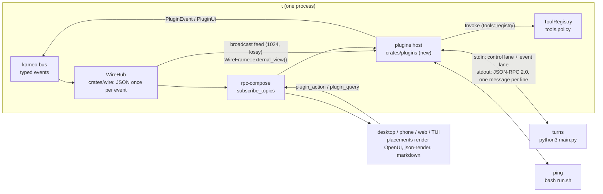
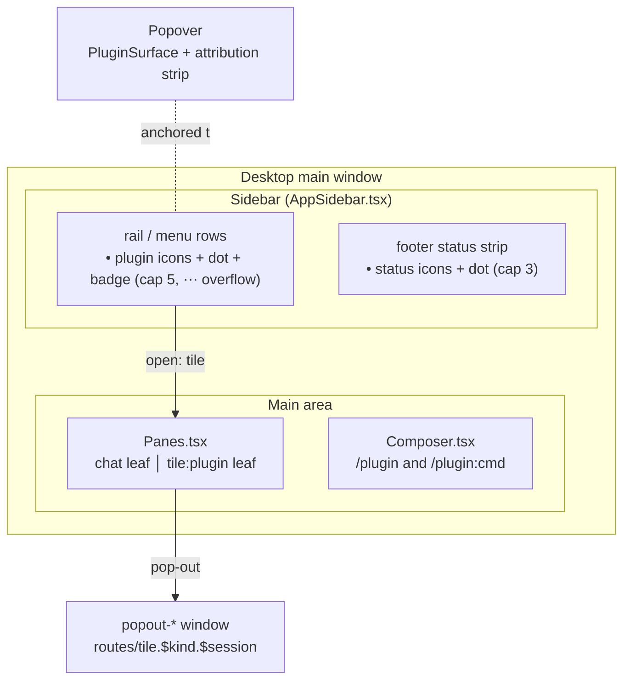

# 216 — External plugins: any language, no compile step

Status: design · 2026-11-24 · revised after review · owner amendments 2026-11-25 (§17 decided; Settings › Plugins, agent tools and SDKs in v1; the CLI is `t`; §3, §12, §14, §17, §20) · not built · build contract `docs/design/216-contract.md`. Extends `docs/plugins.md` (native
plugins), 00 §3–§4 and §7 ("Owner-declared event bridge"), 46 (apps / OpenUI), 30 (surfaces /
json-render), 40 (sensors), 04 and 187 (MCP loader). On *external* plugins this doc wins; on
everything a native plugin does, `docs/plugins.md` still wins. The two example plugins in §13 live in
`docs/design/216-examples/` with `check.sh`, a scripted host that runs both (§19).

**Revised after review (2026-11-24).** A read-only review (Fable 5.2) found two blockers, ten majors,
ten minors and nits; the owner ruled on each. This revision applies all of them: grants are
authenticated and code that holds secrets is hashed (F1), the install is a human-only press that never
times out (F7), meeting text and contacts' words are withheld by session and sender (F2, private
list), requests travel on a lossless control lane (F6), tools are declared in the manifest (F8),
`input` is destructive and rate-limited (F9), every plugin surface carries host-drawn attribution
(F10), and v1 is cut to the sidebar, status, tile and command placements, with everything else moved
to §20 "Later (not v1)" and its manifest keys reserved. §21 maps every finding to where it landed.

A **native plugin** is a Rust crate compiled into `t` (`docs/plugins.md#L5`). An **external plugin** is
a folder the user drops into `~/.theuth/plugins/<name>/`: a `plugin.yaml` and a `run:` command in any
language. theuth spawns it, writes the events it subscribed to on its stdin as JSON lines, and reads
what it emits, what it wants shown, and what it asks for from its stdout. It hot-loads the way MCP
files do, is restarted when it crashes, and cannot take theuth down with it. The host of all of this is
one ordinary native plugin crate, `plugins`, that obeys `docs/plugins.md` like any other and can be
switched off.



## 0. What exists today, what does not

Grounding for every later section. "Exists" means read in the tree on 2026-11-24 (re-read for the
revision).

| Need | Exists | Where |
|---|---|---|
| Plugin trait with a declaration pass before any start | yes | `crates/runtime/src/lib.rs#L439-L449` (`Plugin::declare_wire`, `start`) |
| One typed bus, guaranteed + unbounded mailboxes | yes | `crates/runtime/src/lib.rs#L41-L88`, `crates/runtime/src/lib.rs#L432-L437` |
| Generic serialisation of bus events to JSON, once per event | yes | `crates/wire/src/lib.rs#L1-L31` (`WireHub`), `crates/wire/src/lib.rs#L69-L84` (`WireEvent { TOPIC, VERSION }`), `crates/wire/src/lib.rs#L144-L153` (`WireFrame`) |
| Live JSON feed any in-process consumer can read | yes | `RuntimeWire::wire_events` `crates/wire/src/lib.rs#L204`, a `broadcast::channel(1024)` `crates/wire/src/lib.rs#L281` |
| Event catalog with JSON Schemas, topic + version | yes — 75 topics | `rpc_core::Discovery` `crates/rpc-core/src/discovery.rs#L157-L164`, emitted at `crates/rpc-core/src/discovery.rs#L215-L244` into `bindings/openrpc.json` → `x-theuth.events` |
| Compatibility gate on the catalog | yes | `crates/theuth/tests/wire_schema_snapshot.rs#L13-L21`, 00 §7 "Discovery, audiences and compatibility" |
| Catalog sealed after declaration | yes | `declare_plugins` → `rt.freeze_wire()` `crates/theuth/src/main.rs#L2068-L2082`; new topics after freeze are an error (`crates/wire/src/lib.rs#L215-L217`) |
| Topic-filtered event stream for clients | yes | `subscribe_topics(topics, session, descendants)` `crates/rpc-compose/src/api.rs#L109-L118` |
| A notion of *private* events | **no** — `EventPolicy` is admission/coalescing metadata, "not a new privacy model" (`crates/wire/src/lib.rs#L98`); 00 §7 says policies are "not nested-scope privacy" |
| Secret scrubbing of arbitrary JSON | yes | `tools::secrets::redact_value` `crates/tools/src/secrets.rs#L76-L81` over the vault's scrubber `crates/secrets/src/vault.rs#L907-L926` |
| Hot-reloaded directory of child processes, backoff, gates | yes (MCP) | watcher + 300 ms debounce `crates/tools/src/mcp.rs#L2537-L2562`; backoff 30 s → 30 min `crates/tools/src/mcp.rs#L50-L53`; gates in `mcp/config.yaml` (`crates/tools/src/mcp.rs#L1-L10`, `Gate` `crates/tools/src/lib.rs#L604-L631`) |
| `{{secret:…}}` / `$VAR` / `$(cmd)` expansion for a child's env | yes (MCP) | `expand` `crates/tools/src/mcp.rs#L2127-L2145` |
| Kill a child as a whole process tree | yes | `platform::process::ProcessTree` `crates/platform/src/process.rs#L19-L30` |
| Child-process JSON protocol precedent | yes (sensors) | CPython sensors: request on stdin, JSON on stdout `crates/agent/src/sensor/cpython.rs#L1-L31`, `assets/sensors/README.md` |
| Risk tiers and policy | yes | `Risk` `crates/tools/src/lib.rs#L150-L157`, `Policy` default allow/ask/ask `crates/tools/src/lib.rs#L697-L717` |
| UI-triggered tool call with press-as-consent | yes (apps) | `tools::AppInvoke` + `UserActivation` `crates/tools/src/registry.rs#L274-L304`; 46 §0.4 |
| OpenUI renderer with a pluggable tool provider | yes | `AppRendererProps.provider` `packages/apps/src/renderer.tsx#L33-L41`; `AppHost` builds one `crates/desktop/ui/src/components/apps/AppHost.tsx#L283-L316`, handles `@OpenUrl` / `@ToAssistant` `crates/desktop/ui/src/components/apps/AppHost.tsx#L427-L466` |
| OpenUI headless validation | yes | `app::helper` (js-runtime isolate, 2 s deadline) — `crates/app/src/lib.rs#L1-L12`, `docs/plugins.md#L308` |
| json-render parse/validate + text and picture fallbacks | yes | `surface::parse` `crates/surface/src/lib.rs#L177`, `spec_lines` `crates/surface/src/render.rs#L25`, `picture_parts` `crates/surface/src/pictures.rs#L141` |
| Sandboxed HTML with a postMessage JSON-RPC bridge (used only by §20, not v1) | yes | `crates/desktop/ui/src/lib/page-bootstrap.ts#L1-L14`, `components/chat/HtmlPage.tsx#L113-L171`; the page's whole policy is `CSP: sandbox allow-scripts allow-forms` (`crates/desktop/src/pages.rs#L1-L8`, `crates/desktop/src/pages.rs#L181-L185`) — no network restriction |
| Generic tiles, poppable | yes | `TILE_KINDS` `crates/desktop/ui/src/components/tiles/registry.tsx#L42-L61`, `PoppedTile` `crates/desktop/ui/src/components/tiles/registry.tsx#L100-L119`, leaf switch `routes/c.$session.tsx#L96`, `PopoutTarget { kind: 'tile' }` `lib/popout.ts#L45`, Tauri `open_window` `crates/desktop/src/commands.rs#L23` |
| Attention inbox sources | yes | `roster::attention::Source` / `RegisterSource` `crates/roster/src/attention.rs#L630-L636` |
| Event-triggered routines (`when:` on a bus event) | **no** — `when:` names a sensor file (`assets/sensors/README.md`, `crates/schedule/src/lib.rs#L505-L508`) |
| Plugin-declared sidebar/composer/header slots | **no** |
| Mesh replication of a plugin folder | **no, by design** — the file mirror is "top-level files only" (`crates/replica/src/files.rs#L1-L7`) |
| Human-only approval rows (the double and channel users cannot answer) | yes, but they time out to Deny | `RequestApproval` needs a `session` and a `tool`; timeout = Deny (`crates/tools/src/approval.rs#L152-L167`); `human_only` (`crates/tools/src/approval.rs#L87-L91`), `RequestHumanOnly` (`crates/tools/src/approval.rs#L169-L173`), `ask_human_only_on` (`crates/tools/src/approval.rs#L634-L650`) |
| "Human press" admission for an RPC call | yes | 171 §12.1 invariant 1: authenticated, not a guest, not the internal peer — `crates/cells/src/cells_guard.rs#L11-L20`, `RpcPeer::is_internal` `crates/rpc-core/src/peer.rs#L177-L181` |
| Engine-internal vault rows (never listed, never expandable by placeholder) | yes | `mesh/`, `sandbox/`, `share/` prefixes and `writable_name` `crates/secrets/src/vault.rs#L249-L275`; `hmac` 0.13 and `sha2` are workspace deps (`Cargo.toml#L218-L219`) |
| Frames relayed from other engines in the same feed | yes | `sessionsync` registers a wire source (`crates/sessionsync/src/lib.rs#L358-L377`); unknown kinds become descriptor-less frames (`crates/wire/src/lib.rs#L450-L454`); `WireFrame` carries no timestamp and no origin (`crates/wire/src/lib.rs#L144-L153`) |
| A marker for meeting sessions | yes | `meeting.events#Started { meeting, session }` (`crates/meeting/src/lib.rs#L353-L357`); every meeting input line starts with `[meeting` (`crates/meeting/src/session.rs#L1-L3`) |
| Contact vs mesh-peer provenance on delivered messages | partly | `PeerOrigin.contact_mode` is `Some` only for a contact (`crates/agent/src/communication.rs#L798-L810`); `AgentEvent::MessageDelivered { from, text }` has no such flag (`crates/agent/src/lib.rs#L3772-L3780`) |

Correction to the brief's UI map: since "tiles everywhere" (2026-11-22) a generic tile is a
`tile:<id>` leaf drawn by `TileLeaf` from `components/tiles/registry.tsx`; `web:<id>` and `draft:<uuid>`
leaves remain. Panes are still the in-memory `usePanes` tree in `lib/panes.ts` (678 lines) rendered by
`components/chat/Panes.tsx`.

## 1. Decisions

Each names what it beat (`docs/plugins.md#L28`).

**D1 — A plugin is a child process speaking JSON-RPC 2.0, one message per line, over stdin/stdout.**
Folder + `plugin.yaml` + `run:`. No SDK is needed: a plugin that only shows status is a `printf` in a
loop (§13.2); one that reacts to events is a `for line in sys.stdin` loop (§13.1). Rejected:

- *An MCP server with extensions.* MCP already hot-loads here, but its session is client-driven with a
  mandatory `initialize`/capabilities handshake, it has no subscription model for a stream of host
  events into the server, and its UI extension renders HTML in an iframe only — not UI as data. A
  10-line bash plugin cannot speak it. MCP is reused where it is good: the *tool* shapes (D7).
- *An RPC client of the engine* (`ws://…/?token=`, `subscribe_topics`). It exists and is the full
  owner API: whoever holds the token sees every event and calls every method, so there is no
  per-plugin permission at all; it needs a WebSocket client (no bash); nothing manages its lifecycle.
- *WASM components* (wasmtime + WIT). The only option with a real sandbox, but "any language" becomes
  "any language with a component toolchain" (Python via componentize-py, no bash), it needs a build
  step the owner ruled out, and it adds wasmtime to the binary. It wins the day plugins from strangers
  must be contained; v1 ships without containment and reserves an `isolation:` key for it (§20).
- *dlopen / C ABI.* A compile step, `unsafe`, and a segfault takes `t` down. Rejected outright.
- *An embedded JS runtime.* `js-runtime` exists for the app validator, and `docs/plugins.md#L308`
  already says it "is not a precedent for a JS plugin runtime": one language, and a hang shares our heap.

Framing: NDJSON, as MCP stdio does; rejected LSP's `Content-Length` headers (bash cannot produce them
honestly) and a bespoke `{"type": …}` protocol (JSON-RPC gives request ids and error objects that every
language already has a library for, and MCP's tool messages are JSON-RPC).

**D2 — The host is one native plugin crate, `plugins`.** It owns the folder watcher, the processes,
the grants, the catalog of plugin events, the placement state and the RPC methods. `plugins.enabled:
false` starts nothing (§3). Rejected: putting this in `tools` next to MCP (it would pull UI placement
state and app validation into the crate every plugin depends on) or in `agent` (the loop owns the frame,
not processes; `docs/plugins.md#L14`).

**D3 — Events reach plugins from the existing wire feed, not from new bus subscriptions.** The host
reads `rt.wire_events()` (`crates/wire/src/lib.rs#L204`): every registered event is already serialised
once into an `Arc<WireFrame>` with its topic, version and JSON. The host filters per plugin and writes
lines. Rejected: subscribing the host actor to each Rust type (it would have to name every event type,
an upward dependency on every plugin, and re-serialise per type) and a second serialisation layer.
Consequences carried honestly:

- The feed is live and lossy (1024 frames, `x-theuth.delivery.feed: "live"`, `durableReplay: false`);
  a slow plugin gets a `lagged` notice, never back-pressure on the bus (§6.6).
- A frame without a descriptor (an unknown payload from an older peer, `crates/wire/src/lib.rs#L450-L454`)
  has no topic and therefore no exposure: the router drops it.
- `sessionsync` relays other engines' approvals, asks, jobs, peer messages, cells and artifact frames
  into the same feed (`crates/sessionsync/src/lib.rs#L358-L377`). They carry a registered topic and
  pass the same exposure filter, so a local plugin sees what the owner's clients on this engine see,
  relayed or not. `WireFrame` has no origin field, so v1 cannot tell them apart; the `event`
  notification reserves an `engine` key for when it can (§6.2).
- `WireFrame` has no timestamp (`crates/wire/src/lib.rs#L144-L153`): `event.at_ms` is the host's receive time.

**D4 — Public by default; private is marked on the type and applied in `wire`.** `wire::WireEvent`
gains `const EXPOSURE: Exposure = Exposure::Public` and a `fn plugin_view(json: &Value) -> Option<Value>`
whose default is identity. A new event is public the moment its owner implements `WireEvent`, with no
list to update. An owner marks a whole topic `Private`, a transport topic `Internal`, or strips
variants/fields in `plugin_view` (§7.3). The projection is computed in one place, `wire`:
`WireFrame::external_view()` returns the frame as an outsider may see it (`None` for a private topic,
an internal one, a dropped variant or a descriptor-less frame), computed lazily once per frame and
cached in the `Arc`. The plugins router and any later consumer (routines, §20) call that method; none
re-implements it. Two guards keep public-by-default honest: a snapshot of every `topic#variant →
exposure` that changes only through `just wire-schema-accept`, and a lint over field names (§7.3).
Rejected: an allow-list in the host (every new event would be invisible until someone remembered it —
the opposite of the owner's rule), a derive macro (the trait already has `TOPIC` and `VERSION` consts
in exactly this shape), and the projection in the host (a second consumer would copy it — review F4).

**D5 — Plugin events join the catalog under one host-owned wire topic.** The catalog is frozen after
the declaration pass (`crates/theuth/src/main.rs#L2078`), so a plugin that appears at runtime cannot
register a new `WireEvent`. The host declares one topic, `plugins.events` v1, whose frames are
`{plugin, event, version, session?, data}`; the per-plugin event names (`turns.limit_reached`) and their
declared schemas (from the manifest) live in a second, dynamic catalog the host serves (`plugin_catalog`).
Other plugins subscribe to `turns.limit_reached`; clients subscribe to `plugins.events` and filter;
native code subscribes to the `PluginEvent` Rust type. Rejected: unfreezing the wire catalog (it is the
reviewed ABI; `wire_schema_snapshot` exists so it does not drift at runtime) and one wire topic per
plugin (same problem).

**D6 — UI is data.** A plugin sends OpenUI Lang, json-render or markdown source for a placement it
declared; every client renders it natively with the libraries it already ships (46, 30). Presses come
back as `action` requests to the plugin; OpenUI `Query(...)` comes back as `query` requests. Rejected:
HTML-first (does not render on TUI, Slack or the phone's native chrome, every plugin restyles theuth by
hand, and the page policy has no network restriction — review F10); React components shipped by the
plugin (a compile step and a supply chain inside our webview). An HTML escape hatch is specified for
later, with the policy it would need (§20).

**D7 — Tools are declared in the manifest, in MCP's shapes.** A plugin lists its tools under `tools:`
in `plugin.yaml` — `name`, `description`, `input_schema`, MCP `annotations` — and answers MCP
`tools/call` on its own pipe with MCP's exact `CallToolResult`. The host registers them from the
manifest at start, so the install card lists exactly what the model will be offered and the grant
covers them (§8). There is no `tools/list` and no `list_changed`: the set changes only by editing the
manifest, which re-prompts when it widens. Risk comes from the annotations through the existing
mapping (`annotated`, `crates/tools/src/mcp.rs#L651`), then the gate lines of `mcp/config.yaml` under
the reserved key `plugin.<name>` (the same gate-then-annotations order as `risk_of`, `crates/tools/src/mcp.rs#L2389-L2396`).
Rejected: a dynamic `tools/list` (the card could not know the tools before the process ran, and the set
could change after approval — review F8) and a theuth-specific `tool` message (a second schema, a second
risk mapping, a second gate file). Attaching a whole MCP server through a plugin is §20.

**D8 — Installing is approving arbitrary code; capabilities gate only what goes through theuth.** The
process runs as the user with the user's OS permissions. Grants decide which events it sees, which
placements it gets, and which host-brokered powers it can use (tool calls, input into sessions,
notifications, secrets in its env). The install card says this in one sentence and carries risk
`destructive`. Rejected: pretending capabilities are a sandbox (§10.4 says exactly what is and is not
contained).

**D9 — Plugin folders do not replicate across the mesh.** A plugin runs on the engine whose disk holds
its folder. The file mirror only replicates top-level files (`crates/replica/src/files.rs#L6`), and
code that runs as the user on another machine needs that machine's own approval. Remote clients of an
engine see that engine's placements (they come over its RPC) and no other engine's. Rejected:
replicating like `mcp/*.json` + `homes.yaml` (187) — a remote engine would list plugins it cannot run
without asking — and showing a mesh peer's placements read-only on another engine's clients (a second
source of truth for one icon; review §4 Q6).

**D10 — No runtime prompts for undeclared things.** Everything a plugin may do is on the install card;
an undeclared request fails with a JSON-RPC error and a log line (§10.3). The one runtime prompt is the
existing one: a host-brokered tool call whose `tools.policy` action is `ask`. Rejected: per-call
capability prompts (prompt fatigue; the owner asked for one card at install).

**D11 — Placements are declared, rendered by host-owned slots, and always attributed.** The plugin
cannot position pixels; it names a slot kind (sidebar, status, tile, command) and theuth draws the
icon, dot, badge and frame in house style on every surface, with a defined fallback where a surface has
no such slot (§9.5). Every plugin surface — popover, tile, notification, inbox item, brokered approval,
command reply — carries a host-drawn strip "plugin · `<name>`" outside the plugin's content, and plugin
content may not contain masked inputs (§9.4). Rejected: free-form overlays (cannot degrade to
TUI/phone; a phishing surface) and attribution drawn by the plugin (it can be omitted or forged).

**D12 — Native plugins stay.** Anything that needs the frame, a typed `ask`, a hot path, or must exist
for the harness to work stays a crate. The second tier is for things a user wants without a release.

**D13 — Grants are authenticated; code that holds power is hashed.** `grants.yaml` stays a readable
file, but each entry carries an HMAC-SHA256 under a 32-byte key kept in the vault as the
engine-internal row `plugins/grants-key` — a new `PLUGINS_PREFIX` with `share/`'s rules: written only
through `set_if_version`, never listed, never expandable by `{{secret:…}}`
(`crates/secrets/src/vault.rs#L249-L275`). An entry whose MAC does not verify is ignored, so writing
`grants.yaml` with `write_file` or from another plugin approves nothing. A plugin whose grant holds a
secret or any capability above `read_only` also has a **code hash** in its grant (the `run` target and
the files matched by `watch`); changed code does not start until a "code changed" card is pressed.
`plugins.dev: true` is the author's opt-out (§10.2). Rejected: keeping the grants themselves as vault
rows (opaque to the owner, who can read and diff `grants.yaml` today and revoke by deleting a line) and
trusting the plain file (any file-writing tool could install code — review F1).

**D14 — Install approval is a human press with no timeout, not an approval row.** The install card is
an attention item the host serves through its own `roster::attention::Source`
(`crates/roster/src/attention.rs#L630-L636`); it waits until pressed or dismissed. `plugin_approve` is
admitted only on a human press in the sense of 171 §12.1 invariant 1 — an authenticated peer that is
not a guest and not the internal peer (`crates/cells/src/cells_guard.rs#L11-L20`) — so the double, a
channel thread user, the model's tools and the MCP console cannot press it. Rejected: an ordinary
`RequestApproval` (needs a session and a tool, times out to Deny, and can be answered by the double or a
channel user — `crates/tools/src/approval.rs#L152-L167`) and `ask_human_only_on` (human-only, but it
needs a session to live in and still times out — `crates/tools/src/approval.rs#L634-L650`; an install is not part of any chat and
may wait for days).

**D15 — Two lanes into a plugin.** Host → plugin traffic is split: a **control lane** (requests,
responses to the plugin's requests, `granted`, `lagged`) that is never dropped and is always written
first, and an **event lane** (`event` notifications) that is bounded and drops oldest. `shutdown` jumps
both. Rejected: one lossy queue (a press or a `tools/call` could be dropped, or wait behind 2 048 events
and time out for a plugin that is merely busy — review F6).

**D16 — v1 is the smallest set that shows the idea end to end.** v1 ships the `sidebar` (icon, status
dot, badge; opens a popover or the plugin's tile), `status`, `tile` and `command` placements;
`subscribe`, `emit`, `notify`, `call`, `input` and static tools. `header`, composer icons, `card`,
`tray`, `settings` pages, the `html` format, the `mcp:` attach, `sessions: focused`, the `open`
capability, per-event `exposure: private`, the dev tile and Inject, git-URL install, and `when: event` routines are §20 (SDKs moved into v1 on 2026-11-25, §14), briefly specified, with their manifest keys reserved so a v1
manifest stays valid when they land. Rejected: shipping the full surface at once (about twice what a
v1 needs, each slot with its own lifecycle and competition rules — review §4).

## 2. The host: crate `plugins`

```
crates/plugins/
  src/lib.rs        // PLUGINS_ACTOR, PluginsConfig, events, Plugin impl, declare_wire
  src/manifest.rs   // plugin.yaml parse + validation, manifest hash, code hash
  src/grants.rs     // grants.yaml read/write, HMAC under the vault's plugins/grants-key
  src/proc.rs       // spawn, ProcessTree, pgid record + reap, two-lane writer, stdout reader, backoff
  src/route.rs      // wire feed → external_view → grants → session/sender scoping → redaction → event lane
  src/catalog.rs    // dynamic catalog: plugin events + exposed wire topics
  src/surface.rs    // placement state, ui validation (app::helper, surface::parse), rate limits, slots
  src/broker.rs     // plugin → host requests: call, input; notify; attention Source (install cards, notify)
  src/tools.rs      // manifest tools → DynTool
  src/rpc.rs        // rpc_module (plugin_* methods)
```

**Dependencies, downward only** (`docs/plugins.md#L80`): `runtime`, `wire` (`WireFrame::external_view`),
`tools` (Risk, Gate, ToolSpec, `RegisterTool`/`UnregisterTool`, `Invoke`, `secrets::redact_value`, the
MCP `expand` and `annotated` code made `pub`), `secrets` (the `plugins/grants-key` row), `app` (OpenUI
validation through `app::helper`), `surface` (json-render parse), `roster` (attention `Source` for
install cards and `notify`), `agent` (types and messages: `SendInput`, `CreateSession`, `SessionId`),
`platform` (`ProcessTree`), `rpc-core` (its own `rpc_module`, as every plugin now has;
`crates/theuth/src/main.rs#L2030-L2055`). Nothing depends on `plugins`. Position in the vector: after
`roster` and before `update` (`crates/theuth/src/main.rs#L2165-L2213`); position is convention only.

**Actor.** `PLUGINS_ACTOR = "plugins"`, one `PluginsActor` on `runtime::subscriber_mailbox()`. One
supervisor task per running plugin owns its child, a writer task and a reader task; the actor never
awaits a child on its mailbox (`docs/plugins.md#L173`).

**Commands** (`ask` → reply; message structs `pub`, serde-derived, reply types `kameo::Reply`):

| Message | Reply | What |
|---|---|---|
| `ListPlugins` | `Vec<PluginInfo>` | name, version, state, grant status, placements, last error, log path |
| `GetPlugin { name }` | `Result<PluginDetail, String>` | manifest, effective grants, catalog entries, stderr tail (40 lines) |
| `Approve { name, manifest_sha256, code_sha256, pressed }` | `Result<(), String>` | write the authenticated grant for exactly those hashes; start. `pressed` is the RPC layer's proof of a human press (D14); the actor refuses `Approve` without it |
| `SetEnabled { name, on }` | `Result<(), String>` | stop/start; persisted in `grants.yaml` (the MAC covers `enabled`) |
| `SetHidden { name, placement, hidden }` | `Result<(), String>` | the owner hides one placement on every client (§9.1) |
| `Restart { name }` | `Result<(), String>` | clears a `failed` crash loop too |
| `Install { path }` | `Result<String, String>` | copy a local folder into `plugins/<name>`; returns the name; the card follows |
| `Uninstall { name, keep_data }` | `Result<(), String>` | stop, unregister, move folder to `plugins/.trash/` |
| `Action { name, placement, action, args, session, activation }` | `Result<Value, String>` | a press, delivered as an `action` request (§6.2) |
| `Query { name, placement, query, args, session }` | `Result<Value, String>` | an OpenUI `Query`, delivered as a `query` request |
| `Command { name, command, args, session, client }` | `Result<CommandReply, String>` | a `/` command, delivered as a `command` request |
| `Catalog` | `Vec<CatalogEntry>` | §7.1 |
| `Surfaces` | `Vec<SurfaceSnapshot>` | latest status + source per placement (snapshot-first for clients) |

**Events** (each `#[serde(tag = "type")]`, `WireEvent`, declared in `declare_wire` even when disabled,
as every owner does — `crates/theuth/src/main.rs#L2068-L2077`):

| Rust type | Topic | Exposure | Published when |
|---|---|---|---|
| `PluginEvent { plugin, event, version, session: Option<SessionId>, data: Value }` | `plugins.events` v1 | Public | a plugin `emit`s a declared event (§7.6) |
| `PluginUi` enum: `PluginStatus { plugin, placement, dot, badge?, tooltip?, label? }`, `PluginSurface { plugin, placement, format, revision }`, `PluginState { plugin, state, error? }`, `PluginsChanged` | `plugins.ui` v1 | Public | status/ui/lifecycle changes; `PluginSurface` carries a revision, clients fetch the source with `plugin_surface` (keeps big sources out of every client's feed) |

**Tools (native).** None. Plugin-offered tools register through the registry like MCP tools (§8).

**`start`.** Reads `plugins:`; disabled → `Ok(())` with a log line. Otherwise spawns the actor,
registers it and its attention `Source`, then in a task: reaps orphans recorded by the last run (§5),
scans `plugins/`, validates each manifest, starts the ones whose authenticated grant matches, files an
install card for the rest, and starts the watcher. Broken folder → that plugin is `invalid` with the
error; the host still comes up (`docs/plugins.md#L171`).

## 3. Config section

`plugins:` in `config.yaml`; every key optional (`#[serde(default)]`, missing section → defaults,
`docs/plugins.md#L234`). Env overlay as usual (`THEUTH_PLUGINS__ENABLED=false`).

```yaml
plugins:
  enabled: true            # false: no actor, no processes, no plugin tools, no placements; folders untouched
  dir: plugins             # under the data dir
  watch: true              # hot-load plugin.yaml changes (300 ms debounce, as mcp/)
  dev: false               # author mode: no code hash in grants (§10.2), restart on any file change
  remote_sessions: false   # also deliver events of sessions owned by another engine of the mesh (§17 Q2)
  restart_first_ms: 1000   # first restart delay after a crash; doubles per crash
  restart_cap_ms: 300000   # 5 min
  crash_loop: 5            # this many crashes within crash_window_s → state `failed` until edited or restarted
  crash_window_s: 60
  shutdown_grace_ms: 3000  # after the `shutdown` notification, before the tree is killed
  max_line_bytes: 1048576  # longer lines: plugin → host discarded to the newline; host → plugin sent as a stub (§6.1)
  queue_frames: 2048       # per plugin, event lane only; overflow → drop oldest + `lagged`. The control lane is never dropped
  emit_per_s: 50           # plugin → host `emit` budget (burst 4×); excess dropped, counted, logged
  ui_per_s: 4              # `ui`/`status` per placement; coalesced, last write wins
  query_per_s: 10          # `plugin_query` per plugin from all clients; excess answered -32005
  input_per_min: 6         # `input` requests per plugin; excess answered -32005 (§10.3)
  request_timeout_ms: 10000   # host → plugin `action`/`query`/`command`/`render`/`tools/call` without a reply → error to the caller
  string_cap: 65536        # strings longer than this inside an event are cut with "…[+N bytes]" before delivery
  log_max_bytes: 10485760  # per plugin per day; past it, lines are counted and dropped until midnight
```

`enabled: false` leaves behind: the folders and `grants.yaml` (unchanged), the declared wire topics
(declaration still runs, so the ABI does not depend on config), plugin tools absent from
`list_tools`, every `plugin_*` method answering `plugins is disabled`.

The section is added, commented, to `DEFAULT_CONFIG` (`crates/theuth/src/main.rs#L884`).

## 4. Folder and manifest

### 4.1 Layout

```
~/.theuth/plugins/
  grants.yaml               # theuth-owned, each entry MAC'd: what the user approved (§11)
  .trash/                   # uninstalled folders, swept after 30 days
  .pgids                    # theuth-owned: process group per running plugin, for orphan reaping (§5)
  turns/                    # one plugin = one folder; the folder name is the plugin name
    plugin.yaml             # the manifest (author-owned)
    main.py                 # anything; run from this folder
~/.theuth/plugin-data/turns/  # THEUTH_PLUGIN_DATA: the plugin's own writable state
~/.theuth/logs/plugins/turns.log.<date>   # its stderr, `log` lines and host lifecycle lines, redacted (§7.4)
```

### 4.2 `plugin.yaml` — full v1 example

```yaml
name: turns                       # required; ^[a-z][a-z0-9-]{0,31}$; must equal the folder name
version: 0.2.0                    # required; free text shown on the card
description: Counts finished turns today; the sidebar dot turns amber past a daily limit.
protocol: 1                       # required; the wire protocol major (§6)
run: [python3, main.py]           # required; argv list, or a string split by shell words (no shell is run)
cwd: .                            # optional; relative to the folder
env:                              # optional; values expand {{secret:NAME}}, $VAR, $(cmd) like mcp/ entries
  TURNS_LIMIT: "50"
  GITHUB_TOKEN: "{{secret:github.pat}}"   # the secret's name is on the install card; the value never is
restart: on-failure               # on-failure (default) | always | never
watch: [main.py, "lib/**/*.py"]   # optional; restart on change, and the code hash covers these (§10.2)

subscribe:                        # optional; nothing is delivered that is not listed here
  - topic: agent.events           # a wire topic …
    types: [TurnFinished]         # … optionally narrowed to `type` tags
    version: [1]                  # optional; the versions this plugin understands (default: the current one)
  - topic: tools.approval-requested
  - event: other-plugin.something # a plugin event (§7.6); `other-plugin.*` for all of one plugin's events
  - topic: agent.events
    types: [TextDelta]
    deltas: true                  # delta-class types are opt-in per subscription (high volume)

emits:                            # optional; the only events this plugin may `emit`
  limit_reached:
    description: The daily turn count reached TURNS_LIMIT.
    version: 1                    # default 1
    scope: global                 # global (default) | session (session events must carry `session`)
    schema:                       # optional JSON Schema, published in the catalog for subscribers;
      type: object                # v1 checks only that `data` is an object (§7.6)
      required: [day, turns]
      properties: {day: {type: string}, turns: {type: integer}}

placements:                       # optional; §9
  - id: turns                     # unique within the plugin; [a-z0-9-]+
    kind: sidebar                 # sidebar | status | tile | command  (others reserved, §20)
    open: popover                 # sidebar only: popover (default) | tile
    icon: gauge                   # a lucide icon name, or a path to an SVG in the folder
    label: Turns today            # tooltip / menu text / tile title
    status: true                  # draws a status dot (+ badge) fed by `status` messages
    size: {width: 320, height: 220}   # popover/tile default; tiles are resizable
    format: openui                # openui | json-render | markdown  (html reserved, §20)
    fallback: text                # what non-rendering surfaces show: text (default) | hide

tools:                            # optional; static, in MCP's Tool shape (§8)
  - name: turns_today
    description: How many turns finished today and how many tokens they used.
    input_schema: {type: object, properties: {}}
    annotations: {readOnlyHint: true}

capabilities:                     # optional; each is a line on the install card (§10)
  - notify                        # inbox items + OS notifications
  - input                         # send text into a session as the user (destructive, rate-limited)
  - call:                         # host-brokered tool calls, in the plugin's own headless session
      tools: [knowledge_search, http_request]
      max_risk: read_only
```

**Reserved keys** (§20; accepted by the parser so a v1 manifest stays valid when they land):
top-level `mcp`, `isolation`; placement kinds `header`, `composer`, `card`, `tray`, `settings`, `view`;
placement `format: html` and `file`; placement `scope`; subscription `sessions`; capability `open`;
`emits.<name>.exposure`. A v1 host treats them as follows: a reserved placement kind or format →
that placement is skipped with a warning and is not on the card; `mcp`, `open` and `sessions` →
ignored with a warning; `isolation` and `emits.<name>.exposure` → **errors** (an author who asked
for containment or privacy must not silently get neither).

### 4.3 Validation

`plugin_check` (and the loader) refuses with a precise path, like `surface::parse` reports JSON
Pointers. Unknown top-level keys are warnings (forward compatibility); unknown `kind`/`capabilities`
that are not reserved are errors; `subscribe.topic` must be in the catalog (§7.1) and `public`;
`emits` names are `^[a-z][a-z0-9_]{0,47}$`; `run[0]` must resolve on `PATH` or in the folder; secrets
named in `env` must exist in the vault (`secret_list`); `tools[].name` follows the tool-name rule and
`input_schema` must be an object schema; `tools: inline` (an earlier draft of this doc) is an error
that says "declare tools as a list". `emits.<name>.schema` is checked only for being a JSON object;
nothing compares it across versions (review §4 cut; the catalog shows what the manifest declares).

Two hashes, with different jobs (review F18):

- **Manifest hash** — sha256 over the canonical JSON of the parsed manifest with `env` values
  *unexpanded*. It identifies one install card and is stored in the grant; it is not the gate.
- **Code hash** — sha256 over the sorted list of `(relative path, sha256(bytes))` for every `run`
  argument that names a file in the folder and every file matched by `watch`. Recorded in the grant
  only when the plugin holds a secret or a capability above `read_only` (§10.2) and `plugins.dev` is
  off.

## 5. Lifecycle

The authenticated grant is the gate; the manifest hash only names the card that produced it
(review F18). A plugin starts when its grant verifies (D13), the manifest asks for nothing the grant
does not hold, and — when the grant has a code hash — the code hash matches.

```mermaid
stateDiagram-v2
  [*] --> found: folder appears / Install
  found --> invalid: manifest error
  invalid --> found: plugin.yaml edited
  found --> awaiting_approval: no verified grant, or manifest wider than grant, or code hash differs
  awaiting_approval --> starting: owner presses Approve (human press)
  found --> starting: verified grant covers manifest (and code)
  starting --> running: process spawned
  running --> exited: exit 0 (restart never / on-failure)
  running --> backoff: crash (exit ≠ 0, signal, broken pipe, stray-output flood) / exit 0 with restart always
  backoff --> starting: delay elapsed (1 s, 2 s, … 5 min)
  backoff --> failed: 5 crashes in 60 s
  failed --> starting: file changed / Restart
  exited --> starting: file changed / Restart / Enable
  running --> stopping: Disable / Uninstall / engine shutdown
  stopping --> disabled
  disabled --> starting: Enable
  running --> running: manifest widened or code changed (old process keeps old grant; card filed)
```



- **Install.** Three ways, one result: drop a folder into `plugins/`; `t plugin install <path>`;
  the model writes the folder with `write_file` (it is a file like any other). The watcher sees a new
  `plugin.yaml`; the host validates it and files the install card (§10.2) in its attention `Source`
  and in Settings › Plugins. Nothing runs before a human press. Any file-writing tool can therefore
  *propose* a plugin; none can *start* one (D13, D14).
- **Spawn.** `run` in `cwd`, own process group / Job Object via `ProcessTree::adopt`
  (`crates/platform/src/process.rs#L18-L30`), env = the user's login env (as `tools.login_path`) +
  `THEUTH_PLUGIN`, `THEUTH_PLUGIN_DATA`, `THEUTH_PROTOCOL=1`, `THEUTH_PLUGIN_DIR`,
  `PYTHONUNBUFFERED=1` (a block-buffered `print` is the first trap a Python author hits) + the expanded
  manifest `env`. Never the RPC token or its path. The process group id is appended to
  `plugins/.pgids` and removed when the tree is gone. The first line on stdin is `hello` (§6.2).
  stderr goes line by line, redacted, to the plugin log.
- **Orphans** (review F14). If `t` itself is SIGKILLed, a Unix process group survives it, and a plugin
  that never reads stdin would run forever and be duplicated at the next start. At start the host
  reads `.pgids` and, for each group still alive whose leader's command line still matches the
  recorded `run`, sends SIGTERM, waits `shutdown_grace_ms`, then SIGKILL; then it truncates the file.
  Windows Job Objects with `KILL_ON_JOB_CLOSE` already cover this (`crates/platform/src/process.rs#L24-L27`).
- **Hot reload.** `plugin.yaml` change → re-validate → compare with the grant. **Widening** is any of:
  a new subscription, emit, placement, tool, capability or secret; a tool whose annotations raise its
  risk; or any change to `run`, `cwd`, `env` (keys or unexpanded values, including `$(cmd)`), `watch`
  or the reserved `mcp`. Widening → the running process keeps its old grant and keeps running, the
  plugin shows `needs approval`, a new card is filed. Same or narrower → graceful restart. A change to
  a file in `watch` (or any file with `plugins.dev`) → graceful restart, unless the grant holds a code
  hash and the new code does not match it: then the old process keeps running, nothing restarts, and
  a "code changed" card is filed (§10.2). If the old process exits meanwhile, the plugin waits in
  `awaiting_approval`. Debounce 300 ms, as `crates/tools/src/mcp.rs#L2554-L2557`.
- **Exit 0** (review F13) → `exited`, dot `off`, tooltip "exited". With `restart: always` an exit 0 is
  treated as a crash (backoff); with `on-failure` or `never` it stays `exited` until a file changes,
  the owner presses Restart, or the plugin is re-enabled. The ping example exits 0 only on `shutdown`
  or EOF, so it never lands here while the host is up.
- **Crash.** Exit ≠ 0, a signal, a broken stdout pipe, or a stray-output flood (§6.1) → `backoff`.
  Delay starts at `restart_first_ms`, doubles, caps at `restart_cap_ms`, resets after 60 s of running.
  `crash_loop` crashes within `crash_window_s` → `failed` (inbox item with the stderr tail). A crash can
  only lose the plugin's own in-flight work: the reader task sees EOF, the supervisor cancels the
  plugin's pending requests with `-32006 plugin <name> exited`, unregisters nothing (tools stay
  registered and answer "plugin restarting" so the model's tool list does not churn), and the dot shows
  `off` with the state as tooltip.
- **Hang.** A plugin that stops reading stdin fills its event lane → `lagged` (§6.6), never a stalled
  host; its control lane grows only with requests the host itself sent, which time out after
  `request_timeout_ms`. The host does not kill a quiet plugin: silence is legal (§13.2 is silent
  between pings).
- **Disable.** `SetEnabled{on:false}` → `shutdown` notification (ahead of both lanes), close stdin,
  wait `shutdown_grace_ms`, kill the tree; tools unregistered; placements removed from clients
  (`PluginState`).
- **Uninstall.** Disable, then move the folder to `plugins/.trash/<name>-<ts>/`, drop the grant, and
  with `keep_data: false` move `plugin-data/<name>` too. Catalog entries for its events disappear;
  subscribers to them simply receive nothing.
- **Engine shutdown.** Every plugin gets `shutdown` in parallel; the engine waits at most
  `shutdown_grace_ms` total (163 graceful quit budget), then kills the trees and clears `.pgids`.

## 6. Wire protocol (version 1)

### 6.1 Framing

- UTF-8 JSON, **one JSON-RPC 2.0 message per line**, `\n`-terminated, both directions. No batches.
- A message with `id` is a request and gets exactly one response; without `id` it is a notification.
  Ids are strings or integers chosen by the sender; the two directions have independent id spaces.
- **A plugin answers every request it receives.** One it does not handle gets `-32601` at once
  (§13.1 does this in its `else` branch); one it never answers costs its caller `request_timeout_ms`.
  A plugin that subscribes to nothing, declares no tools, no `command` and no interactive content
  receives no requests and may answer nothing (§13.2).
- **Stray output** (review F16). A stdout line that is not JSON, or is JSON without `"jsonrpc":"2.0"`
  (libraries that log JSON to stdout), is logged at `warn` as `stdout: <line>` and otherwise ignored,
  so a stray `print()` does not kill a plugin. More than 100 stray lines in 10 s → crash (§5), except
  during the first 5 s after spawn, when runtimes print banners. stderr is the log channel.
- **Long lines** (review F15). `max_line_bytes` (1 MiB). Plugin → host: the reader discards to the
  next newline without buffering it, logs `line over max_line_bytes (N bytes) discarded`, and answers
  a request with `-32602` when the discarded line's prefix carried an `id`. Host → plugin: an event that
  would exceed the cap after `string_cap` truncation is delivered as a stub `{topic, version, type,
  session?, truncated: true, bytes}` without `data`. (Python's default `ensure_ascii` can double a
  non-ASCII source; send `ensure_ascii=False`.)
- The host never sends a line before `hello` and never after `shutdown`. stdin EOF means "stop now".

### 6.2 Host → plugin

Two lanes (D15). The **control lane** carries `hello`, requests (`action`, `query`, `command`,
`render`, `tools/call`), responses to the plugin's requests, `granted` and `lagged`; it is unbounded
in practice (it holds only what the host itself is waiting on) and is always written before the event
lane. The **event lane** carries `event` notifications, bounded by `queue_frames`, drop-oldest.
`shutdown` is written ahead of both.

**`hello`** (notification, always first):

```json
{"jsonrpc":"2.0","method":"hello","params":{"protocol":1,"plugin":"turns","version":"0.2.0","theuth":"0.94.0","engine":"333","data_dir":"/Users/sky/.theuth/plugin-data/turns","grants":{"subscribe":["agent.events#TurnFinished"],"emits":["limit_reached"],"placements":["turns"],"tools":["turns_today"],"capabilities":{"notify":false,"input":false,"call":null}},"clients":{"desktop":true,"tui":false}}}
```

`grants.capabilities` is an object: `notify` and `input` are booleans, `call` is `null` or
`{"tools":[…],"max_risk":"read_only"}` (review F20).

**`event`** (notification) — one per delivered event. `topic`/`version`/`type` are the catalog keys;
`data` is the event JSON exactly as the wire feed carries it (`type` included), after the exposure
projection, session/sender scoping and redaction (§7.3–§7.4). `session` is copied to the top when the
event has one. `at_ms` is the host's receive time (the feed has no timestamp, D3). `engine` is reserved
for the originating engine of relayed frames and is absent in v1.

```json
{"jsonrpc":"2.0","method":"event","params":{"topic":"agent.events","version":1,"type":"TurnFinished","session":"01a20e56-84d4-775f-ae0c-65af2ba8c55b","at_ms":1795530420113,"data":{"type":"TurnFinished","session":"01a20e56-84d4-775f-ae0c-65af2ba8c55b","turn":"01a2…","stop_reason":"end_turn","usage":{"prompt":18234,"completion":912,"cached":17000},"context":19146}}}
```

A plugin event arrives the same way, its keys named as wire events name theirs (`version`, and the
emitting plugin in `data`'s envelope, review nit):

```json
{"jsonrpc":"2.0","method":"event","params":{"topic":"plugins.events","version":1,"type":"turns.limit_reached","at_ms":1795530420200,"data":{"plugin":"turns","event":"limit_reached","version":1,"session":null,"data":{"day":"2026-11-24","turns":50}}}}
```

The outer `version` is the wire topic's (`plugins.events` v1); `data.version` is the plugin event's own.

**`action`** (request, control lane) — a press on one of the plugin's placements. `activation` is the
renderer's action id for a real press on an OpenUI surface (§9.4); `client` says which surface; `form`
carries form values.

```json
{"jsonrpc":"2.0","id":"a-41","method":"action","params":{"placement":"turns","action":"reset","args":{},"session":null,"client":"desktop","activation":"01a2…-act","form":null}}
```

Reply: any `result` (shown as the Mutation's `.data`), or an `error` (shown as `.error`).

**`query`** (request) — an OpenUI `Query("name", args, defaults, refresh)` in one of the plugin's
placements. Reply `result` is the query's value. Rate-limited per plugin (`query_per_s`).

```json
{"jsonrpc":"2.0","id":"q-7","method":"query","params":{"placement":"turns","query":"history","args":{"days":7},"session":null}}
```

**`render`** (request) — a client is about to show a placement whose content the host does not have
(first open after start, or after the plugin's last `ui` was evicted). The plugin replies `{}` after
sending a `ui`, or `-32601` when it renders eagerly anyway (review F11). `session` is the chat the
surface is opened beside, for a plugin that wants to tailor content; v1 placements are global.

```json
{"jsonrpc":"2.0","id":"r-2","method":"render","params":{"placement":"turns","session":"01a20e56-…","client":"desktop"}}
```

**`command`** (request) — a `/` command the plugin declared (§9.1). `name` is the command as declared;
`args` the rest of the line.

```json
{"jsonrpc":"2.0","id":"c-3","method":"command","params":{"placement":"turns-cmd","name":"turns","args":"reset","session":"01a20e56-…","client":"tui"}}
```

Reply `{"text": "…"}` (shown as an ephemeral, attributed note in that chat) or `{"ui": {format,
source, text}}` (an ephemeral card, json-render or markdown), or `{}`.

**`tools/call`** (request; for tools declared in the manifest) — MCP's method name, params and result
verbatim (MCP 2025-06-18 `CallToolRequest.params`, `CallToolResult`). The host adds
`_meta.theuth = {session, call_id}` to the params. There is no `tools/list` (D7).

```json
{"jsonrpc":"2.0","id":"t-1","method":"tools/call","params":{"name":"turns_today","arguments":{},"_meta":{"theuth":{"session":"01a20e56-…","call_id":"toolu_01…"}}}}
```

**`notifications/cancelled`** (notification) — MCP's cancel, `{requestId, reason}`: the model's turn
was interrupted or the caller timed out. The plugin may stop work; it still answers (or not — a late
answer is discarded).

**`lagged`** (notification, control lane) — the plugin's event lane overflowed; `dropped` events were
discarded oldest first. A plugin that keeps derived state should re-read what it needs (`call` a read
tool) instead of trusting its counters.

```json
{"jsonrpc":"2.0","method":"lagged","params":{"dropped":312,"since_ms":1795530419000}}
```

**`granted`** (notification) — the effective grants changed while running (narrowing applies at once;
widening only after a press). `params` has the same shape as `hello.params.grants`.

```json
{"jsonrpc":"2.0","method":"granted","params":{"grants":{"subscribe":["agent.events#TurnFinished"],"emits":["limit_reached"],"placements":["turns"],"tools":["turns_today"],"capabilities":{"notify":false,"input":false,"call":null}}}}
```

**`shutdown`** (notification, ahead of both lanes) — finish within `grace_ms`; stdin closes right after.

```json
{"jsonrpc":"2.0","method":"shutdown","params":{"reason":"disable","grace_ms":3000}}
```

### 6.3 Plugin → host notifications

**`emit`** — publish one declared event. `data` must be a JSON object; otherwise it is dropped with a
`log` line. `session` is required when the event's `scope: session`.

```json
{"jsonrpc":"2.0","method":"emit","params":{"event":"limit_reached","data":{"day":"2026-11-24","turns":50}}}
```

**`status`** — the dot, badge, label and tooltip of a placement with `status: true`. `dot` ∈
`ok | busy | warn | error | off | none`; `badge` is an integer (0 hides it) or a string of ≤ 4
characters; `label` is ≤ 16 characters, shown next to the icon where a surface has room (the TUI
status segment `● ping 0.07 ms`, the status strip on hover); `tooltip` is ≤ 200 characters.

```json
{"jsonrpc":"2.0","method":"status","params":{"placement":"turns","dot":"warn","badge":51,"label":"51/50","tooltip":"Turns today: 51"}}
```

**`ui`** — replace a placement's content. `format` ∈ `openui | json-render | markdown`; `text` is
required, the fallback for surfaces that cannot render the format (TUI, channels).

```json
{"jsonrpc":"2.0","method":"ui","params":{"placement":"turns","format":"openui","text":"51 of 50 turns today · 1,204,113 tokens","source":"root = Card([title, body, controls])\ntitle = TextContent(\"## Turns today\")\nbody = TextContent(\"**51** of 50 turns · 1,204,113 tokens\")\nreset = Mutation(\"reset\", {})\ncontrols = Buttons([Button(\"Reset counter\", @Run(reset), \"secondary\")])"}}
```

A `ui` whose `source` is byte-identical to the current one changes nothing on clients: no new
revision, no remount, OpenUI `$state` and an open popover are kept (review F19).

**`invalidate`** — `{placement}`: clients re-run the placement's OpenUI `Query`s without replacing the
source, so a plugin can refresh data without resetting `$state` (review F19).

**`notify`** (capability `notify`) — an inbox item, plus an OS notification when `level` ≥ `warn`.
Both are shown with the host's "plugin · `<name>`" attribution (D11).

```json
{"jsonrpc":"2.0","method":"notify","params":{"title":"Turn limit reached","body":"50 turns today.","level":"warn","open":{"placement":"turns"}}}
```

**`log`** — a structured log line (`level` ∈ `debug | info | warn | error`) into the plugin log.

```json
{"jsonrpc":"2.0","method":"log","params":{"level":"info","message":"state loaded","fields":{"turns":12}}}
```

### 6.4 Plugin → host requests

All answer `result` or a JSON-RPC `error` (§6.5).

| Method | Capability | Params | Result |
|---|---|---|---|
| `call` | `call` (tool in `tools`, risk ≤ `max_risk`) | `{tool, args}` | `{content, is_error, structured?}` — the `ToolOutput`; always in the plugin's own headless session (§10.3) |
| `input` | `input` | `{session?, text, delivery?}` (`null` session = new chat) | `{session}` — as `agent::SendInput` (`crates/agent/src/lib.rs#L305-L327`), stamped with the plugin as its `channel` (§10.3); at most `input_per_min` |
| `catalog` | none | `{topic?}` | `[CatalogEntry]` (§7.1), for plugins that discover |
| `ping` | none | `{}` | `{now_ms}` |

```json
{"jsonrpc":"2.0","id":1,"method":"call","params":{"tool":"knowledge_search","args":{"query":"pomodoro length"}}}
{"jsonrpc":"2.0","id":1,"result":{"content":"[…]","is_error":false,"structured":[{"id":"…","title":"…"}]}}
```

Host-brokered calls are `tools::Invoke` with a `ToolCall { session, … }` (`crates/tools/src/lib.rs#L282-L296`)
whose session is always the plugin's headless session: the registry applies visibility, `tools.policy`,
secret expansion and redaction exactly as for the model, and any approval card lands in that session,
attributed to the plugin. A `session` param is refused with `-32602` in v1 (review F9: a plugin must not
run a tool in an arbitrary chat's shell and cwd, or put its approval card there).

### 6.5 Errors

Standard JSON-RPC codes plus four host codes:

| Code | Meaning |
|---|---|
| `-32601` | method not found (unknown method either way) |
| `-32602` | invalid params (`data.path` is a JSON Pointer) |
| `-32003` | not granted — `data: {capability \| topic \| placement \| tool}` |
| `-32004` | denied by policy (the tool's risk maps to `deny`, or a human denied the ask) |
| `-32005` | rate limited — `data: {retry_after_ms}` |
| `-32006` | plugin exited / restarting (host → caller) |

```json
{"jsonrpc":"2.0","id":1,"error":{"code":-32003,"message":"not granted: call shell","data":{"tool":"shell"}}}
```

### 6.6 Delivery, ordering, limits

- Per plugin, events are delivered in wire-feed order (bus-processing order, `crates/wire/src/lib.rs#L1-L6`).
  No cross-plugin ordering, no replay, no exactly-once — the feed's own contract
  (`x-theuth.delivery`: `feed: live`, `durableReplay: false`, `exactlyOnce: false`).
- The host's single feed receiver can itself lag (1024 frames). That loss is reported to every
  plugin as `lagged` with the count the broadcast receiver returned.
- Per plugin, the event lane holds `queue_frames`; on overflow the oldest are dropped and one
  `lagged` is queued on the control lane. The control lane is never dropped (D15). The bus, the hub and
  other plugins never wait for a plugin.
- `emit`, `status`, `ui`, `query` and `input` are rate-limited (§3); `ui`/`status` coalesce per
  placement (the last write wins), so a plugin that renders on every token cannot flood clients.
- Requests from a plugin: at most 16 in flight; more → `-32005`.

## 7. Event catalog

### 7.1 Names and entries

An event's stable name is **`<topic>#<type>`** for wire topics that carry a `type`-tagged enum
(`agent.events#TurnFinished`), **`<topic>`** for single-struct topics (`knowledge.changed`), and
**`<plugin>.<event>`** for plugin events (`turns.limit_reached`). `<type>` is the serialized tag as it
appears on the wire, not the Rust variant name, so it is not always PascalCase: `mesh.events#pair`,
`a2a.contacts#contact_pair`, the snake_case tags of `cells.events`, and `secrets.events#SecretsChanged`
for the Rust variant `Changed` (review nit). Topics are owner-qualified already (`TOPIC`,
`crates/wire/src/lib.rs#L69-L77`); Rust type names never identify a topic.

`plugin_catalog` / the `catalog` request return one entry per name:

```json
{"name":"agent.events#TurnFinished","topic":"agent.events","version":1,"type":"TurnFinished","owner":"agent","exposure":"public","describe":"A turn finished; carries its stop reason and token usage.","scoped":"session","delta":false,"schema":{"$ref":"#/components/schemas/event.agent_2eevents.output.AgentEvent"}}
{"name":"turns.limit_reached","topic":"plugins.events","version":1,"type":"turns.limit_reached","owner":"plugin:turns","exposure":"public","describe":"The daily turn count reached TURNS_LIMIT.","scoped":"global","delta":false,"schema":{"type":"object","required":["day","turns"],"properties":{"day":{"type":"string"},"turns":{"type":"integer"}}}}
```

`describe` is the first sentence of the schema `description` — the Rust doc comment, which schemars
already writes into `bindings/openrpc.json` for every topic and every `oneOf` branch — or, for plugin
events, the manifest's `description`. The install card uses it (§10.1), so a new event gets its card
phrase for free, with no new trait const and no table in the host (review §4 Q8).

### 7.2 Schemas come from the Rust types

Nothing new is generated by hand. Every wire topic's JSON Schema is already produced from its Rust
type by `schemars` through the descriptor's lazy `schema` callback (`crates/wire/src/lib.rs#L133-L142`)
when `rpc_core::Discovery::document` builds `bindings/openrpc.json` (`crates/rpc-core/src/discovery.rs#L215-L226`);
the 75 topics on 2026-11-24 are listed in its `x-theuth.events`. The host serves the same frozen
document's schemas (from `rpc_core`'s frozen discovery, no regeneration per request) and splits enum
topics into per-`type` entries by reading each `oneOf` branch's `type.const`. ts-rs bindings
(`bindings/`) stay what the desktop uses; plugins get JSON Schema, which every language can consume.

### 7.3 Public by default; the private rule

```rust
// crates/wire/src/lib.rs — additions (216)
#[derive(Clone, Copy, Debug, Default, PartialEq, Eq, Serialize)]
#[serde(rename_all = "snake_case")]
pub enum Exposure {
    /// Every external plugin may subscribe (after the user approves the subscription).
    #[default]
    Public,
    /// Never delivered to external plugins, never in their catalog. Owner-only consumers
    /// (native plugins, RPC clients holding the owner token) are unaffected.
    Private,
    /// Transport/control frames that are not events of the world (no catalog entry).
    Internal,
}

pub trait WireEvent: Clone + Send + Serialize + JsonSchema + 'static {
    const TOPIC: &'static str;
    const VERSION: u32 = 1;
    /// 216: who outside the binary may see this topic. New topics are public.
    const EXPOSURE: Exposure = Exposure::Public;
    /// 216: `type` tags of variants never shown to external plugins.
    const DROP: &'static [&'static str] = &[];
    /// 216: `"<type>.<field>"` paths always removed before delivery (`"Linked.number"`).
    const STRIP: &'static [&'static str] = &[];
    /// 216: fields whose names look sensitive but were reviewed as public (`"LinkPaired.device.key"`).
    const REVIEWED_PUBLIC: &'static [&'static str] = &[];
    /// 216: data-dependent projection after DROP/STRIP (`None` drops the frame). Default:
    /// unchanged. An owner that overrides it lists what it does in `CONDITIONAL`.
    fn plugin_view(json: &Value) -> Option<Value> { Some(json.clone()) }
    /// 216: one line per data-dependent rule `plugin_view` applies, for the snapshot.
    const CONDITIONAL: &'static [&'static str] = &[];
    // … to_json, policy unchanged
}

impl WireFrame {
    /// 216 (D4): the frame as an external plugin may see it — `None` without a descriptor, for a
    /// Private or Internal topic, a DROP variant or a `plugin_view` drop. Computed once, cached.
    pub fn external_view(&self) -> Option<&Value>;
}
```

`EventDescriptor` gains `exposure`, `drop`, `strip`, `reviewed_public`, `conditional` and
`plugin_view: fn(&Value) -> Option<Value>`; `x-theuth.events[]` gains `exposure` (an additive wire
change, accepted with `just wire-schema-accept`, 00 §7). Four private topics have a second
`impl WireEvent` in `crates/sessionsync/src/events.rs` (the relay's twins, `crates/sessionsync/src/events.rs#L1400`, `crates/sessionsync/src/events.rs#L1412`,
`crates/sessionsync/src/events.rs#L1473`, `crates/sessionsync/src/events.rs#L1484`); declaration fails when two impls of one `TOPIC` disagree on any of these consts,
and a test asserts it (review F4).

**Guards** (review F5), both in `crates/theuth/tests/`, both run by the existing gate:

- **Exposure snapshot** — `wire_exposure.txt`, one line per `topic#type`: `exposure`, its stripped
  fields, its `CONDITIONAL` lines. Generated from `rt.wire_schema()` after `declare_plugins`; any
  difference fails until `just wire-schema-accept` rewrites it, so every new variant is reviewed in
  the diff that adds it.
- **Name lint** — walks every public variant's schema recursively and fails on a property whose
  snake_case segment is one of `key`, `token`, `secret`, `password`, `passcode`, `code`, `pin`,
  `pairing`, `cookie`, `credential` unless it is in `STRIP` or `REVIEWED_PUBLIC`. Today's hits are
  reviewed in the same change (e.g. `link.events#LinkPaired` — `Device` holds no key material).

**Rule.** A topic, variant or field is private when it carries one of: (a) a credential or something
that grants access (keys, pairing material, sign-in pages, live access URLs); (b) words spoken or
written by people other than the owner who did not address theuth; (c) text the owner produced outside
a theuth conversation (dictation into other apps); (d) an inventory of the owner's accounts or
identifiers. Everything else — including the owner's own conversations, tool calls and outputs, their
own subagents' messages, and text from allowed channel users who wrote to theuth — is public, because a
plugin the owner installed and approved to read `agent.events` is the owner's own code. Size and
transport are not privacy: those topics are `Internal`.

**Scoped by session and by sender** (review F2). Rule (b) cannot be met per topic alone: a meeting's
transcript enters its agent session as `[meeting …]` input batches (`crates/meeting/src/session.rs#L1-L3`)
and would be public as `agent.events#InputQueued.text`. So the router keeps the set of **meeting
sessions** — seeded at host start from `meeting::ListMeetings` (every `MeetingSummary` has its
`session`), updated by `meeting.events#Started { session }` and `#Deleted` read off the feed — and for
those sessions strips every text-bearing field of `agent.events` (`TurnStarted.text`,
`InputQueued.text`, `TextDelta.text`, `ReasoningDelta.text`, `ToolCallStarted.args`,
`ToolCallProgress.args`, `ToolCallFinished.output`, `MessageDelivered.text`, `Error.message`,
`Suggestions.items`, `TodoChanged.snapshot`, `AdvisoryAdded.advisory`), keeping types, ids, usage and
timings. Meeting topics, briefs and summaries on `meeting.events`/`meeting.briefs` stay public. This
is the one exposure rule that needs state; it lives in the router beside `external_view`, and
`agent.events`' `CONDITIONAL` lists it so the snapshot shows it. Rejected: narrowing rule (b) to "raw
capture streams" with a warning on the card (the owner's call: withhold, do not warn).

**Private** (verified against `bindings/openrpc.json` and the Rust types on 2026-11-24):

| Topic / variant / field | Marked by | Rule | Reason |
|---|---|---|---|
| `secrets.events#SecretRequested` | `DROP` | a | The live signal that the owner is about to type a secret, with the card's title, note and field labels and the masked-entry request id. The names alone are not the reason — they are already public in `agent.events#ToolCallStarted{name:"secret_request", args}` and in `{{secret:NAME}}` placeholders. The reason is that it gives a plugin the exact moment and wording to imitate the masked-entry card. `SecretsChanged`, `SecretResolved` and `SecretsRotation` are public (counts, phases, versions; no values, no names beyond what redaction already shows). |
| `browser.web-profile-changed` | `EXPOSURE = Private` | d | `sites` is the list of sites the user is signed in to — an account inventory. |
| `link.events#LinkPairing` | `DROP` | a | `key` is the device pairing key; whoever holds it can pair a device to this engine. |
| `signal.events#LinkUrl`, `telegram.events#PairingLink` | `DROP` | a | The device-link / bot pairing URL links an account. |
| `signal.events#Linked.number` | `STRIP` | d | The owner's phone number (E.164). `Linked` itself stays public. |
| `mesh.events#pair`, `a2a.contacts#contact_pair` | `DROP` | a | Pairing ceremony frames with the verification code; a plugin with a placement could phish the ceremony. |
| `sandbox.events#OpenDesktop` | `DROP` | a | `ws_url` is an unauthenticated `ws://127.0.0.1:{port}/websockify` to the VM's desktop (`crates/sandbox/src/types.rs#L164-L167`, minted at `crates/sandbox/src/actor.rs#L1446`). |
| `meeting.events#Utterance` | `DROP` | b | Live transcript of other people's speech; they consented to a recording, not to arbitrary code reading it. |
| `meeting.events#Upcoming.event` and `#Detected.event` (`EventRef`, also in `alternatives`) — fields `description`, `join_url` | `STRIP` | b, a | `EventRef` (`crates/meeting/src/calendar/mod.rs#L82-L107`) carries the invite's agenda (others' words) and the join link (often with an embedded passcode). `title`, `start`, `end`, `join_host`, `organizer` and `attendees` stay public: they are the owner's own calendar metadata, as the owner's own messages are, and meeting plugins need them. |
| `agent.events` text fields of meeting sessions | router (session set, above) | b | Meeting transcripts reach the agent session as input batches. |
| `agent.events#MessageDelivered.text` when the sender is a contact | `plugin_view` + new field | b | The body of a contact's (186) message. `MessageDelivered` gains `contact: bool` (`#[serde(default)]`, additive; set from `PeerOrigin.contact_mode.is_some()`, `crates/agent/src/communication.rs#L798-L810`); `text` is stripped only when it is `true`. The same variant carries the owner's own subagents', parent's and jobs' messages (`crates/agent/src/lib.rs#L3772-L3780`), which stay public. |
| `agent.peer-delivered` `text` and `files` when `origin.contact_mode` is set | `plugin_view` | b | "Bounded, redacted body as consumed" of a peer message (`crates/agent/src/communication.rs#L863-L878`); same content as `MessageDelivered.text`, same rule: stripped for contacts, public for the owner's own mesh peers. |
| `agent.events#ContactFileChanged` — `file.name`, `file.path` | `STRIP` | b | A contact's file name and where it was saved (`crates/agent/src/communication/files.rs#L181-L221`); size, media type, state and hash stay. |
| `voice.events#DictationText`, `#DictionarySuggestion` | `DROP` | c | Dictation types into any app, including password fields (153); the suggestion keeps audio. |

**Public, decided explicitly** (they were private in the first draft or flagged by review):
`talk.events#Heard` (the same words arrive about a second later as public `Submitted`; dropping it
cost live captions and voice-trigger plugins for nothing), `agent.events#MessageDelivered.text` from
anyone but a contact, `secrets.events` other than `SecretRequested`, text from allowed non-owner channel
users on `InputQueued`/`TurnStarted` (they addressed theuth; `channel` on those variants tells a plugin
who wrote, and the card says "including messages people send theuth on Slack/Telegram/Signal" when the
plugin subscribes to them — review §4 Q3). Checked by the review and public: `link.events#LinkPaired`,
`share.*`, `nodes.events`, `agent.login`, `tools.approval-*`, `tools.ask-*`, `tools.jobs`,
`slack.events`, `telegram.events` other than `PairingLink`.

**Internal** (no catalog entry, not subscribable): `rpc.stream` (connection controls),
`sessionsync.follow-state` (relay transport), and the engine-to-shell RPC frames, both halves of each
pair — `artifact.web-view-call-requested` / `-resolved`, `browser.element-form-requested` / `-resolved`,
`artifact.page-preview-requested` / `-resolved`, `artifact.fence-snapshot-requested` / `-resolved`. They
are requests from the engine to a desktop shell (fill values in a signed-in web view, a copy of a
sign-in form, preview HTML), not events of the world. `voice.events#SpeechAudio` (opus chunks) is a
`DROP` on a public topic, transport by the same reasoning. Delta-class types (`TextDelta`,
`ReasoningDelta`, `ToolCallProgress`, `VisionProgress`, 129) stay public but need `deltas: true` on the
subscription.

### 7.4 Redaction inside public events

Applied by the host once per frame, before any plugin sees it, cached across plugins, and only when at
least one running plugin's subscription matches the frame (review F17):

1. `WireFrame::external_view()` and the session/sender scoping (§7.3).
2. `tools::secrets::redact_value` over every string (`crates/tools/src/secrets.rs#L76-L81`): any value
   the vault knows, and its base64, becomes `{{secret:NAME}}`. A token that leaked into a tool output
   reaches a plugin as a placeholder.
3. Strings longer than `string_cap` are cut with `…[+N bytes]`; a plugin that needs the whole tool
   output asks for it with a `call` it was granted.

The same `redact_value` runs on everything a plugin sends that leaves its process: `emit`, `ui`,
`status` (tooltip and label included), `notify`, `log`, command replies and tool results — and on each
stderr line before it is written to the plugin log — so a secret a plugin got through its `env` is
not re-broadcast or logged in clear by accident. The plugin log is capped at `log_max_bytes` a day.

Redaction is defence in depth, not the boundary: §10.4.

### 7.5 Versioning and compatibility

- A wire topic's `VERSION` is its owner's contract; the existing gate
  (`crates/theuth/tests/wire_schema_snapshot.rs#L13-L21`, `rpc_core::compatibility::classify`) already
  fails removed/changed contracts and makes additions a deliberate acceptance. Plugins get the same
  promise as the desktop: additive changes keep the version; a breaking change bumps `VERSION`.
- A subscription may list the versions it understands (`version: [1, 2]`; default: the version current
  when the manifest was approved). On a bump, the host always cuts over — there is no down-projection
  to the old shape. A plugin whose list does not include the new version receives nothing on that
  topic and gets one inbox item ("turns: agent.events moved to v2; update the plugin"); the dot shows
  `warn` until the manifest lists it (review §4 Q4).
- Plugins must ignore unknown fields and unknown `type`s (`x-theuth.delivery.unknownTopicVersionVariant:
  "ignore"`). The host adds fields freely.
- Plugin events version per event (`emits.<name>.version`, default 1). The host does not compare
  schemas across versions; an author bumps the version when the shape breaks, and subscribers name
  the versions they read, as for wire topics.

### 7.6 Plugin-emitted events

`emit {event, data}` → `data` must be a JSON object → redact (§7.4) → publish
`PluginEvent { plugin, event, version, session, data }` on the bus → the wire hub serialises it as
topic `plugins.events` → (a) the router delivers it to plugins subscribed to `<plugin>.<event>` or
`<plugin>.*`; (b) clients see it on `subscribe_topics(["plugins.events"])`; (c) native code
subscribes to `PluginEvent`. A plugin never receives its own emits unless it subscribes to them. An
`emit` of an undeclared name is `-32003`-logged and dropped. Every plugin event is public in v1;
per-event `exposure: private` is §20. Defaults when `emits.<name>` omits them: `version: 1`,
`scope: global`, `schema: {}`. The declared schema is published in the catalog for subscribers;
the host does not validate `data` against it (review §4 cut).

### 7.7 The UI as a subscriber

The UI consumes `plugins.ui` and `plugins.events` through `subscribe_topics`; placement content is
fetched with `plugin_surface` on `PluginSurface { revision }`, snapshot-first as the delivery rule
requires (`x-theuth.delivery.controls`). Owner clients are not filtered by exposure (00 §7: exposure
governs external plugins only). Routines triggered by events (`when: event …`) are §20.

## 8. Tools the plugin offers the model

**`tools:`** in the manifest (D7). Each entry is MCP's `Tool` shape in YAML — `name`, `description`,
`input_schema` (MCP's `inputSchema`), optional `output_schema`, optional `annotations` — and becomes a
`DynTool` in the registry when the plugin starts:

- `name` as given, unprefixed, the same clash rule as MCP and natives (a clash with a native loses,
  logged; `docs/plugins.md#L212`).
- `Risk` through MCP's own order: the gate line of `mcp/config.yaml` under the reserved server key
  `plugin.<name>` (per tool or whole plugin; `off` hides) when it names a risk, else the annotations
  through `annotated` (`readOnlyHint` → `read_only`, else `destructiveHint` → `destructive`, else
  `mutating`; `crates/tools/src/mcp.rs#L651`) — the same gate-then-annotations order as `risk_of`
  (`crates/tools/src/mcp.rs#L2389-L2396`). Settings › MCP already edits those lines (`SetGate`). The MCP loader refuses a
  server *named* `plugin.*` so the key cannot collide.
- `ToolSource::Plugin { name, version }` — a new variant beside `Native` and `Mcp`
  (`crates/tools/src/lib.rs#L217-L234`), so the app bridge and `list_tools` show where a tool comes from.
- `CONSUMES_SECRETS` stays `true`: arguments are expanded by the registry before `tools/call`, outputs
  redacted after, as for MCP.
- The tool set is exactly the manifest's, and the install card lists it with each tool's risk (§10.1).
  Adding a tool or raising a tool's risk is widening (§5). There is no `tools/list` and no
  `list_changed`.
- A `tools/call` while the plugin is restarting answers `plugin <name> is restarting` as a tool error
  (§5): the model sees text, the tool list does not churn. A `tools/call` that the model's turn
  abandons sends MCP's `notifications/cancelled` (§6.2).
- **Prompt injection.** Tool descriptions and results are text the model reads, so a plugin with
  tools can steer the model without the `input` capability (review F8). The card says so on the tools
  line ("the model reads what these tools return"), and tool results carry the plugin attribution in
  the transcript's tool card, as MCP tools carry their server's name.

Plugin tools are invoked through `Invoke` like any other (`docs/plugins.md#L214`); a plugin has no
second way to affect the world on the model's behalf. Shipping a whole MCP server as a plugin (`mcp:`)
is §20; an MCP server can already be dropped into `mcp/` today.

## 9. UI placements

### 9.1 Kinds (v1)

| `kind` | Where (desktop) | Declares | Content |
|---|---|---|---|
| `sidebar` + `open: popover` | an icon in the sidebar's plugin row (expanded) and the rail (collapsed); dot + badge on the icon; click → popover anchored to it | icon, label, `status`, size, format | openui / json-render / markdown |
| `sidebar` + `open: tile` | the same icon; click opens (or focuses) the plugin's `tile` placement — the icon → full view | icon, label, `status`; the plugin must also declare one `tile` | as the tile |
| `status` | the sidebar footer status strip (icon + dot, label and tooltip on hover); no content | icon, label | `status` only |
| `tile` | a panes leaf `tile:<id>` with the shared `TileFrame` header (drag, pop-out, X), opened from its sidebar icon or by the user from Settings › Plugins | icon, label, size, format | openui / json-render / markdown |
| `command` | `/<plugin>` or `/<plugin>:<cmd>` in every composer (desktop, TUI, channels) and an entry in the search/command dialog | `name`, `description`, `args` hint | reply text or an ephemeral card |

Every v1 placement is global: its content does not depend on the chat it is shown beside. Session-scoped
placements (`header`, composer icons, `card`) are §20 with the lifecycle they need.

**Slot competition** (review F12):

- **Commands.** A plugin's command is `/<plugin>` when its `name` equals the plugin name, otherwise
  `/<plugin>:<name>`; a plugin cannot declare a bare `/<word>`. Built-in commands
  (`crates/tui/src/model/slash.rs#L4`, the desktop's `slash.ts`) and an external harness's commands
  always win; a plugin whose name equals a built-in command is refused at validation ("plugin name
  `model` collides with /model"). Plugin names are unique folders, so two plugins cannot collide.
- **Order.** Sidebar icons and status-strip items are ordered by install time (the grant's
  `approved_at`), oldest first; the owner can drag to reorder in Settings › Plugins (stored in
  `grants.yaml`, not MAC'd — order is not a power).
- **Cap.** At most 5 plugin icons show in the sidebar row; the rest are in a "⋯"
  overflow menu at the end of the row, each with its dot. Status-strip items cap at 3 with the same
  overflow. A dot of `warn` or `error` in the overflow lights the "⋯".
- **Hide.** Every placement has a "Hide" toggle in Settings › Plugins and in its icon's context menu
  (`SetHidden`). A hidden placement is not drawn on any client; its `command` still works.

Notifications and badges are not placements: `notify` (capability) lands in the attention inbox via
the host's `roster::attention::Source` (`crates/roster/src/attention.rs#L630-L636`) and, at
`warn`/`error`, as an OS notification through the desktop's existing path; the inbox count is the
badge.



### 9.2 What a placement declares, and its lifecycle

`id`, `kind`, `icon` (a lucide name — the desktop already depends on `lucide-react`, see
`components/tiles/registry.tsx#L1-L20` — or an SVG file in the folder, sanitised), `label`, `status`
(bool), `open` (sidebar only), `size` (`{width, height}` default 360 × 280 for popovers, 480 × 360 for
tiles), `format` (what it will send; a mismatch is a validation error), `fallback` (`text` | `hide`),
and for `command`: `name`, `description`, `args`.

**Lifecycle** (review F11). The host keeps one surface per placement — the latest valid `ui` and the
latest `status` — not one per session. A plugin may render eagerly (send `ui` at start and whenever its
state changes, as §13.1 does) or lazily: when a client opens a placement whose surface the host does not
hold, the host sends a `render` request and the client shows a host-drawn "loading" frame until the
`ui` arrives or `request_timeout_ms` passes ("plugin did not render"). Surfaces are dropped when the
plugin stops, and kept at most 256 KB each and 4 MB per plugin (an over-size `ui` is refused with a
`log` error). Nothing is persisted across engine restarts (review §4 Q5): the icon and label come from
the manifest, so nothing is blank; the dot shows `off` with the tooltip "starting" until the plugin's
first `status`.

**Where a tile lands.** `openTile` and `PopoutTarget { kind: 'tile' }` are bound to a chat
(`UI/lib/tiles.ts#L58` takes a `host`; `UI/lib/popout.ts#L45` carries a `session`). A plugin tile is
opened in the pane tree of the chat focused in that window, keyed `plugin:<name>:<id>` so a second
open focuses the existing leaf; with no chat open, the sidebar icon opens the placement as a popover
instead. Pop-out passes that chat as the `session` of the target; the tile's content is the same global
surface in every window.

### 9.3 Status and badges

Only `status` messages change a dot, badge, label or tooltip. The host stores the latest per
`(plugin, placement)`, publishes `PluginStatus` on `plugins.ui`, and serves the snapshot with
`plugin_surfaces`. A plugin that has never sent `status` shows `off` with "starting" (§9.2), not a
guess. While a plugin is `backoff`, `failed`, `exited` or `awaiting_approval` the host overrides the dot
to `off` / `error` / `off` / `off` and the tooltip to the state, so a dead plugin never shows a stale
green. Badges on a `sidebar` icon also roll up into the rail when the sidebar is collapsed (the same
count, no new widget).

### 9.4 Content, actions and attribution

The host validates every `ui` before clients see it: `openui` through `app::helper` (the same pinned
parser and library hash as apps, 46 §2.1) in a **plugin mode** that resolves `Query`/`Mutation` names
against the plugin, not the tool registry; `json-render` through `surface::parse`
(`crates/surface/src/lib.rs#L177`); `markdown` as is. A failure is sent back to the plugin as `log`
level `error` with the validator's message and path, and the placement keeps its last good content.

**No masked inputs** (review F10). Plugin mode refuses an OpenUI `Input` (a curated component,
`packages/apps/src/library.ts#L78`) whose type is `password` or otherwise masked, and the markdown renderer drops raw HTML inputs, so a plugin surface can never look
like theuth asking for a secret (`secret_request`'s masked card stays the only one). The refusal is a
validation error with its path.

**Attribution** (D11). `PluginSurface` draws a host-owned strip — the plugin's icon, "plugin ·
`<name>`" — above the content of every popover, tile and ephemeral command card; inbox items,
OS notifications and approval cards raised by a plugin's `call` carry the same words in their title
line. The strip is outside the plugin's content tree, so the plugin cannot hide or restyle it.

Clients render with one new component, `PluginSurface`, that switches on `format`:

- `openui` → `AppRenderer` (`packages/apps/src/renderer.tsx#L33-L41`) with a **plugin provider**:
  `Query(name, args, …)` → `plugin_query` (rate-limited, `query_per_s`); `Mutation(name, args)` inside
  `@Run` → `plugin_action` with the renderer's action id as `activation`. `@OpenUrl` and
  `@CopyToClipboard` are handled locally as `AppHost` does (`AppHost.tsx#L427-L440`). `@ToAssistant`
  opens a new chat with that text, drafted in the composer, not sent — sending stays the owner's press.
  Forms deliver their values as `form`. A `ui` with an identical `source` does not remount (§6.3);
  `invalidate` re-runs the queries.
- `json-render` → `JsonRenderFence`'s renderer (`components/chat/surface/JsonRenderFence.tsx`). Static:
  json-render has no actions, so interactive plugins use OpenUI.
- `markdown` → the chat markdown renderer, raw HTML off.

The press is the consent for what the plugin does *itself* in response (it is the plugin's own code);
it is **not** inherited by tools the plugin then calls through the host — those go through
`tools.policy` (§10.3). If press-as-consent for brokered calls is ever added, it is limited to OpenUI
presses (never an HTML bridge), single-use, bound to one `call` id as `UserActivation.request_id` is
(`crates/tools/src/registry.rs#L292-L304`), capped at `mutating`, with a 5 s life (review §4 Q2).

### 9.5 Degradation by surface

| Placement | Desktop (macOS; Linux) | Phone (iOS app, link) | Web client | TUI | Slack / Telegram / Signal | ACP |
|---|---|---|---|---|---|---|
| `sidebar` | icon, dot, badge, popover / tile | icon in the sidebar sheet; popover and tile become a bottom sheet | as desktop | `/plugins` menu lists it with dot + `text` fallback; ⏎ shows json-render/markdown inline, OpenUI as "interactive on desktop/web" (46 §8.2) | not shown | not shown |
| `status` | footer strip | sidebar sheet footer | footer strip | status line segment `● ping 0.07 ms` (dot + `label`) | not shown | not shown |
| `tile` | panes leaf, pop-out window | one leaf at a time (phones show one leaf), no pop-out (`canPopout()` false on iOS) | leaf, no pop-out | not shown; `/plugins` opens its `text` fallback | not shown | not shown |
| `command` | `/plugin[:cmd]` | `/plugin[:cmd]` | `/plugin[:cmd]` | `/plugin[:cmd]` (`crates/tui/src/model/slash.rs#L4` gains dynamic entries) | `/plugin[:cmd]` where the channel already handles slash commands; reply text only | no |
| `notify` | inbox + OS notification | inbox + push (42) | inbox | inbox count in status line | `message_user` only when the plugin has `notify` *and* the owner turned "plugin notifications to channels" on | — |

Windows is unsupported in v1 (review §4 Q7): the host refuses to start on Windows with a log line. When
it is done it needs PATHEXT lookup for `run[0]`, `.cmd`/`.bat` through `cmd /d /s /c`, an optional
per-OS `run` override (`run: {windows: […], default: […]}`, reserved), and `\r\n` tolerated on stdout.

### 9.6 Placement → host file

`UI` = `crates/desktop/ui/src`. All new files are marked *new*.

| Placement | Hosted by | Notes |
|---|---|---|
| all | `UI/components/plugins/PluginSurface.tsx` *new* | format switch (§9.4), plugin provider, attribution strip, loading/error state |
| all | `UI/lib/plugins.ts` *new* | zustand store fed by `plugins.ui` + `plugin_surfaces` snapshot |
| `sidebar` | `UI/components/sidebar/AppSidebar.tsx` — rail icons `UI/components/sidebar/AppSidebar.tsx#L153-L247`, expanded menu above `<SidebarFooter>` `UI/components/sidebar/AppSidebar.tsx#L409` → `UI/components/plugins/SidebarSlot.tsx` *new* (row, cap, ⋯ overflow) | popover = `components/ui/popover` as `Rail.tsx` uses |
| `status` | `UI/components/sidebar/AppSidebar.tsx#L409-L426` (`<SidebarFooter>`) → `UI/components/plugins/StatusStrip.tsx` *new* | tooltip = `RailTip` |
| `tile` | `UI/components/tiles/registry.tsx` `TILE_KINDS` `UI/components/tiles/registry.tsx#L42-L61` + `TILE_ICONS` `UI/components/tiles/registry.tsx#L64-L82` gain `plugin`; `UI/components/tiles/kinds/plugin.tsx` *new*; opened with `openTile` (`UI/lib/tiles.ts#L58`) | pop-out through `PopoutTarget { kind: 'tile' }` (`UI/lib/popout.ts#L45`) → `routes/tile.$kind.$session.tsx` → `PoppedTile`; `lib/popout.test.ts` needs a case |
| `command` | `UI/components/chat/slash.ts`; TUI `crates/tui/src/model/slash.rs` | dynamic `/plugin[:cmd]` entries from `plugin_list` |
| Settings › Plugins | `UI/lib/nav.ts` `GROUPS` `UI/lib/nav.ts#L23` + `UI/routes/settings.$tab.tsx`; `UI/components/settings/Plugins.tsx` *new* (list, install card review, approve, enable, hide, reorder, logs) | owner-only page, not a plugin placement |
| install card | `UI/components/plugins/InstallCard.tsx` *new*, rendered from the host's attention items | its Approve calls `plugin_approve` |
| TUI | `crates/tui/src/model/` new `plugins.rs` + `/plugins` in `slash.rs`, status segment in `ui.rs` | text fallbacks only |

## 10. Permissions

### 10.1 What a manifest can ask for

Every line is shown on the install card in plain words with the risk it maps to. Risk uses the one
contract (`Risk`, 00 §1.7); `tools.policy` still decides every brokered call. One thing here is new
and is said plainly (review F22): `call: {tools, max_risk}` is a **per-plugin allow-list of tools**,
which `docs/plugins.md#L211` rules out for tools ("Do not add a gate, a flag, or a per-tool policy").
It is a grant on a *caller*, not a policy on a tool — it only narrows what this plugin may reach, and
every call it allows still goes through `tools.policy` with the tool's own risk — but it is a second
list a reviewer has to read, so §16 amends `docs/plugins.md` to name it as the one exception.

| Manifest entry | Card wording (example) | Risk | Without it |
|---|---|---|---|
| `run`, `cwd`, `env` (always) | "Runs `python3 main.py` from `~/.theuth/plugins/turns` as you, with your files and network" | destructive | — (cannot install) |
| `env` with `{{secret:X}}` | "Gets the secret `github.pat` in its environment" | destructive | expansion refused → plugin not started |
| `subscribe` topic | "Reads agent.events: TurnFinished — a turn finished; carries its stop reason and token usage" (§7.1 `describe`), plus "including messages people send theuth on Slack/Telegram/Signal" for text-bearing `agent.events` types | read_only | events never delivered |
| `emits` | "Publishes `turns.limit_reached`" | read_only | `emit` dropped (`-32003` logged) |
| `placements` | "Adds a sidebar icon with a popover" | read_only | `ui`/`status` for it ignored |
| `tools` | "Offers the model 1 tool: turns_today (read-only). The model reads what it returns." | per tool, through `tools.policy` at call time | — (only declared tools exist) |
| `call` (`tools`, `max_risk`) | "May call knowledge_search, http_request (read-only), in its own background session" | the max of the listed tools' risks, capped by `max_risk` | `-32003` |
| `input` | "May send messages into your chats as you — at most 6 a minute — which the model then acts on with every tool your policy allows" | destructive | `-32003` |
| `notify` | "May add inbox items and notifications" | read_only | `-32003` |

`input` is `destructive` (review F9): prompting as the user drives every tool the policy allows, and
with `tools.approvals: false` (`crates/tools/src/lib.rs#L636-L641`) that is everything.

The card's overall risk is the highest line's — always at least `destructive`, because `run` is.

### 10.2 The install card and the code-changed card

D13 and D14 together. One card per (manifest hash, code hash) pair: title "Install plugin turns
0.2.0?", the lines of §10.1, the folder path, and Approve / Dismiss / Review (→ Settings › Plugins ›
turns). The card is an item of the host's own attention `Source`, so it reaches every client's inbox
and the phone, with no session, no tool and no timeout: it waits until the owner presses it or
dismisses it. Dismiss leaves the plugin `awaiting_approval` with no card until its manifest or code
changes.

**Who can press it.** `plugin_approve` is admitted only on a human press (171 §12.1 invariant 1:
authenticated, not a guest, not the internal peer — `crates/cells/src/cells_guard.rs#L11-L20`) and
carries that proof into the actor's `Approve`. The double never answers it (it is not an approval
row), a channel thread user cannot (channels do not render install cards; the inbox item says "open
theuth to review"), and the model's tools, the MCP console, the ACP half and the TUI's in-process
connection cannot (they are the internal peer). The CLI's `t plugin approve` connects as an
external peer and asks y/N on its own terminal; it is a press in the same sense as the desktop's and
has the same residual (§10.4). `tools.policy` and `tools.approvals: false` are not consulted: nothing
here is a tool call.

**What the press writes.** A grant entry (§11) with the manifest hash, the effective grants, and —
when the plugin holds a secret or any capability above `read_only` (`input`, or `call` with
`max_risk` above `read_only`) and `plugins.dev` is off — the code hash (§4.3); then its HMAC under
`plugins/grants-key` (D13). Then the plugin starts.

**Re-approval** is needed when:

- the manifest widens (§5: new subscription, emit, placement, tool, capability or secret; a raised
  tool risk; any change to `run`, `cwd`, `env`, `watch`) — the card lists only the new lines, with
  "Runs `…`" repeated when `run`, `cwd` or `env` changed;
- the code changes for a grant that holds a code hash — a **code-changed card**: "turns changed
  `main.py` since you approved it; it holds `github.pat`", with the changed paths, Approve / Dismiss.
  Until it is pressed the old process keeps running if it is up, and nothing new starts.

A plugin with only read-only power (subscriptions, emits, placements, `notify`, read-only tools and
`call`) carries no code hash: editing its code restarts it without a card, as editing a file the owner
already trusts. With `plugins.dev: true` no grant carries a code hash, so an author's edit-run loop has
no cards; the manifest still re-prompts when it widens. Rejected: hashing every plugin's code (a card
on every edit of a read-only status widget; the risk is in what the code can reach, not in the code)
and hashing nothing (writing `main.py` of an approved plugin would inherit its secrets — review F1).

### 10.3 Unapproved at runtime

- **Subscriptions.** The router filters by grant; an undeclared topic is never delivered. There is no
  runtime `subscribe` method — subscriptions are the manifest's.
- **Capabilities.** A request needing an ungranted capability gets `-32003 not granted: <what>`, one
  `log` line in the plugin log. No prompt, no inbox item (D10).
- **Placements.** `ui`/`status` for an undeclared placement is dropped with `-32003` logged.
- **Tool calls.** A granted `call` runs in the plugin's **headless session** (`agent::CreateSession`,
  `crates/agent/src/lifecycle.rs#L121-L131`, title `plugin: turns`, project `plugins`, no model turn
  ever; created on the first brokered call), never in a chat. It goes through `tools.policy` with the
  tool's own risk: `allow` runs; `deny` → `-32004`; `ask` → an approval card titled "plugin turns wants
  to run http_request", raised as `RequestHumanOnly` (`crates/tools/src/approval.rs#L169-L173`), so
  the double and channel users cannot answer it — the double has no conversation to predict from and
  the asker is not the model it was trained on. Its timeout is the ordinary one and resolves to Deny
  (`-32004`); a brokered call may fail, an install may not time out. Rejected: ordinary approvals the
  double may answer.
- **Input.** A granted `input` is a `SendInput` whose `channel` is `ChannelOrigin { via: Plugin, from:
  Some("<name>") }` — `ChannelVia` gains `Plugin` (`crates/agent/src/communication.rs#L834-L841`), an
  enum addition the wire gate shows and that is accepted with `just wire-schema-accept`. The chat
  shows the row with a "plugin · turns" chip, `InputQueued`/`TurnStarted` carry the origin, and other
  plugins can tell. More than `input_per_min` → `-32005`; a plugin that hits the limit three minutes in
  a row is disabled with an inbox item (a `TurnFinished` → `input` loop burns tokens).
- **Grants narrowed while running** (the owner unticks a line in Settings): applied at once,
  re-MAC'd, `granted` notification sent.

### 10.4 The trust boundary, stated plainly

The process is the user's code running as the user. It can read `~/.theuth/token` (any local client
does, `crates/rpc/src/engine.rs#L250-L251`), open the RPC socket and see private events, read the vault
file (encrypted; its key is an OS keychain item or a 0600 file, `crates/secrets/src/key.rs#L1-L4`, both
reachable by the user's processes), and do anything the user's account can. Grants, exposure and
redaction protect against **honest plugins that over-collect and buggy ones that leak** — the common
case for code the user wrote or chose — not against a malicious one.

The install and code-changed cards protect against **the model and other software writing plugins**:
a file-writing tool, another plugin or an MCP server can create or edit a folder and even
`grants.yaml`, but cannot produce a grant that verifies, so nothing it wrote starts with a secret or
more than read-only power. They do not protect against anything that already runs arbitrary commands
as the user — an approved `shell` call, another plugin, the user's own scripts — because that can read
the RPC token and the vault key and act as the owner's client; that is the residual every owner-token
path in theuth has (design 210 review). Installing is therefore `destructive` and always a human
press, and containment of untrusted plugins is a later decision with its key reserved (`isolation:`,
§20): a sandbox VM (79) as the runner, or a macOS sandbox profile that denies `~/.theuth`.

## 11. Data on disk

| Path | Owner | Truth or derived | Deletable |
|---|---|---|---|
| `<data_dir>/plugins/<name>/` | the user / author | truth (the plugin) | yes = uninstall without a trace in `.trash` |
| `<data_dir>/plugins/grants.yaml` | host | truth: what was approved, each entry MAC'd | deleting it re-prompts every plugin |
| vault row `plugins/grants-key` | host | truth: the HMAC key (32 bytes, engine-internal, never listed or expandable) | deleting it invalidates every grant → every plugin re-prompts |
| `<data_dir>/plugins/.pgids` | host | derived: process groups of running plugins (§5) | yes |
| `<data_dir>/plugins/.trash/<name>-<ts>/` | host | copy | yes; swept after 30 days |
| `<data_dir>/plugin-data/<name>/` | the plugin | the plugin's truth (`THEUTH_PLUGIN_DATA`) | yes = the plugin starts fresh |
| `<data_dir>/logs/plugins/<name>.log.<date>` | host | log: redacted stderr, `log` messages, lifecycle lines; `log_max_bytes` a day; 5 days kept | yes |

`grants.yaml`:

```yaml
turns:
  manifest_sha256: 6b1f…e2       # the card that was pressed; identifies, does not gate
  code_sha256: null              # set only for plugins holding a secret or more than read-only power
  approved_at: 2026-11-24T16:40:02Z
  enabled: true
  grants:                        # what the card listed and the owner approved; narrowed by unticking
    subscribe: ["agent.events#TurnFinished"]
    emits: [limit_reached]
    placements: [turns]
    tools: [{name: turns_today, risk: read_only}]
    capabilities: {notify: false, input: false, call: null}
    secrets: []
    run: [python3, main.py]      # run, cwd and env as approved (unexpanded), so a change is widening
    cwd: .
    env: {TURNS_LIMIT: "50"}
  mac: 9c0e…71                   # HMAC-SHA256 over the canonical JSON of every key above; plugins/grants-key
order: [turns, ping]             # sidebar/status order (§9.1); not MAC'd
hidden: []                       # hidden placements (§9.1); not MAC'd
```

An entry whose `mac` does not verify is treated as absent: the plugin shows `awaiting_approval`, and
the card says "the saved approval for turns could not be verified" so an owner who hand-edited the file
knows why. Nothing is in `sessions.sqlite`; nothing replicates (D9). The headless plugin session is an
ordinary session row.

## 12. Commands, RPC, CLI, TUI, Settings, agent tools

Amended 2026-11-25 (owner): the binary is `t`; `t plugin approve` is a human press (Q3); Settings ›
Plugins and agent tools are v1. Exact signatures, serde shapes and owners: `docs/design/216-contract.md`
(§6 RPC, §7 tools/CLI/TUI, §8 the press), which wins on names.

**RPC** (`crates/plugins/src/rpc.rs`, one domain module, merged in `rpc_composition`
`crates/theuth/src/main.rs#L2030-L2055`; each a lookup + one `ask`; owner-only, guests refused):
`plugin_list`, `plugin_get(name)`, `plugin_check(path)`, `plugin_install(path)`, `plugin_new(name,
lang?, raw?)`, `plugin_approve(name, manifest_sha256, code_sha256)` (human press only, D14),
`plugin_set_enabled(name, on)`, `plugin_set_hidden(name, placement, hidden)`, `plugin_set_order(order)`,
`plugin_restart(name)`, `plugin_uninstall(name, keep_data?)`, `plugin_action(name, placement, action,
args, session?, activation?, form?)` (`with_extensions`: the `RpcPeer` decides `client`, and an
activation from the internal peer is refused, as `app_call_tool` does — `docs/plugins.md#L247`),
`plugin_query(name, placement, query, args, session?)`, `plugin_command(name, command, args, session?)`,
`plugin_surfaces()`, `plugin_surface(name, placement, session?)` → `{revision, state, format, source,
text, bindings}`, `plugin_catalog(topic?)`, `plugin_logs(name, tail?)`. Events: `plugins.events`,
`plugins.ui` via `subscribe_topics`.

**CLI** (`t plugin …`, `crates/theuth/src/plugin_cli.rs`, dispatched from `run()` before `cmd_67`):
`list`, `new <name> [--lang py|js|sh|go|rb|rs] [--raw]` (works without an engine), `install <path>`,
`approve <name>`, `enable|disable|restart <name>`, `logs <name> [-n N] [-f]` (reads the log file, no
engine needed), `uninstall <name> [--keep-data]`, `check <path> [--sync]` (offline when no engine
runs), `catalog [<topic>]`. **`t plugin approve` counts as a human press** (owner, Q3): it connects
with the data dir's token as a non-internal, non-guest peer, prints the card's lines, and approves only
on a typed `y` with stdin and stdout on a terminal (no `--yes`). Forwarded calls from another engine
are not a press: a plugin is approved on the engine whose disk holds it.

**Settings › Plugins** (owner amendment): a 13th settings category `plugins` (the Tools category is
full). One row per plugin: state chip, enable switch, Approve (the pending card's lines, then
`plugin_approve`), Restart, Logs, Uninstall (confirmed, optional keep-data), per-placement Hide,
up/down order, the granted subscriptions, tools and capabilities (read-only in v1), Open folder
(desktop only), and **New plugin** (name + language, scaffolds with `plugin_new`). The install card's
Review button opens this page focused on the plugin.

**Agent tools** (owner amendment; `crates/plugins/src/atools.rs`): agents manage plugins for the user
but can never approve one. `plugin_list`, `plugin_status`, `plugin_logs` (`read_only`);
`plugin_enable`, `plugin_disable`, `plugin_restart`, `plugin_new`, `plugin_install` (`mutating` —
enable/restart only start code a human approved for exactly its hashes, new/install only write files
and file a card); `plugin_uninstall` (`destructive` — it throws away an approval only a human can give
back); `plugin_approve_request` (`read_only` — it re-files the install card in the owner's inbox and
says that the owner must press Approve or run `t plugin approve`). None is `HUMAN_ONLY` and none can
produce the press proof `plugin_approve` needs. They are listed in `crates/theuth/harness.md`.

**TUI:** `/plugins` menu (list with state dots; ⏎ shows a plugin's `text` fallbacks and json-render
content; `r` restart, `d` disable/enable, `l` log tail — no approve: the TUI shares the internal
connection, which is not a human press, so it says "approve in the theuth app or with `t plugin
approve <name>`"); `status` placements in the status line; plugin `command`s as dynamic slash entries
(built-ins win).

## 13. Two example plugins

Both are in `docs/design/216-examples/` exactly as printed here, with `check.sh`, a scripted host that
runs them (§19). Neither uses an SDK.

### 13.1 `turns` — Python: subscribes, keeps state, sidebar popover with a status dot, a button, a tool

`docs/design/216-examples/turns/plugin.yaml`:

```yaml
# docs/design/216-examples/turns/plugin.yaml — design 216 §13.1
name: turns
version: 0.2.0
description: Counts finished turns today; the sidebar dot turns amber past a daily limit.
protocol: 1
run: [python3, main.py]
env:
  TURNS_LIMIT: "50"
subscribe:
  - topic: agent.events
    types: [TurnFinished]
emits:
  limit_reached:
    description: The daily turn count reached TURNS_LIMIT.
    version: 1
    scope: global
    schema:
      type: object
      required: [day, turns]
      properties:
        day: {type: string}
        turns: {type: integer}
placements:
  - id: turns
    kind: sidebar
    open: popover
    icon: gauge
    label: Turns today
    status: true
    size: {width: 320, height: 220}
    format: openui
tools:
  - name: turns_today
    description: How many turns finished today and how many tokens they used.
    input_schema: {type: object, properties: {}}
    annotations: {readOnlyHint: true}
capabilities: []
```

`docs/design/216-examples/turns/main.py`:

```python
#!/usr/bin/env python3
"""turns: counts finished turns today (design 216 §13.1). Standard library only, no SDK.

Host -> plugin: one JSON-RPC 2.0 message per stdin line. Plugin -> host: one per stdout line.
"""
import datetime
import json
import os
import pathlib
import sys

DATA = pathlib.Path(os.environ.get("THEUTH_PLUGIN_DATA", "."))
STATE = DATA / "state.json"
LIMIT = int(os.environ.get("TURNS_LIMIT", "50"))


def out(msg):
    sys.stdout.write(json.dumps(msg) + "\n")
    sys.stdout.flush()


def send(method, **params):
    out({"jsonrpc": "2.0", "method": method, "params": params})


def reply(msg, result=None, error=None):
    if "id" not in msg:
        return  # a notification gets no answer
    body = {"error": error} if error else {"result": result}
    out({"jsonrpc": "2.0", "id": msg["id"], **body})


def today():
    return datetime.date.today().isoformat()


def load():
    try:
        s = json.loads(STATE.read_text())
    except (OSError, ValueError):
        s = {}
    return s if s.get("day") == today() else {"day": today(), "turns": 0, "tokens": 0}


def save(s):
    DATA.mkdir(parents=True, exist_ok=True)
    tmp = STATE.with_suffix(".tmp")
    tmp.write_text(json.dumps(s))
    tmp.replace(STATE)


def summary(s):
    return f"{s['turns']} of {LIMIT} turns today · {s['tokens']:,} tokens"


def render(s):
    over = s["turns"] >= LIMIT
    send("status", placement="turns", dot="warn" if over else "ok", badge=s["turns"],
         tooltip=f"Turns today: {s['turns']}", label=f"{s['turns']}/{LIMIT}")
    line = f"**{s['turns']}** of {LIMIT} turns · {s['tokens']:,} tokens"
    send("ui", placement="turns", format="openui", text=summary(s), source="\n".join([
        "root = Card([title, body, controls])",
        'title = TextContent("## Turns today")',
        f"body = TextContent({json.dumps(line)})",
        'reset = Mutation("reset", {})',
        'controls = Buttons([Button("Reset counter", @Run(reset), "secondary")])',
    ]))


state = load()
render(state)
for raw in sys.stdin:
    try:
        msg = json.loads(raw)
    except ValueError:
        continue
    method, p = msg.get("method"), msg.get("params") or {}
    if state["day"] != today():
        state = load()
    if method == "event" and p.get("topic") == "agent.events" and p.get("type") == "TurnFinished":
        usage = p["data"].get("usage") or {}
        state["turns"] += 1
        state["tokens"] += usage.get("prompt", 0) + usage.get("completion", 0)
        save(state)
        render(state)
        if state["turns"] == LIMIT:
            send("emit", event="limit_reached", data={"day": state["day"], "turns": state["turns"]})
    elif method == "action" and p.get("action") == "reset":
        state = {"day": today(), "turns": 0, "tokens": 0}
        save(state)
        render(state)
        reply(msg, {"ok": True})
    elif method == "render":
        render(state)
        reply(msg, {})
    elif method == "tools/call" and p.get("name") == "turns_today":
        reply(msg, {"content": [{"type": "text", "text": summary(state)}],
                    "structuredContent": state, "isError": False})
    elif method == "shutdown":
        save(state)
        break
    else:
        # Every request this plugin does not handle is answered at once, so no caller
        # waits request_timeout_ms (§6.1); unknown notifications are ignored.
        reply(msg, error={"code": -32601, "message": f"method not found: {method}"})
```

What happens: on start it renders from `plugin-data/turns/state.json` (state survives restarts and
crashes); each `agent.events#TurnFinished` adds one turn and the prompt + completion tokens, saves
atomically, re-sends `status` (green dot, badge = count, label `n/limit`; amber at the limit) and the
popover's OpenUI with its `text` fallback; reaching the limit emits `turns.limit_reached`. The popover's
"Reset counter" button is an OpenUI `Mutation("reset")` → `plugin_action` → an `action` request → the
plugin resets, re-renders and answers. A `render` pull re-sends the surface. The model's `turns_today`
tool is answered from the same state. Every other request is answered `-32601` at once, so no caller
waits `request_timeout_ms`. It holds no secret and only read-only power, so its grant carries no code
hash (§10.2): editing `main.py` restarts it without a card.

### 13.2 `ping` — bash: a status-strip ping

`docs/design/216-examples/ping/plugin.yaml`:

```yaml
# docs/design/216-examples/ping/plugin.yaml — design 216 §13.2
name: ping
version: 0.2.0
description: Pings a host every 10 seconds; a status dot and the round trip in its tooltip.
protocol: 1
run: [bash, run.sh]
env:
  PING_HOST: "1.1.1.1"
placements:
  - id: ping
    kind: status
    icon: activity
    label: Ping
    status: true
capabilities: []
```

`docs/design/216-examples/ping/run.sh`:

```bash
#!/bin/bash
# ping: one status line every 10 s (design 216 §13.2). Runs on macOS /bin/bash 3.2 and on bash 4+.
# It reads stdin only to learn when to stop.
host=${PING_HOST:-1.1.1.1}
read -r hello || exit 0            # the first line is always `hello`; EOF: the host is gone
while true; do
  ms=$(ping -c 1 "$host" 2>/dev/null | sed -n 's/.*time=\([0-9.]*\).*/\1/p')
  if [ -n "$ms" ]; then dot=ok; label="$ms ms"; else dot=error; label=down; fi
  printf '{"jsonrpc":"2.0","method":"status","params":{"placement":"ping","dot":"%s","label":"%s","tooltip":"%s %s"}}\n' \
    "$dot" "$label" "$host" "$label"
  start=$SECONDS
  if read -r -t 10 line; then
    case $line in *'"method":"shutdown"'*) exit 0 ;; esac
  else
    rc=$?
    # A timeout is >128 on bash 4+ but 1 on bash 3.2, the same as EOF. A timeout returns only
    # after the full 10 s, so a failure that came sooner is EOF: the host is gone.
    if [ "$rc" -le 128 ] && [ $((SECONDS - start)) -lt 9 ]; then exit 0; fi
  fi
done
```

It receives no requests (no subscriptions, tools, commands or interactive content), so it answers
nothing and never needs to. It reads `hello` before the loop, so it pings once per 10 s from the start;
then it sleeps on `read -t 10`, so a `shutdown` line or stdin EOF ends it at once. The EOF test does
not rely on `read -t`'s exit status: stock macOS `/bin/bash` is 3.2.57, where a timeout returns 1,
the same as EOF (bash 4+ returns > 128). A timeout only returns after the full 10 s, so a failed `read`
that came back sooner is EOF. The desktop draws it in the sidebar footer strip (dot, `label` on hover),
the TUI as the status segment `● ping 0.07 ms`.

## 14. Developer experience

Amended 2026-11-25 (owner): **SDKs are v1** (moved out of §20). They are specified in
`/tmp/theuth-216/research-sdk.md` and built under `sdk/`; scaffolding is `docs/design/216-contract.md` §10.2.

- **`t plugin new <name> [--lang py|js|sh|go|rb|rs] [--raw]`** writes `plugins/<name>/`: `plugin.yaml`
  and the SDK hello world (at most 15 lines) for the language, with the one-file SDK
  (`theuth_plugin.py`, `theuth-plugin.js`, `theuth-plugin.sh`, `theuth.go`, `theuth_plugin.rb`, or a
  small `theuth-plugin` crate) **vendored into the folder**, so the code hash covers the SDK the plugin
  actually runs. Default `py` with the SDK; `--raw` (py, sh) writes the no-SDK templates of §13's
  shape. Help highlights py, js and sh (no compile step); go and rs compile with their own toolchains,
  theuth still compiles nothing. No network, no package manager, no `THEUTH_SDK` import path; the SDK
  files are embedded in `t`, and `new` works without a running engine. Because the folder is new, it
  is awaiting approval: the command points at `t plugin approve <name>`.
- **SDKs are untyped** (dicts, `map[string]any`, `serde_json::Value`): plugins must ignore unknown
  fields anyway (§7.5). `sdk/catalog.md`, generated from `bindings/openrpc.json` by `sdk/gen/catalog.py`
  and checked for drift, lists every subscribable event with its version and card sentence.
- **Yaml wins.** Every SDK accepts `--theuth-manifest`: it prints the YAML its registrations imply and
  exits 0 without reading stdin. `t plugin check --sync <path>` diffs that against `plugin.yaml` and
  warns on drift; it never gates. The manifest stays the contract the install card is drawn from (D7).
- **Logs:** `~/.theuth/logs/plugins/<name>.log.<date>`; `t plugin logs -f <name>` (no engine needed);
  Settings › Plugins › Logs.
- **Restart on edit:** `plugins.dev: true` restarts on any file change in the folder (300 ms debounce)
  and leaves code hashes out of grants (§10.2).
- **Check without the engine:** `t plugin check <path>` validates the manifest offline (secrets and
  topics are checked too when an engine runs). `216-examples/check.sh` and `sdk/conformance/` drive
  plugins through a scripted host. Replaying an events file (`--events file.jsonl`) is §20.

The dev tile with live trace and Inject is §20.

## 15. Implementation steps, each with a runnable check

No step runs a workspace build while other sessions build; follow the machine's build protocol
(`knowledge_search("build protocol")`) and gate at crate level (`cargo check -p plugins`). Every check
below is a command or a scripted RPC round-trip that exits non-zero on failure.

1. **Exposure in `wire`.** `Exposure`, the `EXPOSURE`/`DROP`/`STRIP`/`REVIEWED_PUBLIC`/`CONDITIONAL`
   consts, `plugin_view`, the descriptor fields, `WireFrame::external_view()` (cached), the `exposure`
   key in discovery; mark §7.3's topics in their owners (including the relay twins).
   *Check:* `cargo test -p wire` (new unit tests: a descriptor-less frame's view is `None`; DROP and
   STRIP apply; the view is computed once); `cargo test -p theuth --test wire_exposure` compares the
   new `wire_exposure.txt` snapshot and runs the name lint and the same-`TOPIC` agreement test;
   `just wire-schema` then `cargo test -p theuth --test wire_schema_snapshot` shows only additive
   `exposure` keys; accept.
2. **Provenance the rules need, in `agent`.** `MessageDelivered.contact`, `ChannelVia::Plugin`,
   `PeerDelivered`'s `plugin_view` (contact-only stripping), `ContactFileChanged` STRIP.
   *Check:* `cargo test -p agent` with new tests: a contact's message publishes `contact: true` and
   its external view has no `text`; a subagent's keeps `text`; `just wire-schema` shows the additions
   only; accept.
3. **Crate skeleton + manifest.** `crates/plugins`, config, `manifest.rs`: parse, validation with
   pointer paths, reserved keys (§4.2), manifest hash, code hash.
   *Check:* `cargo test -p plugins manifest` over fixtures: §4.2's example parses;
   `216-examples/*/plugin.yaml` parse; each §4.3 error has its path; `isolation:` and
   `emits.x.exposure` are errors, `kind: header` is a skipped placement with a warning; `tools: inline`
   is an error; touching `main.py` changes the code hash and touching `README` does not.
4. **Authenticated grants.** `grants.rs`, the `plugins/` vault prefix with `share/`'s rules.
   *Check:* `cargo test -p plugins grants`: a written grant verifies; changing any byte of an entry
   (including `run` or `env`) fails verification; `enabled` is covered; `order`/`hidden` are not;
   `cargo test -p secrets` gains `plugins_rows_are_versioned_hidden_and_unexpandable` (the pattern of
   `share_rows_are_versioned_hidden_and_unexpandable`, `crates/secrets/src/vault.rs#L1776`).
5. **Process supervisor.** Spawn under `ProcessTree`, `hello`, two-lane writer, stdout reader (stray
   lines, long lines discarded to the newline), stderr → redacted log, backoff, `exited`, crash loop,
   shutdown grace, `.pgids` and the orphan reaper.
   *Check:* `cargo test -p plugins proc` with fixture plugins: `exit 1` restarts at 1 s, 2 s, 4 s… and
   reaches `failed` after 5 in 60 s; `exit 0` with `on-failure` stays `exited`; a 2 MiB line is
   discarded and the next line is read; 150 banner lines in the first 5 s do not crash it; an `action`
   queued behind 5 000 events is delivered first; a plugin that ignores stdin, left by a simulated
   host kill, is reaped by the next start (`pgrep -g` empty).
6. **Router.** Feed → `external_view` → grants → meeting-session and sender scoping → redaction →
   event lane → `lagged`.
   *Check:* headless engine on a scratch data dir (`docs/plugins.md#L265-L271`) with §13.1 installed
   and approved over RPC: one `send_input` → `plugin-data/turns/state.json` has `turns: 1`; a vault
   value echoed by a tool output reaches a test plugin as `{{secret:NAME}}`; an `InputQueued` in a
   session registered as a meeting session reaches a test plugin without `text`; a plugin that never
   reads stdin under a 5 000-event burst gets `lagged` and the engine's turn latency is unchanged.
7. **Install cards and the human press.** Attention `Source`, `plugin_approve` admission (D14),
   code-changed cards.
   *Check:* `cargo test -p plugins approve`: `plugin_approve` over the internal peer is refused and
   over a local WebSocket peer accepted; an install card is still pending after `tools.approval_timeout_secs`
   (`crates/tools/src/lib.rs#L642-L643`) has passed; a grant written into `grants.yaml` by hand does not start the plugin; a plugin holding
   a secret whose `main.py` changes keeps its old process and files one code-changed card.
8. **Emit + catalog.** `PluginEvent`, the object check, `plugin_catalog` with `describe`.
   *Check:* `subscribe_topics(["plugins.events"])` over WS sees `turns.limit_reached` with
   `TURNS_LIMIT=1`; a second test plugin subscribed to `turns.*` receives it; an undeclared emit is
   logged and absent; `plugin_catalog` shows `describe` for `agent.events#TurnFinished` equal to the
   first sentence of its doc comment.
9. **Placements engine-side.** `status`/`ui` validation (app helper plugin mode with the masked-input
   refusal, `surface::parse`), coalescing, same-source no-op, `render`, `invalidate`, `plugins.ui`,
   `plugin_surfaces`/`plugin_surface`, `plugin_action`/`plugin_query` with `query_per_s`.
   *Check:* RPC round-trip: `plugin_action(turns, turns, reset)` returns `{ok:true}` and the next
   `plugin_surface` shows `**0**`; an OpenUI `Input` of type `password` and an invalid OpenUI `ui`
   each yield an `error` log with a path and the old surface stays; a byte-identical `ui` does not
   bump the revision.
10. **Static tools.** Manifest tools → `DynTool` + `ToolSource::Plugin`, gate-then-annotations risk.
    *Check:* `list_tools` over RPC shows `turns_today` as `read_only` from `plugin:turns`; an
    `mcp/config.yaml` line `plugin.turns: {risk: off}` hides it; calling it returns §13.1's summary
    text.
11. **Brokered requests.** `call` (headless session only), `input` (destructive, rate-limited,
    `ChannelVia::Plugin`), `notify` (attributed); `-32003`.
    *Check:* a test plugin calling `shell` without the grant gets `-32003`; with `call: {tools:
    [http_request]}` and `tools.policy.mutating: ask`, a POST produces one human-only approval card
    titled "plugin …" in the plugin's session; a `call` with a `session` param gets `-32602`; seven
    `input`s in a minute give six turns and one `-32005`, each row stamped `via: plugin`.
12. **Hot reload, CLI, TUI.**
    *Check:* edit `TURNS_LIMIT` in §13.1 → a card (env is widening), old process keeps running; add a
    capability → card; edit `main.py` → restart without a card (read-only plugin); `theuth plugin
    uninstall turns` → folder in `.trash`, tools gone; TUI `/plugins` on a pty lists both examples.
13. **Desktop slots.** `PluginSurface` with the attribution strip, `lib/plugins.ts`, sidebar row with
    cap and overflow, status strip, tile kind (+ pop-out), Settings › Plugins, install card.
    *Check:* `bun run check` and vitest in `crates/desktop/ui` (component tests per the UI's
    convention); `lib/popout.test.ts` case for the plugin tile; on the running app: §13.1's icon shows
    a dot, the popover shows "plugin · turns" above its content, its button resets the badge, the
    `open: tile` variant opens a leaf that pops out into a `popout-*` window; six installed sidebar
    plugins show five icons and a "⋯".

## 16. Amendments needed (listed, not applied)

To `docs/design/00-architecture.md`:

1. Header (`docs/design/00-architecture.md#L6-L8`): "Plugins are in-process crates" → native plugins are in-process crates;
   external plugins (216) are child processes hosted by the native `plugins` plugin and talk to it
   over stdin/stdout only.
2. §1.5 (`docs/design/00-architecture.md#L26-L29`): note that `plugins.events` is one host-owned topic whose payload names the
   emitting plugin — not a central enum: no plugin adds variants to it; each plugin's events are
   catalog entries with their own schemas.
3. §1.7 / §4 "Permission gate": external plugin capabilities map onto `Risk` and `tools.policy`; the
   install is a human press outside the approval system (D14), not an approval; no new policy type
   except the per-plugin `call` allow-list (§10.1). State the trust boundary of §10.4.
4. §7 "Owner-declared event bridge" (`docs/design/00-architecture.md#L683-L711`): `WireEvent` gains `EXPOSURE`, `DROP`, `STRIP`,
   `REVIEWED_PUBLIC`, `CONDITIONAL` and `plugin_view`; `WireFrame` gains `external_view()`;
   `EventDescriptor` gains the matching fields; the sentence "Policies preserve current
   top-level-field semantics, not nested-scope privacy" gains "exposure (216) is the only privacy
   marking; it governs external plugins, not owner clients"; the exposure snapshot and name lint join
   the compatibility gate.
5. §7 "Discovery": `x-theuth.events[].exposure` (additive).
6. §8 TUI: `/plugins`, status-line segments, dynamic `/plugin[:cmd]` commands.
7. §10: add `plugins` — plugin, doc 216.
8. §13: no returned-as row — jarvis had no external plugins; nothing returns. (Checked: 00 names no
   WASM, script or out-of-process plugin tier anywhere.)

To `docs/plugins.md`:

- §1's table gains "Code the user drops in, any language, no release → an external plugin (216), not
  a crate"; §7's `app` paragraph keeps "not a precedent for a JS plugin runtime" and points to 216 for
  why processes were chosen instead.
- `docs/plugins.md#L211` ("Do not add a gate, a flag, or a per-tool policy") gains its one exception: an external
  plugin's `call` grant is a per-caller allow-list (§10.1) and still defers to `tools.policy`.
- `docs/plugins.md#L245` still says commands go in `crates/rpc/src/api/<domain>.rs`; the code now uses a per-crate
  `rpc_module` merged in `rpc_composition` (`crates/theuth/src/main.rs#L2030-L2055`), as this doc does.
  Correct the recipe (review F22).

To other owners (their docs, in the same series): `wire` (§7.3), `agent` (`MessageDelivered.contact`,
`ChannelVia::Plugin`, `PeerDelivered`'s view), `secrets` (`plugins/` row prefix), `tools`
(`ToolSource::Plugin`, reserved `plugin.` gate key, `expand` and `annotated` made `pub`), `app`
(helper plugin mode, masked-input refusal), `desktop` 25 (slots, tile kind, attribution strip,
Settings › Plugins), and one line each to the owners of §7.3's private and internal topics.

## 17. Open questions

The eight questions of the first draft are decided and folded in (review §4): containment ships later
behind a reserved `isolation:` key (§10.4, §20); a press does not cover brokered calls (§9.4, with the
rule if it ever does); non-owner channel text stays public (§7.3); bumped versions always cut over
(§7.5); placements are not persisted (§9.2); a mesh peer's placements are not shown elsewhere (D9);
Windows is unsupported in v1 (§9.5); the card phrase is the schema's doc sentence (§7.1).

The three questions of the revision were decided by the owner on 2026-11-25:

1. **Meeting sessions after the meeting: No.** A meeting session's `agent.events` text stays withheld
   for the session's whole life (§7.3), including the owner's own later messages; the rule stays per
   session, not per input.
2. **Relayed frames: closed, no origin in v1.** The owner's rule was "only if easy", and it is not:
   there are two relay paths, and a followed session's `AgentEvent`s are republished as plain local
   events with no engine field. The cheap mitigation ships instead: the router remembers the sessions
   it has seen `agent.events#SessionOwnerChanged { here: false }` for (and forgets them on
   `here: true`) and drops their frames, unless `plugins.remote_sessions: true` (§3). An origin on
   `WireFrame` stays §20.
3. **`t plugin approve`: Yes, it counts as a human press**, like the app's Approve button (§10.2, §12).
   It must run on a terminal and takes a typed `y`. Plugins are also managed from the CLI and the TUI
   (the TUI cannot approve: it is the internal connection).

No open questions remain.

## 18. Checklist against `docs/plugins.md` §2

| §2 item | Where |
|---|---|
| 1. Status line, docs extended, where it wins | header |
| 2. Decisions naming the alternative | §1 (D1–D16), plus §7.3, §8, §10.2, §10.3 |
| 3. Config section, every key, `enabled: false` | §3 |
| 4. Commands and events as the code will declare them | §2 tables, §6, §7 |
| 5. Tools (name, Risk, args, output) | §2 (none native), §8 (plugin tools, static) |
| 6. UI surface: slash commands, RPC methods, TUI | §9, §12 |
| 7. Data on disk, truth vs derived | §11 |
| 8. Runnable check per step; Status section | §15 (13 steps, each a command), §19 |
| 9. Amendments to 00 | §16 (and to `docs/plugins.md`, including the `call` exception and the `rpc_module` recipe) |
| Not met | `docs/plugins.md#L211` (no per-tool policy): the `call` allow-list is a stated exception (§10.1), not hidden |

## 19. Status

Design only; no production code, no build. Revised after review on 2026-11-24. Exercised:

- Every `path#Lx-Ly` anchor in this doc was re-read for the revision, and a script checked that each
  cited file exists and each line range lies within it. The anchors the review flagged as drifted
  were corrected (§21 nits).
- The event catalog (75 topics), the `AgentEvent` variants and fields §7.3 names, `EventRef`,
  `PeerOrigin`, `ChannelOrigin`, `SecretsEvent`, `SandboxEvent::OpenDesktop` and the `Usage` fields
  §13.1 relies on were read from `bindings/openrpc.json` and the Rust types.
- `docs/design/216-examples/check.sh` drives both examples as a scripted host (no engine) and exits
  non-zero on any mismatch. `/bin/bash docs/design/216-examples/check.sh /bin/bash` (GNU bash
  3.2.57, stock macOS) and `… check.sh /opt/homebrew/bin/bash` (5.3.20) both print `PASS` and exit 0:
  - `ping/run.sh` under each bash, timed by `perl -e 'alarm 40; exec @ARGV'` (macOS has no
    `timeout`): no input → exit 0 with no status line; `hello` then EOF → one status line, exit 0 at
    once; `hello`, 12 s of silence, `shutdown` → two status lines, exit 0 at 12 s; `hello`, 25 s of
    silence, EOF → three status lines, exit 0 at 25 s (the quiet-timeout path: two 10 s timeouts, then
    EOF).
  - The first draft's `run.sh` under `/bin/bash` 3.2 fails the same harness: it exits 0 after the first
    quiet 10 s (`read -t` returns 1 on timeout there, as on EOF) and pings twice at start.
  - `turns/main.py` with `TURNS_LIMIT=1`: `hello`, one `TurnFinished`, an `action reset` (id 7), a
    `render` (id 8), a `tools/call turns_today` (id 9), an unhandled `query` (id 10), a `granted`
    notification, `shutdown` → exactly `status, ui` at start; `status, ui, emit limit_reached` after
    the event; `status, ui, result#7 {"ok":true}`; `status, ui, result#8`; `result#9` whose text starts
    "0 of 1 turns today"; `error#10` with code `-32601`; every `ui` has `text`; exit 0;
    `state.json` at zero turns. `bash -n`, `/bin/bash -n` and `python3 -m py_compile` are clean.

Not exercised: anything engine-side (the host does not exist), OpenUI validation of §13.1's source by
`app::helper` (written to the `apps` grammar — `Card`, `TextContent`, `Mutation`, `Buttons`,
`Button(label, @Run(m), "secondary")` — but not run through the validator), the phone and TUI
fallbacks, Linux. Windows is out of scope for v1 (§9.5).

## 20. Later (not v1)

Each item is specified only far enough that its manifest key is reserved and a v1 manifest stays
valid when it lands (§4.2 says what a v1 host does with each key today). Each needs its own amendment
to this doc before it is built.

| Item | Reserved key | Sketch, and what it must solve first |
|---|---|---|
| Session-header icon | `kind: header` (+ `open: popover \| tile`) | An icon in the session header's right cluster (`UI/components/chat/Header.tsx`). Session-scoped: needs `render {placement, session}` per session, eviction on `agent.events#SessionDeleted` plus an LRU cap, and a decision on what the right cluster holds (review F11, F12). |
| Composer icon | `kind: composer` | An icon beside the model picker (`<ComposerModel>`, `UI/components/chat/Composer.tsx#L1585`), popover above the composer; `@ToAssistant` sends into *this* chat. The composer row is counted in pixels: needs a cap of one plugin icon plus an overflow in the `+` menu. |
| Transcript card | `kind: card` | Commits plugin content into a chat as a `Kind::App` / json-render artifact. Must be visually distinct from the agent's own cards (attribution inside the transcript, not just a strip) before it ships (review F10). |
| Menu-bar items | `kind: tray` | Lines in the macOS tray menu (`crates/desktop/src/commands.rs#L99-L105`'s `share_tray` pattern). No Windows/Linux story yet. |
| Settings page | `kind: settings` | A page under Settings › Plugins › `<name>`, openui / json-render / markdown. |
| Full view route | `kind: view` | `/p/<plugin>/<id>`, a main-area route; v1's `sidebar` + `open: tile` covers the need. |
| Session-scoped placements | placement `scope: session` | One surface per session, addressed by `session` in `ui`/`status`; the lifecycle above. v1 placements are all global. |
| HTML format and bridge | `format: html`, placement `file` | A sandboxed page through the 120 machinery, with what the review found missing: a real CSP (`default-src 'none'; script-src 'unsafe-inline'; style-src 'unsafe-inline'; img-src data:`) and no `allow-forms` (today's page policy is only `sandbox allow-scripts allow-forms`, `crates/desktop/src/pages.rs#L181-L185`); the bridge never mints `activation` (the host-window `navigator.userActivation` check, `HtmlPage.tsx#L147`, is true for seconds after any click); `theuth/plugin/query` rate-limited; a `theuth/plugin/data` push. |
| A plugin that is an MCP server | top-level `mcp:` | An ordinary MCP entry the host hands to the `Mcp` actor as a plugin-owned, in-memory server (`AttachServer`; today only `AddServer` exists and writes `mcp/<name>.json`, `crates/tools/src/mcp.rs#L950-L960`). Its tools must be listed on the card before it runs, which MCP's `tools/list` cannot do — the same problem D7 solved by declaring tools. |
| Focused-session subscriptions | subscription `sessions: focused` | Deliver only events of sessions open in some client. Needs per-connection focus from `rpc-compose`, an upward dependency for the host; needs a focus event on the bus first. |
| Opening own surfaces | capability `open` | `open {placement}` → clients open that tile. Must say which client opens it (the most recently active desktop window of the owner, never a phone) and rate-limit it. |
| Private plugin events | `emits.<name>.exposure: private` | Only native consumers and the owner's clients see the event. An error in v1 so an author does not believe it applies. |
| Dev tile and Inject | — (`plugins.dev`) | A `plugin-dev` tile with a live two-column trace (`plugins.trace`, Internal, collected only under a lease) and an "Inject event" field (`plugin_inject`, allowed only when `plugins.dev: true`, events marked `"injected": true`). |
| Git-URL install | — | `t plugin install <git url>` (`git clone --depth 1`). The install card must then show the commit, and a pull is a code change (§10.2). |
| Origin on relayed frames | — | `WireFrame` gains the originating engine so a plugin can be limited to this engine's events (§17 Q2 closed without it; v1 drops remote-owned sessions by default, `plugins.remote_sessions`). |
| Typed SDK stubs | — | `t plugin types --lang …` writes generated types beside a plugin; needs `catalog` to inline resolved schemas first. (The SDKs themselves are v1, §14.) |
| Grant narrowing in Settings | — | Untick lines in Settings › Plugins to narrow a grant at once (§10.3); v1 shows granted lines read-only. |
| Plugin notifications to channels | — | `notify` also through `message_user` when the owner turns it on (§9.5); v1 is inbox + OS notification. |
| Events replay | — | `t plugin check --events file.jsonl` replays lines into the plugin and prints what it wrote. |
| Event-triggered routines | — (schedule's `when:`) | `when: event turns.limit_reached` / `when: event agent.events#TurnFinished stop_reason=error`, reading the feed through `WireFrame::external_view()` so routines see what plugins see. Belongs in the schedule doc; `when:` names a sensor file today (`crates/schedule/src/lib.rs#L505-L508`). |
| Containment | top-level `isolation:` (e.g. `isolation: vm` \| `macos-sandbox`) | Run the plugin in a sandbox VM (79) with the pipe forwarded, or under a macOS sandbox profile denying `~/.theuth`. An error in v1 (§4.2). Decide when the first third-party plugin is proposed. |
| Windows | `run: {windows: […], default: […]}` | §9.5. |

## 21. Review findings and where they landed

| # | Finding | Resolution |
|---|---|---|
| F1 | Install approval forgeable by one file write; code edits never re-prompt | Grants HMAC'd under a vault-internal key, unverified entries ignored (D13, §11; beat: grants as vault rows); `run`/`cwd`/`env`/`watch` count as widening (§5); code hash for plugins with secrets or above-read-only power, `plugins.dev` opt-out (§10.2); "always a press" restated with its real scope (§10.4) |
| F2 | Rule (b) defeated by public `agent.events` text | Session-scoped stripping for meeting sessions (§7.3; beat: narrowing rule (b) with a card warning) |
| F3 | Relayed and descriptor-less frames unaccounted | Descriptor-less frames dropped; relayed frames pass the same filter; `at_ms` is receive time; `engine` reserved (D3, §6.2); origin is new Q2 (§17) |
| F4 | Exposure enforced in two places; twin impls can disagree | `WireFrame::external_view()` in `wire`, used by every consumer; same-`TOPIC` agreement test (D4, §7.3) |
| F5 | New variants leak silently | Exposure snapshot via `just wire-schema-accept` and a field-name lint with `REVIEWED_PUBLIC` (§7.3, §15 step 1) |
| F6 | Requests share the lossy event queue | Two lanes: lossless control lane first, lossy event lane; `shutdown` ahead of both (D15, §6.2, §6.6) |
| F7 | Install card cannot be an approval | Attention `Source` item with no timeout, `plugin_approve` only on a human press (D14, §10.2; beat: `ask_human_only_on`); brokered asks are `RequestHumanOnly` (§10.3) |
| F8 | Card lists tools the host cannot know | Static tools in the manifest; no `tools/list`, no `list_changed`; injection noted on the card (D7, §8) |
| F9 | `input` under-rated; `call {session}` | `input` destructive, `input_per_min`, `ChannelVia::Plugin` stamp, loop disable; `call` only in the headless session (§6.4, §10.1, §10.3) |
| F10 | Phishing; false HTML network claim | Host-drawn "plugin · name" strip on every surface; no masked inputs (D11, §9.4); HTML moved to §20 with the CSP, no `allow-forms`, no activation minting, rate limit; claim removed |
| F11 | Session placements have no lifecycle; global tile has no home | v1 placements are global; `render` pull, size caps, drop on stop (§9.2); tile lands in the focused chat's panes, popover with no chat (§9.2); session placements in §20 |
| F12 | No rule for competing slots | `/plugin[:cmd]`, built-ins win, install-time order, cap 5 + overflow, per-placement hide (§9.1) |
| F13 | Exit 0 has no state | `exited` state, dot `off`; `restart: always` treats it as a crash (§5) |
| F14 | Orphans after SIGKILL of `t` | `.pgids` record and reap at start (§5, §15 step 5) |
| F15 | Silent line-cap drops | Discard-to-newline reader, `-32602` when an id is known, `truncated: true` stub for events (§6.1) |
| F16 | Stray JSON stdout; banner kills; buffering | Non-`jsonrpc` JSON is stray; 5 s grace; `PYTHONUNBUFFERED=1` (§5, §6.1) |
| F17 | Redaction gaps; unbounded log | stderr, `log`, tooltip/label, command replies, tool results redacted; `log_max_bytes`; redact only when a subscriber matches (§7.4) |
| F18 | Hash model contradicts itself | The verified grant is the gate; manifest hash identifies a card; env edit is widening (§4.3, §5, §15 step 12) |
| F19 | OpenUI `$state` reset on every `ui` | Same source → no remount; `invalidate` re-runs queries (§6.3, §9.4) |
| F20 | Protocol loose ends | `granted` params, `capabilities` object, `status.label`, `notifications/cancelled` (§6.2–§6.3); `sessions: focused`, `open`, `plugin_inject` moved to §20 with their constraints |
| F21 | Examples against the spec | `ui.text`, emit `version`/`scope`, `-32601` default reply, ping is `status` only; `run.sh` reads `hello` first and detects EOF by elapsed time, tested on `/bin/bash` 3.2.57 and bash 5.3 by `check.sh` (§13, §19) |
| F22 | `docs/plugins.md` conformance | `call` allow-list stated as an exception (§10.1, §18); `docs/plugins.md#L211` and `docs/plugins.md#L245` amendments (§16) |
| nits | `risk_of`/`annotated`; drifted anchors; serialized tags; `event_version`/`from` | §8 and D7 cite both; `<SidebarFooter>` `crates/desktop/ui/src/components/sidebar/AppSidebar.tsx#L409`, `<ComposerModel>` `crates/desktop/ui/src/components/chat/Composer.tsx#L1585`, schedule `crates/schedule/src/lib.rs#L505-L508` corrected; §7.1 says names are serialized tags; plugin events use `version` and carry `plugin` in the envelope (§6.2) |

Private-list changes (review §3): added `agent.peer-delivered` text/files for contacts, meeting-session
`agent.events` text, `sandbox.events#OpenDesktop`, `ContactFileChanged` name/path, `signal.events#Linked.number`,
`EventRef.description`/`join_url`; made public `talk.events#Heard`, `MessageDelivered.text` from
non-contacts, `secrets.events` other than `SecretRequested` (kept private with a corrected reason);
moved the eight engine-to-shell RPC topics to Internal (§7.3).
