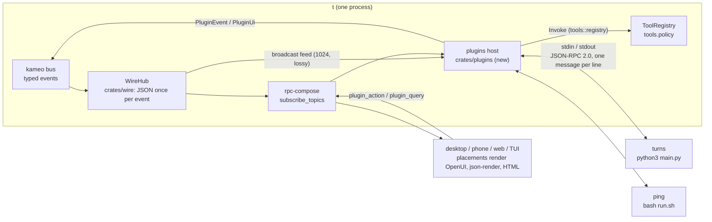
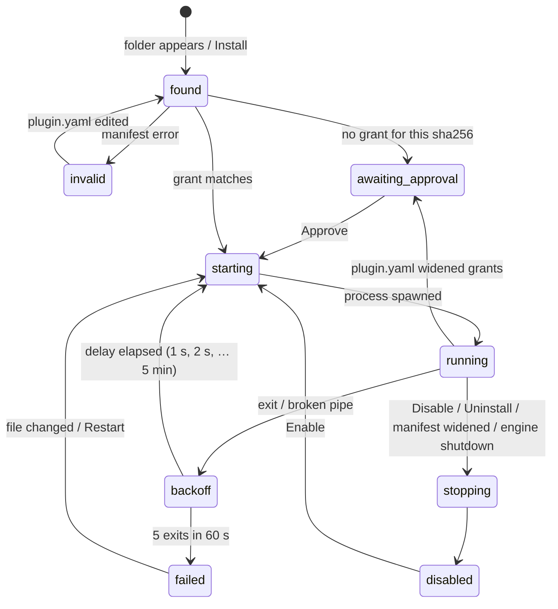
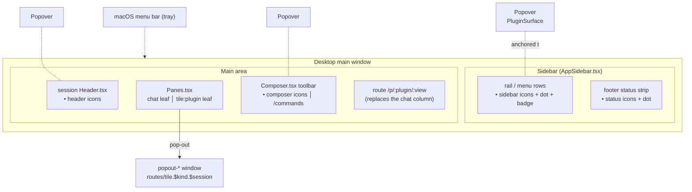

# 216 — External plugins: any language, no compile step

Status: design · 2026-11-24 · not built. Extends `docs/plugins.md` (native plugins), 00 §3–§4 and §7
("Owner-declared event bridge"), 46 (apps / OpenUI), 30 (surfaces / json-render), 120 (inline HTML
pages), 40 (sensors), 04 and 187 (MCP loader). On *external* plugins this doc wins; on everything a
native plugin does, `docs/plugins.md` still wins. The two example plugins in §13 live in
`docs/design/216-examples/` and were run against a scripted host (§19).

A **native plugin** is a Rust crate compiled into `t` (`docs/plugins.md#L5`). An **external plugin** is
a folder the user drops into `~/.theuth/plugins/<name>/`: a `plugin.yaml` and a `run:` command in any
language. theuth spawns it, writes the events it subscribed to on its stdin as JSON lines, and reads
what it emits, what it wants shown, and what it asks for from its stdout. It hot-loads the way MCP
files do, is restarted when it crashes, and cannot take theuth down with it. The host of all of this is
one ordinary native plugin crate, `plugins`, that obeys `docs/plugins.md` like any other and can be
switched off.



## 0. What exists today, what does not

Grounding for every later section. "Exists" means read in the tree on 2026-11-24.

| Need | Exists | Where |
|---|---|---|
| Plugin trait with a declaration pass before any start | yes | `crates/runtime/src/lib.rs#L439-L449` (`Plugin::declare_wire`, `start`) |
| One typed bus, guaranteed + unbounded mailboxes | yes | `crates/runtime/src/lib.rs#L41-L88`, `#L432-L437` |
| Generic serialisation of bus events to JSON, once per event | yes | `crates/wire/src/lib.rs#L1-L31` (`WireHub`), `#L69-L84` (`WireEvent { TOPIC, VERSION }`), `#L144-L153` (`WireFrame`) |
| Live JSON feed any in-process consumer can read | yes | `RuntimeWire::wire_events` `crates/wire/src/lib.rs#L204`, a `broadcast::channel(1024)` `#L281` |
| Event catalog with JSON Schemas, topic + version | yes — 75 topics | `rpc_core::Discovery` `crates/rpc-core/src/discovery.rs#L157-L164`, emitted at `#L215-L244` into `bindings/openrpc.json` → `x-theuth.events` |
| Compatibility gate on the catalog | yes | `crates/theuth/tests/wire_schema_snapshot.rs#L13-L21`, 00 §7 "Discovery, audiences and compatibility" |
| Catalog sealed after declaration | yes | `declare_plugins` → `rt.freeze_wire()` `crates/theuth/src/main.rs#L2068-L2082`; new topics after freeze are an error (`crates/wire/src/lib.rs#L215-L217`) |
| Topic-filtered event stream for clients | yes | `subscribe_topics(topics, session, descendants)` `crates/rpc-compose/src/api.rs#L109-L118` |
| A notion of *private* events | **no** — `EventPolicy` is admission/coalescing metadata, "not a new privacy model" (`crates/wire/src/lib.rs#L98`); 00 §7 says policies are "not nested-scope privacy" |
| Secret scrubbing of arbitrary JSON | yes | `tools::secrets::redact_value` `crates/tools/src/secrets.rs#L76-L81` over the vault's scrubber `crates/secrets/src/vault.rs#L907-L926` |
| Hot-reloaded directory of child processes, backoff, gates | yes (MCP) | watcher + 300 ms debounce `crates/tools/src/mcp.rs#L2537-L2562`; backoff 30 s → 30 min `#L50-L53`; gates in `mcp/config.yaml` (`crates/tools/src/mcp.rs#L1-L10`, `Gate` `crates/tools/src/lib.rs#L604-L631`) |
| `{{secret:…}}` / `$VAR` / `$(cmd)` expansion for a child's env | yes (MCP) | `expand` `crates/tools/src/mcp.rs#L2127-L2145` |
| Kill a child as a whole process tree | yes | `platform::process::ProcessTree` `crates/platform/src/process.rs#L19-L30` |
| Child-process JSON protocol precedent | yes (sensors) | CPython sensors: request on stdin, JSON on stdout `crates/agent/src/sensor/cpython.rs#L1-L31`, `assets/sensors/README.md` |
| Risk tiers and policy | yes | `Risk` `crates/tools/src/lib.rs#L150-L157`, `Policy` default allow/ask/ask `#L697-L717` |
| UI-triggered tool call with press-as-consent | yes (apps) | `tools::AppInvoke` + `UserActivation` `crates/tools/src/registry.rs#L274-L304`; 46 §0.4 |
| OpenUI renderer with a pluggable tool provider | yes | `AppRendererProps.provider` `packages/apps/src/renderer.tsx#L33-L41`; `AppHost` builds one `crates/desktop/ui/src/components/apps/AppHost.tsx#L283-L316`, handles `@OpenUrl` / `@ToAssistant` `#L427-L466` |
| OpenUI headless validation | yes | `app::helper` (js-runtime isolate, 2 s deadline) — `crates/app/src/lib.rs#L1-L12`, `docs/plugins.md#L308` |
| json-render parse/validate + text and picture fallbacks | yes | `surface::parse` `crates/surface/src/lib.rs#L177`, `spec_lines` `crates/surface/src/render.rs#L25`, `picture_parts` `crates/surface/src/pictures.rs#L141` |
| Sandboxed HTML with a postMessage JSON-RPC bridge | yes | `crates/desktop/ui/src/lib/page-bootstrap.ts#L1-L14`, `components/chat/HtmlPage.tsx#L113-L171` (`sandbox="allow-scripts allow-forms"`) |
| Generic tiles, poppable | yes | `TILE_KINDS` `crates/desktop/ui/src/components/tiles/registry.tsx#L42-L61`, `PoppedTile` `#L100-L119`, leaf switch `routes/c.$session.tsx#L96`, `PopoutTarget { kind: 'tile' }` `lib/popout.ts#L45`, Tauri `open_window` `crates/desktop/src/commands.rs#L23` |
| Attention inbox sources | yes | `roster::attention::Source` / `RegisterSource` `crates/roster/src/attention.rs#L630-L636` |
| Event-triggered routines (`when:` on a bus event) | **no** — `when:` names a sensor file (`assets/sensors/README.md`, `crates/schedule/src/lib.rs#L509-L510`) |
| Plugin-declared sidebar/composer/header slots | **no** |
| Mesh replication of a plugin folder | **no, by design** — the file mirror is "top-level files only" (`crates/replica/src/files.rs#L1-L7`) |

Correction to the brief's UI map: since "tiles everywhere" (2026-11-22) a generic tile is a
`tile:<id>` leaf drawn by `TileLeaf` from `components/tiles/registry.tsx`; `web:<id>` and `draft:<uuid>`
leaves remain. Panes are still the in-memory `usePanes` tree in `lib/panes.ts` (678 lines) rendered by
`components/chat/Panes.tsx`.

## 1. Decisions

Each names what it beat (`docs/plugins.md#L28`).

**D1 — A plugin is a child process speaking JSON-RPC 2.0, one message per line, over stdin/stdout.**
Folder + `plugin.yaml` + `run:`. No SDK is needed: a plugin that only shows status is a `printf` in a
loop (§13.2); one that reacts to events is a `for line in sys.stdin` loop (§13.1). Rejected:

- *An MCP server with extensions.* MCP already hot-loads here, but its session is client-driven with a
  mandatory `initialize`/capabilities handshake, it has no subscription model for a stream of host
  events into the server, and its UI extension renders HTML in an iframe only — not UI as data. A
  10-line bash plugin cannot speak it. MCP is reused where it is good: the *tool* half (D7).
- *An RPC client of the engine* (`ws://…/?token=`, `subscribe_topics`). It exists and is the full
  owner API: whoever holds the token sees every event and calls every method, so there is no
  per-plugin permission at all; it needs a WebSocket client (no bash); nothing manages its lifecycle.
- *WASM components* (wasmtime + WIT). The only option with a real sandbox, but "any language" becomes
  "any language with a component toolchain" (Python via componentize-py, no bash), it needs a build
  step the owner ruled out, and it adds wasmtime to the binary. It wins the day plugins from strangers
  must be contained; that is §17 Q1, not this doc.
- *dlopen / C ABI.* A compile step, `unsafe`, and a segfault takes `t` down. Rejected outright.
- *An embedded JS runtime.* `js-runtime` exists for the app validator, and `docs/plugins.md#L308`
  already says it "is not a precedent for a JS plugin runtime": one language, and a hang shares our heap.

Framing: NDJSON, as MCP stdio does; rejected LSP's `Content-Length` headers (bash cannot produce them
honestly) and a bespoke `{"type": …}` protocol (JSON-RPC gives request ids and error objects that every
language already has a library for, and MCP's tool messages are JSON-RPC).

**D2 — The host is one native plugin crate, `plugins`.** It owns the folder watcher, the processes,
the grants, the catalog of plugin events, the placement state and the RPC methods. `plugins.enabled:
false` starts nothing (§3). Rejected: putting this in `tools` next to MCP (it would pull UI placement
state and app validation into the crate every plugin depends on) or in `agent` (the loop owns the frame,
not processes; `docs/plugins.md#L14`).

**D3 — Events reach plugins from the existing wire feed, not from new bus subscriptions.** The host
reads `rt.wire_events()` (`crates/wire/src/lib.rs#L204`): every registered event is already serialised
once into an `Arc<WireFrame>` with its topic, version and JSON. The host filters per plugin and writes
lines. Rejected: subscribing the host actor to each Rust type (it would have to name every event type,
an upward dependency on every plugin, and re-serialise per type) and a second serialisation layer.
Consequence carried honestly: the feed is live and lossy (1024 frames, `x-theuth.delivery.feed:
"live"`, `durableReplay: false`); a slow plugin gets a `lagged` notice, never back-pressure on the bus
(§6.6).

**D4 — Public by default; private is marked on the type.** `wire::WireEvent` gains
`const EXPOSURE: Exposure = Exposure::Public` and a `fn plugin_view(json: &Value) -> Option<Value>`
whose default is identity. A new event is public the moment its owner implements `WireEvent`, with no
list to update. An owner marks a whole topic `Private`, a transport topic `Internal`, or strips
variants/fields in `plugin_view` (§7.3). Rejected: an allow-list in the host (every new event would be
invisible until someone remembered it — the opposite of the owner's rule), and a derive macro (the
trait already has `TOPIC` and `VERSION` consts in exactly this shape; a const is one line and is
checked by the compiler).

**D5 — Plugin events join the catalog under one host-owned wire topic.** The catalog is frozen after
the declaration pass (`crates/theuth/src/main.rs#L2078`), so a plugin that appears at runtime cannot
register a new `WireEvent`. The host declares one topic, `plugins.events` v1, whose frames are
`{plugin, event, version, session?, data}`; the per-plugin event names (`turns.limit_reached`) and their
JSON Schemas (from the manifest) live in a second, dynamic catalog the host serves (`plugin_catalog`).
Other plugins subscribe to `turns.limit_reached`; clients subscribe to `plugins.events` and filter;
native code subscribes to the `PluginEvent` Rust type. Rejected: unfreezing the wire catalog (it is the
reviewed ABI; `wire_schema_snapshot` exists so it does not drift at runtime) and one wire topic per
plugin (same problem).

**D6 — UI is data.** A plugin sends OpenUI Lang or json-render source for a placement it declared; every
client renders it natively with the libraries it already ships (46, 30). Presses come back as `action`
requests to the plugin; OpenUI `Query(...)` comes back as `query` requests. A sandboxed HTML page with
the 120 bootstrap and three more bridge methods is the escape hatch (§9.6). Rejected: HTML-first (does
not render on TUI, Slack or the phone's native chrome, and every plugin restyles theuth by hand);
React components shipped by the plugin (a compile step and a supply chain inside our webview).

**D7 — Tools for the model reuse MCP's shapes, not a second tool protocol.** A plugin that declares
`tools: inline` answers MCP `tools/list` and `tools/call` on its own pipe with MCP's exact JSON
(`Tool`, `CallToolResult`, annotations); the host converts them with the MCP code that already turns
annotations into `Risk` (`risk_of`, `crates/tools/src/mcp.rs#L2389-L2394`) and applies `mcp/config.yaml`
gates under the reserved server name `plugin.<name>`. A plugin that *is* an MCP server already declares
`mcp:` with an ordinary MCP entry; the host hands it to the `Mcp` actor as a plugin-owned server (§8).
Rejected: a theuth-specific `tool` message (a second schema, a second risk mapping, a second gate file).

**D8 — Installing is approving arbitrary code; capabilities gate only what goes through theuth.** The
process runs as the user with the user's OS permissions. Grants decide which events it sees, which
placements it gets, and which host-brokered powers it can use (tool calls, input into sessions,
notifications, secrets in its env). The install card says this in one sentence and carries risk
`destructive`. Rejected: pretending capabilities are a sandbox (§10.4 says exactly what is and is not
contained).

**D9 — Plugin folders do not replicate across the mesh.** A plugin runs on the engine whose disk holds
its folder. The file mirror only replicates top-level files (`crates/replica/src/files.rs#L6`), and
code that runs as the user on another machine needs that machine's own approval. Remote clients of an
engine still see that engine's placements (they come over its RPC). Rejected: replicating like
`mcp/*.json` + `homes.yaml` (187) — a remote engine would list plugins it cannot run without asking.

**D10 — No runtime prompts for undeclared things.** Everything a plugin may do is on the install card;
an undeclared request fails with a JSON-RPC error and a log line (§10.3). The one runtime prompt is the
existing one: a host-brokered tool call whose `tools.policy` action is `ask`. Rejected: per-call
capability prompts (prompt fatigue; the owner asked for one card at install).

**D11 — Placements are declared, rendered by host-owned slots.** The plugin cannot position pixels;
it names a slot kind (sidebar, composer, header, tile, view, …) and theuth draws the icon, dot, badge
and frame in house style on every surface, with a defined fallback where a surface has no such slot
(§9.5). Rejected: free-form overlays (cannot degrade to TUI/phone; a phishing surface).

**D12 — Native plugins stay.** Anything that needs the frame, a typed `ask`, a hot path, or must exist
for the harness to work stays a crate. The second tier is for things a user wants without a release.

## 2. The host: crate `plugins`

```
crates/plugins/
  src/lib.rs        // PLUGINS_ACTOR, PluginsConfig, events, Plugin impl, declare_wire
  src/manifest.rs   // plugin.yaml parse + validation, sha256
  src/proc.rs       // spawn, ProcessTree, stdin writer task, stdout reader task, backoff
  src/route.rs      // wire feed → per-plugin filter → exposure → redaction → queue
  src/catalog.rs    // dynamic catalog: plugin events + exposed wire topics
  src/surface.rs    // placement state, ui validation (app::helper, surface::parse), rate limits
  src/broker.rs     // plugin → host requests: call, input, notify, open
  src/tools.rs      // inline MCP-shaped tools → DynTool; mcp: entries → Mcp actor
  src/rpc.rs        // rpc_module (plugin_* methods)
```

**Dependencies, downward only** (`docs/plugins.md#L80`): `runtime`, `wire`, `tools` (Risk, Gate,
ToolSpec, `RegisterTool`/`UnregisterTool`, `Invoke`, `secrets::redact_value`, the MCP expand and
annotation code made `pub`), `app` (OpenUI validation through `app::helper`; committing a `card`
placement as a `Kind::App` record), `surface` (json-render parse), `roster` (attention `Source` for
`notify`), `agent` (types only: `SendInput`, `CreateSession`, `SessionId`), `platform` (`ProcessTree`),
`rpc-core` (its own `rpc_module`, as every plugin now has; `crates/theuth/src/main.rs#L2030-L2055`).
Nothing depends on `plugins`. `schedule` reaches plugin events through the wire feed by topic string
(§7.7) — no crate edge. Position in the vector: after `roster` and before `update`
(`crates/theuth/src/main.rs#L2165-L2213`); position is convention only.

**Actor.** `PLUGINS_ACTOR = "plugins"`, one `PluginsActor` on `runtime::subscriber_mailbox()`. One
supervisor task per running plugin owns its child, a writer task and a reader task; the actor never
awaits a child on its mailbox (`docs/plugins.md#L173`).

**Commands** (`ask` → reply; message structs `pub`, serde-derived, reply types `kameo::Reply`):

| Message | Reply | What |
|---|---|---|
| `ListPlugins` | `Vec<PluginInfo>` | name, version, state, grants status, placements, last error, log path |
| `GetPlugin { name }` | `Result<PluginDetail, String>` | manifest, effective grants, catalog entries, stderr tail (40 lines) |
| `Approve { name, sha256 }` | `Result<(), String>` | write grants for exactly that manifest hash; start |
| `SetEnabled { name, on }` | `Result<(), String>` | stop/start; persisted in `grants.yaml` |
| `Restart { name }` | `Result<(), String>` | clears a `failed` crash loop too |
| `Install { source }` | `Result<String, String>` | copy a folder or `git clone --depth 1` a URL into `plugins/<name>`; returns the name; the card follows |
| `Uninstall { name, keep_data }` | `Result<(), String>` | stop, unregister, move folder to `plugins/.trash/` |
| `Action { name, placement, action, args, session, activation }` | `Result<Value, String>` | a press, delivered as an `action` request (§6.2) |
| `Query { name, placement, query, args, session }` | `Result<Value, String>` | an OpenUI `Query`, delivered as a `query` request |
| `Catalog` | `Vec<CatalogEntry>` | §7.1 |
| `Surfaces { session }` | `Vec<SurfaceSnapshot>` | latest status + source per placement (snapshot-first for clients) |
| `TraceOpen { name }` / `TraceClose` | lease | dev tile stream (§14) |
| `Inject { name, topic, data }` | `Result<(), String>` | dev: deliver a fabricated event to one plugin only, marked `"injected": true` |

**Events** (each `#[serde(tag = "type")]`, `WireEvent`, declared in `declare_wire` even when disabled,
as every owner does — `crates/theuth/src/main.rs#L2068-L2077`):

| Rust type | Topic | Exposure | Published when |
|---|---|---|---|
| `PluginEvent { plugin, event, version, session: Option<SessionId>, data: Value }` | `plugins.events` v1 | Public | a plugin `emit`s a declared event (§7.6) |
| `PluginUi` enum: `PluginStatus { plugin, placement, session?, dot, badge?, tooltip?, label? }`, `PluginSurface { plugin, placement, session?, format, revision }`, `PluginState { plugin, state, error? }`, `PluginsChanged` | `plugins.ui` v1 | Public | status/ui/lifecycle changes; `PluginSurface` carries a revision, clients fetch the source with `plugin_surface` (keeps big sources out of every client's feed) |
| `PluginTrace { plugin, dir, line, at_ms }` | `plugins.trace` v1 | Internal | only while a `TraceOpen` lease is held (§14) |

**Tools (native).** None. Plugin-offered tools register through the registry like MCP tools (§8).

**`start`.** Reads `plugins:`; disabled → `Ok(())` with a log line. Otherwise spawns the actor,
registers it, then in a task: scans `plugins/`, validates each manifest, starts the ones whose grant
hash matches, files an install card for the rest, and starts the watcher. Broken folder → that plugin
is `invalid` with the error; the host still comes up (`docs/plugins.md#L171`).

## 3. Config section

`plugins:` in `config.yaml`; every key optional (`#[serde(default)]`, missing section → defaults,
`docs/plugins.md#L234`). Env overlay as usual (`THEUTH_PLUGINS__ENABLED=false`).

```yaml
plugins:
  enabled: true            # false: no actor, no processes, no plugin tools, no placements; folders untouched
  dir: plugins             # under the data dir
  watch: true              # hot-load plugin.yaml changes (300 ms debounce, as mcp/)
  dev: false               # restart on any file change in a plugin folder; Plugins dev tile offered
  restart_first_ms: 1000   # first restart delay after a crash; doubles per crash
  restart_cap_ms: 300000   # 5 min
  crash_loop: 5            # this many exits within crash_window_s → state `failed` until edited or restarted
  crash_window_s: 60
  shutdown_grace_ms: 3000  # after the `shutdown` notification, before the tree is killed
  max_line_bytes: 1048576  # a longer line from a plugin is dropped with a log line
  queue_frames: 2048       # per plugin, events waiting for its stdin; overflow → drop oldest + `lagged`
  emit_per_s: 50           # plugin → host `emit` budget (burst 4×); excess dropped, counted, logged
  ui_per_s: 4              # `ui`/`status` per placement; coalesced, last write wins
  request_timeout_ms: 10000   # host → plugin `action`/`query`/`tools/call` without a reply → error to the caller
  string_cap: 65536        # strings longer than this inside an event are cut with "…[+N bytes]" before delivery
```

`enabled: false` leaves behind: the folders and `grants.yaml` (unchanged), the declared wire topics
(declaration still runs, so the ABI does not depend on config), plugin tools absent from
`list_tools`, every `plugin_*` method answering `plugins is disabled`.

The section is added, commented, to `DEFAULT_CONFIG` (`crates/theuth/src/main.rs#L884`).

## 4. Folder and manifest

### 4.1 Layout

```
~/.theuth/plugins/
  grants.yaml               # theuth-owned: what the user approved (§11)
  .trash/                   # uninstalled folders, swept after 30 days
  turns/                    # one plugin = one folder; the folder name is the plugin name
    plugin.yaml             # the manifest (author-owned)
    main.py                 # anything; run from this folder
~/.theuth/plugin-data/turns/  # THEUTH_PLUGIN_DATA: the plugin's own writable state
~/.theuth/logs/plugins/turns.log.<date>   # its stderr + host lifecycle lines
```

### 4.2 `plugin.yaml` — full example

```yaml
name: turns                       # required; ^[a-z][a-z0-9-]{0,31}$; must equal the folder name
version: 0.1.0                    # required; free text shown on the card
description: Counts finished turns today; the sidebar dot turns amber past a daily limit.
protocol: 1                       # required; the wire protocol major (§6)
run: [python3, main.py]           # required; argv list, or a string split by shell words (no shell is run)
cwd: .                            # optional; relative to the folder
env:                              # optional; values expand {{secret:NAME}}, $VAR, $(cmd) like mcp/ entries
  TURNS_LIMIT: "50"
  GITHUB_TOKEN: "{{secret:github.pat}}"   # the secret's name is on the install card; the value never is
restart: on-failure               # on-failure (default) | always | never
watch: [main.py, "lib/**/*.py"]   # optional; restart on change (default: plugin.yaml only, everything when plugins.dev)

subscribe:                        # optional; nothing is delivered that is not listed here
  - topic: agent.events           # a wire topic …
    types: [TurnFinished]         # … optionally narrowed to `type` tags
    sessions: all                 # all (default) | focused (only sessions open in some client)
  - topic: tools.approval-requested
  - event: other-plugin.something # a plugin event (§7.6); `other-plugin.*` for all of one plugin's events
  - topic: agent.events
    types: [TextDelta]
    deltas: true                  # delta-class types are opt-in per subscription (high volume)

emits:                            # optional; the only events this plugin may `emit`
  limit_reached:
    description: The daily turn count reached TURNS_LIMIT.
    version: 1
    scope: global                 # global | session (session events must carry `session`)
    schema:                       # JSON Schema (draft 7 subset); default {} (any object)
      type: object
      required: [day, turns]
      properties: {day: {type: string}, turns: {type: integer}}

placements:                       # optional; §9
  - id: turns                     # unique within the plugin; [a-z0-9-]+
    kind: sidebar                 # sidebar | status | composer | header | tile | view | settings | command | card | tray
    open: popover                 # sidebar/header/composer: popover | view | tile
    icon: gauge                   # a lucide icon name, or a path to an SVG in the folder
    label: Turns today            # tooltip / menu text / tile title
    status: true                  # draws a status dot (+ badge) fed by `status` messages
    scope: global                 # global | session
    size: {width: 320, height: 220}   # popover/tile default; tiles are resizable
    format: openui                # the content format this placement expects (openui | json-render | markdown | html)
    fallback: text                # what non-rendering surfaces show: text (default) | hide

capabilities:                     # optional; each is a line on the install card (§10)
  - notify                        # inbox items + OS notifications
  - input                         # send text into a session as the user
  - open                          # open its own tile/view on clients
  - call:                         # host-brokered tool calls
      tools: [knowledge_search, http_request]
      max_risk: read_only

tools: inline                     # optional; inline (MCP shapes on this pipe) | none (default)
mcp:                              # optional; an ordinary MCP server entry the host owns (§8)
  command: uvx
  args: [some-mcp-server]
```

### 4.3 Validation

`plugin_check` (and the loader) refuses with a precise path, like `surface::parse` reports JSON
Pointers: unknown top-level keys are warnings (forward compatibility), unknown `kind`/`capabilities`
are errors; `subscribe.topic` must be in the catalog (§7.1) and not `Private`/`Internal`; `emits` names
are `^[a-z][a-z0-9_]{0,47}$`; `run[0]` must resolve on `PATH` or in the folder; secrets named in `env`
must exist in the vault (`secret_list`). The manifest hash is sha256 over the canonical JSON of the
parsed manifest with `env` values *unexpanded*.

## 5. Lifecycle



- **Install.** Three ways, one result: drop a folder into `plugins/`; `theuth plugin install <path|git
  url>`; the model writes the folder with `write_file` (it is a file like any other). The watcher sees a
  new `plugin.yaml`; the host validates and files the install card (§10.2) as an attention item and in
  Settings › Plugins. Nothing runs before approval.
- **Spawn.** `run` in `cwd`, own process group / Job Object via `ProcessTree::adopt`, env = the user's
  login env (as `tools.login_path`) + `THEUTH_PLUGIN`, `THEUTH_PLUGIN_DATA`, `THEUTH_PROTOCOL=1`,
  `THEUTH_PLUGIN_DIR` + the expanded manifest `env`. Never the RPC token or its path. The first line on
  stdin is `hello` (§6.2). stderr goes line by line to the plugin log and the dev trace.
- **Hot reload.** `plugin.yaml` change → re-validate → same or narrower grants: graceful restart;
  wider grants (a new subscription, capability, placement or secret): the running process keeps the
  old grants, the plugin shows `needs approval`, a new card is filed. A change to a file in `watch`
  (or any file with `plugins.dev`) → graceful restart. Debounce 300 ms, as `crates/tools/src/mcp.rs#L2554-L2557`.
- **Crash.** Exit, broken stdout pipe, or an unparseable flood (> 100 bad lines in 10 s) → `backoff`.
  Delay starts at `restart_first_ms`, doubles, caps at `restart_cap_ms`, resets after 60 s of running.
  `crash_loop` exits within `crash_window_s` → `failed` (inbox item with the stderr tail). A crash can
  only lose the plugin's own in-flight work: the host's reader task sees EOF, the supervisor cancels
  the plugin's pending requests with `plugin <name> exited`, unregisters nothing (tools stay registered
  and answer "plugin restarting" so the model's tool list does not churn), and keeps the last status
  dimmed with `state: backoff`.
- **Hang.** A plugin that stops reading stdin fills its queue → `lagged` (§6.6), never a stalled host.
  A plugin that stops answering requests makes those requests fail after `request_timeout_ms`.
  The host does not kill a quiet plugin: silence is legal (§13.2 is silent between pings).
- **Disable.** `SetEnabled{on:false}` → `shutdown` notification, close stdin, wait `shutdown_grace_ms`,
  kill the tree; tools unregistered; placements removed from clients (`PluginState`).
- **Uninstall.** Disable, then move the folder to `plugins/.trash/<name>-<ts>/`, drop the grant, and
  with `keep_data: false` move `plugin-data/<name>` too. Catalog entries for its events disappear;
  subscribers to them simply receive nothing.
- **Engine shutdown.** Every plugin gets `shutdown` in parallel; the engine waits at most
  `shutdown_grace_ms` total (163 graceful quit budget), then kills the trees.

## 6. Wire protocol (version 1)

### 6.1 Framing

- UTF-8 JSON, **one JSON-RPC 2.0 message per line**, `\n`-terminated, both directions. No batches.
- A message with `id` is a request and gets exactly one response; without `id` it is a notification.
  Ids are strings or integers chosen by the sender; the two directions have independent id spaces.
- The plugin may ignore every request it does not understand **except** that a request it never
  answers costs its caller `request_timeout_ms`. A plugin that answers nothing is legal (§13.2).
- A plugin stdout line that is not JSON is logged at `warn` as `stdout: <line>` and otherwise ignored,
  so a stray `print()` does not kill a plugin. stderr is the log channel.
- Lines over `max_line_bytes` are dropped with a log line on both sides.
- The host never sends a line before `hello` and never after `shutdown`. stdin EOF means "stop now".

### 6.2 Host → plugin

**`hello`** (notification, always first):

```json
{"jsonrpc":"2.0","method":"hello","params":{"protocol":1,"plugin":"turns","version":"0.1.0","theuth":"0.94.0","engine":"333","data_dir":"/Users/sky/.theuth/plugin-data/turns","grants":{"subscribe":["agent.events#TurnFinished"],"emits":["limit_reached"],"placements":["turns"],"capabilities":[]},"clients":{"desktop":true,"tui":false}}}
```

**`event`** (notification) — one per delivered event. `topic`/`version`/`type` are the catalog keys;
`data` is the event JSON exactly as the wire feed carries it (`type` included), after exposure
projection and redaction (§7.3–§7.4). `session` is copied to the top when the event has one.

```json
{"jsonrpc":"2.0","method":"event","params":{"topic":"agent.events","version":1,"type":"TurnFinished","session":"01a20e56-84d4-775f-ae0c-65af2ba8c55b","at_ms":1795530420113,"data":{"type":"TurnFinished","session":"01a20e56-84d4-775f-ae0c-65af2ba8c55b","turn":"01a2…","stop_reason":"end_turn","usage":{"prompt":18234,"completion":912,"cached":17000},"context":19146}}}
```

A plugin event arrives the same way under its catalog name:

```json
{"jsonrpc":"2.0","method":"event","params":{"topic":"plugins.events","version":1,"type":"turns.limit_reached","event_version":1,"from":"turns","data":{"day":"2026-11-24","turns":50}}}
```

**`action`** (request) — a press on one of the plugin's placements. `activation` is present for a real
user press (the renderer's action id); `client` says which surface; `form` carries form values.

```json
{"jsonrpc":"2.0","id":"a-41","method":"action","params":{"placement":"turns","action":"reset","args":{},"session":null,"client":"desktop","activation":"01a2…-act","form":null}}
```

Reply: any `result` (shown as the Mutation's `.data`), or an `error` (shown as `.error`).

**`query`** (request) — an OpenUI `Query("name", args, defaults, refresh)` in one of the plugin's
placements. Reply `result` is the query's value.

```json
{"jsonrpc":"2.0","id":"q-7","method":"query","params":{"placement":"turns","query":"history","args":{"days":7},"session":null}}
```

**`command`** (request) — a slash command or palette entry the plugin declared (§9.1).

```json
{"jsonrpc":"2.0","id":"c-3","method":"command","params":{"placement":"turns-cmd","name":"turns","args":"reset","session":"01a20e56-…","client":"tui"}}
```

Reply `{"text": "…"}` (shown as an ephemeral note in that chat) or `{"ui": {format, source}}` (an
ephemeral card), or `{}`.

**`tools/list`, `tools/call`** (requests; only with `tools: inline`) — MCP's method names, params and
results verbatim (MCP 2025-06-18 `Tool`, `CallToolRequest.params`, `CallToolResult`). The host adds
`_meta.theuth = {session, call_id}` to `tools/call` params.

```json
{"jsonrpc":"2.0","id":"t-1","method":"tools/call","params":{"name":"turns_today","arguments":{},"_meta":{"theuth":{"session":"01a20e56-…","call_id":"toolu_01…"}}}}
```

**`lagged`** (notification) — the plugin's queue overflowed; `dropped` events were discarded oldest
first. A plugin that keeps derived state should re-read what it needs (`call` a read tool) instead of
trusting its counters.

```json
{"jsonrpc":"2.0","method":"lagged","params":{"dropped":312,"since_ms":1795530419000}}
```

**`granted`** (notification) — grants changed while running (narrowing applies at once; widening only
after approval).

**`shutdown`** (notification) — finish within `grace_ms`; stdin closes right after.

```json
{"jsonrpc":"2.0","method":"shutdown","params":{"reason":"disable","grace_ms":3000}}
```

### 6.3 Plugin → host notifications

**`emit`** — publish one declared event. `data` is validated against the manifest schema; invalid →
dropped with a `log` line in the dev trace. `session` required when the event's `scope: session`.

```json
{"jsonrpc":"2.0","method":"emit","params":{"event":"limit_reached","data":{"day":"2026-11-24","turns":50}}}
```

**`status`** — the dot, badge and tooltip of a placement with `status: true`. `dot` ∈ `ok | busy | warn
| error | off | none`; `badge` is an integer (0 hides it) or a string of ≤ 4 characters.

```json
{"jsonrpc":"2.0","method":"status","params":{"placement":"turns","dot":"warn","badge":51,"tooltip":"Turns today: 51","session":null}}
```

**`ui`** — replace a placement's content. `format` ∈ `openui | json-render | markdown | html`; `text`
is the fallback for surfaces that cannot render it (TUI, channels); `session` targets one session for
`scope: session` placements.

```json
{"jsonrpc":"2.0","method":"ui","params":{"placement":"turns","format":"openui","source":"root = Card([title, body, controls])\ntitle = TextContent(\"## Turns today\")\nbody = TextContent(\"**51** of 50 turns · 1,204,113 tokens\")\nreset = Mutation(\"reset\", {})\ncontrols = Buttons([Button(\"Reset counter\", @Run(reset), \"secondary\")])","text":"51 of 50 turns today"}}
```

**`notify`** (capability `notify`) — an inbox item, plus an OS notification when `level` ≥ `warn`.

```json
{"jsonrpc":"2.0","method":"notify","params":{"title":"Turn limit reached","body":"50 turns today.","level":"warn","open":{"placement":"turns"}}}
```

**`log`** — a structured log line (`level` ∈ `debug | info | warn | error`) into the plugin log and dev trace.

```json
{"jsonrpc":"2.0","method":"log","params":{"level":"info","message":"state loaded","fields":{"turns":12}}}
```

### 6.4 Plugin → host requests

All answer `result` or a JSON-RPC `error` (§6.5).

| Method | Capability | Params | Result |
|---|---|---|---|
| `call` | `call` (tool in `tools`, risk ≤ `max_risk`) | `{tool, args, session?}` | `{content, is_error, structured?}` — the `ToolOutput` |
| `input` | `input` | `{session?, text, delivery?}` (`null` session = new chat) | `{session}` — as `agent::SendInput` (`crates/agent/src/lib.rs#L300-L320`) |
| `open` | `open` | `{placement, session?}` | `{}` — clients open that tile/view |
| `catalog` | none | `{topic?}` | `[CatalogEntry]` (§7.1), for plugins that discover |
| `ping` | none | `{}` | `{now_ms}` |

```json
{"jsonrpc":"2.0","id":1,"method":"call","params":{"tool":"knowledge_search","args":{"query":"pomodoro length"}}}
{"jsonrpc":"2.0","id":1,"result":{"content":"[…]","is_error":false,"structured":[{"id":"…","title":"…"}]}}
```

Host-brokered calls are `tools::Invoke` with a `ToolCall { session, … }` (`crates/tools/src/lib.rs#L282-L296`):
the registry applies visibility, `tools.policy`, secret expansion and redaction exactly as for the
model. `session` absent → the plugin's own headless session (§10.3), created on first use.

### 6.5 Errors

Standard JSON-RPC codes plus four host codes:

| Code | Meaning |
|---|---|
| `-32601` | method not found (unknown method either way) |
| `-32602` | invalid params (schema mismatch; `data.path` is a JSON Pointer) |
| `-32003` | not granted — `data: {capability \| topic \| placement \| tool}` |
| `-32004` | denied by policy (the tool's risk maps to `deny`, or a human denied the ask) |
| `-32005` | rate limited — `data: {retry_after_ms}` |
| `-32006` | plugin exited / restarting (host → caller) |

```json
{"jsonrpc":"2.0","id":1,"error":{"code":-32003,"message":"not granted: call shell","data":{"tool":"shell"}}}
```

### 6.6 Delivery, ordering, limits

- Per plugin, events are delivered in wire-feed order (bus-processing order, `crates/wire/src/lib.rs#L1-L6`).
  No cross-plugin ordering, no replay, no exactly-once — the feed's own contract
  (`x-theuth.delivery`: `feed: live`, `durableReplay: false`, `exactlyOnce: false`).
- The host's single feed receiver can itself lag (1024 frames). That loss is reported to every
  plugin as `lagged` with the count the broadcast receiver returned.
- Per plugin, an outbound queue of `queue_frames`; on overflow the oldest are dropped and one
  `lagged` is queued. The bus, the hub and other plugins never wait for a plugin.
- `emit`, `status`, `ui` are rate-limited (§3); `ui`/`status` coalesce per placement (the last write
  wins), so a plugin that renders on every token cannot flood clients.
- Requests from a plugin: at most 16 in flight; more → `-32005`.

## 7. Event catalog

### 7.1 Names and entries

An event's stable name is **`<topic>#<Type>`** for wire topics that carry a `type`-tagged enum
(`agent.events#TurnFinished`), **`<topic>`** for single-struct topics (`knowledge.changed`), and
**`<plugin>.<event>`** for plugin events (`turns.limit_reached`). Topics are owner-qualified already
(`TOPIC`, `crates/wire/src/lib.rs#L69-L77`); Rust type names never identify a topic.

`plugin_catalog` / the `catalog` request return one entry per name:

```json
{"name":"agent.events#TurnFinished","topic":"agent.events","version":1,"type":"TurnFinished","owner":"agent","exposure":"public","scoped":"session","delta":false,"schema":{"$ref":"#/components/schemas/event.agent_2eevents.output.AgentEvent"}}
{"name":"turns.limit_reached","topic":"plugins.events","version":1,"type":"turns.limit_reached","owner":"plugin:turns","exposure":"public","scoped":"global","delta":false,"schema":{"type":"object","required":["day","turns"],"properties":{"day":{"type":"string"},"turns":{"type":"integer"}}}}
```

### 7.2 Schemas come from the Rust types

Nothing new is generated by hand. Every wire topic's JSON Schema is already produced from its Rust
type by `schemars` through the descriptor's lazy `schema` callback (`crates/wire/src/lib.rs#L133-L142`)
when `rpc_core::Discovery::document` builds `bindings/openrpc.json` (`crates/rpc-core/src/discovery.rs#L215-L226`);
the 75 topics on 2026-11-24 are listed in its `x-theuth.events`. The host serves the same frozen
document's schemas (from `rpc_core`'s frozen discovery, no regeneration per request) and splits enum
topics into per-`type` entries by reading each `oneOf` branch's `type.const`. ts-rs bindings
(`bindings/`) stay what the desktop uses; plugins get JSON Schema, which every language can consume.
A thin SDK may generate types from it (§14).

### 7.3 Public by default; the private rule

```rust
// crates/wire/src/lib.rs — additions (216)
#[derive(Clone, Copy, Debug, Default, PartialEq, Eq, Serialize)]
#[serde(rename_all = "snake_case")]
pub enum Exposure {
    /// Every external plugin may subscribe (after the user approves the subscription).
    #[default]
    Public,
    /// Never delivered to external plugins, never in their catalog. Owner-only consumers
    /// (native plugins, RPC clients holding the owner token) are unaffected.
    Private,
    /// Transport/control frames that are not events of the world (no catalog entry).
    Internal,
}

pub trait WireEvent: Clone + Send + Serialize + JsonSchema + 'static {
    const TOPIC: &'static str;
    const VERSION: u32 = 1;
    /// 216: who outside the binary may see this topic. New topics are public.
    const EXPOSURE: Exposure = Exposure::Public;
    /// 216: what an external plugin sees of one frame of a public topic: `None` drops the frame,
    /// `Some(v)` delivers `v`. Default: unchanged. Owners strip private variants/fields here.
    fn plugin_view(json: &Value) -> Option<Value> { Some(json.clone()) }
    // … to_json, policy unchanged
}
```

`EventDescriptor` gains `exposure` and `plugin_view: fn(&Value) -> Option<Value>`, and
`x-theuth.events[]` gains an `exposure` string (an additive wire change, accepted with
`just wire-schema-accept`, 00 §7). The rule is enforced in exactly one place — the host's router — and
is checked by a test that walks `wire_schema()` and asserts the private list below (§15 step 2).

**Rule.** A topic or variant is private when it carries one of: (a) a credential or something that
grants access (keys, pairing material, sign-in pages); (b) words spoken or written by people other
than the owner who did not address theuth; (c) text the owner produced outside a theuth conversation
(dictation into other apps); (d) an inventory of the owner's accounts. Everything else — including
the owner's own conversations, tool calls and outputs — is public, because a plugin the owner
installed and approved to read `agent.events` is the owner's own code. Size and transport are not
privacy: those topics are `Internal`.

**Proposed private** (verified against `bindings/openrpc.json` on 2026-11-24):

| Topic / variant | Marked by | Reason |
|---|---|---|
| `secrets.events` (whole topic) | `EXPOSURE = Private` in `crates/secrets/src/lib.rs` | `SecretRequested` names the vault's credentials, their notes and form fields, and carries the request id of a masked-entry flow (`crates/secrets/src/lib.rs#L269-L294`); a map of what to steal, and no plugin needs it. |
| `browser.element-form-requested` | `Private` | its `html` is a copy of a sign-in or payment form from the user's signed-in browser (`browser_show_element`). |
| `artifact.web-view-call-requested` | `Private` | `args` of operations the agent runs inside the user's own signed-in web view (fill values, evaluated script); a live channel into logged-in pages. |
| `browser.web-profile-changed` | `Private` | `sites` is the list of sites the user is signed in to — an account inventory. |
| `link.events#LinkPairing` | `plugin_view` drops the variant | `key` is the device pairing key; whoever holds it can pair a device to this engine. |
| `signal.events#LinkUrl`, `telegram.events#PairingLink` | `plugin_view` drops | the device-link / bot pairing URL links an account. |
| `mesh.events` `pair`, `a2a.contacts` `contact_pair` | `plugin_view` drops | pairing ceremony frames with the verification code; the code proves nothing if another UI can show it, so a plugin with a placement could phish the ceremony. |
| `meeting.events#Utterance` | `plugin_view` drops | live transcript of other people's speech in a meeting; they consented to a recording, not to arbitrary code reading it. Topics, briefs and summaries stay public. |
| `talk.events#Heard` | `plugin_view` drops | raw room transcript, including bystanders; what the owner actually sent is public as `Submitted` and `agent.events#InputQueued`. |
| `voice.events#DictationText`, `#DictionarySuggestion` | `plugin_view` drops | dictation types into any app, including password fields (153); the suggestion keeps audio. |
| `agent.events#MessageDelivered` `text` | `plugin_view` strips `text` (keeps `from`, `session`) | the body of a message from another agent or a contact's agent (186) — someone else's words. |

**Internal** (no catalog entry, not subscribable): `rpc.stream` (connection controls),
`sessionsync.follow-state` (relay transport), `voice.events#SpeechAudio` (opus audio chunks),
`plugins.trace` (§14). Delta-class types (`TextDelta`, `ReasoningDelta`, `ToolCallProgress`,
`VisionProgress`, 129) stay public but need `deltas: true` on the subscription.

### 7.4 Redaction inside public events

Applied by the host once per frame, before any plugin sees it, cached across plugins:

1. `plugin_view` of the topic (§7.3).
2. `tools::secrets::redact_value` over every string (`crates/tools/src/secrets.rs#L76-L81`): any value
   the vault knows, and its base64, becomes `{{secret:NAME}}`. A token that leaked into a tool output
   reaches a plugin as a placeholder.
3. Strings longer than `string_cap` are cut with `…[+N bytes]`; a plugin that needs the whole tool
   output asks for it with a `call` it was granted.
4. The same redaction runs on what a plugin `emit`s, `ui`s and `notify`s, so a secret a plugin got
   through its `env` is not re-broadcast in clear by accident.

Redaction is defence in depth, not the boundary: §10.4.

### 7.5 Versioning and compatibility

- A wire topic's `VERSION` is its owner's contract; the existing gate
  (`crates/theuth/tests/wire_schema_snapshot.rs#L13-L21`, `rpc_core::compatibility::classify`) already
  fails removed/changed contracts and makes additions a deliberate acceptance. Plugins get the same
  promise as the desktop: additive changes keep the version; a breaking change bumps `VERSION`.
- A subscription names `topic` and optionally `version` (default: the current one). When an owner
  bumps a version, plugins subscribed to the old one are told once (`log` + card) and receive
  nothing until their manifest is updated — never a shape they did not declare. A host may keep
  serving `N-1` for a release when the owner registers a down-projection (open question §17 Q4).
- Plugins must ignore unknown fields and unknown `type`s (`x-theuth.delivery.unknownTopicVersionVariant:
  "ignore"`). The host adds fields freely.
- Plugin events version per event (`emits.<name>.version`); a schema change without a version bump
  is a validation error at load (the host keeps the last schema per `(name, version)` in
  `plugin-data/.catalog.json` to compare).

### 7.6 Plugin-emitted events

`emit {event, data}` → validate against the manifest schema → redact (§7.4) → publish
`PluginEvent { plugin, event, version, session, data }` on the bus → the wire hub serialises it as
topic `plugins.events` → (a) the router delivers it to plugins subscribed to `<plugin>.<event>` or
`<plugin>.*`; (b) clients see it on `subscribe_topics(["plugins.events"])`; (c) native code
subscribes to `PluginEvent`. A plugin never receives its own emits unless it subscribes to them. An
`emit` of an undeclared name is `-32003`-logged and dropped. A plugin event is public unless the
manifest says `exposure: private` for it, in which case only native consumers and the owner's clients
see it (a plugin may want to emit state for its own UI only).

### 7.7 Other subscribers: routines and the UI

- **Routines** gain an event trigger (does not exist today; `when:` names a sensor file,
  `crates/schedule/src/lib.rs#L509-L510`): `when: event turns.limit_reached` or
  `when: event agent.events#TurnFinished stop_reason=error`. The schedule plugin reads the wire feed
  by topic string, applies the same exposure filter (routines see what plugins see), matches
  top-level `key=value` tokens, and fires with the redacted JSON quoted as data inside `<when>` (40 §7),
  under the existing `cooldown:` and `fire:` rules. This is schedule's change, specified in its own doc
  amendment; 216 only fixes the name syntax.
- **The UI** consumes `plugins.ui` and `plugins.events` through `subscribe_topics`; placement content is
  fetched with `plugin_surface` on `PluginSurface { revision }`, snapshot-first as the delivery rule
  requires (`x-theuth.delivery.controls`).

## 8. Tools the plugin offers the model

**`tools: inline`.** After `hello` the host sends `tools/list`; each returned MCP `Tool` becomes a
`DynTool` in the registry:

- `name` as given, unprefixed, the same clash rule as MCP and natives (a clash with a native loses,
  logged; `docs/plugins.md#L212`).
- `Risk` from MCP annotations through the existing `risk_of` (`readOnlyHint` → `read_only`, else
  `destructiveHint` → `destructive`, else `mutating`; `crates/tools/src/mcp.rs#L2389-L2394`), then the
  gate lines of `mcp/config.yaml` under the reserved server key `plugin.<name>` (per tool or whole
  plugin, `off` hides). Settings › MCP already edits those lines (`SetGate`). The MCP loader refuses a
  server *named* `plugin.*` so the key cannot collide.
- `ToolSource::Plugin { name, version }` — a new variant beside `Native` and `Mcp`
  (`crates/tools/src/lib.rs#L217-L234`), so the app bridge and `list_tools` show where a tool comes from.
- `CONSUMES_SECRETS` stays `true`: arguments are expanded by the registry before `tools/call`, outputs
  redacted after, as for MCP.
- `notifications/tools/list_changed` from the plugin triggers a re-list, as MCP does.
- A `tools/call` while the plugin is restarting answers `plugin <name> is restarting` as a tool error
  (§5): the model sees text, the tool list does not churn.

**`mcp:`** — an ordinary MCP server entry (the object format of `mcp/*.json`). The host asks the `Mcp`
actor to run it as a *plugin-owned* server: a new message `AttachServer { name: "plugin.<name>",
entry, owner }` that lives in memory, is never written to `mcp/` (which replicates, 187), starts and
stops with the plugin, and is listed in Settings › MCP with "from plugin <name>". Today the only entry
point is `AddServer`, which writes `<name>.json` (`crates/tools/src/mcp.rs#L950-L960`); `AttachServer`
is the amendment. This is how an author with a FastMCP or TypeScript-SDK server ships it as a plugin
without rewriting its transport.

Plugin tools are invoked through `Invoke` like any other (`docs/plugins.md#L214`); a plugin has no
second way to affect the world on the model's behalf.

## 9. UI placements

### 9.1 Kinds

| `kind` | Where (desktop) | Declares | Content | Scope |
|---|---|---|---|---|
| `sidebar` + `open: popover` | an icon in the sidebar plugin row (expanded) and the rail (collapsed); dot + badge on the icon; click → popover anchored to it | icon, label, `status`, size | openui / json-render / markdown / html | global |
| `sidebar` + `open: view` | same icon; click navigates to `/p/<plugin>/<id>` | icon, label, `status` | as `view` | global |
| `status` | the sidebar footer status strip (icon + dot, tooltip on hover); no content | icon, label | `status` only | global |
| `composer` | an icon in the chat input toolbar beside the model picker; click → popover above the composer | icon, label, `status`, size | openui / json-render / markdown; `@ToAssistant` sends into *this* chat | session |
| `header` + `open: popover \| view \| tile` | an icon in the session header's right cluster | icon, label, `status` | as chosen | session |
| `tile` | a panes leaf `tile:<id>` with the shared `TileFrame` header (drag, pop-out, X); opened from its sidebar/header icon, by `open`, or by the user | icon, label, size, scope | any | global or session |
| `view` | a full main-area route `/p/<plugin>/<id>`, with a sidebar entry | icon, label | any | global |
| `settings` | a page under Settings › Plugins › `<name>` | label | openui / json-render / markdown | global |
| `command` | `/<name> args` in every composer (desktop, TUI, channels) and an entry in the search/command dialog | name, description, args hint | reply text or ephemeral card | session |
| `card` | a card in a chat's transcript, committed as a `Kind::App` (OpenUI) or json-render artifact in that session | label | openui / json-render | session |
| `tray` | lines in the macOS menu-bar (tray) menu: label + dot; click opens the plugin's popover/view in the main window | label | `status` only | global |

Notifications and badges are not placements: `notify` (capability) lands in the attention inbox via a
`roster::attention::Source` the host registers (`crates/roster/src/attention.rs#L630-L636`) and, at
`warn`/`error`, as an OS notification through the desktop's existing path; the inbox count is the badge.



### 9.2 What a placement declares

`id`, `kind`, `icon` (a lucide name — the desktop already depends on `lucide-react`, see
`components/tiles/registry.tsx#L1-L20` — or an SVG file in the folder, sanitised), `label`, `status`
(bool), `open` (for icon kinds), `size` (`{width, height}` default 360 × 280 for popovers, 480 × 360
for tiles), `scope` (`global` | `session`), `format` (what it will send; a mismatch is a validation
error), `fallback` (`text` | `hide`), and for `command`: `name`, `description`, `args`. Per `scope:
session` the host keeps one surface per session that has one; the plugin addresses it with `session`
in `ui`/`status`.

### 9.3 Status and badges

Only `status` messages change a dot, badge or tooltip. The host stores the latest per `(plugin,
placement, session)`, publishes `PluginStatus` on `plugins.ui`, and serves the snapshot with
`plugin_surfaces`. A plugin that has never sent `status` shows no dot (`none`), not a guess. While a
plugin is in `backoff` / `failed` the host overrides the dot to `off` / `error` and the tooltip to the
state, so a dead plugin never shows a stale green. Badges on a `sidebar` icon also roll up into the
rail when the sidebar is collapsed (the same count, no new widget).

### 9.4 Content and actions

The host validates every `ui` before clients see it: `openui` through `app::helper` (the same pinned
parser and library hash as apps, 46 §2.1) in a **plugin mode** that resolves `Query`/`Mutation` names
against the plugin, not the tool registry; `json-render` through `surface::parse`
(`crates/surface/src/lib.rs#L177`); `markdown` as is; `html` as bytes ≤ 512 KB. A failure is sent back
to the plugin as `log` level `error` with the validator's message and path, shown in the dev tile, and
the placement keeps its last good content.

Clients render with one new component, `PluginSurface`, that switches on `format`:

- `openui` → `AppRenderer` (`packages/apps/src/renderer.tsx#L33-L41`) with a **plugin provider**:
  `Query(name, args, …)` → `plugin_query`; `Mutation(name, args)` inside `@Run` → `plugin_action` with
  the renderer's action id as `activation`. `@OpenUrl` and `@CopyToClipboard` are handled locally as
  `AppHost` does (`AppHost.tsx#L427-L440`). `@ToAssistant` sends into the placement's session when it
  is `scope: session` (the same steer-or-send path, `AppHost.tsx#L441-L465`); on a global placement it
  opens a new chat with that text. Forms deliver their values as `form`.
- `json-render` → `JsonRenderFence`'s renderer (`components/chat/surface/JsonRenderFence.tsx`). Static:
  json-render has no actions, so interactive plugins use OpenUI.
- `markdown` → the chat markdown renderer.
- `html` → §9.6.

The press is the consent for what the plugin does *itself* in response (it is the plugin's own code);
it is **not** inherited by tools the plugin then calls through the host — those go through
`tools.policy` (§10.3; §17 Q2 asks whether a press should cover them as 46 §0.4 does for apps).

### 9.5 Degradation by surface

| Placement | Desktop (macOS/Windows/Linux) | Phone (iOS app, link) | Web client | TUI | Slack / Telegram / Signal | ACP |
|---|---|---|---|---|---|---|
| `sidebar` popover/view | icon, dot, badge, popover / route | icon in the sidebar sheet; popover becomes a bottom sheet; view a route | as desktop | `/plugins` menu lists it with dot + `text` fallback; ⏎ shows json-render/markdown inline, OpenUI as "interactive on desktop/web" (46 §8.2) | not shown | not shown |
| `status` | footer strip | sidebar sheet footer | footer strip | status line segment `● ping 12 ms` | not shown | not shown |
| `composer` | toolbar icon + popover | toolbar icon + bottom sheet | as desktop | `/plugins` entry for the session | not shown | not shown |
| `header` | header icon | header overflow menu | header icon | `/plugins` entry | not shown | not shown |
| `tile` | panes leaf, pop-out window | one leaf at a time (phones show one leaf), no pop-out (`canPopout()` false on iOS) | leaf, no pop-out | not shown; `/plugins` opens its `text` fallback | not shown | not shown |
| `view` | route | route | route | `/plugins` → text fallback | not shown | not shown |
| `settings` | Settings page | Settings page | Settings page | not shown | not shown | not shown |
| `command` | `/name` | `/name` | `/name` | `/name` (`crates/tui/src/model/slash.rs#L4` gains dynamic entries) | `/name` where the channel already handles slash commands; reply text only | no |
| `card` | transcript card (app / json-render) | same | same | json-render as text (`surface::spec_lines`), OpenUI as receipt | json-render as a picture (`surface::picture_parts`, 164), OpenUI as "open on desktop/web" | `ArtifactShown` ResourceLink |
| `tray` | macOS menu bar; Windows/Linux tray where the desktop shell has one | — | — | — | — | — |
| `notify` | inbox + OS notification | inbox + push (42) | inbox | inbox count in status line | `message_user` only when the plugin has `notify` *and* the user turned "plugin notifications to channels" on | — |

### 9.6 The HTML escape hatch

`format: html` renders through the same machinery as `show` pages (120): `page_put` in the Tauri
shell / `srcdoc` elsewhere, `sandbox="allow-scripts allow-forms"`, never `allow-same-origin`
(`components/chat/HtmlPage.tsx#L113-L136`, `#L169-L171`), the bootstrap injected at render time
(`lib/page-bootstrap.ts`). The source is the `ui` message's `source`, or `file: "ui/panel.html"` in the
manifest placement (read from the plugin folder by the host, served over `plugin_surface`).

Bridge: JSON-RPC 2.0 over `postMessage`, the existing names kept (`ui/notifications/host-context-changed`,
`ui/notifications/size-changed`, `ui/open-link`, `theuth/notifications/console`;
`lib/page-bootstrap.ts#L7-L10`) plus three:

| Direction | Method | Params | Meaning |
|---|---|---|---|
| page → host (request) | `theuth/plugin/action` | `{action, args}` | same as an OpenUI Mutation press; requires `navigator.userActivation.isActive` (as `HtmlPage` already checks for links) or it is refused |
| page → host (request) | `theuth/plugin/query` | `{query, args}` | same as an OpenUI Query; no activation needed |
| host → page (notification) | `theuth/plugin/data` | `{data}` | the plugin pushes `ui {format:"html", data}` without replacing the page; the page re-renders itself |

A page has no network beyond the CSP the shell already sets for pages, no RPC, no token; everything
goes through the plugin.

### 9.7 Placement → host file

`UI` = `crates/desktop/ui/src`. All new files are marked *new*.

| Placement | Hosted by | Notes |
|---|---|---|
| all | `UI/components/plugins/PluginSurface.tsx` *new* | format switch (§9.4), plugin provider, error state |
| all | `UI/lib/plugins.ts` *new* | zustand store fed by `plugins.ui` + `plugin_surfaces` snapshot |
| `sidebar` | `UI/components/sidebar/AppSidebar.tsx` — rail icons `#L153-L247`, expanded menu above `SidebarFooter` `#L407` → `UI/components/plugins/SidebarSlot.tsx` *new* | popover = `components/ui/popover` as `Rail.tsx` uses |
| `status` | `AppSidebar.tsx` `SidebarFooter` `#L407-L423` → `UI/components/plugins/StatusStrip.tsx` *new* | tooltip = `RailTip` |
| `composer` | `UI/components/chat/Composer.tsx` toolbar beside `<ComposerModel>` `#L1584`; `+` menu `#L1493-L1530` for overflow → `ComposerSlot.tsx` *new* | `prefillDraft`/`appendDraft` (`Composer.tsx#L158-L166`) for "insert into draft" |
| `header` | `UI/components/chat/Header.tsx` right cluster `#L355-L410` → `HeaderSlot.tsx` *new* | narrow widths: the existing overflow `MenuRow` |
| `tile` | `UI/components/tiles/registry.tsx` `TILE_KINDS` `#L42-L61` + `TILE_ICONS` `#L64-L82` gain `plugin`; `UI/components/tiles/kinds/plugin.tsx` *new*; opened with `openTile` (`UI/lib/tiles.ts#L58`) | pop-out through `PopoutTarget { kind: 'tile' }` (`UI/lib/popout.ts#L45`) → `routes/tile.$kind.$session.tsx` → `PoppedTile`; `lib/popout.test.ts` needs a case |
| `view` | `UI/routes/p.$plugin.$view.tsx` *new* (regenerate `routeTree.gen.ts`) | sidebar entry via `SidebarSlot` |
| `settings` | `UI/lib/nav.ts` `GROUPS` `#L23` + `UI/routes/settings.$tab.tsx`; `UI/components/settings/Plugins.tsx` *new* (list, approve, enable, logs, per-plugin page) | the install card's "Review" lands here |
| `command` | `UI/components/chat/slash.ts`; TUI `crates/tui/src/model/slash.rs` | dynamic entries from `plugin_list` |
| `card` | none new: `ArtifactShown` → existing artifact/app cards | host commits through `app` (§2) |
| `tray` | `crates/desktop/src/lib.rs` tray (`#L3`), the `share_tray` pattern `crates/desktop/src/commands.rs#L99-L107` | `plugin_tray(items)` command *new* |
| dev | `UI/components/tiles/kinds/pluginDev.tsx` *new* | §14 |
| TUI | `crates/tui/src/model/` new `plugins.rs` + `/plugins` in `slash.rs`, status segment in `ui.rs` | text fallbacks only |

## 10. Permissions

### 10.1 What a manifest can ask for

Every line is shown on the install card in plain words with the risk it maps to. Risk uses the one
contract (`Risk`, 00 §1.7, `docs/plugins.md#L211`); nothing here adds a policy.

| Manifest entry | Card wording (example) | Risk | Without it |
|---|---|---|---|
| `run` (always) | "Runs `python3 main.py` from `~/.theuth/plugins/turns` as you, with your files and network" | destructive | — (cannot install) |
| `env` with `{{secret:X}}` | "Gets the secret `github.pat` in its environment" | destructive | expansion refused → plugin not started |
| `subscribe` topic | "Reads your conversations (agent.events: TurnFinished)" — a short phrase per topic from the topic's doc line | read_only | events never delivered |
| `emits` | "Publishes `turns.limit_reached`" | read_only | `emit` dropped (`-32003` logged) |
| `placements` | "Adds a sidebar icon with a popover" | read_only | `ui`/`status` for it ignored |
| `call` (`tools`, `max_risk`) | "May call knowledge_search, http_request (read-only)" | the max of the listed tools' risks, capped by `max_risk` | `-32003` |
| `input` | "May send messages into your chats as you" | mutating | `-32003` |
| `open` | "May open its tile on your screen" | read_only | `-32003` |
| `notify` | "May add inbox items and notifications" | read_only | `-32003` |
| `tools: inline` / `mcp:` | "Offers the model 3 tools: turns_today (read-only), …" | per tool, through `tools.policy` at call time | tools not registered |

### 10.2 The install card

One card per manifest hash, the same component as an approval (`tools.approval-requested`): title
"Install plugin turns 0.1.0?", the lines of §10.1, the folder path, and Approve / Deny / Review
(→ Settings › Plugins › turns). Approving writes `grants.yaml` (§11) and starts the plugin. The card
is an attention item, so it reaches the phone and the inbox; it carries `risk: destructive`, so
`tools.policy.destructive: allow` does **not** auto-approve it — installing code is always a human
press (00 §4 "the press is approval" is the only approval). `tools.approvals: false`
(`crates/tools/src/lib.rs#L639-L641`) does not skip it either: that switch is about prompts during
turns, and a plugin install happens outside any turn.

Re-approval: only when the manifest *widens* (§5). Code edits inside the folder never re-prompt: the
user owns that folder; the trust decision was "run this folder's code".

### 10.3 Unapproved at runtime

- **Subscriptions.** The router filters by grant; an undeclared topic is never delivered. There is no
  runtime `subscribe` method — subscriptions are the manifest's.
- **Capabilities.** A request needing an ungranted capability gets `-32003 not granted: <what>`, one
  `log` line in the plugin log, one dev-trace line. No prompt, no inbox item (D10).
- **Placements.** `ui`/`status` for an undeclared placement is dropped with `-32003` logged.
- **Tool calls.** A granted `call` still goes through `tools.policy` with the tool's own risk: `allow`
  runs; `deny` → `-32004`; `ask` → the normal approval card, titled "plugin turns wants to run
  http_request", in the plugin's headless session. That session (`agent::CreateSession`,
  `crates/agent/src/lifecycle.rs#L121-L131`, title `plugin: turns`, no model turn ever) exists so
  approvals, jobs and costs have a home; it is created on the first brokered call that needs one.
- **Grants narrowed while running** (the user unticks a line in Settings): applied at once,
  `granted` notification sent.

### 10.4 The trust boundary, stated plainly

The process is the user's code running as the user. It can read `~/.theuth/token` (any local client does, `crates/rpc/src/engine.rs#L250-L251`), open the
RPC socket and see private events, read the vault file (encrypted; its key is an OS keychain item or a
0600 file, `crates/secrets/src/key.rs#L1-L4`, both reachable by the user's processes), and do anything
the user's account can. Grants, exposure and redaction protect
against **honest plugins that over-collect and buggy ones that leak** — the common case for code the
user wrote or chose — not against a malicious one. Installing is therefore `destructive` and always a
press. Containment of untrusted plugins is a separate decision (§17 Q1: a sandbox VM (79) as the
runner, or a macOS sandbox profile that denies `~/.theuth`).

## 11. Data on disk

| Path | Owner | Truth or derived | Deletable |
|---|---|---|---|
| `<data_dir>/plugins/<name>/` | the user / author | truth (the plugin) | yes = uninstall without a trace in `.trash` |
| `<data_dir>/plugins/grants.yaml` | host | truth: what was approved | deleting it re-prompts every plugin |
| `<data_dir>/plugins/.trash/<name>-<ts>/` | host | copy | yes; swept after 30 days |
| `<data_dir>/plugin-data/<name>/` | the plugin | the plugin's truth (`THEUTH_PLUGIN_DATA`) | yes = the plugin starts fresh |
| `<data_dir>/plugin-data/<name>/.catalog.json` | host | derived: last schema per `(event, version)` (§7.5) | yes |
| `<data_dir>/logs/plugins/<name>.log.<date>` | host | log: stderr, `log` messages, lifecycle lines; 5 days kept | yes |

`grants.yaml`:

```yaml
turns:
  sha256: 6b1f…e2            # manifest hash approved
  approved_at: 2026-11-24T16:40:02Z
  enabled: true
  grants:                    # what the card listed and the user approved; narrowed by unticking
    subscribe: ["agent.events#TurnFinished"]
    emits: [limit_reached]
    placements: [turns]
    capabilities: []
    secrets: []
```

Nothing is in `sessions.sqlite`; nothing replicates (D9). The headless plugin session is an ordinary
session row.

## 12. Commands, RPC, CLI, TUI

**RPC** (`crates/plugins/src/rpc.rs`, one domain module, merged in `rpc_composition`
`crates/theuth/src/main.rs#L2030-L2055`; each a lookup + one `ask`):
`plugin_list`, `plugin_get`, `plugin_check(path)`, `plugin_install(source)`, `plugin_approve(name,
sha256)`, `plugin_set_enabled(name, on)`, `plugin_restart`, `plugin_uninstall(name, keep_data)`,
`plugin_action(name, placement, action, args, session?, activation?)` (`with_extensions`: the
`RpcPeer` decides `client`, and an activation from a non-owner peer is refused, as `app_call_tool`
does — `docs/plugins.md#L247`), `plugin_query(...)`, `plugin_command(...)`, `plugin_surfaces(session?)`,
`plugin_surface(name, placement, session?)` → `{format, source, text, revision}`, `plugin_catalog`,
`plugin_logs(name, tail)`, `plugin_inject(name, topic, data)` (dev), and the subscription
`subscribe_plugin_trace(name)` (§14). Events: `plugins.events`, `plugins.ui` via `subscribe_topics`.

**CLI** (`clap` subcommands beside the existing ones, `crates/theuth/src/main.rs#L155-L159`; each
connects to the running engine like the others): `theuth plugin new <name> --lang py|ts|go|sh`,
`list`, `install <path|url>`, `check <path>`, `logs [-f] <name>`, `restart <name>`, `enable|disable
<name>`, `uninstall <name>`, `catalog [<topic>]`, `emit <name> <topic> <json>` (= `plugin_inject`).

**TUI:** `/plugins` menu (list with state dots; ⏎ shows a plugin's `text` fallbacks and json-render
content; `a` approve, `r` restart, `d` disable, `l` log tail); `status` placements in the status line;
plugin `command`s in `COMMANDS`. Approval cards for installs appear as approvals do.

## 13. Two example plugins

Both are in `docs/design/216-examples/` exactly as printed here. Neither uses an SDK.

### 13.1 `turns` — Python: subscribes, keeps state, sidebar popover with a status dot, handles a button

`docs/design/216-examples/turns/plugin.yaml`:

```yaml
# docs/design/216-examples/turns/plugin.yaml — design 216 §13.1
name: turns
version: 0.1.0
description: Counts finished turns today; the sidebar dot turns amber past a daily limit.
protocol: 1
run: [python3, main.py]
env:
  TURNS_LIMIT: "50"
subscribe:
  - topic: agent.events
    types: [TurnFinished]
emits:
  limit_reached:
    description: The daily turn count reached TURNS_LIMIT.
    schema:
      type: object
      required: [day, turns]
      properties:
        day: {type: string}
        turns: {type: integer}
placements:
  - id: turns
    kind: sidebar
    open: popover
    icon: gauge
    label: Turns today
    status: true
    scope: global
    size: {width: 320, height: 220}
capabilities: []
```

`docs/design/216-examples/turns/main.py`:

```python
#!/usr/bin/env python3
"""turns: counts finished turns today (design 216 §13.1). Standard library only, no SDK.

Host -> plugin: one JSON-RPC 2.0 message per stdin line. Plugin -> host: one per stdout line.
"""
import datetime
import json
import os
import pathlib
import sys

DATA = pathlib.Path(os.environ.get("THEUTH_PLUGIN_DATA", "."))
STATE = DATA / "state.json"
LIMIT = int(os.environ.get("TURNS_LIMIT", "50"))


def out(msg):
    sys.stdout.write(json.dumps(msg) + "\n")
    sys.stdout.flush()


def send(method, **params):
    out({"jsonrpc": "2.0", "method": method, "params": params})


def today():
    return datetime.date.today().isoformat()


def load():
    try:
        s = json.loads(STATE.read_text())
    except (OSError, ValueError):
        s = {}
    return s if s.get("day") == today() else {"day": today(), "turns": 0, "tokens": 0}


def save(s):
    DATA.mkdir(parents=True, exist_ok=True)
    tmp = STATE.with_suffix(".tmp")
    tmp.write_text(json.dumps(s))
    tmp.replace(STATE)


def render(s):
    over = s["turns"] >= LIMIT
    send("status", placement="turns", dot="warn" if over else "ok", badge=s["turns"],
         tooltip=f"Turns today: {s['turns']}")
    line = f"**{s['turns']}** of {LIMIT} turns · {s['tokens']:,} tokens"
    send("ui", placement="turns", format="openui", source="\n".join([
        "root = Card([title, body, controls])",
        'title = TextContent("## Turns today")',
        f"body = TextContent({json.dumps(line)})",
        'reset = Mutation("reset", {})',
        'controls = Buttons([Button("Reset counter", @Run(reset), "secondary")])',
    ]))


state = load()
render(state)
for raw in sys.stdin:
    try:
        msg = json.loads(raw)
    except ValueError:
        continue
    method, p = msg.get("method"), msg.get("params") or {}
    if method == "event" and p.get("topic") == "agent.events" and p.get("type") == "TurnFinished":
        if state["day"] != today():
            state = load()
        usage = p["data"].get("usage") or {}
        state["turns"] += 1
        state["tokens"] += usage.get("prompt", 0) + usage.get("completion", 0)
        save(state)
        render(state)
        if state["turns"] == LIMIT:
            send("emit", event="limit_reached", data={"day": state["day"], "turns": state["turns"]})
    elif method == "action" and p.get("action") == "reset":
        state = {"day": today(), "turns": 0, "tokens": 0}
        save(state)
        render(state)
        if "id" in msg:
            out({"jsonrpc": "2.0", "id": msg["id"], "result": {"ok": True}})
    elif method == "shutdown":
        save(state)
        break
```

What happens: on start it renders from `plugin-data/turns/state.json` (state survives restarts and
crashes); each `agent.events#TurnFinished` adds one turn and the prompt + completion tokens, saves
atomically, re-sends `status` (green dot, badge = count; amber at the limit) and the popover's OpenUI;
reaching the limit emits `turns.limit_reached`, which a routine can fire on
(`when: event turns.limit_reached`, §7.7). The popover's "Reset counter" button is an OpenUI
`Mutation("reset")` → `plugin_action` → an `action` request → the plugin resets, re-renders and answers.

### 13.2 `ping` — bash: a status-bar ping

`docs/design/216-examples/ping/plugin.yaml`:

```yaml
# docs/design/216-examples/ping/plugin.yaml — design 216 §13.2
name: ping
version: 0.1.0
description: Pings a host every 10 seconds; a status dot and the round trip in its tooltip.
protocol: 1
run: [bash, run.sh]
env:
  PING_HOST: "1.1.1.1"
placements:
  - id: ping
    kind: status
    icon: activity
    label: Ping
    status: true
    scope: global
capabilities: []
```

`docs/design/216-examples/ping/run.sh`:

```bash
#!/usr/bin/env bash
# ping: one status line every 10 s (design 216 §13.2). It reads stdin only to learn when to stop.
host=${PING_HOST:-1.1.1.1}
while true; do
  ms=$(ping -c 1 "$host" 2>/dev/null | sed -n 's/.*time=\([0-9.]*\).*/\1/p')
  if [ -n "$ms" ]; then dot=ok; tip="$host $ms ms"; else dot=error; tip="$host unreachable"; fi
  printf '{"jsonrpc":"2.0","method":"status","params":{"placement":"ping","dot":"%s","tooltip":"%s"}}\n' "$dot" "$tip"
  if read -r -t 10 line; then
    case $line in *'"method":"shutdown"'*) exit 0 ;; esac
  elif [ $? -le 128 ]; then
    exit 0   # stdin closed: the host is gone
  fi
done
```

It never answers anything and never needs to: it ignores `hello`, sleeps on `read -t 10` so a
`shutdown` line or stdin EOF ends it at once, and its only output is a `status` line every 10 s. The
desktop draws it in the sidebar footer strip, the TUI in its status line, the tray as a menu line.

## 14. Developer experience

- **`theuth plugin new <name> --lang py|ts|go|sh`** writes `plugins/<name>/plugin.yaml` (one `sidebar`
  popover placement, one subscription to `agent.events#TurnFinished`, no capabilities) and one file:
  `main.py` (§13.1's shape), `main.ts` (run with `bun main.ts` or `node --experimental-strip-types`,
  `readline` over stdin), `main.go` (run with `go run .` — Go compiles on run; that is the author's
  toolchain, not a theuth build step), or `run.sh` (§13.2's shape). Because the folder is new, it is
  awaiting approval: the command prints the card's lines and offers `--approve` for the author's own
  plugin (still a press: the CLI asks y/N on its terminal).
- **The dev tile** (`plugin-dev` tile kind, opened from Settings › Plugins › `<name>` › "Live", from the
  plugin's context menu, or `/plugins dev <name>`): a live, filterable two-column stream of every line
  in (`event`, `action`, `query`, `tools/call` …) and out (`emit`, `ui`, `status`, requests,
  stderr), from `subscribe_plugin_trace` (a 500-line ring per plugin, collected only while a lease is
  open, so it costs nothing otherwise). Above it: state, pid, uptime, restarts, queue depth, dropped
  count, last validation error with its path; buttons Restart, Disable, Open folder, Open log, and an
  "Inject event" field (catalog name + JSON, pre-filled from the schema's required fields) that calls
  `plugin_inject`. A second tab shows the plugin's slice of the catalog and every placement rendered
  with its fallback text side by side.
- **Logs:** `~/.theuth/logs/plugins/<name>.log.<date>`; `theuth plugin logs -f <name>`.
- **Restart on edit:** `plugins.dev: true` restarts on any file change in the folder (300 ms debounce).
- **Check without the engine:** `theuth plugin check <path>` validates the manifest, every OpenUI /
  json-render file referenced, and replays `--events file.jsonl` through the plugin, printing what it
  wrote — the same thing §19 did by hand.
- **Thin SDKs, optional:** `theuth_plugin.py` (one file: `on(event)`, `action(name)`, `ui()`,
  `status()`, `call()`, a run loop), `@theuth/plugin` for TS, a Go module. Each ≤ 150 lines, generated
  event types from `plugin_catalog`. They are conveniences, never required; the protocol is the contract.

## 15. Implementation steps, each with a runnable check

No step runs a workspace build while other sessions build; follow the machine's build protocol
(`knowledge_search("build protocol")`) and gate at crate level (`cargo check -p plugins`).

1. **Exposure on `WireEvent`.** Add `Exposure`, `EXPOSURE`, `plugin_view`, the descriptor fields, the
   `exposure` key in discovery; mark §7.3's topics/variants in their owners.
   *Check:* `cargo test -p wire`; a new test in `crates/theuth/tests/` walks `rt.wire_schema()` after
   `declare_plugins` and asserts the exact private/internal set of §7.3; `just wire-schema` then
   `cargo test -p theuth --test wire_schema_snapshot` shows only additive `exposure` keys; accept.
2. **Crate skeleton + manifest.** `crates/plugins`, config, `manifest.rs` with validation and hash.
   *Check:* `cargo test -p plugins manifest` over fixtures: §4.2's example parses; each §4.3 error
   has a pointer path; `216-examples/*/plugin.yaml` parse.
3. **Process supervisor.** Spawn under `ProcessTree`, `hello`, stdout reader, stderr to log, backoff,
   crash loop, shutdown grace.
   *Check:* a test plugin `exit 1` restarts at 1 s, 2 s, 4 s… and reaches `failed` after 5 in 60 s;
   `kill -9` of the child leaves the engine running (`plugin_list` answers); `shutdown` reaches the
   process and the tree is gone after `shutdown_grace_ms` (`pgrep -g`).
4. **Router.** Wire feed → grants → `plugin_view` → redaction → queue → stdin; `lagged`.
   *Check:* headless engine on a scratch data dir (`docs/plugins.md#L265-L271`), §13.1 installed and
   approved via RPC, one `send_input` → its `plugin-data/turns/state.json` has `turns: 1`; a vault
   value echoed by a tool output reaches a test plugin as `{{secret:NAME}}`; a plugin that never reads
   stdin under a 5 000-event burst gets `lagged` and the engine's turn latency is unchanged.
5. **Emit + catalog.** `PluginEvent`, schema validation, `plugin_catalog`.
   *Check:* `subscribe_topics(["plugins.events"])` over WS sees `turns.limit_reached` with
   `TURNS_LIMIT=1`; a second test plugin subscribed to `turns.*` receives it; an undeclared emit is
   logged and absent.
6. **Placements engine-side.** `status`/`ui` validation (app helper plugin mode, `surface::parse`),
   coalescing, `plugins.ui`, `plugin_surfaces`/`plugin_surface`, `plugin_action`/`plugin_query`.
   *Check:* RPC round-trip: `plugin_action(turns, turns, reset)` returns `{ok:true}` and the next
   `plugin_surface` shows `**0**`; an invalid OpenUI `ui` yields an `error` log with a path and the
   old surface stays.
7. **Desktop slots.** `PluginSurface`, `lib/plugins.ts`, sidebar, status strip, composer, header,
   tile kind (+ pop-out), view route, Settings › Plugins, install card.
   *Check:* `bun run check` and vitest in `crates/desktop/ui` (component tests in `.test.ts` per the
   UI's convention); `lib/popout.test.ts` case for the plugin tile; on the running app: §13.1's icon
   shows a dot, the popover's button resets the badge, the tile pops out into a `popout-*` window.
8. **Brokered requests.** `call`, `input`, `open`, `notify`; the headless plugin session; `-32003`.
   *Check:* a test plugin calling `shell` without the grant gets `-32003`; with `call: {tools:
   [http_request]}` and `tools.policy.mutating: ask`, a POST produces one approval card titled
   "plugin …"; `notify` creates one inbox item.
9. **Tools.** `tools: inline` → `DynTool` + `ToolSource::Plugin`; `mcp:` → `AttachServer`.
   *Check:* `list_tools` over RPC shows the plugin tool with the risk from its annotations; an
   `mcp/config.yaml` line `plugin.turns: {risk: off}` hides it; the `mcp/` directory has no new file.
10. **Hot reload + install/uninstall + CLI + TUI.**
    *Check:* edit `TURNS_LIMIT` → restart without a card; add a capability → card, old process keeps
    running; `theuth plugin uninstall turns` → folder in `.trash`, tools gone; TUI `/plugins` on a pty.
11. **Dev tile + `plugin new` + `check`.**
    *Check:* `theuth plugin new demo --lang sh` → approve → the dev tile shows `hello` out and its
    `status` lines in; `plugin_inject` of a fake `TurnFinished` appears in the trace marked injected.
12. **Routine trigger** (`when: event …`) — in schedule, after its doc amendment.
    *Check:* a routine `when: event turns.limit_reached` fires once with `TURNS_LIMIT=1`.

## 16. Amendments needed (listed, not applied)

To `docs/design/00-architecture.md`:

1. Header (`#L6-L8`): "Plugins are in-process crates" → native plugins are in-process crates;
   external plugins (216) are child processes hosted by the native `plugins` plugin and talk to it
   over stdin/stdout only.
2. §1.5 (`#L26-L29`): note that `plugins.events` is one host-owned topic whose payload names the
   emitting plugin — not a central enum: no plugin adds variants to it; each plugin's events are
   catalog entries with their own schemas.
3. §1.7 / §4 "Permission gate": external plugin capabilities map onto `Risk` and `tools.policy`; the
   install press is the approval; no new policy type. State the trust boundary of §10.4.
4. §7 "Owner-declared event bridge" (`#L683-L711`): `WireEvent` gains `EXPOSURE` and `plugin_view`;
   `EventDescriptor` gains `exposure`; the sentence "Policies preserve current top-level-field
   semantics, not nested-scope privacy" gains "exposure (216) is the only privacy marking; it governs
   external plugins and routines, not owner clients".
5. §7 "Discovery": `x-theuth.events[].exposure` (additive).
6. §8 TUI: `/plugins`, status-line segments, dynamic slash commands.
7. §10: add `plugins` — plugin, doc 216.
8. §13: no returned-as row — jarvis had no external plugins; nothing returns. (Checked: 00 names no
   WASM, script or out-of-process plugin tier anywhere.)

To `docs/plugins.md`: §1's table gains "Code the user drops in, any language, no release → an external
plugin (216), not a crate"; §7's `app` paragraph keeps "not a precedent for a JS plugin runtime" and
points to 216 for why processes were chosen instead.

To other owners (their docs, in the same series): `tools` (`ToolSource::Plugin`, `AttachServer`,
reserved `plugin.` gate key, `expand` and `risk_of` made `pub`), `app` (helper plugin mode), `schedule`
(`when: event`), `desktop` 25 (slots, tile kind, route, tray items), the owners of §7.3's private
topics (one line each).

## 17. Open questions

1. **Containment.** Run untrusted plugins in a sandbox VM (79) with the pipe forwarded, or under a
   macOS sandbox profile denying `~/.theuth` reads? Without one, "private" holds only against honest
   plugins (§10.4). Recommendation: ship without, label the card honestly, decide when the first
   third-party plugin is proposed.
2. **Should a press cover the plugin's brokered tool calls?** Apps get press-as-consent for the bound
   tool (46 §0.4, `tools::AppInvoke`). A plugin action could cite its `activation` on the `call`s it
   makes within N seconds. Safer default (this doc): no.
3. **Message bodies from non-owner channel users.** `agent.events#InputQueued`/`TurnStarted` text from a
   Slack/Telegram user who is allowed but is not the owner is "someone else's words" under rule (b).
   Strip by channel origin (172), or keep public because they addressed theuth?
4. **Old versions.** Serve `N-1` of a bumped wire topic to plugins via an owner-registered
   down-projection, or always cut over (this doc)?
5. **Per-session plugin state.** Should the host persist the last `ui`/`status` per placement across
   engine restarts (so a slow plugin's icon is not blank for a second), or is "no dot until the plugin
   speaks" the honest default?
6. **Phone without a desktop engine running the plugin**: placements come from the engine the phone is
   linked to. Should a mesh peer's plugins be visible (read-only) on another engine's clients?
7. **Windows**: `run` argv resolution (`.cmd`/`.ps1`) and Job Object behaviour are unverified; the tray
   placement has no Linux story beyond what the desktop shell already does.
8. **Catalog phrase per topic** for the install card ("reads your conversations"): one `const DESCRIBE`
   on `WireEvent` (another trait const) or a table in the host?

## 18. Checklist against `docs/plugins.md` §2

| §2 item | Where |
|---|---|
| 1. Status line, docs extended, where it wins | header |
| 2. Decisions naming the alternative | §1 (D1–D12), plus §7.3, §8 |
| 3. Config section, every key, `enabled: false` | §3 |
| 4. Commands and events as the code will declare them | §2 tables, §6, §7 |
| 5. Tools (name, Risk, args, output) | §2 (none native), §8 (plugin tools) |
| 6. UI surface: slash commands, RPC methods, TUI | §9, §12 |
| 7. Data on disk, truth vs derived | §11 |
| 8. Runnable check per step; Status section | §15, §19 |
| 9. Amendments to 00 | §16 |

## 19. Status

Design only; no production code, no build. Exercised on 2026-11-24:

- Every path and line cited in this doc was read in the tree at the time of writing.
- The event catalog numbers (75 topics, the variants and fields named in §7.3, the `Usage` fields
  `prompt`/`completion`/`cached` §13.1 relies on) were read from `bindings/openrpc.json`.
- `216-examples/turns/main.py` was run with a scripted host: `hello`, one `TurnFinished`, an
  `action reset` with id 7, `shutdown` → it wrote `status` + `ui` at start, `status`/`ui`/`emit
  limit_reached` after the event (`TURNS_LIMIT=1`), `status`/`ui` and the response `{"id":7,"result":
  {"ok":true}}` after the reset, exited 0, and left `state.json` at zero turns. `python3 -m py_compile` clean.
- `216-examples/ping/run.sh`: `bash -n` clean; against `127.0.0.1` it printed one `status` line and
  exited 0 both on a `shutdown` line and on stdin EOF.

Not exercised: anything engine-side (the host does not exist), OpenUI validation of the examples'
source by `app::helper` (written to the `apps` skill's grammar — `Card`, `TextContent`, `Mutation`,
`Buttons`, `Button(label, @Run(m), "secondary")` — but not run through the validator), Windows, the
phone and TUI fallbacks.
