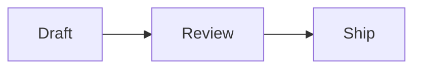
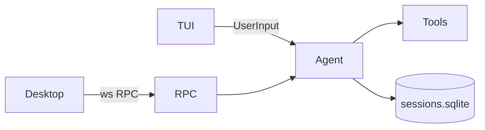

# 30 — Surfaces: Mermaid diagrams and json-render blocks in replies

Status: as-built v0 · 2026-09-15 (draft v0 same day; §16 records what the
build changed and wins where it disagrees) · extends `03-streaming-markdown.md` (the
`markdown` crate is the integration point), `00-architecture.md` §8 (TUI
shapes) and §10 (crate table), `25-desktop.md` §0.5 (streamdown),
`28-untrusted-content.md` (a spec is a sink), `24-message-user.md` /
`21-slack.md` / `09-signal.md` (text-only channels). Source material:
`../jarvis/crates/jarvis-agent/src/rich_content.rs`,
`../jarvis/crates/jarvis-agent/prompts/desktop_ui.md`,
`../jarvis/ui/src/components/rich-content/{JsonRenderSurface,MermaidDiagram}.tsx`,
re-read today. Every claim about theuth cites `file:line` as of this tree.

## 0. Decisions in one screen

1. **Fences in prose, not a tool.** The model writes ```` ```mermaid ```` and
   ```` ```json-render ```` blocks inside its ordinary reply, exactly as
   jarvis does (`desktop_ui.md:3`). They stream with the text, survive
   history as text the model can re-read, and degrade to a code block on any
   surface that cannot draw them. Rejected: a `show{spec}` tool — tool
   arguments do not stream, provider strict-JSON modes fight the
   id-keyed `elements` map, and models put presentation in prose, not in
   tool calls.
2. **No new wire types. No promotion at completion.** jarvis re-parses the
   finished message into `ContentPart::Mermaid | JsonRender` and persists
   those (`rich_content.rs:160-187`); it needs that for surface ids and
   server-side programs. theuth v0 has neither. Rendering is a *frontend*
   concern at the moment `mdstream` commits the fence (03 §2); the store,
   RPC and `HistoryEntry` are untouched.
3. **One Rust crate, `crates/surface`, UI-agnostic like `markdown`.** Parse +
   repair + validate a json-render fence into a typed `Spec`; render a
   `Spec` or a Mermaid source to `Vec<markdown::Line>` at a given width. The
   TUI, the non-TTY printer, Slack and Signal all consume `Line`s or their
   flattening; the desktop consumes the same catalog through ts-rs bindings.
   One catalog definition (Rust, `schemars`) feeds the prompt, the validator,
   the TUI renderer and the TypeScript types. jarvis keeps three copies
   synchronised by tests (`rich_content.rs:43-72`, `desktop_ui_catalog.txt`,
   `catalog.ts`); we keep one.
4. **json-repair at every boundary a model-authored JSON crosses** (§4).
   Strict parse first, `jsonrepair` only on failure, the fact that a repair
   happened is logged. Rust: `jsonrepair-rs` 0.2 (jarvis
   `rich_content.rs:280`). Desktop: `jsonrepair` 3.x before json-render's
   own validation (jarvis `JsonRenderSurface.tsx:84-89`), and — new — on the
   *open* fence while it streams, so a partial spec renders progressively.
5. **Validation errors are located and typed, and the model gets one round
   to fix them.** jarvis validates to `Option<()>` and tells the model
   "check the surface id, spec.root, spec.elements, component names, …"
   (`rich_content.rs:298-303`). We return `Vec<SpecError { path, message }>`
   with JSON-Pointer paths and hand them back as one `<surface_error>`
   message; the reply that follows is the fix. Bounded: one extra round
   per turn, off by config.
6. **Mermaid renders in the terminal.** jarvis's TUI drops rich parts
   (`jarvis-tui/src/app/state.rs:110`). We use an off-the-shelf headless
   Mermaid→text crate (§2.2 names the candidates and the bake-off);
   diagram types the crate does not cover, or wider than the terminal, fall
   back to today's `╭ mermaid` code block. Never worse than today.
7. **Desktop: two libraries, zero custom renderers.** `@streamdown/mermaid`
   is a one-line plugin on the existing `Streamdown` (`MessageAssistant.tsx:9,49`).
   `@json-render/react` + `@json-render/shadcn` render the spec with the
   36 shadcn components that already match the desktop's stack
   (25 §0.5); the catalog is a subset of those plus four data-display
   components we write.
8. **Show, don't tell, is a prompt rule with triggers, not a wish** (§6).
   A static `RegisterPrompt` block (~350 tokens, cache-safe,
   `registry.rs:98-106`) names when to draw, when not to, and the compact
   catalog; a bundled `visualize` skill carries the full schema and
   examples, written to `skills/` on start like `harness.md`
   (`crates/theuth/src/main.rs:165-179`).
9. **Interactive surfaces are not v0.** jarvis's `programs` + QuickJS-Wasm
   sandbox + MCP allowlist + approval flow is the bulk of its code. If we
   want buttons later, a press becomes a user-turn message
   (`<surface_action id=… input=…>`) and the agent handles it with its
   normal tools — no sandbox (§14). Rejected, not deferred: the sandbox.
10. **A spec is a sink.** Under 28, a json-render block can carry data out
    (an `Image` `src`, a link `href`). The v0 catalog has no component that
    fetches or navigates; Mermaid runs `securityLevel: "strict"` with
    `htmlLabels: false` so `click` and HTML labels are inert (§11).

## 1. What exists

| Layer | theuth today | jarvis |
|---|---|---|
| Model → fence | nothing tells the model it may draw; `GUIDANCE` is delegation only (`crates/agent/src/frame.rs:25-43`) | `desktop_ui.md` supplement, UI channel only (`prompt.rs:216-224`) |
| Fence detection | `markdown::Renderer` sees `Tag::CodeBlock(Fenced(lang))`, emits dim `╭ {lang}`, then raw lines (`crates/markdown/src/lib.rs:479-488, 428-441, 560-571`) | post-completion line scanner (`rich_content.rs:104-158`) |
| Validation | none | limits + allowlist + tree/cycle + duplicate-key JSON, boolean result (`rich_content.rs:312-418`) |
| JSON repair | none | Rust `jsonrepair` before serde (`:280`); TS `jsonrepair` before zod (`JsonRenderSurface.tsx:84-89`) |
| Correction | none | one side-call rewriting the draft, fail-open, UI only (`run.rs:2121-2180`) |
| TUI | code block | dropped (`state.rs:110`) |
| Desktop | `Streamdown` + `@streamdown/code` (`MessageAssistant.tsx:1-9, 46-54`) | lazy `mermaid@11`, DOMPurify, 2 s timeout; `@json-render/react` with 28 custom components |
| Text channels | raw text (`crates/tui/src/lib.rs:445-447`; Slack `bubble`, Signal) | Slack re-emits fence, Signal drops the part |
| Streaming | `mdstream` commits a fence only when closed; open fence is the raw pending tail (03 §2) | plain text until completion, soft-closed fence (`streamStatus.ts:117-121`) |

## 2. Facts relied on

### 2.1 Libraries

- **`jsonrepair-rs` 0.2.1**: `jsonrepair(&str) -> Result<String, JsonRepairError>`,
  `RepairOptions`, writer/reader variants; port of josdejong's `jsonrepair`
  (single quotes, trailing commas, comments, Python literals, unterminated
  strings/brackets, fenced wrappers, 30+ cases). Same crate jarvis uses.
- **`jsonrepair` 3.13 (npm)**: same algorithm; jarvis pins it
  (`ui/package.json:59`). Closes truncated documents, which is what makes
  progressive rendering of an open fence possible.
- **`@json-render/core` + `@json-render/react`** (Apache-2.0): flat spec
  `{root, elements: {id: {type, props?, children?}}}`; `defineCatalog(schema,
  {components, actions})`, `defineRegistry`, `<Renderer spec registry/>`,
  `catalog.prompt()`; `createSpecStreamCompiler` for the JSONL
  patch format (RFC 6902 lines) — not used here, our fence is one JSON
  object (§3.1 says why).
- **`@json-render/shadcn`**: 36 components (Card, Stack, Grid, Separator,
  Tabs, Accordion, Collapsible, Heading, Text, Badge, Alert, Table,
  Progress, Button, Input, …) on Radix + Tailwind; `@json-render/shadcn/catalog`
  exports the zod definitions without React. The desktop already is shadcn
  on Tailwind v4 (25 §0.5), so these drop in unstyled work.
- **`@streamdown/mermaid` 1.0.2**: `plugins={{ code, mermaid }}` on the
  existing `Streamdown`; depends on `mermaid ^11.12`. Streamdown also takes
  `components={{ code: … }}` to override the code renderer — that is where
  `json-render` fences are intercepted on the desktop.

### 2.2 Mermaid → terminal text, in Rust

00 §1.2 requires named candidates before any hand-written layout engine.
There are three; none needs a browser.

| Crate | Diagram types with text output | Notes |
|---|---|---|
| `merman` 0.7 (`features = ["ascii"]`) | flowchart, sequence, class, ER, XY chart | parity-focused against mermaid@11.15; `HeadlessAsciiRenderer::render_ascii_sync`; also SVG/PNG headless (`raster`) — the same crate could produce PNGs for Signal later. Depends on `chrono` (already in tree). MSRV 1.95. |
| `mmdflux` (lib + CLI) | flowchart, class, state | own layout engine with orthogonal routing; the best-looking flowchart text of the three; `--lint` gives located diagnostics. |
| `mermaid-text` 0.57 | flowchart | smallest; `render_ascii(&str)`. |

**Bake-off is step 1 of the build (§13)**: a fixture corpus of 12
model-authored diagrams (flowchart LR/TD with subgraphs and labelled
edges, sequence with alt/loop, state, class, pie, gantt, ER, one with a
syntax error). Criteria, in order: renders without panic on all 12;
sequence support; output width at 100 columns; dependency weight
(`cargo tree -d` delta). Default expectation: `merman` for coverage, with
`mmdflux` if its flowchart output is clearly better and sequence turns out
rare in practice. Whatever loses is not kept behind a feature flag.
Unsupported types (`pie`, `gantt`, `mindmap`, `gitGraph`…) fall back to the
source block; the correction pass does not fire for them.

### 2.3 Where fences are seen

- `mdstream` only commits a fenced block once its closing fence arrives;
  until then it is the pending tail shown raw (03 §2, `markdown/src/lib.rs:225-252`).
  So the TUI sees a fence exactly once, whole. Good: one render, no
  half-drawn diagram, no retraction (03: "a live UI cannot retract a drawn
  block").
- `Tag::CodeBlock(CodeBlockKind::Fenced(lang))` is the only place the info
  string is available (`markdown/src/lib.rs:479-488`).
- The final assistant text of a turn is the `calls.is_empty()` branch of
  `round` (`crates/agent/src/loop_.rs:1406-1411`): that is the correction
  hook. Tagged user-role messages (`<subagent_result>`, `<job_result>`,
  `harness.md:122-136`) are the existing way results re-enter the loop.
- ts-rs bindings already exist behind `feature = "ts"`
  (`crates/agent/src/lib.rs:100`, `bindings/*.ts`); the catalog enum joins
  that export.
- The `Entry::height` estimate for an assistant entry is its rendered line
  count (`crates/tui/src/model.rs:570-596`); diagram lines are lines, so the
  anchored window (00 §8) needs no new arithmetic.

### 2.4 Error modes of model-authored specs (why repair, why located errors)

From jarvis's fixtures and the `jsonrepair` case list: trailing commas
(most common), single-quoted keys, `//` comments, unescaped newlines inside
strings, a closing fence inside a JSON string, truncation at `max_tokens`,
`True/None`, and — not repairable — a `children` id that was never
defined, a `type` outside the catalog, a prop of the wrong shape.
Repair handles the first group silently; the second group needs the model,
and needs to be told *where*.

## 3. Shape

### 3.1 The fences

Mermaid: unchanged upstream syntax.

````markdown

````

json-render: the body is **one JSON object, the spec itself** — `root` and
`elements`, nothing else. No envelope, no `id`, no `initial_state`, no
`programs` (jarvis `rich_content.rs:75-84`): every removed field is a field
the model can get wrong and a validator we do not write.

````markdown
```json-render
{
  "root": "r",
  "elements": {
    "r":  {"type": "Card", "props": {"title": "Release readiness"}, "children": ["m", "t"]},
    "m":  {"type": "MetricGrid", "props": {"items": [
            {"label": "Tests", "value": "412 / 412"},
            {"label": "Coverage", "value": "81%", "trend": "up"},
            {"label": "Open P0", "value": "0"}]}},
    "t":  {"type": "Table", "props": {
            "columns": ["Check", "Status"],
            "rows": [["clippy", "pass"], ["signing", "pending"], ["notarize", "blocked"]]}}
  }
}
```
````

Why one object and not SpecStream JSONL: the TUI renders once at commit, so
patches buy nothing there; on the desktop `jsonrepair` closes the partial
object well enough to render progressively (§8); and one object is what
the model already writes for every other JSON it emits.

### 3.2 `crates/surface`

```rust
// crates/surface/src/lib.rs — UI-agnostic; depends on `markdown` for Line/Span/Style
pub const MAX_FENCE_BYTES: usize = 256 * 1024;   // jarvis MAX_JSON_RENDER_SPEC_BYTES
pub const MAX_ELEMENTS: usize = 256;
pub const MAX_DEPTH: usize = 32;                 // nesting via children
pub const MAX_MERMAID_BYTES: usize = 128 * 1024;

/// One located validation failure; `path` is a JSON Pointer into the fence body.
pub struct SpecError { pub path: String, pub message: String }

pub struct Parsed { pub spec: Spec, pub repaired: bool }

/// Strict serde first; on failure `jsonrepair` then serde again; then typed validation.
pub fn parse(body: &str) -> Result<Parsed, Vec<SpecError>>;

/// `Spec` → terminal lines at `width` columns; `None` if it cannot fit.
pub fn spec_lines(spec: &Spec, width: usize) -> Option<Vec<markdown::Line>>;

/// Mermaid source → terminal lines; `Err` carries the parser's located message,
/// `Ok(None)` = diagram type unsupported or too wide (caller falls back to source).
pub fn mermaid_lines(src: &str, width: usize) -> Result<Option<Vec<markdown::Line>>, String>;

/// The `markdown` fence hook: `(lang, body, width) -> Option<Vec<Line>>`.
pub fn fence(lang: &str, body: &str, width: usize) -> Option<Vec<markdown::Line>>;

/// Replace every renderable fence in `text` with its plain-text rendering (Slack, Signal, printer).
pub fn flatten(text: &str, width: usize) -> String;

/// Every `json-render` fence in a finished reply, validated; empty = nothing to correct.
pub fn check(text: &str) -> Vec<(usize /* fence ordinal */, Vec<SpecError>)>;

/// The compact catalog for the prompt block and the JSON Schema for the skill — from `Spec`'s schemars.
pub fn catalog_compact() -> String;
pub fn catalog_schema() -> serde_json::Value;
```

`Spec` is a `serde` + `schemars` + `ts_rs` struct: `root: String`,
`elements: BTreeMap<String, Element>`, `Element { #[serde(flatten)] kind:
Component, children: Vec<String> }`, `Component` an internally tagged enum
(`type`) with one variant per catalog entry and typed `props`. Unknown
`type` → `SpecError` at `/elements/<id>/type` listing the catalog; a bad
prop → the serde error at `/elements/<id>/props/<field>`. Two passes of
validation after deserialisation: (a) every child id exists, each element
has at most one parent, `root` exists, no cycles (a shared child renders
exponentially — jarvis `JsonRenderSurface.tsx:92-125`); (b) limits above.
Duplicate JSON keys: `serde_json` keeps the last; jarvis rejects them with
a custom visitor (`rich_content.rs:509-596`). We accept last-wins — two
elements with one id is a `children` reference error the model sees
anyway.

### 3.3 `markdown` hook

```rust
// crates/markdown/src/lib.rs
pub type FenceHook = std::sync::Arc<dyn Fn(&str, &str, usize) -> Option<Vec<Line>> + Send + Sync>;
pub struct Options { pub width: usize, pub fence: Option<FenceHook> }
pub fn render_with(md: &str, opts: &Options) -> Vec<Line>;
impl Text { pub fn with(opts: Options) -> Self; /* push/finish/complete unchanged */ }
```

In `Renderer::start(Tag::CodeBlock(Fenced(lang)))` (`lib.rs:479-488`): if
`opts.fence` returns `Some(lines)` for this lang, the block's text events
are swallowed and the lines are emitted at `TagEnd::CodeBlock` — but the
body is only known at the end, so the renderer buffers code-block text
when a hook is set and decides at `TagEnd`. Hook returns `None` → today's
`╭ lang` + raw lines. `render(md)` stays as `render_with(md, &Options::default())`
(width 0 = unbounded, no hook), so every existing caller and test is
untouched. Rendering happens once per committed block (03 §2), so the
Mermaid layout cost (tens of ms for merman on M-series) is paid once per
diagram, off the 60 Hz tick.

The `Line`s a diagram produces carry `Style::default()` except: box-drawing
and arrows `dim`, node labels plain, edge labels `italic`. No new `Style`
fields in v0; `Alert` tone is a glyph (`ℹ ⚠ ✗ ✓`), not a colour.

## 4. json-repair: exactly where

The rule: **every** point where text the model wrote is fed to a JSON
parser tries strict first, then `jsonrepair`, then reports. Never repair
silently without a trace; never skip repair because "the model usually
gets it right".

| # | Where | Input | Strict → repair → | On success | On failure |
|---|---|---|---|---|---|
| R1 | `surface::parse` (Rust; TUI render, `check`, `flatten`) | fence body, ≤ 256 KiB | `serde_json::from_str::<Spec>` → `jsonrepair_rs::jsonrepair` → `from_str` again | `Parsed{repaired: true}`; `tracing::info!(target: "surface", kind="json-render", repaired=true)` | `SpecError{path:"", message: "invalid JSON after repair: <serde msg at line:col>"}` |
| R2 | `surface::check` (agent loop, before `TurnFinished`) | same | same as R1 | no `<surface_error>` for JSON syntax — repair fixed it, the frontends will repair identically | the error goes to the model with the serde position |
| R3 | Desktop `JsonRenderFence` on a **closed** fence | fence body | `JSON.parse` → `jsonrepair` → `JSON.parse` | render; `repaired` badge in the block's hover/tooltip (debug aid, not UI noise) | error card: message + source, like jarvis `SurfaceError` |
| R4 | Desktop, **open** fence while streaming | partial body | `jsonrepair` (closes strings/brackets) → `JSON.parse` → json-render `Renderer` with `loading` | progressive skeleton of the spec so far; re-run per streamdown re-render (≤ 60 Hz, body ≤ 256 KiB, sub-ms) | show nothing for this frame (no error card mid-stream) |
| R5 | Skill/prompt examples | — | the fixture corpus in `crates/surface/fixtures/` includes 8 deliberately broken bodies; a unit test asserts each parses after repair or yields a located error | | |

Repair changes nothing the validator would accept differently: R1 and R3
run the same algorithm (Rust port of the same library), so what the TUI
draws is what the desktop draws. The `repaired` counter in the log is the
calibration knob: if a week of sessions shows 30 % of fences repaired,
the prompt's JSON rules need work; if 0 %, R4 can be simplified.

Mermaid has no JSON to repair. Its parse error (from the chosen crate, or
from `mermaid` in the webview) is located text; it goes through the same
`<surface_error>` path (§5) when the Rust parser rejects. A pre-pass that
quotes labels containing `()[]{}` — the single most common model error —
is *not* built until the log shows it (`ponytail:` note in `mermaid_lines`).

## 5. Validation and the one correction round

At `loop_.rs:1406-1411`, when the round ended with text and no tool
calls:

1. `let errs = surface::check(&text)`; empty → unchanged path.
2. Otherwise persist the assistant message as today, then persist one
   user-role message and run one more round (the existing `Round::Tools`
   continuation, counted against `max_tool_rounds`). At most once per
   turn (`state.surface_corrected: bool`), and only if
   `surface.correct` is on (§12).

The message the model sees (verbatim template; `{…}` filled):

```
<surface_error>
Your reply contains {n} `json-render`/`mermaid` block(s) that cannot be rendered. The user saw the raw source instead. Reply with the corrected block(s) only — no apology, no explanation of the fix, keep any prose that was already correct out of this reply.

Block {ordinal} ({kind}), errors:
- {path}: {message}
- {path}: {message}

Catalog: {catalog_compact}
</surface_error>
```

Examples of `message` the validator produces (tests pin these shapes,
not wording): `/elements/t/type: unknown component "DataTable"; catalog:
Card, Stack, …`; `/elements/r/children/1: "m2" is not an element id`;
`/elements/m/props/items/0/value: expected string, got number`;
`/root: "main" is not an element id`; `/: element "x" is referenced by
two parents (r, c)`; `/: 300 elements, limit 256`.

Why a follow-up reply and not jarvis's draft rewrite: the TUI has already
drawn the streamed text and 03 forbids retraction; a visible correction is
honest and costs one short call. The frontends show the broken block as
a code block with an `✗ invalid: <first error>` line under the `╭` header,
so the user sees why a second block follows. Why not fail-open silently:
the whole point is that the user *sees* the picture.

The desktop and TUI never wait for the correction: they render what they
can from the first message immediately.

## 6. Prompting: show, don't tell

### 6.1 Placement

- **`RegisterPrompt { plugin: "surface", text }`** from the surface
  plugin at start — static, a pure function of config, so cache-safe
  (`registry.rs:98-106`). ~350 tokens including the compact catalog. It is
  registered when `surface.enabled` (default true); nothing else in the
  prompt changes.
- **Skill `visualize`** (`crates/surface/visualize.md`, written to
  `<data_dir>/skills/visualize.md` on every start beside `harness.md`,
  `main.rs:172-179`): the full catalog with prop schemas (generated into
  the file at build time from `catalog_schema()` by `build.rs`, so the
  skill can never drift from the validator), six worked examples, the
  anti-patterns. Loaded on demand via `load_skill` or `/visualize`.
- No per-channel gating in the prompt: the model does not learn a
  session's delivery channel today (the prompt is cache-stable by design,
  07 §4), and every channel degrades usefully (§9). jarvis's
  `RICH_SURFACE_WITHDRAWN` machinery (`prompt.rs:253-260`) is not ported.

### 6.2 The prompt block (verbatim)

```
## Show, don't tell
Your reply can draw. Two fenced blocks render as pictures in the terminal and the desktop app, and read as text everywhere else:
- ```mermaid — flowchart, sequenceDiagram, stateDiagram-v2, classDiagram, erDiagram. Use it when the answer is a shape: how things connect, what calls what, what happens in what order, which states lead where.
- ```json-render — one JSON object {root, elements:{id:{type, props, children}}}. Use it when the answer is structured data: a comparison, a status board, before/after, metrics, a plan with states, a timeline. Catalog: {catalog_compact}
Draw when a reader would sketch it on a whiteboard to explain it; that is most architecture, flow, dependency, sequence, state and comparison answers. One picture per idea, ≤ 12 nodes or ≤ 8 rows; labels ≤ 4 words; put the takeaway in one sentence before the block and do not repeat in prose what the picture already shows. Do not draw a one-line answer, a list of two, code, or anything the user asked to copy or paste. Prose is still right for reasoning, caveats and instructions.
Every block must be complete and closed. In json-render every `children` id must be an element, every `type` must be in the catalog, JSON must be strict (double quotes, no trailing commas, no comments). If a block fails to render you will receive a <surface_error> message with the exact path of each error: answer with the corrected block only.
```

`{catalog_compact}` renders from `Spec`'s schema as one line per
component, e.g. `Card(title?, description?) · Stack(direction?, gap?) ·
Grid(columns) · Heading(text, level?) · Text(text, variant?) · Badge(text,
variant?) · Alert(title?, message, type) · Separator · Table(columns,
rows) · KeyValueList(items[{key,value}]) · Metric(label, value, trend?,
delta?) · MetricGrid(items[Metric]) · Progress(value, max?, label?) ·
Bars(items[{label,value}], max?) · Timeline(items[{when,title,detail?,state?}])
· Checklist(items[{text,done}]) · Tabs(tabs[{label,children}]) ·
Accordion(items[{title,children}])`.

### 6.3 The skill (`visualize.md`, abridged; the catalog section is generated)

```markdown
---
name: visualize
description: When and how to draw in a reply — Mermaid diagram types, the json-render catalog with full prop schemas, worked examples, what not to draw. Load before a reply that explains structure, flow or a comparison.
---

# Visualize: show, don't tell

A picture is read in one glance; the same content as prose is read in ten.
When the thing you are explaining has a shape, give it the shape.

## Choose the block

| The answer is… | Draw | Not |
|---|---|---|
| components and what talks to what | `flowchart LR` (TD if it is a hierarchy) | a bullet list of arrows |
| a request/response order across parties | `sequenceDiagram` | numbered prose steps |
| a lifecycle, modes, transitions | `stateDiagram-v2` | "when X it becomes Y, unless…" |
| data model / relationships | `erDiagram` or `classDiagram` | field lists |
| options compared on criteria | `json-render` `Table` | three paragraphs |
| where a job/rollout/checklist stands | `Checklist`, `Timeline`, `Progress` | "we have done A and B; C is pending" |
| numbers that matter | `MetricGrid` or `Bars` | numbers buried in sentences |
| a plan with phases | `Timeline` (state per item) | headers + bullets |

Do not draw: one fact; two items; code or commands; anything the user will
copy; a diagram of the diagram you are about to show. Never describe the
picture in prose — one sentence of takeaway above it, then the block.

## Mermaid rules that avoid errors
- Quote labels that contain `(`, `)`, `[`, `]`, `{`, `}`, `:` or `|`: `A["fetch(url)"]`.
- Node ids are bare words; `end` is reserved — write `End` or `finish`.
- Edge labels: `A -->|label| B` or `A -- label --> B`, no spaces inside `|…|` delimiters.
- One diagram, one direction; ≤ 12 nodes; split otherwise.
- `subgraph name … end` for grouping; `%%` for comments; no HTML in labels.

## json-render rules that avoid errors
- Exactly `{ "root": "<id>", "elements": { … } }`; nothing else at the top.
- Every id in any `children` list is a key of `elements`; each element appears in at most one `children`.
- `type` is one of the catalog names below, spelled exactly; `props` match its schema; unknown props are errors.
- Strict JSON: double quotes, no trailing commas, no comments, no `True`/`None`.
- Prefer flat: a `Card` with a `Table` beats nested `Stack`s. ≤ 256 elements.

## Catalog
<!-- generated from crates/surface: names, props, one example each -->
…

## Worked examples
### Architecture answer
Takeaway sentence, then:

### Status board
```json-render
{ "root": "c", "elements": {
  "c": {"type":"Card","props":{"title":"Rollout · eu-west"},"children":["p","l"]},
  "p": {"type":"Progress","props":{"value":7,"max":12,"label":"hosts migrated"}},
  "l": {"type":"Checklist","props":{"items":[
    {"text":"schema migration","done":true},
    {"text":"canary 5%","done":true},
    {"text":"full traffic","done":false}]}} } }
```
### Comparison
… (`Table` with `columns`/`rows`)
### Sequence
… (`sequenceDiagram` with `alt`)
### Lifecycle
… (`stateDiagram-v2`)
### Metrics
… (`MetricGrid` with `trend`)
```

### 6.4 Steering strength, measured not asserted

The block is instruction, not a demand. The check that it works is §13
step 8: 20 prompts that *should* draw (explain this architecture, compare
these three, where is the rollout) and 10 that should not (what is the
port, give me the command, summarise this paragraph); count blocks per
reply before and after the prompt lands. Target: ≥ 15/20 drawn, ≤ 1/10
drawn where they should not be, and 0 unrendered blocks after the
correction round. Tune the wording in §6.2, not the code.

## 7. TUI

- `Entry::Assistant` constructs `markdown::Text::with(Options { width:
  cols - 2, fence: Some(surface::fence) })` — the only construction site
  that changes (`model.rs:2217-2224`); `Card`, `Compacted` and tool
  expansions keep `Text::new()`. Width is the terminal width at
  construction; resize does not re-render, the same ceiling 03 accepts for
  tables. `ponytail: re-render on resize when it grates; the raw buffer is kept`.
- Rendered lines go through the unchanged `line()` mapper
  (`crates/tui/src/ui.rs:926-960`): dim → dark grey for box drawing, bold
  for `Metric` values and `Heading`, italic for edge labels, `code` cyan
  for `Text{variant:"code"}`.
- A block that fails (`fence` → `None` or a parse error) renders exactly
  as today plus one dim line under the `╭` header: `✗ invalid json-render:
  /elements/t/type unknown component "DataTable"` (first error only; the
  model gets them all). Mermaid types the crate cannot draw: `╭ mermaid`
  and source, no `✗` — the model did nothing wrong.
- Non-TTY printer (`tui/src/lib.rs:445-447`) keeps raw text: it is a
  transcript, and the fences are copy-pasteable.
- Ctrl+O on an assistant entry: not added. The raw source is one
  `/copy`-style action away in the desktop; in the TUI a diagram the user
  wants as text is the model's job to give when asked.

Rendering per component, at `width` columns (all reuse `markdown`
primitives; `layout_table` becomes `pub`):

| Component | Lines |
|---|---|
| `Card` | `╭─ title ─────╮` / `│ …children… │` / `╰──────╯` — the same round frame as tool cards (00 §8) drawn in text; `description` dim under title |
| `Stack` | children in order; `direction: "horizontal"` = side by side when the sum of widths fits, else stacked |
| `Grid` | `columns` equal-width cells, row by row, padded like a table |
| `Heading` | bold; `level` 1 additionally `heading` style (mapper underlines) |
| `Text` | wrapped at width; `variant: muted/caption` dim, `code` code style |
| `Badge` | `[text]`; `variant: destructive` → `[✗ text]`, `success` → `[✓ text]` |
| `Alert` | `ℹ`/`⚠`/`✗`/`✓` + bold title, message wrapped under a `│` prefix (quote style) |
| `Separator` | `────` to width, dim |
| `Table` | existing `layout_table` |
| `KeyValueList` | keys right-aligned to the longest, dim; values plain |
| `Metric` | `label` dim over `value` bold; `trend` `▲ ▼ ▶`, `delta` dim beside |
| `MetricGrid` | `Metric`s side by side, wrap to rows at width |
| `Progress` | `label  ████████░░░░  7/12  58%` — bar fills the remaining width, min 10 cells |
| `Bars` | one row per item: `label` padded, bar ∝ `value/max`, value at end |
| `Timeline` | `● when  title` / `│       detail`; `state: done` `●`, `active` `◉`, `pending` `○` |
| `Checklist` | `[x] text` / `[ ] text` (the existing task-list glyphs, 03 §3) |
| `Tabs` | every tab expanded, each under a bold `label` line — terminals do not click |
| `Accordion` | same, every item open |

Anything wider than `width` after layout (a `Grid` of long cells) →
`spec_lines` returns `None` → source block. The desktop never hits this.

## 8. Desktop

- `MessageAssistant.tsx:9`: `const plugins = { code, mermaid }`; add
  `@streamdown/mermaid` and `mermaid` to `package.json`. Configure via the
  plugin's options with `securityLevel: "strict"`, `htmlLabels: false`,
  `suppressErrorRendering: true`, `maxEdges: 1000` — the same settings
  jarvis chose after its DOMPurify pass (`MermaidDiagram.tsx:116-125`); if
  the plugin does not expose `securityLevel`, we call `mermaid.initialize`
  once at app start, which mermaid honours globally. `[INFERENCE]` about the
  plugin's option surface — verified in step 6.
- `components={{ code: CodeOrSurface }}`: for `className ===
  "language-json-render"` mount `<JsonRenderFence body open/>`; every
  other language falls through to the `@streamdown/code` renderer it
  replaces (streamdown's `components` override precedes plugins, so the
  wrapper must delegate explicitly).
- `JsonRenderFence`: R3/R4 from §4, then `<JSONUIProvider registry>
  <Renderer spec registry loading={open}/>`. Registry = `defineRegistry`
  over the catalog: `@json-render/shadcn` components for Card, Stack, Grid,
  Separator, Tabs, Accordion, Heading, Text, Badge, Alert, Table,
  Progress; four small components of ours for `KeyValueList`, `Metric` /
  `MetricGrid`, `Bars`, `Timeline`, `Checklist` (Tailwind, no library).
  Catalog definitions: `shadcnComponentDefinitions.X` for the shadcn ones;
  for ours, zod schemas *generated* from the ts-rs `Spec` types by a
  `bun run gen:catalog` step so they cannot drift from Rust (25 §4 already
  generates `bindings/`). A vitest asserts `Object.keys(registry) ==
  ComponentType` from the bindings.
- Invalid closed fence → the same error card as jarvis (`Interactive view
  unavailable · <first error> · <source in details>`), styled as the
  desktop's `Alert`.
- Performance (25 §0.7): a fence is one virtualised transcript row whose
  height changes when mermaid finishes — the row measurer must observe
  size (jarvis `VirtualTimeline.tsx:262-266` uses `ResizeObserver` for
  this). Mermaid renders are serialised through the plugin; R4 re-parses
  ≤ 256 KiB per frame, which is under 1 ms.

### 8.3 Desktop mermaid block (as-built, 2026-09-22)

```` ```mermaid ```` fences no longer reach streamdown's built-in block:
`plugins.renderers` maps the language to `components/chat/Mermaid.tsx`
(`MermaidFence`), which renders through `@streamdown/mermaid`'s configured
instance (§11 settings unchanged) and owns the rest. Why: the artifact panel
is a Radix modal `Sheet`, which sets `pointer-events: none` on `body` while
open; streamdown's fullscreen is a bare `createPortal(document.body)`, so
in that panel wheel and pointer events never reached its pan/zoom (the chat
transcript, outside any modal, was unaffected). Its `Mermaid` component is
not exported, its zoom steps about the centre, and its toolbar takes no
extra buttons, so the block was replaced rather than patched.

- **Pan/zoom** (`Diagram`): wheel zooms about the cursor (`t' = p − (p − t)·k`,
  content box = surface box, `transform-origin: 0 0`), one pointer drags, two
  pointers pinch about their midpoint, double-tap/click resets — pointer
  events throughout, so mouse, trackpad and fingers share one path and
  `lib/pinch.ts` (synthetic wheel from touch) is gone. The surface has
  `touch-action: none`, `overflow: hidden`, a non-passive `touchmove`
  `preventDefault` for two fingers (the viewport is not scale-locked), and
  no transition (drag jitter, see the 2026-09-15 CSS fix it replaces).
- **Fullscreen** (`Fullscreen`): our `Dialog` (Radix), full-bleed, no scroll
  container. Nested under the panel's Sheet, Radix's layer stack gives the
  inner content `pointer-events: auto`, Esc closes only the diagram, focus
  is trapped. Controls (Copy PNG · Save PNG… · Save SVG… · Reset · Close)
  are `Button size="icon"`: 36 px, 44 px on coarse pointers, offset by the
  safe areas. The inline overlay has the same export buttons plus
  Fullscreen, shown on hover/focus and always on coarse pointers.
- **Export** (`lib/mermaid-export.ts`): `standalone()` gives the rendered
  svg explicit `width`/`height` from its `viewBox`, drops mermaid's
  `width="100%"`/`max-width`, and paints a white rect over the whole box
  (+1 unit each side, so a shifted origin or pixel rounding leaves no
  transparent strip); mermaid's own `<style>` makes it self-contained, so
  nothing from the page is inlined. `rasterize()` decodes it through an
  `` into a 2× canvas → `image/png` blob. Copy PNG writes a
  `ClipboardItem` whose blob is a *promise* (Safari only honours writes
  still inside the click's activation). Save: in a browser, `<a download>`
  named `diagram-<fnv1a of source>.{png,svg}`; in the desktop shell on the
  local daemon, `put_attachment` (the only byte sink the shell has — no fs
  plugin) then `revealItemInDir`; hidden elsewhere (iOS, remote harness).
  `ponytail:` `@tauri-apps/plugin-fs` + the `save()` dialog would give a
  chosen path and name.
- **Streaming**: every source change re-renders; a failed render keeps the
  last good svg and, once the fence is closed, shows the §8 error card
  (`Diagram unavailable · <mermaid parse error> · source`).

## 9. Text channels: Slack, Signal, `message_user`

`surface::flatten(text, 60)` runs where each channel turns the assistant's
text into an outgoing message: Slack `bubble` (21 §8), Signal outbound
text (09 §8.1), and the `message_user` body (24 §3). A `json-render` fence
becomes its terminal rendering wrapped in a code block (monospace on both
platforms, so the box drawing survives); a Mermaid fence stays a code
block of source in v0 — readable, and Slack users know the syntax.

v1, when asked for: `merman` with `raster` renders the Mermaid to PNG
into `attachments/` and the channel attaches it (`message_user{files}`
already carries images, 24 §5); Signal then shows a picture where jarvis
shows nothing.

## 10. Catalog v0

Eighteen components, chosen for what an assistant *shows*: layout (Card,
Stack, Grid, Separator, Tabs, Accordion), content (Heading, Text, Badge,
Alert, Table, KeyValueList), quantities (Metric, MetricGrid, Progress,
Bars), time and state (Timeline, Checklist). Not in v0: `Image`, `Link`,
`Avatar`, `Carousel`, `Button`, `Input`, `Select`, `Dialog`, `Drawer`,
`Tooltip`, `Popover`, `DropdownMenu`, `Skeleton`, `Spinner` — either they
fetch or navigate (§11), take input (§14), or are meaningless in a
transcript. jarvis's `Flow`, `Graph`, `RiskMatrix`, `Pie`, `TaskBoard`
(`rich_content.rs:43-72`): flows and graphs are what Mermaid is for; a pie
is `Bars`; a risk matrix is a `Table`; a task board is `Checklist` or
`Timeline` with `state`. Adding a component = one enum variant + one TUI
arm + one React component; the prompt, skill, validator and bindings
regenerate.

## 11. Security (28)

- A `json-render` block is model output shaped by everything the model
  read; under 28 it is a *sink* if any component can carry bytes out. v0
  has no `Image`, no `Link`, no `href`, no `src`; `Text` and labels are
  rendered as text nodes (React escapes; iocraft draws characters). No
  `dangerouslySetInnerHTML` anywhere in our components.
- Mermaid: `securityLevel: "strict"` disables `click` callbacks and
  `htmlLabels: false` keeps labels as text; `@streamdown/mermaid` renders
  into an SVG the way jarvis did but without DOMPurify — if step 6 shows
  the plugin injects unsanitised SVG, add `dompurify` with jarvis's profile
  (`MermaidDiagram.tsx:55-70`). Nothing in a Mermaid source reaches the
  network under strict.
- Limits stop resource abuse: 256 KiB body, 256 elements, depth 32, 128 KiB
  Mermaid, `maxEdges 1000`; the Rust Mermaid renderer runs on the TUI
  thread once per block — a pathological 128 KiB flowchart is bounded by
  the crate's own node limits, verified in the bake-off (step 1) with a
  1000-node fixture (must return within 200 ms or `None`).
- The correction message is user-role text the model wrote about; it
  contains no tool output, so it carries no taint of its own.

## 12. Config, data on disk, events

```yaml
surface:
  enabled: true      # false: no prompt block, no rendering hook, fences stay code blocks everywhere
  correct: true      # false: no <surface_error> round; frontends still render what parses
```

Data on disk: `skills/visualize.md` (binary-owned, rewritten on start).
No new tables, no new RPC methods, no new `AgentEvent`. Tracing target
`surface`: `fence{kind, ok, repaired, errors, ms}` per block, the only
telemetry, and the number the calibration in §4 reads.

## 13. Build steps, each with its check

1. **Bake-off** (`crates/surface/fixtures/*.mmd`, a throwaway
   `examples/bakeoff.rs` deleted after): pick the Mermaid crate per §2.2.
   Check: a table of 12 fixtures × 3 crates (rendered / fallback /
   panic, width, ms) pasted into §16.
2. **`surface::parse` + validator + `check`**, `jsonrepair-rs`. Check:
   `cargo test -p surface`: 12 valid fixtures parse; the 8 broken ones
   either parse with `repaired: true` (trailing comma, single quotes,
   comment, Python literals, truncated tail) or yield the expected
   `SpecError.path` (unknown type, missing child, shared child, bad prop
   type).
3. **`spec_lines` + `mermaid_lines` + `fence` + `flatten`.** Check:
   golden text files per component at width 60 and 100; the status-board
   example from §6.3 renders to the expected lines; a 200-column `Grid`
   at width 80 → `None`.
4. **`markdown::Options` + hook**; TUI wires `Text::with`. Check:
   `cargo test -p markdown` unchanged; new test: a message with prose,
   a mermaid fence and prose renders prose / diagram lines / prose, and
   the same with a hook that returns `None` equals `render(md)`.
5. **Agent: `check` + `<surface_error>` round**, `surface` config, prompt
   block, `visualize.md` written on start. Check: unit test on the round
   logic (one correction max, off by config); `/prompt` shows the block;
   `load_skill visualize` returns the generated catalog.
6. **Desktop**: `@streamdown/mermaid`, `JsonRenderFence`, registry, generated
   zod catalog, vitest parity. Check: playwright/visual — the three §6.3
   examples rendered; a streamed fence shows a partial render before the
   closing fence arrives (R4); an invalid fence shows the error card.
7. **Channels**: `flatten` in Slack bubble, Signal reply, `message_user`.
   Check: unit test that a reply with a `json-render` fence arrives as a
   monospace block of the rendered text.
8. **Steering measurement** (§6.4): 30 prompts through `theuth -p` against
   the configured model, before/after; counts into §16.
9. **pty run** as in 03 §4: 100×40, Anthropic, "explain how theuth's TUI,
   agent and store talk": a flowchart appears once its fence closes;
   frames sampled at 100 ms show raw ```` ```mermaid ```` lines typing
   out, then the box-drawn diagram in one frame.

Steps 2–3 (Rust) and 6 (TS) are independent once the catalog enum exists;
they can go to two workers with the enum as the contract.

## 14. Not built, and when

- **Interactive surfaces.** A `Button`/`Input`/`Select` whose action is a
  user-turn message `<surface_action fence=N element=id value=…>` — the
  agent reacts with tools, the approval gate applies as always. No
  sandbox, no programs, no MCP allowlist (jarvis `jarvis-surface`,
  `desktop_ui.md:33-44`). Add when a real workflow wants a button; the
  message shape is the whole design.
- **Progressive rendering in the TUI.** Not until a diagram takes longer
  than a sentence to stream; 03's reveal cursor already types the source
  out, which reads as progress.
- **Mermaid PNG to Signal/Slack** (§9).
- **Mermaid label pre-repair** (§4) — when the `surface` log shows it.
- **`Style.tone`** for coloured alerts/badges — when glyphs prove
  insufficient.
- **Resize re-render** of committed diagrams (§7).
- **`Image` with `attachments/` paths only** — when a tool starts producing
  charts as files; 28's sink rule needs a path allowlist first.

## 15. Amendments to `00-architecture.md`

- §8 (TUI): assistant entries may contain rendered diagram/surface lines
  produced by the `markdown` fence hook; failed blocks show `╭ lang` +
  `✗` line + source.
- §10 (crate table): `surface` — parse/repair/validate json-render, render
  json-render and Mermaid to `markdown::Line`s, flatten fences for text
  channels; depends on `markdown`, `jsonrepair-rs`, the chosen Mermaid
  crate, `schemars`, `ts_rs` (feature `ts`).
- §8 prompt parts: one more `RegisterPrompt` block, plugin `surface`.

## 16. Status (as-built, 2026-09-15)

Built on branch `surfaces` in three phases (commits `a08c294`, `03496bf`,
`4149b80`). Gates at each phase: `cargo clippy --workspace --all-targets
-D warnings` clean, `cargo test --workspace` green (surface 28, markdown
9, agent 73, tui 32, slack/signal/user tests included), desktop `tsc`
clean and vitest 74/74. Steps 8–9 of §13 (steering counts, pty sampling)
are the user's to run; one smoke turn is recorded below.

### 16.1 Bake-off (step 1) — `merman` 0.7 `ascii`

`crates/surface/fixtures/mermaid/BAKEOFF.md` has the 12 × 3 table. Summary:
no crate panicked or hung; rendered/unsupported/error — merman 6/5/1,
mmdflux 8/3/0, mermaid-text 10/0/1. merman: narrowest and cleanest
sequence output (49 cols vs 69/80), only parser that rejects
`11-syntax-error.mmd` the way mermaid.js does, 22.5 ms on the 1000-node
chain (mmdflux 63, mermaid-text 439). Costs: `stateDiagram-v2` is
`UnsupportedDiagram` in merman-ascii 0.7 (source fallback, no `✗`); class
relationship cardinality labels unsupported; an upstream lexer bug rejects
valid `||--o|` in `erDiagram`. Consequences below.

### 16.2 What the build changed against §1–§15

- **Mermaid never triggers the correction round** (§4, §5 said it would).
  The ER false positive would produce an unsatisfiable `<surface_error>`.
  `surface::check` covers `json-render` only; a Mermaid parse error is
  shown in the TUI as `╭ mermaid` / `✗ mermaid: <msg>` / source, and ER
  parse errors fall back to a plain source block (`mermaid.rs`, `ponytail:`
  note). Desktop mermaid.js remains the authority there.
- **Desktop components are ours over the local shadcn primitives**, not
  `@json-render/shadcn` (§8, §0.7). The catalog is Rust-owned; adopting the
  package's prop shapes would have made its zod definitions the authority.
  `@json-render/core` + `@json-render/react` 0.20 are used for
  `defineCatalog`/`defineRegistry`/`Renderer`. Text-bearing components are
  `div`s with ARIA roles so `MessageAssistant`'s `[&_p]`/`[&_li]`
  selectors do not restyle them.
- **Fence interception uses streamdown's `plugins.renderers`** keyed by
  language (`{language: 'json-render', component: JsonRenderFence}`), not a
  `components.code` wrapper. streamdown passes `isIncomplete` per fence,
  which is exactly R4's open/closed distinction. Mermaid config goes through
  `createMermaidPlugin({config})` (`securityLevel: strict`,
  `htmlLabels: false` top-level and `flowchart.htmlLabels`,
  `suppressErrorRendering`, `maxEdges: 1000`); no DOMPurify added.
- **`parsePartial` prunes dangling child ids instead of dropping the
  parent** — dropping the root while its children stream would hide
  everything until the fence closed.
- **Skill generation is a runtime template**, not `build.rs` (§6.1):
  `crates/surface/visualize.md` with `{{catalog}}` filled by
  `surface::visualize_skill()` from `catalog_schema()`; `crates/theuth`
  depends on `surface` directly and writes `skills/visualize.md` beside
  `harness.md`.
- **Config**: `SurfaceConfig { enabled, correct }` lives on
  `AgentConfig.surface` (`#[serde(skip)]`, filled from the top-level
  `surface:` section in `supervisor::start` via `rt.section`). Documented
  in `harness.md` and `DEFAULT_CONFIG`.
- **Correction hook**: `loop_.rs` `round()`, `calls.is_empty()` branch;
  pure decision `needs_correction(cfg, state, text)` with tests;
  `SessionState.surface_corrected` reset per turn; the round returns
  `Round::Tools` so the extra call counts against `max_tool_rounds`.
- **Slack streaming**: stream mode appends deltas rather than re-posting,
  so `flatten` alone would never see a closed fence. `Bubble::streamable()`
  holds the send boundary at the committed prefix while the pending tail is
  an open ```` ```json-render ```` fence; when it closes, the whole fence is
  flattened in one chunk. Prose and other fences stream as before.
- **TUI width** is read with `crossterm::terminal::size()` into
  `Model::width` on each frame that applies events (the event future cannot
  see the `use_terminal_size` hook); hook width = `width - 2`, min 20; 0 =
  unbounded (line printer, tests). Replay (`from_history`) builds with the
  same options so history and live render identically.
- **Validation is schema-driven**: `validate.rs` walks each element's
  `props` against the schemars schema of `Component` (built once), so prop
  errors carry `/elements/<id>/props/<field>/...`; then `serde` builds the
  typed value. Duplicate keys: last wins (as decided).
- **Bindings**: `just ts` also writes `bindings/surface-catalog.json`
  (schemars) and `surface-catalog-compact.txt`; the desktop vitest
  `catalog.test.ts` normalises both the JSON schema and the zod catalog to
  one shape tree and compares all 18 components (required/optional props,
  enum values, `Grid.columns` 1..6, `Heading.level` 1..4, containers).
  Mutation check: dropping `Metric.delta` or renaming `Tabs.labels` fails
  exactly the affected components.
- Rendering rules honoured with these readings of §7: Card title plain,
  `Text muted/caption` dim, `Stack gap: none` is the only gap that removes
  the blank line, Grid rows adjacent, Progress/Bars use a 20-cell bar when
  width is unbounded, Timeline default glyph `●`. Mermaid edge labels are
  not italic: merman's text output has no label structure.
- Not done (still §14): resize re-render, Mermaid PNG to channels, label
  pre-repair, `Style.tone`, interactive surfaces.

### 16.3 Smoke (step 8/9 precursor)

`t --data-dir /tmp/theuth-verify -p "Explain in a short answer how a request
flows from the theuth TUI through the agent to the model provider and back,
including the sessions store."` with `anthropic/claude-sonnet-4-5`, effort
low, fresh data dir: `skills/visualize.md` written on start; the reply
(18.6 s, 11 707↑ 660↓) ended with a closed ```` ```mermaid ```` `sequenceDiagram`
of TUI/Agent/Sessions/Provider — drawn without being asked, with a
one-sentence takeaway after it. It also kept an 8-step numbered list above
the diagram, so the "do not repeat in prose" rule is only partly followed
at effort low; the §6.4 measurement decides whether the wording needs
tightening. No `<surface_error>` round fired.
