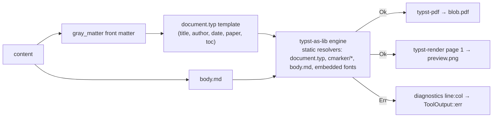

# 35 — Artifacts: files the agent makes for the user, shown in chat

Status: as-built v0 · 2026-09-16 (draft same day; §14 records what the
build changed and wins where it disagrees) · extends `00-architecture.md` §4 (tool
contract), §5 (tools list), §7 (`get_attachment`), §8 (TUI shapes), §10
(crate table); `17-images.md` §10 (`ToolOutput.files` is *not* this);
`20-documents.md` (the inbound direction of PDFs); `24-message-user.md`
(out-of-band delivery, unchanged); `25-desktop.md` §3 (parity table);
`28-untrusted-content.md` (sinks); `30-surfaces.md` (inline pictures in
prose — the sibling of this doc, and what it is not). Every claim about theuth
cites `file:line` as of this tree.

## 0. Decisions in one screen

1. **One tool, `show`.** `show { path?, content?, name?, title?, source? }`
   displays a file in the chat. Give it a `path` and it shows a file that
   already exists (one the model wrote with `write_file`, a screenshot, a
   PDF the user dropped). Give it `content` + `name` and it writes the file
   under the harness and shows it. The extension decides everything else:
   `.md` renders as markdown, `.png` as a picture, `.csv` as a table,
   `.pdf` is *compiled* from the markdown (or Typst) in `content`.
   Rejected: one tool per kind (`create_pdf`, `show_image`,
   `display_markdown`) — four schemas for one idea, and the model already
   thinks in file names; a ```` ```artifact ```` fence (30 §0.1's answer for
   pictures) — a file is bytes with a name and a version, a fence is text
   in prose, and a PDF cannot stream through one.
2. **An artifact is an immutable snapshot with a name and a version.**
   `show` copies the bytes to `<data_dir>/artifacts/<sha256[..16]>.<ext>`
   (the `attachments/` convention, `rpc/src/api.rs:619-630`) and records
   `{call_id, session, name, title, kind, bytes, version, …}` in
   `<data_dir>/artifacts.sqlite` beside it (the `knowledge/` +
   `knowledge.sqlite` layout). Showing the same `name` again in a session is `v2`;
   every card keeps opening the version it showed. Rejected: showing the
   live file at its path — the transcript would lie once the file changed,
   a phone through the relay could not fetch it (`get_attachment` serves
   three directories, `api.rs:1260-1272`), and "which version did I see"
   has no answer.
3. **The `show` tool call *is* the card.** No new `HistoryEntry`, no new
   transcript entry kind. A tool card whose name is `show` renders as an
   artifact card in every frontend; the live data comes from one event,
   `ArtifactShown { call_id, artifact }`, and history joins
   `HistoryEntry::Tool { call_id, name: "show" }` (`agent/src/lib.rs:759-773`)
   with `list_artifacts(session)`. Rejected: `ToolOutput.files` — those
   become image parts of the tool result (`loop_.rs:1619-1633`); a 30-page
   markdown would be base64 in the frame and in `messages.body`.
4. **Documents come out of Typst, in-process.** `typst-as-lib` +
   `typst-pdf` compile markdown (through the vendored `cmarker` package)
   or raw Typst to PDF; `typst-render` rasterises page 1 for the card and
   for the model. Off-the-shelf (00 §1.2), pure Rust, no binary to
   install, fonts embedded. Rejected: `genpdf`/`printpdf` (we would write
   the layout engine), headless Chromium (none in tree; obscura has no
   print path, 23), asking the model to emit PDF bytes (the user's words:
   "with tools, not by literally outputting text in a pdf file format").
5. **The model sees what it made.** A compiled PDF or an SVG comes back
   to the model as a page-1 / rasterised PNG on `ToolOutput.files` — the
   same channel `browser_screenshot` uses (`browser/tools.rs:577-580`) —
   so a vision model can catch a broken table before the user does.
   Compile errors return located (`line:col: message`) as `ToolOutput::err`,
   exactly like 30 §5's `<surface_error>`; the next call is the fix.
   Text kinds return a one-line receipt, never the content.
6. **The display layer is per frontend, and never worse than a path.**
   Desktop: inline card + a side panel with a viewer per kind and
   Copy / Save as / Open / Reveal. TUI: a `▣` card with the path as an
   OSC 8 `file://` link, Ctrl+O renders text kinds inline through
   `markdown::Text`, `o` opens the OS viewer, `/artifacts` lists. Slack
   and Signal: the file lands in the bound thread. ACP: a `ResourceLink`.
   Line printer: `[artifact: name → path]`.
7. **Long tool arguments get a progress event.** `show{content}` for a
   three-page report is 40 s of tool-argument streaming during which every
   UI today shows a spinner (`ToolCallPending` fires once,
   `loop_.rs`). One new `AgentEvent::ToolCallProgress { call_id, args:
   Arc<str> }` coalesced at 250 ms carries the cumulative partial JSON
   genai already gives us (00 §11.4); UIs `jsonrepair` it for `name` and
   show `writing report.pdf… 3.2 KB`. Rejected: nothing (a blank minute
   is the worst UX in this design); a per-chunk event (noise on the bus).
8. **`Risk::ReadOnly`, not a sink.** `show` writes only under
   `<data_dir>/artifacts/` and the recipient is whoever the reply already
   reaches: the same argument as `message_user` (24 §4) and `knowledge_put`
   (10 §6). An HTML artifact, when *rendered*, can load images from the web
   like any page the user opens — that is intended (46) — but the desktop
   renders it in a script-less sandbox (§9): CSP blocks scripts,
   `fetch`/XHR, fonts and frames; `sandbox=""` blocks forms, top navigation
   and same-origin access. External image requests are intentional, so this
   viewer is not claimed to be network-less or an egress-prevention boundary.
9. **Not a canvas.** No user edits flowing back, no diff view, no code
   workspace (00 §1.8: not a coding agent). A code file is a text artifact
   with highlighting. §12 names the one message shape that would make
   artifacts editable, and stops there.
10. **A plugin, `crates/artifact`.** Own state on disk, own actor, own
    tools, own event, own config section — `docs/plugins.md` §1's row.

## 1. What exists

| Layer | theuth today | Cite |
|---|---|---|
| Tool → file → model | `ToolOutput.files: Vec<PathBuf>`; the loop makes each an image part on the `ToolResponse`; `ToolCallFinished { files }`; `HistoryEntry::Tool { files }` rebuilt from `Binary.name` | `tools/src/lib.rs:106-116`, `agent/src/loop_.rs:1587-1633`, `supervisor.rs:2297-2323` |
| File → frontend bytes | `get_attachment(path)` base64, only under `<data_dir>/{attachments,browser,computer}`; `put_attachment(bytes, ext)` → `attachments/<sha16>.<ext>` | `rpc/src/api.rs:467-476, 619-630, 1242-1272` |
| Desktop file display | `Attachments`: image thumbnails + lightbox; any other file is a filename chip with no action; `resolveFile` = `convertFileSrc` locally, `get_attachment` → blob URL remotely (LRU 50) | `desktop/ui/src/components/chat/Attachments.tsx:8-76`, `lib/files.ts:56-76` |
| TUI file display | `ToolCallFinished { .. }` drops `files`; a file is visible only if the tool's text names its path; links are OSC 8 for `http(s)` only; no open/reveal | `tui/src/model.rs:2827-2842, 4818-4819`, `tui/src/ui.rs:1015-1036, 1070-1071` |
| Slack / Signal tool cards | `tool_finished(call_id, output, is_error)` — no files; outbound files exist only through `message_user` (`upload_file`, `send_attachment`) | `slack/src/channel.rs:1887-1895`, `slack/src/api.rs:228-238`, `signal/src/user.rs:20-58` |
| ACP | `ToolCallFinished` → `ToolCallContent::from(output)` text only | `rpc/src/acp.rs:472-488` |
| Writing files | `write_file { path, content }`, `Mutating`, relative to the *process* cwd, returns `wrote N bytes to <path>` | `tools/src/fs.rs:82-121` |
| Reading documents | `read_file` renders PDF/Office to markdown (20); nothing renders *to* PDF | `tools/src/fs.rs:18-78` |
| "Show" verbs | `browser_show` → bus event the desktop acts on; `computer_open` → `open`/`xdg-open`; `message_user` → out of band | `browser/tools.rs:641-653`, `computer/tools.rs:364-393`, `agent/src/user.rs:140-227` |
| Inline pictures in prose | Mermaid / json-render fences (30) — pictures *in* the reply, not files | `crates/surface` |

The gap in one sentence: the model can write a file and can hand a file to
Slack, but nothing lets it put a document in front of the user in the
conversation they are having — so it pastes the content into its reply,
or tells the user to open a path.

## 2. Facts relied on

### 2.1 Typst in-process

- **`typst-as-lib` 0.16** (Typst 0.15; API marked unstable — pin it):
  `TypstEngine::builder().main_file(src).fonts([..]).with_static_source_file_resolver([..]).with_static_file_resolver([..]).build()`;
  `compile()` / `compile_with_input(Value)` → `Warned<Option<PagedDocument>>`
  plus `SourceDiagnostic { span, message, hints }`; spans resolve to
  `line:col` through the `Source`. `with_file_system_resolver(root)`
  restricts `image("…")`/`read("…")` to `root`. Package resolution
  (`@preview/…`) is a feature we **do not enable**: it fetches at first
  use; we vendor what we need.
- **`typst-pdf` 0.15**: `pdf(&PagedDocument, &PdfOptions) -> Result<Vec<u8>>`.
  **`typst-render` 0.15**: `render(&Page, pixels_per_pt) -> tiny_skia::Pixmap`
  → `encode_png()`.
- **Fonts**: `typst-kit` `fonts` + `embed-fonts` features embed Libertinus
  Serif, New Computer Modern (+ Math) and DejaVu Sans Mono and search
  system font dirs; `FontSearcher::new().include_system_fonts(true).search()`.
  Nothing to install.
- **`cmarker` 0.1.10** is a Typst Universe package, not a crate: `.typ`
  sources + a WASM plugin built from `pulldown-cmark`. Typst runs plugins
  through `wasmi` (the `typst` crate's default `plugin` path). We vendor
  the package directory under `crates/artifact/typst/cmarker/` and serve
  it through the static resolvers, so `#import "cmarker.typ": render` works
  offline. It supports headings, emphasis, lists, links, code (with
  `raw`), tables, images, blockquotes, footnotes, and raw Typst via
  `<!--raw-typst … -->` for the model that wants a page break.
- **`gray_matter`** is in the tree (skills front matter, 00 §5) and parses
  the YAML front matter a markdown document may carry (`title`, `author`,
  `date`, `paper`, `toc`).
- **`resvg`** arrives with `typst` (SVG images); we use it directly for
  `.svg` artifacts → PNG.
- Compile cost: a 5-page markdown document through cmarker is hundreds of
  ms on M-series; a `PagedDocument` render of page 1 at 144 ppi is tens of
  ms. Both run on the blocking pool under a 30 s deadline (`tools::doc`'s
  shape, 20 §2.1).

### 2.2 Frontends

- **Desktop**: streamdown `mode="static"` renders committed markdown with
  `components.a` overrides (`knowledge/Document.tsx:344-409`); CodeMirror
  is present (`knowledge/Editor.tsx:37-110`); `Dialog` `max-w-[90vw]` and
  480–640 px `Sheet`s are the existing panel shapes (`ApprovalCard.tsx:76-110`,
  `SessionMenu.tsx:90-160`); `Transcript` measures rows with
  `v.measureElement`, so a card that grows when its preview loads is
  re-measured (`Transcript.tsx:214-231`). WKWebView renders
  `application/pdf` natively in an `<iframe>`/`<embed>`; Tauri's asset
  protocol already allows the whole data dir (`desktop/src/lib.rs:188-190`,
  CSP `tauri.conf.json:34-37`). `@tauri-apps/plugin-opener` is installed
  with its scope limited to one URL scheme (`capabilities/default.json:17-21`);
  `@tauri-apps/plugin-dialog` is installed with `open` only. No pdf.js, no
  CSV parser (`desktop/ui/package.json`).
- **TUI**: `Entry::Tool { call_id, name, args, result, expanded, job }`
  (`tui/src/model.rs:531-601`); cards are `View(border_style: Round)` with
  a glyph header (`ui.rs:931-976`); Ctrl+O toggles the newest collapsible
  (`model.rs:1951-1984`); `MixedTextContent.hyperlink(url)` emits OSC 8
  (`ui.rs:1015-1036`) — ghostty, iTerm2, kitty and WezTerm open `file://`
  links with the OS default app on click.
- **Slack**: `SlackApi::upload_file(channel, thread_ts, &[UploadFile{name,mime,bytes}], comment)`
  (`slack/src/api.rs:228-238, 656-705`); images and PDFs preview natively
  in the thread. **Signal**: `Channel::send_attachment(to, bytes, mime,
  file_name)` (`signal/src/channel.rs:914-935`). Both resolve a bound
  thread from a session (`threads.by_session`, `threads.number_for`).
- **ACP**: `ToolCallContent::Content(ContentBlock::ResourceLink { uri, mime_type, name, title, size })`
  is a valid tool-call content block that Zed renders as an openable
  link; `acp.rs:29-30` already imports the types.
- **genai** delivers `ToolCallChunk.fn_arguments` as a cumulative partial
  JSON string per chunk (00 §11.4); the loop publishes `ToolCallPending`
  on the first chunk and nothing after until `StreamEnd`.

### 2.3 Where the model puts presentation today

The `visualize` prompt block (30 §6.2) teaches "show, don't tell" for
*pictures in prose*. Nothing teaches "hand over a file": the smoke in
24 §9 watched the model run `find` to locate a screenshot it had just
taken; 20 §2.5 notes a tool result is text, so a tool cannot show a
document; and every report a model writes today is pasted into the reply,
where it scrolls past and cannot be saved.

## 3. Shape

### 3.1 The tool

```rust
// crates/artifact/src/tools.rs
pub struct ShowArgs {
    /// Absolute path of an existing file to show (a file you wrote, a screenshot, a document).
    pub path: Option<PathBuf>,
    /// Text to write and show instead of `path`. Requires `name`. For `.pdf` names this is the
    /// document source (markdown by default; `source: typst` for Typst).
    pub content: Option<String>,
    /// File name with extension; the extension picks the rendering (`report.md`, `chart.svg`,
    /// `summary.pdf`, `data.csv`, `notes.txt`, `page.html`). Showing the same name again in this
    /// session makes a new version.
    pub name: Option<String>,
    /// Short human title for the card. Default: `name`, or the first heading of a markdown file.
    pub title: Option<String>,
    /// Source language of `content` when `name` ends in `.pdf`: `markdown` (default) or `typst`.
    pub source: Option<Source>,
}
```

`NAME = "show"`, `RISK = Risk::ReadOnly` (§9), `RETURNS = "dict"` (the
Python runtime gets the record, 08 §3.2). Exactly one of `path` /
`content` is required; `content` requires `name`. Description (static,
cache-safe):

> Show a file to the user in the chat, as a card they can read, open and
> save: markdown, text and code render inline; images and SVGs show as
> pictures; CSV as a table; `.pdf` names compile the markdown (or Typst)
> in `content` into a real PDF. Pass `path` for a file that exists, or
> `content` + `name` to write one under the harness first. The result
> tells you the version and, for PDFs and SVGs, includes a picture of the
> result. Use this instead of pasting a file's content into your reply.

What the model gets back (`ToolOutput.content`, one line each):

```
shown report.pdf (v1 · 3 pages · 84.2 kB) · source report.md
shown notes.md (v2 · 118 lines · 6.1 kB)
shown chart.svg (v1 · 1200×640)
```

plus `ToolOutput.files = [page-1.png]` for `.pdf` / `.svg` (the model's
eyes, §0.5), `ToolOutput.structured = Artifact` (Python). Errors are
`ToolOutput::err`, never `Err`:

```
show: report.pdf: compile failed
  12:5: unknown variable: tabel
  hint: did you mean `table`?
show: /Users/x/big.mov: 212 MB exceeds 32 MB
show: name.xyz: unknown kind; showing as a downloadable file   ← a warning line, not an error: the card still appears
```

### 3.2 Kinds

`Kind` is derived from the extension at show time and stored; frontends
switch on it, never on the extension again.

| `Kind` | Extensions | Card preview | Viewer (desktop) | Inline (TUI, Ctrl+O) | To the model |
|---|---|---|---|---|---|
| `Markdown` | md, markdown | title + first lines | streamdown static, links via opener | `markdown::Text::with(surface::fence)` — fences draw (30) | receipt |
| `Text` | txt, log, and every code extension (`rs`, `py`, `ts`, `json`, `yaml`, `toml`, `sh`, …) | first lines | shiki-highlighted `<pre>` (via `@streamdown/code`'s highlighter) | code fence with the language | receipt |
| `Csv` | csv, tsv | row count | table (RFC 4180 parse with `papaparse` — quoted fields, embedded newlines, `\t` sniffed for `.tsv`; first 500 rows, sticky header) | `markdown::layout_table` on the first 20 rows, parsed by the `csv` crate in `artifact::kind` | receipt (rows × columns) |
| `Image` | png, jpg, jpeg, gif, webp | thumbnail | ``, click = lightbox | `[image W×H]` + path (17 §6 stands: no terminal graphics) | receipt (it already has it) |
| `Svg` | svg | rasterised PNG | `` of the SVG (text/svg is inert as an ``) | as Image | page PNG |
| `Pdf` | pdf | page-1 PNG when we compiled it; page count | native `<iframe>` viewer | `N pages` + path | page PNG (compiled only) |
| `Html` | html, htm | none | sandboxed `<iframe sandbox srcdoc>` with a script-less CSP; images may load from the web (§9) | source fence | receipt |
| `Archive` | zip, tar, tgz, tar.gz, tar.bz2, tbz2 (double suffixes checked first) | glyph | header (entries · unpacked · archive size, `truncated at 5,000`), path filter, folder tree (folders first; size, date), download | `name · N files · size` card; Ctrl+O lists the first 50 entries from the sidecar | receipt `42 files · 3 MB` — never the listing |
| `Mermaid` | mmd, mermaid | first lines of the source | the ```` ```mermaid ```` fence block (`MermaidFence fill`): pan/zoom, fullscreen, Copy/Save PNG, Save SVG | a `mermaid` fence through `surface::fence` → `mermaid_lines`, the source block when it declines | receipt `mermaid · N lines` |
| `File` | anything else | none | download / open only | path | receipt + the warning line |

### 3.3 The record, the actor, the event

```rust
// crates/artifact/src/lib.rs
pub const ARTIFACT_ACTOR: &str = "artifact";
pub const MAX_BYTES: u64 = 32 * 1024 * 1024;          // 20's PDF cap; one number for every kind

#[derive(Clone, Serialize, Deserialize, JsonSchema)]  // + ts(export)
pub struct Artifact {
    pub id: String,            // sha256[..16] of the bytes — also the blob file stem
    pub session: SessionId,
    pub call_id: String,       // joins the `show` tool card; `ToolCx` carries session + call_id, no turn (`tools/src/lib.rs:141-147`)
    pub name: String,          // `report.pdf`
    pub title: String,
    pub kind: Kind,
    pub mime: String,
    pub bytes: u64,
    pub version: u32,          // per (session, name), 1-based
    pub path: PathBuf,         // <data_dir>/artifacts/<id>.<ext>
    pub source: Option<PathBuf>,   // <data_dir>/artifacts/<sha16>.md|.typ for compiled PDFs
    pub preview: Option<PathBuf>,  // <data_dir>/artifacts/<id>.preview.png for Pdf (compiled) and Svg
    pub pages: Option<u32>,
    pub origin: Option<PathBuf>,   // the `path` argument, when the model showed an existing file
    pub created_at: i64,
}

/// ask → Result<Artifact, String>. Snapshots, renders, records, publishes `ArtifactShown`.
pub struct Show { pub session: SessionId, pub call_id: String, pub args: ShowArgs }
/// ask → Vec<Artifact>, newest first; `Some(session)` + `descendants` widens to its subtree (19 §2.2); `None` = every session (the desktop explorer).
pub struct List { pub session: Option<SessionId>, pub descendants: bool }
/// ask → Result<PathBuf, String>: copy the blob to `dest` (parent created; refuses to overwrite).
pub struct Export { pub id: String, pub dest: PathBuf }

/// Event: one struct, wire shape `{ "type": "ArtifactShown", ... }`.
#[serde(tag = "type", rename = "ArtifactShown")]
pub struct ArtifactShown { pub session: SessionId, pub call_id: String, pub artifact: Artifact }
```

The tool is thin: `ask(Show)` on the actor, then formats the receipt. The
actor does the work off its mailbox (`ctx.reply_sender()` + spawn, as
`Invoke` does) because a compile can take seconds.

`Show` steps: validate (exactly one of `path`/`content`; `path` is a
regular file ≤ `MAX_BYTES`; `name` has an extension) → derive `Kind` →
if `Pdf` from `content`: write the source blob, compile (§4), render
page 1 → else if `Svg`: rasterise → write the blob by sha (existing file
= same bytes, not rewritten) → `version = 1 + count(session, name)` →
insert → `rt.publish(ArtifactShown)` → reply.

### 3.4 Data on disk

```
<data_dir>/
  artifacts/
    3f9a1c2e7b04d5aa.pdf            # blob, content-addressed
    3f9a1c2e7b04d5aa.preview.png    # page 1, long edge ≤ 1568 (17 §1)
    9c0b…e1.md                      # the markdown source of that PDF
  artifacts.sqlite                  # the index; deleting it orphans the blobs (sweep removes them at next start)
```

Truth is the sqlite index, `<data_dir>/artifacts.sqlite` beside the blob
directory (the `knowledge/` + `knowledge.sqlite` layout; an index inside
the directory it indexes is one `read_dir` entry the sweep has to skip);
blobs without a row are garbage and swept at `start` (one `read_dir`,
like `spill::sweep`, 07 §6). `SessionDeleted`
(`agent/src/lib.rs:1014-1017`) is subscribed: rows of that session are
deleted, blobs the next sweep collects. No age-based GC: these are the
user's deliverables. `sqlx::migrate!` with one table:

```sql
CREATE TABLE artifacts (
  call_id TEXT PRIMARY KEY, id TEXT NOT NULL, session TEXT NOT NULL,
  name TEXT NOT NULL, title TEXT NOT NULL, kind TEXT NOT NULL, mime TEXT NOT NULL, bytes INTEGER NOT NULL,
  version INTEGER NOT NULL, source TEXT, preview TEXT, pages INTEGER, origin TEXT, created_at INTEGER NOT NULL
);
CREATE INDEX artifacts_session ON artifacts(session, created_at);
```

Why not the agent's `sessions.sqlite`: only the agent writes it (00 §5),
and this is a plugin (knowledge and schedule own their own files for the
same reason).

### 3.5 RPC

Three additions to `trait Api` (`rpc/src/api.rs`), each lookup + one `ask`:

```rust
#[method(name = "list_artifacts")]   async fn list_artifacts(&self, session: Option<SessionId>, descendants: Option<bool>) -> RpcResult<Vec<Artifact>>;  // None = every session
#[method(name = "export_artifact")]  async fn export_artifact(&self, id: String, dest: PathBuf) -> RpcResult<PathBuf>;
```

and `get_attachment`'s allowlist (`api.rs:1263`) grows `artifacts` — one
entry in the existing array; the desktop's `resolveFile` then works
unchanged for artifact paths, locally and through the relay. `ArtifactShown`
is added to `bridge.rs`'s `forward!` and subscribe lists and to `export.rs`.

**Search (49).** The `artifacts` group of the unified `search` RPC and
`search` tool asks `artifact::search::SearchArtifacts { query, limit }`;
two direct reads exist for opening a hit:

```rust
#[method(name = "get_artifact")]           async fn get_artifact(&self, call_id: String) -> RpcResult<Artifact>;                       // the exact record; vanished → error
#[method(name = "artifact_search_match")]  async fn artifact_search_match(&self, call_id: String, query: String) -> RpcResult<ArtifactMatchContext>;  // ≤2,000 chars of indexed text around the match, rebased ranges, coverage
```

A hit identifies one **`call_id` occurrence** (every retained version, each
its own row), never the shared blob `id`; equal blobs under different
call_ids stay separate. Search reads saved `path`/`source` only, never
`origin`. What is indexed, per `ArtifactSearchHit.content_coverage`:

| saved kind | indexed | coverage |
|---|---|---|
| name, title, kind of every record | metadata candidate | — |
| Markdown, text/code, CSV (all rows, not the 500-row preview) | complete UTF-8 text | `complete`, field `content` |
| HTML, SVG, compiled PDF with saved Markdown/Typst source | the saved source text (**Source match**); no DOM execution, render or recompile | `complete`, field `source` |
| PDF without source, Office/ODF/RTF/EPUB | `tools::doc::format/to_markdown` once per payload (25 MiB / 30 s converter limits kept, so a 32 MiB artifact can be too large) | `complete` or `metadata_only` + `content_not_searchable` notice |
| images, unrecognised binaries | nothing (no OCR) | `metadata_only` notice |
| invalid UTF-8, encrypted/scanned/malformed document, converter failure | metadata only, reason in the page notices | `metadata_only`, page coverage `partial` |

The index is a lazy owner-local cache keyed by occurrence with bodies shared
by immutable payload identity; `State::show/delete_session` invalidate it,
`search_refresh` drops failed extractions for retry, and records whose
owning session the supervisor no longer knows are excluded. Destinations:
desktop `/artifacts/$callId` (exact version, local explorer filters reset;
**Matched text** panel from `artifact_search_match`), TUI a read-only
preview of that record with `o` open / `e` export / `m` matched text — no
implicit session switch, no execution of artifact content.

### 3.6 `ToolCallProgress` (agent, §0.7)

```rust
// agent/src/lib.rs, AgentEvent
/// Tool arguments still streaming: the cumulative partial JSON so far. Coalesced ≥ 250 ms;
/// UIs may `jsonrepair` it to name what is being written. Not persisted.
ToolCallProgress { session: SessionId, turn: TurnId, call_id: String, args: Arc<str> },
```

Published from the `ToolCallChunk` arm in the stream loop where
`ToolCallPending` is published today, at most once per 250 ms per call
and only when the cumulative string grew by ≥ 512 bytes. `AgentEvent::session()`
gains the arm. Nothing else in the agent changes.

## 4. Documents: markdown → PDF

### 4.1 Pipeline



`crates/artifact/typst/document.typ` (ours, ~40 lines — glue, not a
layout engine):

```typst
#import "cmarker.typ": render
#let meta = json.decode(sys.inputs.meta)      // {title, author, date, paper, toc}
#set page(paper: meta.paper, numbering: "1 / 1", margin: 2.2cm)
#set text(font: ("Libertinus Serif", "New Computer Modern"), size: 11pt)
#show raw: set text(font: "DejaVu Sans Mono", size: 9pt)
#if meta.title != none [ #align(center)[#text(20pt, weight: "bold")[#meta.title] #v(2mm) #text(fill: luma(90))[#meta.author #h(1em) #meta.date]] #v(8mm) ]
#if meta.toc [ #outline(depth: 2) #pagebreak() ]
#render(read("body.md"), smart-punctuation: true, math: none)
```

Front matter keys the model may set on a markdown document: `title`,
`author`, `date` (default today, the one non-pure input, taken from the
front matter or the clock at *compile* time — not the prompt), `paper:
a4 | us-letter` (default `a4`), `toc: bool`. Everything else is the
markdown. Images: `` with an **absolute path** is served by a
resolver that allows regular files anywhere the process can read (the
PDF goes where the reply goes, §9); relative paths resolve against
`<data_dir>/artifacts/`. A missing image is a located error, not a blank.

`source: typst` skips the template and cmarker: `content` is the main
file, fonts and the same image resolver apply. This is the power path for
the model that wants two columns or a real table style; the prompt does
not advertise it (§5) — the `pdf` skill does.

### 4.2 Errors the model sees

`SourceDiagnostic` → `"{line}:{col}: {message}"` plus each hint on a
`hint:` line, up to 8, then `… and N more`. Lines are lines of `content`
(the body), not of the template: the template is a separate `Source`, so
its spans are reported as `template: …` only if our template is wrong,
which a unit test pins never happens for the fixture corpus.

A warning-only compile (`Warned { output: Some, warnings }`) succeeds and
appends `warnings: N (first: …)` to the receipt.

### 4.3 What the user gets

A4, 11 pt serif body, mono code, numbered pages, a title block when the
front matter has one, tables with header rules (cmarker's default),
images scaled to the text width. Not tunable from the prompt in v0 beyond
the front matter; a `theme` is a second template and waits for a user to
want one.

## 5. Prompting

`RegisterPrompt { plugin: "artifact", text }` at start, when
`artifact.enabled` (the `computer` shape, `computer/src/lib.rs:164-176`).
~180 tokens, static:

```
## Hand over files, don't paste them
`show` puts a file in front of the user as a card in this chat — rendered, openable, savable. Use it whenever the deliverable is a file: a report, a summary longer than a screen, a table over ~8 rows, a document you were asked to write, an image or screenshot they should look at, a PDF. `show{path}` shows a file that exists (never read a file and then repeat its content in your reply — show it). `show{content, name}` writes and shows a new one; a `.pdf` name turns markdown into a real PDF (front matter `title`, `author`, `toc: true` for a title block and contents) and the result includes a picture of page 1 — look at it; `.zip`/`.tar.gz` shows the archive with a browsable listing (build it with `tar`/`zip` in `shell` first). A diagram the user should keep or open on its own: `show{content, name: 'x.mmd'}`; a diagram that explains this reply: a ```mermaid fence in your text. Same name again = a new version. One sentence of takeaway in your reply, then the card carries the content. `message_user` is still how you reach the user *outside* this chat.
```

Skill `pdf` (`crates/artifact/pdf.md`, written to `skills/pdf.md` on every
start beside `harness.md` and `visualize.md`, `theuth/src/main.rs:172-179`):
the front matter keys, what cmarker renders and does not (no HTML, no
`$math$` in v0), page breaks (`<!--raw-typst #pagebreak() -->`), when to switch
to `source: typst` with a 20-line example (two-column, `#table` with
`stroke`), and the three errors seen most in the fixture corpus. Loaded on
demand; `/pdf` hands it over like `/visualize`.

`harness.md` gains one bullet under "Sessions, subagents, jobs, knowledge"
and one `artifacts/` row in the layout table.

## 6. TUI

### 6.1 The card

A `Tool` entry whose `name == "show"` renders as an artifact card
(`ui.rs:931-976` gains one branch; `CardKind` gains `Artifact` with glyph
`▣` in the tool colour):

```
╭ ▣ report.pdf · v2 · 3 pages · 84.2 kB ──────────────────────────╮
│ Quarterly summary                                                 │
│ ~/.theuth/artifacts/3f9a1c2e7b04d5aa.pdf          o open · ctrl+o   │
╰───────────────────────────────────────────────────────────────────╯
```

- Line 1: glyph, `name`, version (only when > 1), kind-specific size
  (`pages` / `lines` / `W×H` / bytes). Before `ArtifactShown` arrives the
  header is the existing `⚙ show` + spinner; with `ToolCallProgress` the
  spinner row reads `writing report.pdf… 3.2 KB` (name from `jsonrepair`
  of the partial args; `jsonrepair-rs` is already a dependency of
  `surface`, so `tui` gets it through `surface::partial_name(&str)`, a
  five-line helper).
- Line 2: `title` when it differs from `name`.
- Line 3: the path, dim, as an OSC 8 `file://` hyperlink (click opens in
  the terminal's handler); `o` and `ctrl+o` hints.
- Error: the existing `✗` result line with the first diagnostic; Ctrl+O
  expands the full error list as today.

Ctrl+O on the newest artifact card (`toggle_card`, `model.rs:1951-1984`,
which already covers finished tools) renders inline by kind (§3.2 table):
markdown through `markdown::Text::with(Options { width, fence:
Some(surface::fence) })` so a report's own Mermaid draws; text in a
fence with the extension as language; CSV via `layout_table` (first 20
rows, `… (+N rows)`); everything else one line. Inline bodies are capped
at 200 lines with `… (+N lines, o opens)`. `Entry::height` counts them
like any expanded tool.

`o` while the newest entry is an artifact card runs `open <path>` /
`xdg-open <path>` detached (the `computer_open` mechanism,
`computer/tools.rs:364-393`, in `tui/src/ui.rs` — the I/O layer, `model.rs`
stays pure). The TUI runs in-process on the harness host, so the path is
local by construction.

### 6.2 `/artifacts`

A picker over `list_artifacts(session, descendants: true)`, rows
`▣ name · kind · size · vN · 2m ago · <subagent name if any>`; Enter opens
with the OS (`o`), `s` shows inline (pushes an `Info` entry with the
rendered body), `e` exports (`export_artifact` to a path typed in the
input, default `~/Downloads/<name>`). Menu is modal like the others
(02 §4); approvals take precedence.

### 6.3 Line printer (`-p`)

`[artifact: report.pdf → /Users/x/.theuth/artifacts/3f9a…aa.pdf]` on its own
line when `ArtifactShown` arrives. The transcript stays copy-pasteable.

## 7. Desktop

### 7.1 Card

`MessageTool.tsx` dispatches `name === 'show'` to `ArtifactCard`
(`components/chat/ArtifactCard.tsx`). The card is the ChatGPT file-chip
family restyled for a document: 640 px wide max, radius 16, elevated
background, a 56×72 preview slot on the left.

```
┌───────┬──────────────────────────────────────────────────┐
│ ▤     │ Quarterly summary                        v2  ⋯  │
│ page  │ report.pdf · PDF · 3 pages · 84 KB               │
│ thumb │ Open in panel ›                                  │
└───────┴──────────────────────────────────────────────────┘
```

- Preview slot: `preview` PNG for Pdf/Svg, the image itself for Image
  (`Attachments`' `Img` + `resolveFile`), the first 6 lines in 10 px mono
  for Markdown/Text/Csv, a kind glyph (lucide `FileText`, `Table`,
  `Image`, `FileCode`, `File`) otherwise.
- States: **writing** (`ToolCallProgress`: skeleton card, `writing
  report.pdf… 3.2 KB`, a thin indeterminate bar), **rendering**
  (`ToolCallStarted` → `ArtifactShown`: same skeleton, `compiling…`),
  **shown**, **failed** (destructive `Alert` with the first diagnostic;
  "Show errors" expands the rest — the user sees why a second `show`
  follows, as 30 §5 argues).
- Actions row (always visible, right-aligned, 32 px icon buttons with
  tooltips): **Reveal in Finder** (`revealItemInDir(path)`; "Show in file
  manager" off macOS; local harness only) and **Open in panel**. `⋯` menu:
  Copy (text kinds → clipboard; images → clipboard image), Save as…
  (`plugin-dialog` `save({ defaultPath: name })` → `export_artifact(id, dest)`
  for a local harness; a remote harness triggers a browser download of
  the blob URL instead), Open (opener `openPath(path)`, local only), Copy
  path.
- Click anywhere else → the panel.

Row height changes when the thumbnail loads; `measureElement` handles it
(`Transcript.tsx:214-231`).

### 7.2 Panel

`ArtifactPanel`: a right-side `Sheet` at 640 px (the `PromptSheet` width),
resizable to 50 % of the window by a drag handle (`ponytail:` plain
`onPointerMove` on a 6 px strip; `react-resizable-panels` if a second
panel ever needs it). Header: title, `name · kind · size`, a version
`Select` when more than one version of `name` exists in the session
(switching swaps the viewer, the card in the transcript stays on its
version), the `⋯` actions, close. Body by kind (§3.2): streamdown static
for Markdown with `components.a` → opener like the knowledge document
(`Document.tsx:358-408`); `<pre>` with `@streamdown/code`'s shiki
highlighter for Text; a plain `<table>` for Csv (sticky header, 500 rows,
"showing 500 of N"); `` in a centred scroll area for Image/Svg;
`<iframe src={blobUrl}>` for Pdf (WKWebView's viewer: zoom, search, page
thumbnails come free; `ponytail:` pdf.js if a platform lacks a native
viewer); the sandboxed iframe for Html (§9); a download button for File.

Open policy: the panel opens itself for the first `ArtifactShown` of a
turn in the *visible* session while the window is focused; closing it
suppresses auto-open for the rest of that turn. A `▣ N` button in the
chat header (beside the browser globe, `Header.tsx:104-108`) lists the
session's artifacts (`list_artifacts`, invalidated on `ArtifactShown`) and
opens any in the panel. Rejected: always-auto-open (a session producing
eight CSVs would fight the user for the screen); never-auto-open (the
point is that the user sees the document without a click).

### 7.3 Store

`SessionSlice` gains `artifacts: Map<call_id, Artifact>` fed by
`ArtifactShown` and by `list_artifacts` on session load (joined to the
`tool` entries by `call_id` in `reduce.ts`, next to `h.files` at
`reduce.ts:111-112`), and `progress: Map<call_id, { name?: string; bytes: number }>`
fed by `ToolCallProgress` (name via the already-installed `jsonrepair`,
`package.json`). Bindings: `Artifact`, `Kind`, `ArtifactShown`,
`ToolCallProgress` from `just ts`.

### 7.4 Remote harness (link, 31)

Everything above works through `resolveFile` → `get_attachment` (the
allowlist grows by one directory, §3.5) except Open / Reveal / Save as,
which are hidden when `active !== LOCAL`; Save as becomes Download. A phone
therefore sees the card, the preview, the panel and can download the PDF.

## 8. Slack, Signal, ACP

- **Slack** (`slack/src/channel.rs`): subscribe `ArtifactShown`; for a
  session (or ancestor, the `message_user` chain, 24 §2) bound to a thread,
  `upload_file(channel, thread_ts, [{name, mime, bytes}], comment: title)`.
  Slack previews images and PDFs inline; markdown/text/CSV arrive as files
  with Slack's own preview. Unbound sessions post nothing — the user is
  looking at a TUI or the desktop, and `message_user` exists for the rest
  (the prompt says so). The tool card in the bubble (`bubble.rs:435-500`)
  renders `show` with its receipt like any tool.
- **Signal**: same subscription; bound number → `send_attachment(to,
  bytes, mime, Some(name))` with `title` as caption. Signal previews
  images; a PDF shows as a file with its name.
- **ACP** (`rpc/src/acp.rs:472-488`): on `ArtifactShown`, a second
  `ToolCallUpdate` for the call with `content: [ResourceLink { uri:
  file://<path>, mime_type, name, title, size }]`; Zed shows a clickable
  file. History replay (`acp.rs:340-366`) adds the same link from
  `list_artifacts`.
- **`message_user`** is untouched. The two verbs are documented against
  each other in the prompt block and in `harness.md`: *show* = in this
  chat; *message_user* = wherever the user is.

## 9. Security (28)

- **Risk.** `ReadOnly`. The tool reads a file the process can read (B in
  28's terms, not egress) and writes only under `<data_dir>/artifacts/`.
  Its audience is exactly the reply's audience: the TUI/desktop user, or
  a bound Slack/Signal thread — the streamed reply already goes there, so
  `show` opens no channel the text did not have. A non-owner principal's
  session (28 §5) is born tainted and its reply is already in their
  thread; `show` adds nothing. Hence `sink: false`, `untrusted: false`.
- **`show{path}` snapshots into the harness dir** and never serves the
  original path over RPC: `get_attachment`'s allowlist stays a list of
  harness-owned directories.
- **HTML is the one kind that renders code.** Desktop viewer: `<iframe
  sandbox="" srcdoc={html}>` (no scripts, no same-origin, no forms, no
  top navigation) with a `<meta http-equiv="Content-Security-Policy"
  content="default-src 'none'; style-src 'unsafe-inline'; img-src data:
  https: http:">` prepended. Images load from the web on purpose — a
  report with a chart from a URL is the normal case (46) — and the main
  window's `img-src` (and the relay's, 31 §7.6) allow `https: http:` for
   the same reason. `default-src 'none'` blocks scripts, `fetch`/XHR,
   fonts and frames; `sandbox=""` blocks forms, top navigation and
   same-origin access. Image URLs and their request metadata reach the remote
   host by design; rendering is not a guarantee against data leaving.
  The TUI shows source; channels upload the file (their clients do not
  render HTML). Rejected: DOMPurify + inline render — sanitising is the
  approach 28 §0.4 declines; the inert sandbox is the control.
- **SVG** renders as `` (scripts and external references are inert
  in an image context) and is rasterised by `resvg` with `ImageHrefResolver`
  set to refuse remote `href`s.
- **PDF compile** reads only files the process can read, into a document
  that goes to the owner; the Typst engine has no network (packages
  disabled) and runs under the 30 s deadline on the blocking pool; a
  runaway `#while` loop is Typst's own step limit plus our deadline.
- **Limits**: `MAX_BYTES` 32 MiB per artifact; `content` bounded by the
  tool-argument size the provider allows; previews ≤ 1568 px; CSV table
  500 rows; markdown inline in the TUI 200 lines.
- **Taint**: the receipt is harness text; a compiled PDF's page image
  returned to the model was rendered from the model's own content, so it
  carries the session's existing taint and no new source.

## 10. Config, events, RPC, disk

```yaml
artifact:
  enabled: true      # false: no `show` tool, no prompt block, no /artifacts; blobs and index kept
  fonts: []          # extra directories searched for PDF fonts, besides system fonts and the embedded set
```

Events: `ArtifactShown` (this crate); `AgentEvent::ToolCallProgress`
(agent). RPC: `list_artifacts`, `export_artifact`, `get_artifact`,
`artifact_search_match`, and the `artifacts` group of `search`/`search_refresh`
(49; §3.5); `get_attachment` +
`artifacts/`. Disk: §3.4. Tracing target `artifact`:
`show{kind, bytes, ms, compiled, pages, ok}` per call — the one number
that says whether PDFs compile first time (§11 step 8's calibration).
`DEFAULT_CONFIG` in `theuth/src/main.rs` and the README config list gain the
section.

## 11. Build steps, each with its check

1. **Typst spike** (`crates/artifact/examples/typst.rs`, deleted after):
   vendor `cmarker` 0.1.10 under `typst/cmarker/`, embed fonts, compile a
   fixture corpus of 10 markdown documents (headings, table, code, image
   by absolute path, footnote, front matter with `toc`, a 40-page one, one
   with a deliberate `<!--raw-typst #tabel() -->` error) → PDF + page-1 PNG.
   Check: a table of fixture × (ms, pages, ok/diagnostic) pasted into
   §14; the 40-page one under 3 s; the broken one yields `line:col`;
   `cargo tree -d` delta recorded. Falsifier: if `cmarker`'s plugin does
   not load offline through the static resolver, the fallback is a
   pulldown-cmark → Typst emitter in this crate (~150 lines; `markdown`
   already depends on pulldown-cmark) with the reason written here.
2. **`crates/artifact`**: `Kind`, `Artifact`, store (`sqlx` migrate),
   `Show` (snapshot, version, publish), `List`, `Export`, sweep, `pdf.rs`,
   `svg.rs`, the tool, the prompt block, the `pdf` skill template.
   Check: `cargo test -p artifact` — kind by extension incl. `.tar.gz` →
   `File`; same bytes twice = one blob, two rows, `v1`/`v2`; `path` to a
   directory / a 33 MiB file / a missing file are `err`; `content` without
   `name` is `err`; `.svg` gets a preview; a compile error reproduces the
   fixture's `line:col`; sweep deletes an orphan blob and keeps a
   referenced one.
3. **Agent**: `ToolCallProgress` (250 ms / 512 B coalescing, `session()`
   arm). Check: unit test on the coalescer (two chunks 10 ms apart → one
   event; a 600 B growth after 300 ms → one more); `subscribe_events` shows
   `ToolCallProgress` for a `show{content: <3 KB>}` call over RPC.
4. **RPC**: `list_artifacts`, `export_artifact`, allowlist, bridge,
   `export.rs`, `just ts`. Check: headless — `show{content,"a.md"}` then
   `list_artifacts` returns it; `get_attachment(path)` returns the bytes;
   `export_artifact` to `/tmp/x/a.md` copies and refuses a second time;
   `get_attachment` of the model's original `path` argument is still `not
   an attachment`.
5. **TUI**: `CardKind::Artifact` branch, progress row, Ctrl+O by kind, `o`,
   `/artifacts`, `file://` hyperlink, line printer. Check: pty run
   (`tui_smoke.py`, 100×40): "write me a two-paragraph note about X as
   note.md and show it" → `writing note.md…` row, then the `▣` card; Ctrl+O
   renders the markdown; `/artifacts` lists it; `o` spawns `open` (assert
   via `ps` in the pty session).
6. **Desktop**: `ArtifactCard`, `ArtifactPanel`, header `▣ N`, store
   slices, actions, sandboxed HTML, PDF iframe, `Kind` vitest parity with
   the bindings. Check: in the webview — a markdown, a CSV, an SVG and a
   compiled PDF each render in the panel; the PDF's page-1 thumbnail sits
   in the card; an HTML artifact with ``
   shows the picture and makes **only** that request (network panel); Save
   as writes where chosen; through a relay-linked browser the card and
   preview show and Open / Reveal are hidden.
7. **Channels + ACP**: Slack/Signal subscriptions; ACP `ResourceLink`.
   Check: unit — bound session → one `upload_file` with `comment ==
   title`; child of a bound parent → the parent's thread; unbound →
   nothing sent. Smoke on the real workspace as 24 §9 did: "write a
   one-page PDF summary of this thread and show it" in a Slack thread →
   the PDF appears in the thread with Slack's preview.
8. **Steering measurement** (30 §6.4's method): 20 prompts that should
   produce a file ("write up …", "make me a PDF of …", "show me that
   file", "put this in a table I can save") and 10 that should not ("what
   port", "one-line summary"). Target: ≥ 16/20 `show` calls, ≤ 1/10 where
   not wanted, ≥ 90 % of `.pdf` shows compile on the first call; counts
   into §14. Tune §5's wording, not code.
9. **Docs**: 00 amendments (§13), README (crate list, config, TUI
   paragraph, desktop paragraph), `harness.md`, `docs/plugins.md` §1 row
   is already general.

Steps 2 (Rust core), 5 (TUI) and 6 (desktop) are independent once §3.3's
types and the event exist; three workers with `Artifact`/`Kind`/`ArtifactShown`
as the contract.

## 12. Not built, and when

- **Editable artifacts / canvas.** A user edit in the panel becomes a
  user-turn message `<artifact_edit call_id=… name=…>` carrying the new
  content (or a unified diff); the agent shows `v(n+1)`. The message shape
  is the whole design; the panel's editor is CodeMirror, already present.
  Add when someone edits a report in the panel and wants the model to
  continue from it — not before (00 §1.8).
  _2026-09-22: 59 §7.2 tried BlockNote as the artifact view; Sky ruled it back to read-only markdown (59 §7.2 as built) — the bound document remains storage the agent edits._
- **Charts as a first-class kind.** Today the model writes an SVG or a
  Mermaid/json-render fence (30). A `plotters`-backed `chart` kind, or
  Typst's `lilaq`, waits for the first user who asks for a real plot.
- **Foreign PDF thumbnails** (`show{path: user.pdf}`): `hayro` (pure-Rust
  PDF rasteriser from the Typst authors) when the blank card slot grates;
  the desktop's native viewer already shows the document itself.
- **Office output** (`.docx`, `.xlsx`): no pure-Rust writer worth
  shipping; PDF and CSV cover the asks. Revisit when a user needs Word.
- **Math in markdown PDFs** (`$…$`): cmarker supports it through
  `mitex`, another package to vendor; on when asked.
- **A second PDF theme / letterhead**: a second `.typ` template selected
  by front matter `theme:`; when a user wants their name on it.
- **Terminal graphics** for images in the TUI: 17 §6's decision stands.
- **Artifact GC by age or size**: none; the user's deliverables. A
  `/artifacts` size line and a `rm` when the directory is noticed.
- ~~**`show` for directories / archives**: a `File` card with a download;
  no listing.~~ As built 2026-09-23: archives are `Kind::Archive` with a
  header-only listing (§3.2, §14.4); directories still need `tar`/`zip`
  in `shell` first — no `pack` tool, no "open a member" RPC.

## 13. Amendments to `00-architecture.md`

- §4 tool contract: `Tool` implementations may return `ToolOutput.files`
  as *the model's view of a rendered artifact* (page PNG); the artifact
  itself is announced by the plugin's own event, not by `files`.
- §5 tools list: add `show` (35): the model's file-to-user display; one
  tool, kind by extension; PDFs compiled in-process.
- §5 `AgentEvent`: `ToolCallProgress` (not persisted, coalesced).
- §7 RPC: `list_artifacts`, `export_artifact`; `get_attachment` serves
  `<data_dir>/{attachments,browser,computer,artifacts}`.
- §8 TUI: artifact cards (`▣`), `o` opens with the OS, `/artifacts`.
- §10 crate table: `artifact/ — plugin: show tool, content-addressed
  artifact store + index, Typst PDF compile and page render, SVG
  rasterise, prompt block + pdf skill (35)`. Dependency order: `artifact`
  sits in the `agent ← {signal, slack, nodes, schedule, artifact} ← rpc`
  tier — it depends on `agent` for `AgentEvent::SessionDeleted` (subscribed,
  never asked) and on `tools`/`runtime`; nothing depends on it below `rpc`.
  Workspace deps: `typst-as-lib 0.16`, `typst 0.15`, `typst-pdf 0.15`,
  `typst-render 0.15`, `typst-kit 0.15 (fonts, embed-fonts)`, `resvg`
  (already transitive), `sqlx` (present).
- §12 phases: row 22 — artifacts (35): "a `.pdf` show compiles and its
  page-1 image comes back to the model; the card, panel and Slack thread
  each show it; a phone fetches it through the relay".
- §13 returned-as table: jarvis had no artifact system; nothing to add.

## 14. Status (as-built, 2026-09-16)

Built in one day as three parallel slices (core crate + Typst render +
`ToolCallProgress`; rpc/ACP/binary wiring, TUI, desktop, Slack/Signal,
docs). Gates: `cargo check/clippy --workspace --all-targets -D warnings`
clean, `cargo test --workspace` green (artifact 16, agent 78, tui 42,
slack 88, signal 56, surface 28), `cargo check -p rpc --features ts`,
`just ts-desktop`, desktop `tsc` clean and vitest 101/101 (incl. the
`METHODS` parity test against the regenerated `methods.json`).

### 14.1 Typst spike (§11 step 1)

`cmarker` 0.1.10 loads offline: its `.typ` and `plugin.wasm` are vendored
under `crates/artifact/typst/cmarker/` and served through
`typst-as-lib`'s static resolvers; the pulldown-cmark emitter fallback was
not needed. Engine built once (`OnceLock`; font scan ≈ 1.8 s debug /
150 ms release, paid by the first compile). Fixtures (release ms): headings
14, table 362, code 32, image (absolute + cwd-relative PNG) 13, footnote
11, front matter + `toc` 11 (2 pages, us-letter), lists 11, raw-typst 10
(pagebreak, rect, columns), long 185 (38 pages; 3.6 s debug), error 155 →
`9:16 unknown variable: tabel` on the `<!--raw-typst -->` line. SVG
fixtures: 1280×720; a 4000-wide chart scaled to 1568×196.

### 14.2 What the build changed against §1–§13

- **Raw Typst in markdown is `<!--raw-typst … -->`** (cmarker's syntax);
  the draft wrote `<!--typst`, which cmarker treats as a plain HTML
  comment and drops silently. §4/§5/§12 corrected; the `pdf` skill was
  right from the start.
- **Located diagnostics need a second pass.** cmarker `eval`s the Typst it
  generates under one uniform span, so every body error lands on
  `lib.typ:413`. `pdf.rs` re-compiles cmarker's `show-source` output as a
  real file (`transpile.typ` exposes it as `<src>` metadata) and maps each
  error back to the body by generated-line/text search; a body that
  compiles clean standalone makes the error `front matter <key>: …` or
  `template: …`. Typst-mode spans map directly.
- **No `body.md` file**: body and front matter travel as `sys.inputs.meta`;
  per-call sources live in a custom `FileResolver` with a pooled free-list
  of `FileId`s (the interner is a leaked `u16`). Images: project root `/`
  so absolute paths resolve; a miss is retried against cwd.
- **Deps**: `typst-as-lib` with `typst-kit-fonts` + `typst-kit-embed-fonts`
  replaces the direct `typst-kit` entry; `typst-layout` added
  (`PagedDocument` is not re-exported by `typst` 0.15).
- **`ShowTool` calls `State::show` directly** (a handle, `plugins.md` §3.4)
  rather than asking the actor: the receipt needs numbers only the store
  has (line count, CSV dims, SVG dims, warnings). `Show` on the actor keeps
  the contract reply `Result<Artifact, String>` for other askers.
- **`Artifact` has no `turn`**: `ToolCx` carries `session` + `call_id`
  only; the tool card knows its turn.
- **`descendants`** for `List` asks `agent::ListAgents` for the subtree
  (cheap, exists); no new agent message.
- **Image receipts carry no W×H** (`shown x.png (v1 · N kB)`): no image
  header parser in the crate; `ponytail:` add one when it matters.
- **`ToolCallProgress` on Anthropic is one event per call.** Without the
  `fine-grained-tool-streaming` beta, Anthropic buffers a tool's input and
  emits the `input_json_delta`s in a burst, so the 250 ms gate fires once
  (at the first chunk ≥ 512 B) and `ToolCallStarted` follows within
  milliseconds. The UI still names the file (`writing report.pdf…`) but
  the byte counter does not tick. OpenAI-compatible providers stream
  arguments as generated. Upgrade path: send the beta header through the
  agent's provider options (not in this doc's scope).
- **Desktop**: text-kind bodies fetched via `get_attachment` → `TextDecoder`
  (an `asset://` URL cannot be `fetch`ed without a `connect-src` change);
  `openPath` scoped to `$HOME/.theuth/artifacts/**` — a relocated data dir
  makes Open fail with a scope error while Reveal (scopeless) still works;
  Copy offered for text kinds only (no clipboard-manager plugin for images);
  panel width is component-local; auto-open tracks `turnSeq`. CSP gains
  `frame-src blob:` for the PDF iframe.
- **Signal `Channel::send_attachment` gained `caption`** (was hard-coded
  `None`); Slack resolves the bound thread from its own `parent_of` map,
  Signal asks `agent::Ancestors`.
- **TUI**: `Entry::Pending.progress` is `Option<(Option<String>, usize)>`
  (the name may be unknown while bytes stream); `Menu::Artifacts` had to
  join `input_focused`'s modal list — the smoke caught the picker's `s`
  leaking into the editor.
- **`artifacts.sqlite` sits beside `artifacts/`**, not inside it (the
  `knowledge/` + `knowledge.sqlite` layout, §3.4); the draft drew it
  under the blob directory, which put the index in the sweep's own
  `read_dir`. `List.session` / `list_artifacts(session)` became
  `Option`: `None` lists every session newest first (no `WHERE`) for the
  desktop's cross-session artifacts explorer; the TUI and the chat header
  still pass `Some(session)`.
- **Desktop card is the tool card.** The first build gave the `show` card
  its own frame (`max-w-[640px]`, `rounded-2xl`, elevated background,
  shadow); the user saw a different width and colour beside every other
  tool card. It now uses `PlainTool`'s box verbatim (`rounded-xl`,
  `bg-layer-1`, `px-4 py-3`, full column width) with the same `⚙ show`
  header, and the preview slot + actions sit under it. §7.1's 640 px /
  radius-16 / elevated description is superseded.
- **Progress label is tool-aware.** `writing <name>…` only when the
  partial args carry `content`; a `show{path}` streams as `showing
  <name>…`; every other tool as `preparing <tool>… <bytes>`. `surface::partial_show`
  returns `{name, writing}`; the TUI's `Progress`/`progress_line` and the
  desktop reducer's `partialShow` mirror it.
- **Version assignment is atomic.** Two `show`s of one name in one
  assistant message run concurrently (the actor answers off its mailbox);
  the draft's `1 + COUNT` read-then-insert gave both `v1` in the smoke.
  The version is now the `(SELECT COUNT(*) + 1 …)` subquery inside the
  `INSERT … RETURNING version`; `parallel_shows_of_one_name_get_distinct_versions`
  pins it.
- **Title precedence**: front matter `title:` (what the PDF prints) beats
  the first `#` heading; the smoke showed `Executive Overview` for a
  document titled `Quarterly summary`.
- **Artifacts explorer** (`/artifacts`, `/artifacts/$callId`; desktop
  and phone): the knowledge explorer's shape — 300 px rail with filter,
  kind chips and rows grouped by session (title, newest first, older
  versions of a name folded under `▸ N older`), a viewer pane with the
  shared `ArtifactView` (extracted from the panel), version `Select`,
  Reveal / Open chat / `⋯`, and a 260 px details rail; one pane at a time
  under `md` with a back chevron and `Esc`. Sidebar entry `Artifacts`
  under `Knowledge`; the card's `⋯` gains `Open in explorer`.
  `queryKeys.artifacts` is invalidated on `ArtifactShown`. Verified in a
  browser against the headless daemon (`VITE_THEUTH_URL`) at 1280 and
  390 px: list, PDF (native viewer), markdown, CSV, details rail, mobile
  list → viewer → back.

### 14.3 Smoke (headless, `claude-sonnet-4-5` effort low, `/tmp/theuth-art`)

- Start: `skills/pdf.md` written beside `harness.md`/`visualize.md`;
  `list_tools` has `show` as `read_only`.
- Turn 1 (9.6 s): two `show{content,name}` calls → `shown notes.md (v1 ·
  9 lines · 406 B)`, `shown towns.csv (v1 · 4 rows × 3 cols · 130 B)`;
  `ArtifactShown` for each; blobs under `artifacts/<sha16>.<ext>`.
- Turn 2 (38 s, four `show`s in one assistant message): `report.pdf` from
  markdown with front matter → `v1 · 3 pages · 42.0 kB · source <sha>.md`,
  page-1 PNG on `files` (title block, author/date line, contents page,
  `1 / 3` footer — viewed); `chart.svg` → `1200×600` + preview;
  `show{path: config.yaml}` → text v1; `notes.md` again → **v2**. Three
  `ToolCallProgress` events (one per call ≥ 512 B, §14.2). The model,
  asked, described the page image correctly.
- Turn 3: a deliberate `<!--raw-typst #tabel(…) -->` → `ToolOutput::err`
  `show: bad2.pdf: compile failed / 5:16: unknown variable: tabel`, no
  `ArtifactShown`, `is_error: true` on the card.
- RPC: `list_artifacts(session, true)` returns 6 rows newest first;
  `get_attachment` serves the PDF (`%PDF-`) and the preview (`PNG`) and
  refuses the model's original `config.yaml` path (`not an attachment`);
  `export_artifact` copies to `/tmp/theuth-art-export/report.pdf` and refuses
  the second time (`exists`); every artifact `call_id` joins a
  `HistoryEntry::Tool { name: "show" }` in `load_session`.
- TUI on a pty (110×45, `--resume`): history load joins `list_artifacts`
  — the `⚙ show` card becomes `▣ bad.pdf · 1 pages · 8.9 KB` / `Broken` /
  dim path + `o open · ctrl+o`; the failed show renders `✗ ERROR: show:
  bad2.pdf: compile failed`; Ctrl+O expands to `1 pages · 8.9 KB · <path>`;
  `/artifacts` lists seven rows (`▣ name · kind · size · vN · age`); `s`
  renders `notes.md` v2 inline as markdown (heading, paragraphs, bullets)
  and, after the `input_focused` fix, leaves the editor empty.

Not exercised: the desktop card/panel in the webview (tsc + vitest only),
`o`/Enter spawning `open` from the TUI, `e` export from the picker (the
RPC it calls is smoke-tested), Slack/Signal uploads live (unit-tested with
the stub API / mock transport), ACP `ResourceLink` against an editor, a
relay-linked phone, `source: typst`, `.html` artifacts, the 32 MiB cap
live (unit only), a non-default data dir with the desktop `openPath`
scope, §11 step 8's steering counts.

### 14.4 Archive and Mermaid kinds (as-built, 2026-09-23)

`Kind::Archive` (`"archive"`) and `Kind::Mermaid` (`"mermaid"`) join §3.2.
An archive is listed at show time from headers only — `zip` (default
features off: nothing is ever inflated) walks the central directory,
`tar` streams entry headers through `flate2`/`bzip2` for `.gz`/`.bz2` —
into `ArchiveListing { entries ≤ 5,000, total_entries, total_size,
truncated }`, written as `<blob>.listing.json` beside the blob (same stem,
so the sweep keeps it; the `Artifact` row stays small). A corrupt archive
is still an `Archive` record without a sidecar: the viewer says so and
offers the download. `get_artifact_listing(call_id)` serves the sidecar
through `search::Get` (same liveness check as `get_artifact`). Search
indexes the member paths one per line as `content` (a file name inside an
archive is findable; `metadata_only` when there is no sidecar). `.tar.xz`
stays `File`: no xz decoder in the lock. A `.mmd` artifact indexes as
text and renders through the fence block on every surface; bare mermaid
fences in replies are not promoted to artifacts. Prompt: one clause for
`.zip`/`.tar.gz`, one telling keep-it diagrams from explain-it fences.
