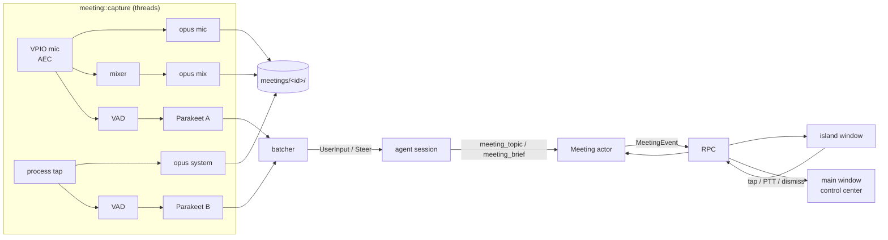

# 53 — Meetings: record, understand live, brief the user from the notch

Status: design v0 · 2026-09-19 · extends `00-architecture.md` §4 (plugin),
§5 (a session whose inputs are a live transcript), §7 (RPC), §9 (data dir,
`meetings/`, `models/pyannote/`), §10 (crate `meeting`), §13 (returned-as:
meetings); `43-voice.md` §9 / `45-voice-notes.md` (the `voice` crate lends
its Parakeet engine to two live streams); `25-desktop.md` §4.5 (a second
window, global shortcuts) and §7 (RPC additions); `07-context.md` §8
(compaction is the rolling summary); `10-knowledge.md` §5 (harvest runs on
the meeting session). §13 lists the amendments. macOS only.

Scope: the user is in a video call and presses **Start meeting**. The
harness records the meeting app's audio and the microphone as separate
Opus tracks (plus a mix), transcribes both live with Parakeet, and feeds the
transcript to the meeting's own agent session in small batches. The model's
job in that session is to spot **things the user should not have to ask
about** — a ticket, a system, a person, a number, jargon — and to write a
**brief**: 2–3 bullets of facts, never a script. Briefs and one-tap **topic
buttons** appear in a small always-on-top window hugging the camera notch,
excluded from screen capture. A held hotkey turns the microphone into a
request line to the model. After the meeting: diarization with speaker
enrollment, a correction pass, a guided summary, knowledge harvest, and a
session the user can keep talking to. The feel we are building: the system
anticipates what the user needs to see and has it at hand before they
reach for it.

Not in v1 (and the seams left for them): TTS into an earpiece (43's
`Speak` already exists; nothing here blocks it), calendar/attendee briefs
(§4.6 keeps the "meeting context" input a plain text the user types; a
later doc fills it from a calendar), recording from the phone (§10),
phone calls / FaceTime (the process picker lists whatever plays audio; a
process that is FaceTime works if Core Audio taps it — not designed for),
Windows/Linux, live diarization, cost ceilings (51 §6 accounts; nothing
here stops for money), automatic meeting detection, onboarding for the
new permissions (first-use prompts only).

## 0. Decisions in one screen

1. **One new plugin, crate `meeting`.** It owns capture, encoding, the two
   live transcribers, the batching into the session, topic/brief bookkeeping,
   the meeting store, the post pipeline (diarize → correct → summarize →
   harvest), speaker profiles, and the `meeting_*` tools and RPC. 00 §13 lists
   `meetings` among the jarvis subsystems that "return as plugins when a doc
   argues the need"; this is that doc. Rejected: growing `voice` (voice is
   "text in, speech out, per message"; a 3 h stateful recorder with its own
   store is a different owner); growing `agent` (00 §10: the loop and what it
   must own — a recorder is not that); a Swift helper process (00 §2: one
   process; Core Audio taps and ONNX both have Rust bindings).
2. **The intelligence is the agent loop, not a second model loop.** A meeting
   *is* a theuth session. Every transcript batch is one user input, prefixed
   `[meeting 00:14:32]`, in the pattern 45 §0.2 set for voice notes: the
   marker is the mode flag, one static prompt block says what it means. Topics
   and briefs are two ReadOnly tools the model calls (`meeting_topic`,
   `meeting_brief`); the plugin turns those calls into events the island
   renders. Steering (a tapped button, a spoken request, a dismissed topic)
   is `Steer` (00 §5), so it lands after the current tool batch, never
   cancels research in flight. What this buys: the session store keeps every
   batch, brief and tool result; approvals are exactly the existing gate
   (Ask stays Ask — §4.5 adds one opt-in switch); every installed tool
   (knowledge, Jira, Confluence, Grafana, web) is available with no new
   wiring; the control-center view is just the session transcript; the model
   is whichever the user picked for the session (the start form nudges
   toward a fast, inexpensive one — the choice is the user's, not this
   doc's). Rejected: a `genai` loop inside `meeting` (duplicates loop,
   registry, approvals, store, compaction; 00 §1.4); a separate cheap
   "detector" model call before the session turn (deferred by the user; the
   seam is §4.4 — the batcher is the only place that would change).
3. **Context is a rolling summary plus a recent window, and the mechanism
   is compaction (07 §8), triggered by a meeting-sized budget.** Three
   hours of three people is ~30 k words; nobody sends that per batch. The
   meeting session runs with `meeting.context_tokens` (default 24 k) as its
   compaction threshold; the head (summary) carries "what has been discussed,
   decided, and the live topics", the tail carries the last few batches.
   Prompt caching makes each batch a cache-hit prefix plus ~200 new tokens.
   Live topics and dismissed topics are also restated in every batch line
   (§4.4), so the model never depends on the window to avoid a duplicate.
   Rejected: a bespoke summariser in `meeting` (a second copy of 07 §8.3).
4. **Audio: `flexaudio` for the meeting app's audio (Core Audio process tap,
   INCLUDE one selected process), Apple's Voice Processing IO for the
   microphone (hardware-clocked AEC), three Opus tracks written live.**
   Mic and system are recorded separately and a third encoder writes the
   mix as it happens, so a crash loses nothing and playback needs no
   post-step. Opus 24 kHz mono 32 kbps per track (43 §0.5's numbers), in
   Ogg pages. The mic goes through `kAudioUnitSubType_VoiceProcessingIO`
   (via `coreaudio-rs`), whose echo canceller references the device the
   meeting plays through — that is the AEC the user asked for, with the
   OS's own clock alignment. If VPIO cannot be opened (an aggregate/odd
   output device), the mic falls back to the plain `flexaudio` cpal input
   and the island shows *headphones recommended* — accepted as degraded,
   undesirable. Rejected: software AEC (`webrtc-audio-processing`) with the
   system track as reference (two independent clocks; alignment is the
   whole problem VPIO solves at the HAL); a virtual audio device (a driver,
   signing, and it changes the user's mic in the meeting app — the user
   ruled out install friction); ScreenCaptureKit audio (video-oriented,
   Screen Recording permission for an audio-only need; taps are the
   audio-only API and macOS 15 is required anyway).
5. **Live STT: Parakeet TDT, one engine instance per track, VAD-endpointed
   utterances, in the `voice` crate's engine but owned here.** `voice`
   exposes `voice::stt::Engine` (load once, `transcribe(&[f32] @16 kHz)`),
   `meeting` holds two — mic and system — so the two streams never queue
   behind each other. Silero VAD (`flexaudio-vad`) ends an utterance on
   300 ms of silence or 8 s of speech; the piece is resampled (`rubato`, as
   45) and transcribed at RTF ≈ 0.03, so a finished sentence is text
   ~300 ms after it ends. The live text is a **working stream** — it drives
   the session and the control center and is written to `live.jsonl`; the
   **transcript of record** is re-transcribed from the Opus tracks after the
   meeting with full 180 s pieces and word timestamps (§6.1). Rejected: Apple
   `SpeechAnalyzer` on macOS 26 (a Swift surface in the shell, two engines
   to reason about; the user chose one engine everywhere); whisper.cpp (45
   §0.1); one transcriber on the mix (loses the free you/them attribution).
6. **Speaker attribution is post-meeting: `pyannote-rs` on the system
   track, the mic track is "Me".** Segmentation-3.0 + wespeaker embeddings
   (ONNX Runtime, the same `libonnxruntime` 45 §4.6 already locates),
   clustered by cosine; each cluster is matched against **enrolled
   profiles** (`speakers/*.json`: name, mean embedding, optional knowledge
   entity) and proposed with its score for the user to confirm. Enrollment
   is a user act on a played-back segment ("this is John"). The mic track
   defaults to `Me`; the user enrolls themselves manually if they want a
   profile. Delete profile = delete file. Rejected: live diarization (the
   user's own call: inaccurate and expensive); diarizing the mix (bleed
   from the user's own voice contaminates clusters when there are no
   headphones); exporting embeddings (out of scope).
7. **The post pipeline is a gate the user walks through in the main
   window:** stop → (background: re-transcribe both tracks, diarize, align
   words to segments) → **review** (play any segment; relabel, merge, split;
   enroll; fix text) → **Summarize** (a guided-form turn in the same
   session: topics, decisions, action items, open questions; the model may
   improvise, nothing is schema-validated) → summary saved, title set,
   `knowledge_harvest` on the session, then the session is compacted with
   the summary as head so "chat with the meeting" starts from the summary
   and reaches the data through tools (`meeting_read`, `meeting_search`,
   `meeting_speakers`). Rejected: summarizing before review (names would be
   `Speaker 2`); summarizing automatically (the user wants the correction
   opportunity first); loading the whole transcript into the follow-up
   conversation (that is what the tools are for).
8. **The island is a second Tauri window, a non-activating panel, always on
   top, never focused, excluded from capture by `sharingType = .none`,
   positioned per monitor configuration.** `tauri-nspanel` turns the
   `WebviewWindow` into an `NSPanel` with `NSWindowStyleMaskNonactivatingPanel`
   + `canJoinAllSpaces` + `fullScreenAuxiliary` at status-window level, so a
   click on a button never steals focus from the meeting app and the window
   stays over full-screen Zoom. Capture exclusion is Tauri's
   `set_content_protected(true)` (`NSWindow.sharingType = .none` — the API
   1Password uses). Honesty: on macOS 15+ reports disagree — Tauri #14200
   says ScreenCaptureKit ignores it, shipping overlay products report Zoom,
   Teams and Meet honour it (2026-05). We use the documented API and verify
   at first dogfood (§12 check 9); if SCK ignores it there is no hack to
   fall back to and the setting says so. The island is a plain RPC client of
   the same daemon (25 §0.1): it subscribes to `MeetingEvent` and renders;
   the shell only creates the window and sets its flags — OS integration,
   which is what the shell is for (25 §0.4, `desktop/src/lib.rs` header).
   Rejected: drawing the island inside the main window (must be tiny, on top
   of everything, focus-free); a native SwiftUI window (a second UI stack
   for one panel); `NSWindow.level` tricks for capture (compositor merges
   them; documented API or nothing).
9. **One eye toggle, default hidden, applies to both windows, never
   automatic.** `hidden_from_capture: bool` in the desktop's own settings,
   default `true`; it sets `set_content_protected` on `main` and `island`.
   A global hotkey (default ⌥⇧E, rebindable) and a small eye button in the
   island flip it. The harness does not detect screen sharing and does not
   hide anything on its own. Rejected: separate switches (the user asked
   for one); detecting SCK streams (private APIs).
10. **Push-to-talk is a tag, not a route.** While the PTT hotkey (default
    ⌥`, rebindable, `ShortcutState::Pressed/Released`) is held, the island
    shows a listening cue and the plugin marks the span. The mic transcriber
    keeps running; the utterance that ends on key release (VAD is forced to
    end it) is tagged `request` and steered to the session as
    `[meeting request, spoken] …` with the highest display priority. The
    meeting still hears the user — accepted; the span stays in the recording
    and the transcript. Rejected: muting the meeting app (per-app automation,
    fragile); a virtual device (decision 4).
11. **Briefs are immutable and never displace what the user is reading.**
    The island holds a stack of briefs and a cursor. At the newest brief a
    new one takes the view; if the user has stepped back, new briefs queue
    behind an `↑ N new` badge. A brief produced by a user action (a topic
    button, PTT request, *deeper*) always jumps into view. A refinement is a
    new brief. Up/down arrows on the right flip between briefs; no scrollbar.
    A viewed topic's button disappears; a dismissed topic teaches the model
    (a steer line: `[meeting: user dismissed "X" — not useful]`).
12. **Recording outranks intelligence.** Capture and the three encoders run
    on their own threads with no dependency on STT or the model. STT dying
    leaves the island with a *transcription down* badge and the files still
    growing; the model failing leaves live text flowing into `live.jsonl`;
    the daemon dying leaves valid Ogg pages up to the last flush (page every
    1 s). Hard bound: `meeting.max_minutes = 180`, warning at 170.
13. **Storage is files under `<data_dir>/meetings/`, an index in
    `meetings.sqlite`, never blobs in sqlite; retained until deleted.**
    §5 has the layout. Delete = the directory, the index row, the session
    (`delete_session`, exists) in one RPC.
14. **Consent is a checkbox on the start form:** "I acknowledge I understand
    the law and this recording is legal." Recorded in the manifest with a
    timestamp; nothing else about consent is the harness's business.
15. **No benchmarking, no measured acceptance.** The user's call: build the
    fastest reasonable pipeline and dogfood it. §12's checks are functional
    (it works end to end), not numbers. The only performance *design* inputs
    are structural: two engines instead of a queue, VAD endpointing instead
    of fixed windows, live mix instead of a post-step, prompt-cached batch
    turns instead of re-sent transcripts.

## 1. Why

The user's phrase: *the user should never have to say "what's X?" in a
meeting.* Everything the harness knows — knowledge bundle, Jira, Confluence,
Grafana, ArgoCD, Slack, the web — is one hop from the conversation the user
is actually in, but today the user has to leave the call to ask. The gap is
timing and eyes: the help has to arrive while the topic is live, and it has
to be readable while looking at the camera. Hence the two halves of this
doc: a live pipeline from audio to a brief in seconds, and a window that
sits where the user's eyes already are.

The recording half is the same feature seen from after the meeting: a
transcript of record with speakers, a summary, and knowledge that
accumulates across meetings — which is also what makes later features
(dossiers, "what did Dana say last time") possible without another
capture design.

## 2. Facts relied on (recon 2026-09-19)

### 2.1 In the tree

- `crates/voice` (43, 45): `stt.rs` loads Parakeet TDT via `parakeet-rs` 0.3
  with `load-dynamic` ORT (`ort_lib` finds `libonnxruntime` in the bundle,
  the model dir, `$ORT_DYLIB_PATH`, Homebrew); decodes any symphonia
  container to mono 16 kHz; 180 s pieces; the model is dropped after
  `stt_idle_secs`. Public messages `Transcribe { bytes, ext }` →
  `Transcript`. `opus` 0.3 and `rubato` 0.16 are already workspace deps;
  `symphonia` is built with `ogg`. Nothing streams; nothing exposes the
  loaded model.
- `crates/desktop`: Tauri 2, `ActivationPolicy::Accessory`, one `main`
  window built in `desktop::configure`, `tauri-plugin-global-shortcut`
  (⌥Space toggles the window), `-positioner`, `-window-state`; `objc2` is
  already a dependency (iOS side). The Rust side is "launch, probe, quit and
  OS integration only" (lib.rs header). No second window, no
  `set_content_protected`, no NSPanel today.
- `crates/rpc/src/api.rs`: 150 methods; `rename_session`, `delete_session`,
  `knowledge_harvest`, `put_attachment`/`get_attachment` (base64 bytes over
  JSON), `subscribe_events` (one stream, plugins' event enums forwarded).
- `crates/agent`: `Steer` queues a user message after the current tool
  batch; compaction opens an epoch with a summary head (07 §8); harvest is a
  cache-hot continuation (10 §5, `continuation.rs`); `RegisterPrompt` gives a
  plugin one static prompt block; session titles via `title.rs` and
  `RenameSession`; 51 added session cost/project metadata.
- `crates/computer` (27): `computer_permissions` reports Screen Recording;
  the TCC pattern (ask on first use, report status) exists to copy.

### 2.2 Libraries

| crate | version | facts | use |
|---|---|---|---|
| `flexaudio` (Studio-Sadola) | 0.2 (the only crates.io release — 0.3 does not exist, corrected by 54 on 2026-09-20; the workspace pin `flexaudio = "0.2"` lives in `voice`) | Verified against the 0.2.0 sources (2026-09-20, `meetings/01-capture.md` §4.1): `open(StreamConfig{kind: SourceKind::{Mic \| SystemLoopback \| ProcessLoopback \| Mix}, target_pid: Option<u32>, output: OutputFormat { sample_rate, channels }, chunk_ms, ..})` → `Stream::start()`, `poll_chunk()` → `AudioChunk { data: Vec<f32>, frames, pts_ns, seq, flags, dropped_before, peak, rms }` interleaved at a chosen rate; **no process enumeration** (only `devices()`, `watch_devices()`, `open()`) — the picker reads `kAudioHardwarePropertyProcessObjectList` itself via `objc2-core-audio`; macOS system/per-process via Core Audio process taps (`CATapDescription` → tap → private aggregate device → IOProc, on a dedicated thread because the ObjC objects are `!Send`); needs macOS 14.4+, TCC `kTCCServiceAudioCapture`, `NSAudioCaptureUsageDescription` in Info.plist; VAD is `wavekat-vad` (54), not `flexaudio-vad`; docs.rs build fails for 0.2 (native deps) — read the sources | the meeting app's audio; the fallback mic (`voice::mic`) |
| `coreaudio-rs` | 0.13 (already in `Cargo.lock` via `cpal`; 0.12 would duplicate `objc2-audio-toolbox`) | `AudioUnit::new(IOType::VoiceProcessingIO)`, `set_input_callback`, `set_property(kAUVoiceIOProperty_BypassVoiceProcessing, .., 0)` = AEC + AGC + NS on | the microphone with AEC (decision 4) |
| `pyannote-rs` (thewh1teagle) | 0.3.4 | segmentation-3.0 (10 s sliding windows) + wespeaker-voxceleb-resnet34-LM embeddings, `knf-rs` fbanks, ONNX Runtime with CoreML EP on macOS, "1 h in under a minute on CPU"; models are HF-gated → mirror on the release bucket exactly as 43 §0.3 does for Pocket TTS | diarization, speaker embeddings |
| `ogg` | 0.9 | `PacketWriter` for Opus-in-Ogg (RFC 7845 headers: `OpusHead`/`OpusTags`) | the three `.opus` files |
| `tauri-nspanel` | git (ahkohd) | converts a `WebviewWindow` into `NSPanel`; style masks, level, collection behaviour | the island (decision 8) |
| `tauri-plugin-global-shortcut` | in tree | `ShortcutState::{Pressed, Released}` per registration | PTT hold, eye toggle |
| `tauri-plugin-store` | 2 | JSON settings files for the app | island position configs (§7.3) |

### 2.3 Platform facts

- Core Audio process taps: macOS 14.4+; we require **macOS 15**
  (`LSMinimumSystemVersion`) so one OS line covers taps, VPIO and the panel
  behaviour we test on.
- `NSWindow.sharingType = .none`: documented since 10.13; excluded from
  `CGWindowListCreateImage` on every macOS; ScreenCaptureKit behaviour on
  15+ is contested (decision 8). `cmd-shift-3/4` screenshots blank the window
  where it works — the user should know their own screenshots go black.
- Notch: `NSScreen.safeAreaInsets.top > 0` on the built-in display of a
  notched Mac; `auxiliaryTopLeftArea`/`auxiliaryTopRightArea` give the
  usable strips beside it. A window may be placed at y=0 across the notch;
  content under the notch is simply hidden by the bezel.
- Two Parakeet engines resident ≈ 2 × ~1.2 GB (int8) of RAM while a meeting
  runs; dropped after the meeting (the voice-notes engine keeps its own idle
  rule).

## 3. Shape



### 3.1 Actors and threads

- `Meeting` actor (kameo, named `meeting`): one per process; holds the
  current recording's state machine (`Idle → Starting → Recording ⇄ Paused
  → Stopping → Post(Transcribing | Diarizing | Review | Summarizing) →
  Done`), the brief stack, the topic set, and answers every `meeting_*` RPC
  and tool. Only one meeting records at a time (one mic).
- `capture` module: three OS threads, none async. *Mic thread* owns the
  VPIO audio unit; its render callback pushes `f32` frames into two
  lock-free rings (`rtrb`): one for the encoder/mixer, one for VAD+STT.
  *System thread* owns the `flexaudio` tap stream and polls chunks into its
  two rings. *Encoder thread* drains both rings at 20 ms cadence, resamples
  to 24 kHz once per track (`rubato` FFT resampler; the tap and VPIO are
  asked for 48 kHz), encodes three Opus streams (`opus::Encoder`, VOIP
  application, 32 kbps, 20 ms frames), mixes by summation with a soft
  limiter, writes Ogg pages, flushes every 1 s. Clock alignment for the mix
  uses each chunk's host time (`mach_absolute_time` from the IOProc / VPIO
  timestamps) to insert silence when a source stalls; drift within a
  meeting is sub-frame.
- `stt` module: two tokio tasks, each owning a `voice::stt::Engine` and a
  Silero VAD state; drain the STT ring, accumulate speech, cut on 300 ms
  silence / 8 s cap / PTT release, resample to 16 kHz, `engine.transcribe`,
  emit `Utterance { track, t0, t1, text, request: bool }` to the batcher and
  append it to `live.jsonl`.
- `batcher`: a small state machine that turns utterances into session
  inputs (§4.4).
- `post` module: a tokio task per finished meeting running the pipeline
  (§6), publishing `MeetingEvent::PostProgress`.

### 3.2 Messages the plugin owns

```rust
// crate: meeting  (all Serialize/Deserialize, ts-rs under `ts`)
pub struct MeetingId(pub uuid::Uuid);

pub struct StartMeeting { pub process: Option<u32>, pub title: Option<String>,
    pub context: Option<String>, pub consent: bool, pub session_model: Option<String> }
pub struct PauseMeeting; pub struct ResumeMeeting; pub struct StopMeeting;
pub struct TapTopic { pub topic: TopicId }
pub struct DismissTopic { pub topic: TopicId }
pub struct Deeper { pub brief: BriefId }
pub struct TypedRequest { pub text: String }          // control-center steering
pub struct PushToTalk { pub held: bool }
pub struct SetCursor { pub brief: Option<BriefId> }   // island reports where the user is

#[serde(tag = "type")]
pub enum MeetingEvent {
    Started { meeting: MeetingId, session: SessionId, process: ProcessInfo, at: DateTime },
    State { meeting: MeetingId, state: MeetingState, degraded: Vec<Degradation> },
    Level { mic_rms: f32, system_rms: f32 },                 // 10 Hz, island meters; not persisted
    Utterance { meeting: MeetingId, track: Track, t0_ms: u64, t1_ms: u64, text: String, request: bool },
    TopicAdded { meeting: MeetingId, topic: Topic },
    TopicRemoved { meeting: MeetingId, topic: TopicId, why: TopicGone },  // Viewed | Dismissed | Expired
    Brief { meeting: MeetingId, brief: Brief },
    Listening { held: bool },
    PostProgress { meeting: MeetingId, stage: PostStage, pct: u8 },
    ReviewReady { meeting: MeetingId },
    Summarized { meeting: MeetingId, title: String },
    Deleted { meeting: MeetingId },
}

pub struct Topic { pub id: TopicId, pub label: String /* ≤4 words, as spoken */, pub at_ms: u64,
    pub brief: Option<BriefId> /* precomputed */ }
pub struct Brief { pub id: BriefId, pub topic: Option<TopicId>, pub title: String,
    pub bullets: Vec<String> /* 2–3 */, pub source: BriefSource /* Auto | Tap | Request | Deeper | Typed */,
    pub at_ms: u64, pub parent: Option<BriefId> }
pub enum Degradation { MicNoAec, SttDown(Track), ModelDown, DiskLow, NearMaxLength }
```

`Track = Mic | System`. Times are milliseconds from the meeting start on the
recording clock (pauses excluded from the clock, recorded as gaps in the
manifest so playback and the Ogg timeline agree).

### 3.3 Tools the plugin registers

| tool | risk | who calls it | what it does |
|---|---|---|---|
| `meeting_topic { label, brief: { title, bullets } }` | ReadOnly | the model, during a meeting | registers a topic button *with its precomputed brief* in one call; publishes `TopicAdded` and stores the brief unshown. Rejected by the actor (error text to the model) if `label` > 4 words, bullets ∉ 2..=3, or the label duplicates a live/dismissed topic |
| `meeting_brief { title, bullets, topic?, parent? }` | ReadOnly | the model | a brief with no button: the answer to a tap (`topic` set — the actor shows it and removes the button), a PTT/typed request, or a *deeper* (`parent` set). Displays immediately per decision 11 |
| `meeting_read { meeting?, from_ms?, to_ms?, speaker? }` | ReadOnly | the model, after | the transcript of record (or live text while recording) as `[mm:ss] Name: text` lines, capped at 400 lines per call |
| `meeting_search { query, meeting? }` | ReadOnly | the model | FTS over transcript segments of one or all meetings (`meetings.sqlite`), hits with times and speakers |
| `meeting_speakers { meeting? }` | ReadOnly | the model | speakers in a meeting with talk time; or all enrolled profiles |
| `meeting_list { limit? }` | ReadOnly | the model | meetings with date, title, duration, session id |

`meeting_topic`/`meeting_brief` are ReadOnly because their only effect is a
row in the meeting's own store and a window redraw: no world state. They are
registered only while a meeting records (the registry list is read per turn,
12 §4), so an idle session never sees them.

### 3.4 Prompt block (`RegisterPrompt`, static)

> **Meetings.** A user line beginning `[meeting hh:mm:ss]` is a live
> transcript batch from a meeting the user is in (`them:` other participants,
> `me:` the user). You are not a participant. Your job: notice anything the
> user might have to ask about — a ticket, a system, a person, a project, a
> number, a term of art, a past decision — look it up with your tools
> (knowledge first), and call `meeting_topic` with a label of at most four
> words as it was spoken and a brief of two or three short factual bullets.
> Never write what the user should say. Do not repeat a topic already in
> `live:` or `dismissed:`. Call nothing when there is nothing worth a brief;
> reply with no text — text replies are not shown. `[meeting request …]` is
> the user asking you directly: answer with `meeting_brief` at once, tools
> if needed. `[meeting tapped "X"]`: the user wants the brief for X now —
> if you already gave one with the topic, do nothing; otherwise
> `meeting_brief` with `topic`. `[meeting deeper …]`: a longer follow-up on
> that brief (up to three bullets, more specific). After the meeting, the
> first line of the conversation is its summary; `meeting_read`,
> `meeting_search` and `meeting_speakers` reach the full record — use them
> instead of guessing.

## 4. Live: from audio to a brief

### 4.1 Start

The start form (main window, and the tray menu *Start meeting…*):
process picker (`meeting_processes`, 01 §4.1; active ones first, the last
choice remembered per bundle id), optional title, optional context (a text
box plus a mic button that uses the existing `transcribe` RPC to dictate —
45), the consent checkbox (required), and the session's model (the standard
picker, pre-filtered to the "fast" tier of the catalog with a one-line hint;
02's menus). *Start* → `start_meeting` RPC → the actor: creates the
directory and manifest, creates the session (`agent::CreateSession` with
`project`/`kind` metadata from 51 so the sidebar shows a meeting icon),
starts capture, loads two engines, registers the two live tools, sends the
first input: `[meeting 00:00:00] started. context: <text or none>`.
Permission prompts (mic, audio capture) fire here on first use; a denial
fails `Starting` with the reason in `State.degraded`.

### 4.2 Capture, encode, persist

Described in §3.1. Files appear at once and grow; the manifest is rewritten
on every state change (pause/resume gaps, degradations, stop). `Pause`
stops the encoders and transcribers and keeps the devices open; the clock
stops; the gap is recorded.

### 4.3 Live transcription

Two engines, two VADs (§3.1). Utterances from the mic are `me:`; from the
system, `them:`. The live transcript is written to `live.jsonl` (one
utterance per line) and published as `MeetingEvent::Utterance` for the
control center's live log (the island never shows it — the user asked for
no live transcript display).

### 4.4 Batching into the session

The batcher sends a `UserInput` when either (a) 25 s have passed since the
last send and at least one utterance arrived, or (b) 6 utterances have
accumulated, or (c) a `them:` utterance ends with `?` (questions get the
fastest path). While a turn is running, the next batch is a `Steer` so it
lands after the current tool batch rather than waiting for `TurnFinished`.
One batch line:

```
[meeting 00:14:32] live: SRE-2386, DR cutover · dismissed: KEDA
them: so the DR sync for two-three-eight-six is blocked on the image tags
me: right, I think the app patches those
them: what did we decide about Pulumi state last week?
```

`live:` and `dismissed:` are the actor's current sets, so the model's
duplicate check does not depend on the context window. PTT and typed
requests bypass the batcher: `[meeting request, spoken] …` /
`[meeting request, typed] …` go out immediately (as `Steer` if a turn
runs). Taps: `[meeting tapped "X"]`; dismiss: `[meeting: user dismissed
"X" — not useful]`; deeper: `[meeting deeper on "<brief title>"] <bullets>`.

Seam for a later detector (decision 2): the batcher is the one place that
would call a small model first and forward only batches it scores as
"has a topic"; nothing else changes.

### 4.5 Approvals

Unchanged. A `Mutating` tool the model reaches for during a meeting asks
in the control center like anywhere else; the island shows a small
*approval waiting* badge and nothing more. One opt-in switch,
`meeting.allow_read_only = true` (default `false`), applies the existing
per-session in-memory `SetApprovals { session: Some(id) }` shape to the
meeting session for **ReadOnly** tools only — a new `PolicyOverride::
ReadOnlyAllow` variant on that message, inherited by nothing (meetings
spawn no subagents). `{{secret:…}}`-bearing calls still ask (37 §0.4).

### 4.6 Topics and briefs

The actor is the referee: it validates `meeting_topic`/`meeting_brief`
calls (§3.3), assigns ids, persists them to `briefs.jsonl`, and publishes.
Topic buttons live until viewed (tap → brief shown → button gone),
dismissed, or `meeting.topic_ttl_secs` (default 600) passes without a
mention — the batcher re-touches a topic when its label appears in a new
utterance (case-insensitive substring), so a live subject stays. At most
`meeting.max_topics` (6) buttons; the oldest untouched expires first. A
precomputed brief whose topic expires stays in the store and appears in
the control center's brief log, never on the island.

The brief stack and cursor (decision 11) live in the island's state; the
actor only publishes `Brief` with its `source`. The island: `source ==
Auto` → if cursor is at top, show; else queue and badge. Any other source →
show and move cursor to it. `SetCursor` tells the actor where the user is
so the control center can mirror it; nothing else depends on it.

### 4.7 Context management during the meeting

Decision 3. The meeting session is created with `compact_threshold =
meeting.context_tokens` (default 24 000) and the `snap`-less summary style
(11). The compaction instruction gains one meeting-specific paragraph
(a static string in `meeting`, passed at session creation as the session's
`compaction_hint` — a new optional field on `CreateSession`, `None`
everywhere else): keep *who is in the meeting, what has been discussed in
order, decisions and numbers said aloud, the current live topics and every
dismissed topic*. Harvest at compaction boundaries (10 §5) runs as it does
in any session, so knowledge accrues *during* a long meeting too. The
brief-writing turns are short (one batch in, zero or a few tool calls, one
`meeting_topic` out) and cache-hot: the head + prompt are a stable prefix
and each batch adds a few hundred tokens.

