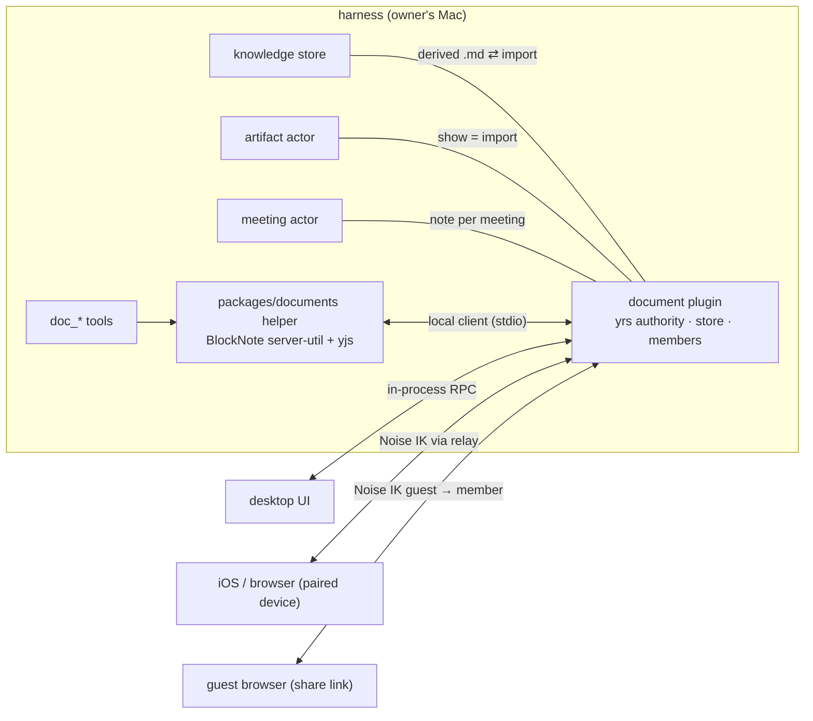

# 59 — Documents: BlockNote everywhere, notes, agent co-editing, end-to-end encrypted collaboration

Status: design v0 · 2026-09-21 · extends `00-architecture.md` §4 (plugin),
§7 (RPC), §9 (data dir, `documents/`), §10 (crate `document`, helper
`packages/documents`); `10-knowledge.md` §2/§7 (the concept file stays the
derived export; the editor changes); `25-desktop.md` §4 (routes, sidebar);
`31-link.md` §4.3/§6.2/§7.6/§10 (guest connections, the `/d` page, the
disclosure sentence); `35-artifacts.md` §2 (`Kind::Markdown` becomes
doc-backed); `46-apps.md` §0.2/§0.7 (the headless helper pattern, reused);
`53-meetings.md` §4/§7 (a note per meeting, the summary turn). §13 lists the
amendments. Decisions in §0 are Sky's from the 2026-09-21 interview
(knowledge `projects/theuth-documents-blocknote`); alternatives named there
were considered and rejected in that interview, not reopened here.

Scope: one editor — [BlockNote](https://github.com/TypeCellOS/BlockNote) —
for three kinds of thing the harness already has or now gets: **knowledge
concepts**, **markdown artifacts**, and **notes** (new; every meeting owns
one). Every document is a Yjs CRDT whose authority is the harness; the
markdown file the rest of the system reads is derived from it. The agent
edits documents through a few high-level tools and its changes appear live
in front of whoever has the document open, typewriter-style. The user's
paired devices (macOS, iOS, browser build) edit the same document through
the existing encrypted link; other people edit or read it through a share
link that makes them a *member of one document*, never a device. The relay
stays what 31 made it: a pipe that sees ciphertext.

Not in v1 (and the seams left for them): comments/threads and suggestions
(BlockNote `xl-comments` fits the member model in §8; not wired), documents
served while the harness is offline (§8.7: the relay stores nothing —
accepted), version browsing UI beyond "restore a snapshot" (§4.6 keeps the
snapshots), editing `Kind::Text`/`Kind::Csv` artifacts (they stay viewers),
images/files inside documents (the `image` block is disabled in the schema;
attachments exist elsewhere), real-time suggestions/autocomplete (explicitly
unwanted), the notch island showing notes (53's island is briefs only),
Android (58 decides the client).

## 0. Decisions in one screen

1. **One new plugin, crate `document`, and one headless helper,
   `packages/documents`.** The crate owns the store, the Yjs authority
   (`yrs`), access (members, links, guest connections), sync RPC, events,
   the `doc_*` tools, the derived-file export/import loop and the bindings
   to knowledge, artifacts and meetings. The helper is the same pattern 46
   §0.2 established for OpenUI: a persistent Bun-compiled process running
   the *pinned* BlockNote (`@blocknote/server-util` + `yjs`) so that every
   schema-aware operation — markdown ⇄ blocks, blocks ⇄ Y.XmlFragment,
   block-id addressing — has exactly one definition, the one the UI renders
   with (46 §0.7). Rejected: a Rust re-implementation of BlockNote's
   ProseMirror schema and markdown serializer (tracks a moving target,
   two definitions of the same thing); growing `knowledge` or `artifact`
   (three owners would each need the same Yjs machinery).
2. **The Y.Doc is the truth; the `.md` is a derived export.** Each document
   is `<data_dir>/documents/<id>/` (§4.1); the harness re-exports the bound
   markdown file after every settled transaction so `grep`, git (10 §3),
   `read_file`, harvest (10 §5) and every existing `knowledge_*` /
   `artifact_*` path keep working unchanged. An edit that arrives through
   the file (CLI, `write_file`, `knowledge_put`, git pull) is imported back
   as one Yjs transaction, block-diffed so untouched blocks keep their
   formatting and ids (§4.4). Rejected: markdown as truth with a Y.Doc
   rebuilt on open (two devices editing offline can never converge; every
   live session must start from one host's doc anyway); Y.Doc only for
   notes (knowledge and artifacts would then never collaborate).
3. **The harness is the Yjs authority, in Rust.** One `yrs::Doc` per open
   document, loaded lazily, persisted as snapshot + update log, unloaded
   when idle. Desktop, phone, browser and helper are Yjs clients; the
   harness fans updates out over the channel each client already has (in-
   process JSON-RPC on the Mac, Noise over the relay for link devices and
   guests). Rejected: the desktop UI as authority (nothing works with the
   window closed; the agent would edit through a browser); the relay as
   authority (31 §0.1 — no state).
4. **The agent edits through five block tools, not a text blob.**
   `doc_read` (outline with block ids, or markdown), `doc_insert`,
   `doc_replace`, `doc_delete`, `doc_create` (§5). Arguments are block ids
   and markdown; the helper turns the markdown into blocks and applies one
   Yjs transaction; the change reaches every client as an ordinary update.
   No autocomplete, no ghost text, no "AI menu": the user asks in chat, the
   agent does it. `@blocknote/xl-ai` is not installed. Rejected: the agent
   returning a whole new markdown document (rewrites blocks the user is
   typing in, destroys formatting, costs the whole doc in tokens each turn);
   raw Yjs operations (the model cannot reason about item ids).
5. **Typewriter is paint, not history.** An agent transaction lands whole in
   the Y.Doc; the update carries an `agent` origin marker in awareness (§6.4)
   and the editor reveals the affected blocks progressively over ≤ 1.5 s
   with a ProseMirror decoration. Truth is never delayed; a collaborator who
   joins mid-reveal sees the final text. Rejected: pacing the insert as many
   micro-transactions (bloats history, multiplies relay traffic, races with
   a human typing in the same block).
6. **Frontmatter is a block.** A knowledge document's first block is a
   custom `frontmatter` block (§4.5): the keys `knowledge::Meta` requires are
   fixed fields, other keys are free rows, the block cannot be deleted,
   moved or duplicated. It exports to the YAML header the store parses
   today. Rejected: a side panel form (two places to look; loses undo
   integration); frontmatter as plain text in a code block (no validation).
7. **A markdown artifact is a living document.** `show` of the same
   `(session, name)` is an import transaction into the bound document; each
   commit and each settled user edit is a Yjs snapshot recorded as an
   artifact version (§4.7). Rejected: user edits forking new immutable
   versions (no live collaboration on the thing the agent just wrote);
   "convert to note" (two copies drift).
8. **Notes are documents with no other owner.** A note is `kind: note` in the
   store, listed under a new sidebar entry, opened at `/notes/$id`, attached
   to any session from the composer like an attachment; the note page has a
   chat panel that opens a session with the note attached (§7.3). Rejected:
   every note owning a session (a session per scratchpad; the user asked for
   attach-anywhere).
9. **One note per meeting, and the summary lands in it.** `meeting_start`
   creates the meeting's note; the meeting page shows it beside the live
   transcript during the call; the summary turn (53 §7, `summary.rs`) reads
   the note with `doc_read`, regroups the user's blocks under headings
   without rewriting or deleting any of them, and appends Summary /
   Decisions / Action items / Open questions with `doc_insert` (§7.4).
   `summary.md` becomes the note's derived export, so harvest and
   `meeting_summary` are unchanged. Rejected: a second summary document
   (the user reads two things); the agent rewriting the user's words.
10. **Members, not devices; capability by link, identity by key.** A share
    link is `https://<relay>/d#1.<harness>.<doc>.<secret>` (§8.2). The
    visitor's browser generates an X25519 static, completes the ordinary
    `Noise_IK` to the harness as a *guest* (unknown static, admitted only to
    call `doc_join`), and proves possession of the link secret; the harness
    records `{pub, name, role}` as a member of that one document. Return
    visits are plain `IK` again, recognised by the static. The owner sees a
    member list per document, renames, demotes, revokes; a viewer's
    `doc_update` is refused at the harness. Rejected: read-only public and
    pairing for editors (a doc member is not a device; 31 §0.5's device
    holds every RPC); self-declared identity only (no revocation unit).
11. **E2E is the Noise channel; there is no per-document content key.**
    Every participant talks to the owner's harness over a mutually
    authenticated Noise session; the relay copies ciphertext (31 §0.2). The
    document exists in plaintext only on the owner's machine and in
    participants' editors. Revocation is closing the member's connections and
    refusing its static — nothing to re-key. secsync is the reference for
    the *shape* (snapshot + update log, ephemeral awareness, per-participant
    identity) and for what we deliberately do not need: its symmetric
    document key and signed encrypted snapshots exist so an untrusted server
    can store the document; decision 3 and 31 §0.1 have no such server.
    Rejected: a document key layered inside Noise (double encryption with
    the same trust boundary); secsync's protocol adopted wholesale (a Rust
    port of a server role nobody runs).
12. **The relay changes by one static route and nothing else.** `/d` serves
    the same UI bundle `/link` serves (31 §7.6); the fragment never reaches
    it; guest sockets are ordinary device sockets on `/h/<id>` and every
    31 §4.5 limit applies. The relay learns one new thing: that a browser
    with no pairing loaded `/d`. Rejected: relay-stored encrypted documents
    for offline availability (state, accounts, retention — the exact
    surface 31 §1.1 dropped).
13. **Mobile is read + light edit, and the toolbar is ours.** Under
    `pointer: coarse` the editor hides drag handles and the side menu,
    disables drag-and-drop, and renders a fixed formatting bar pinned above
    the keyboard (`visualViewport`), with bold/italic/strike, heading level,
    list toggles, indent/outdent, undo/redo and a block-type sheet (§10).
    BlockNote's selection-anchored floating toolbar is not shown on touch:
    WebKit's own selection callout sits exactly there. Rejected: full desktop
    parity on the phone (drag reordering and slash menus on a 6″ screen are
    the beta parts); read-only mobile (the user wants to type in meetings
    from the phone).
14. **Packages: `@blocknote/core`, `@blocknote/react`, `@blocknote/shadcn`,
    `@blocknote/server-util`, `yjs`; `@blocknote/xl-multi-column` allowed
    (AGPL accepted); `@blocknote/xl-ai` never.** The shadcn flavour maps onto
    the repo's radix-ui + Tailwind 4 kit. Slash menu is curated (§9.3).
15. **Tools go through the gate; sharing never does.** `doc_read` is
    `ReadOnly`; `doc_insert`/`doc_replace`/`doc_delete`/`doc_create` are
    `Mutating` (every edit is undoable from the snapshot log). There is no
    `doc_share` tool: links and members are RPC reached from the UI by the
    owner. Text written by a non-owner member is untrusted content when the
    agent reads it (28 §5 principal `doc-member`). Rejected: a share tool
    (an exfiltration primitive for a prompt injection to aim at).
16. **Build in eight steps, each ending in a runnable check** (§14); step 1
    is BlockNote on knowledge with the harness authority and the derived
    export, single user, no link — the spike that decides the helper protocol
    and the frontmatter block before any collaboration code exists.

## 1. Why

Knowledge is edited in CodeMirror as raw markdown+YAML
(`crates/desktop/ui/src/components/knowledge/Document.tsx`, 598 lines,
`@uiw/react-codemirror`); artifacts are read-only cards; meeting summaries are
a `summary.md` the user can only read (53 §7); there is no place to type a
note. The user's actual pattern is: a summary appears, they want to change
one section and add two lines, and the cheapest way to do that should be to
say so — while also being able to just type. Three separate viewers cannot
become that; one editor with one document model can. Making the document a
CRDT from day one is what lets the agent, the phone and another person all
type into it without a locking story, and what makes "share this" a
membership question rather than a copy.

## 2. Facts relied on (recon 2026-09-21)

### 2.1 Repository

- Design docs `docs/design/00–58`; 58 is the newest; 59 is free.
- `crates/runtime/src/lib.rs:213` `trait Plugin { name, start(self, &Runtime) }`;
  `SessionId` is uuid v7 (`:221`).
- `crates/tools/src/lib.rs:91` `enum Risk { ReadOnly, Mutating, Destructive }`;
  `:259` `trait Tool { NAME, RISK, type Args: JsonSchema, RETURNS, DIRECT }`.
- `crates/knowledge/src/store.rs`: `open(data_dir, rt)` `:405`, `sync` `:467`,
  `get` `:544`, `put(Put, Source)` `:588`, `write(id, text)` `:641` (source
  `user`, unknown frontmatter keys survive), `delete` `:664`, `history`
  `:797`, `revision` `:818`, `restore` `:832`. Types in `types.rs`: `Meta`
  `:62`, `Concept` `:87`, `Put` `:114`, `Source` `:12`. Concept files are
  `<data_dir>/knowledge/<id>.md` (10 §2), a git repo (`repo.rs`).
- RPC `knowledge_get/list/put/delete/write/sync/history/revision`
  (`crates/rpc/src/api.rs:583–617`); `subscribe_events` is a jsonrpsee
  subscription (`:1047`) that link devices receive byte-for-byte (31 §0.3).
- `crates/artifact/src/lib.rs:67` `enum Kind { Markdown, Text, Csv, Image,
  Svg, Pdf, Html, App, File }`; `Artifact` `:126` has `id = sha256[..16]`,
  `session`, `call_id`, `name`, `version` (per `(session, name)`, 1-based),
  `path = <data_dir>/artifacts/<id>.<ext>`; actor messages `Show`, `Commit`
  `:214`, `Export`, `List`; event `ArtifactShown` `:163`.
- `crates/meeting/src/summary.rs`: the summary is one normal turn — the
  `SUMMARY_FORM` user input asks for markdown (`#` title, **Topics**,
  **Decisions**, **Action items**, **Open questions**, **Numbers and names**,
  < 400 words), the reply is written to `meetings/<id>/summary.md`
  (`store.rs:17 SUMMARY`), `title_of` takes the first `#`, then
  `knowledge_harvest` runs and the session is compacted with the summary as
  head. States `Summarizing` / `Summarized{title}` (`lib.rs:153, :337`);
  messages `Summarize` `:874`, `GetSummary` `:888`. RPC `meeting_*`
  (`api.rs:840–931`); `meeting_start` at `:848`.
- `crates/link`: `conn.rs:326` mode 0 = JSON-RPC records into
  `raw_json_request` (`:508`), mode 1 = ACP; `devices.rs:12` `Row { id, pub,
  name, platform, paired_at_ms, last_seen_ms }` in `link/devices.yaml`
  (31 §6.3); identity is `link/identity` (32 bytes); a harness id *is* its
  static public key (31 §5.6).
- `crates/relay/src/main.rs:116–118` routes `/h/{id}`, `/healthz`,
  `/metrics`; `web.rs` serves the UI bundle at `/`, `/link`, `/assets/*`
  with CSP and the `__Host-link` cookie (31 §7.6). Frames: `DATA` payload is
  one Noise message ≤ 65 535 bytes (31 §4.3); pairing is `IKpsk2`, later
  sessions `IK`; an unknown static is refused today (31 §10 "Downgrade to
  pairing by an unknown device").
- `crates/desktop/ui`: React 19, TanStack router/query, `radix-ui`,
  Tailwind 4 (`package.json`); routes `knowledge.tsx`, `knowledge.$.tsx`,
  `artifacts.tsx`, `artifacts.$callId.tsx`, `meetings.$id.tsx`,
  `island.tsx`; sidebar rows Knowledge / Artifacts / Meetings
  (`AppSidebar.tsx:85–100`); `Composer.tsx` attaches files through
  `put_attachment` (31 §9) and holds them as `Pastes` tokens (`lib/pastes`).
  `components/knowledge/frontmatter.ts` exports `stripFrontmatter`,
  `scaffold(id, title)`, `checkId`.
- 46 as built: `packages/apps` (`@theuth/apps`) is a Bun `--compile`
  helper (`scripts/build-helper.ts`) driven from `crates/app/src/helper.rs`
  (`actor.rs:28`), 78 tests including the helper protocol — the pattern §3.2
  copies.
- No Yjs crate is in `Cargo.lock` or `vendor/` today.

### 2.2 External (verified 2026-09-21)

- BlockNote collaboration: `withCollaboration({ collaboration: { provider,
  fragment: doc.getXmlFragment(name), user: { name, color },
  showCursorLabels } })` from `@blocknote/core/yjs`; any Yjs provider works
  ([docs](https://www.blocknotejs.org/docs/features/collaboration)).
- `@blocknote/core/yjs` exports `blocksToYDoc`, `blocksToYXmlFragment`,
  `yDocToBlocks`, `yXmlFragmentToBlocks`; `blocksToYDoc` "should not be
  used to rehydrate a Y.Doc once collaboration has begun, as all history
  will be lost" — hence §4.4's diff import
  ([docs](https://www.blocknotejs.org/docs/reference/editor/yjs-utilities)).
- `@blocknote/server-util` `ServerBlockNoteEditor.create(options)` gives
  `blocksToMarkdownLossy`, `tryParseMarkdownToBlocks`, `blocksToFullHTML`,
  and the Yjs conversions above, with the same custom schema as the client
  ([docs](https://www.blocknotejs.org/docs/features/server-processing)).
  Markdown export is documented as *lossy* (styles, alignment, some block
  props do not survive) — the reason for decision 2.
- `yrs` (crates.io, docs.rs): Yjs-compatible CRDT; `Doc`, `transact_mut`,
  `Update::decode_v1`, `encode_state_as_update_v1(&StateVector)`,
  `XmlFragmentRef`; `yrs::sync` module implements y-protocols sync/awareness
  (`y-sync` is the older separate crate). Default 53-bit client ids match
  current Yjs. Version pinned at step 1 (§14).
- secsync (nikgraf): snapshots (encrypted full state, signed) + updates
  (encrypted deltas referencing a snapshot) + ephemeral messages; a
  symmetric document key derived per snapshot; per-client signing keys;
  the server stores ciphertext and verifies membership. Used here only as
  the vocabulary and the checklist in §8.8.

## 3. Shape



Four roles, one wire: every editor — including the helper the agent edits
through — is a Yjs client of the harness authority and speaks the same
three RPC calls (`doc_open`, `doc_update`, `doc_subscribe`, §6). Ownership:

| concern | owner |
|---|---|
| Y.Doc state, persistence, snapshots, fan-out, access checks | `crates/document` (Rust) |
| block schema, markdown ⇄ blocks, block ids, applying `doc_*` edits | `packages/documents` helper (TS, pinned BlockNote) |
| derived files (`knowledge/<id>.md`, `artifacts/<sha>.md`, `meetings/<id>/summary.md`) | `crates/document` writes; existing owners read |
| bindings (which document is which concept/artifact/meeting) | `crates/document` index; owners call `Bind`/`Lookup` |
| editor UI, mobile toolbar, reveal decoration | `crates/desktop/ui/src/components/editor/` |
| guest admission, member connections | `crates/link` (handshake) + `crates/document` (membership) |

### 3.1 Crate `document`

`Plugin::start`: open the store (§4.1), start the `DocumentActor` (kameo,
00 §3), spawn the helper (§3.2), register tools (§5), register the static
prompt block (§5.4), subscribe to `KnowledgeChanged` / `ArtifactShown` /
`MeetingEvent::Started|Reviewed` on the bus for the bindings (§7), and start
the derived-file watcher (§4.4). Dependency order (00 §10 amendment):
`runtime ← tools ← document ← knowledge ← agent ← link ← {artifact, meeting,
…} ← rpc`. `knowledge`, `artifact` and `meeting` depend on `document`;
`document` depends on none of them — it knows a binding as
`Binding::{Knowledge(String), Artifact{session, name}, MeetingNote(MeetingId),
Note}` and a derived path.

```rust
pub struct DocumentActor {
    store: Store,                              // §4.1
    open: HashMap<DocId, Open>,                // loaded docs
    helper: Arc<Helper>,                       // §3.2
    subs: HashMap<DocId, Vec<Subscriber>>,     // §6.2 fan-out
    rt: Runtime,
}
struct Open {
    doc: yrs::Doc,
    meta: Meta,                                // §4.2
    awareness: yrs::sync::Awareness,
    pending_log: usize,                        // bytes since last snapshot
    last_export: [u8; 32],                     // sha256 of the derived file we wrote
    idle_since: Instant,
    export_due: Option<Instant>,               // debounce, §4.3
}
```

Messages (`ask` unless noted): `Open{doc, sv: Option<StateVector>} →
{state: Vec<u8>, meta}`, `ApplyUpdate{doc, update, by: Principal} →
Result<(), Refused>`, `Subscribe{doc, by} → mpsc::Receiver<DocEvent>`,
`Awareness{doc, state, by}`, `Create{kind, title, binding} → DocId`,
`ImportMarkdown{doc, markdown, origin} → Snapshot`, `Bind`, `Lookup{binding}
→ Option<DocId>`, `Snapshot{doc, label}`, `Restore{doc, snapshot}`,
`Members`, `SetMember`, `RevokeMember`, `CreateLink`, `RevokeLink`,
`Join{doc, link, guest_pub, proof, name} → Result<Member, Refused>`,
`Delete{doc}`; `tell`: `Tick` (1 s: idle unload, export debounce, snapshot
policy).

`Principal` is `Owner{device: Option<DeviceId>}`, `Agent{session}`,
`Helper`, `Member{pub}`, `File` — every update is stamped with who applied
it; `Member` updates are checked against `role` (§8.4) and `Member`-authored
text is what §11 labels untrusted.

### 3.2 Helper `packages/documents` (`@theuth/documents`)

Built like `packages/apps` (46 §12: `bun build --compile`, checked-in
binary per platform, started by the crate, restarted on crash with
backoff, protocol version pinned by a hash the Rust side checks at start).
It is a Yjs client with `Principal::Helper` over its stdio: newline-
delimited JSON, binary fields base64.

```ts
type Req =
  | { id: number; op: "open"; doc: string; state: string }            // full state from the authority
  | { id: number; op: "update"; doc: string; update: string }         // authority → helper
  | { id: number; op: "close"; doc: string }
  | { id: number; op: "outline"; doc: string; depth?: number }        // §5.1
  | { id: number; op: "markdown"; doc: string; blocks?: string[] }    // export (whole or some blocks)
  | { id: number; op: "import"; doc: string; markdown: string; mode: "diff" | "replace" | "append"; frontmatter?: boolean }
  | { id: number; op: "edit"; doc: string; edits: Edit[] }            // §5.2, one Y transaction
type Res =
  | { id: number; ok: true; result?: unknown }
  | { id: number; ok: false; error: string }
  | { ev: "update"; doc: string; update: string; touched: string[] }  // helper → authority after import/edit
type Edit =
  | { op: "insert"; markdown: string; after?: string; before?: string; at?: "start" | "end" }
  | { op: "replace"; blocks: string[]; markdown: string }
  | { op: "delete"; blocks: string[] }
```

The helper holds one `Y.Doc` per open document, mirrors of the authority
(the authority sends every update it accepts; the helper's own transactions
come back as `ev: update` and the authority applies them as `Principal::
Helper`, stamping the requesting agent session for attribution). It never
touches disk. Schema: one `schema.ts` shared by the helper and the UI
(same package, `src/schema.ts`; the UI imports it) — the frontmatter block
(§4.5) and the curated block set (§9.3). Rejected: running a full
`BlockNoteEditor` in the helper (server-util's `ServerBlockNoteEditor` is
the supported headless path).

### 3.3 Editor component (`crates/desktop/ui/src/components/editor/`)

`Editor.tsx` (BlockNote + `withCollaboration`, provider = `HarnessProvider`
§6.5, schema from `@theuth/documents/schema`), `FrontmatterBlock.tsx`
(§4.5), `MobileToolbar.tsx` (§10), `reveal.ts` (§6.4 decoration),
`useDocument(ref)` (open → Y.Doc + awareness + status). Used by
`knowledge/Document.tsx` (replacing `Raw`/CodeMirror for the current
revision; `Historical` stays read-only text), `artifacts/*` for
`Kind::Markdown`, `notes/*`, and `meeting/Live.tsx` + `meeting/Review.tsx`.

## 4. Store, export, import

### 4.1 Layout

```
<data_dir>/documents/
  index.sqlite                 id, kind, title, binding, created_ms, updated_ms, bytes, members_n, deleted_ms
  <id>/
    meta.json                  §4.2
    snapshot.yjs               encode_state_as_update_v1 at the last snapshot
    updates.log                length-prefixed v1 updates since snapshot (append-only, fsync on write)
    snapshots/<ts>-<label>.yjs kept snapshots (artifact versions, meeting summary, manual restore points)
```

`<id>` is uuid v7 base32 (26 chars). Load = decode `snapshot.yjs`, replay
`updates.log`. Snapshot policy: when `updates.log` > 1 MiB or > 1 000
updates, or at unload, or on a labelled `Snapshot` — write `snapshot.yjs`
(tmp + rename), truncate the log. Derived files live where their owners
already look (`knowledge/<id>.md`, `artifacts/<sha16>.md`,
`meetings/<id>/summary.md`); a note's derived file is
`documents/<id>/note.md` (so `read_file`/`grep` over notes works).
Rejected: sidecar `.yjs` next to each concept in `knowledge/` (the
knowledge bundle is a git repo shared as OKF; binary sidecars would be
committed and `knowledge_sync` would fight them).

### 4.2 `meta.json`

```json
{
  "id": "01J8…", "kind": "knowledge" | "artifact" | "meeting_note" | "note",
  "title": "…",
  "binding": { "knowledge": "facts/foo" } | { "artifact": { "session": "…", "name": "report.md" } } | { "meeting": "…" } | null,
  "derived": "knowledge/facts/foo.md",
  "fragment": "document-store",
  "members": [ { "pub": "b64url", "name": "Ana", "role": "editor", "added_ms": 0, "via": "lnk_…", "last_seen_ms": 0 } ],
  "links": [ { "id": "lnk_…", "role": "viewer" | "editor", "secret_hash": "b64url(sha256)", "name": null, "created_ms": 0, "expires_ms": null, "revoked_ms": null } ],
  "agent": { "color": "#7c3aed" }
}
```

Owner devices are not members: they are 31's devices and hold everything.

### 4.3 Export (Y.Doc → derived markdown)

After each accepted transaction, `export_due = now + 400 ms` (reset on
every further transaction, hard cap 3 s). On fire: helper `markdown` (whole
doc; for knowledge with `frontmatter: true` the frontmatter block becomes
the YAML header, §4.5), write tmp + rename, `last_export = sha256(bytes)`,
then the owner-specific notification (§7). Titles: knowledge from the
frontmatter `title`; artifact/note/meeting from the first heading block
else the first 80 chars (meeting reuses `summary::title_of`).

### 4.4 Import (derived markdown → Y.Doc), and who wins

Triggers: `notify` watcher on every derived path (debounced 300 ms);
`knowledge` store hooks (`put`, `write`, `restore`, `sync` pulled changes)
call `ImportMarkdown` directly so a `knowledge_put` from the agent lands
without waiting for the watcher; artifact `Commit` (§7.2); meeting summary
(§7.4). Skip when `sha256(file) == last_export` (our own write).

Mode `diff` (the default): helper `tryParseMarkdownToBlocks(new)`; for each
existing top-level block compute its lossy markdown; align old and new
blocks with a longest-common-subsequence on normalised markdown; blocks
whose markdown is unchanged are kept (ids and formatting intact); changed
runs are replaced; the frontmatter block is updated field by field. One
transaction, `Principal::File`. This is what makes decision 2 safe: a
`sed` on the file does not flatten the formatting of the paragraphs it did
not touch.

Concurrency rule: the CRDT merges; at block granularity the file import is
"last writer" for the blocks it changed. If a human is typing in a block
the import replaces, their in-flight characters land in the replaced
block's successor as Yjs decides — acceptable for a rare path; the UI shows
"updated from file" in the status line. Rejected: locking the file while
the editor is open (git and CLI do not ask).

### 4.5 The frontmatter block

Custom block `frontmatter` (`schema.ts`): `props: { yaml: string }`
(the serialised header, authoritative), rendered as a two-column grid:
required keys of `knowledge::Meta` (`type`, `title`, `description`, `tags`,
`scope`, `source`, `timestamp`) as fixed rows — `type` a select over
`knowledge`'s known types, `tags` a chip input, `timestamp`/`source`
read-only (the store sets them) — then free rows with "+ add key". Validation
mirrors `knowledge::Put` (10 §2); an invalid header shows the row red and
the export is withheld until valid (the Y.Doc still saves). The block is
`isSelectable: false`, excluded from drag, the slash menu and delete;
`import` always maps the YAML header to it and export always writes it
first. Non-knowledge documents have no frontmatter block; `import` with
`frontmatter: false` treats a leading `---` block as a code block.

### 4.6 Snapshots and restore

`Snapshot{label}` writes `snapshots/<ts>-<label>.yjs`. Automatic labels:
`artifact-v<N>` (§7.2), `meeting-before-summary`, `meeting-summary`,
`import-file` (before a diff import that changes > 50 % of blocks),
`daily` (first change of a day). `Restore{snapshot}` is *not* a rewind: it
imports the snapshot's markdown with mode `diff` as one transaction, so
collaborators converge and history is kept. Retention: 30 snapshots per
document, labelled ones never pruned automatically; knowledge additionally
keeps git (10 §3) as before because the derived file is committed.

### 4.7 Sizes and limits

Y state ≤ 8 MiB (edits refused with `DocTooLarge` beyond; export still
runs); one update ≤ 48 KiB over the link (the authority splits a larger
state into 48 KiB `state` chunks in `doc_open`; a client update larger than
that is refused — BlockNote never produces one from typing; a paste over
48 KiB is chunked by `HarnessProvider`); ≤ 64 members, ≤ 32 concurrent
connections per document; ≤ 256 open documents in memory, LRU unload after
10 min idle.

## 5. Agent tools

Five tools, registered by `document`, visible when the runtime is on as
ordinary Monty functions (08 §0.4); `doc` is always explicit (decision 8).

### 5.1 `doc_read` — `ReadOnly`

```
doc_read(doc: str, format: "outline" | "markdown" = "outline", blocks: list[str] | None = None, depth: int | None = None) -> str
```

`outline` is the compact addressable view — one line per block, id first,
children indented, text truncated to 120 chars, block type in brackets when
not a paragraph:

```
[fm] type=project title="wth apps — design doc 46" tags=wth,openui
b3f1 [h2] Decisions
b3f2 • app = artifact Kind::App (blob = OpenUI Lang v0.5 source)
b3f3 • one new tool app{name, source, edit?} …
b3f4 [h2] Open questions
b3f5 [code:rust] pub struct ArtifactActor { … (14 lines)
b3f6 [table 3×4] step | crates | done when
```

`markdown` returns the lossy markdown of the whole doc or of `blocks`, each
block preceded by an HTML comment `<!-- b3f2 -->` so the model can quote an
id it is about to replace. `depth` limits nesting. Result is also filled in
`ToolOutput::structured` as `{ blocks: [{id, type, text, children}] }` for
Python-side filtering. Documents the session may read: the owner's (all);
a session is never a member.

### 5.2 `doc_insert`, `doc_replace`, `doc_delete` — `Mutating`

```
doc_insert(doc: str, markdown: str, after: str | None = None, before: str | None = None, at: "start" | "end" | None = None) -> {inserted: [id], snapshot: int}
doc_replace(doc: str, blocks: list[str], markdown: str) -> {removed: [id], inserted: [id]}
doc_delete(doc: str, blocks: list[str]) -> {removed: [id]}
```

Exactly one of `after`/`before`/`at` (default `end`). `markdown` is parsed
with the document's schema; several top-level blocks may result. All three
are one helper `edit` → one Y transaction → one update, stamped
`Principal::Agent{session}`, so one tool call = one undo step for the user
(§6.4). Unknown block id → error listing the nearest ids by outline order.
Replacing or deleting a block authored by a *member* (non-owner) is allowed
— the owner's agent acts for the owner — but the tool result says whose
text it removed. Replacing the frontmatter block is an error; the agent
edits knowledge metadata with `knowledge_put` as today (which imports,
§4.4).

### 5.3 `doc_create` — `Mutating`

```
doc_create(title: str, markdown: str | None = None) -> {doc: str, url: "theuth://notes/<id>"}
```

Always `kind: note`. Knowledge and artifact documents are created by their
owners (`knowledge_put`, `show`); meeting notes by `meeting_start`. There is
no `doc_delete_document` tool and no `doc_share` tool (decision 15);
deleting a note is UI.

### 5.4 Prompt block and the attach token

`RegisterPrompt` static block (00 §4), ~120 tokens: documents have block
ids; read the outline first; edit the smallest run of blocks; quote ids from
the outline you just read (ids are stable across edits you did not make);
one tool call per user request when possible; never rewrite text a person
typed unless asked to change *that* text. When a session has a document
attached (§7.3) the user input carries `[doc <id> "<title>"]` on its first
line, in the 45 §0.2 marker pattern; the block says what the marker means.

### 5.5 Attribution and undo

Every accepted update is stored with its `Principal` in the log (a 1-byte
tag + optional 16-byte session id before the update). The UI colours
agent-authored text on hover ("theuth · 14:02, session …") from awareness
+ a `DocEvent::Authored{blocks, by}` event, not from Yjs internals. Undo
in BlockNote is `y-undo-manager` scoped to the local client's origin; the
user's Cmd-Z never undoes the agent's or another person's edit — to revert
an agent edit the user asks, or uses "Undo last agent edit" in the page menu
(an inverse `doc_replace` computed by the helper from the touched ids and
the pre-edit snapshot of those blocks; `Mutating`, owner-only).

## 6. Sync RPC and events

### 6.1 Methods (`rpc::Api`, `docs/plugins.md` §4 step 2)

```rust
#[method(name = "doc_list")]      async fn doc_list(&self, kind: Option<DocKind>, limit: Option<u32>) -> RpcResult<Vec<DocSummary>>;
#[method(name = "doc_resolve")]   async fn doc_resolve(&self, binding: Binding) -> RpcResult<Option<DocId>>;
#[method(name = "doc_open")]      async fn doc_open(&self, doc: DocId, sv: Option<String>) -> RpcResult<DocOpen>;   // sv = b64 state vector
#[method(name = "doc_update")]    async fn doc_update(&self, doc: DocId, update: String) -> RpcResult<()>;          // b64 v1 update
#[method(name = "doc_awareness")] async fn doc_awareness(&self, doc: DocId, state: String) -> RpcResult<()>;       // b64 awareness update
#[subscription(name = "doc_subscribe", unsubscribe = "doc_unsubscribe", item = DocEvent)]
                                  async fn doc_subscribe(&self, doc: DocId);
#[method(name = "doc_create")]    async fn doc_create(&self, title: String, markdown: Option<String>) -> RpcResult<DocSummary>;
#[method(name = "doc_rename")]    async fn doc_rename(&self, doc: DocId, title: String) -> RpcResult<()>;
#[method(name = "doc_delete")]    async fn doc_delete(&self, doc: DocId) -> RpcResult<()>;                          // notes only; others via their owner
#[method(name = "doc_snapshots")] async fn doc_snapshots(&self, doc: DocId) -> RpcResult<Vec<SnapshotInfo>>;
#[method(name = "doc_restore")]   async fn doc_restore(&self, doc: DocId, snapshot: String) -> RpcResult<()>;
#[method(name = "doc_members")]   async fn doc_members(&self, doc: DocId) -> RpcResult<Members>;                    // owner only
#[method(name = "doc_member_set")] async fn doc_member_set(&self, doc: DocId, pub_: String, role: Option<Role>, name: Option<String>) -> RpcResult<()>;
#[method(name = "doc_member_revoke")] async fn doc_member_revoke(&self, doc: DocId, pub_: String) -> RpcResult<()>;
#[method(name = "doc_link_create")] async fn doc_link_create(&self, doc: DocId, role: Role, name: Option<String>, expires_ms: Option<i64>) -> RpcResult<ShareLink>; // returns the full URL once
#[method(name = "doc_link_revoke")] async fn doc_link_revoke(&self, doc: DocId, link: String) -> RpcResult<()>;
#[method(name = "doc_join")]      async fn doc_join(&self, doc: DocId, link: String, proof: String, name: Option<String>) -> RpcResult<Joined>;  // guests only, §8.3
#[method(name = "doc_set_name")]  async fn doc_set_name(&self, doc: DocId, name: String) -> RpcResult<()>;         // a member renames themself
```

`DocOpen { meta: DocMeta, state: Vec<String> /* ≤48 KiB b64 chunks of the diff against sv */, awareness: String }`.
`DocEvent = Update{update, by: Who} | Awareness{state} | Authored{blocks, by} | Members{n, online} | Exported | Snapshot{label} | Closed{reason}`.
`Who = Owner | Agent{session} | Member{pub, name} | File`.

Why JSON-RPC and base64 rather than a raw y-websocket: 31 §0.3 — the phone
speaks the existing JSON-RPC byte for byte inside Noise, and every method is
available on every container the moment it exists. Base64 costs 33 % on
updates that are a few hundred bytes; measured, not assumed (§14 step 4).

### 6.2 Fan-out

`ApplyUpdate` → `doc.transact_mut().apply_update` → on success append to
`updates.log`, then `DocEvent::Update` to every subscriber of that document
*except the sender's connection* (the `Principal` carries the conn id), then
schedule export. Yjs updates are idempotent and commutative: a client that
gets its own update back would apply a no-op, but skipping it halves the
phone's downlink. Awareness is relayed without persistence, ≤ 4 states/s per
participant (excess dropped, cursors are best-effort).

### 6.3 Late joiners, offline, and the phone

`doc_open(sv)` returns exactly the missing part (`encode_state_as_update_v1
(&sv)`), chunked. `HarnessProvider` (§6.5) persists the Y.Doc and pending
local updates in IndexedDB per `(harness, doc)` (31 §0.8 store shape):
edits typed in a tunnel apply locally, queue, and flush on reconnect in
order; the reconnect `doc_open` carries the local state vector, so the
phone downloads only what it missed. A note edited on the phone offline and
on the Mac meanwhile converges on reconnect — the property decision 2 buys.
Meeting notes on the phone during a meeting: the same path; the iOS app is
a paired device.

### 6.4 The reveal (typewriter)

Before applying an agent edit, the helper sets its awareness state to
`{ agent: { doc, blocks: [ids], at: now } }`; the update follows within the
same tick. `reveal.ts` — a ProseMirror plugin — on receiving an update whose
`Who` is `Agent` and whose touched ids are listed, adds a decoration over
those blocks' text that masks characters and unmasks them at
`max(24 chars/s, len/1.5 s)`; the caret and layout are final from the first
frame (no reflow while revealing). Selection inside a revealing block stops
the animation for that block. Rejected: `prefers-reduced-motion` on →
no animation, the text simply appears with a 600 ms highlight.

### 6.5 `HarnessProvider` (TS, `src/lib/doc/provider.ts`)

A Yjs provider (`on('update')` → `doc_update`; `doc_subscribe` → `Y.applyUpdate
(doc, update, 'harness')`; awareness both ways) over the existing `api`
client — the same object that drives every other RPC, so it is in-process
on the Mac and Noise-over-relay on the phone with no provider-specific
transport. Status: `connecting | live | offline(queued: n) | readonly |
closed(reason)`. One instance per open editor; a document open in two tabs
shares one via a module-level registry.

## 7. The three owners and the meeting

### 7.1 Knowledge (10)

- `knowledge::Store::open` asks `document` for `Lookup(Knowledge(id))` lazily
  on first `get` from the UI; a concept with no document gets one created
  from its file (`import`, mode `replace`, `frontmatter: true`) — migration
  is on demand, not a batch; the file stays the file.
- `Document.tsx`: the `Doc` branch renders `<Editor doc=… frontmatter />`
  instead of CodeMirror; `Historical` (49 §7) keeps rendering revision text
  read-only; `Actions` gains "Open raw" (a CodeMirror sheet over the derived
  markdown — saving it is a `knowledge_write`, which imports). `Explorer`
  and `Backlinks` are untouched: they read the store, the store reads files.
  Wikilinks: `[[id]]` stays literal text in the editor in v1 (a `link`
  inline to `theuth://knowledge/<id>` is step 7 polish); backlink indexing
  reads the derived markdown as today.
- `knowledge_put` / `knowledge_write` / `restore` / `sync`(pull) → store
  hook → `ImportMarkdown` (mode `diff`). `knowledge_delete` → `Delete` (the
  document directory is moved to `documents/.trash/<id>` for 30 days; the
  git history of the file is 10's restore path).
- Harvest (10 §5) unchanged: it writes through `knowledge_put`.

### 7.2 Artifacts (35)

- `Commit` with `Kind::Markdown`: after writing the blob as today, the
  actor calls `document::Bind`/`ImportMarkdown{origin: Show{call_id}}`
  (mode `diff`; first show = `replace`) and `Snapshot{label: "artifact-v<N>"}`.
  The version row is unchanged; `Artifact.doc: Option<DocId>` is added
  (ts-rs export) so the UI opens the editor.
- A settled user edit (export fired) creates a new blob
  `artifacts/<sha16>.md`, a version row with `call_id = "edit"` and
  `origin = None`, and a snapshot `artifact-v<N+1>` — so `artifact_list`,
  `Export` and the `show`-same-name-again path see the user's edit as the
  latest version, and the model's next `show` diffs against it.
- `Kind::Text`/`Csv`/`Html`: viewers as before. PDFs compiled from markdown
  (`source: <sha16>.md`) are not documents; the markdown that compiled them
  is (`show` of `x.pdf` binds `x.pdf`'s source as a document — deferred, §15).
- The artifacts page: `artifacts.$callId.tsx` renders `<Editor>` when
  `artifact.doc` is set; the version chip opens `doc_snapshots`.

### 7.3 Notes

- Sidebar row **Notes** between Knowledge and Artifacts (`AppSidebar.tsx`);
  routes `notes.tsx` (list: title, updated, meeting badge, members badge,
  search via 49's `search` category `notes` over derived files) and
  `notes.$id.tsx` (editor; header: title inline, share button (§8), members
  chip, snapshots menu, "Chat" toggle).
- **Attach to a session.** Composer `+` menu gains "Attach note…" (picker
  over `doc_list`) and "New note"; the attachment becomes a `Pastes` token
  rendered as a chip, expanded on send to the `[doc <id> "<title>"]` marker
  line (§5.4). Dropping a note chip on the composer from the sidebar does
  the same. Nothing is pinned server-side: the id is in the input, the
  tools take the id, the prompt block explains the marker.
- **Chat under the note.** The toggle opens a composer at the bottom of the
  note page; the first message creates a session (title = note title) with
  the marker prepended and navigates nothing — the session's transcript
  renders in the panel (`c.$session.tsx`'s message list component reused
  with `compact`). Later messages in that panel prepend the marker again
  (cheap; keeps the id in context after compaction). The panel remembers
  the last session for that note in the UI store.

### 7.4 Meetings (53)

- `meeting_start` → `Create{kind: MeetingNote, binding: Meeting(id), title:
  "<meeting title or 'Meeting <date>'>"}`; `Manifest.note: DocId` (ts-rs).
  The meeting page while live (`meeting/Live.tsx`) gets a two-pane layout:
  transcript left, note right (stacked under `md`, tabs on the phone). The
  island is unchanged.
- The note's derived file is `meetings/<id>/notes.md` during the meeting
  and becomes `summary.md` after the summary turn (one file, renamed once
  the doc has the summary sections; `GetSummary` reads it as before;
  `meeting_summary` RPC unchanged).
- **Summary turn contract** (`SUMMARY_FORM` amended): "The meeting's note is
  document `<id>`. First `doc_read` its outline. Regroup the user's blocks
  under headings where that helps — move, never rewrite or delete a block
  the user wrote; keep their order inside a heading. Then append, using
  `doc_insert(at="end")`: `# <title>` only if the note has no heading yet,
  **Summary** (≤ 120 words), **Decisions** (with who), **Action items**
  (owner — item — due if said), **Open questions**, **Numbers and names said
  aloud**. Use `meeting_read` and `meeting_speakers` for the transcript.
  Reply with the one-line title only." The actor takes the title from the
  reply (falls back to `title_of(derived)`), snapshots `meeting-summary`,
  runs harvest and compacts as before. `Snapshot{"meeting-before-summary"}`
  precedes the turn, so "the agent rearranged my notes badly" is one
  restore.
- Post-pipeline retry (`meeting_post_retry`) restores `meeting-before-
  summary` before re-running the turn.
- The user's own blocks are `Principal::Owner`; the agent's are `Agent`;
  the hover attribution (§5.5) shows which is which in the finished note.

## 8. Sharing: members, links, guests

### 8.1 Roles

`owner` (implicit: the harness's devices), `editor` (open, update,
awareness, rename self), `viewer` (open, awareness — cursor visible to
others, no update). An `editor` can be demoted to `viewer` live: the
harness closes their subscription with `Closed{Demoted}`; the client
re-opens read-only.

### 8.2 The link

`https://<relay>/d#1.<harness_id>.<doc_id>.<secret>` — version tag,
harness static public key (b64url, the same value 31's pairing string
carries), document id, 32-byte random secret (b64url). Created by
`doc_link_create` (owner UI only), stored as `sha256(secret)`; the full URL
is returned once and shown with copy/QR; optional preset display name and
expiry. Revoking a link stops *new* joins; members admitted through it stay
until revoked individually (the owner is shown "via link <name>" on each
member so they can sweep). The fragment never leaves the browser (31 §0.6).
The `/d` page is the ordinary UI bundle booted into a **guest container**:
no harness list, no pairing, one document, `isGuest()` gates everything
else (31 §7.7 pattern).

### 8.3 Joining (guest connection)

```mermaid
sequenceDiagram
  participant B as guest browser
  participant R as relay
  participant L as link plugin
  participant D as document plugin
  B->>B: parse fragment; load or create X25519 static (IndexedDB)
  B->>R: WS /h/<harness_id>
  R->>L: OPEN conn
  B->>L: Noise_IK message 1 (guest static, unknown)
  L->>L: static ∉ devices.yaml → guest conn (mode 2), 5 s to join
  L->>B: Noise_IK message 2
  B->>L: doc_join{doc, link_id, proof = HMAC(secret, h ‖ guest_pub), name?}
  L->>D: Join{doc, link, guest_pub, proof, name, conn}
  D->>D: link live? proof ok? members < 64? → add member{pub, role}
  D-->>L: Member{role}
  L->>B: result Joined{role, name, color}; conn now scoped to {doc}
  B->>D: doc_open / doc_subscribe / doc_update …
```

`h` is the Noise handshake hash of this session (both sides have it), so
the proof binds the secret to *this* connection and *this* guest key; a
captured proof is useless elsewhere. 31 §4.3 frames and §4.2 handshakes are
untouched: the one change to `link` is that an unknown static no longer
closes the connection but opens a **mode 2** conn whose only reachable
method is `doc_join` for 5 s (then `CLOSE 3`), rate-limited per harness to
10 guest handshakes/min (a guest handshake costs the harness one DH, 31
§10). After `Joined`, mode 2 dispatches only the `doc_*` methods in §6.1
marked for members, and only for documents whose `members` contain this
static — checked in `document`, not in `link`, on every call.

Return visits: the static is now in some document's `members`; `IK`
completes, mode 2, no join needed; the page opens the doc from the
fragment. The same browser following a second link for another document
joins again with the same static and becomes a member there too — one
identity, several memberships, shown to the owner by name.

### 8.4 Revocation

`doc_member_revoke`: remove from `members`, `Closed{Revoked}` to their
subscriptions, drop their mode 2 conns; the next `IK` from that static
finds no membership and gets `CLOSE 3`. Nothing to re-key (decision 11);
what the ex-member already downloaded they keep, as with any document
anyone has read. `doc_link_revoke`: `revoked_ms` set; `doc_join` refused.
Owner deletes the document: members get `Closed{Deleted}`.

### 8.5 Presence and names

Awareness state `{ name, color, cursor, role, agent? }`. Members' names are
the preset on the link or self-chosen at join (`doc_set_name` later; the
owner can override with `doc_member_set`). Colours are assigned by the
harness from a fixed palette on join; the agent is `theuth` in the
document's `agent.color`, present only while a tool call is in flight on
that document. The owner's paired devices show as the owner's name from
Settings with a per-device suffix when two are open.

### 8.6 Guest UI

The guest container renders: title, the editor (read-only for viewers, with
BlockNote's `editable: false`), the participant strip, "You are viewing as
<name> · shared by <owner name>", and a "Get theuth" footer. No sidebar,
no settings, no chat, no attachments, no slash-menu items that need harness
tools. Mobile rules of §10 apply. Everything a guest sees came through the
same Noise channel a paired phone uses; the CSP is 31 §7.6's.

### 8.7 What the relay learns

31 §5.6 plus: that some browser loaded `/d` (a page load, no fragment),
and that a connection to harness `<id>` came from an IP with a
`__Host-link` cookie but — nothing else: it cannot tell a guest from a
paired phone (both are `IK`, both encrypted from the first frame). The
Settings › Link disclosure sentence gains: *"Share links connect the other
person to this Mac through the relay the same way your devices connect; the
document is never stored on the relay, so it is available while this Mac
is."*

### 8.8 secsync checklist, applied

| secsync has | here | why |
|---|---|---|
| symmetric doc key, rotated per snapshot | none | no untrusted store; Noise per participant |
| signed snapshots/updates with per-client signing keys | `Principal` stamped by the harness on receipt | the harness authenticates each connection; no third party verifies |
| server verifies membership | `document` checks `members` per call | same role, on the owner's machine |
| ephemeral messages (awareness) | `doc_awareness`, never persisted | same |
| snapshot + update log | `snapshot.yjs` + `updates.log` | same shape, plaintext at rest under `data_dir` 0700 |
| client persistence + replay | `HarnessProvider` IndexedDB queue | same |
| a member sees who wrote what | `Who` on updates + `Authored` events | same, from the authority not from signatures |

## 9. Editor UI

### 9.1 Packages and theme

`@blocknote/core`, `@blocknote/react`, `@blocknote/shadcn` (components map
onto the repo's radix-ui primitives; `shadCNComponents` override with ours
so one `Button`/`Popover`), `yjs`, `y-protocols` (awareness encoding),
`@blocknote/xl-multi-column` optional (not in step 1). Never
`@blocknote/xl-ai`, `y-webrtc`, `y-websocket`. The editor theme reads the
app's CSS variables (`styles.css`), light/dark from the existing switch.

### 9.2 Schema (`packages/documents/src/schema.ts`)

Blocks: `paragraph`, `heading` (1–3), `bulletListItem`, `numberedListItem`,
`checkListItem`, `codeBlock` (with language), `table`, `quote`, `divider`,
`frontmatter` (custom, knowledge only), `toggleListItem` (allowed;
exports as a bullet). Disabled: `image`, `video`, `audio`, `file`
(attachments live elsewhere; §15). Inline: `link`, styles bold/italic/
underline/strike/code. Markdown mapping is BlockNote's; the lossy set
(text/background colour, alignment, toggle state) lives only in the Y.Doc.

### 9.3 Slash menu and side menu

Curated to the schema above plus "Ask theuth…" which focuses the note's
chat panel (or the session composer) with the current block id quoted —
that is the whole AI surface. Side menu: drag handle + block menu on
pointer-fine only.

### 9.4 Status line

Under the title: `live · 3 here` / `offline · 2 queued` / `updated from
file` / `read only` / `exported 14:02`, and the agent chip while it edits.

## 10. Mobile (iOS Tauri, 31 §8 rules extended)

- `pointer: coarse` (media query, evaluated once at mount, re-evaluated on
  `change`): `sideMenu={false}`, `formattingToolbar={false}`,
  `slashMenu={false}` on `BlockNoteView`; drag-and-drop off
  (`editor.dragHandle` unmounted); `<MobileToolbar>` rendered in a portal.
- `MobileToolbar`: `position: fixed; bottom: var(--kb-inset)`; `--kb-inset`
  from `window.visualViewport` (`resize`/`scroll` → `innerHeight −
  visualViewport.height − offsetTop`), safe-area-inset-bottom added;
  44 px targets; groups: **Aa** (block type sheet: paragraph, H1–H3,
  bullet, numbered, checklist, quote, code), **B I S** `<>`, list
  indent/outdent, link (sheet), undo/redo, keyboard-down. Hidden when the
  editor is not focused; `readonly` hides it entirely.
- Selection: rely on WebKit's native selection; `showCursorLabels:
  "always"` for others' cursors so a label does not need a hover.
- Typing: `Enter` inserts a new block as on desktop (BlockNote's own
  handling; the 31 §8.2 "Enter = newline on touch" rule is for the *chat*
  composer, not the editor).
- Scrolling: the editor scrolls inside `100dvh` minus header; the focused
  block is kept above the toolbar with `scrollIntoView({block: "nearest"})`
  on selection change (WebKit does not do this for a fixed bar).
- Not on mobile: table editing beyond typing in cells, multi-column, block
  drag reorder, the frontmatter block's "+ add key" (fields editable).
- Check (step 6): iPhone, live meeting note over the relay, type 200 words
  with the keyboard up, toggle a bullet, undo, background the app, return,
  edits converge with the Mac; no toolbar under the keyboard; no zoom on
  focus (`font-size ≥ 16px` on inputs).

## 11. Security boundary

| threat | answer |
|---|---|
| Prompt injection in a member's text steers the owner's agent | 28 §5: text authored by `Principal::Member` is labelled `doc-member:<pub8>` when `doc_read` returns it (`<!-- b3f2 by Ana -->`), the approval card shows the label on the first tool call after such a read; the agent cannot share documents (decision 15) |
| A guest reaches other RPC | mode 2 dispatch allow-list (`doc_*` members subset), membership checked per call in `document` |
| Guest handshake flood | 10 guest handshakes/min per harness, relay per-IP buckets (31 §4.5), 5 s join deadline |
| Stolen share link | expiry and revoke; proof binds to the connection, so a link is a capability to *become* a member, not a session |
| Viewer sends `doc_update` | refused, counted, three refusals close the conn |
| Huge update / paste bomb | 48 KiB per update, 8 MiB per document, `DocTooLarge` |
| Owner's device offline while a guest edits | the harness is the authority; the owner's device catches up via `sv` |
| Relay operator | ciphertext, 31 §5.6 + §8.7 |
| Agent deletes the user's meeting notes | `Mutating` gate, `meeting-before-summary` snapshot, prompt contract (§7.4), hover attribution |
| Helper crash mid-edit | the transaction is atomic in the helper; the authority only applies what it receives whole; the tool returns an error and the model retries |

## 12. Config

```yaml
documents:
  export_debounce_ms: 400
  max_doc_bytes: 8388608
  max_members: 64
  guest_joins_per_minute: 10
  sharing: on            # off → doc_link_create refuses, existing members still connect; `disabled` → also closes them
  agent_color: "#7c3aed"
  snapshots_keep: 30
```

## 13. Amendments

- **00 §9**: `documents/` in the data dir. **00 §10**: crate `document`
  between `tools` and `knowledge`; `packages/documents` beside
  `packages/apps`. **00 §13**: "documents/notes" was never a jarvis
  subsystem; no row.
- **10 §7 (desktop)**: the concept editor is BlockNote on a document whose
  derived export is the concept file; `knowledge_write` remains the raw
  path. **10 §2**: the header's required keys are the frontmatter block's
  fixed rows.
- **25 §4**: routes `/notes`, `/notes/$id`; sidebar row Notes.
- **31 §4.3 / §6.2**: mode 2 (guest) connections; an unknown static opens
  a mode 2 conn instead of closing. **31 §7.6**: `/d` served like `/link`.
  **31 §7.7**: `isGuest()`. **31 §5.6 / §10**: §8.7 and §11 rows.
- **35 §2**: `Kind::Markdown` artifacts are document-backed; `Artifact.doc`;
  version rows from user edits.
- **46 §0.2**: the helper pattern has a second instance.
- **53 §4.3 (meeting page)**: note pane. **53 §7 (summary)**: the turn edits
  the note; `summary.md` is its export; `Manifest.note`.

## 14. Build steps (one commit series each; `cargo check` and the UI
typecheck green at every step; each ends in the check named)

| # | step | crates / packages | done when |
|---|---|---|---|
| 1 | **Spike: knowledge in BlockNote, single user.** `crates/document` (store §4.1, `yrs` authority, `Open/ApplyUpdate/Subscribe`, export §4.3, watcher import §4.4), `packages/documents` helper (open/update/markdown/import/outline, schema with frontmatter block), `Editor.tsx` + `HarnessProvider`, `Document.tsx` switched | document, knowledge, rpc, desktop/ui, packages/documents | Open a concept, edit, `cat knowledge/<id>.md` shows the change within 3 s; `sed -i` the file → the editor updates and untouched blocks keep their ids (helper test); frontmatter block round-trips every key of `Meta`; 10's git history still commits |
| 2 | **Agent tools.** `doc_read/insert/replace/delete/create`, helper `edit`, prompt block, `Authored` events, reveal decoration, "Undo last agent edit" | document, tools, desktop/ui | In a session: "in `facts/foo` replace the second bullet with …" → one tool call, one update, revealed typewriter-style, Cmd-Z does not undo it, page menu does |
| 3 | **Notes + composer attach + chat panel.** Store kind `note`, `/notes`, sidebar, `Pastes` token, marker line | document, desktop/ui, agent (prompt) | Create a note, attach to a chat, ask for an edit; open the chat panel under the note, ask again; both edits attributed |
| 4 | **Link devices.** `doc_*` over mode 0, chunked `doc_open`, IndexedDB queue and replay, base64 overhead measured | link, desktop/ui | iPad and Mac edit one note live; airplane mode 2 min on the iPad, type, reconnect → converged; measured bytes per keystroke logged in the PR |
| 5 | **Artifacts + meetings.** `Artifact.doc`, `Commit` import + snapshot, user-edit versions; `meeting_start` note, live two-pane, `SUMMARY_FORM` contract, snapshots before/after | artifact, meeting, document, desktop/ui | `show` a report twice → one document, two versions, user edit = v3; run a meeting with typed notes → summary appended under the user's blocks unchanged; `meeting_summary` returns the export |
| 6 | **Mobile toolbar.** §10 in full, tested on iPhone over the relay | desktop/ui | the §10 check passes on a physical iPhone; screenshots in the PR |
| 7 | **Sharing.** Links, members, mode 2 guest conns, `doc_join` proof, guest container at `/d`, member UI, revocation, disclosure copy | link, relay (one route), document, desktop/ui | A browser with no theuth opens an editor link on another machine, types, is seen by the Mac with a name and colour; demote to viewer live; revoke → `CLOSE 3` on next connect; a viewer's `doc_update` is refused; relay logs show no fragment |
| 8 | **Hardening + docs.** 28 §5 label on member text, limits, LRU unload, snapshot retention, config, `docs/plugins.md` entry, this doc's §16 as-built | document, tools, docs | Limits tested (8 MiB doc, 48 KiB update, 65th member); `cargo test -p document`; helper tests ≥ 60 |

Step 1 is the decision point for two things this doc fixes only
provisionally: the helper protocol's exact ops and whether BlockNote's
`ServerBlockNoteEditor` handles a custom block's markdown export the way
§4.5 needs (if not, the frontmatter block's YAML is written by the Rust
side from the block's `yaml` prop, read via `yrs` — the prop is a plain
attribute on the `blockContainer` XML element, so this fallback needs no
schema knowledge).

## 15. Open

- **Images in documents.** The `image` block is disabled; documents that
  need pictures will want the attachment store (31 §9) behind a `theuth://`
  URL that guests can fetch through mode 2 — a small `doc_blob_get`. Not
  designed here.
- **Wikilinks as inline links** (§7.1) and backlinks from notes to
  knowledge.
- **Comments/threads** (`xl-comments`) fit `members` directly; the agent
  answering a comment thread is the natural next AI surface.
- **Offline availability of shared documents.** If it turns out to matter,
  the honest option is a second, opt-in relay mode that stores *encrypted*
  snapshots — which reintroduces a document key and secsync's snapshot
  signing; §8.8 is the checklist for that day.
- **Compiled PDFs from edited markdown** (§7.2): recompile on export or on
  demand.
- **Search** (49): notes as a category over derived files is trivial; block-
  level hits that open the editor at a block id need the outline ids in the
  index.

## 16. Status

Proposed. Nothing in this document is built; §2 is what was verified in the
repository and upstream on 2026-09-21.

## 17. As built — step 1 (2026-09-21)

Branch `feature/documents` (worktree off main b2b1a5e), commits
`feat(document)`, `feat(packages/documents)`, `feat(knowledge)`,
`feat(rpc)`, `feat(desktop)`, one `fix(document,desktop)` from the smoke,
`docs(59)`. Not merged. §14 row 1 is done; the two provisional points named
under §14 are settled below.

### 17.1 Pinned versions

- `yrs` = 0.28.0 (`sync` feature), `notify`, `sqlx` (the workspace's
  sqlite), `uuid` v7 → 26-char base32 `DocId`.
- `@blocknote/core`, `@blocknote/react`, `@blocknote/shadcn`,
  `@blocknote/server-util` = 0.54.2; `yjs` = 13.6.32; `y-protocols` = 1.0.7;
  `y-prosemirror` = 1.3.7 (peer of core; explicit in both packages). Never
  `@blocknote/xl-ai` (the helper build refuses it). Helper binary prints
  `theuth-documents 59.1`; `PROTOCOL_VERSION = "59.1"` checked by
  `document::helper` at spawn.
- API names as installed, where §2.2 differed: `withCollaboration` comes from
  `@blocknote/core/yjs` and takes `{ collaboration: { fragment, user,
  provider? } }` — the provider only needs `{ awareness?: Awareness }`;
  `filterSuggestionItems` lives in `@blocknote/core/extensions`;
  `createReactBlockSpec(config, impl)` returns a *creator* — call it once
  (`…)()`), same as `createBlockSpec` in `schema.ts`; the shadcn package is
  `@blocknote/shadcn` with `./style.css`.

### 17.2 Helper protocol as implemented (`packages/documents/src/protocol.ts`)

§3.2 verbatim plus: `open.fragment?` (default `document-store`);
`{"ev":"update", doc, update, touched, req, changed?, total?}` — the
`req` ties the emitted transaction to its `import`/`edit` request and
`changed/total` is written *before* the reply so the authority can take the
`import-file` snapshot before applying a diff that changes > 50 % of blocks;
`import` result `{changed, total, touched}`; `markdown` → `{markdown}`;
`outline` → `{outline, blocks}` (§5.1 text plus a typed tree; ids are the
full 36-char BlockNote uuids — shortening is step 2's call). `edit` is typed
and answers `unimplemented: edit is design 59 step 2`. The Rust side spawns
`packages/documents/dist/theuth-documents` (env `THEUTH_DOCUMENTS_HELPER`
overrides; debug builds fall back to the repo path), restarts with backoff,
and on restart re-`open`s every loaded document from its full state.

### 17.3 The §14 bet: custom block markdown

`ServerBlockNoteEditor.blocksToMarkdownLossy` tolerates the `frontmatter`
block (no throw; it contributes nothing to the output). The helper does not
rely on that either way: `markdown` skips a leading frontmatter block and
writes `---\n<yaml>\n---\n` itself from the block's `yaml` prop; `import`
with `frontmatter: true` splits the header off before
`tryParseMarkdownToBlocks` and maps it onto the existing frontmatter block
(same id; compared after parse/emit normalisation so a reordered-but-equal
header is not a change). The Rust-side `yrs` fallback named in §14 was not
needed. `packages/documents/src/yaml.ts` is the flat key/value + list subset
the store uses (mirrors okf's emitter: block lists, double-quote rules);
unknown keys and lines outside the subset survive as `raw` entries.

### 17.4 Deviations from §3–§4 and why

1. `crates/document` depends on `runtime` only, not `tools` — nothing to
   register until step 2's tools. 00 §10 says `runtime ← tools ← secrets ←
   document ← knowledge`.
2. Knowledge hooks (§7.1) use a lazy `document::Handle::lookup()` inside
   `Store::write_concept`/`sync`/`delete` as fire-and-forget tasks; no
   `documents: Option<Handle>` field on the store (start order irrelevant).
3. Editor → file: the actor exports straight to the derived path and
   publishes `document::Exported`; `knowledge` subscribes and runs `sync()`,
   which indexes and commits `sync: edit <id>` (10 §3 holds). Consequence:
   editor edits do **not** restamp `timestamp`/`source` — routing the export
   through `Store::write` would loop (stamp → import → export …).
4. File → doc: an import stamped `Principal::File` does **not** schedule an
   export; `meta.last_export = sha256(text)` is set instead (unless an editor
   edit is still pending). Otherwise every `knowledge_put` would be rewritten
   in BlockNote's lossy formatting and race the put. On-demand creation
   (`doc_resolve` → `Ensure` → `import replace`) *does* export once; observed
   diff on a real concept: the blank line after the header dropped.
5. `meta.json` carries `last_export` (sha256 hex) so an unloaded document
   recognises its own file cheaply; `DocMeta` also carries
   `created_ms`/`updated_ms`.
6. `Who` has no `Helper` variant: a helper transaction is stamped with the
   import's principal (`File` in step 1; `Agent` in step 2); a bare helper
   update maps to `File` with a warning.
7. Fan-out skip is by RPC connection id (`Principal::Owner{device: Some(u64)}`
   from `link::RpcPeer::id()`), so `document` does not depend on `link`.
8. `import-file` snapshot when the helper's pre-apply ratio says
   `changed*2 > total` on a diff import. Not implemented: the `daily` snapshot,
   the ≤ 4/s awareness rate limit; `bytes` in the index is snapshot + log bytes
   (exact only at snapshot time). Restore renders the snapshot's markdown
   through a throwaway helper mirror, then a diff import (§4.6 as written).
9. Desktop: `RpcClient.subscribeTo(method, unsubscribe, params, onItem)` is the
   generic subscription the provider uses (`subscribe` wraps it);
   `#receive` dispatches any notification by `params.subscription`. The
   provider's offline queue is in memory (IndexedDB is step 4); `Closed{slow}`
   re-syncs from the state vector; a reconnect re-issues `doc_subscribe` then
   `doc_open(sv)` and flushes the queue as one merged update.
10. The live view replaced `Header`/`Body` (streamdown) in
    `knowledge/Document.tsx`: the frontmatter block *is* the header. okf link
    semantics (missing target → "create" dialog) exist only in the historical
    reader now; BlockNote's link toolbar handles links in the editor. The
    `?draft=` path still opens the CodeMirror editor full-pane (the file must
    exist before a document can). "Open raw" is that editor in a Sheet whose
    Escape/outside-click/X go through its dirty check (`EditorHandle.leave`).
11. Side menu: hidden on the frontmatter block via a `SideMenuController`
    override; on `pointer: coarse` hidden by CSS (the §10 toolbar is step 6).
    BlockNote's palette is aliased onto the app tokens in `styles.css` under
    `html .bn-root` (its own sheet loads later with the editor chunk, so equal
    specificity would lose).
12. Bindings (`bindings/`, `crates/desktop/ui/src/rpc/bindings/`) are
    gitignored in this repo; "commit the bindings" = `just ts-desktop`
    (≈ 8 min cold). ts-rs warns `failed to parse serde attribute transparent`
    on `DocId` — harmless, the newtype exports as `string`.
13. `@theuth/documents` is consumed from source like `@theuth/apps`: Vite
    aliases for `/schema` and `/yaml`, a `documentsDeps` plugin that resolves
    bare imports from under `packages/documents` against the UI's
    `node_modules` (one `@blocknote/core`, one `yjs`), tsconfig `paths`
    for the same plus `@blocknote/core` → the UI copy.
14. Watcher: the knowledge root is canonicalised before watching — FSEvents
    reports resolved paths (`/tmp` → `/private/tmp`) and the prefix match
    silently dropped every event until it was.

### 17.5 Checks (§14 row 1 / brief "done when")

| # | check | outcome |
|---|---|---|
| 1 | `cargo check --workspace`; UI `tsc -b`; `cargo test -p document`; `bun test` (helper); `vitest` (UI) | green; 13 + 1 (integration vs the real helper) pass; 46 pass (one run under full compile load showed 1 fail/1 error, re-run clean — timing); 193 pass; `vite build` ok |
| 2 | type a paragraph → `cat knowledge/<id>.md` | file updated 605 ms after the last keystroke, header first and intact, commit `sync: edit <id>` |
| 3 | `sed -i '' s/Foo/Bar/` with the editor open | editor showed `Bar` in 483 ms, status `updated from file hh:mm`; frontmatter and unchanged paragraph kept their ids, the changed block got a new one; the store committed the external edit. Helper test: 6-block doc, block 3 changed → ids 1,2,4,5,6 identical |
| 4 | frontmatter round-trip | `title` (quoted on export because it contains `:`), `tags` list (chip added), unknown `extra_key` added via "+ add key", `source`/`timestamp` read-only — all landed in the header; the explorer title followed. Found and fixed: "+ add key" wrote `: ""` before the key had a name |
| 5 | `knowledge_put` on the open concept | editor updated 3 ms after the reply; `git log` shows `put <id>` and `sync: edit <id>` commits; `find knowledge -name '*.yjs'` empty |
| 6 | restart the harness | provider back to `live` on reconnect; full page reload → identical text, identical block ids, file byte-identical; reload was snapshot-less (log replay) |
| — | slash menu | Headings 1–3, Quote, Toggle/Numbered/Bullet/Check list, Paragraph, Code, Table, Divider; no media, emoji or toggle headings |

Harness for the checks: `t --headless` with `THEUTH_DATA_DIR=/tmp/theuth-59-data`
(three concepts copied in), the Vite dev server with
`VITE_THEUTH_URL`/`VITE_THEUTH_TOKEN` (the path `lib/tauri.ts` documents), a
headless Chromium; not the Tauri shell. Pre-existing, not ours: `git status`
in any knowledge bundle (also `~/.theuth/knowledge`) reports every file as
`D` + `??` — the gix-written index and the git CLI disagree; commits and
diffs are fine.

### 17.6 Left for step 2 (and noticed on the way)

- §5 tools, helper `edit`, `Authored` events, reveal decoration, undo menu.
- `Who::Helper`/agent stamping through `ev:update.req` is wired; the agent
  session id is not yet carried on the request.
- `daily` snapshot, awareness rate limit, exact `bytes`, `doc_list`/
  `doc_snapshots`/`doc_restore` have no UI yet (RPC only).
- Restamping `timestamp`/`source` on editor edits (deviation 3) needs a
  loop-safe path in `knowledge` (write the header without re-importing).
- Missing-link → create in the editor (deviation 10) if it is missed.
- An empty paragraph typed and left in the editor exports as nothing and is
  dropped by the next file-origin diff import — fine, but visible as a block
  that vanishes.
- `just ts-desktop` and `just desktop` are slow (test-profile build, helper
  build); `desktop` now depends on `documents-helper`.
