# 67 — Agents: a roster over a leaderless mesh

*Status: design v0.6, 2026-09-25 — v0.6: as-built §20 (what stage 1 actually built and where it deviates); v0.5: tasks belong to projects (decision 2, §7.1, §12). Earlier: (v0.2: replication first choice → SQLite session extension, cr-sqlite fallback, WaveSyncDB as reference; v0.3: iroh relay on relay.theuth.io, election by observed stability with graceful release, orphaned checkouts resumed elsewhere — §4.5, §4.6, §7.5, decision 21; v0.4: Signal as one linked device per hub-eligible engine, protocol store never replicated — §4.7, decision 22; v0.5: tasks belong to projects — decision 2, §7.1, §12). Supersedes 64 (Bots), which is withdrawn. Nothing built. Sky's rulings are in knowledge `decisions/theuth-agents-design-67-sky-rulings-2026-09-24` (28 items); the review that led here is `~/.theuth/scratch/64-review.md` and knowledge `projects/theuth-design-64-review-2026-09-24`. Calls marked **[orch]** were made by the orchestrator, not ruled on by Sky, and are open to correction.*

## 0. Decisions in one screen

1. **An agent is a file; theuth is the default agent.** `<data_dir>/agents/<name>.md` — YAML front matter (`title`, `reports_to`, `model`, `effort`, `tools`, `mcp`, `budget`, `paused`) and a body that is the charter. It has no `computer:` key and never names a machine or a harness. theuth itself — the harness's own voice with `prompt.md` as its charter — is the built-in default agent: it answers anything unaddressed, owns delegation, and is the root of every reporting line. It is not a roster entry and cannot be deleted. Rejected: 64's `computer:` (identity, placement and record-home fused; every complication in 64 followed from it — see §1); a roster file for theuth (the user would then be editing the harness's own prompt in two places).
2. **A task is a first-class record; theuth's tasks are the source of truth.** `task { id, title, owner, state, reviewer, blockers, parent, where, harness, external, thread, checkout, … }` in the replicated store (§5). External tickets (Jira, GitHub) are *linked* from a task and updated by the agent through MCP; they are never the source of truth. Every task belongs to a **project** — the project labels theuth already has for sessions (`crates/agent/migrations/0018_project_style.sql`); a task created from a session inherits that session's project, and the board is browsed per project, never as one bucket (Sky, 2026-09-24). Exactly one owner (an agent or the user). Any agent may create tasks — for itself, a peer or the user; delegation is a child task with a different owner. Rejected: external trackers only (nothing to hang checkout, coalescing and disposition on); a shared backlog agents pull from (paperclip's evidence is that the assignee filter is what keeps agents in lane).
3. **theuth decides where and in what a task runs, at delegation.** When theuth creates or assigns a task it writes `where: <engine>` and `harness: native | omp | opencode | …` onto it, from what the task needs (a repo path, a display, a signed-in browser, a GPU) and what engines advertise (§8). Agents open the task's session exactly as written. A task that reaches an agent without a placement (a direct Slack call-out) is placed by asking theuth's desk (`task_place`), which answers from policy and knowledge in one short turn **[orch]**. Rejected: a fixed harness or machine per agent (paperclip's model, Sky's stated dislike); the agent choosing (Sky revised this mid-interview: "theuth I think should decide this and where the task runs actually").
4. **Sessions execute where the task says, as ordinary children.** An agent's work session is a child of its desk, opened on another engine over the mesh exactly as `spawn_subagent{agent:"<node>"}` does today (`crates/agent/src/supervisor.rs:681-698`, `crates/rpc/src/acp.rs:192-202`), with three gaps closed: the parent sets `model`/`effort`/`tools` on a remote child (`crates/agent/src/peers.rs:47-55` forbids it today), a remote child can address its parent (32:872-881 makes it a leaf), and `agent: "omp@build-A"` names harness and engine together. Sessions are never migrated: the next session goes where the next piece of work is. Rejected: proxying tools to remote paths (32 §0.3 stands); a mirror session kind (64 decision 3 — a proxy under another name).
5. **No root. Engines form a leaderless mesh; hub duties are a lease won by stability.** Every engine (`t --headless`, 63) is a peer: it holds the replicated small records, runs its own sessions, and may hold the **hub lease** — Slack/Signal sockets, schedule ticks, wake dispatch, budget checks, OAuth refresh, the default agent's desk. The lease goes to the connected engine with the best **stability score** (§4.5): `hub: prefer` first, then availability as *observed by peers* over 30 days, then always-on class (no battery, no sleep), then uptime, id as tie-break — so a cloud box or a container on a server is the hub whenever it exists, a laptop only when it is all there is, and a newly joined engine must prove itself before it can take the lease from an incumbent. A hub that is shutting down or going to sleep releases the lease explicitly (§4.6); one that vanishes is replaced after a 30 s heartbeat gap. The Mac is the hub when it is the only engine on; build-A takes over when the lid closes; a one-laptop user never sees any of this, and a user who wants the Mac as the permanent hub sets `hub: prefer` on it. Rejected: a configured root with manual failover (Sky: "any node can come in or out of the picture at any time and as long as there is one, everything just keeps working"); lowest-id election (a laptop with a small key would keep stealing the lease from a server — Sky's objection); relay-arbitrated leases (ruling 27: the relay is rendezvous only); a consensus library (openraft) for a 2–5 engine mesh — a soft lease plus idempotent duties is enough, and a short double-hub window is accepted.
6. **Three classes of state, one replication mechanism where possible.** *Small records* (agents, tasks, schedules, skills, MCP config, secrets, OAuth grants, channel bindings, cost counters) are replicated to every engine. *Knowledge* is a `gix` bundle already; engines fetch each other's bundles and resolve the rare same-concept conflict last-writer-wins per file. *Sessions* have one writer for life; in stage 1 they stay on the engine that ran them and are read there; in stage 2 they are shipped as an append-only row log with **transferable ownership** (a lease per session), so any engine can resume any session without a merge. Artifacts are copied by hash. The replication mechanism: **first choice is SQLite's own session extension** (`sqlite3session` capturing changesets from the preupdate hook, `sqlite3changeset_apply` replaying them with a conflict callback) — already a feature of the vendored `libsqlite3-sys` (`vendor/libsqlite3-sys/Cargo.toml:61-63`: `session`, `preupdate_hook`), zero write-time overhead, no clock tables, and one mechanism for both the single-writer session log and the LWW small records; theuth owns only the conflict callback (per-column last-writer-wins on a hybrid-logical-clock column, ~100 lines) and the changeset bookkeeping (origin + sequence + acks over the mesh). Fallback if it misbehaves under SQLCipher's page encryption (it hooks above the pager, so it should not): `cr-sqlite` — proven CRDT tables, at 2.5× insert cost and roughly 2× storage from per-column clock rows (its README's own numbers; irrelevant to latency at theuth's ~1 message/min average, felt only in first-sync size). The stage-1 spike confirms the first choice on two engines and measures write latency, growth and first-sync time. WaveSyncDB (§17) is the *reference design* for the layer theuth owns — shadow clocks, version-vector catch-up, change notifications — not a dependency. Files that are records today (`agents/`, `schedules/`, `skills/`, `mcp/`) become rows `(path, …[+13 chars]
7. **Secrets replicate across engines, never to agents.** The vault is small-record state (§6); a new engine has every provider the moment it joins, and the Slack socket moves with the lease because the token is already there. Agents never hold values — `{{ secret : NAME }}` resolves on the executing engine (37 §3.6), and what an agent may *reach* is governed by its `tools` ceiling and `mcp` allowlist, not by which secrets exist. OAuth grants are replicated records with **one refresher: the lease holder**; log in once on any engine. Rejected: 64's per-computer proxy login (needed only because two independent refreshers rotate one grant; a single elected refresher removes the problem); a secrets allowlist per node (Sky: "the same inference providers are already available immediately").
8. **Real reporting lines; review by the line.** `reports_to` names an agent or the user. Finishing work moves a task to `review`; the owner's manager (or a named `reviewer`) marks it `done` or sends it back with notes; the user closes their own. Escalations, decisions and approvals go up the line first: an agent's manager gets the request; only if the manager is the user, or declines to decide, does it reach the user. A live wait of `agents.decision_wait_secs` (default 120) then **park**: the task becomes `blocked` on the decider, the session closes with its journal, and the answer re-wakes it. Rejected: a flat roster under theuth (Sky wants agents managing agents); paperclip's always-async question (a person in front of a desktop deserves a live prompt); review off by default (Sky: "nothing reaches done without a second pair of eyes").
9. **Agents may propose agents; the user approves.** `agent_propose` writes `agents/<name>.md` with `paused: true` and files an approval through the one permission contract (00 §1.7). A proposed agent receives no tasks until approved. Budgets: `budget: 40 USD/month` warns at 80 %, pauses the agent at 100 %, holds its queued wakes and files an override up the line; `budget: none` (the default) is infinite — the self-hosted-inference case is the default case, not an exception. Rejected: managers hiring freely within budget (a person should see every new identity); a required budget.
10. **Memory: one knowledge store, owner + visibility on every item.** Every concept an agent writes carries `owner: agent:<name>` and `visibility: private | team | shared` (default `private`). Priming a session: own items first, then the team's (its reporting line), then shared. Sharing flips visibility; nothing is copied. Search may report *that* a peer knows something on a private item without revealing it. The journal is per agent and always private. Rejected after discussion with Sky: physically separate stores per agent (duplicate, drifting copies; a fact you do not know exists cannot be asked for); one namespace with no owner (Marketing reads Ops' runbooks).
11. **Focus is charter + scoped wake + hard caps.** The agent's `tools: read_only | mutating | destructive` ceiling (exists: `crates/tools/src/registry.rs:792-809`, min-over-ancestors) and an `mcp:` allowlist of servers/tools apply to every session it opens; a wake names one task; the inbox shows only the agent's own `todo/doing/blocked` tasks. Rejected: charter only (paperclip shows prompting alone leaks); per-tool lists (`decisions/theuth-subagent-tool-cap-v1` — the risk ceiling is the V1 contract, and the MCP allowlist covers the "wrong department's tools" case).
12. **Wake discipline from paperclip, on the task record.** Wakes for a busy agent coalesce (idempotency key `(agent, task, reason)`); a task re-woken twice with no field change backs off 2 min doubling to 30 min, reset by a human comment; one session may write to at most 20 tasks it does not own; an episode may not end without a disposition — `done | review | blocked(on) | delegated(to) | continuing(by)`. Rejected: relying on budget and review alone (loops are cheap and fast; review is slow).
13. **The desk is a small orchestrator; the work is in children.** Each agent has one named, pinned session — its desk — that takes a wake, reads its inbox, opens one child session per task at the placement written on it, reviews the result and writes the disposition. Desks rotate as **episodes** (64 §6.2 kept: idle 6 h, 60 % context, or thread end) with a Done/Open/Next **journal** (64 §6.3 kept) and a knowledge harvest. Desks run on the hub and follow the lease **[orch]**: a hub move closes the episode, the replicated journal opens the next one elsewhere; work sessions belong to their engine and are untouched — the new desk reconnects to them with `session/load`. Rejected: a permanent desk on compaction (unbounded drift); no desk (no continuity beyond the journal).
14. **Schedules that name an agent create a task.** `agent: ops` in the front matter (`crates/schedule/src/file.rs:88-102` has no such key today): each fire creates — or re-opens, coalesced on `(schedule, fire)` — a task owned by the agent with the prompt as its brief, then wakes the agent. Routines are on the board like any other work. A schedule without `agent:` behaves as today. Rejected: 64's `into:` direct wake (routine work invisible to the board).
15. **Chat routing: call out by name, or it is theuth's.** A Slack/Signal message whose first word is an agent's name (case-insensitive, optional `:` or `,`) routes to that agent and binds the thread to it; anything unrouted goes to theuth, which answers or delegates. No `@` (taken by Slack's user mentions), no per-agent channels, no slash commands **[orch]**. Rejected: theuth relaying every agent's words in its own voice (Sky wants to speak to agents directly); one channel per agent.
16. **Screens: a Tasks board and an Agents view.** Tasks by state, filtered by agent; a task opens its thread, its sessions and its cost. Agents as a tree by `reports_to` with status, budget, open tasks, and the file in an editor. A queue of approvals and escalations sits at the top of both. The desktop/mobile client attaches to any engine and sees the mesh's records (they are local everywhere) and each session where it lives. Rejected: mirror sessions in a sidebar (64); one combined view.
17. **Transport for the mesh: iroh; the 31 relay stays for devices.** Engine↔engine traffic (records sync, ACP for remote children, session logs) runs over `iroh` 1.x QUIC — dial by public key, direct on the LAN via mDNS discovery, hole-punched across NATs, relay fallback (n0's or a self-hosted `iroh-relay`). The existing 31 link (Noise over the theuth relay) keeps serving device↔engine until a later doc unifies them. Rejected: extending 31 into a mesh (LAN direct dial, hole punching and QUIC streams would be re-implemented — 00 §1.2); rust-libp2p (heavier, slower to reach connectivity); mDNS alone (no cross-network case). Assessed libraries with links: §17.
18. **Bring-up: SSH installer first, container second** — 64 §4 kept as "make an engine": `t mesh add --ssh user@host` installs `t`, runs first-run, joins the mesh; `t mesh add --docker` does the same in a container on this machine. Both end in a peer, not a "computer". Rejected: nothing else changed from 64 here.
19. **Crates.** `mesh` (iroh endpoint, discovery, peer set, lease, record sync, session log shipping), `roster` (agent files, desks, episodes, journal, budgets, proposals), `tasks` (record, states, wakes, disposition, back-off), `sandbox` (bring-up, from 64 §4). `nodes` (32) and `link` (31) remain for devices and are the migration source **[orch]**. Rejected: `agents` (one letter from the loop crate `agent`); `bot`.
20. **Staged.** Stage 1: mesh + lease + small-record replication + agents + tasks + delegation, with sessions staying on their engine. Stage 2: session log shipping with transferable ownership. Agents and tasks ship before session replication.
21. **A task checked out by a lost engine is resumed elsewhere.** The task record carries `checkout: { session, engine, epoch, progress_at }`, and every work session writes a short **progress note** to the task thread at natural boundaries (a tool-result batch, every `tasks.note_secs`, and at disposition). When the checkout's engine has been unreachable for `tasks.orphan_secs` (default 120) the hub marks the checkout orphaned and wakes the owner's desk with reason `resume`; theuth re-places the task on an engine that still satisfies its needs (or sets `blocked: engine:<name>` when only the lost engine could do it), and a new session starts from brief + thread + the last progress note. In stage 2 the new session loads the lost session's replicated transcript instead. A lost engine that returns finds the epoch moved and cancels its stale session with a note. Rejected: waiting for the engine (Sky: resume elsewhere "is ideal"); replicating every transcript byte in stage 1 to make this possible (the note is a few hundred bytes and the right unit anyway — a resume brief, not a replay).
22. **Signal: one linked device per hub-eligible engine; the protocol store is never replicated; answering is the hub duty.** presage's `signal/presage.db` holds Double-Ratchet session state, identity and pre-keys that advance with every message; 09 §1 already rules that "one presage store is one linked device with one websocket; two processes on it corrupt each other" (09:30-33). So each engine that may hold the lease is linked to the account as its *own* secondary device (`signal_link`, once, from the phone); Signal's own multi-device fan-out then delivers every inbound message to every engine — that is the replication, and it is the protocol's, not ours. The **hub answers**; the others record and stay silent. theuth's own Signal records — `threads.json` (contact → session/agent binding) and a per-message `answered` marker — become replicated small records; inbound attachments are stored by hash and replicated like artifacts. Slack is the opposite shape and stays as designed: one bot token, replicated in the vault, sockets opened by the hub. Rejected: copying `presage.db` between engines (ratchet desync — the copy that did not send can no longer decrypt); a single Signal device whose store migrates with the lease (an abrupt hub loss would lose keys advanced since the last copy, and Signal has no server-side recovery for that); Signal on the hub only, linked on demand (a QR scan on every hub change is not "seamless").

## 1. Why — what 64 got wrong and what the review found

64 set out to give the user teammates rather than tasks and got the goal right (64 §1). Its one structural error was the required `computer:` key (64:49-56): the bot's identity, the machine its sessions ran on and the engine that kept its records became a single thing, and the §3.1 state table (64:351-359) then dragged every kind of state onto that machine. Everything that made 64 heavy followed:

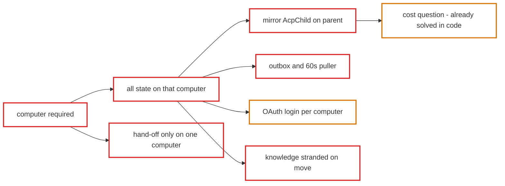
*Red: exists only because of the key. Amber: a cost the key made worse.*

The review (`~/.theuth/scratch/64-review.md`) also read paperclip (`~/Develop/paperclip`) and found the mirror-image error: an agent is a row with one fixed `adapterType` (`packages/db/src/schema/agents.ts:29`) and a static default environment (`server/src/services/execution-workspace-policy.ts:312-327`); the workspace is authoritative on the server and copied to an SSH host and back (`server/src/execution/ssh.ts:1556-1605`). What paperclip does well is not the org chart — visibility is company-wide by default (`doc/SPEC.md:145-147`) — but the *work protocol*: a scoped wake, an inbox of one's own tasks, a checkout lock, an end-of-run disposition (`skills/paperclip/SKILL.md:178-184`), coalesced wakes, no-progress back-off. Those are borrowed here (§7). Its budgets (`server/src/services/budgets.ts:214-259`) and approved hires (`server/src/routes/agents.ts:4593-4669`) are borrowed in §6.

The interview then moved the design further than the review proposed: Sky wants no root at all. "Is there a way that we could decentralize which machine is the root, so it's distributed, and any node can come in or out of the picture at any time and as long as there is one, everything just keeps working." — and, when told what it costs, "I prefer fully peer to peer", staged.

## 2. Facts relied on

- **Remote children exist.** `spawn_subagent{agent:"<node>"}` resolves to `Transport::Dial` over a mode-1 link conn (`crates/agent/src/supervisor.rs:681-698`; `crates/acp/src/harness.rs:102-114`); the node creates a root session in its own store with its own credentials (`crates/rpc/src/acp.rs:192-202`); the session survives a dropped conn for `session/load` (32:287-290); the node's `UsageUpdate.cost` rolls into the parent's tree total (`crates/rpc/src/acp.rs:570-578`; 51 §8.3).
- **Gaps.** The parent cannot set `model`/`effort`/`tools` on a node child (`crates/agent/src/peers.rs:47-55`); a node child is a leaf that cannot address its parent (32:872-881); the node control conn serves four methods (`crates/nodes/src/client.rs:17`: `info, link_pair, link_revoke_device, link_status`) though the node also serves `set_secret`, `add_skill`, `add_mcp_server`, `knowledge_put`; the link is directional — the node never dials the parent (`facts/theuth-relay-role-for-nodes-and-bots`).
- **Schedules.** Front matter is `cron, every, at, quiet, missed, model, enabled, until, max_runs, cwd, approvals` (`crates/schedule/src/file.rs:88-102`); a fire always opens a local session (`crates/schedule/src/lib.rs:446-539`); schedule roots are isolated and cannot reach live sessions (`facts/theuth-schedule-runs-cannot-reach-sessions`).
- **Sessions.** `SessionSummary` has no host or node column (`crates/agent/src/lib.rs:1213-1260`); `pinned` only sorts (`crates/agent/src/store.rs:317-320`); a native session can switch model (`SetModel`, `lib.rs:905-914`); the harness is fixed at creation. Fourteen tables in the agent store: `sessions, messages, model_calls, inner_calls, cost_owners, remote_meters, epochs, errors, peer_bindings, peer_exchanges, projects, reminders, todo_snapshots, a`. Ids are UUIDv7.
- **CRDT already in tree.** `yrs = "=0.28.0", features = ["sync"]` (`Cargo.toml:155`), used by `crates/document` (23 sites); 59 makes the harness the Yjs authority in Rust with sync RPC over the link.
- **Knowledge** is a `gix` bundle with FTS (`crates/knowledge/Cargo.toml:6-10`); concepts are files with front matter; `knowledge_list(tag)` exists.
- **Cost.** `SessionCost { direct, descendants, total, children, … }` (`crates/agent/src/cost.rs:344-364`) over `cost_owners`, `model_calls`, `remote_meters`. No budgets exist.
- **Tool cap** is a min-over-ancestors risk ceiling in the registry (`crates/tools/src/registry.rs:473, 792-809`), `send_message` exempt; not enforceable on external harnesses (`decisions/theuth-subagent-tool-cap-v1`).
- **One engine per data dir** (63, shipped 067bfa8): `t` attaches to a running engine; every engine serves RPC.
- **Store volume** (Sky's Mac, 2026-09-24): `sessions.sqlite` 108 MB — 21,157 `messages`, 6,337 `model_calls`, 436 `inner_calls`, 166 `sessions` after ~two weeks; messages are persisted per message, not per delta. sqlx 0.9 with 297 query sites in 7 crates, 30 migrations, no ORM.
- **SQLite session extension** is compiled into the vendored SQLite: `vendor/libsqlite3-sys/Cargo.toml:61-63` (`preupdate_hook`, `session`); rusqlite (already linked for the Signal store) exposes it.
- **Libraries** (checked 2026-09-24): `iroh` 1.2.0 (Sep 9 2026, 6 stable releases); `iroh-docs` 0.101.0 (Jun 2026, "30 breaking releases" — pre-1.0); `mdns-sd` 0.21.4 (Sep 2026); `cr-sqlite` last tagged release 0.16.3, commits continuing through 2026-08 (Sky's check) — active, untagged; README: inserts into CRRs 2.5× slower, reads unchanged. `WaveSyncDB` (pvg13) 0.6.0: 0 stars, 1 contributor, 1 release, license unasserted, last push 2026-08-29; captures writes by parsing SQL text over SeaORM, ships over libp2p gossipsub.

## 3. Shape

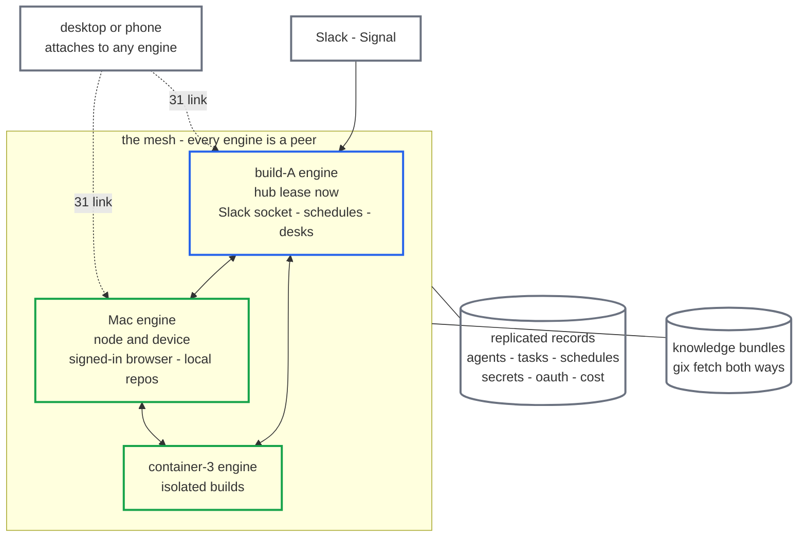
*Blue: the engine currently holding the hub lease. Green: peers. Gray: shared state and outside parties. Any engine may become blue.*

Three records, and who owns each:

| Record | Where | Written by | Read by |
|---|---|---|---|
| **agent** `agents/<name>.md` (row + file projection) | replicated | user, or an agent's proposal until approved | every engine; the desk primes from it |
| **task** | replicated | the owner's sessions, theuth at delegation, the reviewer, the user | inbox queries, the board, wake dispatch |
| **session** | the engine that ran it (stage 1); shipped log with an owner lease (stage 2) | exactly one engine at a time | the client, wherever it lives |

Roles an engine may play at once: **peer** (always: records, its own sessions, tools on its own files), **hub** (lease holder: sockets, ticks, wake dispatch, budgets, OAuth refresh, desks), **placement target** (any engine theuth names on a task).

## 4. The mesh (`crates/mesh`)

### 4.1 Identity and pairing
An engine's identity is its iroh `EndpointId` (an Ed25519 public key), stored in `<data_dir>/mesh/identity`. Pairing is **mutual and transitive**: `t mesh add <pairing string>` on either side exchanges keys and the current peer set; a new engine learns every peer from the one it paired with. The peer set is itself a replicated record. Leaving is `t mesh remove <name>`; an engine that is merely off is *unreachable*, not removed.

### 4.2 Discovery and transport
- **LAN**: iroh's mDNS discovery (`discovery-local-network`) finds peers on the same network and dials them directly — Sky's "engines on one LAN find each other directly".
- **Across networks**: iroh's DNS/pkarr discovery plus hole punching; when punching fails, traffic relays through an `iroh-relay`. **theuth runs its own, on the existing relay host**: `iroh.relay.theuth.io` (a subdomain of `relay.theuth.io` on the same box, same wildcard certificate; a subdomain rather than a path because the iroh relay also needs UDP for its QUIC address-discovery probe, which a path cannot carry) **[orch: subdomain vs path]**. `deploy/relay` gains the `iroh-relay` process beside the 31 relay; engines get the address from `mesh.relay` (default `https://iroh.relay.theuth.io`) and use n0's public relays only when the user sets `mesh.relay: public`. Sky's ruling: iroh "should become part of the existing relay".
- **Streams**: one QUIC connection per peer pair, ALPNs `theuth/records`, `theuth/acp`, `theuth/sessions`, `theuth/knowledge`, `theuth/gossip`. ACP for a remote child is the existing `rpc::acp` server over a `theuth/acp` stream instead of a mode-1 link channel — the serving code is transport-agnostic (`Transport::Dial` is one variant).
- **31 stays for devices.** Phones and desktops keep pairing with an engine over the theuth relay; a later doc may move devices onto iroh too.

### 4.3 The hub lease

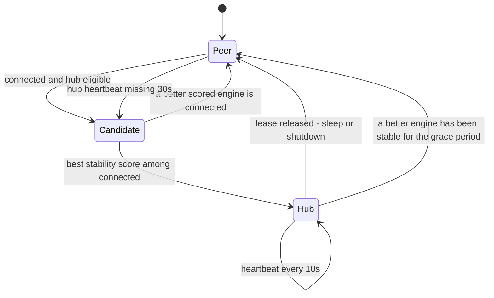
Every engine computes the holder from the same replicated inputs — the connected peer set, each peer's `hub:` setting and its stability record (§4.5) — so no message says "you are hub"; the heartbeat only confirms liveness. On a partition each side may elect a hub for the duration; every hub duty is written to be **idempotent under two hubs** (§4.4). Sessions are not hub duties and never move on a lease change.

### 4.5 Election by stability

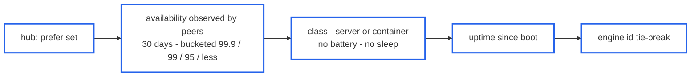
*Compared left to right; the first difference decides.*

Each engine keeps a replicated `engine_stats` row: `uptime_since`, `class: server | desktop | laptop | container` (from the platform crate: battery present and sleep-capable → `laptop`), and an **availability ledger written by its peers, not by itself** — every engine records, per peer, reachable/unreachable intervals as it observes them; availability is the peer-observed fraction over the last 30 days, bucketed so that noise does not flip elections. Two guards against flapping: a **probation** of `mesh.probation_secs` (default 6 h) before a newly joined engine may outrank an incumbent, and a **grace period** of `mesh.handover_secs` (default 10 min) during which a better-scored engine must stay connected before the incumbent yields. The net effect is what Sky asked for: "a stable cloud node pretty much is always the hub unless it's decommissioned, then the next best available is elected." `hub: never` removes an engine from the running entirely (a build box that must not carry Slack).

### 4.6 When the hub disappears

Two cases, one outcome:
- **Graceful** — the hub is asked to sleep or stop (macOS `willSleep`, `SIGTERM`, `t stop`, lid close on a laptop that is not on power): it broadcasts `lease_release` over gossip, flushes its desks' journals and outstanding replicated writes, and the next best engine takes the lease within a second. Work sessions on the departing engine are checkpointed by a progress note (§7.5) so their tasks can be resumed elsewhere if it does not return.
- **Abrupt** — the hub's heartbeat stops (crash, power, network): after 30 s the others re-elect. The new hub opens each agent's desk from its last journal plus the task table; any desk turn that was in flight is lost, but its effects are not — every checkout, wake claim and disposition is a replicated row, and a wake the dead hub had claimed but not finished is un-claimed by the orphan sweep (§7.5) and redelivered. Schedules missed during the gap follow 34's `missed:` policy on the new hub. Slack messages that arrived during the gap are redelivered by Slack when the new socket connects (Socket Mode retries un-acked events for a short window); those outside the window are lost as they would be for any offline bot — the Tasks board shows the gap.
The election inputs make the abrupt case rare: a laptop only holds the lease when it is the only engine on, and it releases gracefully on lid close whenever the OS gives it the chance.

### 4.4 Hub duties and their double-hub behaviour

| Duty | Idempotent because |
|---|---|
| Slack / Signal sockets | Slack Socket Mode load-balances events across up to ten connections for one app — two hubs each receive *different* events, and thread bindings are replicated, so routing still holds **[orch: verify against Slack docs in stage 1]**. Signal: every hub-eligible engine is its own linked device and receives every message anyway (§4.7); only the hub answers, and a replicated `answered` marker keyed `(sender, timestamp)` lets a second hub see a reply already went out — a partition can still produce one duplicate reply, same window as Slack. |
| Schedule ticks | A fire creates a task keyed `(schedule, fire_time)`; the second hub's create coalesces into the same row. |
| Wake dispatch | Wakes are rows with idempotency keys; a desk claims a wake with a checkout; the loser sees the claim. |
| Budget checks | Pure function of replicated counters. |
| OAuth refresh | The refresher writes the new grant with the old grant's version as a precondition; the loser's refresh fails and it re-reads. A provider that rotates refresh tokens can still be logged out by a true double refresh in the same second — accepted, rare, and the fix is one login. |
| Desks | A desk is a pinned session on the hub; on a graceful lease change the old hub closes its episode (journal written, replicated), the new hub opens the next; on an abrupt loss the new hub opens from the last journal (§4.6). Two hubs → two desks for one agent for the partition's duration, both reading the same inbox; the checkout on tasks keeps them from working the same one. |

### 4.7 Signal and Slack under the lease

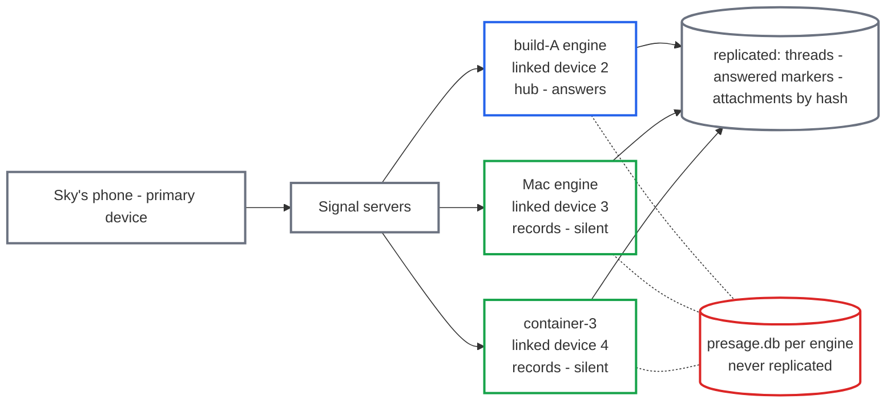
*Blue: the hub answers. Green: linked, listening, silent. Red: per-engine protocol state that must not be copied.*

| | Slack | Signal |
|---|---|---|
| Identity | one app, one bot token | one account (Sky's), one *device per engine* |
| What replicates | the token (vault), thread→agent bindings | thread→agent bindings, `answered` markers, attachments by hash — **never `presage.db`** |
| Who connects | the hub opens the socket(s) | every hub-eligible engine keeps its own websocket (09 §3.1 supervisor, unchanged) |
| Who answers | the hub | the hub |
| Inbound while a hub changes | Slack redelivers un-acked events to the new socket | already delivered to every engine; the new hub answers anything without an `answered` marker |
| Setup on a new engine | nothing — the token is already there | one QR scan (`signal_link`) — Signal caps an account at five linked devices, so at most four hub-eligible engines plus the desktop's own link **[orch: `hub: never` engines need no link]** |
| Abrupt hub loss | new socket, short redelivery window | nothing lost: the messages are on every engine; the new hub replies |

Why not migrate one Signal device with the lease: a Double-Ratchet store that misses even one sent or received message can no longer decrypt the chain that follows; Signal has no server-side way to recover it, only a re-link. Multi-device is how Signal itself solves this, so theuth uses it rather than fighting it. Non-hub engines stay quiet by policy, not by disconnecting — a device that is linked but never fetches would accumulate undelivered messages on the server and eventually be unlinked by Signal.

A returning engine (lid reopened) that was hub before simply stops answering when it sees a better-scored hub in the peer set; anything it replied to during a partition is visible as a duplicate in the thread and nowhere else.

## 5. Replication (`crates/mesh::records`)

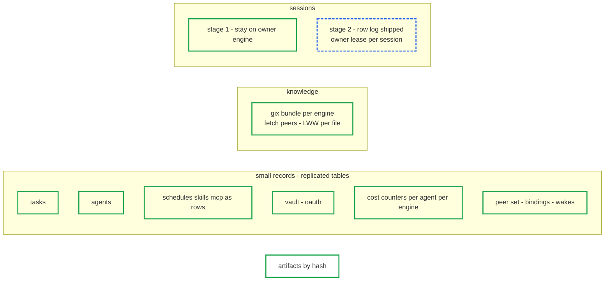
*Green: stage 1. Dashed blue: stage 2.*

### 5.1 Small records
Tables marked as replicated (cr-sqlite CRRs if the spike passes; else yrs maps mirrored to SQLite). Per-column last-writer-wins with a hybrid logical clock; every row carries `origin: <engine id>`. Sync is a change feed exchanged over `theuth/records` on connect and on every local commit; an engine that was away catches up from any peer. Conflicts that matter are avoided by shape, not merged by luck:
- **tasks**: `state` transitions are guarded by `checkout` (one session id); the loser's write is rejected before it reaches the CRDT.
- **cost**: per-`(agent, month, engine)` counters, each written only by its engine; the total is a sum — no conflicts.
- **vault**: `(name, version)` rows, append-only; `current` is a LWW pointer (37's versions already exist).
- **files as rows**: `agents/`, `schedules/`, `skills/`, `mcp/` are projected to disk on every change so `read_file`, hot reload and hand edits keep working; a hand edit is read back into the row with the file's mtime as its clock.

### 5.2 Knowledge
Each engine's bundle is a git repo (10). On connect and every `knowledge.sync_secs`, an engine fetches each peer's bundle over `theuth/knowledge` and merges: disjoint files always; the same concept file changed on both sides → newer commit wins, the loser's version is kept in history (gix already keeps it — 10 §8). The FTS index rebuilds incrementally. Owner and visibility (§9) are front-matter fields and travel with the file.

### 5.3 Sessions
- **Stage 1.** A session lives where it ran. The board and the Agents view show *where*; the client attaches there to read or stream (32 §0.3's device→node case, already allowed). A desk on the hub reconnects to its remote children with `session/load` over `theuth/acp`.
- **Stage 2.** Every session row (`messages`, `model_calls`, `inner_calls`, …) is shipped in commit order over `theuth/sessions`; the `sessions` row itself is a small record with an `owner: <engine>` field. **Ownership transfers** when the owner is unreachable for `sessions.takeover_secs` (default 300) and a peer needs to write (resume, steer); the taker writes `owner = self, epoch + 1`; the old owner, on return, sees the higher epoch and demotes itself to a replica of that session. Nothing is merged: one writer per epoch.

### 5.4 Secrets and OAuth
The vault replicates as §5.1 — encrypted at rest on every engine with that engine's key (37), values in flight only inside the QUIC/Noise channel. `{{ secret : NAME }}` resolves on the executing engine (37 §3.6), which now always has it. OAuth grants (`oauth/<ns>.json`, 05) are vault rows; the hub is the only refresher (§4.4). Log in once, anywhere: the browser flow (05 §2.1) runs on whichever engine the user is in front of; the grant lands in the vault and is everywhere in seconds. **Not replicated, ever:** `signal/presage.db` (§4.7) and each engine's own iroh identity key; both are per-device by nature. 64 §5.1's three routes for *agents asking for a secret* are kept: `secret_request` prompts the user (via the hub's channels), the value goes into the vault, never into a session.

## 6. Agents (`crates/roster`)

### 6.1 The file
```yaml
# agents/ops.md
title: Ops
reports_to: theuth           # an agent name, or `theuth` (the default)
model: anthropic/claude-opus-5-5
effort: high
tools: mutating              # risk ceiling for every session it opens
mcp: [grafana, argocd_prod, slack]   # MCP servers (or server.tool) it may see
budget: 40 USD/month         # or `none` (default) — infinite; self-hosted inference is the normal case
capabilities: >              # "when I am relevant", read by other agents when handing off
  Production health, incidents, Grafana and ArgoCD. Not code review.
paused: false
---
You are Ops. Your charter is …   (standing instructions; the desk's system prompt is built from this)
```
Name `[a-z0-9-]{1,32}`; peer name `agent:<name>`. `theuth` is reserved: the built-in default agent, charter `prompt.md`, `reports_to: user`, `tools: destructive`, no `mcp` limit, no budget. Hot-reloaded; a hand edit is a record write (§5.1).

### 6.2 Desk, episodes, journal
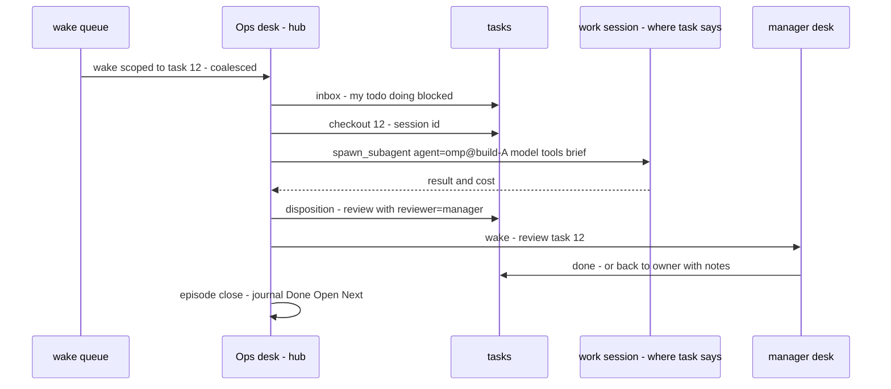
The desk is one pinned session named `agent:<name>` on the hub. Its context is kept small on purpose: the charter, the journal, the primed knowledge (§9), the inbox, and one task at a time. It never edits files itself except through a child. **Episodes** (64 §6.2 kept): the desk session closes and a new one opens on idle 6 h, at 60 % of context, at thread end, or on a lease change; the closing turn writes the **journal** (`roster/journal/<name>.md`, Done / Open / Next / Notes, ≤ 8 KiB, replicated, private) and harvests knowledge (§9). The next episode starts from the charter + journal, not from the transcript.

### 6.3 Caps and MCP allowlist
`tools:` is the existing registry ceiling applied at the desk and inherited by every child (min-over-ancestors, `registry.rs:792-809`). `mcp:` is new: a per-session allowlist consulted by the MCP plugin when it builds the tool list for a session; children inherit the intersection. For an external harness child (omp, opencode) neither is enforceable inside the harness (`decisions/theuth-subagent-tool-cap-v1`) — the brief states the limits, and the task's `harness` choice (§8) is where theuth decides whether an external harness is acceptable for this agent's ceiling **[orch]**.

### 6.4 Budgets
`cost` counters (§5.1) summed per agent per calendar month; `SessionCost` (51) attributes each session to its agent via `cost_owners`. At 80 % a note to the agent's manager; at 100 % `paused: true` is written, queued wakes are held, and an approval `budget_override { agent, month, spent, cap }` goes up the line. `budget: none` never checks. Prices come from 51's model pricing; an own-inference provider prices at zero and so never trips a cap.

### 6.5 Proposals
`agent_propose { name, title, reports_to, charter, budget, tools, mcp }` writes the file with `paused: true` and `proposed_by: agent:<name>`, then files a `hire_agent` approval through the permission contract (00 §1.7) to the proposer's line, ending at the user. Approval flips `paused`. The Agents view shows proposals in the queue with the charter inline.

## 7. Tasks (`crates/tasks`)

### 7.1 Record
```
task {
  id (uuidv7), title, brief (markdown), owner: agent:<name> | user,
  project: <project name> | null,               # the existing project label (51 §3 as-built); boards are per project
  state: todo | doing | review | blocked | done | cancelled,
  reviewer: agent:<name> | user | null,        # default: owner's reports_to
  blockers: [task id | "decision:<approval id>" | "person:<name>"],
  parent: task id | null,                        # delegation tree
  where: <engine name> | null,  harness: native | omp | opencode | claude | null,   # written by theuth (§8)
  external: [url],                               # Jira, GitHub, …
  thread: document id (59),                      # comments, questions, answers, notes
  checkout: session id | null,  checkout_epoch,
  schedule: (name, fire) | null,                 # routine provenance, coalescing key
  created_by, created_at, updated_at, no_progress_count, next_wake_after
}
```

### 7.2 States
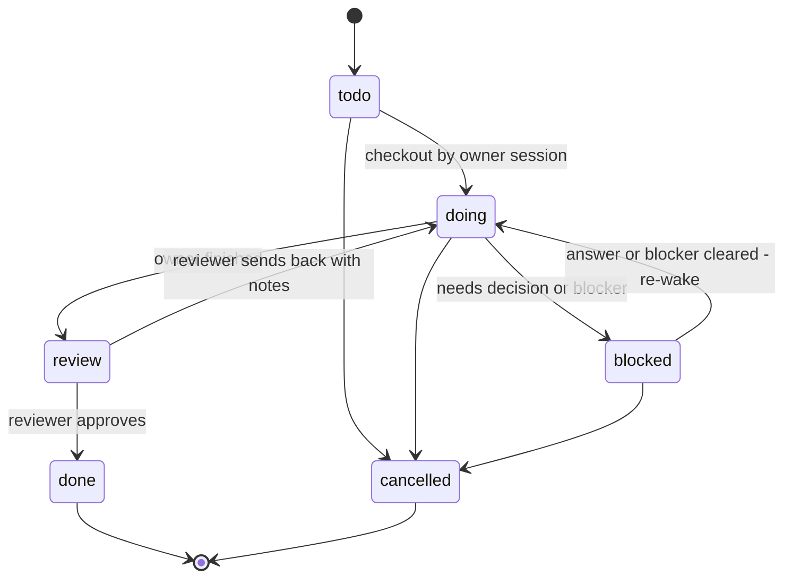
`done` requires the reviewer to be someone other than the owner unless the owner is the user. Every transition writes to the thread with actor, session and before/after (paperclip's field-level activity log).

### 7.3 Wakes
A wake is a row `{ agent, task, reason: assigned | comment | mention | schedule | answer | review | manual, idempotency_key, claimed_by }`. Dispatch (a hub duty) delivers the oldest unclaimed wake per agent to its desk as one input: *"Wake: task 12 — <title>. Reason: comment. Do not switch to another task until this wake is handled."* plus the new thread entries inline (paperclip's scoped wake with a resume delta). Rules:
- **Coalesce**: a wake for `(agent, task, reason)` that already has an unclaimed row merges (count + 1).
- **No-progress back-off**: if two consecutive wakes on a task end with no field change, `next_wake_after` = now + 2 min, doubling to 30 min; a human thread entry clears it.
- **Cross-task cap**: a session may write to at most 20 tasks it does not own; the 21st is refused with the reason.
- **Disposition**: an episode's closing turn must leave every task it checked out in `review | blocked | done(by reviewer) | delegated (child task exists) | continuing (a schedule, reminder or live child will wake it)`. A task left in `doing` with none of these is set `blocked: "no continuation"` and the manager is woken.

### 7.4 Schedules → tasks
`agent: ops` in schedule front matter: each fire upserts a task with `schedule: (name, fire_time)`, owner `ops`, the wrapped prompt as brief, then a wake with reason `schedule`. `until`/`max_runs` (33) act on the task: `until` passing sets it `done` with reviewer `system` **[orch]**. A schedule without `agent:` runs as today.

### 7.5 Orphaned checkouts — resuming a task when its engine is lost

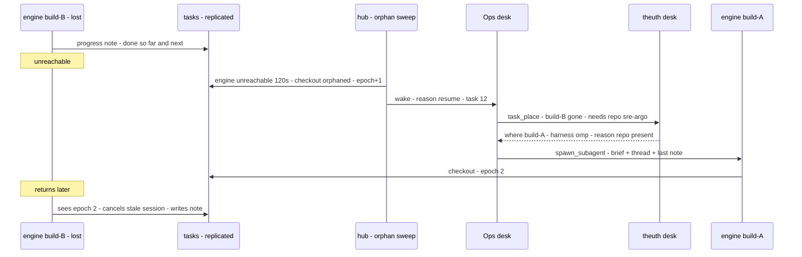

The task's `checkout` is `{ session, engine, epoch, progress_at }`. The owning session bumps `progress_at` (a coalesced replicated write, at most every 10 s) while it works, and writes a **progress note** to the thread — two or three lines, *done so far / next / files touched* — at natural boundaries: after each tool-result batch that changed something, every `tasks.note_secs` (default 300), and at disposition. The note is the resume brief; it is small on purpose.

The hub's **orphan sweep** runs every 30 s over tasks in `doing`: if `checkout.engine` has been unreachable (peer set) for `tasks.orphan_secs` (default 120) *or* `progress_at` is older than `tasks.stale_secs` (default 900) while the engine is reachable (a hung session), the checkout is marked orphaned, `epoch` is incremented, and the owner's desk is woken with reason `resume`. The desk asks theuth to re-place the task (§8): if another engine satisfies its needs — the repo exists there, or the work needs nothing local — the task is re-placed and a new session opens with brief + thread + last note; if only the lost engine could do it (its disk holds the only copy of half-finished edits), the task becomes `blocked: engine:<name>` and is re-woken with reason `resume` when the engine returns. The placement reason says which of the two happened.

A **returning engine** reconciles before it does anything else: for every session it still has running, it reads the task's `checkout`; an epoch higher than its own means it was superseded — it cancels the turn, leaves *"superseded by <session> on <engine>"* in the thread, and keeps the session for inspection. Its uncommitted files stay on its disk; the thread names them so the new session or the user can fetch them. In **stage 2** the lost session's transcript is replicated, so the new session `session/load`s it (ownership transfer, §5.3) and continues from the exact turn instead of from the note.

Wakes are covered the same way: a wake claimed by a desk on a lost hub is un-claimed by the sweep and redelivered by the new hub.

## 8. Delegation and placement — theuth's job

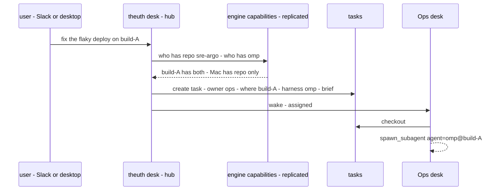
theuth decides *where* and *in what* when it creates or assigns a task, and writes both onto the record. Inputs: the task's needs (a repo path, a display, a signed-in browser, a GPU, isolation), the agent's `tools` ceiling (an external harness cannot enforce it — so a `read_only` agent's tasks are placed on native), and **engine capabilities**, a replicated record each engine refreshes on start and every `mesh.capabilities_secs`: `{ os, arch, harnesses: [omp, opencode, claude], repos: [git roots under mesh.workspaces], display, browsers_signed_in, gpu, load }`. A task without a placement — one created by an agent for itself or by a direct call-out — is placed on first checkout by `task_place`, one short turn of theuth's desk that may answer from policy alone (the obvious cases: the repo lives on exactly one engine; needs a display → the Mac) **[orch]**. The chosen placement is recorded with a one-line reason in the thread.

`spawn_subagent` gains `agent: "<harness>@<engine>"`: `"omp@build-A"`, `"build-A"` (native there), `"omp"` (local, as today). `model`, `effort`, `tools` apply to remote children; for omp/opencode the model is set through their announced `category: "model"` config option (`facts/theuth-acp-harnesses-announce-model-in-config-options`).

## 9. Memory

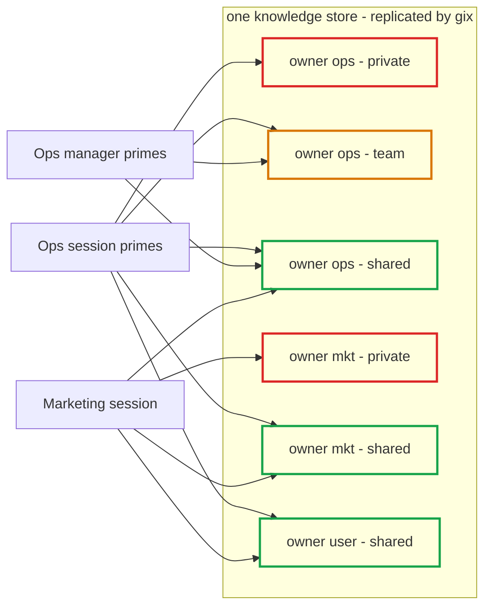
*Red: only the owner. Amber: owner and its reporting line. Green: everyone.*

Every concept gains `owner` and `visibility` front matter (defaults for existing items: `owner: user`, `visibility: shared`). A session's knowledge hints and `knowledge_search` see: its agent's own items, `team` items of agents in its reporting line (up and down), and `shared` items — own items rank first. `knowledge_share { id, visibility }` flips visibility; nothing is copied. A search that would have matched a private item of another agent returns a stub *"agent:ops holds a private item matching this — ask Ops"* without the content. Harvests at episode close write `private` by default; the closing prompt asks the agent to mark what its team or everyone should know. The journal is not knowledge and is never visible to others.

## 10. Chat routing
The hub answers on every channel (21 Slack — it holds the socket; 09 Signal — every hub-eligible engine is linked and listening, the hub alone replies, §4.7). A message whose first token, case-insensitive with an optional `:` or `,`, is an agent name routes to that agent's desk and binds the thread (`threads.json` gains `agent`); later messages in the thread go to the same agent. Anything else goes to theuth. An agent answers in its own name (Slack: the app's display name is unchanged; the reply is prefixed `Ops —` **[orch]**; Signal has no display-name switch either). `message_user` and `show` from any session reach the user through the hub's channels — there is no outbox, because the hub is always the engine that owns the channel.

## 11. People in the loop
An agent needing a decision mid-task calls `escalate { task, question, options }`: the request goes to its manager's desk as a wake with reason `decision`. A manager that is an agent answers or escalates further; the user gets it through the hub's channels and 42 push, with the approval card as today. The requesting session waits `agents.decision_wait_secs` (120) for a live answer; then the task goes `blocked: decision:<id>`, the episode closes with its journal, and the answer re-wakes the agent (paperclip's pattern, after a live attempt). Tool approvals (`approvals: ask`) follow the same line: the manager may approve within its own `tools` ceiling; above it, the user.

## 12. Screens
- **Tasks board** (desktop, mobile, TUI `/tasks`): one board per project (the project palette selects it; "all projects" is a deliberate extra click); columns by state; filter by agent, engine, schedule; a task shows brief, thread, placement with its reason, sessions (with engine and harness), cost, blockers; actions: assign, comment, answer, approve, send back, cancel.
- **Agents view**: tree by `reports_to`; per agent: status (idle / working / blocked / paused / proposed / unreachable), budget bar, open tasks, current desk, file editor, journal (read-only), knowledge counts by visibility.
- **Queue** at the top of both: approvals, escalations, proposals, budget overrides — "does it need me".
- **Mesh** (Settings): engines with reachability, hub holder, capabilities, `hub:` preference, add/remove.
The client attaches to whichever engine it is paired with; records are local there; a session opens where it lives (stage 1) or anywhere (stage 2).

## 13. Bring-up (`crates/sandbox`, from 64 §4)
`t mesh add --ssh user@host [--key <vault name>]` (built-in `russh` with a vault key, or the system `ssh`), then `t mesh add --docker` — 64 §4's detect → fetch `t` → first-run → start → pair, unchanged except the last step joins the mesh instead of `nodes::Add`. Order per Sky: SSH first (build-A/build-B exist), container second. Provisioning has no separate step: the vault, MCP and skills arrive by replication (§5) the moment the engine joins.

## 14. Cost
51's per-session and per-tree totals are unchanged. New: `cost_owners` gains `agent`; the hub folds each engine's per-agent month counters into the replicated table (§5.1); the Agents view shows agent-month totals and budgets; a task shows the sum of its sessions across engines. Node children already report `UsageUpdate.cost` (`acp.rs:570-578`); with tokens now replicated in stage 2 the "not tokens" gap in 64 §17.1 closes by itself.

## 15. Security
- Mesh peers are pairwise-authenticated by key; a stranger cannot join without a pairing string from a member.
- The vault is replicated encrypted; each engine re-encrypts at rest with its own key (37). Loss of one engine leaks nothing more than today's node.
- Agents see only what their `tools` and `mcp` allow; an external harness child is briefed, not fenced — the placement rule in §8 keeps `read_only` agents on native.
- Untrusted content rules (28) apply to task threads written by agents and to Slack text.

## 16. Build order

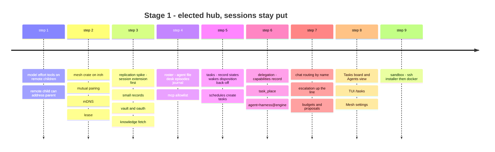
Stage 2 (its own numbered doc): session row log over `theuth/sessions`, owner lease and epoch, client opens any session anywhere, devices over iroh.

Steps 1–3 are pure infrastructure and each is testable alone (a remote child with a cap; two engines electing; a task row appearing on both). Step 4 without 5 already gives a local agent that spawns work on other engines — most of 64's value with none of its machinery.

## 17. Libraries chosen and assessed (for Sky's review)

| Purpose | Choice | Version / status (checked 2026-09-24) | Why | Link |
|---|---|---|---|---|
| Engine↔engine transport, hole punching, relay fallback | **iroh** | 1.2.0, Sep 9 2026; six stable releases since 1.0 | QUIC dialed by public key; LAN via mDNS; self-hostable relay; the whole "engines find each other" problem in one crate | https://github.com/n0-computer/iroh · https://docs.rs/iroh |
| Presence and lease heartbeats | **iroh-gossip** | tracks iroh | epidemic broadcast over the same endpoint; no second socket | https://github.com/n0-computer/iroh-gossip |
| Self-hosted relay (optional) | **iroh-relay** | tracks iroh | when the public n0 relays are not wanted | https://github.com/n0-computer/iroh/tree/main/iroh-relay |
| Replication of tables and the session log (first choice) | **SQLite session extension** | built into SQLite; enabled in the vendored `libsqlite3-sys` | changesets from the preupdate hook, applied with a conflict callback; zero write overhead, no clock tables; one mechanism for single-writer sessions and LWW records; theuth owns ~100 lines of LWW + bookkeeping | https://www.sqlite.org/sessionintro.html · https://docs.rs/rusqlite/latest/rusqlite/session/ |
| Replicated tables (fallback) | cr-sqlite | 0.16.3 tagged; commits through 2026-08 | CRDT tables with `crsql_changes`; 2.5× inserts, ~2× storage (README); linking into vendored SQLCipher-on-BoringSSL unproven | https://github.com/vlcn-io/cr-sqlite · https://vlcn.io/docs/cr-sqlite/intro |
| Reference design for the layer theuth owns | WaveSyncDB | 0.6.0; 0 stars, 1 contributor, license unasserted | the README is a clear spec of per-column Lamport clocks, shadow tables, version-vector catch-up and change notifications; not adopted: SQL-text parsing as write capture, SeaORM and libp2p as required companions, bus factor 1 | https://github.com/pvg13/WaveSyncDB |
| Replicated records (second fallback) | yrs | 0.28.0 pinned in tree; `sync` feature | already the Yjs authority for documents (59); Y.Map per record type over the y-sync protocol, mirrored to SQLite for queries | https://github.com/y-crdt/y-crdt |
| Knowledge sync | **gix** | in tree | the bundle is a git repo; fetch + per-file LWW | https://github.com/GitoxideLabs/gitoxide |
| LAN discovery if iroh's proves insufficient | mdns-sd | 0.21.4, Sep 2026 | pure-Rust mDNS, no runtime dependency | https://github.com/keepsimple1/mdns-sd |
| Assessed, not chosen | iroh-docs | 0.101.0, pre-1.0, "30 breaking releases" | a KV replication layer we would build our records on and chase through breaking changes | https://github.com/n0-computer/iroh-docs |
| Assessed, not chosen | automerge / loro | current | excellent document CRDTs, but a second CRDT engine beside yrs with no table story | https://github.com/automerge/automerge · https://github.com/loro-dev/loro |
| Assessed, not chosen | openraft | current | real consensus for a 2–5 engine mesh whose duties are all idempotent — heavier than the problem | https://github.com/databendlabs/openraft |
| Assessed, not chosen | rust-libp2p | current | general and heavy; iroh reaches direct connectivity with far less surface | https://github.com/libp2p/rust-libp2p |

## 18. Open questions
1. **Session extension under SQLCipher** — the stage-1 spike (step 3) proves the first choice on two engines (write latency, growth, first-sync time); cr-sqlite, then yrs, are the fallbacks; the design is written so any fits.
8. **An ORM.** Sky raised SeaORM. Not required for replication (the preupdate hook intercepts below any ORM); adoptable per crate on the same sqlx pool if wanted for ergonomics — a separate decision, not part of 67.
2. **Slack under two hubs** — verify Socket Mode's multi-connection event distribution before relying on it (§4.4); otherwise the Slack duty needs a stricter lease (a vault row with a short TTL as a mutex, accepting a one-TTL outage on hub change).
3. **Desk on the hub vs desk on a preferred engine** — **[orch]** chose the hub for simplicity; an agent whose work is always on one engine might prefer its desk there. Revisit after stage 1 numbers.
4. **Task placement for direct call-outs** — `task_place` as a short turn of theuth's desk **[orch]**; if latency annoys, a pure policy path for the unambiguous cases.
5. **Devices over iroh** — out of scope here; the 31 relay remains until a later doc.
6. **Availability observation.** Peers record each other's reachability; two engines that are only ever on at different times see each other as mostly-unreachable — the bucket thresholds and the 30-day window may need tuning once real numbers exist.
7. **Naming of the reply prefix in Slack** (§10) and whether Slack's per-message username override (`chat.postMessage` `username`, needs `chat:write.customize`) is acceptable instead.

## 19. Relation to 64
Withdrawn: `computer:`, `crates/bot`, the mirror `AcpChild`, `AgentState::Offline`, the outbox and puller, per-computer OAuth, hand-off restricted to one computer, "Bots". Kept, moved: episodes + journal (→ §6.2), the bundle (→ replication, §5), `into:` (→ `agent:` creating tasks, §7.4), the three secret routes (→ §5.4), SSH/Docker bring-up (→ §13), the Bots UI (→ Agents view, §12), approval wait + push (→ §11). 64's recon facts (64 §2) remain valid and are cited above where used.
## 20. As built — stage 1 (2026-09-25), deviations from the text above

Built by eleven parallel omp workers plus four fix rounds and a single-engine smoke; per-worker detail in `docs/design/67-as-built-{C,N,M,R,A,T,U,S,X,H,V,Z}.md`, the spike in `67-replica-spike.md`, the smoke in `67-single-engine-smoke.md`. Where the code differs from the sections above, the code is the decision and this section is the record:

| Section | As designed | As built | Why |
|---|---|---|---|
| decision 6, §5.1 | SQLite session extension as the stage-1 capture | **`AFTER INSERT/UPDATE/DELETE` triggers into a per-file `_replica_log`**, polled every 200 ms, applied row-by-row with per-column LWW (shadow clocks + tombstones); capture runs *before* applying a peer batch | the session extension captures only the connection it is attached to; sqlx pools open and recycle connections it cannot hook. It works under SQLCipher (spike: +0.45 µs/row, 40 B/row) and is kept for stage 2's single-writer session log |
| §5.1 write concern | — | **local-first everywhere**; no ack-one for tasks/wakes (Sky, 2026-09-25) | a lost engine's last ≤200 ms of writes are invisible until it returns; late rows lose LWW to newer state |
| §5.1 outbox | prune with zero peers | **not pruned** while there is no peer (33–152 rows / 1.1 MB after 500 tasks, idle growth 0) | it is the catch-up log for the first engine paired after solo use; there is no snapshot path yet |
| §4.2 | relay + discovery at bind | **lazy network join**: the endpoint binds with an empty relay map and no lookup; relay and discovery join on first pairing or when stored peers exist; `mesh.discovery: false` knob | a default-config offline engine logged ~3 WARN/s from iroh (mDNS, pkarr, relay probes) |
| §4.1 | pairing over `ALPN_GOSSIP` | pairing/presence has its own **`ALPN_MESH`**; gossip keeps `ALPN_GOSSIP` | iroh-gossip owns its ALPN |
| §4.5 | heartbeat carries stats until replication lands | heartbeat = `{ id, is_hub, stats_hlc }`; `engine_stats` is the replicated row, written **only on change**; `peers`/`availability` gained `hlc` and a single-column PK so they attach | double path would churn; attach refuses composite keys |
| §6.2 | desk system prompt = charter + journal | charter + journal + operating manual are the **head of the episode's first input** | no per-session system prompt exists in the agent crate |
| §6.2 | `theuth`'s desk opens at start | **lazy** — opens on `theuth`'s first wake | a fresh data dir must not carry a pinned `agent:theuth` session (single-engine invariant 5) |
| §6.1 | session→agent ownership as an agent-crate attribute | **roster-owned** map (session id → agent) | no agent-crate column; keeps `agent` untouched |
| §7.1 | `Owner: Agent | User` | `Owner::System` added (schedule-closed tasks); `Checkout.orphaned`; `Task.blocks` (computed inverse) | tasks worker + dependency ruling |
| §7.3 | `escalate` waits then parks | `escalate` returns at once with the request id; the **live wait is the roster's** (`roster.decision_wait_secs`); user path via the `ask_user` actor | the tool must not block a desk turn |
| §8 | placement policy a–e, theuth's desk on ambiguity | as designed (`tasks::place`, 9 tests); the desk is asked over the 50 `Deliver{await_reply}` path; **the local engine is named by hostname**, not `mesh.name` | known gap, X |
| §10 | reply prefix `<Title> —` | as designed; Signal `answered` de-dup lives in `tasks` migration `0002_answered.sql` | |
| §11 | manager may approve tool calls within its ceiling | **not built** — no registry hook lets a tool resolve an `Approval`; budget overrides and hires are *tasks up the line* resolved by `agent_pause` / `agent_approve` | H |
| §11, §12 | 42 push for escalations | **not built** — 42 is not implemented in the repo | H |
| §12 | TUI `/agents` | TUI roster command is **`/roster`** | `/agents` was already the subagent picker |
| §13 | `put` over SFTP | `put` = `cat >` over exec; **Windows targets refused** for now | S |
| §5.4 | vault rows encrypted per engine | vault rows + a **mesh data key** carried in the pairing string, sealed locally per engine; `vault.id` single PK | attach refuses composite keys |
| §4.7 | — | Signal answering and Slack sockets **follow the lease in their own crates** (`Follower`), not via roster | roster→slack dependency would cycle |

**Verification on the integrated branch (`feature/67-agents`)**: workspace `cargo test --no-fail-fast` — see §21 for the final numbers; single-engine smoke: serving in 0.31 s, lease = self in 0.27 s, byte-identical `list_sessions`/`knowledge_search`/`list_secrets`/`list_schedules` against `main`, each new sqlite file unwritable → one WARN and the rest serves.

**Open after stage 1**: manager-routed tool approvals (needs a registry hook); 42 push; `mesh.name` for the local engine in placement; outbox snapshot/prune once a first-pairing snapshot path exists; `tasks::store::hlc` text is not parseable by `replica::Hlc::parse` (replica re-stamps — harmless, untidy); Slack Socket Mode under two hubs still unverified against Slack's docs (§18 item 2); stage 2 (session log shipping, owner lease) is its own doc.
