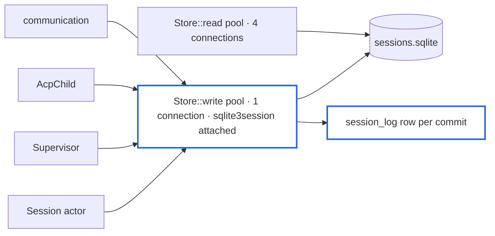

# 68 — Sessions everywhere: transcript replication with transferable ownership

*Status: design v0.4, 2026-09-25 — BUILT (stage 2 complete; §14 as built). Stage 2 of design 67 (§16, ruling 10 "stage it"). Recon in `68-recon.md`; per-worker detail in `68-as-built-{C,L,O,F,U,Z}.md`; smoke recipe and evidence in `68-two-engine-smoke.md`.*

## 0. Decisions in one place

| # | Decision | Recommendation | Why |
|---|---|---|---|
| 1 | Base branch | **Ruled**: 67 squash-merged onto `main` (654febe); 68 is `feature/68-sessions` off `main` | one integration branch at a time |
| 2 | Capture mechanism | **SQLite session extension on a single dedicated write connection** (§3) — not the stage-1 record replica, not an application-level op log | the transcript tables have composite PKs, reused `seq`, ~20 update-in-place columns and deletes; the session extension records physical row diffs for all of that natively; the stage-1 replica refuses composite PKs and has no transaction boundaries (recon B, constraints 1–3, 10) |
| 3 | What each engine holds | **Ruled: everything everywhere** — every engine mirrors every durable session; no `index` policy in 68 | simplest; every engine offline-complete (126 MB today, ~18 MB/day on busy days); sandboxes are engines like any other |
| 4 | Ownership transfer | **Ruled** — explicit, epoch-fenced: a session moves when (a) the user says "continue here" on another engine, (b) a task checkout is resumed elsewhere (67 §7.5), or (c) an engine needs to write and the owner has been unreachable ≥ `sessions.takeover_secs` (300). Never on mere liveness | a transfer discards the old owner's unshipped tail (§4.3); it must be an act, not a side effect |
| 5 | Front door | **Ruled: hybrid.** Reads are local everywhere. A write from a non-owner engine: **user sessions follow you** — typing takes the session here (instant release when the owner is reachable, §4.2 with `reason = write`); **agent desks are steered by forwarding** — the input goes to the owner over the mesh and its events stream back; a desk whose owner is unreachable answers the steer with "owner offline — continue here?" (a take). Devices keep the 31 link | the two kinds of session want opposite behaviour, and the kind (`sessions.agent` set or not) is already in the row |
| 6 | Privacy | private (`:memory:`) trees never replicate (as today); an agent's session replicates like any other, readable by the user everywhere; agents read transcripts only through the existing tools, which already apply owner/visibility on knowledge and desk scoping on sessions | one user owns every engine in the mesh; the boundary that matters is agent↔agent, and that is enforced at the tool layer, not the wire |
| 7 | Bootstrap | **snapshot first, then log**: a peer with no cursor for an origin gets one changeset per table built from the owner's current rows (`sqlite3session_diff` against an empty schema), then follows the log from the snapshot's seq | replaying every batch since the beginning is what 67 §20 flagged; the same path prunes the stage-1 outbox (67 loose ends 2.4) |
| 8 | Global tables | `projects`, `cost_owners` join the **stage-1 record replica** (add `hlc`, single PK already); `peer_bindings`, `a2a_contexts`, `a2a_tasks`, `a2a_task_work`, `peer_exchanges` are **engine-local** and do not replicate in 68 | they are about this engine's peers, not about a conversation |

## 1. What stage 2 adds, in one paragraph

Every durable session — its `sessions` row, messages, epochs, todo snapshots, errors, inner calls, reminders, model calls and meters — is written on exactly one engine, the **owner**, and copied to the other engines of the mesh as a commit-ordered log of SQLite changesets. Any engine can open any session: reads come from the local copy, writes are forwarded to the owner. Ownership can move — explicitly, with an epoch that fences the old owner — so a conversation started on the laptop continues on the desk machine, and an agent's desk lost with its engine resumes from the exact turn on another. Nothing about a single engine changes: with no peers the log is written and never shipped, and pruned when a snapshot supersedes it.

## 2. Vocabulary

- **Owner** — the engine holding the live actor for a session; the only writer. `sessions.owner TEXT` (mesh `EngineId`), `sessions.epoch INTEGER` (starts at 1).
- **Epoch** — increments on every transfer. A changeset for `(session, epoch)` is applied only if `epoch` ≥ the highest epoch the replica has seen for that session; lower is a stale owner and is dropped (and logged once).
- **Session log** — `session_log(seq INTEGER PK, session_id TEXT, epoch INTEGER, changeset BLOB, hlc TEXT, shipped_to TEXT)` in `sessions.sqlite`; one row per committed write transaction, `seq` per origin engine. Origin = the mesh `EngineId` (not a second id space — recon constraint 12 fixed here).
- **Cursor** — per peer, per origin: the last `seq` applied. The version vector is the set of cursors, as in 67 §5.1.
- **Snapshot** — for one origin, one changeset per replicated table containing every current row that origin owns; carries the `seq` it is current to.

## 3. Capture: one writer, one session


Legend: blue = the one mutating path.

- `Store` gains two pools: **write** (`max_connections(1)`, `min_connections(1)`, no idle timeout, no max lifetime, `after_connect` attaches a `sqlite3session` to the raw handle via `libsqlite3-sys` and keeps the pointer in the `Store`) and **read** (the existing 4). Every one of the 93 write statements in `store.rs`, `communication.rs`, `accounting.rs` moves to the write pool — a mechanical edit inside the store; **no caller changes** (recon A2). The private `:memory:` store gets neither session nor log. The writer runs `PRAGMA synchronous=NORMAL` (WAL: a committed frame is in the WAL file before `COMMIT` returns, so an engine kill loses nothing; only an OS crash or power loss can drop the last commits), and the read pool keeps its 4 connections warm with no idle timeout or max lifetime, as do the one-connection `:memory:` pools (sqlx's reaper would otherwise replace a `:memory:` connection with an empty database).
- Each write method already runs in its own transaction. After commit the store calls `sqlite3session_changeset()`, resets the session, and — in the same connection, so the log and the data are never out of step — appends a `session_log` row. The changeset is split by `session_id`: the store iterates it (`sqlite3changeset_iter`) and groups operations by the `session_id` column (every replicated table has one; `sessions` itself uses `id`). A transaction that touches two sessions yields two log rows. Tables without a session column are not in the session (`sqlite3session_attach` per table).
- `SQLITE_ENABLE_SESSION` is compiled into the vendored `libsqlite3-sys` for **all** builds (today: tests only — recon B). Cost: ~60 KB of code.
- Stamps: every log row carries an HLC from the replica's clock; the sessions row carries `owner` and `epoch`; no `hlc` column is added to the transcript tables — the log is the clock.
- Local writes on a non-owner are refused at the store (`Err(NotOwner{owner, epoch})`) — the only way past is §5's forwarding.

Why not the alternatives: the stage-1 record replica needs single-column PKs and an `hlc` column on every table and applies per-column LWW with no transaction boundary — wrong for a transcript (constraints 1, 3, 10). An application-level operation log ("replay `append`, `commit_cut`…" on replicas) is semantically clean but means wrapping 31 store functions in a second serialisation and keeping replay in lockstep with every future store change; the session extension gets the same result from the physical rows for free and the spike already proved it under SQLCipher (67-replica-spike: +0.45 µs/row, 40 B/row, 10k rows applied in 22 ms).

## 4. Ownership

### 4.1 Creation
A session is created on the engine the client is attached to; `owner = self`, `epoch = 1`. Task-driven sessions (desks, delegated harnesses) are created where 67's placement put them.

### 4.2 Transfer
`session_take(id, reason)` on engine B — `reason ∈ {user, write, orphan}`:
1. B checks the replica's `sessions` row: owner A, epoch e. If A is reachable (mesh peer connected) B **asks A to release** over `theuth/sessions/1` (`Release{session}`); A stops the actor, flushes its log, replies with its last seq for the session; B waits for its cursor to reach it (bounded by `sessions.release_wait_secs`, 10). If A is unreachable, B checks `availability`: A must have been unseen ≥ `takeover_secs` (300) unless `reason = user` (the user asked; the user may take at once and accept the tail loss shown in §4.3).
2. B writes `owner = B, epoch = e+1` — a normal write through its own store, so it is the first log row of the new epoch and reaches every replica, A included.
3. B starts the actor from its replica of the transcript; the client that asked is attached.

### 4.3 The stale owner
A comes back (or was never gone, only partitioned). Its replica applies B's row: owner B, epoch e+1 > its own e. A **demotes**: kills its actor, marks every unshipped `session_log` row for `(session, e)` as `orphaned`, and never ships them. Those rows are surfaced once — a system message in the session on A's copy ("N turns from <time> were not delivered; view") reachable by `session_orphans(id)` — and pruned after 7 days. Replicas that receive a stale row (epoch < seen) drop it. There is no merge, ever; the user chose B.

### 4.4 Resume on another engine
67 §7.5's orphan sweep already wakes an agent with `Resume` when a checkout's engine is unreachable. In 68 the resumed desk **takes the session** (`reason = orphan`) instead of starting a new one from the task thread's progress note: the new episode's first input is the replicated transcript, cut at the last complete turn. The progress note remains the fallback when the owner died before shipping its tail.

## 5. Every engine is a front door

- **Reads** (`load_session`, `list_sessions`, search, `subscribe_events`) are served from the local replica. `list_sessions` gains `owner` and `here: bool`; the sidebar shows a small engine chip on sessions owned elsewhere.
- **Writes** on a non-owner engine depend on the kind of session (ruling 5):
  - **User session** (`sessions.agent` empty): the engine **takes** it (§4.2, `reason = write`) and runs the turn locally. With the owner reachable this is a release round-trip — sub-second on a LAN — and nothing is lost; with the owner unreachable the take waits for `takeover_secs` unless the user confirms the card ("continue here now"), accepting the §4.3 tail.
  - **Agent desk** (`sessions.agent` set): the input is **forwarded** to the owner as JSON-RPC over `theuth/acp/1` (X's ACP-over-mesh already carries `session/new` and `session/prompt` to remote engines — recon F; the forward reuses that stream with the engine resolved from `sessions.owner`). The forwarding engine attaches the reply and streams the owner's events for that session back onto its own bus, so a device paired here sees the turn live. Owner unreachable → `OwnerUnreachable{owner, last_seen}` and the "continue here?" card; yes = take (`reason = user`), which is what the orphan sweep would do after 300 s anyway.
- **Events**: the owner publishes session events for sessions with remote subscribers over `theuth/sessions/1` (`Events{session, from_seq}` stream, closed when the last remote subscriber goes). Replication delivers the same rows a moment later; the stream exists only for liveness of the UI.

## 6. Shipping, bootstrap, pruning

- **ALPN** `theuth/sessions/1` (already registered by 67, unused — recon B). Framing as records: `LengthDelimitedCodec` + tag + postcard.
- **Hello** `{cursors: [(origin, seq)]}`. The peer answers with, per origin it holds rows for: a **snapshot** if the asker has no cursor for that origin, else the log from `cursor+1`. Then live rows as they are logged. Relay: engines forward rows from origins they hold (A→B→C works, as in 67).
- **Snapshot**: per origin, per table, one changeset of current rows (`sqlite3session_diff` from an empty copy of the schema), tagged `current_to_seq`. Applied with `sqlite3changeset_apply` and a conflict handler that always takes the incoming row (the replica has nothing of its own). Sizes today: whole store 126 MB — a first sync on a LAN is seconds, over the relay a minute.
- **Pruning**: an origin prunes `session_log` rows below the **minimum cursor of its known peers**, and a snapshot supersedes everything below its `current_to_seq`, so a never-paired engine keeps at most one snapshot's worth of history to replay: the log is pruned on every snapshot build. 67's stage-1 outbox gets the same rule in the same round (67 loose ends 2.4).
- **Apply**: `sqlite3changeset_apply` on the replica's write connection with the session **detached** during apply (no echo). Conflict handler: `REPLACE` for `DATA`/`CONFLICT` (owner wins — there is one), `OMIT` for `NOTFOUND` on delete. Epoch fence checked before apply.

## 7. Artifacts and spill

- Message bodies keep absolute spill paths (`<data_dir>/spill/<session>/<call_id>.txt`, recon A3) and artifacts are addressed by `sha256[..16]` + extension in `<data_dir>/artifacts/` with a `call_id`-keyed index (recon C). Neither exists on a replica.
- **`theuth/artifacts/1`**: `Get{hash}` and `GetSpill{session, call_id}` served by any engine that has the bytes; the owner always does. A replica fetches on demand when rendering (`get_artifact`, `get_attachment`, spill expansion) and caches under its own data dir by hash. Spill files are swept after 7 days today; the sweep skips files a replica may still ask for only if the session is younger than `spill.keep_days`; older spill simply reads as the marker text, as it does locally today.
- Epoch heads (29 MB in 18 rows here) travel in the log like any row — they are the compaction summary and are needed to resume.

## 8. Schema changes (contract commit)

| Table | Change | Reason |
|---|---|---|
| `sessions` | `+ owner TEXT NOT NULL DEFAULT ''`, `+ epoch INTEGER NOT NULL DEFAULT 1`; migration sets `owner` = this engine's id | ownership |
| `errors` | `id INTEGER PK` → `id TEXT PK` (uuid v7) | integer rowids collide across engines (constraint 6) |
| `session_log` | new | the log |
| `session_cursors` | new: `(origin, peer) → seq` | pruning and Hello |
| `projects`, `cost_owners` | `+ hlc TEXT` | join the stage-1 record replica (decision 8) |
| `messages.seq` | unchanged | reuse after `commit_cut` is fine: the changeset carries the DELETEs of the cut and the INSERTs of the new tail in commit order |

## 9. Config

```yaml
sessions:
  takeover_secs: 300      # owner unseen this long → another engine may take a session it needs to write
  release_wait_secs: 10   # how long a taker waits for a reachable owner to flush
  orphan_keep_days: 7     # how long a demoted owner keeps undelivered turns for viewing
```

## 10. RPC and tools

RPC: `list_sessions` (+`owner`, `here`), `session_take(id, reason)`, `session_orphans(id)`, `session_owner(id)`; every existing session RPC works on any engine (forwarded when not the owner). Events: `SessionOwnerChanged{session, owner, epoch}`. TUI `/sessions` shows the owner chip; `/take` takes the current session here. Desktop: engine chip in the sidebar row, "Continue here" in the session menu, the owner-unreachable card.

## 11. Single-engine invariants (extend 67's smoke)

1. No peers → log rows are written and pruned by the next snapshot build; `session_log` stays ≤ one snapshot of history; no shipping attempted.
2. Every existing session RPC on a lone engine is byte-identical to `main` (owner = self, `here = true`).
3. Startup with `SQLITE_ENABLE_SESSION` compiled in: no measurable change to append latency (spike: +0.45 µs/row).
4. Migration of a 126 MB store: `owner` backfill + `errors` id rewrite under 2 s.

## 12. Build plan

Contract omp (types, migrations, two-pool store with the session attached and the 93 statements moved, ALPN messages, RPC stubs, tool stubs), then in parallel: **L** log + shipping + snapshot + pruning (replica-style sync worker on `theuth/sessions/1`, applies to the read model); **O** ownership (take/release/demote/orphans, epoch fence, resume-takes-the-session in tasks); **F** front door (take-on-write for user sessions, forwarding over ACP for desks, remote events, artifacts ALPN); **U** UI/TUI; **Z** single-engine + two-engine smoke (the two-engine smoke is the first real one: two data dirs on this Mac, then Mac + build-A). Same rules as 67: blind tests, per-crate fix rounds, integrated compile-only pass before the full run.

## 13. Out of scope

Devices over iroh (67 loose ends 3.2); replicating `peer_exchanges`/A2A state; multi-user meshes; merging divergent transcripts (there are none by construction); private trees.
## 14. As built (2026-09-25), deviations from the text above

Built overnight by a contract omp, four parallel workers (L log shipping, O ownership, F front door, U ui), two merge-resolution omps and a two-engine smoke worker (Z) that fixed six defects on the integrated tree. Where the code differs from §1–§13, the code is the decision and this table is the record.

| Section | As designed | As built | Why |
|---|---|---|---|
| §3 capture | session attached in `after_connect`; 93 statements | as designed; **94** statements (`set_project`'s `RETURNING` write was hiding on the read pool); every mutating statement runs inside `begin_write() → WriteTx` | one more write path than the recon counted |
| §3 split | per-session changesets, `shared` marker as fallback | clean split with `sqlite3changegroup_add_change` (vendored SQLite 3.50.4); **43/43** store mutations touch one session; no `shared` column | the API exists |
| §3 guard | cached per-method owner map | the guard is evaluated **once at commit from the changeset's post-state**, against the fence (`session_epochs` ∪ row) | one place, cannot be bypassed by a new method |
| §11 (3) | append latency unchanged | **+78 µs per append in release** (85 → 163 µs in-process; debug RPC p50 407 → 710 µs) — the changeset read + `session_log` row | measured by Z; accepted — invisible against a model turn |
| §6 snapshot | `sqlite3session_diff` against an empty schema | **temp twin tables + a scratch session**; parts ≤ 32 MiB + an empty terminator carrying the cursor | `ATTACH` is refused inside a transaction and `diff` cannot filter by owner |
| §6 catch-up | log from the peer's cursor | as designed, plus: a relayed origin, or a cursor already pruned, **re-syncs by snapshot**; an owned store with an empty log **still offers a snapshot** (Z fix: a freshly migrated 126 MB store never bootstrapped a peer) | |
| §6 shipping | — | **one dialer per pair** (lower id dials); reorder buffer per origin (L's first test run caught two streams per pair reordering rows) | |
| §6 pruning | min cursor over known peers; solo keeps one snapshot | as designed; **solo keeps only the head row** (seeds seq/HLC at open) and skips the snapshot build; stage-1 replica outbox gains `Engine::prune_outbox` (67 loose ends 2.4 closed) | nothing to snapshot for nobody |
| §4.2 | Orphan takes wait `takeover_secs` | **Orphan takes skip the 300 s gate** — the tasks ledger's 120 s no-progress timer already judged the engine lost; `Checkout.taken` distinguishes a taken session from a hung local one | two timers for one judgement is one too many |
| §4.3 | orphans = unshipped rows | orphans = rows **above the taker's applied cursor** of ours (unacked), else all unshipped; hourly sweep + the 60 s prune tick both prune them (idempotent) | |
| §5 classify | user session = `sessions.agent` empty | user vs desk is decided from **`sessions.agent` OR a pinned `agent:<name>` root** (Z fix: roster desks had `agent = NULL` and were being *taken* instead of forwarded) | the roster names desks by pin, not by the column |
| §5 forward | over `theuth/acp/1` | own ALPN **`theuth/rpc/1`**: one JSON-RPC line per stream, 30 s, the owner dispatches into its own `Server` as an internal peer with a one-hop `Forwarded` marker; error `-32010` `{"OwnerUnreachable": {owner, last_seen}}`; **24** mutating RPCs routed | ACP's stream is a session protocol, not a request/reply one |
| §7 | `Get{hash}`, `GetSpill` | plus `Record` (the artifact index row travels with the blob); `get_attachment` fetches a remote spill (Z fix) | a blob without its record is unrenderable |
| decision 8 | `projects`/`cost_owners` on the record replica | **was never wired** by the contract; Z wired it after the first foreign turn hit a `FOREIGN KEY … cost_owners` failure on the taker | the smoke earned its keep |
| §4.2 network | — | `mesh.bind` knob for the iroh endpoint | macOS firewall blocked the debug binary's LAN inbound; no sudo overnight |
| §10 | — | `sessions_status` RPC (Settings › Mesh › Sessions: owned here / elsewhere, log size, last snapshot) | U needed a read model |
| §11 (2) | byte-identical RPCs | identical except `list_sessions` rows gain `owner, epoch, here` | as intended |

**Two-engine evidence (Z, this Mac, two data dirs, mDNS, relay none)**: user row on B +127 ms after A's append; take 53 ms, next turn on B 781 ms; kill A mid-turn → write refused on B ("seen 98 s ago; takeover after 300 s"), `reason = user` succeeds → epoch 2, A returns and demotes with orphans `[{epoch 1, seq 33}]`, transcripts identical; desk steer forwarded in 53 ms, events ≈ 15 ms behind the hub; fresh engine C bootstraps 122 MB / 24 944 rows in ≈ 8 s then follows live (777 ms); artifact record 41 ms, blob 51 ms, spill 109 KB in 70 ms. Single engine: log 12 rows → 1 after the 60 s tick, no shipping; migration of the 126 MB store 3.76 ms, 173/173 sessions `owner = self, epoch = 1, here`.

**Open after stage 2**: ~~attachments over the mesh / forwarded `send_input{files}` (F)~~ — **done, follow-up A1** (`Req::GetAttachment{name}` on `theuth/artifacts/1`, sha256-prefix verified; forwarded `files` travel as `attachments/<sha16>.<ext>` names the owner fetches from the forwarder; owner-first peer ordering for every fetch — `68-as-built-F.md` "Follow-up A1"); a take row for a session the replica does not hold yet is `OMIT`ted until its `sessions` row arrives (L — benign under snapshot-first, worth a test); `last_seen` in the take refusal is the presence stamp, not the last log row; the Mac + build‑A LAN leg of the smoke (Sky's ruling: not tonight); devices over iroh (67 loose ends 3.2); `tasks::store::hlc` text vs `replica::Hlc::parse` (67 loose ends 2.5).
