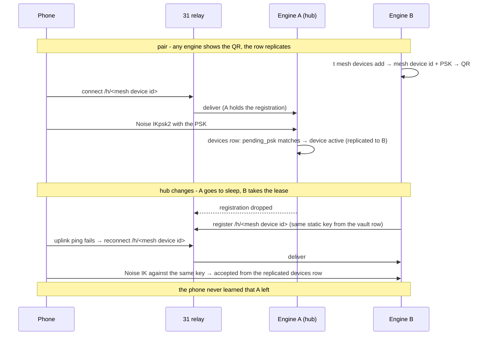

# 69 — Devices pair to the mesh

*Status: **v0.4 — BUILT** on feature/69-devices, 2026-09-25 (§8 as built; v0.3: wave 2 — documents replicate, the yrs server is a hub duty, share links name the mesh — Sky: "go all the way"; v0.2: recon corrections — second identity beside the engine's, no-redial on lease loss, pending id in the QR, per-mesh device keys are new work, failover ≈ 30 s, PSK 5 min). Follows 67 (mesh, hub lease) and 68 (sessions everywhere). Sky's rulings of 2026-09-25: serving paired devices is a **hub duty** with automatic failover, so the device registry is **replicated**; devices pair to **hubs (meshes), not engines**, so one device connects to several meshes (work, personal). Supersedes 31 §6 (per-engine `devices.yaml`) and closes 67 loose end 3.2's first half; the transport (31 relay vs iroh) is left as it is.*

## 0. Decisions

| # | Decision | Why |
|---|---|---|
| 1 | **A mesh has an identity of its own**: a second Noise static key pair (`mesh/device_key`, a vault row sealed with the mesh data key, reserved `mesh/` prefix so `{{secret:…}}` cannot expand it), created by the first engine that pairs a device with `set_if_version(expected = None)` (a race loser re-reads). **The engine's own link identity and uplink stay** — document-share URLs (`/d#1.<engine>.…`) and `nodes` dial `/h/<engine id>` | devices must reconnect to "the same thing" after a hub change; an engine key cannot do that, and the engine key has other users |
| 2 | **Serving devices is a hub duty**: the hub — and only the hub — runs a *second* uplink registering the mesh device id at the relay (`/h/<mesh device id>`) and answers device connections. Lease following is Slack's pattern (own `Follower` + reconcile with a `CancellationToken`), `Follower` moves from roster to `mesh` so `link` need not depend on roster. **On loss the mesh uplink's token is cancelled and its supervisor does not redial** — the relay's `register` replaces the previous holder, so a loser that kept redialing would steal the registration back and the two hubs would flap. `holder: None` is a loss; a lone engine is elected hub by the mesh, so it serves | Sky: "paired to device should be a hub duty and it needs to just fail over automatically" |
| 3 | **The device registry is a replicated record**: `<data_dir>/link.sqlite`, table `devices(id TEXT PK, name, platform, static_pub, paired_ms, last_seen_ms, revoked_ms, hlc)` attached to the stage‑1 record replica (single PK, nullable columns, revoke = `revoked_ms`, never delete — a delete loses to a newer column write); `last_seen_ms` written on session close only (each write is a replicated batch). Pairing: `pending(id TEXT PK, psk_sealed, name, created_ms, expires_ms, hlc)` — the PSK is **sealed with the mesh key** (the replicated file is plaintext at rest), TTL 5 min as today. `devices.yaml` is imported once as active rows and then ignored | the new hub must recognise every device the old hub knew, at once |
| 4 | **Devices pair to meshes**: the QR/string carries the *mesh* device id, relay URL, a one‑time PSK **and a pending id** (Noise psk2 is mixed in after msg1, so the hub cannot tell which of several replicated pending PSKs a device holds from msg1 alone — the device sends the pending id in `PairHello`, which tolerates unknown fields; a hint-less device falls back to "exactly one live pending row"). Any engine can show the QR (it reads the vault row and writes the pending row); the hub accepts. Format stays `1.<pub‖secret>.<name>` + a 4th part for the pending id (older apps reject > 3 parts — acceptable, they must update anyway). The app keeps a list of **meshes** (name, members, presence) | Sky: "devices should pair to hubs, so one device can connect to multiple meshes, e.g. work, personal" |
| 5 | **Local stays local**: the desktop app on a machine that runs an engine talks to that engine directly as today (`LOCAL`); it also shows the meshes it is paired to as a device. A device on the LAN of a non‑hub engine still goes via the hub | no regression for the one‑laptop user; LAN‑direct for remote devices is the iroh lift |
| 6 | **Failover is invisible to the user**: when the hub's uplink dies the relay sends the device `CLOSE 4 HARNESS_GONE` and parks its socket; the device shows "reconnecting" and re-dials `/h/<mesh device id>`; the new hub registers within a heartbeat of taking the lease (abrupt loss: ≈ 30 s for the lease itself, graceful release: seconds); the Noise handshake is against the same static key, so nothing on the device changes; open sessions resume through 68's front door on the new hub. A graceful handover closes device conns with a new reason `HUB_MOVED 5` (relay `frame.rs` + UI `CLOSE_REASON`), treated like 4 | |
| 7 | **Transport unchanged**: 31 relay + Noise IK/IKpsk2. The mesh identity is transport‑agnostic — when devices move to iroh (67 loose end 3.2) the hub binds a second iroh endpoint with the same key material | one change at a time; web clients need the relay anyway |
| 8 | **Mesh name**: a replicated `mesh_meta(key TEXT PK, value, hlc)` record in `mesh.sqlite` (`name`, default the first engine's `mesh.name`), added to the `mesh_status` reply (which today has neither mesh nor self name) and shown on the device and Settings › Mesh | a device with two meshes must tell them apart |
| 9 | **Per-mesh device keys**: the app has one device key today (`identity/device`); 69 adds `identity/<mesh id>` so a device is a different identity to each mesh | one device, several meshes, no cross-mesh linkability |

## 1. Shape

## 2. Hub duty

`link` follows the lease itself (Slack's pattern): a `mesh::lease::Follower` fed by `MeshEvent::Lease` (self id via `lookup_when::<mesh::Mesh>` — link starts before mesh and replica), and a reconcile that holds `Option<CancellationToken>` for the mesh uplink. Gain: load `mesh/device_key` from the vault, start the second uplink at `/h/<mesh device id>`, accept devices against the replicated `devices` rows. Loss: cancel the token — the supervisor does **not** redial — and close device conns with `HUB_MOVED 5`. Two hubs for a few seconds (67 §4.4) means two registrations racing at the relay; the relay keeps the latest; the loser learns it lost the lease and stops; devices reconnect once.

A lone engine is its own hub (Follower default `holding: true`), so single‑engine behaviour is unchanged: it registers, it serves.

## 3. Registry

`<data_dir>/link.sqlite` (link gains sqlx + migrations, the roster store shape): `devices` and `pending` attached via `lookup_when::<replica::Replica>` (local-only on failure). `t mesh devices list|add|revoke`, RPC `devices_list`, `device_revoke`, `device_pair_start` (returns the QR payload incl. pending id), `LinkStatus` gains `mesh: Option<{device_id, connected}>` beside the unchanged `harness_id`. `devices.yaml` is imported once as active rows and then ignored (kept on disk, unread).

Security: a device row carries only the device's static public key and metadata; the PSK is one‑time and expires; revocation replicates, so a revoked device is refused by any hub within one replication hop.

## 4. The device side

- The app stores **meshes**: `Harness` gains `kind: 'engine' | 'mesh'` and `meshName`; rows of kind `mesh` dial `/h/<mesh device id>`; `harnesses.ts` keeps its shape (add/remove/active/presence, IndexedDB `state`) and the list UI shows meshes with members + presence from `mesh_status` (which gains `mesh_meta.name` and self name). Existing engine rows keep working (document guests, old pairings).
- One device, several meshes: a per-mesh device key `identity/<mesh id>` (new — today there is one `identity/device`); switch by tapping; sessions/tasks/agents shown are the active mesh's.
- Local engine on this machine: still the `LOCAL` entry; the same app can be local for one mesh and a device of another.

## 5. Wave 2 — documents go all the way (ruling 2026-09-25)

Documents (`<data_dir>/documents/`: `index.sqlite` + one directory per document) are the one store neither 67 nor 68 replicated, which is why a share link had to name the holding engine. Sky's ruling: replicate them, make the live-editing (yrs) server a hub responsibility, and let share links name the mesh.

| # | Decision | Why |
|---|---|---|
| 10 | **Document files replicate** to every engine (per-document directories via `replica::files::mirror_at`, the index tables via `replica::attach` with `hlc`) | a document must exist wherever the hub is |
| 11 | **The yrs server is a hub duty**: the hub holds the live `Doc` for any open document and serves editors (desktop, TUI, guests); a non-hub engine's editor session is forwarded to the hub the way 68 forwards desk steers; agent tool edits (`doc_insert/replace/delete`) go through the same path | one live Doc per document, no cross-engine CRDT reconciliation of half-applied sessions; handover = the new hub loads the replicated files and editors reconnect |
| 12 | **Share links name the mesh**: `/d#1.<mesh device id>.<doc>.<secret>`; the hub serves guests; old engine-id links keep working while the engine identity exists | links survive the hub changing |
| 13 | **Afterwards the engine link identity has no external user** except `nodes` (already absorbed by the mesh) → retire it in a follow-up (not yet ruled) | one identity per mesh |

Details (layout, what is file vs row, whether the yrs update log ships as a per-document single-writer log or yrs merges make fan-out safe) follow the document-crate recon — `69-recon-docs.md` — and are fixed in the wave-2 contract.

## 6. Build

Contract: `link.sqlite` + `devices`/`pending` tables + replica attach, `mesh/device_key` vault row and the reserved prefix, `Follower` moved to `mesh`, `mesh_meta` + `mesh_status` fields, `HUB_MOVED 5`, RPC/CLI stubs, `LinkStatus.mesh`, QR 4th part + `PairHello.pending` — 1 omp. Then in parallel: **K** link crate (mesh identity registration, replicated registry, pairing flow, HubMoved) ; **D** device app (meshes list, pairing UI, failover UX, member presence); **Z** smoke: two engines + a real phone or the desktop in web mode — pair via engine B's QR, connect through hub A, kill A, watch the device land on B with an open session intact.

Wave 2 (after the recon): contract **C2** (document index attach + mirror wiring + yrs-server hub gate + share URL form), then **M** documents replicate, **Y** yrs on the hub + guest serving + forwarding, **Z2** smoke: edit on A, read on B, kill A, guest link still opens on B, editor reconnects.

## 7. Out of scope

Devices over iroh (67 loose end 3.2, unchanged); per‑device permissions beyond pair/revoke; multi‑user meshes; retiring the engine link identity (candidate follow-up).
## 8. As built (v0.4, 2026-09-25 evening)

Nine workers + two merge omps + one twelve-invariant smoke on this Mac (three engines, local relay, web-mode device harness). Workspace: 1695 passed, 2 pre-existing PTY/zsh failures. Per-worker reports: `69-as-built-{C,K,D,C2,M,Y,E1,E2,P,Z}.md`; smoke recipe and evidence: `69-smoke.md`; contracts: `69-contract.md`, `69-contract-docs.md`.

| # | Invariant | Evidence |
|---|---|---|
| 1 | lone engine registers engine id + mesh id | both registrations at the relay; `link_status.mesh.connected` |
| 2 | pairing on a non-hub lands on the hub | pending row replicated < 1 s; device served by A; `devices_list` equal on A and B |
| 3 | device session round trip | reply received, session owned by A |
| 4 | hub SIGKILL survived | device back on B against the same key in **31.1 s** (QUIC detection 31.1 s + 18 ms handshake) |
| 5 | no relay flap | A restart: 0 registrations while B holds; B release → A registered +42 ms |
| 6 | revocation global | revoke on the non-hub → `CLOSE 3` on the hub at the next handshake, 2 s |
| 7 | documents on the hub survive it | B's copy 2.9 s; share URL carries the mesh id; guest re-joined on B in 2.35 s, identical markdown, 0 re-snapshots |
| 8 | off-hub editing forwards | non-hub `doc_open` 7.5 ms over `theuth/docs/1`; hub device sees the update in 40 ms |
| 9 | documents migration | copy of Sky's store: 36 moves / 0 merges, `hlc` stamped, all knowledge docs open, idempotent |
| 10 | no replication storms | 306 s idle: 0 batches, 0 mirror rows; one edit: hub 4 / non-hubs 1 batch, 0 re-snapshots; pairing 1 batch per writer; knowledge sync one way, md sha stable |
| 11 | peers follow the owner | cross-engine `await_reply` answered in 3.3 s; dead owner → `failed{OwnerUnreachable}` in 32.3 s |
| 12 | lone engine byte-identical to main | identical except `doc_list[].bytes` lagging until the 2 s quiet snapshot (C2 contract) |

Deviations accepted at merge (details in the per-worker reports): mesh identity is a *second* link identity, minted only by a pairing and loaded by every hub (the smoke caught K's eager mint — two identities per mesh); `Follower` lives in `mesh::lease`; `secrets::mesh_device_key` returns raw bytes (crate cycle); the mesh uplink is gated on `link.enabled`; `Uplink {Engine, Mesh}` enum carries K's consume-on-take pending semantics; revoked static → `CLOSE 3`, unknown static → guest; `docs` row touched at snapshot/export only; receivers adopt the hub's snapshot bytes verbatim when they add nothing (`store::exceeds` on state vector + delete set); `Msg` gained Hello/SetName/Edit tags; `NotHub{hub: Option<EngineId>}`; agent tool edits off the hub forward as `Msg::Edit`; `peer_deliver` over `theuth/rpc/1`, receipts engine-local, both engines' communication policy must allow; counters `MeshStatus.traffic/.replica`, `doc_stats`.

Echo audit (all seven replication paths): no unbounded loop; six risks fixed — hub no-op merge, receiver re-snapshot amplification, `availability_touch` idle writes every 10 s (67), foreign outbox never pruned (67), files-mirror scan/apply race that reverted remote writes for schedules/skills/mcp (67), plus the storm sampler's "never warned" bug found on verification. Knowledge LWW by relay time (sync.rs) is recorded, not fixed.

Smoke fixes (Z, ten commits): eager mesh-identity mint; vault rows never announced; replica upsert applied a column subset to NOT NULL tables; no snapshot path for a peer behind the pruned outbox; mesh rows written before the attach; lease split on paused gossip; self-election on restart (relay flap); eager mesh uplink at boot; paired set not refreshed when the replica delivered the row first; first reconcile waited for the wrong signal.

Found, not fixed: youngest-wins on `mesh_meta.name`; N−1 `docs`-row touches per edit; pkarr log noise; `ScheduleInfo.next` stale on a non-hub (S1); knowledge LWW by relay time; the per-engine link identity's only external user is now `nodes` — retiring it is the natural follow-up; devices over iroh (67 loose end 3.2) unchanged. Fixed after merge: the share-link `secret_hash` that sat in plaintext `meta.json` on every engine is now sealed with the mesh key (`secret_hash_sealed`, SEAL — `69-contract-docs.md` §3.2, `69-as-built-SEAL.md`).
