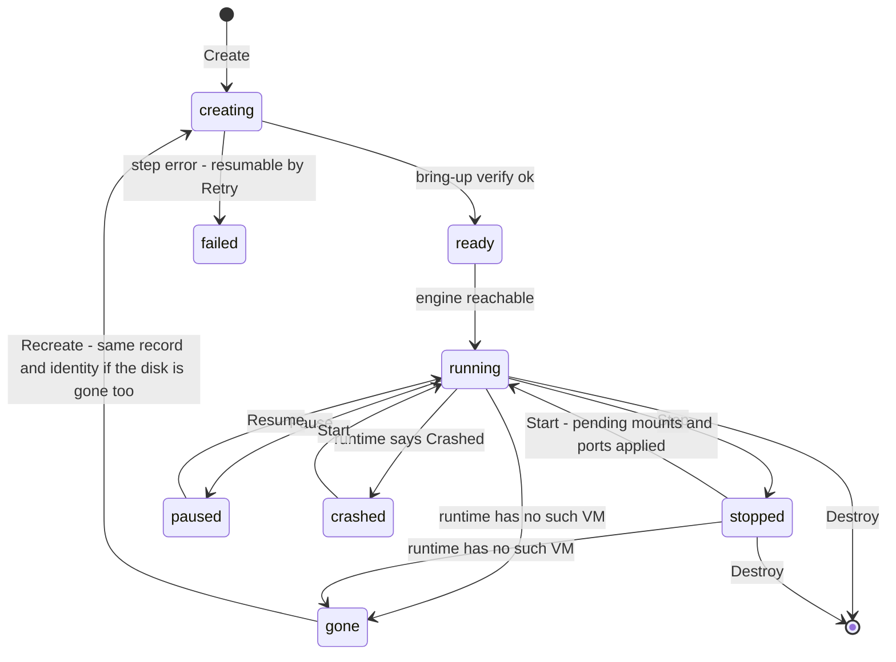
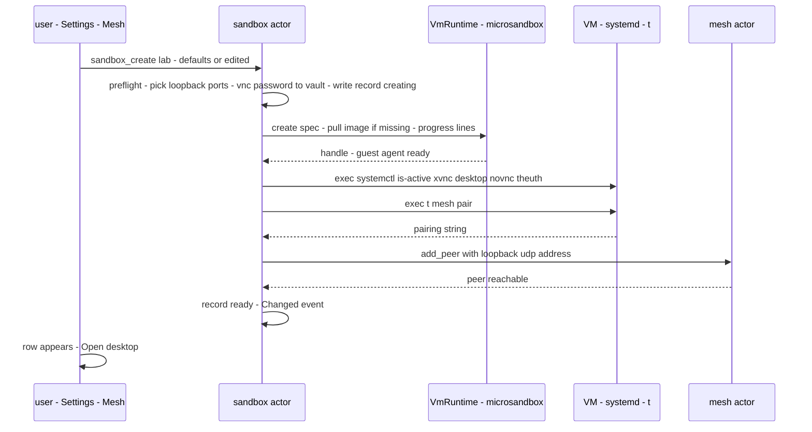
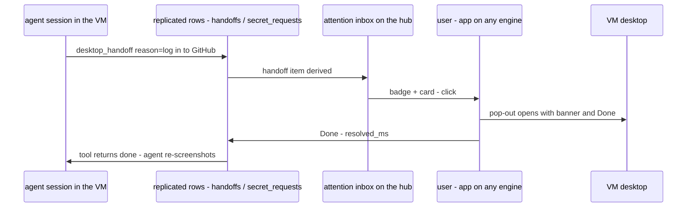

# 79 — Sandbox VMs: a full Linux desktop microVM as an engine in the mesh

Status: design v0.3 · 2026-09-29 (v0.3: Sky — observe/take over the desktop from the session, pin an agent to a VM, login hand‑off with an attention item and a secure vault paste that skips the desktop — decisions 13–15, §6.5–6.6, §12.13–15; v0.2: no designing around the corporate proxy — the loopback host↔VM path is an optimisation over the relay, decision 10) · nothing built. Extends `67-agents.md` (§4 mesh, §8 placement, §13 bring-up — this doc adds the third bring-up backend and amends decision 18), `68-sessions.md` (a VM is an engine; sessions inside it replicate like any other), `69-devices.md` (the app reaches a VM's host engine as it reaches any engine), `63-one-engine.md`, `27-computer.md` (the first `computer_*` deployment on Linux X11 in anger), `37-secrets.md` §7 as amended by 67 §5.4 (the vault replicates), `25-desktop.md` (one Settings page gains a section and one pop-out route). Closes 64 §4's "Not in v1" seam *a display in the Docker computer* by a different route; 64 is withdrawn (67 §19) and only its recon facts are cited. Where this doc disagrees with 67 §13 or with `crates/sandbox` as built, this doc wins; §13 lists the sentences. Calls marked **[orch]** were made by the orchestrator, not ruled on by Sky, and are open to correction.

**Scope.** One click in the desktop app — or one sentence to the agent — produces a hardware‑isolated Linux virtual machine on this computer with a real desktop (Debian 13 + XFCE, streamed over VNC), sized by the user, with chosen host directories shared into it, joined to the mesh as an ordinary engine so the vault, MCP servers, skills, schedules, knowledge and sessions arrive by replication and `spawn_subagent{agent:"<vm>"}` opens work inside it. The runtime is microsandbox (libkrun microVMs: KVM on Linux, Hypervisor.framework on Apple Silicon) driven through its Rust SDK. The VM runtime is abstracted behind a trait of its own, separate from "make an engine", so the same machinery can later run throwaway sandboxes with no engine in them.

**Not in v1 (and the seams left for them).** GPU, Wayland, audio (microsandbox exposes virtio console/net/fs/blk/rng only; GPU is upstream issue #291); Windows and macOS *guests* (libkrun boots Linux); Windows *hosts* (the SDK's Windows support is a preview — the `VmRuntime` trait does not care, the preflight refuses with the reason); Intel Macs (libkrun's HVF backend is aarch64‑only — refused with the reason); hosts without `/dev/kvm` (build‑A is an LXC — same refusal); cloud microsandbox (no published ports there — the `VmRuntime` trait is where an `msb-cloud` impl would go); watching a VM's desktop from an app attached to a *different* engine (v1 opens the desktop from the VM's host engine; the seam is a `theuth/vnc/1` iroh stream forwarded by the attached engine, §6.4); a per‑VM vault allowlist (67 replicates the whole vault; a VM is a trusted member of the user's mesh, §9 — an allowlist is mesh work, not VM work); throwaway "plain" sandboxes with no engine inside (`VmRuntime` supports `ephemeral`, `idle_timeout`, `max_duration`; the first later use is a `sandbox_run` tool, §12 item 6); several desktops or per‑agent display leases in one VM (Grok Bot's pattern — one VM, one display, one trust domain); VM‑to‑VM networking (upstream #1331); snapshots that carry published ports and mounts (upstream restore does not — theuth re‑applies them from its record, §5.6).

## 0. Decisions in one screen

1. **A sandbox VM is an engine, and nothing else is new about it.** It runs `t --headless` as a systemd service, pairs with `t mesh add` like an SSH or Docker engine (67 §13), replicates the small records and the vault (67 §5, decision 6), mirrors sessions (68), is reached by `spawn_subagent{agent:"<name>"}` through the existing `RegisterNode` + `MeshDialer` path (`crates/rpc/src/acp.rs:166-269`), and shows in `mesh_peers` as `class=vm`. Rejected: 64's *computer* record with a mirror session (withdrawn in 67 §19 — a proxy under another name); an exec‑only VM with no theuth inside driven by proxied tools (32 §0.3 stands: it would teach every tool about remote paths and lose replication, secrets and sessions); a VM that is a *device* (it has no screen of its own to attach with).
2. **microsandbox through its Rust SDK, in‑process, behind a `VmRuntime` trait that knows nothing about engines.** `crates/sandbox` gains `vm/` with `trait VmRuntime` (create/start/stop/pause/destroy/exec/put/mounts/ports/resize/snapshot/restore/metrics/logs/status, §4.1) and one impl, `Microsandbox`, over the `microsandbox` crate (v0.7.4, Apache‑2.0, `--no-default-features --features local,net`, pinned `=`). A second, thin `VmBackend: Sandbox` adapts a runtime handle to the bring‑up trait that already exists (`crates/sandbox/src/lib.rs:176-202`), so bring‑up stays the seven steps it is today plus one (`config`, §5.3). The SDK spawns each VM as a detached child process (`msb machine`) — there is no daemon, no port, no API key — so an engine restart or self‑update (39) does not take the VMs down. Rejected: shelling out to `msb` (stringly output, no typed errors, no progress or metrics streams, a second copy of every argument list); a runtime downloaded at first use (the v0.3 choice, built as `setup::install_runtime` from GitHub with an **Install runtime** button; **Sky, 2026‑09‑30: embed** — `t` is self‑contained: the crate's `embed-binaries` feature `include_bytes!`s the `msb` + `libkrunfw` pair for the build target, +51 MiB on the release binary (F6 measured: the 28.5 MB archive twice — theuth's explicit set‑up and the SDK's own spawn‑time `ensure_runtime`; `codegen-units = 1` for the crate keeps it from being four), extracted into the SDK home on first use in 0.3 s; the install step is gone, §5.1. The archive comes from `download-binaries` in the SDK's `build.rs` — one fetch per target profile, cached in `target/`, `MSB_EMBED_RUNTIME_BUNDLE_PATH` for offline builds); Docker + Xvfb + VNC (64's seam — a container is not a kernel boundary, Docker Desktop hangs on Sky's Mac (`facts/namgq1y4930l0-docker-desktop-daemon-hang`), and the desktop stack would be ours to supervise); Apple Virtualization.framework / vfkit / Lima / UTM / QEMU directly (macOS‑only or a hypervisor to package; microsandbox is one API on macOS and Linux with a Windows preview, and ships the kernel); Firecracker (Linux only).
3. **One published image on Debian 13 (trixie) over our own systemd base, systemd inside, `t` self‑updates; the first‑boot install script on that base is the fallback.** `deploy/vm/Dockerfile` has three stages. `base` = `debian:trixie-slim` + `systemd systemd-sysv dbus ca-certificates`, `CMD ["/lib/systemd/systemd"]`, `serial-getty@hvc0`, `getty@tty1` and `systemd-modules-load` masked (the libkrun kernel has no console login to offer and no loadable modules; without the masks `is-system-running` sits in `starting` for minutes or ends `degraded`) — published on its own as `ghcr.io/basedatum/theuth-vm-base:<tag>` (`just vm-image-base`). `desktop` = XFCE, TigerVNC (`tigervnc-tools` for `vncpasswd`), noVNC + websockify, dbus, fonts, Firefox ESR, `curl git python3 ripgrep tar zstd minisign xdg-utils`, `libgbm1 libpipewire-0.3-0t64` (what `t` links), Node LTS and `uv` (stdio MCP servers), user `engine` (uid 1000), and four units — `xvnc`, `desktop`, `novnc`, `theuth` (`Restart=always`, `Environment=DISPLAY=:1`); `LABEL io.theuth.vm.schema=2`. The final stage adds a minisign‑verified `t` from the release → `ghcr.io/basedatum/theuth-vm:<version>` (amd64 + arm64). microsandbox boots it with `init: auto` (systemd is PID 1, dbus and `systemctl` work). The root disk holds everything, including `/data`; `t` inside updates itself like every engine (39; nodes already work this way, 64 §4.4 "its `t` is the node's own updater's business"), so the image version matters only at creation. Why trixie: glibc **2.41** — the released Linux `t` needs ≥ 2.39 and Debian 12's 2.36 cannot load it (the smoke ran a specially bookworm‑built `t`); a `t` built on trixie or bookworm runs unchanged. `image: bootstrap` keeps the recipe alive without a desktop image — the `base` image plus `deploy/vm/bootstrap.sh` at first boot (minutes) — for a registry that is unreachable and for developers; `init: auto` needs systemd in the image, which is why the bootstrap base is ours and not stock `debian:trixie`. Rejected: `ghcr.io/superradcompany/debian-systemd:12` (glibc 2.36 cannot run the released `t`; a third party's weekly rebuild under our boot path; it also ships the unmasked getty that S1 #8 found); Ubuntu (Sky: "I don't want Ubuntu bloat"); Debian 14 forky (testing — a moving ABI is no base for a shipped image; revisit at its freeze); apt on first boot as the *primary* path (the official LXQt example: ~183 MB download, ~734 MB of guest disk, "a few minutes" — and a different result on every mirror day); a shell‑script entrypoint keeping the VM alive (the official example — `websockify` in the foreground; a crashed or self‑updated `t` has no supervisor and a dead entrypoint stops the VM); a named or owned data volume for `/data` (SQLite on virtio‑fs, one more part to reconcile on update, and the mesh already replicates everything worth keeping except the engine's identity — which a snapshot keeps too); a `Dockerfile` we do not publish (microsandbox has no `msb build`; images come from Docker or a registry).
4. **The desktop is X11 on `Xtigervnc :1`, streamed by the guest's `websockify` on guest 6080, published to a per‑VM ephemeral port on host `127.0.0.1`, rendered by noVNC *inside the app*.** The desktop app bundles `@novnc/novnc` (MPL‑2.0) and draws the RFB session on a canvas in a pop‑out window (`open_window("popout-vm-<name>", "/vm/<name>")` — app routes only, exactly what pop‑outs allow, `crates/desktop/src/commands.rs:12-48`) over `ws://127.0.0.1:<port>/websockify`, which the CSP already permits (`connect-src … ws://127.0.0.1:*`, `tauri.conf.json:47-52`). VNC auth is on: an 8‑character random password per VM, set with `vncpasswd` in the guest at create, kept in the vault as `sandbox/<name>/vnc` (a reserved prefix like `mesh/`, never expandable by the 37 placeholder), handed to the app by RPC. The window's size drives the guest's geometry (noVNC `resizeSession` → RFB `SetDesktopSize` → TigerVNC RandR), so "resize the desktop" is dragging the window. Rejected: an `<iframe>` on `http://127.0.0.1:<port>/vnc.html` (the CSP's `frame-src` excludes http and should keep excluding it; noVNC in the app is one npm package and no CSP change); publishing raw 5901 (RFB has no browser client; websockify is the official stack); `-SecurityTypes None` as in the official example (loopback only, but any local process could then watch and drive a desktop that holds the user's logins — one `vncpasswd` line closes it); a host‑side RFB client behind `computer_*` (a second display backend and a network hop per click — see 5).
5. **Sessions run *inside* the VM; `computer_*` there drives `DISPLAY=:1` through the code that exists.** 67 decision 4: work happens where the task says, as an ordinary child. `crates/computer` has no Linux‑specific code — xcap (xcb) and enigo (x11rb) read `DISPLAY` from the process environment (`crates/computer/src/screen.rs:1-5`, `input.rs:1-2`; 58 decision 11) — so the `theuth.service` unit's `Environment=DISPLAY=:1` is the whole integration, and the human sees the same screen through decision 4 to watch or take over. `mesh/stats.rs:79-87` reads the same variable, so the VM advertises `display: true` and placement sends display‑needing tasks to it (`crates/tasks/src/place.rs:147-154`). Rejected: a VNC client backend for `computer_*` on the host (5 lines of env beat 500 lines of RFB); proxying screenshots through the host engine.
6. **Resources are the user's to set, with defaults derived from the host, and CPU/memory change live.** Defaults: `cpus = clamp(host_cores / 4, 2, 4)`, `memory = clamp(host_mem / 4, 2 GiB, 8 GiB)`, `root_disk = 20 GiB` (sparse, grows on use), shown as sliders with the host's limits before the first click. microsandbox resizes CPU and memory live only *within boot‑time ceilings* (`max_cpus`, `max_memory`; the guest onlines CPUs and plugs memory via virtio‑mem), so every VM boots with ceilings of `host_cores` and `host_mem / 2` **[orch]** and `sandbox_resize` is instant within them; the root disk grows live (grow‑only); raising a ceiling is a restart the UI and the tool say out loud (`restart_required: true`). Rejected: ceilings equal to the size (the SDK default — "leaves no live growth headroom"); ballooning down below what the guest needs (the tool refuses a memory value under what the guest's `memory_bytes` metric shows in use plus 512 MiB); fixed defaults (4/4G/10G from the brief) that ignore an 8‑core laptop or a 128 GB workstation.
7. **Shared directories are microsandbox bind mounts (virtio‑fs), chosen per directory, applied at (re)start.** `shares: [{ host, guest, readonly }]` in the record; default guest path `/shared/<basename>`; default `readonly: false`; guest sees sandbox‑local ownership (stat virtualization, `host_permissions: private`) so nothing on the host is chowned. Mounts cannot change on a running VM (absent from `modify`), so a share edit is recorded as `pending` and applied by the next start; the UI offers "Restart now" and the tool returns `restart_required`. Shares are advertised: bring‑up sets the VM's `mesh.workspaces` to the guest mount points, so shared repos appear in `EngineStats.repos` and placement (67 §8) can choose the VM for them. No directory is shared by default. Rejected: sharing `~` or `~/Develop` implicitly (the point of the VM is that what it sees is chosen); sshfs/NFS/rsync mirrors (a second sync system; virtio‑fs is what the runtime provides); the SDK's named volumes for user data (they live under `~/.microsandbox/volumes`, not where the user's files are).
8. **Secrets: the vault replicates on pairing — the existing path, unchanged — and a VM is a trusted member of the mesh.** The pairing string carries the mesh data key (`crates/mesh/src/net.rs:522-559`); the joining engine adopts it (`net.rs:602-615`) and every vault row follows (`crates/secrets/src/store.rs:17`). Sky's ruling stands: "secrets sync across nodes, but not agents". The VM's `secrets.key_store: file` (no keychain in a guest). The SDK's own `keyring` and host‑held‑secrets features are not enabled — theuth has one vault. What this doc adds: the reserved `sandbox/` prefix (VNC passwords, later per‑VM material) and the statement in §9 that isolation protects the *host* from what the agent runs, not the *mesh* from the VM. Rejected: a per‑VM allowlist (64's bundle allowlist — not built, and it belongs to 67's replication, not here); pushing secrets by `set_secret` over a control connection (the node control conn has four methods and none of them, `crates/nodes/src/client.rs:15-17`; replication made it unnecessary).
9. **VMs are never the hub by default, and the mesh learns the word `vm`.** Bring‑up writes `mesh.hub: never` into the VM's config; `EngineClass` gains `Vm`, ranked with `Laptop` in the lease (`crates/mesh/src/lease.rs:93-99`), and `mesh.class:` becomes a declarable override (today class is only detected, `crates/mesh/src/stats.rs:40-52`; a VM with `DISPLAY` set and no battery would otherwise detect as `Desktop`, outrank the laptop it runs on after probation, and take Slack, schedules and every desk with it). Rejected: hub‑eligible VMs (a VM cannot be more available than its host, and hub duties on it double every failover); detecting `vm` from DMI or `/.msb` (fragile across libkrun versions; the engine that created the VM knows what it made — it says so in the config).
10. **The network is `public,host`; host↔VM traffic takes a loopback shortcut when it can.** microsandbox denies private networks, loopback, link‑local and the host by default; `public` lets the VM reach the iroh relay and the internet, so pairing and every mesh path work out of the box exactly as for any engine; `host` (`host.microsandbox.internal`) lets an agent in the VM use services the user runs on the host — a local model server, a dev server. Two processes on one machine should not round‑trip through a public relay, so the VM's iroh endpoint also binds a fixed UDP port (`mesh.bind`, which exists) published to `127.0.0.1:<p>`, and bring‑up hands the mesh that loopback address as an extra peer address (§6.3): iroh prefers a direct address that answers and falls back to the relay when it does not — an optimisation, not a dependency. `network: public,host,private` is a per‑VM choice for a VM that must reach a NAS or LAN service, shown as such. Rejected: `all` by default (isolation from the user's LAN is part of what a sandbox is for); `public` only (no host services); making the loopback path load‑bearing (a published‑UDP quirk would then block pairing; as designed it costs one round‑trip through the relay).
11. **The agent drives all of it through `sandbox_*` tools; the app drives it through RPC; both go through one actor and one record.** `sandbox_create` (Mutating; waits up to `create_timeout_secs` while streaming progress into its card), `sandbox_list` (ReadOnly), `sandbox_start/stop` (Mutating), `sandbox_resize` (Mutating), `sandbox_share/unshare` (Mutating — it exposes host files), `sandbox_snapshot` (Mutating), `sandbox_restore` (Destructive — discards the current disk), `sandbox_destroy` (Destructive), `sandbox_desktop` (ReadOnly — opens the pop‑out on the user's app), plus a one‑paragraph prompt block. "Make me a Linux desktop with my `~/Develop` shared" is one approved tool call and a few minutes. Rejected: a Python‑runtime‑only surface (the desktop needs RPC anyway; tools are the model's RPC); a job id from `sandbox_create` (the `Jobs` actor owns processes, not tasks — the tool waits and streams like `scrape`, and returns `state: creating` on timeout so `sandbox_list` can follow).
12. **Bring‑up moves into the engine.** Today it runs inside the CLI process and joins through the engine's `mesh_add` (`crates/theuth/src/main.rs:423-475`); the app and the tools need it in the actor: `Create` spawns a task per VM, publishes `SandboxEvent::Progress`, joins through the in‑process mesh actor, and records every step on the row so a crash resumes and the UI shows where it is (the "ponytail" note at `crates/sandbox/src/lib.rs:292-293` anticipated exactly this). `t mesh add --vm` becomes an RPC client of the same path. Rejected: a second bring‑up for the UI.
13. **The human can watch, take over and hand back — from wherever the agent's session is shown.** The pop‑out (decision 4) is the live framebuffer, opened from the VM row *and* from a **Desktop** button on any session whose owner engine is a VM (68's `sessions.owner` → `sandboxes_list`), view‑only while an agent turn is running on that engine; **Take over** flips noVNC to input and steers every session with a running turn on that engine ("the user has the desktop; stop `computer_*` until told otherwise"), **Hand back** steers the reverse (§6.5). Rejected: silent shared control (two hands on one mouse); a second screenshot stream into chat (the `computer_screenshot` cards already show what the agent saw).
14. **An agent may be pinned to a VM: `runs_in:` on the agent file, a placement *constraint*.** `runs_in: vm` — the agent's own VM `vm-<agent>`, created from `sandbox.vm.defaults` on first need; `runs_in: vm:<name>` — a named (shared) VM. `tasks::place` and the desk's `spawn_subagent` then keep every work session of that agent on that engine; a stopped VM is started, an unreachable one blocks the task on it rather than falling back to the laptop. The desk stays a hub duty (67 §4.4): it is the small orchestrator; its work is in children, and those are what the pin is about **[orch — Sky may want the desk in the VM too, §12.13]**. Amends 67 decision 1 ("no `computer:` key"): a *constraint theuth places within*, not a machine theuth obeys (§13). Rejected: 64's `computer:` as identity (the agent record stays machine‑free otherwise; a pinned agent is still hired, budgeted and reviewed like any other); a per‑task `where:` typed by hand each time (the point is *always*).
15. **Logging in never puts a password in chat; two paths, both from primitives that exist.** (a) **Hand‑off**: `desktop_handoff { reason, url? }` writes a replicated `handoffs` row; the HUD's attention inbox (`crates/roster/src/attention.rs`, kinds approval/decision/blocked/review/hire/budget/unreachable) derives a `handoff` item; the click opens the VM's desktop with a banner and **Done**; the tool returns `done | cancelled` and the agent re‑screenshots — Grok Bot's takeover for "passwords, passkeys, MFA, CAPTCHA, payments, identity checks". (b) **Secure paste**: `secret_request` (masked field, the model never sees the value — 37) then `computer_type { text: "{{secret:…}}" }` — the placeholder raises the call to Ask (`CONSUMES_SECRETS` is `true` by default, `crates/tools/src/lib.rs:325`), the user approves the paste seeing the placeholder and the last screenshot, the vault expands it *inside the VM's engine* after approval and redacts the output — Grok Bot's "the model receives only an acknowledgement that the value went directly to its destination", plus the value is kept, versioned, for the next login. What this doc adds: `secret_request_form` (several masked fields on one card — username, password, TOTP), and **pending secret requests and hand‑offs as replicated rows** so the card reaches the user on whatever engine their app is attached to (today `SecretsEvent::Requested` is engine‑local — 67 loose end, closed here for both). Rejected: an OpenUI login form whose inputs return through `@ToAssistant` (the value would enter the transcript — the vault card is the form; an OpenUI `Input(type="secret")` bound to the vault is the later generalisation, §12.14); the agent reading the password from a file or env (same problem, worse audit).

## 1. Why

Three wants, one machine. (1) **Isolation with a screen.** Agents that click, type and browse need a display, and today the only display is the user's own Mac — every `computer_*` call fights the user for the mouse and runs with the user's logins. A Docker engine (67 §13) has no display and no kernel boundary. (2) **A Linux box without owning one.** build‑A exists because Linux builds and Linux‑only tools need Linux; not every user has a build‑A, and an LXC on someone else's host is not a click away. (3) **Somewhere for the dangerous parts.** "Install this, run that, see what it does" belongs in a machine whose loss costs a snapshot restore, not a laptop rebuild. microsandbox gives all three on the laptop itself: a real kernel per VM, boots in about a second once the image is local, no root to install, one API on macOS and Linux, and — since v0.7 — live resize, snapshots that clone, bind mounts and metrics. The mesh gives the rest for free: once the VM is an engine it has the vault, MCP, skills, schedules, knowledge and sessions, and every frontend already knows how to open a session there.

Why now: 67 stage 1 built `crates/sandbox` with the two backends Sky ordered first ("SSH installer first, container second"); the VM is the third, and the first with a display, resources and mounts — the axes 64 §4 designed (`Capabilities.screen`, `cpus`, `memory_mb`) and stage 1 left out.

## 2. Facts relied on (recon 2026-09-29; `path:line` in this repo at main, microsandbox docs and repo at v0.7.4 / c677090)

**theuth**
- `crates/sandbox` exists with `Sandbox` (`kind, create, exec, put, durable_roots, daemon, capabilities, destroy`; `src/lib.rs:176-202`), `Handle { id }` (`:76-82`), `Cmd { line, stdin, timeout }` (`:84-111`), `Capabilities { os, arch, durable_roots, daemon }` (`:160-171`), `Target::{Ssh, Docker}` (`:248-272`), `SANDBOX_ACTOR = "sandbox"` with `MakeEngine(Target) → Result<mesh::Peer>` and `Engines → Vec<Computer>` (`:36-37, 274-325`), `make_engine()` (`:351-412`); no config is read (`:414-428`); no RPC method, tool or UI mentions it (grep `sandbox` in `crates/rpc`, `ui/src` → nothing). Record `Computer { name, backend, handle, engine, created_ms }` at `<data_dir>/computers/<name>.yaml` (`src/record.rs:1-24`).
- Bring‑up: `MeshJoin { add_peer, status }` (`src/bringup.rs:14-22`), `Spec { name, local_t, pair_tries: 6, verify_tries: 3, verify_every: 10 s }` (`:24-50`), steps create → detect (Windows refused, `:87-91`) → binary → first_run (`t --secret-list`, `:118-123`) → daemon (`t --install-service --no-pair --name`, `:127-144`) → pair (`t mesh pair` then `MeshJoin::add_peer`, `:146-163`) → verify (`:165-181`). `STEP_TIMEOUT` 600 s is a constant (`src/lib.rs:42-43`). Progress is a closure to stdout or tracing (`:45-74`).
- Docker backend: bollard, `theuth-engine-<name>`, two named volumes, no ports, no CPU/memory limits, no host mounts (`src/docker.rs:260-313`); image `deploy/computer/Dockerfile:1-42` (Ubuntu 24.04, minisign‑verified `t`, user `engine` uid 1000, "no display, no published ports").
- CLI: `t mesh add --ssh … | --docker …` → `sandbox::make_engine` (`crates/theuth/src/main.rs:176-215, 310-338`), bring‑up in the CLI process joining through RPC (`:423-475`).
- Mesh: identity `<data_dir>/mesh/identity` (`crates/mesh/src/identity.rs:22-41`); pairing string `1.<base32 json {id, name, relay, addrs, token, vault_key?}>` (`src/pairing.rs:21-39, 76-92`) built by `pairing_string()` with `secrets::GetMeshKey` (`src/net.rs:522-559`); the joiner adopts the key (`:602-615`). `Peer { id, name, addrs, reachable, last_seen_ms, hub_pref }` (`src/types.rs:87-106`); `EngineStats { id, uptime_since_ms, class, availability_30d, harnesses, repos, display, gpu }` (`:108-129`); `EngineClass { Server, Desktop, Laptop, Container }` (`:72-85`); class detection `src/stats.rs:40-77`, display = `DISPLAY`/`WAYLAND_DISPLAY` set (`:79-87`), repos = git roots under `mesh.workspaces` (`:115-130`); no config key declares a class (`src/config.rs:9-46`). Lease rank: prefer → availability bucket → class `Server = Container > Desktop > Laptop` → uptime → id (`src/lease.rs:79-119`); `Never` filtered (`:133-136`). `mesh.hub` written by `SetHubPref` (`src/lib.rs:567-585`). Config keys and defaults `src/config.rs:48-66` (`bind: None` exists). `MeshEvent` is not on the RPC bridge (`crates/rpc/src/bridge.rs:92-124`).
- Remote children: `parse_agent` splits on the last `@` (`crates/agent/src/peers.rs:120-132`); every mesh peer is a node via `serve_mesh` → `RegisterNode { name, describe, dialer: MeshDialer }` (`crates/rpc/src/acp.rs:166-269`), name collisions get an id suffix (`:271-285`); `RegisterNode` replaces same‑name entries (`crates/agent/src/supervisor.rs:6629-6637`). Placement keeps only `stats.display` engines for display words (`crates/tasks/src/place.rs:75-76, 147-154`).
- Secrets: rows sealed under the mesh key (`crates/secrets/src/vault.rs:1-11`); `vault`, `vault_current` replicate (`src/store.rs:17`, `src/lib.rs:566`); `KeyStore { Auto, Keychain, File }` (`src/vault.rs:51-62`); the placeholder regex and the reserved `mesh/` prefix (`src/vault.rs:39-40, 116-119`); placeholders resolve on the executing engine (`37-secrets.md:623-625`, 67 §5.4); `SecretsEvent::Requested` is local to an engine (`src/lib.rs:159-192`) and not relayed (`crates/sessionsync/src/events.rs:8-13`).
- Computer: capture by xcap, input by enigo (`crates/computer/src/screen.rs:1-5, 155-212`, `src/input.rs:1-2, 153`); no Linux‑specific code and no `DISPLAY` read in the crate; xcap 0.9.8 → xcb, enigo 0.6.1 → x11rb (`Cargo.lock:24262-24290, 5087-5105`). No VNC/RFB anywhere (grep → nothing).
- Desktop: Settings tabs `SettingsDialog.tsx:43-59` (no Nodes/Devices/Sandbox); Settings › Mesh shows this node, peers with remove, "Add a node" QR/paste and the SSH path (`settings/Mesh.tsx:61-263`); `useAction` (`settings/shared.tsx:105-122`); pop‑outs `open_window(label, url)` app routes, label `popout-*` (`crates/desktop/src/commands.rs:12-48`); no child webviews; iframes only for artifacts (`Viewer.tsx:269-273, 336`); CSP `frame-src 'self' asset: http://asset.localhost blob:`, `connect-src … ws://127.0.0.1:* ws://localhost:* wss: ws:` (`crates/desktop/tauri.conf.json:47-52`); `tauri-plugin-dialog` registered with `dialog:allow-open` (`crates/desktop/src/lib.rs:244`, `capabilities/default.json:42-43`), `directory: true` unused; the step‑log precedent is the launch transcript (`components/launch/StartupScreen.tsx:93-129`); tool progress joined by `call_id` (`crates/web/src/progress.rs:18-54`, `store/reduce.ts:637`). RPC recipe: `trait Api` (`crates/rpc/src/api.rs:147-151`), `forward!` + subscribe (`bridge.rs:92-124, 141-171`), `export.rs` → `bindings/`, `just ts` / `just ts-desktop` (`justfile:67-75`), hand‑written `ui/src/rpc/api.ts` checked against `methods.json`.
- Tools: `Risk { ReadOnly, Mutating, Destructive }` (`crates/tools/src/lib.rs:95-107`); `Tool` constants incl. `CONSUMES_SECRETS` (`:299-332`); `ToolCx { session, call_id, quiet, resources }` (`src/registry.rs:1551-1556`).
- Conventions: `THEUTH_<SECTION>__<KEY>` (`crates/theuth/src/main.rs:477-478, 863`); `DEFAULT_CONFIG` has `nodes:` and a commented `mesh:` (`:590-608`); README has no `mesh:` block; 00 §10 omits mesh, replica, sessionsync, roster, tasks, sandbox (doc debt, §13).

**microsandbox** (D = docs.microsandbox.dev, G = github superradcompany/microsandbox @ c677090)
- Rust SDK: crate `microsandbox` 0.7.4 (2026‑09‑29), Apache‑2.0, edition 2024; features default `local, cloud, keyring, net, download-binaries`, optional `embed-binaries`, `ssh` (G/sdk/rust/README.md). No daemon: "creating a sandbox spawns a VM as a child process" (D/sdk/overview); needs `msb` + `libkrunfw` on the host — `setup::{ensure_runtime, is_runtime_installed, install_runtime, resolve_runtime}`, `MSB_PATH`/`MSB_LIBKRUNFW_PATH`/`MSB_HOME`, `set_sdk_msb_path()` (D/sdk/setup). Attached handles stop the VM when the client exits; `.detached(true)` / `create_detached()` / `sb.detach()` survive it (D/sdk/rust/sandbox). libkrun runs in the `msb machine` child, not in the SDK's process (G/sdk/rust/Cargo.toml, G/COMPATIBILITY.md §3–5).
- Builder: `cpus(u8) max_cpus memory(MiB) max_memory image(..) image_with(|i| i.oci(..).root_disk(..)) pull_policy init init_with entrypoint cmd env workdir user hostname script(name, body) port(host, guest) port_bind(ip, h, g) port_udp(_bind) network(|n| ..) volume(guest, |m| m.bind(host).readonly().owner(uid,gid)) label secret idle_timeout max_duration ephemeral(bool) detached create create_with_progress`. Handle: `status config metrics metrics_stream(Duration) logs log_stream exec exec_with shell exec_stream attach_shell fs() modify() stop stop_and_wait kill restart pause resume destroy remove wait_for_status snapshot(name)`. `Sandbox::list()/list_with(labels)`, `Sandbox::get(name)`. Modify: `cpus max_cpus memory max_memory root_disk_size env label next_start restart dry_run apply` (D/sdk/rust/sandbox, D/sandboxes/tuning, G/sdk/rust/lib/sandbox/*).
- Resources: defaults 1 vCPU / 512 MiB / 4096 MiB root; ceilings default to the starting size; **live CPU and memory within `max_*`** (virtio‑mem, parked vCPUs; `ResourceResizeStatus { Accepted, Converging, Applied, GuestRefused, Failed }`), lowering live too; **root disk grows live, grow‑only**; raising ceilings needs `restart`/`next_start`; no completion signal after `Converging` (issue #1578) (D/sandboxes/tuning, D/sdk/rust/sandbox). `SandboxMetrics { cpu_percent, memory_bytes, memory_limit_bytes, disk_read/write_bytes, net_rx/tx_bytes, upper_used/free/host_allocated_bytes, uptime }` — Rust only (D/sandboxes/metrics).
- Lifecycle: stop keeps config and filesystem, start boots a new VM; pause/resume keep RAM; `rm` deletes record, config, logs, `upper.ext4`, scripts and keeps image cache, named volumes, snapshots, bind‑mounted host files (D/sandboxes/lifecycle). Host layout `~/.microsandbox/{bin,lib,cache,db,sandboxes/<name>/logs,volumes,snapshots,config.json}` (D/configuration).
- Snapshots: disk (files + owned volumes, boots new) or full (memory too, resumes); every restore creates a *new* sandbox (`--name` required), source unchanged, **ports and mounts not inherited**, no startup command; a disk restore currently loses `--init` (issue #1676); `msb snap create|restore|ls|inspect|rm|export|import` (D/sandboxes/snapshots, D/cli/snapshot-commands).
- Networking: guests reach the public internet only — no private networks, loopback, link‑local, metadata or host by default; profiles `public|private|host|all|none`, rules `--net-rule`; `host.microsandbox.internal` resolves to the host when `host` is allowed; ports bind `127.0.0.1` by default, TCP and UDP, **not changeable after creation**; user‑space smoltcp stack, no host NAT; each sandbox its own `/30` in `172.16.0.0/12` (D/networking/overview, D/security/network, D/sdk/rust/networking).
- Guest init: PID 1 is the microsandbox agent by default; `--init auto` finds `/sbin/init` or systemd — needed for dbus/systemctl; `ghcr.io/superradcompany/debian-systemd:12` = `debian:bookworm` + `systemd systemd-sysv dbus ca-certificates`, amd64 + arm64, rebuilt weekly (D/sandboxes/bootstrap, guest‑images repo). Scripts land executable at `/.msb/scripts/<name>` on `PATH`; pre‑boot rootfs patches `--copy-file/--copy-dir/--mkdir/--rm` exist (D/sandboxes/bootstrap).
- Desktop example: Debian bookworm‑slim + LXQt + `Xtigervnc :1 -SecurityTypes None -geometry 1440x900 -depth 24` + `websockify --web=/usr/share/novnc 0.0.0.0:6080 localhost:5901`, `-p 127.0.0.1:6080:6080`, `--cpus 2 --memory 2G --root-disk 5G`; first install ~183 MB / ~734 MB / minutes; "Local‑only"; no mention of RandR, clipboard, audio; GPU unsupported (#291) (D/examples/development/vnc-desktop).
- Volumes: `-v host:guest[:ro,noexec,nosuid,nodev,stat-virt=…,host-perms=private|mirror,uid=,gid=]`, YAML `mounts:`, SDK `volume(guest, |m| m.bind(host)…)`; virtio‑fs on every host OS (macOS falls back to `O_NOFOLLOW` containment); stat virtualization by default; `owner()` does not chown host files; mounts absent from `modify`; paths UTF‑8 without `, : ;`; open perf issues #1701 (`statfs` walks the tree), #1702 (one slow request blocks the mount) (D/sandboxes/volumes, D/security/filesystem, D/sdk/rust/volumes).
- Hosts: macOS Apple Silicon only ("x86_64 macOS is not supported"), no extra permission; Linux glibc ≥ 2.28, `/dev/kvm` rw (nested virt must be exposed inside VMs/LXC); Windows 10+/11 with HypervisorPlatform (preview); install `curl -fsSL https://install.microsandbox.dev | sh` or `brew install superradcompany/tap/microsandbox`, no root, into `~/.microsandbox` (D/troubleshooting/*, install script). `msb doctor` checks runtime files and virtualization.
- Images: any OCI registry; no `msb build` — build with Docker then push, or `docker save | msb load` (`Image::load`); pulled at create by `PullPolicy::IfMissing` (D/images/overview, D/examples/docker/local-images).
- Errors: `RuntimeNotInstalled, RuntimeIncomplete, LibkrunfwNotFound, WindowsHostSetup, BootStart { name, err }, SandboxAlreadyExists, StopTimeout, ExecTimeout, ExecFailed`; `BootError { stage: mount|build_vm|config|network|image|other }`; status `Crashed` covers kernel panic/OOM (G/sdk/rust/lib/error.rs, D/sdk/errors).
- Health: 8,478 stars, Apache‑2.0, two releases a week (v0.7.0 2026‑09‑16 → v0.7.4 2026‑09‑29), two committers carry it, README: "still beta software. Expect breaking changes". docs.rs has never built the crate (the `download-binaries` build script).

## 3. Shape

```mermaid
flowchart LR
  subgraph HOST[host engine - the Mac or a Linux box]
    direction TB
    APP[desktop app<br/>Settings - Mesh - Add a sandbox VM<br/>pop-out desktop window]
    TOOLS[sandbox_* tools<br/>the agent asks for one]
    ACT[sandbox actor<br/>records - bring-up - events]
    RT[VmRuntime trait<br/>impl Microsandbox - Rust SDK]
    APP --> ACT
    TOOLS --> ACT
    ACT --> RT
  end
  subgraph VM[sandbox VM - libkrun microVM]
    direction TB
    SYSD[systemd PID 1]
    X[Xtigervnc :1 - XFCE - websockify 6080]
    T[t --headless - DISPLAY=:1<br/>vault - MCP - skills - sessions by replication]
    SH[/shared/... - virtio-fs binds]
    SYSD --> X
    SYSD --> T
  end
  RT -- msb machine child process --> SYSD
  APP -. noVNC over ws://127.0.0.1:port .-> X
  T -- iroh over 127.0.0.1:udp --> ACT
  MESH[(the mesh<br/>other engines - relay for them only)]
  T -. public .-> MESH
  classDef host fill:none,stroke:#2563eb,stroke-width:2.5px
  classDef vm fill:none,stroke:#16a34a,stroke-width:2.5px
  classDef ext fill:none,stroke:#6b7280,stroke-width:2.5px
  class APP,TOOLS,ACT,RT host
  class SYSD,X,T,SH vm
  class MESH ext
```
*Blue: the engine that owns the VM. Green: inside the VM. Gray: the rest of the mesh, reached through the relay when it is reachable.*

Two layers in `crates/sandbox`, each with one job:

| Layer | Knows about | Does not know about |
|---|---|---|
| `sandbox::vm::VmRuntime` (§4.1) — *a microVM runtime* | images, resources, mounts, ports, network policy, exec/put, snapshots, metrics, the runtime install | theuth, engines, the mesh, the desktop |
| `sandbox::Sandbox` (exists) + `VmBackend` (§4.2) — *make an engine* | bring‑up steps, the pairing string, `MeshJoin` | how the compute is made (docker / ssh / vm) |

Everything a user or agent touches is the **sandbox record** (§4.3): one YAML per VM, the source of truth for what the VM should be; microsandbox's own state is reconciled to it (adopt, recreate, re‑apply ports and mounts after a restore). The mesh's `Peer`/`EngineStats` rows say what the VM *is* once it is up.

## 4. `crates/sandbox` additions

### 4.1 `sandbox::vm` — the runtime trait

```rust
// crates/sandbox/src/vm/mod.rs
#[async_trait::async_trait]
pub trait VmRuntime: Send + Sync {
    fn kind(&self) -> &'static str;                                  // "microsandbox"
    /// Host readiness without creating anything: runtime files, virtualization, versions.
    async fn preflight(&self) -> Preflight;
    /// Install or repair the runtime (msb + libkrunfw) into `home`; streams lines. Idempotent.
    async fn install(&self, out: &Progress) -> anyhow::Result<()>;
    /// Create and boot a VM from `spec`; returns when the guest agent is ready. Idempotent on name:
    /// a VM with our label and the same image digest is adopted, a mismatched one is replaced.
    async fn create(&self, spec: &VmSpec, out: &Progress) -> anyhow::Result<VmHandle>;
    async fn status(&self, h: &VmHandle) -> anyhow::Result<VmStatus>;   // Running | Stopped | Paused | Crashed | Gone
    async fn start(&self, h: &VmHandle) -> anyhow::Result<()>;          // boots a new VM on the kept disk
    async fn stop(&self, h: &VmHandle, grace: Duration) -> anyhow::Result<()>;
    async fn pause(&self, h: &VmHandle) -> anyhow::Result<()>;          // RAM kept
    async fn resume(&self, h: &VmHandle) -> anyhow::Result<()>;
    async fn destroy(&self, h: &VmHandle) -> anyhow::Result<()>;        // record + disk; snapshots and binds kept
    /// The two primitives bring-up is written against (same shape as `Sandbox::exec/put`).
    async fn exec(&self, h: &VmHandle, cmd: Cmd) -> anyhow::Result<ExecOutput>;
    async fn put(&self, h: &VmHandle, path: &str, bytes: Bytes, mode: u32) -> anyhow::Result<()>;
    /// Live where the runtime allows; the result says what applied now and what waits for a restart.
    async fn resize(&self, h: &VmHandle, r: ResourceChange) -> anyhow::Result<ResizeOutcome>;
    /// Mounts and ports are boot-time properties: recorded now, applied by the next `start`.
    async fn set_mounts(&self, h: &VmHandle, mounts: &[Mount]) -> anyhow::Result<Pending>;
    async fn set_ports(&self, h: &VmHandle, ports: &[Port]) -> anyhow::Result<Pending>;
    async fn metrics(&self, h: &VmHandle) -> anyhow::Result<VmMetrics>;
    async fn logs(&self, h: &VmHandle, tail: usize) -> anyhow::Result<Vec<LogLine>>;
    async fn snapshot(&self, h: &VmHandle, name: &str, full: bool, out: &Progress) -> anyhow::Result<SnapshotId>;
    /// Restore always yields a *new* VM (upstream semantics); the caller re-applies mounts/ports and swaps names.
    async fn restore(&self, id: &SnapshotId, as_name: &str, spec: &VmSpec, out: &Progress) -> anyhow::Result<VmHandle>;
    async fn snapshots(&self, h: &VmHandle) -> anyhow::Result<Vec<SnapshotInfo>>;
    async fn delete_snapshot(&self, id: &SnapshotId) -> anyhow::Result<()>;
    async fn list(&self) -> anyhow::Result<Vec<VmHandle>>;              // ours only (label io.theuth.sandbox)
}

pub struct VmSpec {
    pub name: String,                       // ≤ 63 chars, [a-z0-9-], unique among engine names
    pub image: ImageRef,                    // Oci(String) | Bootstrap { base: String, script: String }
    pub cpus: u8, pub max_cpus: u8, pub memory_mib: u32, pub max_memory_mib: u32, pub root_disk_mib: u32,
    pub mounts: Vec<Mount>,                 // { host: PathBuf, guest: String, readonly: bool }
    pub ports: Vec<Port>,                   // { host_ip: Ipv4Addr /*127.0.0.1*/, host: u16 /*0 = pick*/, guest: u16, udp: bool }
    pub network: NetPolicy,                 // PublicHost (default) | PublicHostPrivate | None
    pub init: Init,                         // Auto (systemd) | Agent
    pub hostname: String, pub env: BTreeMap<String, String>,
    pub files: Vec<PrebootFile>,            // { path, bytes, mode } written into the rootfs before first boot
    pub labels: BTreeMap<String, String>,   // io.theuth.sandbox=<name>, io.theuth.owner=<engine id>, io.theuth.schema=1
    pub ephemeral: bool, pub idle_timeout_secs: Option<u32>, pub max_duration_secs: Option<u32>, // for later uses
}
pub struct VmHandle { pub name: String, pub runtime_id: Option<String> }
pub struct ResourceChange { pub cpus: Option<u8>, pub max_cpus: Option<u8>, pub memory_mib: Option<u32>, pub max_memory_mib: Option<u32>, pub root_disk_mib: Option<u32> }
pub struct ResizeOutcome { pub applied: ResourceChange, pub next_start: ResourceChange, pub status: ResizeStatus /* Applied | Converging | GuestRefused(String) */ }
pub struct VmMetrics { pub cpu_percent: f32, pub memory_bytes: u64, pub memory_limit_bytes: u64, pub disk_used_bytes: u64, pub disk_free_bytes: u64, pub net_rx_bytes: u64, pub net_tx_bytes: u64, pub uptime_secs: u64, pub at_ms: u64 }
pub struct Preflight { pub runtime: RuntimeState /* Installed{version, home} | Missing | Incomplete(String) */, pub virt: VirtState /* Ok | Unsupported(String) */, pub host: HostFacts { os, arch, cores, mem_bytes, disk_free_bytes }, pub defaults: Resources }
```

**`impl VmRuntime for Microsandbox`** (`vm/microsandbox.rs`): one `LocalBackend` set once with `set_default_backend`, `MSB_HOME` = `sandbox.vm.home` (default the SDK's `~/.microsandbox`, so the user's own `msb ls` shows the same VMs — **[orch]**); `create` = `Sandbox::builder(name).image_with(|i| i.oci(ref).root_disk(mib)).cpus().max_cpus().memory().max_memory().init_with(auto).hostname().env().label(..).network(|n| n.policy(profiles)).port_bind(..).port_udp_bind(..).volume(guest, |m| m.bind(host).readonly()?).detached(true).create_with_progress()`, mapping `RuntimeNotInstalled | LibkrunfwNotFound | WindowsHostSetup | BootStart { stage }` onto one‑line reasons; `exec` = `shell_with(timeout)`; `put` = `fs()` write or `shell("cat > … && chmod")`; `resize` = `modify().cpus().memory().root_disk_size().apply()` for what fits the ceilings and `.next_start()` for the rest, then `metrics()` until `memory_limit_bytes`/vCPU count converge or `resize_settle_secs` pass (issue #1578 — no completion signal); `snapshot` = `handle.snapshot(name)` or `Snapshot::builder(name).from_sandbox(..).full()`; `restore` = `Sandbox::restore(id).name(as_name)` with the spec's ports and mounts re‑applied (upstream does not carry them); `list` = `Sandbox::list_with(|l| l.label("io.theuth.sandbox"))`. Pre‑boot files use the SDK's rootfs patch (`--copy-file` equivalent) when exposed by the builder, else `put` right after `Running` **[orch: verify in step 1]**.

Why a trait and not the SDK types in the actor: the actor, the record and the UI are written against `VmSpec`/`VmHandle`/`VmMetrics`; a beta SDK that releases twice a week with breaking changes (§2) is then one file to fix, and a second runtime (cloud microsandbox, Apple Virtualization, a remote KVM host) is one more impl — 00 §1.2 is satisfied (the SDK does the work) and 64 §4.1's reasoning for `exec`/`put` as the only bring‑up primitives is kept.

### 4.2 `VmBackend: Sandbox` — the bring‑up adapter

`sandbox::vm::backend::VmBackend { rt: Arc<dyn VmRuntime>, spec: VmSpec }` implements the existing trait: `kind() = "vm"`, `create(out)` = `rt.create(spec)` (the VM is booted and ready — systemd up, `t` unit starting), `exec`/`put` forward, `durable_roots() = ["/data"]`, `daemon() = DaemonKind::Service` (the unit ships in the image; there is no `install-service` step), `destroy(h, preserve_data)` = `rt.stop` + (`preserve_data` → keep, else `rt.destroy`). `Target` gains `Vm(VmSpec)` (`crates/sandbox/src/lib.rs:248-272`), so `make_engine` and `t mesh add` need one match arm each.

### 4.3 The sandbox record

`<data_dir>/computers/<name>.yaml` keeps its place and name (renaming the directory is a loose end, §12) and gains `vm:`:

```yaml
name: lab
backend: vm                       # docker | ssh | vm
handle: { id: lab }               # the microsandbox sandbox name
engine: 7f3a…                     # mesh EngineId once paired
created_ms: 1790000000000
vm:
  runtime: microsandbox
  image: ghcr.io/basedatum/theuth-vm:2.1.2      # or bootstrap: { base: ghcr.io/basedatum/theuth-vm-base:trixie }
  resources: { cpus: 4, max_cpus: 12, memory_mib: 4096, max_memory_mib: 32768, root_disk_mib: 20480 }
  shares:
    - { host: /Users/sky/Develop, guest: /shared/Develop, readonly: false }
  desktop: { enabled: true, geometry: 1440x900, host_port: 61234 }    # noVNC: ws://127.0.0.1:61234/websockify
  mesh_port: { guest: 7800, host_port: 61235 }                        # iroh UDP, loopback
  network: public,host
  autostart: true
  state: ready            # creating{step} | ready | starting | running | paused | stopped | crashed | gone | failed{step, error} | destroying
  pending: { shares: true }                                           # applied by the next start
  setup: { step: verify, at_ms: …, error: null }                      # bring-up progress, resumable
  snapshots: [ { id: "lab:clean", full: false, at_ms: … , bytes: … } ]
```

State machine (per record; the runtime's `status()` is reconciled into it on start, every `health_interval_secs`, and on every RPC/tool call):



### 4.4 Actor, commands, events

`SANDBOX_ACTOR` keeps `MakeEngine(Target)` and `Engines` and gains: `Create { spec: SandboxCreate, origin: Option<(SessionId, String /*call_id*/)> } → SandboxInfo` (returns at once with `state: creating`; the work runs in a spawned task), `Retry { name }`, `Start { name }`, `Stop { name, grace }`, `Pause`/`Resume { name }`, `Resize { name, change } → ResizeOutcome`, `SetShares { name, shares } → Pending`, `Snapshot { name, label, full } → SnapshotInfo`, `Restore { name, id }`, `Destroy { name, keep_snapshots }`, `DesktopAccess { name } → DesktopAccess { ws_url, password, geometry }`, `Preflight → Preflight`, `InstallRuntime → ()`, `List → Vec<SandboxInfo>`, `Metrics { name } → VmMetrics`. At most `max_concurrent_bringups` (2) creations run at once; a second `Create` for the same name is refused.

```rust
#[derive(Clone, Debug, Serialize, Deserialize, schemars::JsonSchema)]
#[serde(tag = "type")]
pub enum SandboxEvent {
    Changed  { sandbox: SandboxInfo },                                   // state, resources, shares, metrics
    Progress { name: String, step: String, line: String, pct: Option<u8>,
               session: Option<SessionId>, call_id: Option<String> },   // joins the tool card like ScrapeProgress
    Removed  { name: String },
    OpenDesktop { name: String, ws_url: String },                        // the app opens the pop-out
}
pub struct SandboxInfo { pub name: String, pub backend: String, pub state: SandboxState, pub engine: Option<String>,
    pub vm: Option<VmView> /* image, resources, shares, desktop{enabled, geometry, host_port}, network, autostart, pending, metrics: Option<VmMetrics>, snapshots */,
    pub created_ms: u64, pub updated_ms: u64 }
```

`SandboxEvent` is bridged (`forward!` + subscribe), exported for `just ts`, and `MeshEvent` is bridged in the same commit (it is missing today, §2) so the Mesh page stops polling.

### 4.5 RPC (`rpc::Api`)

`sandboxes_list`, `sandbox_preflight`, `sandbox_install_runtime`, `sandbox_create(spec)`, `sandbox_retry(name)`, `sandbox_start(name)`, `sandbox_stop(name)`, `sandbox_pause(name)`, `sandbox_resume(name)`, `sandbox_resize(name, change)`, `sandbox_set_shares(name, shares)`, `sandbox_snapshot(name, label, full)`, `sandbox_restore(name, id)`, `sandbox_destroy(name, keep_snapshots)`, `sandbox_desktop_access(name)`, `sandbox_metrics(name)`, `sandbox_logs(name, tail)`. `sandbox_desktop_access` returns a credential and is RPC only (token‑protected socket / paired device), never a tool result. Also: `sandbox_takeover(name, on)`, `handoffs_list`, `handoff_resolve(id, outcome)`; `attention_list` gains kinds `handoff` and `secret`; `answer_secret` answers a replicated request as it answers a local one.

### 4.6 Tools

| Tool | Risk | Args | RETURNS |
|---|---|---|---|
| `sandbox_create` | Mutating | `{ name, purpose?, cpus?, memory_mib?, root_disk_mib?, shares?: [{host, guest?, readonly?}], desktop?: true, network?: "public,host", wait?: true }` | the `SandboxInfo` when `ready` (progress streamed into the card); on timeout `state: creating` with "follow with sandbox_list"; preflight failures as one line ("Intel Mac: not supported", "the runtime could not be set up — Set up runtime in Settings › Mesh, or call sandbox_install_runtime") |
| `sandbox_install_runtime` | Mutating | `{}` | writes the embedded runtime into the home (the first `sandbox_create` does this itself); refuses when it is already set up or a blocker is not installable |
| `sandbox_list` | ReadOnly | `{}` | one line per sandbox: name, backend, state, engine reachability, cpus/memory/disk with live use, shares, desktop yes/no, pending |
| `sandbox_start` / `sandbox_stop` / `sandbox_pause` / `sandbox_resume` | Mutating | `{ name }` (stop: `grace_secs?`) | new state; `stop` warns when the VM has busy sessions (`sessions_status`) unless `force` |
| `sandbox_resize` | Mutating | `{ name, cpus?, memory_mib?, root_disk_mib?, max_cpus?, max_memory_mib? }` | `ResizeOutcome` — what applied live, what waits, `restart_required` |
| `sandbox_share` / `sandbox_unshare` | Mutating | `{ name, host, guest?, readonly? }` / `{ name, guest }` | the share list and `restart_required: true` |
| `sandbox_snapshot` | Mutating | `{ name, label, full?: false }` | `SnapshotInfo` |
| `sandbox_restore` | Destructive | `{ name, id }` | new state; the current disk is discarded |
| `sandbox_destroy` | Destructive | `{ name, keep_snapshots?: true }` | confirmation line; the engine is removed from the mesh (`mesh_remove`) |
| `sandbox_desktop` | ReadOnly | `{ name }` | publishes `OpenDesktop`; returns "opened in the desktop app" or, with no app attached, "open Settings › Mesh › lab › Desktop" |
| `sandbox_takeover` | Mutating | `{ name, on: bool }` | steers the running sessions on that engine (§6.5); normally pressed in the app, exposed so an agent can *hand back* explicitly |
| `desktop_handoff` | ReadOnly | `{ reason, url?, timeout_secs? }` | waits for the human: `{ outcome: done \| cancelled \| timeout, elapsed_secs }` (§6.6); on any engine with a display |
| `secret_request_form` | ReadOnly | `{ title, fields: [{ name, label, masked? }] }` | `stored a, b, c` — the values never enter the transcript; pair with `computer_type` placeholders (§6.6) |

`CONSUMES_SECRETS = false` on all (no argument takes a placeholder). Descriptions are pure functions of config: with `sandbox.enabled: false` no tool registers; with `sandbox.vm.enabled: false` the tools describe docker/ssh engines only (`sandbox_list`) and `sandbox_create` says VMs are disabled. Prompt block (`RegisterPrompt`, one paragraph): a sandbox VM is an isolated Linux desktop machine on this computer that is also an engine — create one when the user asks for a VM, a Linux box, an isolated desktop or somewhere safe to run things; `spawn_subagent{agent:"<name>"}` works there; shares are explicit; the user can watch the desktop. On the VM's own engine a second block says: this engine is sandbox VM `<name>` on `<host engine>`, display `:1`, shared directories `<list>`, the user may be watching or driving the desktop (from `sandbox.guest` in its config, written at create).

### 4.7 Config

```yaml
sandbox:                          # design doc 79; crates/sandbox
  enabled: true                   # false: no actor, no tools, no RPC; records and VMs on disk untouched (VMs keep running detached)
  vm:
    enabled: true                 # false: docker/ssh engines only
    runtime: microsandbox         # the only value in v1
    home: ""                      # MSB_HOME; "" = the SDK default (~/.microsandbox), shared with the user's own msb
    image: ghcr.io/basedatum/theuth-vm   # tag = this binary's version; `bootstrap` = `theuth-vm-base:trixie` + first-boot script
    defaults:
      cpus: auto                  # auto = clamp(host_cores / 4, 2, 4)
      memory_mib: auto            # auto = clamp(host_mem / 4, 2048, 8192)
      root_disk_mib: 20480
      max_cpus: auto              # live-resize ceiling; auto = host_cores
      max_memory_mib: auto        # auto = host_mem / 2
      desktop: true
      geometry: 1440x900
      network: public,host        # public,host,private | public
    autostart: true               # start recorded VMs with this engine
    max_vms: 4
    resize_settle_secs: 20
  create_timeout_secs: 900        # sandbox_create waits this long for `ready`
  step_timeout_secs: 600          # replaces the STEP_TIMEOUT constant
  health_interval_secs: 60        # status + metrics reconcile → SandboxEvent::Changed on change
  max_concurrent_bringups: 2
  snapshots_keep: 5               # oldest auto-snapshots pruned; named ones kept
  handoff_timeout_secs: 1800      # desktop_handoff waits this long for Done
```

`THEUTH_SANDBOX__VM__ENABLED=false` and friends follow the `THEUTH_<SECTION>__<KEY>` rule. `sandbox:` enters `DEFAULT_CONFIG` and the README block (neither has it today).

### 4.8 Data on disk

`<data_dir>/computers/<name>.yaml` (the record; deletable — the VM then has to be adopted by name or removed with `msb rm`), `<data_dir>/sandbox/bootstrap/start-desktop.sh` (the fallback script, written from `include_str!` so a user can edit it), `<data_dir>/sandbox/runtime.json` (preflight cache: versions, last check). microsandbox's own state stays in `MSB_HOME` (`~/.microsandbox/{sandboxes/<name>,snapshots,cache}`) and is never edited by theuth. Inside the VM: `/data` is the engine's data dir (`THEUTH_DATA_DIR=/data` in the unit), on the root disk.

### 4.9 The agent pin (`crates/roster`, `crates/tasks`)

`agents/<name>.md` front matter gains `runs_in: any | vm | vm:<name>` (parsed and re‑serialised beside `reports_to` in `crates/roster/src/file.rs`; replicated with the row). `tasks::place` (`crates/tasks/src/place.rs`) reads the owner's pin before its a–e policy: `vm` → the engine whose record is `vm-<agent>` (created through `SandboxActor::Create` with the defaults when missing; the task waits `blocked` on `sandbox:vm-<agent>` until it is `ready`), `vm:<name>` → that record's engine (started if stopped; `blocked` if `gone`/`failed`, never a silent fallback); the desk's `spawn_subagent` defaults `agent` to the same engine. The Agents view exposes it as **Runs in**. Nothing else about the agent changes: budget, tools ceiling, MCP allowlist, reporting line, review.

## 5. Lifecycle

### 5.1 Preflight and the embedded runtime

`Preflight` runs on the Mesh page's first paint and before every `sandbox_create`: host OS/arch (macOS must be arm64; Linux needs `/dev/kvm` readable and writable — the message names the `kvm` group; Windows is refused in v1 with "preview"), the runtime state, free disk (refuse a create when `disk_free < root_disk + image size + 2 GiB`), and the derived defaults. The runtime is **embedded** (decision 2, F6): `RuntimeState::Embedded { version, extracted, home }` — `extracted: false` is not a blocker, the first `create` (or **Set up runtime** / `sandbox_install_runtime`) writes the pair into `home` with `setup::install_runtime(InstallSource::EmbeddedArchive)` in 0.3 s, no network, no root. The home is chosen once per process (`install::effective_home`): the user's `~/.microsandbox` (`MSB_HOME`) when it is empty or already holds the embedded version — a same‑version Homebrew/script install is used as is — and the private `<data_dir>/sandbox/msb-home` when it holds another version or half a pair, with the warning `runtime_home` ("your own msb will not list theuth's VMs"). An explicit `sandbox.vm.home` always wins; a pair of another version there (or via `MSB_PATH`) is `Installed { version }` and used unchanged. Blockers: `runtime_extract_failed { why }` (read‑only home, bad archive; the button retries), `runtime_incomplete` (half a pair the SDK refuses to repair; the fix names the two files to remove), `runtime_missing` only for a build without a runtime. `msb doctor` is not shelled; `Preflight` renders the same facts.

### 5.2 One click, end to end



### 5.3 Bring‑up for a VM (the existing seven steps, one added, two changed)

1. `create` — `VmRuntime::create(spec)` with: labels; `init: auto`; `hostname = name`; ports `[ {127.0.0.1, 0→picked, 6080, tcp}, {127.0.0.1, 0→picked, 7800, udp} ]`; mounts from `shares`; `network`; pre‑boot files — `/data/config.yaml` (below), `/data/secrets.key` is *not* pre‑seeded (the engine mints it on first run; `key_store: file`), `/etc/theuth/vnc-passwd` is written by step 3. Image pull progress is the visible part of a first create.
2. `detect` — `uname -sm`; refuse anything but Linux (a guest can only be Linux; the check stays for symmetry).
3. `config` *(new)* — `exec vncpasswd -f < password > /home/engine/.vnc/passwd` (0600) and `systemctl restart xvnc`; confirm `/data/config.yaml` landed (else `put` it now). The VM's config, written by the host from its own settings:
   ```yaml
   mesh: { name: lab, hub: never, class: vm, bind: "0.0.0.0:7800", relay: <host's mesh.relay>, workspaces: [/shared/Develop] }
   secrets: { key_store: file }
   link: { enabled: false }
   tools: { policy: <host's tools.policy> }
   computer: { enabled: true }
   sandbox: { enabled: false, guest: { name: lab, host: <host engine name>, shares: [/shared/Develop] } }
   ```
   (`sandbox.enabled: false` inside the VM: no VMs in VMs — nested virtualization is not exposed and 64's rule "the container is an alternative to a node, not a layer on one" holds.)
4. `binary` — `t --version` inside; the image carries `t`; `bootstrap` images fetch it exactly as the SSH path does (`release::fetch` on the host, `put`).
5. `first_run` — `t --secret-list` as today (unit already running; this proves the data dir).
6. `daemon` *(changed)* — `systemctl is-active theuth xvnc desktop novnc`; not active after `step_timeout` → `failed{daemon, journalctl tail}`.
7. `pair` — `exec t mesh pair` (retried `pair_tries`), decode the payload, **replace `addrs` with `["127.0.0.1:<mesh host_port>"]`** (the VM's own view is `172.16.x.2`, unreachable from the host), `MeshJoin::add_peer`.
8. `verify` — peer reachable, `EngineStats.class == vm`, `display == true`, `curl -fsS http://127.0.0.1:<vnc host_port>/vnc.html` → 200 → `ready`.

Every step writes `setup: { step, at_ms, error }`; `Retry` resumes from the failed step; each step has `step_timeout_secs`. A create that fails before `pair` leaves a VM the user can inspect or destroy from the row.

### 5.4 Start, stop, autostart, survival

VMs are created **detached**: they belong to no process. An engine restart, `t` self‑update or app quit leaves them running; `SandboxPlugin::start` reconciles every record against `VmRuntime::list()`/`status()` — `running` stays running, `stopped` + `autostart` → `start`, missing → `gone`. Host sleep suspends the VM with everything else; on wake the mesh reconnects (loopback, no relay dance). `Stop` is graceful (`systemctl` inside gets SIGTERM through the runtime's stop; `t` releases nothing hub‑related because it never holds the lease) with `grace_secs` 20, then kill. A VM whose engine has busy sessions warns before `Stop`/`Restart`; 68 replicates its transcripts, so a hard stop loses at most the in‑flight turn. `idle_stop` is deliberately absent in v1: an engine is expected to be reachable, and a paused engine is an `unreachable` peer that confuses placement; a later doc can add it with placement awareness **[orch]**.

### 5.5 Resize — what is live and what is not

| Change | Applied | How the user sees it |
|---|---|---|
| `cpus` within `max_cpus` | live (guest onlines vCPUs, seconds) | slider moves, `metrics` follows, no restart |
| `memory_mib` within `max_memory_mib` | live (virtio‑mem plugs/unplugs; the guest may refuse to shrink below use → `GuestRefused`, reported) | same |
| `root_disk_mib` larger | live, grow‑only (`resize2fs` is the runtime's job for managed roots) | disk gauge grows |
| `max_cpus` / `max_memory_mib` up | next start (`restart_required`) | "Restart to apply" |
| `root_disk_mib` smaller | refused | — |
| display geometry | live (window drag → RandR) | the desktop follows |

The tool refuses a memory value below `memory_bytes + 512 MiB` from the last metrics sample and a CPU count under 1; the UI clamps the sliders to the same rule. The ceilings default high (§0 decision 6) so the common resize never restarts; the cost of headroom is address space, not memory.

### 5.6 Shares, snapshots, restore, destroy, update

- **Shares** — `SetShares` validates each host path (absolute, exists, is a directory, UTF‑8, no `, : ;`, not `/`, not `<data_dir>`, not `MSB_HOME`), records them, sets `pending.shares`, and — when the VM is running — returns `restart_required`; on the next `start` the runtime is given the full mount list (the SDK re‑creates the sandbox's mount config from the record: a stopped microsandbox sandbox is re‑created with the same name and disk when mounts change **[orch: verify the SDK path — `replace` keeps the upper disk or not — in step 1]**). Guest paths default to `/shared/<basename>` with a numeric suffix on collision; `mesh.workspaces` in the VM's config is rewritten to match (the engine re‑probes repos every `capabilities_secs`).
- **Snapshots** — `Snapshot { label, full }`: disk by default (boots fresh on restore), `full` keeps RAM and running processes (resumes). Before `Restore`, `Retry`‑from‑`failed`, `Destroy` and a `bootstrap` image's first successful `ready`, the actor takes an automatic disk snapshot `auto-<step>-<ts>` (pruned to `snapshots_keep`). Named snapshots are never pruned.
- **Restore** — upstream restores into a *new* sandbox and drops ports and mounts, so the actor does: stop `name` → restore `id` as `name.restoring` with the record's ports and mounts re‑applied → destroy the old → rename by re‑creating? No: microsandbox has no rename, so the record's `handle.id` simply becomes `name.restoring`'s successor — the actor alternates two runtime names (`lab`, `lab~`) and the record points at the live one. The engine identity is on the disk, so the peer reappears with the same id; a *full* restore resumes `t` mid‑flight and the mesh reconnects. `--init` loss on disk restore (issue #1676) is worked around by passing `init: auto` explicitly on restore.
- **Destroy** — `mesh_remove` the peer (today `t mesh remove` does not destroy compute; this path does both), stop, `VmRuntime::destroy` (record + disk; snapshots kept unless `keep_snapshots: false`; bind‑mounted host files are never touched), delete the vault row `sandbox/<name>/vnc`, remove the record.
- **Update** — nothing to do: `t` inside updates itself (39) and apt is the guest's business. "Recreate from the current image" is a `Destroy` + `Create` the user asks for; the disk snapshot taken before `Destroy` is the way back.

## 6. The VM

### 6.1 Image (`deploy/vm/`)

`Dockerfile` — three stages. **`base`**: `FROM debian:trixie-slim`; `apt-get install --no-install-recommends systemd systemd-sysv dbus ca-certificates`; `systemctl mask serial-getty@hvc0.service getty@tty1.service systemd-modules-load.service`; `CMD ["/lib/systemd/systemd"]` — the smallest guest `init: auto` boots, and the bootstrap route's base (`ghcr.io/basedatum/theuth-vm-base:<tag>`, `just vm-image-base`). **`desktop`**: `apt-get install --no-install-recommends xfce4 xfce4-terminal xfce4-session dbus-x11 tigervnc-standalone-server tigervnc-tools novnc websockify fonts-dejavu-core firefox-esr curl git python3 ripgrep tar zstd minisign xdg-utils xauth x11-utils x11-xserver-utils procps libgbm1 libpipewire-0.3-0t64` + Node LTS (nodesource) + `uv`; user `engine` (uid 1000, home `/home/engine`, `/data` owned); `/etc/tmpfiles.d/theuth-vm.conf` for `/run/user/1000`; `LABEL io.theuth.vm.schema=2`; four units enabled (`systemctl enable`): `xvnc.service` (`User=engine`, `ExecStart=/usr/bin/Xtigervnc :1 -rfbauth /home/engine/.vnc/passwd -geometry 1440x900 -depth 24 -localhost -AcceptSetDesktopSize -ac`), `desktop.service` (`After=`/`Requires=xvnc`, `ExecStartPre` polls `xdpyinfo -display :1`, `Environment=DISPLAY=:1 XDG_RUNTIME_DIR=/run/user/1000`, `ExecStart=/usr/bin/dbus-launch --exit-with-session startxfce4`), `novnc.service` (`ExecStart=/usr/bin/websockify --web=/usr/share/novnc 0.0.0.0:6080 localhost:5901`), `theuth.service` (`After=network-online.target desktop.service`, `User=engine`, `Environment=DISPLAY=:1 THEUTH_DATA_DIR=/data THEUTH_LAUNCH=1`, `ExecStart=/usr/local/bin/t --headless`, `Restart=always`, `RestartSec=2`). **Final**: `t` from `theuth_<version>_linux-<arch>.tar.gz` verified against the release manifest with the baked public key (the `deploy/computer` recipe verbatim); `THEUTH_T_URL` overrides the URL. Multi‑arch (`linux/amd64,linux/arm64`) by `docker buildx` in the release recipe (`just vm-image`, published as `ghcr.io/basedatum/theuth-vm:<version>` beside `theuth-computer`). `Dockerfile.dev` = `FROM theuth-vm:desktop` + a local Linux `t` (the `--local-t` path of the Docker backend), loaded with `docker save | msb load` (`Image::load`). Guest glibc 2.41: any `t` built on ≤ 2.41 runs; Ubuntu 26.04 builds (2.43) do not. Measured on trixie (F1, arm64, `t 2.3.2` bookworm‑built): 632 MiB in `msb images` (2.68 GB unpacked in Docker), `/vnc.html` 200 **2.6 s** after `msb run` started, `is-system-running` = `running` at 2.8 s, four units active with `t --headless` running, ≈ 300 MiB idle (`msb metrics`), 22 MB written to the upper layer — `docs/design/79-as-built-F1.md`.

`bootstrap` image — the same end state without the `desktop` layers in a registry: base `ghcr.io/basedatum/theuth-vm-base:<tag>` (our `base` stage — `init: auto` needs systemd in the image, so a stock `debian:trixie` will not do), `script("start-desktop", include_str!("../../deploy/vm/bootstrap.sh"))` installing the same package set on first boot from Debian's mirrors (+ nodesource, astral.sh) and writing the same four units, then `systemctl daemon-reload && systemctl enable --now …`; idempotent behind `/var/lib/theuth-vm/bootstrapped`. Minutes, network‑bound, but no dependency on the desktop image being published.

### 6.2 Display and the app's window

Guest: `Xtigervnc :1` (RFB on 5901, localhost only inside the guest, `VncAuth` from `vncpasswd`), XFCE session, `websockify` on 6080 serving noVNC's static files too (kept for a browser fallback: `http://127.0.0.1:<port>/vnc.html`). Host: microsandbox publishes 6080 → `127.0.0.1:<host_port>`. App: route `/vm/$name` renders `<VmDesktop>` — `RFB(target = ws://127.0.0.1:<host_port>/websockify, { credentials: { password } })` with `scaleViewport: false`, `resizeSession: true`, `clipViewport: false`; the pop‑out window's client size becomes the guest's screen (TigerVNC honours `SetDesktopSize` when `-AcceptSetDesktopSize` is on — a TigerVNC fact, not a microsandbox one; verified in step 2). Keyboard and mouse go through noVNC; clipboard text rides RFB both ways (noVNC `clipboardPasteFrom` / `clipboard` event) — a nice‑to‑have wired if it works in step 5. A **Take over / Hand back** toggle is UI sugar: the user is always allowed to drive; the toggle only posts a `message_user`‑style note into the VM's active session ("the user has the desktop") so the agent pauses `computer_*` — **[orch]**, optional. `computer_screenshot` inside and the window show the same frame.

### 6.3 Network: the loopback direct path

The VM's `mesh.bind` is `0.0.0.0:7800/udp`, published to `127.0.0.1:<mesh host_port>`; bring‑up adds the peer with that loopback address alongside the ones in the pairing string, so iroh has a direct address to try first and keeps the relay as the fallback (its normal behaviour for a peer with several addresses). The VM's `mesh.relay` is the host's; `public` reaches it and the rest of the mesh; `host` lets `host.microsandbox.internal:<port>` reach host services. LAN peers of the host are not reachable from the VM (they are `private`) — they see the VM through the relay, as any two engines on different networks do. **Measure in step 1**: QUIC over a microsandbox‑published UDP port (smoltcp forwarding). If it does not carry QUIC, the port and the address injection are dropped and host↔VM traffic simply uses the relay, as a Docker engine's does today (64 §4.2 accepted the same for the container backend).

### 6.4 Seam: the desktop from another engine

A phone or a Mac attached to build‑A cannot reach `127.0.0.1:<port>` on the Mac that hosts the VM. The seam: `sandbox_desktop_access` on any engine returns `{ ws_url: ws://127.0.0.1:<local port>/vm/<name> }` served by the *attached* engine, which opens a `theuth/vnc/1` iroh stream to the VM's host engine, which pipes to the VM's published 6080. Not in v1; the RPC already carries `host_engine` so the UI does not change when it lands.

### 6.5 Observe, take over, hand back

The pop‑out is the live RFB session: the agent's cursor moves, windows open, text appears as `computer_*` runs — the screenshot cards in chat are stills of the same screen. Entry points: the VM row; a **Desktop** button in the header of any session owned by a VM engine (owner from 68, engine→VM from `sandboxes_list`); the `handoff` attention item (§6.6). Mode: `viewOnly: true` while `sessions_status` reports a running turn on that engine, with a **Take over** button; pressing it sets `viewOnly: false` and calls `sandbox_takeover { name, on: true }`, which steers every session with a running turn on that engine with one input — `<desktop_takeover by="user"/>`: the user has the keyboard and mouse; do not call `computer_*` until `<desktop_handback/>` — and shows a red border on the canvas; **Hand back** reverses both. An agent that ignores the steer is interrupted like any turn (12). Nothing is recorded but the two steers.

### 6.6 Hand‑off and secure login



**Hand‑off** — `desktop_handoff { reason, url?, timeout_secs? }` (ReadOnly: it waits for a person): inserts `handoffs(id, engine, session, agent, reason, url, created_ms, resolved_ms, outcome)` in `roster.sqlite`, attached to the replica; the attention actor derives `handoff` items (kind 8) from unresolved rows and shows them on the hub's HUD; the card says who needs what, opens the desktop (pop‑out on the VM's host engine; on another engine the card says "open on <host>" until §6.4 lands) with a banner *"ops needs you: log in to GitHub — Done · Cancel"*; **Done**/**Cancel** call `handoff_resolve { id, outcome }`; the tool in the VM polls its local replica every second and returns `{ outcome, elapsed_secs }`; `timeout_secs` default `sandbox.handoff_timeout_secs` (1800) → `outcome: timeout`. The banner also arms **Take over** automatically. If `url` is given and a browser is the foreground window, the agent has already navigated there; the human only types.

**Secure paste** — the agent clicks the field, screenshots (so the approval card shows where the value goes), then `secret_request { name: "github.com/<user>/password", note }` or `secret_request_form { title, fields: [{ name, label, masked: true }…] }` (ReadOnly, like the four `secret_*` tools) → a replicated `secret_requests(id, engine, session, name, note, fields, created_ms, answered_ms)` row → the attention inbox derives a `secret` item and the app renders the existing masked card (several fields for a form) → `answer_secret` on the user's engine writes the vault row(s) (replicated) and `answered_ms` (replicated) → the requesting tool sees the row arrive and returns `stored NAME vN`. Then `computer_type { text: "{{secret:github.com/<user>/password}}" }`: Ask (placeholder mentioned), expanded in the VM's engine after approval, output redacted, transcript shows the placeholder. TOTP codes go through the same card (a one‑line note: *expires in 30 s*); passkeys and CAPTCHAs are hand‑offs. A second login of the same site needs no one: the Firefox profile keeps the session on the root disk, and the vault keeps the credential if the session expired. Both rows and both tools work on any engine, not only VMs — a hand‑off on the Mac is an attention item that focuses the screen.

## 7. Desktop UI

Settings › **Mesh** grows one section, **Sandbox VMs** (the page already lists peers and owns "Add a node"; a VM is a node, so this is where it belongs — no new tab):

- **Add a sandbox VM** button → a sheet: name (prefilled `vm-1`, `vm-2`…), sliders for CPUs / memory / disk with the host's limits and the derived defaults, a **Shared folders** list with **Add folder** (`open({ directory: true, multiple: true })` — the dialog plugin is registered; `directory` has just never been used) and a read‑only switch per row, **Desktop** on/off, **Network** (`public,host` default, `+private` with a one‑line warning), an **Advanced** disclosure (ceilings, image tag, `bootstrap`). Above it the preflight card: green when the runtime and virtualization are fine; **Set up runtime** button while the embedded pair is not extracted yet or a set‑up failed (F6; the first create does it anyway; the log streams in the same step‑log component as the launch transcript); a red reason and no button when the host cannot (Intel Mac, no `/dev/kvm`, Windows).
- **Create** → the row appears at once in `creating` with the step log expanded (`Progress` events); `failed` shows the step, the error and **Retry** / **Destroy**.
- **Each VM row**: name, state badge, image tag, three gauges (CPU %, memory used/allocated, disk used/size — from `metrics` in `Changed`, refreshed every `health_interval_secs` and on focus), shares as chips, the mesh peer's reachability and sessions count (from `mesh_status` / `sessions_status`), and actions: **Open desktop** (pop‑out), **Terminal** (a PTY job running `msb exec --tty <name> -- bash -l` through the existing interactive‑terminal machinery of 55 — the `msb` binary is in `MSB_HOME`), **Resize** (sheet with the same sliders; live changes apply on release; ceiling changes show "restart to apply"), **Shared folders** (the same list editor; **Restart now** when pending), **Snapshot** / **Restore…** (list with labels and sizes; restore asks once, in the button label: "Restore lab:clean — current disk is discarded"), **Stop** / **Start** / **Pause**, **Destroy** (with "keep snapshots" checked).
- **Pop‑out desktop window** `/vm/<name>`: the noVNC canvas, a slim bar with the VM name, state, geometry, **Watch / Take over** (§6.5, red border while taken over), **Reconnect**, **Ctrl‑Alt‑Del**‑style key menu, and a **Fit / Actual size** toggle; a hand‑off banner with **Done · Cancel** when one is pending (§6.6). Losing the socket shows "reconnecting" and retries; a stopped VM shows **Start**.
- **Sessions**: the header of a session owned by a VM engine shows **Desktop** (opens the pop‑out) and the VM's name.
- **Attention inbox (HUD)**: two new item kinds — `handoff` (opens the desktop with the banner) and `secret` (the masked card, one or several fields); both count in the badge.
- **Agents view**: the agent editor gains **Runs in**: *anywhere* / *its own VM* / *a named VM* (decision 14); an agent's page shows its VM row inline.
- **Engine switcher and elsewhere**: nothing — the VM is a mesh peer like any other; the peer list on the Mesh page and `mesh_peers` show `vm`.
- Mobile: the row and actions render; the desktop pop‑out is desktop‑only in v1 (the seam in §6.4 is what a phone would need anyway).

## 8. CLI and TUI

- `t mesh add --vm [--name N] [--cpus N] [--memory 4G] [--disk 20G] [--share HOST[:GUEST][:ro]]… [--no-desktop] [--network public,host[,private]] [--image REF | --bootstrap] [--local-t PATH]` — the third arm beside `--ssh` and `--docker`; an RPC client of `sandbox_create` that prints the progress lines (the CLI no longer runs bring‑up itself for any backend — one path, §0 decision 12).
- `t sandbox ls | start NAME | stop NAME | rm NAME [--keep-snapshots] | desktop NAME` (prints the `vnc.html` URL for a browser) — thin RPC clients; resize, shares and snapshots are app‑and‑tool surfaces in v1.
- TUI: `/sandbox` lists VMs with state and resources; `/sandbox desktop NAME` prints the URL. No menus.

## 9. Security

| Threat | Answer |
|---|---|
| A workload in the VM escapes to the host | libkrun microVM: own kernel, KVM/HVF; devices virtio console/net/fs/blk/rng only; the `msb machine` process runs as the user, not root. This is the boundary Docker did not give. |
| The VM reads the user's files | Only what is shared, per directory, visible on the row; stat virtualization keeps host ownership and modes; symlink escapes out of a share are blocked by the runtime. Nothing is shared by default. |
| The VM reaches the LAN or the host's other services | `public,host` by default: no private networks; `host` reaches only what listens on the host — the row shows the policy; `private` is opt‑in per VM. |
| A local process watches or drives the agent's desktop | noVNC/RFB on `127.0.0.1` with a per‑VM `VncAuth` password from the vault (`sandbox/<name>/vnc`, reserved prefix, not expandable). VNC auth is 8‑char DES: it stops casual access, not a local attacker with root — the loopback bind and the OS user boundary are the real line; never `0.0.0.0`. |
| **The VM holds the whole vault** | By design (67 decision 6, Sky's ruling). A sandbox VM is a trusted member of the user's mesh, like build‑A; its isolation protects the host from what the agent runs, not the mesh from the VM. A workload the user would not trust with the vault does not belong in an *engine* VM — that is the `ephemeral`, no‑engine sandbox left as a seam. The doc says this on the Add sheet in one sentence. |
| Snapshots and disks on the host | `MSB_HOME` is the user's, mode 0700 by the installer; the VM's `/data` (with `secrets.key` and the vault) is inside `upper.ext4` and inside snapshots — the same exposure as `~/.theuth` on the host, stated in §12. |
| A tool call in the VM asks for a new secret | `secret_request` events are engine‑local today (§2); a VM session gets no answer. The tool's prompt block tells the agent to ask the user to add it on any engine (it replicates within a hop). A mesh relay of `SecretsEvent::Requested` to the hub is 67 loose‑end work, not this doc's. |
| Approvals | A child on the VM asks its parent's user (32/50 unchanged); a root session on the VM (someone attached a TUI to it) asks locally. `tools.policy` is copied from the host at create. |
| Screen content | Data, not instructions (28) — nothing new. |

## 10. What we knowingly give up

GPU and OpenGL (software rendering; no CUDA, no games); Wayland; audio; Intel Macs and Windows hosts (v1); LXC/VM hosts without nested virtualization — including build‑A as it stands; live change of mounts and ports (restart); shrinking a disk; the desktop from a device attached to another engine (seam §6.4); an idle‑stop policy; VMs inside VMs; a per‑VM secret allowlist; upstream's beta churn — pinned and behind a trait, but two committers carry the project.

## 11. Alternatives, libraries, licensing, numbers

**Runtime** — microsandbox (chosen; Apache‑2.0; beta; one API on macOS arm64 + Linux + Windows preview; live resize, snapshots, virtio‑fs, metrics, Rust SDK). Apple Virtualization.framework via `vfkit`/`Lima`/`UTM`: macOS only, we would supply and update a kernel and a disk image format per platform, and the desktop stack would be ours; Rosetta and GPU (Venus) are the one thing it has that microsandbox lacks. QEMU: everything, everywhere, slowly, and a hypervisor to package and sign. Firecracker: Linux only, no macOS. Docker + Xvfb (64's seam): no kernel boundary, Docker Desktop's hang history on the Mac, a display stack to babysit. gVisor: Linux only, not a VM.
**Display** — `@novnc/novnc` (MPL‑2.0, the reference RFB web client, maintained by the TigerVNC people) in the app; TigerVNC + websockify in the guest (the official example). Alternatives: SPICE (no libkrun support), xpra (HTML5 client is heavier and per‑app), a Rust RFB client for `computer_*` (rejected in §0 decision 5).
**SDK features** — `local,net` only; `keyring` off (one vault), `cloud` off (v1), `ssh` off (`msb exec --tty` covers the terminal), `download-binaries` off (install at first use).
**Numbers to fill in step 2/6** — first create with a cold cache (image pull), warm create to `ready`, start‑to‑noVNC, `computer_screenshot` latency inside, live memory resize 4→6 GiB settle time, virtio‑fs `cargo check` on a shared repo vs the same repo cloned inside (expect the shared one to be several times slower — #1701/#1702; the UI's Shared‑folders help text will say "share sources, build inside").
**Numbers measured (smoke 2026-09-30, M-series Mac 16 cores / 64 GiB, debug build, warm `theuth-vm:dev`; `docs/design/79-smoke.md`)** — create → `ready` 15.1–18.1 s (of which the `pair` step, i.e. the guest engine's start, is ≈ 14 s; the VM itself boots in 50 ms and `systemd` reports the four units active 1.2 s after activation); stop 3.4 s; start 0.5 s (plain and pending-shares recreate alike) + ≈ 14 s until the peer is reachable again; live `cpus` 4→2 visible in the guest ≤ 2 s; live memory 8→3→4 GiB changes the hypervisor limit at once (`metrics.memory_limit_bytes`) while the guest's `MemTotal` stays at the boot size; root disk 20→24 GiB visible in `df /` < 2 s; disk snapshot of a running VM 216 ms; restore 4.2 s + peer; destroy 3.7 s; `computer_screenshot` inside ≈ 1 s round trip through the ACP child. Cold-cache create (image pull) and the virtio-fs `cargo check` comparison remain unmeasured.

## 12. Open

1. **QUIC through a microsandbox‑published UDP port** (§6.3) — the loopback shortcut for host↔VM traffic. Step 1 measures it; if it fails, the shortcut is dropped and nothing else changes (decision 10).
2. **Live resize on macOS** — documented as local‑only, not per platform; step 1 measures 2→4 vCPU and 2→4 GiB on the M3 Max. If HVF refuses, decision 6 becomes "live on Linux, restart on macOS" and the UI says which.
3. **Mounts on a stopped sandbox** — whether the SDK can change a stopped sandbox's mounts in place or the actor must `replace` it (keeping `upper.ext4`). Step 1.
4. **Root‑disk `/tmp`** — docs say disk‑backed since 0.7, issue #1377 says tmpfs sized `min(mem/4, 512 MiB)`. XFCE and Firefox write there; if tmpfs, the unit files set `TMPDIR=/var/tmp` for `t`.
5. **Host ownership of files the guest writes into a share** — expected: the user (the machine process runs as the user); verify, since it decides whether an agent's edits in `/shared/Develop` are usable on the host without a `chown`.
6. **`sandbox_run` — a throwaway sandbox with no engine** (`ephemeral`, `idle_timeout`, `max_duration`, no vault, `exec` only): the first "more things later" use of `VmRuntime`, one tool and no record. Sky to say whether it rides in v1 (it is cheap once §4.1 exists) or waits.
7. **Hub eligibility on always‑on Linux hosts** — a VM on a server is as stable as the server; default stays `never`, `t mesh hub eligible` inside the VM flips it. Revisit with numbers.
8. **The record directory `computers/`** — 64's word; renaming to `sandbox/` touches the two built backends' tests. Cosmetic; a follow‑up.
9. **Firefox ESR in the image** — ~250 MB for a real browser the agent can drive with `computer_*`; `browser_*` (23) works without it. **[orch]** kept it in; drop it if the image size matters more.
10. **Take over / hand back** (§6.2) — sugar over a note into the active session; only if it costs nothing.
11. **`secret_request` from a VM** — engine‑local today; the mesh relay of `Requested` to the hub is 67 loose‑end work that this doc makes visible, not owns.
12. **Windows hosts** — the SDK's WHP support is a preview; the preflight refuses; when upstream marks it stable, the refusal is one line to lift (bring‑up's target is Linux either way).
13. **`runs_in: vm` and the desk** — v0.3 pins work sessions and leaves the desk on the hub. If Sky wants the *whole* agent in the VM (desk included), the desk becomes a pinned session on the VM's engine, wakes route there, and hub failover no longer reopens it — a VM that is stopped is an agent that is off. Decide before step 4.
14. **OpenUI secret inputs** — an `Input(type="secret", vault=NAME)` whose value posts to `answer_secret` and never to `@ToAssistant` would let an agent design the login card itself; v0.3 uses the secrets plugin's card (multi‑field). Parser‑helper and app‑runtime work (46); a later doc.
15. **Hand‑off on the Mac** — the same tool on the local engine focuses the app and shows the item; whether it should also raise the relevant window (`computer_open`) is UI taste.

## 13. Amendments to earlier docs (exact sentences)

- **67 §0 decision 1** — after "It has no `computer:` key and never names a machine or a harness." add: "It may carry `runs_in: vm | vm:<name>` (79 decision 14) — a placement constraint theuth places within; the desk stays a hub duty."
- **67 §5.4 / 37 §7** — "`secret_request` prompts via the hub's channels" becomes true: pending requests are replicated rows (79 §6.6) and any engine's app answers them.
- **67 §5.4 / §4.1** — "the joiner adopts the inviter's mesh key from the pairing string" becomes: "pairing is mutual; the established side keeps the mesh key — ownership by rank (79 F5): more paired peers, then the older identity, then the lower id, decided on both sides of the handshake. The dialer's key rides in `PairHello`; whichever side is fresh adopts, whether it dialed (a laptop pasting a mesh's string) or was dialed (a host bringing up a VM)."
- **67 §0 decision 18** — after "`t mesh add --docker` does the same in a container on this machine." add: "`t mesh add --vm` does the same in a libkrun microVM with a desktop on this machine (79); all three end in a peer."
- **67 §13** — after "then `t mesh add --docker`" add: ", then `t mesh add --vm` (79)". Replace "Provisioning has no separate step" with "Provisioning has no separate step for secrets, MCP and skills (replication); a VM additionally receives a `config.yaml` written by its host at create (79 §5.3)."
- **67 §4.5 / `EngineClass`** — "`class: server | desktop | laptop | container`" becomes "`class: server | desktop | laptop | container | vm`, detected, or declared with `mesh.class:` (79 §0 decision 9); `vm` ranks with `laptop`."
- **64 §4 "Not in v1"**, item *a display in the Docker computer* — closed by 79 (a VM with a display, not a container with Xvfb); recorded here because 64's recon facts are still cited.
- **27 §0** — add: "The first Linux X11 deployment of `computer_*` is inside a sandbox VM (79): `DISPLAY=:1` in the engine's unit environment, nothing else."
- **00 §10** — add the crate lines the table is missing: `mesh` (plugin, 67), `replica` (plugin, 67), `sessionsync` (plugin, 68), `roster` (plugin, 67), `tasks` (plugin, 67), `sandbox` (plugin, 67 + 79); **00 §9** — add `computers/`, `mesh/`, `mesh.sqlite`, `replica.sqlite`, `secrets.sqlite` (the README still says `secrets.vault`), `link.sqlite`, `roster.sqlite`, `tasks.sqlite`, `schedule.sqlite` to the data‑dir list. Doc debt found by the recon; paid in step 7.
- **README** — the `sandbox:` config block (§4.7) and a `mesh:` block (none today); crate list sentence for `sandbox`.
- **`crates/theuth/src/main.rs:141-142`** — the "`not built`" comment on `t mesh` is stale; **`service.rs:71-74`** — `t --install-service` still prints "Settings › Nodes"; the tab is Settings › Mesh.

## 14. Build steps (each with its check)

| # | Step | Done when |
|---|---|---|
| 1 | `sandbox::vm`: `VmRuntime` + `Microsandbox` (SDK `=0.7.4`, `local,net`), `Preflight`, install helper, `Target::Vm`, `VmBackend`; `t mesh add --vm --bootstrap --no-desktop --name t1` end to end with the **loopback UDP mesh port**; spikes for open items 1–3 | On Sky's Mac: `t1` is `reachable class=vm display=false` in `mesh_peers` within 120 s of a warm image; `mesh_status` shows the host↔VM connection direct on loopback, or the shortcut is dropped per §6.3; `sandbox_resize` 2→4 vCPU / 2→4 GiB applies live or the doc is amended; `t sandbox rm t1` leaves no sandbox in `msb ls` |
| 2 | `deploy/vm/{Dockerfile,Dockerfile.dev,bootstrap.sh,units/*}`, `just vm-image`, release publish; image runs the four units | `msb run … theuth-vm:dev` answers 200 on `/vnc.html` in < 20 s after `Running`; a session in the VM returns an XFCE screenshot from `computer_screenshot`, and `computer_click` opens the XFCE menu; dragging a noVNC window changes `xrandr` inside |
| 3 | Actor: in‑engine bring‑up with `Progress`, records with `vm:`, state reconcile, autostart, `config` step, `SandboxEvent` + `MeshEvent` on the bridge, `sandbox:` config, RPC methods, TS bindings | RPC smoke: `sandbox_create` → `Progress` lines → `sandboxes_list` shows `ready`; `kill -TERM` the engine and start it again → the VM is still running and the row says `running`; `sandbox_destroy` removes peer, VM, vault row, record |
| 4 | Tools + prompt blocks (host and guest); `desktop_handoff`, `secret_request_form`, `sandbox_takeover`; replicated `handoffs` and `secret_requests` rows with attention kinds `handoff`/`secret`; `runs_in` in roster + `tasks::place` | In a fresh session: "make me a Linux desktop VM called lab with ~/Develop shared" → one approval → `lab` ready; `spawn_subagent{agent:"lab"}` returns `uname -a` and `DISPLAY=:1`; `sandbox_list` shows the share; the guest session's prompt names its host; a child in `lab` calls `desktop_handoff` → the item appears in the Mac app's HUD within 2 s and **Done** returns it; `secret_request` from the child → masked card on the Mac → `computer_type` with the placeholder types it into an xfce4‑terminal `read -s` and the transcript shows only the placeholder; an agent with `runs_in: vm` gets its task placed on `vm-<agent>` |
| 5 | Desktop UI: preflight card, Add sheet (sliders, folder picker, network), rows with gauges and actions, resize and shares sheets, snapshot list, pop‑out desktop with noVNC (Watch / Take over, hand‑off banner), Terminal, session **Desktop** button, attention kinds `handoff`/`secret`, **Runs in** on the agent editor | Click‑through on the Mac with no CLI: install runtime → create → open desktop → resize memory live → add a folder → restart → snapshot → restore → destroy; `tsc` + vitest green; the `api.test.ts` method list matches `methods.json` |
| 6 | Measurements and hardening: numbers in §11, virtio‑fs guidance text, `GuestRefused` handling, restore name alternation, `bootstrap` path on a clean Debian mirror | The §11 table is filled; a `bootstrap` create finishes on a Mac with the registry blocked |
| 7 | Docs: §13 amendments, README, 00 §9/§10, stale comments; Status section | `docs(79)` commit; grep finds no `Settings › Nodes` |

Sky's order from 67 ("SSH first, container second") is respected: this is the third backend, and steps 1–2 are spikes that can stop the doc early if items 1–3 in §12 come back negative.

## 15. Status

Design v0.3, 2026‑09‑29 (v0.1 and v0.2 the same evening). Built 2026‑09‑30 on branch `feature/79` by workers K, S1/S2, A, B, C, H, E, integrated by I and smoked live by Z (`docs/design/79-as-built-*.md`, `79-smoke.md`; §16 below). Recon: `docs/design/79-recon-theuth.md` and `79-recon-microsandbox.md` are the fact sheets this doc cites.

## 16. As built (2026-09-30)

Twelve live checks on Sky's Mac passed (create, pair, child session, screenshot, RFB, hand‑off, secret paste, live resize, shares, snapshot/restore, pin, engine‑restart survival, destroy) after three fixes found by the smoke: `/data` ownership under the SDK's pre‑boot file, `systemctl` before D‑Bus, and resource ceilings above the host (`137e7656`, `0477f072`). Open bugs, each with a repro, are in `79-smoke.md` — the one that matters is the SDK's in‑process DB state after a failed boot (every later boot in that engine process fails `insert run: FOREIGN KEY` until restart). Deviations from this document and from `79-contract.md`, collected across the as‑builts, behaviour first:

| section | designed | built | why |
|---|---|---|---|
| §6.3 loopback path / decision 10 | UDP 7800 published, loopback addr injected, always on | `sandbox.vm.loopback_mesh`, default `false` (relay path) | S1 #4b: a ≥ 1500 B host→guest datagram wedges the guest NIC and QUIC's payload size is not pinned. Smoke: with the flag on, the QUIC path is `lo0` and 1.5 MB crossed with zero NIC errors — a candidate default once the payload cap is pinned. F3: iroh 1.2 pins it per connection only on the dial side (`connect_with_opts` + `QuicTransportConfig`); gossip dials and accepted connections take the endpoint-global `Builder::transport_config` — a complete pin is global (`79-as-built-F3.md`) |
| §4.2 `VmBackend: Sandbox`, `Target::Vm` | Thin adapter over the generic seven‑step `run` | Neither; `run_vm` written against `VmRuntime` directly | The VM adds config, ports and resumable steps the generic path has no room for |
| §5.6 full snapshots | `full: true` keeps RAM and processes | `Snapshot { full: true }` → `Err`; UI hides the option | S1 #3: full snapshots fail for `init: auto` systemd guests |
| §5.6 restore name | `<name>` ↔ `<name>~` | `<name>` ↔ `<name>-r` | The SDK's name validator rejects `~` |
| §5.6 shares / pending | Pending mounts and ports apply at the next `start` | Same, but `Start` re‑issues them from the record (the SDK's pending state is process‑local); the recreate's steps are logged, not streamed | Survives an engine restart |
| §5.3 ports | Runtime picks host ports, theuth reads them back | theuth bind‑and‑releases both loopback ports and passes them | The SDK never reports a `0` port (S1 #4a) |
| §5.3 readiness | `is-system-running` | `systemctl is-active theuth xvnc desktop novnc`; `serial-getty@hvc0` masked in the image | S1 #8: `starting` lasts minutes otherwise |
| §5.5 memory resize | Guest converges | Hypervisor limit converges; guest `MemTotal` is fixed at boot | libkrun/HVF behaviour (smoke check 7) |
| §5.5 ceilings | Any `max_*` recorded for the next start | `max_memory ≥ host RAM` and `max_cpus > cores` refused | HVF `SetUserMemoryRegion(MemoryMap)` at boot (smoke bug 3) |
| §4.9 / contract §2.4 `Verdict::Blocked` | New variant | `Verdict::Missing`, blocker `sandbox:<name>` without reason text | Same shape as an absent `where:` engine; unblock matches blockers exactly |
| §4.9 pin | Pin evaluated before rules a–e | Pin skips (a)–(c), keeps (d)–(e); unblocking runs on the hub only | A repo path in the brief must not block a VM‑pinned agent; desks are hub duties |
| §4.9 `spawn_subagent` default | Tool defaults `agent` to the pin | Prompt paragraph names the pin; no tool default | Engine name unknown at desk open |
| §5.4 `Stop` busy check, §6.5 `Takeover` | See every running turn on the VM | Host‑owned sessions only | In‑VM turns are invisible to the host supervisor; `rpc::forward` needs connection extensions |
| §6.5 pop‑out | `viewOnly` from `sessions_status` | `list_sessions` polled every 5 s | No per‑engine turn state on the wire |
| §6.6 hand‑off | Rows on a `Handoff`/roster actor | Rows on the `Attention` actor; outcome may also be `timeout` | Attention already derives the items |
| §6.6 secrets | Engine id from `mesh`; `/` in request names | Id from `mesh` (`SetEngine` told by the mesh plugin at start, F3; was the roster); `/` names invalid (`[A-Za-z0-9_.-]{1,64}`) | 37 §11 name rule kept |
| §6.6 `answer_secret` | `{ id, values }` | Positional `(id, value, values)`; UI sends three | jsonrpsee positional decoding |
| §9 vault row | `sandbox/<name>/vnc` via `Set`; visible in lists | Via `set_if_version`; `sandbox/` family hidden from `--secret-list` like `oauth/` | `Set` rejects `/`; not a user secret |
| §4.3 record | `Computer.engine: EngineId` | `Option<EngineId>` | A creating VM has no engine yet |
| §6.1 image base (decision 3, amended 2026‑09‑30 F1) | `ghcr.io/superradcompany/debian-systemd:12` (Debian 12, glibc 2.36) | Own `base` stage on `debian:trixie-slim` (Debian 13, glibc 2.41), published as `ghcr.io/basedatum/theuth-vm-base:<tag>`; `desktop` stage on it; `LABEL io.theuth.vm.schema=2`; `getty@tty1` and `systemd-modules-load` masked beside `serial-getty@hvc0`; `libpipewire-0.3-0` → `libpipewire-0.3-0t64` | Sky: Debian 13/14, no Ubuntu; 2.36 cannot run the released `t` (floor 2.39); forky is testing; the libkrun kernel has no modules, so `is-system-running` ended `degraded` |
| §6.1 image | Release `t` fetched by manifest; contract apt set | `just vm-image` needs `THEUTH_T_URL`/dev image (no `cli-linux-*` asset); + `tigervnc-tools libgbm1 libpipewire-0.3-0t64`; guest `t` must be built on glibc ≤ 2.41 | No Linux CLI asset; `t` links gbm/pipewire; Ubuntu‑built `t` needs GLIBC 2.43, guest is Debian 13 (2.41) |
| §6.1 bootstrap base | Stock `debian-systemd:12` | `ghcr.io/basedatum/theuth-vm-base:<tag>` (our `base` stage); `bootstrap.sh` proven on it under msb (F1) | `init: auto` needs systemd in the image and the base must be ours (glibc, masks); the constant in `crates/theuth/src/main.rs` and the UI now name it (Z2) |
| contract §2.12 units | `After=xvnc.service`; no `-ac` | `ExecStartPre` polls `xdpyinfo`; `-ac` kept; `/run/user/1000` via tmpfiles.d | `After=` orders exec, not readiness; root `msb exec` shares `:1`; no `user@1000` |
| §4.6 tools | `sandbox_retry` tool; create tool subscribes to the bus | No retry tool (Settings › Mesh › Retry); create tool polls `List` every 2 s | Tools have no actor; retry is one click in the UI |
| §8 CLI | One RPC path for every backend; `rm --keep-snapshots` flag | Only `--vm` is an RPC client; `--keep-snapshots BOOL` | `Target` has no `Vm`; a bare flag cannot say "drop them" |
| §7 UI | Slider component; header button; Terminal pop‑out; clipboard | Native `<input type=range>`; `slot: menu` item; Terminal item → `sandbox_terminal` → the 55 `/pty/$session/$job` pop‑out (F4); memory gauge says "allocated" with a MemTotal tooltip; secret inbox card from `secret_requests_list`; no clipboard | Platform first; header tests pin the bar; every PTY RPC is keyed `(session, job)` |
| §4.1 `VmRuntime::start` | `start(h)` | `start(h, out: &Progress)`; a recreate publishes `Progress { step: "start" }` lines (F2, smoke bug 8) | The UI's step log only sees bus events, not the log |
| §4.1 `SnapshotInfo` | `SnapshotInfo` | `VmSnapshotInfo` (F4) | `document::SnapshotInfo` already exports `bindings/SnapshotInfo.ts` |
| §5.6 snapshot list | `vm.snapshots` = the record's list | `all_snapshots(name)` merges groups `<name>` and `<name>-r`; reconciled on the health tick (F2, smoke bug 6) | A restore alternates the runtime name; the SDK keeps the group a snapshot was created under |
| §5.7 destroy | Runtime removed, listed snapshots deleted | Sweeps both runtime names and both snapshot groups even when the record is `gone`; a later `Create` prunes stale `auto-*` (F2, smoke bug 4) | `keep_snapshots: false` must leave nothing in msb |
| §5.2 boot failure | — | `boot()` rebuilds the SDK backend (fresh sqlite pools) after any failed boot; `snapshot()` reindexes when the new id is not listed (F2, smoke bug 2) | Defensive: the FK wedge never reproduced in a rig; re‑smoke Z2 created after a `build_microvm` failure in the same process |
| §4.4 `sandbox_terminal` | `→ { job }` | `sandbox_terminal(name, session?) → { job, session }` (F2); `msb exec --tty … runuser -u engine -- bash -l` as a PTY job on the caller's root | A PTY job belongs to a session the UI must address |
| §6.6 `secret_requests_list` | Inbox rows | `secret_requests_list() → Vec<SecretRequest>` (unanswered only; F4) | The card needs `fields[]` and `masked` |
| bug 7 exit watch | — | Every normal exit logs its origin: `shutdown requested over rpc peer=… remote=…`, `exiting: SIGTERM (mesh plugin …)`, `exiting: SIGINT`, `exiting: parent process gone`, `exiting: shutdown token cancelled` (Z2) | The smoke's silent exit left no trace; re‑smoke Z2 saw none in 25 min |
| §5.1 preflight cache | `<data_dir>/sandbox/runtime.json` | None (probe cached 60 s in memory) | Not built (S2) |
| decision 2 / §5.1 runtime (Sky's ruling 2026‑09‑30, F6) | Runtime downloaded at first use; `runtime_missing` blocker; **Install runtime** button; `download-binaries`/`embed-binaries` rejected | `embed-binaries` (+ `download-binaries` for the SDK's `build.rs`): the pair is in `t` (+51 MiB: two instantiations of the 28.5 MB archive; `[profile.release.package.microsandbox] codegen-units = 1`), extracted into the home on the first `create` in 0.3 s; `RuntimeState::Embedded { version, extracted, home }`; home = shared `~/.microsandbox` when empty or the same version, else `<data_dir>/sandbox/msb-home` + warning `runtime_home`; blocker `runtime_extract_failed` (retry); button **Set up runtime**; the `PATH` `msb` lookup is gone | `t` must be self‑contained; a same‑version user install is the same bytes; a different one must not be overwritten |
| §5.3 guest exec | `t …` | `runuser -u engine -- env THEUTH_DATA_DIR=/data … t …` | `t mesh pair` must read the engine's token under `/data` |
| §14 step 4 secret paste | Value never in the transcript | Tool results redacted (placeholder only); the model can still read an echoing terminal off a screenshot; `guest_prompt` now says a placeholder goes only into a masked field or a `read -s` prompt, never a visible terminal (F2) | Guidance lives in the guest engine — live only once the guest `t` is rebuilt from this branch |
| §5.3 pair step / 67 §5.4 | The joiner adopts the inviter's vault key from the string (dial direction) | Key ownership by rank on both sides of the handshake: `PairHello { vault_key, rank }`, `PairAck { adopted, rank }`, `pairing::key_owner` (peers, identity age, id); the fresh side adopts whichever way it was dialed; a pre‑F5 peer sends no rank → the old behaviour with a warning (F5, smoke bug 10) | The host dials the VM, so it adopted every guest's fresh key and orphaned every other engine's vault |
| §5.3 `first_run` / `daemon` | `t --secret-list` beside the boot‑started unit; `daemon` = `is-active` | `secrets::store::open` runs its migrations inside `BEGIN IMMEDIATE`; the `daemon` step restarts `theuth` once after `first_run` (F5, smoke bug 11) | Two processes migrating one fresh `secrets.sqlite` raced ("table … already exists"); the restart also puts the engine on the re‑owned `/data` and the final `t` |
| §4.7 guest config | `sandbox: { enabled: false, guest: {…} }` selects the guest half | Same text; `config::mode()` now checks `guest` before `enabled` (F5, smoke bug 12) | It returned `Disabled` first, so no VM ever registered the guest prompt block or `sandbox_takeover` |

Not built, still open: `VmBackend`/`Target::Vm`; auto snapshot before a bootstrap image's first `ready`; remote steer for `Takeover`; `sandbox_retry` tool; clipboard sync; snapshot delete RPC; multi‑arch image build (recipes exist, amd64 unbuilt); cold image pull timing; release `cli-linux-*` asset (any glibc ≤ 2.41 now); default image `ghcr.io/basedatum/theuth-vm:<version>` and `theuth-vm-base:trixie` unpublished (the constants name them; the smoke runs the locally loaded tags — `theuth-vm:dev` now carries a `t` built from `feature/79` @ `c2f123c7`, F5); QUIC MTU pin before `loopback_mesh` defaults on (F3: only the global `Builder::transport_config` pin is complete); a third engine's replicated `peers.addrs_json` can still overwrite an injected loopback address (per‑column LWW). Re‑smoke bug 10 (the host adopting each guest's vault key) is fixed by F5 — key ownership by rank on both sides of the handshake, proven with two VMs; see `79-smoke.md` "F5 proof".
